# 数量关系 · 总题库分册

> 跨 2022–2026 全部 15 卷汇总。**本分册按考点组织，不按年份分章**；年份仅作为每题的元数据标注。
> 全量出现 171 题次，按 qid 去重后 **110 道唯一题**。
> 题目顺序按「考点 → qid」固定排序，与考试年份无关；日后新增年份重跑脚本不会打乱既有顺序。
> 来源、可靠性与争议题说明见 `国考真题_2022-2026/核验报告.md`；答案与解析为机构整理版，非官方标准答案。

## 考点分布

| 考点 | 唯一题数 | 全量题次 |
|---|---:|---:|
| 数学运算 | 110 | 171 |

---

## 数学运算

### 第 1 题　qid 4637209 · 出现于 2022 · 副省级/地市级/行政执法

#### 本题共享材料

①老鼠生性胆小机警，我们常用“胆小如鼠”来形容一个人懦弱怕事。老鼠怕猫更被认为是天经地义的事情。这对冤家也常被搬上屏幕，例如《猫和老鼠》和《黑猫警长》。

②那么，老鼠有没有不怕猫的时候呢？

③答案是肯定的。比如当老鼠感染一种名叫刚地弓形虫的寄生虫的时候。1908年，细菌学家查尔斯·尼科尔在突尼斯的刚地疏趾鼠体内发现了这种只有几个微米大小的细胞内寄生原虫。随着研究深入，人们发现，弓形虫只在家猫和虎、狮等猫科动物体内进行有性生殖，其无性繁殖则可以发生在几乎所有温血动物（比如老鼠）的有核细胞中。

④值得一提的是，弓形虫的感染通常比较温和。在免疫力正常的动物体内，弓形虫以一种叫做组织包囊的形式存在于动物大脑或肌肉中，呈慢性感染。只有当动物免疫力低下时，弓形虫感染才会引起严重的临床后果，比如脑炎、视网膜脉络膜炎等。

⑤慢性感染并不表示弓形虫对动物没有影响，何况它感染的部位是大脑。早在2014年，分子与细胞生物学教授迈克·艾森团队就发现，慢性感染弓形虫的小鼠对猫尿液的畏惧程度降低了。研究人员将小鼠体内的弓形虫完全清除后，这种变化并没有发生反转。通俗地讲，老鼠胆子变大了，不再害怕猫留下的痕迹和气味，而且“一时感染，终生受用”。

⑥2020年1月，日内瓦大学医学院多米尼克·索达提——法威尔教授团队发表论文称，慢性感染弓形虫的小鼠，不只是针对猫的胆子变大，面对其他捕食者时胆子也会变大。

⑦“我们发现感染弓形虫的小鼠的恐惧感丧失不仅仅是针对猫的，”科研人员表示，“这些小鼠思维活跃，四处游走探索。”在该研究中，研究人员建立了弓形虫慢性感染的小鼠模型，惊奇地发现，在慢性感染状态下，小鼠的焦虑水平降低了，更喜欢探索未知的东西。

⑧难道小鼠的胆子真的变大了？研究人员检测了小鼠对不同动物尿液的恐惧程度，发现弓形虫慢性感染的小鼠对猫尿液的恐惧程度明显降低，也不惧怕狐狸和豚鼠的尿液。就算附近放置的是处于麻醉状态的活的大鼠，小鼠依然来去自如。这和未感染组小鼠的小心翼翼形成鲜明对比。

⑨研究人员进而发现，弓形虫感染的小鼠，其行为变化程度与其脑组织中的包囊数量呈一定的相关性，弓形虫感染量越大，小鼠的探索性行为就越明显。通过转录组学分析，研究人员发现弓形虫慢性感染的小鼠，脑组织中炎性因子的转录水平发生了明显变化，并且与脑组织中包囊的数量和行为的变化程度具有相关性。科研人员推测，弓形虫慢性感染会引起动物脑组织持续性的炎症反应，炎性因子的释放会影响神经细胞的功能，最终导致动物的“勇敢”行为。

⑩安徽医科大学一位病原生物学教授说，弓形虫感染引起动物行为的变化可以拉近猎物和捕食者之间的空间距离，有利于虫体的扩散传播；老鼠不怕猫则更有助于弓形虫在猫体内的有性生殖，促进弓形虫的进化以及对环境的适应。动物实验研究有助于揭示人体“慢性无症状感染”相关神经精神障碍性疾病的发病机制。

一个圆柱体零件的高为1，其圆形底面上的内接正方形边长正好也为1。现将圆柱体零件切割4次，得到棱长为1的正方体，则切去部分的总表面积为：

- **A**. 
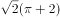

- **B**. 
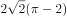

- **C**. 
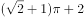
　✅
- **D**. 
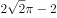

**答案**：C

**官方解析**

如下图所示，圆形底面上的内接正方形的对角线即为圆的直径，则该圆柱体的底面直径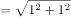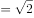，半径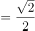。要想得到棱长为1的正方体，则需要分别沿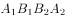、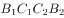、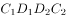、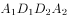切割4次，且切去的4个部分完全相同。切去部分的表面积包括圆柱体的侧面积、圆柱体的2个底面积扣除内接正方形的部分、正方体的4个侧面。故切去部分的总表面积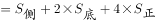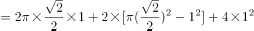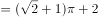。

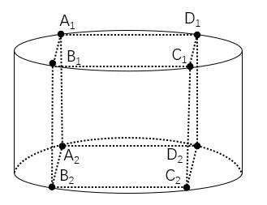

故正确答案为C。

---

### 第 2 题　qid 4637223 · 出现于 2022 · 地市级/行政执法

某企业将5台不同的笔记本电脑和5台不同的平板电脑捐赠给甲、乙两所小学，每所学校分配5台电脑。如在所有可能的分配方式中随机选取一种，两所学校分得的平板电脑数量均不超过3台的概率为：

- **A**. 
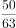
　✅
- **B**. 
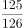

- **C**. 
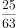

- **D**. 
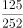

**答案**：A

**官方解析**

根据题意，甲、乙两所学校分配5台电脑的总情况数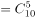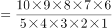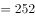种。满足两所学校分得的平板电脑数量均不超过3台的情况分类讨论如下：

①甲学校分得2台笔记本电脑、3台平板电脑，则乙学校分得3台笔记本电脑、2台平板电脑，情况数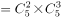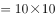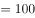种；

②甲学校分得3台笔记本电脑、2台平板电脑，则乙学校分得2台笔记本电脑、3台平板电脑，情况数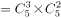种。

则所求概率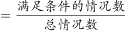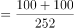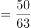。

故正确答案为A。

---

### 第 3 题　qid 4637224 · 出现于 2022 · 地市级/行政执法

某单位办事大厅有3个相同的办事窗口，2天最多可以办理600笔业务，每个窗口办理单笔业务的用时均相同。现对该办事大厅进行流程优化，增设2个与以前相同的办事窗口，且每个办事窗口办理每笔业务的用时缩短到以前的。问优化后的办事大厅办理6000笔业务最少需要多少天？

- **A**. 8　✅
- **B**. 10
- **C**. 12
- **D**. 15

**答案**：A

**官方解析**

根据“每个窗口办理单笔业务的用时均相同”，则1个窗口1天可办理业务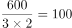笔，根据题意，增设2个窗口，且每个办事窗口办理每笔业务的用时缩短到以前的，同一项业务，办理时间和办理效率成反比，则每笔业务办理的效率是原来的，即优化后1个窗口1天可办理业务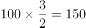笔。设优化后6000笔业务最少需要t天办理完成，则有6000=150×（3+2）×t，解得t=8，即最少需要8天。

故正确答案为A。

---

### 第 4 题　qid 4637225 · 出现于 2022 · 副省级/行政执法

> 共享材料同上一题。

为降低碳排放，企业对生产设备进行改造，改造后日产量下降了10%，但生产每件产品的能耗成本下降了50%，其他成本和出厂价不变的情况下每天的利润提高了10%。已知单件利润=出厂价-能耗成本-其他成本，且改造前产品的出厂价是单件利润的3倍，则改造前能耗成本为其他成本的：

- **A**. 
不到

- **B**. 
-之间
　✅
- **C**. 
-之间

- **D**. 
超过

**答案**：B

**官方解析**

设改造前能耗成本为x、其他成本为y、日产量为10、单件利润为100，则每天利润为1000、出厂价为300。根据每件产品的能耗成本下降了50%，可知改造后成本为0.5x；每天的利润提高了10%，可知改造后每天利润为1000×（1+10%）=1100；根据改造后日产量下降了10%，可知改造后日产量为9，则改造后单件利润为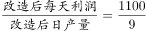。主体多可以考虑列表，表格如下图所示：

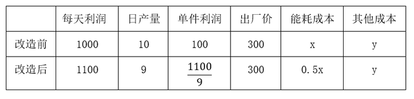

已知单件利润=出厂价-能耗成本-其他成本，根据改造前后可列方程组：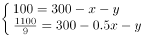，解得：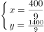，所求为：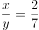，在-之间。

故正确答案为B。

---

### 第 5 题　qid 4637226 · 出现于 2022 · 地市级/行政执法

张和李2名社区工作者上门统计某小区内住户的新冠疫苗接种情况，两人各负责1栋住宅楼，每访问1户居民均需要5分钟。李因处理公文比张晚出发一段时间。已知14：00时两人共访问63户，15：00时张访问的户数是李的2倍。问李访问完50户居民是在什么时候？

- **A**. 16：30
- **B**. 16：45　✅
- **C**. 17：00
- **D**. 17：15

**答案**：B

**官方解析**

设14：00时，张访问了x户，李访问了63-x户，则15：00时，张访问了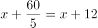户，李访问了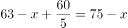户。根据“15：00时张访问的户数是李的2倍”，可得x+12=2（75-x），解得x=46。则14：00时李访问了63-46=17户，还需访问50-17=33户，需要时间为33×5=165分钟，14：00再过165分钟为16∶45。

故正确答案为B。

---

### 第 6 题　qid 4637227 · 出现于 2022 · 副省级/行政执法

> 共享材料同上一题。

李某骑车从甲地出发前往乙地，出发时的速度为15千米/小时，此后均匀加速，骑行25%的路程后速度达到21千米/小时。剩余路段保持此速度骑行，总行程前半段比后半段多用时3分钟。问甲、乙两地之间的距离在以下哪个范围内？

- **A**. 不到23千米
- **B**. 在23~24千米之间
- **C**. 在24~25千米之间
- **D**. 超过25千米　✅

**答案**：D

**官方解析**

设总行程为4S千米，则总行程前半段为2S千米，后半段为2S千米。总行程前25%的路程为匀加速运动，初速度为15千米/小时，末速度为21千米/小时，代入公式：匀加速运动平均速度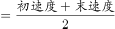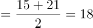千米/小时。根据“总行程前半段比后半段多用时3分钟”，可列方程：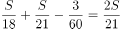，解得S=6.3千米，故甲、乙两地之间的距离4S=6.3×4=25.2千米，对应D项。

故正确答案为D。

---

### 第 7 题　qid 4637228 · 出现于 2022 · 副省级/行政执法

> 共享材料同上一题。

某种商品的定价为成本的1.5倍，如果在降价30元/件的基础上再打八折，则销售5件这种商品的利润比原价销售1件时多130元。问用以下哪种折扣销售时，1.5万元能买到的件数正好比原价销售时多4件？

- **A**. 先降价50元/件再打八折
- **B**. 先打九折再降价50元/件　✅
- **C**. 降价150元/件
- **D**. 打八五折

**答案**：B

**官方解析**

设该种商品每件成本为x元，则每件定价为1.5x元。根据题意可列方程：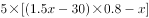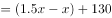，解得x=500，即该种商品每件成本为500元，则每件定价为1.5×500=750元。按原价销售时，1.5万元可购买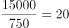件，按选项折扣销售时，1.5万元需购买20+4=24件，此时每件售价应为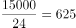元。代入选项：

A项：折扣售价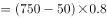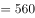元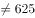元，排除；

B项：折扣售价=750×0.9-50=625元，符合题意，当选。无需验证其他选项。

故正确答案为B。

---

### 第 8 题　qid 4637229 · 出现于 2022 · 地市级/行政执法

甲、乙等16人参加乒乓球淘汰赛。每轮对所有未被淘汰选手进行抽签分组两两比赛，胜者进入下一轮。已知除甲以外，其余任意两人比赛时双方胜率均为50%。甲对乙的胜率为0%，对其他14人的胜率均为100%。则甲夺冠的概率为：

- **A**. 

- **B**. 
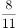

- **C**. 
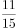
　✅
- **D**. 

**答案**：C

**官方解析**

根据题意，甲若想夺冠，需进行四轮比赛且比赛中不能与乙同组比赛，正面讨论较为复杂，正难则反，考虑反面情况（甲乙同组比赛），分类讨论如下：

甲在第一轮与乙比赛：甲在第一轮碰到乙的概率为，则淘汰概率为；

甲在第二轮与乙比赛：甲、乙在第一轮均胜出的概率为，甲在第二轮碰到乙的概率为，则淘汰概率为；

甲在第三轮与乙比赛：甲、乙在第一轮均胜出的概率为，在第二轮均胜出的概率为；甲在第三轮碰到乙的概率为，则淘汰概率为；

甲在第四轮与乙比赛：甲、乙在第一轮均胜出的概率为，在第二轮均胜出的概率为，在第三轮均胜出的概率为；甲在第四轮碰到乙的概率为1，则甲在第四轮淘汰的概率为。

则题目所求概率反面情况概率。

故正确答案为C。

---

### 第 9 题　qid 4637230 · 出现于 2022 · 副省级/地市级/行政执法

> 共享材料同上一题。

某水果种植特色镇创办水果加工厂，从去年年初开始通过电商平台销售桃汁、橙汁两种产品。从去年2月开始，每个月桃汁的销量都比上个月多5000盒，橙汁的销量都比上个月多2000盒。已知去年第一季度桃汁的总销量比橙汁少4.5万盒，则去年桃汁的销量比橙汁：

- **A**. 少不到5万盒　✅
- **B**. 少5万盒以上
- **C**. 多不到5万盒
- **D**. 多5万盒以上

**答案**：A

**官方解析**

根据题意，设去年1月桃汁销量为x万盒，去年1月橙汁销量为y万盒，根据等差数列通项公式，可将具体情况列表如下：

根据“去年第一季度桃汁的总销量比橙汁少4.5万盒”可知（y+y+0.2+y+0.4）-（x+x+0.5+x+1）=4.5，解得y-x=1.8万盒，根据等差数列求和公式，即桃汁去年总销量为万盒；橙汁去年总销量为万盒，故所求为12x+33-（12y+13.2）=12（x-y）+19.8=-1.8万盒，即少1.8万盒。

故正确答案为A。

---

### 第 10 题　qid 4637231 · 出现于 2022 · 副省级/行政执法

> 共享材料同上一题。

甲地在丙地正西17千米，乙地在丙地正北8千米。张从甲地、李从乙地同时出发，分别向正东和正南方向匀速行走。两人速度均为整数千米/小时，且1小时后两人的直线距离为13千米，又经过3小时后两人均经过了丙地且直线距离为5千米。已知李的速度是张的60%，则张经过丙地的时间比李：

- **A**. 早不到10分钟
- **B**. 早10分钟以上
- **C**. 晚不到10分钟
- **D**. 晚10分钟以上　✅

**答案**：D

**官方解析**

设张的速度为5m千米/小时，则李的速度为3m千米/小时。由题意可知，张、李两人1小时后直线距离为13千米，又经过3小时后直线距离为5千米，且此时均经过了丙地，即出发4小时后张、李两人分别到达图示、处。则根据勾股定理可得：，因两人速度均为整数千米/小时，则m=1时，符合题干所有要求。因此张到达丙地需小时，即3小时24分钟，李到达丙地需小时，即2小时40分钟，即张经过丙地的时间比李晚44分钟。

故正确答案为D。

---

### 第 11 题　qid 4637431 · 出现于 2022 · 副省级/地市级

> 共享材料同上一题。

某县通过发展旅游业来实现乡村振兴，引进了甲、乙、丙、丁、戊和己6名专家。其中甲、乙、丙是环境保护专家，丁、戊、己是旅游行业专家，甲、丁、戊熟悉社交媒体宣传。现要将6名专家平均分成2个小组，每个小组都要有环境保护专家、旅游行业专家和熟悉社交媒体宣传的人，问有多少种不同的分组方式？

- **A**. 12
- **B**. 24
- **C**. 4
- **D**. 8　✅

**答案**：D

**官方解析**

方法一：由题意可知，6名专家平均分成2个小组，因分组为平均分组，故对应总情况数为种。考虑不满足题目要求的情况为：①小组3人不含有环境保护专家（丁戊己），②小组3人不含有旅游行业专家（甲乙丙），③小组不含有熟悉社交媒体宣传的人（乙丙己），由于①和②其实是同一种分组下的两组，故不满足题目要求的情况为2种。故满足要求的情况数为10-2=8种。

方法二：将熟悉社交媒体宣传的甲、丁、戊分成两部分：

①甲一组，丁、戊一组，要满足要求，剩下的乙、丙、己需选在乙、丙两人中选出一人与丁戊一组，只有（甲乙己、丙丁戊）和（甲丙己、乙丁戊）2种情况；

②丁一组，甲、戊一组，剩下的乙、丙、己选一个与甲、戊一组即可满足要求，有（丙丁己、甲乙戊）、（乙丁己、甲丙戊）、（乙丙丁、甲戊己）3种情况；

③戊一组，甲、丁一组，剩下的乙、丙、己选一个与甲、丁一组即可满足要求，有（丙戊己、甲乙丁）、（乙戊己、甲丙丁）、（乙丙戊、甲丁己）3种情况。

共2+3+3=8种情况满足要求。

故正确答案为D。

---

### 第 12 题　qid 4637435 · 出现于 2022 · 副省级/地市级

> 共享材料同上一题。

高校某专业70多名毕业生中，有96%在毕业后去西部省区支援国家建设。其中去偏远中小学支教的毕业生占该专业毕业生总数的20%，比任职大学生村官的毕业生少2人，比在西部地区参军入伍的毕业生多1人，其余的毕业生选择去国有企业西部边远岗位工作。问去国有企业西部边远岗位工作的毕业生有多少人？

- **A**. 32
- **B**. 29
- **C**. 26　✅
- **D**. 23

**答案**：C

**官方解析**

根据题意可知，，可知总毕业生人数为25的倍数，则总毕业生人数为75人，去西部省区支援国家建设的毕业生有75×96%=72人，去偏远中小学支教的毕业生有75×20%=15人，去任职大学生村官的毕业生有15+2=17人，在西部地区参军入伍的毕业生有15-1=14人，则去国有企业西部边远岗位工作的毕业生有72-15-17-14=26人。

故正确答案为C。

---

### 第 13 题　qid 4637507 · 出现于 2022 · 副省级/地市级

> 共享材料同上一题。

企业列出500万元设备采购预算，如用于购买x台进口设备，最后剩余20万元。经董事会研究后，决定购买质量更高的同类国产设备，单价仅为进口设备的75%。当前预算可购买x+3台，最后剩余5万元。问国产设备的单价在以下哪个范围内？

- **A**. 不到30万元/台
- **B**. 30—40万元/台之间
- **C**. 40—50万元/台之间　✅
- **D**. 50万元/台以上

**答案**：C

**官方解析**

根据题意，若购买x台进口设备，最后剩余20万元，则每台进口设备的单价为万元。若购买国产设备，单价为进口设备的75%，则每台国产设备的单价为。当前预算可购买国产设备x+3台，最后剩余5万元，可列式：，解得x=8。则共购买国产设备8+3=11台，花费495万元，其单价为万元，在C项范围内。

故正确答案为C。

---

### 第 14 题　qid 4637509 · 出现于 2022 · 副省级/地市级

> 共享材料同上一题。

某地引进新的杂交水稻品种，今年每亩稻谷产量比上年增加了20%，且由于口感改善，每斤稻谷的售价从1.5元提升到1.65元。以此计算，今年每亩稻谷的销售收入比上年高660元。问今年的稻谷亩产是多少斤？

- **A**. 2200
- **B**. 1980
- **C**. 1650　✅
- **D**. 1375

**答案**：C

**官方解析**

根据题意，假设上年每亩稻谷产量为x斤，则今年每亩稻谷产量为斤。今年每亩稻谷的销售收入比上年高660元，即，解得x=1375，则今年的稻谷亩产为1.2×1375=1650斤。

故正确答案为C。

---

### 第 15 题　qid 4639320 · 出现于 2022 · 副省级

> 共享材料同上一题。

救灾部门紧急运送两批大米分给受灾群众。已知甲村人数是丙村的2倍，如果两批大米都给甲村，每人正好能分24斤；如果第一批大米分给乙村，每人正好能分12斤，第二批大米分给甲、乙、丙三个村，每人正好能分4斤。为尽量保障受灾群众的基本需求，现决定另运送一批面粉分给甲村，并将两批大米都分给乙、丙两村。问乙、丙两村平均每人分到的大米重量在以下哪个范围内？

- **A**. 不到14斤
- **B**. 14～15斤之间　✅
- **C**. 15～16斤之间
- **D**. 16斤以上

**答案**：B

**官方解析**

设丙村有x人，乙村有y人，则甲村有2x人。根据两批大米的总重量不变，可列方程：24×2x=12y+4×（2x+y+x），解得，故两批大米都分给乙、丙两村，平均每人分到的大米重量斤，在B项范围内。

故正确答案为B。

---

### 第 16 题　qid 4639327 · 出现于 2022 · 副省级

> 共享材料同上一题。

甲和乙两条效率相同的生产线从早上不同时间开始生产同一种产品，到中午12：00时分别正好生产了x件和y件。已知乙生产x件时，甲生产了54件；甲生产y件时，乙生产了1.5x件。如乙从9：00开始生产且12：00后两条生产线仍保持原有速度，问两条生产线生产的产品总量达到500件是在什么时候？

- **A**. 16：30之前
- **B**. 16：30～17：00之间
- **C**. 17：00～17：30之间
- **D**. 17：30之后　✅

**答案**：D

**官方解析**

根据甲和乙两条生产线效率相同，故在甲、乙均开始生产后，两条生产线生成产品数量的差值始终不变，则可列式：y-x=x-54=1.5x-y，解得x=72，y=90。由于乙从9：00开始生产，到12：00时乙生产了3小时，生产了90件，则甲、乙的效率均为件/小时。12：00时，甲、乙共生产72+90=162件，则两条生产线生产的产品总量达到500件还需小时，即时间为17：38时，两条生产线生产的产品总量达到500件。

故正确答案为D。

---

### 第 17 题　qid 4639352 · 出现于 2022 · 副省级

> 共享材料同上一题。

某企业职工筹款给甲村学龄儿童购买学习用具，如按100元/人的标准执行则资金剩余550元，如按120元/人的标准执行则还需筹集630元。现额外筹集2510元，且最终按80元/人的标准，正好能给甲、乙两村的学龄儿童购买学习用具。问乙村学龄儿童有多少人？

- **A**. 50
- **B**. 53　✅
- **C**. 56
- **D**. 59

**答案**：B

**官方解析**

设甲村学龄儿童为x人，根据题意可列方程：100x+550=120x-630，解得x=59，则原来筹款资金为100×59+550=6450元。现额外筹集2510元，则此时共有6450+2510=8960元。根据“80元/人的标准”，可得甲、乙两村的学龄儿童人数人，则乙村学龄儿童有112-59=53人。

故正确答案为B。

---

### 第 18 题　qid 4639353 · 出现于 2022 · 副省级

> 共享材料同上一题。

甲、乙、丙、丁、戊5名职工参加党史知识测验，每人得分均不相同。甲和乙的平均分比丙多2分，丁和戊的平均分比丁多5分，甲、乙的平均分比丙、丁、戊的平均分多3分。问丙、丁、戊三人得分的排序为：

- **A**. 
丙&gt;丁&gt;戊

- **B**. 
丙&gt;戊&gt;丁

- **C**. 
丁&gt;丙&gt;戊

- **D**. 
戊&gt;丙&gt;丁
　✅

**答案**：D

**官方解析**

根据“丁和戊的平均分比丁多5分”，可知，整理可得：戊=丁+10······①，可知戊＞丁。根据“甲和乙的平均分比丙多2分”，可知：······②；根据“甲、乙的平均分比丙、丁、戊的平均分多3分”，可知：，代入①可得：······③，联立②③：，整理可得：丙=丁+6.5。则戊=丁+10＞丙=丁+6.5＞丁。

故正确答案为D。

---

### 第 19 题　qid 4639355 · 出现于 2022 · 副省级

> 共享材料同上一题。

甲和乙两个乡村图书室共有5000本藏书，其中甲图书室的藏书比乙图书室多3x本。现从甲图书室中取出150本书放入乙图书室后，甲图书室的藏书仍比乙图书室多2x本。问甲图书室原有图书多少本？

- **A**. 2500
- **B**. 2750
- **C**. 2950　✅
- **D**. 3500

**答案**：C

**官方解析**

方法一：设甲图书室原有藏书y本，则乙图书室藏书为（y-3x）本，由题意可列方程：y+y-3x=5000······①；甲图书室中取出150本书放入乙图书室，此时甲图书室有藏书（y-150）本，则乙图书室藏书为（y-3x+150）本，由题意可列方程：（y-150）-（y-3x+150）=2x······②。通过②式解得x=300，代入①式，解得y=2950，即甲图书室原有图书2950本。

方法二：结合盈亏思想分析：从甲图书室中取出150本书放入乙图书室后，甲乙两个图书室的藏书之差从3x本变为2x本，即150×2=3x-2x，解得x=300。则原来甲图书室的藏书比乙图书室多3×300=900本，即原来甲-乙=900······①，又知甲和乙两个图书室共有5000本藏书，即甲+乙=5000······②，联立①②，解得甲，即甲图书室原有图书2950本。

故正确答案为C。

---

### 第 20 题　qid 5445712 · 出现于 2023 · 副省级/行政执法

#### 本题共享材料

        降雨来源于云层，云层中的水蒸气遇到冷空气或某些成核物质后，就会很快冷凝而降落下来，所以冷暖空气相遇之处就是雨水多发的地带，这就是天气预报的基础；遇到干旱，给云层来一发干冰或碘化银炮弹，通过干冰降温或碘化银增加成核物质的手段增加降雨，也就成了最常见的人工降雨方式。不过，最近越来越多的科学家开始认为，除了天气变化，细菌也有很大可能控制着降雨。

        故事要从50年前说起。1970年，科学家在研究雨水时，发现其中含有微量的维生素B12。他们首先考虑，雨水由云层中的水蒸气凝结而成；云层中除了水蒸气，还有大量来自地表的灰尘，这些灰尘可能受人类活动影响而携带一些维生素B12上天，导致雨水中维生素B12的存在。不过在检查了云层中的灰尘后，他们发现云层中的灰尘含量与维生素B12含量并没有什么关系。云只是一团堆积的水蒸气和灰尘，在排除人类活动干扰后，这些维生素B12就只剩下一个来源——云层本身。

        科学家开始猜测，可能是由于有大量微生物生活在云层中，在生命活动中产生了维生素B12。不过由于当时技术条件有限，他们无法确定云层中到底存在哪些微生物。

        基因测序技术的出现，让科学家有了彻底调查云层生态系统的能力。2017年，法国科学家在一个海拔1465米的气象站中采集到干净无污染的降水水样，对其进行基因测序。结果发现，水样中存在超过28000种微生物的DNA或RNA，其中细菌和古菌有22000多种，真核生物有2600多种。这些微生物中既有能够进行光合作用的细菌和藻类，也有异养细菌，它们可能构成了一个完整的生态链：光合作用生物利用云层中的水分和大气中的二氧化碳等合成有机物，异养细菌则可能会以光合作用生物为食。

        云层中的紫外线极其强烈，很容易杀死位于高空的微生物。新的研究发现，其实有些细菌早就发展出抵抗紫外线的能力。无论是通过光合作用合成，还是通过掠食其他微生物获取，细菌们能将这些有机物分解为具有保护作用的胞外聚合物，这些物质基本由糖构成，类似一层“糖衣”，能够轻松抵御高空中的低温、干燥和紫外线破坏。芽孢杆菌就是最常见的能合成这种“糖衣”的细菌。该属包括许多种微生物，臭名昭著的炭疽杆菌就是其中之一。

        近年来，随着人类活动越来越强烈，大量有机物的微小颗粒飘散到云层上，所形成的效应就是，微生物们可能躺在云层里“无所事事”，就能吃到足够的食物。很多人小时候曾经幻想天上的云朵就是棉花糖，盼望自己能飞到云层上大吃特吃，现在看来，细菌的生活就是我们的美梦。

        每个带有防护性“糖衣”的细菌都相当于一个天然的凝聚核，<u>                    </u>。在天然条件下，云层中的纯水分子在低于时才会凝结；如果其中含有无机颗粒作为凝聚核，凝结温度就会变成；一旦存在细菌，水分子的凝结温度还会再次升高，有些细菌甚至能让水分子在时凝结。部分科学家相信，人类活动为微生物提供了童话般的生存环境，高空云层变得更为“宜居”，这就使得云层生态系统极度繁盛，这反过来将会引发频繁的雨雪。

        当然，这还不是全部。还有一些科学家认为，增加降水本身就是云层微生物的一种生存策略。许多云层微生物是因为风力吹动而从地面直达空中的，它们会借助高空气流在空中远距离旅行一段时间，之后再通过变成凝聚核的方式，以雨水的形式重回地表，寻找新的宿主。

        此外，这些微生物在享受云层中的有机物颗粒时，会将它们重新分解为二氧化碳。如此一来，原本以固体颗粒形式存在的二氧化碳又被微生物释放到大气中，成为日益暖化的地球上又一根新的稻草。据估算，大气中每年因此增加的二氧化碳约为100万吨，数量虽少，却会随着人类排放的有机污染物数量增加而增加。这种暖化的结果就是：地表温度升高，蒸发加强，云层增多，云层生态系统更加繁荣。这么一想，细菌似乎成了控制地球气候的幕后黑手？

甲、乙、丙三家科技企业2021年的收入之和比2020年提升了20%。其中甲企业的收入上升了400万元，乙企业的收入下降了100万元且是甲企业收入的一半，丙企业的收入上升了30%且其2020年的收入与甲、乙两企业同年收入之和相同。问2020年甲企业的收入比乙企业高多少万元？

- **A**. 900
- **B**. 1100
- **C**. 400
- **D**. 600　✅

**答案**：D

**官方解析**

设2021年乙企业的收入为x万元，则根据题干条件甲、乙、丙三家企业的收入如下表所示：

2021年甲、乙、丙三家企业的收入之和为2x+x+3.9x-390=6.9x-390，2020年甲、乙、丙三家企业的收入之和为。因甲、乙、丙三家企业2021年的收入之和比2020年提升了20%，即，解得x=1100，则2020年甲企业的收入比乙企业高（2x-400）-（x+100）=x-500=600万元。

故正确答案为D。

---

### 第 21 题　qid 5445716 · 出现于 2023 · 地市级/行政执法

公园里有一片四边形草坪，沿对角线修建的小道相交于O点，O到四个顶点A、B、C、D的距离之比正好为1：2：3：4，一名工人花费1天正好完成AOB区域的修剪，问第二天至少需要额外增加多少名效率相同的工人一起工作，才能在当天内完成剩余草坪的修剪？

- **A**. 8
- **B**. 10　✅
- **C**. 11
- **D**. 12

**答案**：B

**官方解析**

根据题意，设的面积为S。因为与的高相同，底边BO：DO=2：4=1：2，根据结论“两个三角形的高相同，面积之比等于底之比”可得：；同理，与的高相同，底边AO：CO=1：3，则；与的高相同，底边AO：CO=1：3，则。故四边形ABCD的面积=S+2S+6S+3S=12S。根据题意可知，一名工人花费1天正好完成AOB区域的修剪，即一名工人花费1天修剪的面积为S，剩余面积为12S-S=11S，则要在第二天完成修剪至少需要11S÷S=11名效率相同的工人，故至少需要额外增加11-1=10名效率相同的工人一起工作。

故正确答案为B。

---

### 第 22 题　qid 5445717 · 出现于 2023 · 副省级/行政执法

> 共享材料同上一题。

一项工作甲独立完成需要3小时，乙独立完成的用时比其与甲合作完成多4小时，且乙和丙合作完成需要4小时。问丙独立完成需要多少小时？

- **A**. 10
- **B**. 12　✅
- **C**. 6
- **D**. 8

**答案**：B

**官方解析**

赋值工作总量为12，则甲的效率为，乙、丙合作的效率为。设乙的效率为x，根据“乙独立完成的用时比其与甲合作完成多4小时”，可得：，解得：x=2，即乙的效率为2，则丙的效率为3-2=1。因此，丙独立完成需要小时。

故正确答案为B。

---

### 第 23 题　qid 5445718 · 出现于 2023 · 行政执法

一个圆柱体零件A和一个圆锥体零件B分别用甲、乙两种合金铸造而成。A的底面半径和高相同，B的底面半径是高的2倍，两个零件的高相同，质量也相同。问甲合金的密度是乙合金的多少倍？

- **A**. 

　✅
- **B**. 

- **C**. 

- **D**. 

**答案**：A

**官方解析**

赋值零件A与零件B的高均为1，则A的底面半径为1，B的底面半径为2，可得零件A的体积为，零件B的体积为。根据公式：质量=密度×体积，可知质量相同时，密度和体积成反比，即。

故正确答案为A。

---

### 第 24 题　qid 5445722 · 出现于 2023 · 行政执法

已知A、B两种设备定价相同，C设备单价为8000元/台。现A、B两种设备分别打六折、七折促销，购买1台B设备的费用比购买A、C设备各1台的总费用高2万元。问促销期间1000万元预算最多可以购买多少台A设备？

- **A**. 35
- **B**. 51
- **C**. 59　✅
- **D**. 77

**答案**：C

**官方解析**

设A、B两种设备每台定价均为x万元，则促销期间A设备单价为0.6x万元，B设备为0.7x万元。8000元=0.8万元，根据题意，可列方程：0.7x=0.6x+0.8+2，解得x=28，则促销期间A设备单价为28×0.6=16.8万元。促销期间1000万元可以购买台A设备，则最多可以购买59台A设备。

故正确答案为C。

---

### 第 25 题　qid 5445723 · 出现于 2023 · 行政执法

单位将10个培训名额分配给4个分公司，要求在每个分公司至少分配1个名额的所有分配方案中，随机选择1个方案实施，问4个分公司中有3个分配名额数量相同的概率为多少？

- **A**. 

- **B**. 

- **C**. 

- **D**. 

　✅

**答案**：D

**官方解析**

根据题意可知，将10个相同的培训名额分配给4个不同的分公司，每个分公司至少分配1个名额，可使用插板法解题，共有种分配方案。

方法一：4个分公司中有3个分公司分配到的名额数量相同，设3个分公司分配到的名额数量均为a个，另外一个分公司分配到的名额数量为b个，则3a+b=10，且，符合要求的情况有3大类（a=1，b=7；a=2，b=4；a=3，b=1），那么符合条件的情况数有种，则题干所求概率为。

方法二：根据公式：概率，则题目所求概率为，即选项的分母部分为84的因子，结合选项，只有D项符合。

故正确答案为D。

---

### 第 26 题　qid 5445725 · 出现于 2023 · 副省级/行政执法

> 共享材料同上一题。

某单位有甲和乙2个办公室，分别有职工5人和4人。每周从这9名职工中随机抽取1人下沉社区担任志愿者（同一人有可能被连续、重复选中）。问7月前2周的志愿者均来自甲办公室的概率在以下哪个范围内？

- **A**. 不到25%
- **B**. 25%~35%之间　✅
- **C**. 35%~45%之间
- **D**. 超过45%

**答案**：B

**官方解析**

根据题意可知，7月前2周的志愿者总情况数为种，7月前2周的志愿者均来自甲办公室的情况数为种。因此所求概率，在25%~35%之间。

故正确答案为B。

---

### 第 27 题　qid 5445729 · 出现于 2023 · 行政执法

某次会议邀请4所高校每所各2位学者作报告。在某日上午、下午和晚上的三个时间段分别安排3位、3位和2位学者依次作报告，且同一所高校的2位学者不安排在同一时间段内作报告。问8人的报告次序有多少种不同的安排方式？

- **A**. 不到5000种
- **B**. 5000~10000种之间
- **C**. 10001~20000种之间　✅
- **D**. 超过20000种

**答案**：C

**官方解析**

对上午、下午和晚上的三个时间段报告次序进行分步讨论：

第一步，上午需要从4所高校中选3所高校，每所高校各选1位学者进行排序，有种情况；

第二步，下午需要从上午未选高校中选1位学者，再从上午已选3所高校中选2位学者进行排序，有种情况；

第三步，对晚上剩余的2位学者进行排序，有种情况。

则这8人的报告次序共有192×36×2=13824种不同的安排方式，在C项范围内。

故正确答案为C。

---

### 第 28 题　qid 5445731 · 出现于 2023 · 行政执法

一辆汽车从甲地开往乙地，先以40千米/小时的速度匀速行驶一半的路程，然后均匀加速；行驶完剩下路程的一半时，速度达到80千米/小时；此后均匀减速，到达乙地时的速度正好降为0。问其全程的平均速度在以下哪个范围内？

- **A**. 不到44千米/小时　✅
- **B**. 在44~45千米/小时之间
- **C**. 在45~46千米/小时之间
- **D**. 超过46千米/小时

**答案**：A

**官方解析**

如下图所示，A地为甲、乙两地的中点，B地为A地、乙地的中点。由A地到B地汽车均匀加速，则该段的平均速度为千米/小时；由B地到乙地汽车均匀减速，则该段的平均速度为千米/小时。因B地为A地、乙地的中点，根据等距离平均速度公式，可得汽车从A地到乙地的平均速度为千米/小时；又因A地为甲、乙两地的中点，根据等距离平均速度公式，可得汽车全程的平均速度为千米/小时，在A项范围内。

故正确答案为A。

注：匀变速运动的平均速度公式为，等距离平均速度公式为。

---

### 第 29 题　qid 5445739 · 出现于 2023 · 副省级/行政执法

> 共享材料同上一题。

在一块正方形土地中，画一条经过某个顶点的规划线，将其分割为三角形和梯形两块土地，且梯形土地的面积正好是三角形土地的2倍。问三角形和梯形土地的周长之比是多少？

- **A**. 
1：2

- **B**. 
5：7

- **C**. 

- **D**. 

　✅

**答案**：D

**官方解析**

赋值正方形土地的边长为3，根据题意，梯形土地的面积正好是三角形土地的2倍，则正方形土地的面积是三角形土地的3倍，设三角形土地BE边长为x，则，代入数据得，解得x=2，则ED=BD-BE=3-2=1。根据勾股定理，，则三角形土地的周长，梯形土地的周长，故三角形和梯形土地的周长之比为。

故正确答案为D。

---

### 第 30 题　qid 5445874 · 出现于 2023 · 副省级/地市级

> 共享材料同上一题。

商店销售某种商品，打八折销售时卖2件的利润与按定价销售时卖1件的利润相同，相当于降价120元/件销售时卖3件的利润。问该商品的定价为多少元/件？

- **A**. 360
- **B**. 450　✅
- **C**. 540
- **D**. 720

**答案**：B

**官方解析**

设该商品每件定价为x元，成本为y元，根据题意可得：x-y=（80%x-y）×2······①，x-y=（x-120-y）×3······②，联立①②，解得x=450，即该商品的定价为450元/件。
故正确答案为B。

---

### 第 31 题　qid 5445875 · 出现于 2023 · 副省级/地市级

> 共享材料同上一题。

农科院在某村287名淡水鱼养殖人员中开展防病培训和育种培训。已知参加防病培训的养殖人员中，参加育种培训的人数比未参加的多21%；参加育种培训的养殖人员中，参加防病培训的人数比未参加的多76人。问共有多少人未参加任何一项培训？

- **A**. 21　✅
- **B**. 23
- **C**. 25
- **D**. 27

**答案**：A

**官方解析**

根据“参加防病培训的养殖人员中，参加育种培训的人数比未参加的多21%”，可知只参加防病培训的人数是100的倍数。由于总人数为287人，当只参加防病培训的人数是200人时，参加防病培训的共有200×（1+21%）+200＞287人，排除。则只参加防病培训的人数为100人，此时既参加防病培训又参加育种培训的有100×（1+21%）=121人，只参加育种培训的有121-76=45人。未参加培训的人数=总数-只参加防病培训的人数-只参加育种培训的人数-两者都参加的人数=287-100-45-121=21人，即共有21人未参加任何一项培训。
故正确答案为A。

---

### 第 32 题　qid 5445876 · 出现于 2023 · 地市级

工厂从某周第一天开始生产某种零件，每周生产7天，从第二天开始每一天都比前一天多生产200件。已知工厂第三周的产量是第一周的2倍，问第几天其日产量第一次达到1万件？

- **A**. 37
- **B**. 38
- **C**. 39
- **D**. 40　✅

**答案**：D

**官方解析**

根据题意可知，每天的零件产量构成等差数列。设第一天的零件产量为x件，根据等差数列通项公式，可得第一周第四天的零件产量件。结合等差数列求和公式，则第一周的零件产量件。同理，第三周第四天的产量（即第18天）的产量件，则第三周的产量件。根据“第三周的产量是第一周的2倍”可列式：7x+23800=2（7x+4200），解得x=2200。设该工厂第n天的日产量第一次达到1万件，则可列式：2200+（n-1）×200=10000，解得n=40，即第40天其日产量第一次达到1万件。

故正确答案为D。

---

### 第 33 题　qid 5445877 · 出现于 2023 · 副省级/地市级

> 共享材料同上一题。

社区计划采购10份年货礼包发放给10户独居老人，每户发放1份。年货礼包有100元/份和150元/份的两种供选择，总预算不能超过1250元。如采购了150元/份的年货礼包，则需要优先在3户孤寡老人中选择发放对象。问共有多少种不同的发放方式？

- **A**. 21
- **B**. 28
- **C**. 36　✅
- **D**. 55

**答案**：C

**官方解析**

设购买150元/份的年货礼包x份，则购买100元/份的年货礼包（10-x）份，故可列式：，解得：。因此年货礼包采购数量情况可分为以下6类：

（1）150元的0份，100元的10份，有种发放方式；

（2）150元的1份，100元的9份，有种不同的发放方式；

（3）150元的2份，100元的8份，有种不同的发放方式；

（4）150元的3份，100元的7份，有种发放方式；

（5）150元的4份，100元的6份，有种不同的发放方式；

（6）150元的5份，100元的5份，有种不同的发放方式。

分类用加法，共有1+3+3+1+7+21=36种不同的发放方式。

故正确答案为C。

---

### 第 34 题　qid 5445879 · 出现于 2023 · 地市级

甲和乙两个工程队共同承担某项工程的施工任务。两队合作时各自的效率均比单独施工时高20%。已知两队合作施工需要25天完工；如甲先施工15天后乙加入，两队合作15天后剩余工作乙单独施工还需要10天完成。问甲队的效率是乙队的多少倍？

- **A**. 

- **B**. 

- **C**. 

- **D**. 

　✅

**答案**：D

**官方解析**

设甲队和乙队单独施工时的效率分别为x、y，根据题意可知：甲队和乙队合作施工时的效率分别为1.2x、1.2y。根据工程总量相等，则（1.2x+1.2y）×25=15x+（1.2x+1.2y）×15+10y，解得，即甲队的效率是乙队的。

故正确答案为D。

---

### 第 35 题　qid 5445880 · 出现于 2023 · 地市级

从A地前往B地的道路前40%的路程为上坡路，其余为下坡路。张某驾驶满载的汽车从A地去B地卸货，然后空车返回A地。已知他满载时上坡的速度是下坡速度的一半，空车时上、下坡的速度分别是满载时的1.5倍和1.2倍。问他返程的用时是去程的多少倍？

- **A**. 

- **B**. 

- **C**. 

　✅
- **D**. 

**答案**：C

**官方解析**

赋值去程上坡路段长度为40，则去程下坡路段长度为60；赋值满载时上坡的速度为1，则满载时下坡速度为2。根据题意可知，空车时上坡速度=满载时上坡速度×1.5=1×1.5=1.5，空车时下坡速度=满载时下坡速度×1.2=2×1.2=2.4。去程时间为，返程时间为，则所求倍数。

故正确答案为C。

---

### 第 36 题　qid 5445881 · 出现于 2023 · 副省级/地市级

> 共享材料同上一题。

甲和乙两人8：00同时从A地出发前往B地，其中乙全程匀速，甲出发时的速度是乙的一半，但全程均匀加速。已知10：00甲追上乙，11：00甲到达B地。问乙什么时间到达B地？

- **A**. 11：30
- **B**. 11：45　✅
- **C**. 12：00
- **D**. 12：15

**答案**：B

**官方解析**

赋值出发时甲的速度为1，乙的速度为2。从8：00至10：00，甲和乙的路程相同，即该时段甲的平均速度=乙的速度=2。根据匀加速运动的平均速度，则10：00时甲的速度为2×2-1=3。因此，甲的速度每小时增加，故甲11：00时的速度为3+1=4。根据甲可计算，从A地到B地的路程为，则乙全程所需时间为小时小时=3小时45分钟，即乙在11：45到达B地。

故正确答案为B。

---

### 第 37 题　qid 5445882 · 出现于 2023 · 地市级

甲、乙两名职工负责国庆7天长假的值班工作，每天安排1人值班。已知乙至少值了2天班，且在国庆期间任一天结束后，甲的累计值班天数都比乙的多。问两人的值班日期安排有多少种不同的可能？

- **A**. 6
- **B**. 9
- **C**. 10
- **D**. 14　✅

**答案**：D

**官方解析**

因乙至少值了2天班，且在国庆期间任一天结束后，甲的累计值班天数都比乙的多，则乙值班2天或者3天，且乙最早从第三天开始值班。分情况讨论如下：
①乙值班2天：当乙从第三天开始值班时，则剩下的1天可以从第五天、第六天和第七天中选1天，有3种情况；当乙从第四天开始值班时，则剩下的1天可以从第五天、第六天和第七天中选1天，有3种情况；当乙从第五天开始值班时，则剩下的1天可以从第六天和第七天中选1天，有2种情况；当乙从第六天开始值班时，则剩下的1天为第七天，有1种情况，共有3+3+2+1=9种情况；
②乙值班3天：当乙从第三天开始值班时，则剩下的2天可以为第五天和第七天、第六天和第七天，有2种情况；当乙从第四天开始值班时，则剩下的2天可以为第五天和第七天、第六天和第七天，有2种情况；当乙从第五天开始值班时，则剩下的2天为第六天和第七天，有1种情况，共有2+2+1=5种情况。
因此，两人的值班日期安排有9+5=14种不同的可能。
故正确答案为D。

---

### 第 38 题　qid 5445926 · 出现于 2023 · 副省级

> 共享材料同上一题。

将一个高度为x的实心圆锥体零件尖部朝下放入密度为1的液体A中，浮出液面的高度为0.1x。如将其尖部朝上放入密度为1.5的液体B中，浮出液面的高度将在以下哪个范围内？

- **A**. 超过0.8x　✅
- **B**. 0.7x~0.8x之间
- **C**. 0.6x~0.7x之间
- **D**. 不到0.6x

**答案**：A

**官方解析**

由于实心圆锥体零件的质量不变且放入液体A、B中均为漂浮状态，则两种放置方式所受浮力相等。根据物理学中浮力公式：，令尖部朝下放入时排出的液体体积为，尖部朝上放入时排出的液体体积为，则，化简得。由于尖部朝下时浮出液面的高度为0.1x，则液体中零件的高度为x-0.1x=0.9x，此时液面下方零件为实心圆锥体， 。根据相似图形结论：当图形相似比为1：k时，其体积之比为，故，赋值零件总体积为1000，则液面下方零件的体积，则。当实心圆锥体零件尖部朝上放入液体中，液面上方零件为实心圆锥体（其与实心圆锥零件整体相似），则体积为1000-486=514。则此时，则，则浮出液体的高度。（，则）

故正确答案为A。

---

### 第 39 题　qid 5445927 · 出现于 2023 · 副省级

> 共享材料同上一题。

一个三角形公园ABC内的道路如下图中实线所示。已知AE=EF=FB，AD=DC，且黑色部分为人工湖。问公园总面积是人工湖面积的多少倍？

- **A**. 9
- **B**. 12
- **C**. 16
- **D**. 18　✅

**答案**：D

**官方解析**

如图所示，由AE=EF，AD=DC，则ED为的中位线，则，且，则AE：AF=ED：FC=1：2，可推出，且EO：OC=DO：FO=1：2。赋值黑色部分人工湖面积为1，根据面积之比等于相似比的平方，可知面积为4。与，高相同，底边DO：FO=1：2，则面积为2，则面积。由AE=EF=FB，C点向AB的高相同，可知面积，则三角形公园ABC面积为3×6=18。故所求为倍。

故正确答案为D。

---

### 第 40 题　qid 5445928 · 出现于 2023 · 副省级

> 共享材料同上一题。

甲和乙两个实验室共同承接10000份样本的检验工作。甲实验室每小时可检验200份样本，每检验一份样本的费用为100元；乙实验室每小时可检验500份样本，每检验一份样本的费用为200元。问如要求15小时内检验完毕，最低总检验费用比要求18小时内检验完毕时高多少万元？

- **A**. 3
- **B**. 4
- **C**. 5
- **D**. 6　✅

**答案**：D

**官方解析**

根据甲每检验一份样本的费用比乙低，则在一定时间内要想总检验费用最低，甲尽可能多干，即让甲全程参与。
方法一：若要求15小时内检验完毕且总检验费用最低，则甲检验200×15=3000份，乙检验10000-3000=7000份，总检验费用为3000×100+7000×200=300000+1400000=1700000元=170万元；若要求18小时内检验完毕且总检验费用最低，则甲检验200×18=3600份，乙检验10000-3600=6400份，总检验费用为3600×100+6400×200=360000+1280000=1640000元=164万元，故题干所求为170-164=6万元。
方法二：观察18小时和15小时的差异部分。与15小时相比，18小时检验完时，甲多做了3小时即多检验了3×200=600件，则乙少检验了600件，每件费用可节省200-100=100元，共节省了600×100=60000元=6万元。
故正确答案为D。

---

### 第 41 题　qid 5445930 · 出现于 2023 · 副省级

> 共享材料同上一题。

将5个相邻的铺位出租给2家餐厅和2家水果店。要求租完不能有空余铺位，每家餐厅可以租用1个铺位，也可以租用并打通2个相邻的铺位作为其营业场所，每家水果店只能租用1个铺位，且相同类型的两个租户之间至少要间隔1个铺位。问有多少种不同的安排方式？

- **A**. 24
- **B**. 48
- **C**. 8
- **D**. 16　✅

**答案**：D

**官方解析**

根据题意，5个铺位出租给2家餐厅和2家水果店，且每家水果店只能租用1个铺位，则有1家餐厅租用2个相邻的铺位，其余的1家餐厅和2家水果店各租用1个铺位。在2家餐厅中选1家租用2个相邻的铺位，有种情况；因为相同类型的两个租户之间至少要间隔1个铺位，即相同类型的两个租户不相邻，则只能按照（水果店、餐厅、水果店、餐厅）或（餐厅、水果店、餐厅、水果店）的方式排列，有种情况，则共有种不同的安排方式。

故正确答案为D。

---

### 第 42 题　qid 5445934 · 出现于 2023 · 副省级

> 共享材料同上一题。

某次招标活动中，甲、乙、丙、丁、戊和己6家投标企业依次对自己的设计进行讲解。已知甲和乙均不能安排在第一个或最后一个，丙只能安排在第三个或第四个，如在满足以上条件的次序中随机选择一个，则丁和戊的讲解次序相邻的概率为：

- **A**. 

　✅
- **B**. 

- **C**. 

- **D**. 

**答案**：A

**官方解析**

丙只能安排在第三个或第四个，则丙的次序安排有种情况；甲和乙均不能安排在第一个或最后一个，则甲、乙应在第二个到第五个剩余的3个中安排，其次序有种情况；剩余三人全排列，有种情况。故总情况数为种。

现要丁、戊的次序相邻，可根据丙的次序分两类讨论：

第一类：丙安排在第三个时：

当甲、乙在（二、四）时，丁、戊只能在（五、六）才能相邻，有种情况；

当甲、乙在（二、五）时，丁、戊无法相邻，不符合题意；

当甲、乙在（四、五）时，丁、戊只能在（一、二）才能相邻，有种情况。故共有4+4=8种情况。

第二类：丙安排在第四个时，与安排在第三个时的情况类似，同理，也有8种情况。

因此，满足条件的情况数共有8+8=16种，则所求概率。

故正确答案为A。

---

### 第 43 题　qid 5445938 · 出现于 2023 · 副省级

> 共享材料同上一题。

工厂生产甲、乙两种设备，需要用到A、B、C三种零件。其中生产1台甲设备需要5个A零件和11个B零件，生产1台乙设备需要4个B零件和9个C零件。工厂某日生产的一批设备共用A、B、C三种零件不超过200个，其中C零件的用量超过100个。问最多可能生产了多少台甲设备？

- **A**. 1
- **B**. 2　✅
- **C**. 3
- **D**. 4

**答案**：B

**官方解析**

要让甲设备数量最多，则需要让乙设备数量最少。因为只有乙设备用到了C零件，根据“生产1台乙设备需要4个B零件和9个C零件······其中C零件的用量超过100个”，则乙设备数量最少为101÷9=11······2，结合题意可知每个C零件均已被用于生产，则乙设备数量最少为11+1=12个，最少用了12×（4+9）=156个零件。结合“设备共用A、B、C三种零件不超过200个”，则生产甲设备可用的零件数量最多为200-156=44个，44÷（5+11）=2······12，即最多可能生产了2台甲设备。
故正确答案为B。

---

### 第 44 题　qid 5893532 · 出现于 2024 · 地市级/行政执法

某企业招聘笔试参考人员均来自甲、乙、丙三所高校。笔试结束后，在进入面试的100人中，来自甲高校人员占比从笔试时的50%下降至当前的40%，乙高校人员占比下降了15个百分点，丙高校的有50人。问笔试时来自甲、乙、丙三所高校的人员比例是多少？

- **A**. 2：1：1　✅
- **B**. 2：3：2
- **C**. 3：1：2
- **D**. 3：2：1

**答案**：A

**官方解析**

根据题意，进入面试的100人中，来自甲高校的人员占比为40%，来自丙高校的有50人，占比为，故来自乙高校的人员占比为1-40%-50%=10%。根据“乙高校人员占比下降了15个百分点”，可得笔试参考人员中来自乙高校的人员占比为10%+15%=25%。根据题意，笔试参考人员中来自甲高校的人员占比为50%，则来自丙高校的人员占比为1-50%-25%=25%，故笔试时来自甲、乙、丙三所高校的人员比例为50%：25%：25%=2：1：1。

故正确答案为A。

---

### 第 45 题　qid 5893536 · 出现于 2024 · 地市级/行政执法

甲、乙、丙三个研发团队共有研发人员300多人，其中甲的人数比乙多26%。现丙调3人去乙后，两个团队人数相同。问此时甲至少调多少人去丙后，才能保证丙的人数是甲的2倍以上？

- **A**. 49
- **B**. 35
- **C**. 50　✅
- **D**. 40

**答案**：C

**官方解析**

由于甲的人数比乙多26%，可得：，则甲的人数是63的倍数，乙的人数是50的倍数，设乙的人数为50x人，则甲的人数为63x人。根据丙调3人去乙后，两个团队人数相同，可得：丙-3=50x+3，则丙=（50x+6）人。根据三个研发团队共有研发人员300多人，可得：300&lt;63x+50x+50x+6&lt;400，解得：x=2，即甲的人数为63x=63×2=126人，丙原来的人数为50x+6=50×2+6=106人。丙调3人去乙后，此时丙的人数为106-3=103人。设此时甲调y人去丙，可得：103+y&gt;2×（126-y），解得：，向上取整，则y取50，即此时甲至少调50人去丙后，才能保证丙的人数是甲的2倍以上。

故正确答案为C。

---

### 第 46 题　qid 5893539 · 出现于 2024 · 行政执法

甲、乙两个联络站相距10千米。一条道路与甲、乙联络站连线相平行，且与两联络站连线的垂直距离为12千米。现需紧邻该道路建一个工作站，问工作站距离甲、乙联络站距离之和最小为多少千米？

- **A**. 20
- **B**. 22
- **C**. 24
- **D**. 26　✅

**答案**：D

**官方解析**

如图所示：过道路作甲联络站（A点）的对称点点，并交道路于M点，连接点和乙联络站（B点）交道路于O点。由于点和A点关于道路对称，则三角形AMO与三角形为全等三角形，即。根据两点之间线段最短，可知将工作站建在O点时，距离甲、乙联络站的距离之和最小，即工作站距离甲、乙联络站的距离之和。在直角三角形中，AB=10千米，千米，根据勾股定理可得，千米。因此，工作站距离甲、乙联络站距离之和最小为26千米。

故正确答案为D。

---

### 第 47 题　qid 5893542 · 出现于 2024 · 副省级/地市级/行政执法

#### 本题共享材料

        人们观瞻南京长江大桥，莫不为其雄伟赞叹不已。然而很少有人知道，宋代曾在南京长江大桥的西南，即今安徽当涂县境采石矶一带，建造过一座跨江大浮桥，这也是世界桥梁史上的创举。

        采石自古以来是长江的重要渡口。北宋初，江南人樊若冰举进士不中第，钓鱼采石江上，以小舟装载丝绳，测得长江宽度，之后诣阙上书，创议修建浮桥，以攻江南。当时南唐军力居南方割据政权第一，水师颇强，国都金陵城池深固，易守难攻。宋太祖估计战事可能旷日持久，为保障兵力增援和后勤供给，采纳此议，修建浮桥。

        长江自西南方向流经采石矶，采石矶江面稍窄而水急。1采石矶上游江面宽阔而水缓，近似喇叭形，因上游泥沙沉积，形成现在的江心洲，已伸展至采石矶的下游。但在宋时，江心洲或尚未出现，或尚未伸展到采石一带。2宋人陈造《采石渡》诗说：“大江碍崇山，突起作湍悍。采石天下险，揭厉谁敢玩。”3据现代水文资料，在枯水期和涨水期，采石一带江水流速为0.96～2.03米/秒，江面宽度为5250～5900米，其中包括江心洲2000米。因历代泥沙淤积，江面逐渐变窄，估计宋代采石矶一带江面，当比现代更宽。在如此宽阔、风浪险恶的江面上修建大浮桥，即使从现代技术条件看来，也并不简单，在一千余年前的古代，更是不可思议的奇迹。4这种奇迹毕竟出现了。开宝七年（974年）冬天，宋人利用枯水期，在采石矶建成浮桥。《续资治通鉴长编》中说，宋人按照樊若冰的计策，造好几千艘大舰和黄黑龙船，用大舰装载“巨竹絙”，用黄黑龙船在采石矶跨江建成浮桥。南唐君臣听说宋人试图造桥，认为载籍以来，无有此事，宋人儿戏，必造不成。他们对跨江建浮桥缺乏足够估计，铸成大错。

        宋军建成浮桥后，沿江东下。南唐出兵，企图焚烧浮梁，并未得手。开宝八年（975年）宋军攻破金陵，南唐后主李煜被迫辞别“凤阁龙楼”，充当降王。采石跨江大浮桥对这次军事胜利，无疑起了很大作用。在一年多的时间里，浮桥经历了各种气象与水文条件的考验，安然无恙，<u>                    </u>。古代浮桥的构造，或在江河两岸以铁柱、石柱之类系几根牵缆，牵缆上缚工铺板，连接成桥，或以各船下锚碇为主，两岸系牵缆为辅。宋人造桥时记载的“巨竹絙”，应即浮桥的缆绳。然而在江阔水深的条件下，以粗竹绳系缆，强度毕竟有限，估计各船必须在江底下碇石，方能保证浮桥的牢固。宋时浮桥往往“治铁为琐，辫竹为缆”，使之稳固，采石浮桥应该不会只用竹缆而无铁锁之类的设备。

        依据现在采石的江面宽度，我们不妨估计宋代浮桥的长度约6000米上下。依1宋丈约为3.1米计，约合1935宋丈，须用船773～967艘。宋人记载中的“黄黑龙船数千艘”，当是构筑浮桥用的。

        这里不妨以南京长江大桥作比较。南京长江大桥江面正桥长1577米，连同两端引桥，铁路桥总长6772米，公路桥总长4589米。采石浮桥估计在6000米上下，其下所用黄黑龙船，少则七百，多则近千艘，十分壮观。在世界古代史上，建造如此长跨度的大浮桥，无疑是绝无仅有的。这是世界科技史上的一件大事，充分显示了中华民族的智慧和创造才能。

某高校外国语学院中，会俄语的学生都会英语，其中一半还会法语；会英语的学生中有一半会法语；这三种语言都会的学生有50人，只会其中两种语言的有100人，只会其中一种语言的有150人。问会法语的学生有多少人？

- **A**. 100
- **B**. 200　✅
- **C**. 50
- **D**. 150

**答案**：B

**官方解析**

因为“会俄语的学生都会英语”，所以会俄语的学生包含于会英语的学生，因此作图如下：

又因为“会俄语的学生都会英语，其中一半还会法语”，即会俄语的学生的一半三种语言都会，又因为“三种语言都会的学生有50人”，所以会俄语的学生的一半是50人，另一半只会俄语和英语的有50人。又因为“只会其中两种语言的有100人”，所以只会英语和法语的学生有100-50=50人，会英语的学生中有50+50=100人会法语，结合“会英语的学生中有一半会法语”，可得会英语的学生共有100×2=200人，其中只会英语的学生有200-50-100=50人。根据“只会其中一种语言的有150人”，可得只会法语的学生有150-50=100人，则会法语的学生有100+50+50=200人。

故正确答案为B。

---

### 第 48 题　qid 5893551 · 出现于 2024 · 副省级/地市级/行政执法

> 共享材料同上一题。

小张每周二、周五和周日固定参加骑行社团活动。某年9月和10月，小张分别参加了13次和14次活动。问当年他最后一次参加活动是在哪一天？

- **A**. 12月31日　✅
- **B**. 12月30日
- **C**. 12月29日
- **D**. 12月28日

**答案**：A

**官方解析**

由题意可知，小张连续7天参加3次社团活动，9月有30天，前28天参加次社团活动，则后2天需参加13-12=1次；同理，10月有31天，后28天也参加12次社团活动，则前3天需满足参加14-12=2次，即9月29日-10月3日连续5天内需满足参加3次社团活动。

若9月29日为周一，连续5天内只有2天参加社团活动，不满足题意；

若9月29日为周二，连续5天内只有2天参加社团活动，不满足题意；

若9月29日为周三，连续5天内只有2天参加社团活动，不满足题意；

若9月29日为周四，连续5天内只有2天参加社团活动，不满足题意；

若9月29日为周五，连续5天内有3天参加社团活动，满足题意；

若9月29日为周六，连续5天内只有2天参加社团活动，不满足题意；

若9月29日为周日，连续5天内只有2天参加社团活动，不满足题意。

综上可知，9月29日只能是周五，则9月30日为周六，10-12月共31+30+31=92天，天，则12月31日为周日，恰好为当年小张最后一次参加社团活动。

故正确答案为A。

---

### 第 49 题　qid 5893559 · 出现于 2024 · 地市级/行政执法

甲、乙、丙三人未来3周均要去A、B、C三个地方调研，每人每个地方调研时长为1周，如每个人随机安排顺序，则每周三个人去的地方都不同的概率为：

- **A**. 

- **B**. 

- **C**. 

　✅
- **D**. 

**答案**：C

**官方解析**

由题意可知，甲未来3周分别要去A、B、C三个地方调研，则甲的情况数为种情况，同理乙、丙的情况数均为6种情况，则总情况数为6×6×6=216种情况。要满足每周三个人去的地方都不同，先考虑第一周，甲、乙、丙三人对应A、B、C三个地方，则第一周三人的情况数为种情况。以甲、乙、丙分别去A、B、C三个地方为例，讨论第二周及第三周情况，如下表所示：

如表格所示，若第一周A地点由甲调研时，则第二周A地点可以从乙、丙二人中选择，有种情况，若第二周A地点人员确定，即其余地点和时间的人员均确定，则满足要求的情况数为6×2=12种情况。根据概率，则每周三个人去的地方都不同的概率。

故正确答案为C。

---

### 第 50 题　qid 5893562 · 出现于 2024 · 地市级/行政执法

某小区内部的道路如下图所示，道路转弯处的、、均为直角，。已知AB、CD、EA的长度分别为40米、50米、60米，问整圈道路的总长度在以下哪个范围内？

- **A**. 在200~210米之间
- **B**. 在210~220米之间　✅
- **C**. 不到200米
- **D**. 超过220米

**答案**：B

**官方解析**

延长AB、ED，作C点关于AB和ED的垂线，分别交于F点、G点，如下图所示：

因五边形内角和为，则，即。又因为直角，则为等腰直角三角形，CD=50米，则米。同理，为等腰直角三角形，设BF=FC=x米，则米。因FG=AE，则，解得米，即米。因AF=EG，则AB+BF=ED+DG，即，解得米。故道路总长度为米，在B项范围内。

故正确答案为B。

备注：根据多边形内角和公式：n边形内角和，可知五边形内角和。

---

### 第 51 题　qid 5893566 · 出现于 2024 · 行政执法

某单位组织干部职工分5批进行业务培训，培训地点有甲、乙、丙三个地方，每个地方至少安排一批。受接待能力影响，第一、二批不去甲地，问有多少种安排方式？

- **A**. 52
- **B**. 62　✅
- **C**. 72
- **D**. 82

**答案**：B

**官方解析**

5批员工分在3个地方培训，每个地方至少安排一批，有（1、2、2）、（1、1、3）两类情况，分情况讨论如下：

（1）3个地方分得员工批数为（1、2、2）：

①若甲地接待1批：先从后三批中选1批去甲地，有种情况；再将其余4批平均分成2组安排到乙、丙两地，有种情况。共有种情况；

②若甲地接待2批：先从后三批中选2批去甲地，有种情况；再将其余3批分成2组安排到乙、丙两地，有种情况。共有种情况。

分类用加法，有18+18=36种情况。

（2）若3个地方分得员工批数为（1、1、3）：

①若甲地接待1批：先从后三批中选1批去甲地，有种情况；再将其余4批分成2组安排到乙、丙两地，有种情况。共有种情况；

②若甲地接待3批：后三批均去甲地，有1种情况；前两批分别去乙、丙两地，有种情况。共有种情况。

分类用加法，有24+2=26种情况。

综上，题目所求情况数共有36+26=62种。

故正确答案为B。

---

### 第 52 题　qid 5893586 · 出现于 2024 · 副省级/行政执法

> 共享材料同上一题。

甲、乙、丙三人的年龄之比为3：4：5。8年之后，甲、乙的年龄之和是丙的1.5倍，且这一年甲、乙、丙、丁四人的平均年龄为43岁。问再过15年，甲、乙、丙、丁中有几人将超过60岁?

- **A**. 4
- **B**. 3
- **C**. 2　✅
- **D**. 1

**答案**：C

**官方解析**

设甲、乙、丙三人现在的年龄分别为3x岁、4x岁、5x岁。根据“8年之后，甲、乙的年龄之和是丙的1.5倍”，可列式：，解得x=8，则甲、乙、丙现在的年龄分别为3×8=24岁、4×8=32岁、5×8=40岁。如下表，则8年之后、再过15年，甲、乙、丙年龄分别为：

根据“8年之后，甲、乙、丙、丁的平均年龄为43岁”，则8年之后，四人年龄之和为43×4=172岁，此时丁年龄为172-32-40-48=52岁，则再过15年，丁年龄为52+15=67岁。故再过15年，年龄超过60岁的有丙和丁2人。

故正确答案为C。

---

### 第 53 题　qid 5893758 · 出现于 2024 · 副省级

> 共享材料同上一题。

某企业去年全年收入1200万元，支出960万元。今年上半年和下半年，企业支出比去年同期分别减少20%和15%，且全年收入与去年相同，总体盈余（收入-支出）比去年增加172万元。问今年上半年支出比下半年：

- **A**. 少160万元
- **B**. 多160万元
- **C**. 少108万元
- **D**. 多108万元　✅

**答案**：D

**官方解析**

设该企业去年上半年和下半年支出分别为x万元与y万元，可得x+y=960······①，因今年上半年和下半年企业支出比去年同期分别减少20%和15%，且全年收入与去年相同，总体盈余（收入-支出）比去年增加172万元，则今年支出比去年少172万元，可得20%x+15%y=172万元······②，联立①②，解得x=560，y=400。今年上半年支出-下半年支出万元，即今年上半年支出比下半年多108万元。

故正确答案为D。

---

### 第 54 题　qid 5893759 · 出现于 2024 · 副省级

> 共享材料同上一题。

甲、乙等36人分为6个小组参加某项活动，要求任意2组人数不同，每个组都不少于3人，且任何一组人数不得超过另一组的3倍。问甲和乙至少有1人分到人数第二多的小组的概率为（    ）。

- **A**. 35%
- **B**. 40%　✅
- **C**. 25%
- **D**. 30%

**答案**：B

**官方解析**

根据题干“6个小组任意2组人数不同，每个组不少于3人”，可先给6个小组分别分3人、4人、5人、6人、7人、8人，共3+4+5+6+7+8=33人，还剩余36-33=3人。根据题干“任何一组人数不得超过另一组的3倍”，则人数最多的组不能超过9人，故剩余的3人只能分到人数最多的三个小组且每个小组分1人，此时人数第二多的小组有7+1=8人。总情况数为从36人中选8人分到人数第二多的小组，有种情况。

方法一：满足题意要求的情况较复杂，优先考虑反面情况。反面情况为甲和乙两人均未分到人数第二多的小组，即从剩余34人中选8人分到该小组，有种情况，则所求概率。

方法二：将满足题意要求的情况分类讨论如下：

①甲、乙其中1人分到人数第二多的小组，再从剩余34人中选7人分到该小组，有种情况；

②甲和乙都分到人数第二多的小组，再从剩余34人中选6人分到该小组，有种情况。

分类用加法，则所求概率。

故正确答案为B。

---

### 第 55 题　qid 5893760 · 出现于 2024 · 副省级

> 共享材料同上一题。

甲、乙、丙和丁四个汽车租赁公司可用汽车数量比为5：4：3：2，现甲公司调度4辆汽车到丙公司，丁公司调度1辆汽车到乙公司后，丁公司可用汽车数量正好是丙公司的60%。问此时甲公司的可用汽车数量比乙公司：

- **A**. 少22辆
- **B**. 多22辆
- **C**. 少12辆
- **D**. 多12辆　✅

**答案**：D

**官方解析**

设开始时甲公司有可用汽车5x辆，则乙、丙、丁公司分别有可用汽车4x、3x、2x辆。根据题意“甲公司调度4辆汽车到丙公司，丁公司调度1辆汽车到乙公司后，丁公司可用汽车数量正好是丙公司的60%”，则可列式：，解得x=17。那么，此时甲公司的可用汽车数量为5×17-4=81辆，乙公司为4×17+1=69辆，81-69=12辆，即甲公司的可用汽车数量比乙公司多12辆。

故正确答案为D。

---

### 第 56 题　qid 5893761 · 出现于 2024 · 副省级

> 共享材料同上一题。

市政部门采购了一批灯带用于美化夜景，有30灯珠/条的M型和60灯珠/条的N型两种规格，单价分别是20元/条和30元/条。已知所采购M型灯带的总灯珠数量是N型的2倍，M型灯带的总价比N型多3万元，问共采购灯带多少条？

- **A**. 2400
- **B**. 2700
- **C**. 3000　✅
- **D**. 3300

**答案**：C

**官方解析**

设市政部门采购了M型灯带x条，N型灯带y条。根据“所采购M型灯带的总灯珠数量是N型的2倍”，可得；根据“M型灯带的总价比N型多3万元”，可得，联立①②，解得x=2400，y=600，故共采购灯带2400+600=3000条。

故正确答案为C。

---

### 第 57 题　qid 5893763 · 出现于 2024 · 副省级

> 共享材料同上一题。

甲乙两条生产线同一天开始生产某种产品，甲每天比前一天多生产m件，乙每天比前一天少生产2m件，第5天两条生产线的当日产量相同，且前5天乙的累计产量是甲的2倍。问第一天乙的产量是甲的多少倍？

- **A**. 6
- **B**. 7
- **C**. 4　✅
- **D**. 5

**答案**：C

**官方解析**

根据题意可知，甲生产线每天产量是公差为m的等差数列，乙生产线每天产量是公差为-2m的等差数列。设第5天两条生产线的当日产量均为x件，根据等差数列通项公式：，即，则第1天甲生产线产量为件，乙生产线产量为件。根据等差数列求和公式：，可列等式：，解得x=8m，则第1天甲生产线产量为x-4m=8m-4m=4m件，乙生产线产量为x+8m=8m+8m=16m件，故所求为倍。

故正确答案为C。

---

### 第 58 题　qid 5893774 · 出现于 2024 · 副省级

> 共享材料同上一题。

某公园内的道路如下图所示，其中AB、BC分别为正南北向和正东西向道路，AB、AC分别长100米和200米。且BCD为正三角形，如要用直线道路连接AD，则该道路的长度为多少米？

- **A**. 

- **B**. 

- **C**. 

　✅
- **D**. 

**答案**：C

**官方解析**

连接AD（如下图）：

由于“AB、BC分别为正南北向和正东西向道路”，故，根据勾股定理可得：米，由于，故三角形ABC为一个锐角为的直角三角形，。由于BCD为正三角形，故米，，故，则三角形ACD为直角三角形，根据勾股定理可得：米。

故正确答案为C。

---

### 第 59 题　qid 5893780 · 出现于 2024 · 副省级

> 共享材料同上一题。

设计师将一个正方形的大厅分给如下图所示的几个区域，已知所有的三角形都是等腰直角三角形，梯形都是等腰梯形，且所有三角形和梯形面积均相等。在三角形的区域铺设地砖，在中间的正方形区域铺设木地板。问地砖和木地板的面积比是多少？

- **A**. 2：3
- **B**. 4：3
- **C**. 8：9　✅
- **D**. 16：9

**答案**：C

**官方解析**

如图所示，从E点作EG垂直于AC；从C、D两点分别作CF、DH垂直于EM。根据题意可知，三角形都是等腰直角三角形，梯形都是等腰梯形，BE与EC均为梯形的腰，则BE=EC，可知E为BC的中点，那么EG为等腰直角三角形ABC的中位线。赋值EG=1，则EG=CF=DH=1，又，则EG=GC=EF=HM=1，AB=2EG=2。，，根据三角形和梯形面积相等，，可得CD=1，则中间正方形区域的边EM=EF＋FH＋HM=3。三角形的区域铺设地砖，则铺设地砖的面积；中间的正方形区域铺设木地板，则铺设木地板的面积=3×3=9，地砖和木地板的面积比是8：9。

故正确答案为C。

---

### 第 60 题　qid 5893783 · 出现于 2024 · 副省级

> 共享材料同上一题。

某工程队接到一项任务，甲、乙合作6天后完成总任务量的25%，乙、丙合作15天后又完成剩余任务量的，剩下全部任务由乙单独工作11天完成。已知乙与他人合作时效率比其单独工作时高10%，问甲、乙、丙合作完成这项任务需要多少天？

- **A**. 16
- **B**. 20　✅
- **C**. 24
- **D**. 28

**答案**：B

**官方解析**

由于“乙与他人合作时效率比其单独工作时高10%”，即乙与他人合作时效率为（1+10%）乙=1.1乙，根据题意则有：······①；······②；······③。联立①③可得15甲=11乙，赋值甲的效率为11，乙的效率为15，则工作总量=11×15×4=660，则，所求时间天。

故正确答案为B。

---

### 第 61 题　qid 5893784 · 出现于 2024 · 副省级

> 共享材料同上一题。

甲和乙两辆车同时从A地出发匀速开往B地，甲车出发时的速度比乙车快20%，但乙车行驶1个小时后速度加快30千米/小时继续匀速行驶，又用了3小时与甲车同时抵达，问A、B两地相距多少千米（    ）：

- **A**. 540　✅
- **B**. 510
- **C**. 600
- **D**. 570

**答案**：A

**官方解析**

根据题意，设乙车出发时的速度为v，则甲车速度为v×(1+20%)=1.2v，乙车1个小时后速度变为v+30。则A、B两地的距离为，整理可得，则0.8v=90，即千米。

故正确答案为A。

---

### 第 62 题　qid 5893786 · 出现于 2024 · 副省级

> 共享材料同上一题。

甲、乙、丙三种农产品价格分别为30元/包、24元/包和20元/包。某日销售三种农产品共240包，总销售额为6000元，已知甲的销售量是乙的2倍，问丙销售了多少包？

- **A**. 90　✅
- **B**. 75
- **C**. 60
- **D**. 45

**答案**：A

**官方解析**

设乙的销售量为x包，则甲的销售量为2x包，丙的销售量为240-x-2x=（240-3x）包。根据题意，可列等式：，解得x=50。因此，丙的销售量为240-3×50=90包。

故正确答案为A。

---

### 第 63 题　qid 5893787 · 出现于 2024 · 副省级/地市级

> 共享材料同上一题。

公司有六个编号依次为1—6的研发团队，现安排这6个团队参与甲、乙两个科研课题，要求每个团队参与一个课题。每个课题最少安排2个团队，每个课题安排一个团队负责，且负责团队不能是该课题所有参与团队中编号最小的团队。问有多少种不同的安排方式？

- **A**. 300
- **B**. 340
- **C**. 150
- **D**. 170　✅

**答案**：D

**官方解析**

因每个课题最少安排2个团队，可分成三大类情况：

第一大类：甲课题由2个团队参与，有种情况，其中编号较大的团队负责该课题，有1种情况；乙课题由剩余的4个团队参与，负责团队可为编号较大的3个团队之一，有种情况。故共有15×1×3=45种安排方式。

第二大类：乙课题由2个团队参与，有种情况，其中编号较大的团队负责该课题，有1种情况；甲课题由剩余的4个团队参与，负责团队可为编号较大的3个团队之一，有种情况。故共有15×1×3=45种安排方式。

第三大类：甲课题由3个团队参与，有种情况，负责团队可为编号较大的2个团队之一，有种情况；乙课题由剩余的3个团队参与，负责团队为编号较大的2个团队之一，有种情况。故共有20×2×2=80种安排方式。

分类用加法，满足条件的共有45+45+80=170种不同的安排方式。

故正确答案为D。

---

### 第 64 题　qid 5893789 · 出现于 2024 · 副省级

> 共享材料同上一题。

某次考试有20道选择题和20道判断题，每题答对得3分，答错得0分，不答得1分。考生小王成绩为82分，且他选择题的答错数比答对数多，问他判断题至少答对了多少道？

- **A**. 17　✅
- **B**. 18
- **C**. 15
- **D**. 16

**答案**：A

**官方解析**

要让判断题答对的尽量少，则判断题的得分应尽量少，成绩82分一定，选择题的得分应尽量多，由于“选择题的答错数比答对数多”，则选择题最多答对9道，答错10道，不答1道，此时选择题得分最多为9×3+1=28分，判断题得分至少为82-28=54分。设判断题答对x道，答错y道，不答z道，可列方程组：。①-②可得：，要想x尽量小，则y尽量小，y最小为0，此时x=17，因此小王判断题至少答对了17道。

故正确答案为A。

---

### 第 65 题　qid 5893827 · 出现于 2024 · 地市级

甲、乙分别从一个环形跑道的A、B两点同时出发，分别以顺时针、逆时针方向匀速跑步，甲跑15秒后与乙相遇，又跑了20秒后到达B点，又跑了45秒后回到A点，问此时乙还要跑多久才能再次回到B点（    ）。

- **A**. 40秒　✅
- **B**. 50秒
- **C**. 20秒
- **D**. 30秒

**答案**：A

**官方解析**

设甲的速度为，乙的速度为。由题意可知，甲由A点到B点共需要15+20=35秒，根据相遇公式：，可知，解得：。已知甲由A点到B点再回到A点，即甲跑完一圈所需时间为15+20+45=80秒。当路程相等时，速度与时间成反比，则，所以乙跑完一圈所需时间为秒。故当甲回到A点时，乙再次回到B点需要60×2-80=40秒。

故正确答案为A。

---

### 第 66 题　qid 5893829 · 出现于 2024 · 地市级

2023年王的年龄比张的年龄的2倍小2岁，2025年张的年龄是李的年龄的1.5倍，2030年张和李的年龄之和与王的年龄相同。问3人的年龄之和在哪一年第一次超过120岁？

- **A**. 2037年
- **B**. 2036年
- **C**. 2035年
- **D**. 2034年　✅

**答案**：D

**官方解析**

设2025年李的年龄为x岁，根据题意列表如下：

根据“2030年张和李的年龄之和与王的年龄相同”，可列式：3x+1=1.5x+5+x+5，解得x=18，则2030年3人的年龄之和为岁。设从2030年起，再过n年3人的年龄之和超过120岁，则有110+3n&gt;120，解得，取整为4年，即3人的年龄之和在2030+4=2034年第一次超过120岁。

故正确答案为D。

---

### 第 67 题　qid 19283725 · 出现于 2025 · 副省级/行政执法

#### 本题共享材料

        在19世纪的欧洲，<u>                     </u>。精致的赛璐珞发梳一受热就可能突然起火，优雅的河狸礼帽要用剧毒汞盐来加工，而迷恋明亮鲜艳的翠绿色则可能引来名为砷中毒的死神。

        含砷绿颜料的历史从一种名为“舍勒绿”的物质开始。1775年，瑞典化学家卡尔·威廉·舍勒首先在实验室里得到了它。在加热的碳酸钠溶液里缓缓加入三氧化二砷，然后加进硫酸铜，再把产物过滤干燥，就得到了这种颜色有点像抹茶的绿色粉末，它的化学成分是铜的亚砷酸氢盐。25年后，一种更鲜艳的翠绿色颜料诞生了。它常被叫做“巴黎绿”，或者“翡翠绿”，背后的化学成分是乙酸亚砷酸铜。这两种绿颜料都有很强的毒性。按照当时的话说，“只要几格令就可以置人于死地”（一格令大约相当于65毫克）。

        在梵高、透纳等著名画家的作品中都有这种绿颜料的身影，同时，它在人们的生活中也普及到了令人吃惊的程度。这是名副其实的“维多利亚流行色”，它们被用于制作印花壁纸、人造花、包装纸和衣服，甚至还出现在食品和儿童玩具当中。

        公平地讲，在那个年代有问题的远不只是绿色颜料，不过鲜艳的巴黎绿和它制成的华美壁纸确实颇具代表性。在19世纪的欧洲和美国，鲜艳华丽的壁纸图案十分盛行。很多壁纸都描绘着花卉图案或者大幅的自然风景，要想表现它们的美，就需要大面积使用鲜艳的绿色颜料。砷绿颜料不易褪色、成本低廉，于是它自然受到了壁纸生产商的青睐。这些壁纸表面会“上胶”，但它却往往不能起到充分的固定作用。时间一长，壁纸上的绿色便渐渐褪去，同时房间里的各种东西都会覆盖上一层绿色的“灰尘”。除此之外，在潮湿环境和霉菌的作用下，壁纸中的砷颜料还会发生化学变化，产生带着大蒜味的三甲基胂气体，它同样有可能危害健康。

        除了壁纸，这些绿颜料在当时的应用非常普遍，即使不追求华美的装饰，人们也可能会在意想不到的地方中招。例如，一位波士顿的医生受到手指疼痛的困扰，最终发现原因是他玩的纸牌使用了有毒砷颜料来上色。而在一个位于马萨诸塞州的儿童福利院，孩子们持续不断地出现呼吸困难，甚至还有两名婴儿死亡，结果问题出在护士们制服上——其中也发现了含砷颜料。

        砷绿礼服刺激皮肤，含砷壁纸令人头疼、恶心，但真正承担最大风险的并不是消费者，而是生产它们的人。在开采、加工砷矿，以及用绿颜料装饰产品的过程中，工人们接触到的毒物剂量都远超过了消费者。即使面对恶劣的工作环境，他们也可能别无选择。

        其实在这些颜料问世之初，就已经有人提出了担忧。1815年，德国化学家利奥波德·格梅林就在报纸上指出，把砷颜料用于壁纸是危险的。从1850年开始，报纸、杂志和医学期刊上都刊登出了大量中毒案例，这些危险才真正开始得到关注。欧洲各国逐渐开始立法禁止含砷颜料在生活用品中的使用，但唯独在英国，禁令迟迟没有出台——这与砷矿开采和壁纸制造业的利益牵连有关。

        为复制大自然的美，人们选择了舍勒绿与巴黎绿，但这些颜料带来的后果却完全走向了“清新自然”的反面。现在再来欣赏那些维多利亚风格的壁纸图案，也会感到它们美得相当讽刺吧。

甲、乙、丙3台收割机每小时均能收割2亩小麦，三台机器上午先后开始收割工作，12：00时甲收割的面积是乙的1.5倍，且比丙多收割6亩，16：00时3台收割机共收割了50亩，问乙是何时开始工作的？

- **A**. 6：00
- **B**. 7：00
- **C**. 8：00　✅
- **D**. 9：00

**答案**：C

**官方解析**

12：00至16：00，3台收割机均工作4小时，共收割亩小麦，则12：00之前3台收割机收割50-24=26亩小麦。设12：00之前乙收割机工作了x小时，收割面积为2x亩，根据题意可列等式：，解得x=4，即乙收割机在12：00之前工作了4小时，则乙是在8：00开始工作的。

故正确答案为C。

---

### 第 68 题　qid 19283726 · 出现于 2025 · 地市级/行政执法

甲、乙、丙、丁四个部门共有210名员工，且甲部门员工数比丁部门多10人。现乙部门调动20名员工到丙部门且其剩余员工并入丁部门后，甲、丙、丁三个部门的员工数之比为3：3：4。问原乙部门有多少名员工？

- **A**. 41
- **B**. 46
- **C**. 51　✅
- **D**. 56

**答案**：C

**官方解析**

方法一：调动后，甲、丙、丁三个部门的员工数分别为名、63名、210-63-63=84名。则调动前，甲、丙、丁三个部门的员工数分别为63名、63-20=43名、63-10=53名，原乙部门有210-63-43-53=51名员工。

方法二：调动后，甲、丁两个部门的员工数分别为名、名。则调动前，甲、丁两个部门的员工数分别为63名、63-10=53名，可知乙部门并入丁部门的员工数为84-53=31名，原乙部门有20+31=51名员工。

故正确答案为C。

---

### 第 69 题　qid 19283729 · 出现于 2025 · 地市级/行政执法

张、王、李、赵4人的平均年龄为28岁，张、王的年龄之和比李大25岁，李、赵的年龄之和比张大27岁。已知张比王大2岁，问他们4人中年龄最大的比最小的大几岁？

- **A**. 5
- **B**. 6　✅
- **C**. 3
- **D**. 4

**答案**：B

**官方解析**

根据题意可列方程组：，解得：王=27，张=29，李=31，赵=25。

因此4人中年龄最大的李（31岁）比最小的赵（25岁）大31-25=6岁。

故正确答案为B。

---

### 第 70 题　qid 19283731 · 出现于 2025 · 副省级/行政执法

> 共享材料同上一题。

将甲、乙两种设备各5件全部分配给A、B、C三个车间，要求每个车间分配两种设备至少各1件，A车间分配的设备总数比其他任一车间都多，B车间分配的甲设备多于乙设备，问有多少种不同的分配方式？

- **A**. 3　✅
- **B**. 6
- **C**. 12
- **D**. 24

**答案**：A

**官方解析**

根据题意，符合要求的情况列表如下：

综上，共有3种不同的分配方式。

故正确答案为A。

---

### 第 71 题　qid 19283740 · 出现于 2025 · 地市级/行政执法

张某8：00开车从A地出发，在A、B两地之间往返行驶。8：30第一次到达A、B之间的C点时加速30%继续行驶，并于9：00第二次到达C点。问AC距离是BC距离的多少倍？

- **A**. 

- **B**. 

- **C**. 

　✅
- **D**. 

**答案**：C

**官方解析**

设张某出发时的速度为v，8：00从A地出发，8：30到达C点，则AC间的路程共用时30分钟。根据公式：路程=速度×时间，则AC距离为30v。8：30到达C点后，加速30%继续行驶，并于9：00第二次到达C点。则可知张某在BC间往返共用时30分钟，即单程用时15分钟，速度变为1.3v，则BC距离为。故AC距离是BC距离的倍。

故正确答案为C。

---

### 第 72 题　qid 19283754 · 出现于 2025 · 行政执法

小张每周一到周四夜跑，周五到周日休息，已知某年2月他夜跑17次，3月夜跑19次，问4月他夜跑多少次？

- **A**. 16　✅
- **B**. 17
- **C**. 18
- **D**. 19

**答案**：A

**官方解析**

由题意可知，小张每周夜跑4次，则任意连续的28天共夜跑次。2月前28天（2月1日-2月28日）夜跑16次，不足17次，故该年2月应为29天，最后1天（2月29日）再夜跑1次。3月有31天，后28天（3月4号-3月31日）共夜跑16次，前3天（3月1日-3月3日）夜跑19-16=3次，即2月29日-3月3日连续4天夜跑4次，则这4天只能是周一至周四。4月有30天，前28天夜跑16次，后2天分别为周五、周六，不夜跑，因此小张4月夜跑16次。

故正确答案为A。

---

### 第 73 题　qid 19283756 · 出现于 2025 · 副省级/行政执法

> 共享材料同上一题。

某种商品在定价基础上打八折销售，打折之前每天卖40件，开始打折第一天起，每天都比前一天多卖10件。打折销售15天的利润总额与打折之前销售20天的利润总额相同，问这种商品的成本是定价的：

- **A**. 60%
- **B**. 64%　✅
- **C**. 70%
- **D**. 75%

**答案**：B

**官方解析**

设该商品的成本为x，且赋值该商品的定价为10，则打折前该商品每件的利润为10-x；打折后该商品每件的售价为10×0.8=8，利润为8-x。根据等差数列通项公式可知，打折销售第15天卖出该商品件；根据等差数列求和公式可知，该商品打折销售15天共计销售件。根据题意可列方程：（8-x）×1800=（10-x）×20×40，解得x=6.4。故这种商品的成本是定价的。

故正确答案为B。

---

### 第 74 题　qid 19283757 · 出现于 2025 · 副省级/行政执法

> 共享材料同上一题。

某厂区如图所示，其中ABCD为矩形，ABEF为直角梯形，AB与DE相交于G点，其中阴影区域ADGF为涉密区域。已知AD、AF、AB长度分别为240米、150米、100米，问涉密区域的面积为多少万平方米？

- **A**. 1.2　✅
- **B**. 1.3
- **C**. 1.4
- **D**. 1.5

**答案**：A

**官方解析**

方法一：如下图所示，连接AE，根据“ABEF为直角梯形”，可知，和均以AG为底、EB为高，即两个三角形同底等高，则。由于ABCD为矩形且AD、AB长度分别为240米、100米，则所求涉密区域面积平方米=1.2万平方米。

方法二：设AG、BE的长度分别为x米、y米，则BG的长度为（100-x）米。根据“ABCD为矩形，ABEF为直角梯形”，则，，因此，则有，即，整理可得，故所求涉密区域面积平方米=1.2万平方米。

故正确答案为A。

---

### 第 75 题　qid 19283758 · 出现于 2025 · 地市级/行政执法

某单位65名职工中，拥有甲、乙、丙三项认证中至少一项的职工正好占80%，没有甲认证的职工与有乙认证的职工人数一样多，仅有丙认证的职工有3人，三项认证都有的职工有6人，问有多少人仅拥有甲、乙两项认证？

- **A**. 10　✅
- **B**. 13
- **C**. 16
- **D**. 19

**答案**：A

**官方解析**

根据题意，该单位没有甲、乙、丙三项认证中任何一项的职工人数为65×（1-80%）=13人。如图所示，设仅有甲、乙两项认证的人数为x人，仅有乙、丙两项认证的人数为y人，仅有乙认证的人数为z人。则没有甲认证的职工人数为（z+y+3+13）人，有乙认证的职工人数为（z+y+x+6）人，根据题意可得：z+y+3+13=z+y+x+6，解得x=10，即仅有甲、乙两项认证的人数为10人。

故正确答案为A。

---

### 第 76 题　qid 19283762 · 出现于 2025 · 行政执法

一个长方体零件最大面的面积是最小面的3倍，次大面的面积是最大、最小面面积平均值的。问该零件最小面的长是其宽的多少倍？

- **A**. 

- **B**. 

- **C**. 

　✅
- **D**. 

**答案**：C

**官方解析**

设该长方体零件的三条不同长度的棱长从长到短依次为a、b、c，则最大面的面积为ab、次大面的面积为ac、最小面的面积为bc，根据题意则有，根据①可得a=3c，代入②可得。

故正确答案为C。

---

### 第 77 题　qid 19283924 · 出现于 2025 · 副省级/地市级

> 共享材料同上一题。

某竞赛由5道次序固定的判断题组成，参赛者起始为0分，每答对1题加1分，每答错1题扣1分。小王作答了所有试题，答完每道题时当前的得分都不低于1分。问他的答题情况有多少种不同的可能？

- **A**. 7
- **B**. 6　✅
- **C**. 4
- **D**. 3

**答案**：B

**官方解析**

根据题干“答完每道题时当前的得分都不低于1分”可知，第一题和第二题均答对，第三题分情况讨论：
①第三题答对，此时有3分，第四题和第五题不论是答对还是答错，均能保证答完每道题时当前的得分都不低于1分，故第四题和第五题答题情况均为2种，分步用乘法，有2×2=4种情况；
②第三题答错，此时还剩1分，所以第四题必须答对，第四题答对后有2分，则第五题不论答对还是答错均满足题干条件，有2种情况。
分类用加法，即共有4+2=6种情况。
故正确答案为B。

---

### 第 78 题　qid 19283930 · 出现于 2025 · 副省级/地市级

> 共享材料同上一题。

甲船在A港正东n海里，乙船在A港正南海里，两船相距120海里，同时出发向A港匀速行驶。已知乙船的速度是甲船的倍，比甲船早3小时到A港。问甲船的速度是多少海里/小时？

- **A**. 
10
　✅
- **B**. 
15

- **C**. 

- **D**. 

**答案**：A

**官方解析**

根据题意可知，，解得n=60，则甲船距离A港60海里，乙船距离A港海里。已知乙船的速度是甲船的倍，则，根据乙船比甲船早3小时到A港，可列式：，即，解得。

故正确答案为A。

---

### 第 79 题　qid 19283932 · 出现于 2025 · 地市级

化工商店出售200千克某种试剂，前60千克打2折出售，之后60千克打5折出售，剩余部分原价出售。以下坐标图中，最能准确反映该试剂销量和销售收入之间关系的是：

- **A**. 

　✅
- **B**. 

- **C**. 

- **D**. 

**答案**：A

**官方解析**

根据题意可知，销量分为三段：前60千克、之后60千克和剩余的200-（60+60）=80千克，相对应的收入也分为三段：打2折、打5折和原价，排除B、C两项。出售60千克该种试剂打2折的收入一定低于打5折的收入，排除D项。
故正确答案为A。

---

### 第 80 题　qid 19283934 · 出现于 2025 · 副省级/地市级

> 共享材料同上一题。

某种机械由3个A模块和2个B模块组成。甲车间每天可生产6个A模块或3个B模块，乙车间每天可生产1个A模块或2个B模块。现两车间合作生产40台该机械所需模块，问至少需要多少天？

- **A**. 24
- **B**. 26
- **C**. 28　✅
- **D**. 30

**答案**：C

**官方解析**

要使所需时间最少，则让两个车间分别生产相对效率更高的模块。甲车间相对于乙车间生产A模块的效率为，生产B模块的相对效率为，比较发现，甲车间生产A模块的相对效率更高，故先由甲车间生产A模块，乙车间生产B模块。甲车间生产A模块需要天，此时乙车间已生产B模块2×20=40个，还剩40×2-40=40个B模块由两车间共同生产，需要天，故至少需要20+8=28天。

故正确答案为C。

---

### 第 81 题　qid 19283935 · 出现于 2025 · 副省级/地市级

> 共享材料同上一题。

小王计划在7天假期自学甲、乙两门在线课程，每门课程需要连学2整天。如在所有可能的安排中随机选择1种，不用学习的3天均不相邻的概率为：

- **A**. 

- **B**. 

- **C**. 

- **D**. 

　✅

**答案**：D

**官方解析**

根据公式：概率，分析如下：

甲、乙两门课程均需要占用相邻的2天，可用捆绑法，先将每门课程所占用的2天分别捆绑，再将这2个捆绑体和其它3天进行排序。因每“天”均相同，不用排序，而两门课程不同，需要排序，则总情况数种情况；

根据题意，不用学习的3天均不相邻，可用插空法，优先安排学习两门课程的时间，因两门课程不同，对两门课程进行排序有种情况，再将剩余3天插入两门课程安排好之后形成的3个空隙，因每“天”均相同不用再排序，有种情况，故满足要求的情况数=2×1=2种情况。

综上，所求概率。

故正确答案为D。

---

### 第 82 题　qid 19283938 · 出现于 2025 · 副省级/地市级

> 共享材料同上一题。

一个容器的下部分为高12厘米的倒立圆锥体，上部分为圆柱体，且圆锥和圆柱的底面半径相等。现匀速向容器中注入水，1分钟后液面高6厘米，又过30分钟后注满。问整个容器的高度为多少厘米？

- **A**. 22
- **B**. 22.5
- **C**. 23
- **D**. 23.5　✅

**答案**：D

**官方解析**

根据题意，该容器由圆柱体和倒立圆锥体组成，注入水后先注满圆锥体，再注满圆柱体。根据几何等比例放缩性质，在立体几何中，体积比等于相似比的立方，根据题意可知，，则相似比为1：2，故，因为注入水的流速相同，则，故注满圆锥体需要用时8分钟；水注满圆锥体后，再注满圆柱体需要用时1+30-8=23分钟，因圆锥体和圆柱体的底面半径相等，则二者的底面积相等，设圆锥体和圆柱体的底面积为S，圆柱体的高为厘米，根据公式：，，可得，解得厘米，则整个容器的高度为12+11.5=23.5厘米。

故正确答案为D。

---

### 第 83 题　qid 19283954 · 出现于 2025 · 副省级

> 共享材料同上一题。

某企业今年3月节电量是1月的1.2倍、2月的1.5倍，已知2月节电量比1月少4万度，问今年一季度企业节电量为多少万度？

- **A**. 48
- **B**. 52
- **C**. 56
- **D**. 60　✅

**答案**：D

**官方解析**

设3月节电量为6x万度，则1月节电量为万度，2月节电量为万度，根据“2月节电量比1月少4万度”可得：4x=5x-4，解得x=4。故今年一季度企业节电量=5x+4x+6x=15x=15×4=60万度。

故正确答案为D。

---

### 第 84 题　qid 19283955 · 出现于 2025 · 副省级

> 共享材料同上一题。

运送一批货物，第一趟派出10辆大车，第二趟又增派15辆小车，运输量比第一趟高50%。问每辆大车的载货量是小车的多少倍？

- **A**. 3　✅
- **B**. 2.5
- **C**. 2
- **D**. 1.5

**答案**：A

**官方解析**

设每辆大车的载货量为x，每辆小车的载货量为y，则第一趟的运输量为10x，第二趟的运输量为10x+15y。根据题意可列式：，整理可得：x=3y，即每辆大车的载货量是小车的3倍。

故正确答案为A。

---

### 第 85 题　qid 19283958 · 出现于 2025 · 副省级

> 共享材料同上一题。

某研发小组员工中，60％的人参与了A项目，45％的人参与了B项目，两个项目都参与的人比两个项目都不参与的多2人。问该研发小组有多少人？

- **A**. 100
- **B**. 50
- **C**. 40　✅
- **D**. 20

**答案**：C

**官方解析**

设该研发小组有x人，则参与了A项目的有人，参与了B项目的有人；设两个项目都不参与的有y人，则两个项目都参与的有（y+2）人。根据两集合容斥原理公式：，可列式：0.6x+0.45x-（y+2）=x-y，解得x=40，即该研发小组有40人。

故正确答案为C。

---

### 第 86 题　qid 19283964 · 出现于 2025 · 副省级

> 共享材料同上一题。

甲和乙从环形跑道的同一点出发，向相反方向匀速慢跑，乙的速度是甲的一半。两人3分钟后第一次相遇，此后乙加速又跑了正好半圈后和甲第二次相遇。问两人第一次到第二次相遇间隔了多长时间？

- **A**. 2分10秒
- **B**. 2分15秒　✅
- **C**. 2分20秒
- **D**. 2分30秒

**答案**：B

**官方解析**

根据题意，赋值最初乙每分钟的速度为1，则甲每分钟的速度为2。环形跑道同点出发反向而行，第一次相遇路程和为一圈，设环形跑道一圈路程为S，则。从第一次相遇到第二次相遇，两人的路程和又是一圈，而乙正好跑了半圈，则甲跑的路程也为半圈，即甲跑的路程为。甲的速度始终未变，则两人第一次到第二次相遇间隔了分钟，即2分15秒。

故正确答案为B。

---

### 第 87 题　qid 19283966 · 出现于 2025 · 副省级

> 共享材料同上一题。

2024年甲、乙、丙三人的年龄之和与2034年甲的年龄相同，且甲、乙的年龄之差大于乙、丙的年龄之差。已知乙的年龄小于甲但大于丙，问2024年甲的年龄最小可能为多少岁？

- **A**. 13
- **B**. 11
- **C**. 10
- **D**. 9　✅

**答案**：D

**官方解析**

根据“2024年甲、乙、丙三人的年龄之和与2034年甲的年龄相同”可得：甲+乙+丙=甲+（2034-2024），化简为：丙=10-乙······①，根据“乙的年龄小于甲但大于丙”，则乙&gt;5。年龄问题优先考虑代入排除法，问最小，按照从小到大依次代入。

代入D项，当甲=9时，根据“甲、乙的年龄之差大于乙、丙的年龄之差”可得：9-乙&gt;乙-丙······②，将①代入②，解得：，又因乙&gt;5，则乙=6，丙=10-6=4，满足题干所有条件，无需验证其他选项。

故正确答案为D。

---

### 第 88 题　qid 19283970 · 出现于 2025 · 副省级

> 共享材料同上一题。

某门店星期一至星期五的日营业额均为1万元，星期六和星期日的日营业额均为2万元。某月1-16日的总营业额为22万元，问该月8日为：

- **A**. 星期三
- **B**. 星期四
- **C**. 星期五
- **D**. 星期六　✅

**答案**：D

**官方解析**

根据题意，该门店每周的营业额为1×5+2×2=9万元，周······2天，即该月1-16日的总营业额包含2个整周加2天的营业额，这2天的营业额为22-9×2=4万元，则多出的这2天只能是星期六和星期日，即该月1-16日包含3个星期六和3个星期日，连续的14天（3日至16日）包含星期一至星期日各2个，则该月1日只能是星期六，该月8日也是星期六。

故正确答案为D。

---

### 第 89 题　qid 19526236 · 出现于 2026 · 地市级/行政执法

某种商品若按每件100元出售，每天售出m件；若降价10%，日销量将提高25%且单日利润与降价前相同。问该商品成本为多少元/件？

- **A**. 50　✅
- **B**. 60
- **C**. 70
- **D**. 80

**答案**：A

**官方解析**

方法一：设该商品成本为x元/件。根据题意，每件售价100元，每天可售出m件；若降价10%，日销量可提高25%，则降价后每件售价为100×（1-10%）=90元，日销量为（1+25%）m=1.25m件。根据单日利润与降价前相同，可列式：，解得x=50，故该商品成本为50元/件。

方法二：降价前每件售价100元，降价10%后每件售价减少100×10%=10元。根据公式：利润=售价-成本，成本不变，则售价减少10元即利润减少10元。根据题意可知，单日利润与降价前相同，根据公式：总利润=单个利润×数量，已知总利润一定，单个利润与数量成反比，该商品降价前、后日销量之比为1：（1+25%）=4：5，则降价前、后单个利润之比为5：4，相差1份即为利润减少的10元，则降价前单个利润为元，故该商品成本为100-50=50元/件。

故正确答案为A。

---

### 第 90 题　qid 19526237 · 出现于 2026 · 地市级/行政执法

某部门7人分两组到甲、乙两市进行调研。已知到甲市人数超过一半，老张和小王均到乙市，问共有多少种不同的分组方式？

- **A**. 10
- **B**. 8
- **C**. 6　✅
- **D**. 5

**答案**：C

**官方解析**

根据题意可知，总人数为7人，老张和小王均到乙市，甲市人数超过一半且为整数，即甲市为4人或5人，分以下2种情况。

①甲市4人，乙市3人：因老张和小王均到乙市，故只需在余下7-2=5人中选出1人分到乙市，其余4人去甲市即可，情况数为种。

②甲市5人，乙市2人：老张、小王均到乙市，余下5人均到甲市，情况数为1种。

则共有5+1=6种不同的分组方式。

故正确答案为C。

---

### 第 91 题　qid 19526239 · 出现于 2026 · 地市级/行政执法

小王从甲地匀速前往乙地，到达后立刻匀速返回。已知他去程的用时比返程多3小时，去程的速度是返程的40%，且往返的平均速度为40千米/小时，问甲、乙两地相距多少千米？

- **A**. 70
- **B**. 140　✅
- **C**. 210
- **D**. 280

**答案**：B

**官方解析**

由题意可知，，根据“路程一定，速度与时间成反比”，则，设去程时间为5x小时，则返程时间为2x小时，根据“去程的用时比返程多3小时”，可列式：5x-2x=3，解得x=1，故小时，小时，往返用时5+2=7小时，由“往返的平均速度为40千米/小时”，可得甲、乙两地往返距离2S=vt=40×7=280千米，则甲、乙两地距离S=280÷2=140千米。

故正确答案为B。

---

### 第 92 题　qid 19526259 · 出现于 2026 · 行政执法

2024年张和李年龄的平均值是刘的2倍；2028年张的年龄是李的1.5倍，比刘年龄的2倍大4岁。问张哪一年60岁？

- **A**. 2036年
- **B**. 2038年
- **C**. 2040年　✅
- **D**. 2042年

**答案**：C

**官方解析**

方法一：根据“2028年张的年龄是李的1.5倍”，可设2028年张、李、刘的年龄分别为3x、2x、y，因2028年张的年龄比刘年龄的2倍大4岁，可得：3x=2y+4······①；根据“2024年张和李年龄的平均值是刘的2倍”，可得：······②；联立①②式，解得x=16，y=22。即2028年张的年龄为3x=3×16=48岁，到60岁需要60-48=12年，则张在12+2028=2040年60岁。

方法二：根据“2028年张的年龄是李的1.5倍”，可知，故2028年张的年龄是3的倍数；再过n年，张60岁时，年龄也是3的倍数，故n也为3的倍数，即所求年份-2028能被3整除。观察选项，只有C项满足。

故正确答案为C。

---

### 第 93 题　qid 19526285 · 出现于 2026 · 行政执法

甲、乙和丙3个单位共有100多名职工，其中甲单位的职工人数占总数的24%，乙单位的职工比丙单位多50%。问丙单位的职工比甲单位多多少人？

- **A**. 4
- **B**. 8　✅
- **C**. 12
- **D**. 16

**答案**：B

**官方解析**

根据题意可得，，则，又因为，因此（乙人数+丙人数）既满足19的倍数，又满足5的倍数，故应为19×5n=95n人。那么，结合题干条件“3个单位共有100多名职工”可知，总人数（125n）只能为125人，此时n=1。则甲单位的职工人数=125×24%=30人，丙单位的职工人数人，题干所求=38-30=8人。

故正确答案为B。

---

### 第 94 题　qid 19526316 · 出现于 2026 · 副省级/行政执法

#### 本题共享材料

        悬泉置遗址位于敦煌与瓜州交界处的祁连山支脉三危山北麓戈壁边缘，在今瓜敦公路甜水井南侧1.5千米处。悬泉置是汉帝国设立在丝绸之路上的国家驿置机关，创立于汉武帝时期，担负传递信息、接待官员、迎送使者的重大任务，是截至目前丝绸之路长安-天山廊道路网上唯一现存也是最古老的官方邮驿机构。

        1987年全国第二次文物普查时，悬泉置遗址被发现。从1990年秋到1992年冬，经国家文物局批复后对遗址进行了清理发掘。历时三年的文物考古发掘，初步探明整个遗址包括主体建筑、灰区、马厩及其附属建筑，总面积22500平方米，出土各类文物残留碎片70000余件，仅汉简就出土了35000枚，其中写有字迹的有23000余枚，已被简牍学家辨识出来的有19000枚。虽然整个悬泉置遗址面积有22500平方米，但考古发掘面积只有4675平方米，真正出土文物的区域主要集中在院落和院落西墙后边的灰堆区。悬泉汉简的时间跨度长达百余年（从汉昭帝到王莽时期，公元前86年至公元23年），文字信息量非常浩大，绝大部分都是日常记录，是普通人和普通人的故事，很多内容是史书上所没有的。

        出土书信《元致子方书》是一名叫“元”的下级军吏写给朋友“子方”的信，是目前所知两汉地下出土物中保存最完整、字数最多的私人信件；出土册书《元康五年悬泉置过长罗侯费用簿》记录了汉宣帝元康五年长罗侯常惠出使乌孙时，悬泉置招待长罗侯部属384人的事项及费用；出土国宝级文物《四时月令》是迄今为止保存下来最古老的月令，其中50条条例，分属四季12个月，对如何伐木、狩猎、捕鱼以及建筑和水渠修建都做了详尽的规定，《四时月令》也被誉为中国目前保留下来最古老的一部“生态环境保护法”。

        汉朝在河西设置边塞并派遣戍卒，对防御匈奴侵扰寇掠发挥了重要作用，保障了河西走廊生活、生产的安宁，维护了丝绸之路的畅通。从汉简中我们也了解到当时戍边戍卒们日常的琐事和生活的艰辛。除巡边外，砍柴也是他们每天必须做的。年关辞旧迎新，戍卒们要清扫和粉刷墙壁；迎接外来宾客，他们要身着华服；大风天烽烟无法点燃时，他们需要快马加鞭甚至跑步去传送消息；没有战事时，戍卒们也需要扬帆报平安。汉简中虽然有医方的记载，但也留下了戍卒年幼的儿子得了急病，在送医过程中不幸离世的悲伤故事。

        除汉简外，悬泉置遗址出土了400多片纸张，其中10片写有字迹。这些都清晰证实了早在西汉，我国民间就已经有人在造纸，并将纸张用于文字书写和文化传播。汉简中大量关于悬泉置接待各国使者的记载表明，公元前60年于阗国王曾亲自率领1074人的使团途经悬泉置，这是已知该驿站接待过的规模最大的一批客人，也表明悬泉置作为联接大汉与西域诸国的交通枢纽所发挥的重要作用。

        作为丝绸之路上重要的驿站，悬泉置遗址中出土的大量丝绸、纸张、铁器等文物，见证了中西经贸交流的兴盛，勾勒出一幅波澜壮阔的多民族生活画卷。遗址出土的大量简牍文书，真实记载了2000年前丝绸之路的运营状况，证实丝绸之路长安-天山廊道路网真实存在。简牍生动记载了当时人们活动的情况。千年之后，我们仍然能从简牍所记小人物的小故事中，感受到扑面而来的生活气息。这些简牍文书具有不可复制性和唯一性，更凸显了其弥足珍贵的价值。

甲、乙两个工程队单独完成A、B、C三个工程，所需时间如下：

问两队合作完成这3个工程至少需要多少天（不足1天算1天）？

- **A**. 18
- **B**. 17
- **C**. 16
- **D**. 15　✅

**答案**：D

**官方解析**

根据题意，赋值A工程的工程总量为60，B工程为45，C工程为90，则甲、乙两队完成A、B、C三个工程的工作效率如下：

要想完成这3个工程的时间尽量少，需要让甲、乙两队优先完成各自擅长的工程。对比发现，甲队更擅长C工程，乙队更擅长B工程。则甲队优先完成C工程所需时间为10天，同时乙队完成B工程需要9天，此时乙队可再独自做10-9=1天A工程。甲队完成C工程后，两队再共同完成A工程，还需天，则两队合作完成这3个工程至少需要10+5=15天。

故正确答案为D。

---

### 第 95 题　qid 19526319 · 出现于 2026 · 副省级/地市级/行政执法

> 共享材料同上一题。

某单位从所有职工中随机选3人参加某个会议，张立和李磊2人中只有1人被选中的概率是2人均被选中概率的30倍。问该单位有职工多少人？

- **A**. 15
- **B**. 17
- **C**. 29
- **D**. 33　✅

**答案**：D

**官方解析**

根据公式：概率；根据题意可知：，即只有1人被选中的情况数=2人均被选中的情况数×30。

方法一：

设该单位有职工n人，根据题意可知：n＞3。张立和李磊中只有1人被选中，需先从2人中选择1人，再从剩余的职工中选择2人，满足条件的情况数为；张立和李磊2人均被选中，需要从剩余的职工中再选择1人，满足条件的情况数为。可列式：（n−2）×（n−3）=（n−2）×30，解得n=33人。

方法二：

根据题干信息代入排除。

代入A项：若该单位有职工15人，张立和李磊中只有1人被选中，满足条件的情况数为；张立和李磊均被选中，满足条件的情况数为。可验证：，错误；

代入B项：若该单位有职工17人，张立和李磊中只有1人被选中，满足条件的情况数为；张立和李磊均被选中，满足条件的情况数为。可验证：，错误；

代入C项：若该单位有职工29人，张立和李磊中只有1人被选中，满足条件的情况数为；张立和李磊均被选中，满足条件的情况数为。可验证：，错误；

排除A、B、C三项，选择D项。

验证D项：若该单位有职工33人，张立和李磊中只有1人被选中，满足条件的情况数为；张立和李磊均被选中，满足条件的情况数为。可验证：，正确。

故正确答案为D。

---

### 第 96 题　qid 19526325 · 出现于 2026 · 副省级/行政执法

> 共享材料同上一题。

某考试有30人参加，每人得分都是0~100之间的整数且互不相同。已知得分不低于90的人平均分为93.8分，小姜得了92分，问他的成绩排名最低可能是第几名？

- **A**. 4　✅
- **B**. 5
- **C**. 7
- **D**. 8

**答案**：A

**官方解析**

设得分不低于90的有n个人。根据题意“每人得分都是0~100之间的整数且互不相同”，则分数不低于90的人数最多为90~100分各1人，即；总分数为n个整数之和，即总分数＝93.8n为整数，则n只能为5或10。

若n＝10，则前十名的总分数为93.8×10＝938分。因分数为互不相同的整数，则前十名总分最低为90+91+92+93+94+95+96+97+98+99＝945&gt;938，n＝10不成立，则n＝5，排除C、D两项。

n＝5，则前五名总分数为93.8×5＝469分。问“排名最低可能是第几名”，代入B项，92分为第5名，则前五名总分数最低为92+93+94+95+96＝470&gt;469，不成立，排除。

故正确答案为A。

---

### 第 97 题　qid 19526328 · 出现于 2026 · 副省级/地市级/行政执法

> 共享材料同上一题。

某社区干部每周一参加工作例会，每月10日、20日接访群众。已知8月与9月共有2次接访群众与工作例会在同一天，问当年9月1日是：

- **A**. 周三
- **B**. 周二
- **C**. 周六　✅
- **D**. 周五

**答案**：C

**官方解析**

根据题意可知，8月10日、20日，9月10日、20日，这4天中有2天既接访群众又参加工作例会，即这4天中仅有2天是周一。这4天中相邻2天间隔天数依次为10天、21天、10天，21天为7的倍数，则仅8月20日与9月10日的星期数相同，故8月20日与9月10日为周一，则9月3日为周一，9月1日为周六。
故正确答案为C。

---

### 第 98 题　qid 19526340 · 出现于 2026 · 副省级/地市级/行政执法

> 共享材料同上一题。

一块梯形场地如下图所示，已知OA=0.6OD，现在需要将这块场地拓展为一块长方形场地，问扩展后场地面积比原来至少增加：

- **A**. 20%
- **B**. 25%　✅
- **C**. 40%
- **D**. 50%

**答案**：B

**官方解析**

场地要扩展成长方形且面积增加最少，需以梯形的最长底边为长方形的长，梯形的高为长方形的宽，扩展后的场地EFCD如下图所示。在梯形ABCD中，，，赋值，，设梯形的高为，则。扩展后的长方形场地面积最小为，扩展后场地面积比原来至少增加。

故正确答案为B。

---

### 第 99 题　qid 19526357 · 出现于 2026 · 副省级/地市级

> 共享材料同上一题。

某企业采购了A、B、C三个品牌的电脑共54台，其中采购A品牌电脑的台数比B品牌电脑少35%。问采购的C品牌电脑比B品牌电脑：

- **A**. 少1台
- **B**. 少2台
- **C**. 多1台　✅
- **D**. 多2台

**答案**：C

**官方解析**

根据题意可得，该企业采购A品牌电脑数量=采购B品牌电脑数量×（1-35%），化简可得，设该企业采购A品牌电脑13x台，采购B品牌电脑20x台，由于电脑数量必为正整数，且采购A、B品牌电脑数量之和13x+20x=33x&lt;54台，取x=1，则该企业采购A品牌电脑13×1=13台，采购B品牌电脑20×1=20台，采购C品牌电脑54-13-20=21台，故采购的C品牌电脑比B品牌电脑多21-20=1台。

故正确答案为C。

---

### 第 100 题　qid 19526358 · 出现于 2026 · 地市级

甲、乙两车间每天可加工2000个零件。若甲、乙车间效率分别提升10%和20%，则两车间每天可加工2260个零件。问效率提升前甲车间每天可加工多少个零件？

- **A**. 1100
- **B**. 1200
- **C**. 1300
- **D**. 1400　✅

**答案**：D

**官方解析**

方法一：设效率提升前甲车间每天可加工x个零件，则乙车间每天可加工（2000-x）个零件。根据题意，可列式：，解得x=1400。因此，效率提升前甲车间每天可加工1400个零件。

方法二：根据题意可知，甲、乙车间效率分别提升10%和20%，则两车间每天加工的零件数提升了。设效率提升前甲车间每天可加工x个零件，乙车间每天可加工y个零件。根据线段法：距离与量成反比，可列式：，则。因此，效率提升前甲车间每天可加工1400个零件。

故正确答案为D。

---

### 第 101 题　qid 19526360 · 出现于 2026 · 副省级/地市级

> 共享材料同上一题。

甲和乙办公室各有4名职工，乙办公室职工平均年龄为32岁。现从甲办公室调动1人到乙办公室，2个办公室职工平均年龄都增加了2岁。问调动后甲办公室职工的平均年龄为多少岁？

- **A**. 50　✅
- **B**. 48
- **C**. 46
- **D**. 44

**答案**：A

**官方解析**

设调动后甲办公室职工的平均年龄为x岁，则调动前甲办公室职工的平均年龄为（x-2）岁，根据甲办公室减少人员年龄等于乙办公室增加人员年龄，可列式：，解得x=50，即调动后甲办公室职工的平均年龄为50岁。

故正确答案为A。

---

### 第 102 题　qid 19526403 · 出现于 2026 · 地市级

某新技术论坛在3个分会场安排4个领域的12场报告，安排如下表。小华希望在同一天听4个领域的报告各1场，问他有多少种不同的选择方式？

- **A**. 6
- **B**. 8
- **C**. 10
- **D**. 12　✅

**答案**：D

**官方解析**

首先，芯片制造仅在 10:30-12:00时间段有，分会场二、三选择一场，选择方式有种；其次，6G通信仅在14:30-16:00、16:30-18:00时间段有，选择方式有种。若6G通信选定在下午其中一个时间段，则下午另外一个时间段只能从人工智能和网络安全选择1种。分类讨论如下：

①若选择人工智能，则8:30-10:00时间段只能选择网络安全1种；

②若选择网络安全，则8:30-10:00时间段可在分会场一、分会场三中选择一场人工智能，选择方式有2种。

综上，选择方式有种。

故正确答案为D。

---

### 第 103 题　qid 19526419 · 出现于 2026 · 副省级

> 共享材料同上一题。

某园区种植甲、乙、丙三种花卉共10公顷，甲的种植面积是乙的2倍，丙的种植面积比乙少2公顷。问丙的种植面积为多少公顷？

- **A**. 1　✅
- **B**. 2
- **C**. 3
- **D**. 4

**答案**：A

**官方解析**

设乙的种植面积为x公顷，则甲的种植面积为2x公顷，丙的种植面积为（x-2）公顷，根据题意可得：2x+x+（x-2）=10，解得x=3，则丙的种植面积为3-2=1公顷。
故正确答案为A。

---

### 第 104 题　qid 19526420 · 出现于 2026 · 副省级

> 共享材料同上一题。

甲和乙两个工厂共同生产5天，能生产w件产品。甲的效率是乙的m倍，如果甲效率提升50%，乙效率提升为原来的n倍，则3天就能生产w件产品。问m和n的关系为：

- **A**. m=3n-5
- **B**. m=6n-10　✅
- **C**. m=5-3n
- **D**. m=10-6n

**答案**：B

**官方解析**

赋值乙原来的效率为每天生产1件，则甲原来的效率为每天生产m件，故w=（m+1）×5=5m+5件；后来甲的效率变为每天生产m×（1+50%）=1.5m件，乙变为1×n=n件，则w=（1.5m+n）×3=4.5m+3n。故5m+5=4.5m+3n，化简为m=6n-10。
故正确答案为B。

---

### 第 105 题　qid 19526421 · 出现于 2026 · 副省级

> 共享材料同上一题。

某企业2023年开始拓展海外业务，当年海外业务亏损m元，但2024年海外业务实现利润2m元。在国内市场每年利润保持不变的前提下，2024年总利润是2023年的1.2倍。问该企业每年国内市场利润为多少元？

- **A**. 13m
- **B**. 14m
- **C**. 15m
- **D**. 16m　✅

**答案**：D

**官方解析**

设该企业每年国内市场利润为x元，每年总利润=国内市场利润+海外业务利润，根据条件“2024年总利润是2023年的1.2倍”，可列式：x+2m=1.2（x-m），解得x=16m，即该企业每年国内市场利润为16m元。
故正确答案为D。

---

### 第 106 题　qid 19526422 · 出现于 2026 · 副省级

> 共享材料同上一题。

甲、乙两地的中点为丙。张从甲出发在甲、乙之间往返匀速慢跑，同时王从乙出发在乙、丙之间往返匀速慢跑。出发后王第5次到达乙地时，张正好第4次到达乙地。问张的速度是王的多少倍？

- **A**. 

- **B**. 

　✅
- **C**. 

- **D**. 

**答案**：B

**官方解析**

设乙、丙之间的距离为S，由于丙为甲、乙两地的中点，故甲、乙之间的距离为2S。由于王从乙地出发在乙、丙两地之间往返匀速慢跑，故从出发到第5次到达乙地时，王共跑了10×S=10S；张从甲地出发在甲、乙两地之间往返匀速慢跑，故第4次到达乙地时，张共跑了7×2S=14S。

方法一：根据题意可知，两人所用时间相同，可列式，整理可得。

方法二：根据时间相同，速度与路程成正比可知，张与王慢跑的路程之比为14S：10S=7：5，则速度之比为7：5，故张的速度是王的倍。

故正确答案为B。

---

### 第 107 题　qid 19526423 · 出现于 2026 · 副省级

> 共享材料同上一题。

甲和乙两个长方体零件的体积比为3：2，且甲和乙均有2个面为边长n厘米的正方形。将甲和乙粘接为一个长方体之后，表面积比原来2个零件的表面积之和减少了20%。问乙最短棱的长度是最长棱的：

- **A**. 

- **B**. 

- **C**. 

　✅
- **D**. 

**答案**：C

**官方解析**

根据，因为甲和乙均有2个面为边长n厘米的正方形，所以另一棱长度之比等于体积比，赋值甲的另一棱为3厘米，乙的另一棱为2厘米。甲和乙粘接为一个长方体，表面积应是减少了两个正方形，故可列式：，解得，故乙最短棱的长度为2厘米，最长棱的长度为厘米，题干所求。

故正确答案为C。

---

### 第 108 题　qid 19526424 · 出现于 2026 · 副省级

> 共享材料同上一题。

4人参加乒乓球比赛，每2人对战一场，甲战胜乙的概率是0.4，乙战胜丙的概率是丙战胜丁概率的2倍。已知乙在比赛中对甲、丙均取胜的概率是0.18，问丙战胜丁的概率是：

- **A**. 0.1
- **B**. 0.12
- **C**. 0.15　✅
- **D**. 0.3

**答案**：C

**官方解析**

根据“甲战胜乙的概率是0.4”，可知=1−0.4=0.6。设丙战胜丁的概率是x，则乙战胜丙的概率是2x，根据“乙在比赛中对甲、丙均取胜的概率是0.18”，可知，则有，解得x=0.15，即丙战胜丁的概率是0.15。

故正确答案为C。

---

### 第 109 题　qid 19526425 · 出现于 2026 · 副省级

> 共享材料同上一题。

甲、乙、丙三辆车同时从环形道路同一点出发匀速行驶，其中甲和乙顺时针行驶，丙逆时针行驶，且甲、乙、丙的速度比为4：5：6。已知甲丙和乙丙第一次相遇的时间间隔为5秒，问出发后多久乙第一次追上甲？

- **A**. 不到8分钟
- **B**. 8分钟~9分钟之间
- **C**. 9分钟~10分钟之间　✅
- **D**. 超过10分钟

**答案**：C

**官方解析**

根据题意，赋值甲、乙、丙每秒的速度分别为4、5、6，设环形道路一圈的长度为S。甲丙和乙丙第一次相遇的时间间隔为5秒，根据相遇公式：，可列式：，解得：S=550。设出发t秒后乙第一次追上甲，根据追及公式：，可列式：550=(5-4)t，解得t=550，分钟······10秒，即出发9分钟10秒后乙第一次追上甲，在C项范围内。

故正确答案为C。

---

### 第 110 题　qid 19526426 · 出现于 2026 · 副省级

> 共享材料同上一题。

公司1月销售额为w元，从2月开始每个月的销售额都比上个月高k元。已知一季度完成全年销售目标的18%，上半年完成全年销售目标的48%，问公司全年实际销售额将比销售目标高多少元？

- **A**. 21k
- **B**. 28k
- **C**. 33k　✅
- **D**. 44k

**答案**：C

**官方解析**

根据题意，公司每个月的销售额构成等差数列。根据等差数列求和公式：，可得公司一季度完成销售额元，公司上半年完成销售额元，公司全年完成销售额元。根据题意，可列式：，化简可得：w=3.5k，即全年销售目标为元，公司全年实际销售额为12w+66k=12×3.5k+66k=108k元，故公司全年实际销售额将比销售目标高108k-75k=33k元。

故正确答案为C。

---
