# 判断推理 · 总题库分册

> 跨 2022–2026 全部 15 卷汇总。**本分册按考点组织，不按年份分章**；年份仅作为每题的元数据标注。
> 全量出现 570 题次，按 qid 去重后 **344 道唯一题**。
> 题目顺序按「考点 → qid」固定排序，与考试年份无关；日后新增年份重跑脚本不会打乱既有顺序。
> 来源、可靠性与争议题说明见 `国考真题_2022-2026/核验报告.md`；答案与解析为机构整理版，非官方标准答案。

## 考点分布

| 考点 | 唯一题数 | 全量题次 |
|---|---:|---:|
| 图形推理 | 91 | 150 |
| 定义判断 | 90 | 148 |
| 类比推理 | 85 | 150 |
| 逻辑判断 | 78 | 122 |

---

## 图形推理

### 第 1 题　qid 4637309 · 出现于 2022 · 地市级/行政执法

#### 本题共享材料

某超市从前到后整齐排列着7排货架，放置着文具、零食、调料、日用品、酒、粮油和饮料7类商品，每类商品占据一排。已知：

（1）酒类排在调料类之前；

（2）文具类和调料类中间隔着3排；

（3）粮油类在零食类之后，中间隔着2排；

（4）日用品类紧挨在文具类前一排或者后一排。

从所给的四个选项中，选择最合适的一个填入问号处，使之呈现一定的规律性：

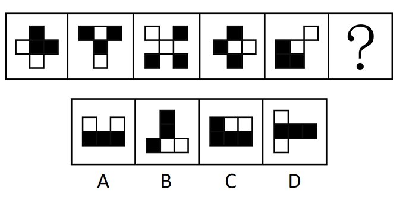

- **A**. A　✅
- **B**. B
- **C**. C
- **D**. D

**答案**：A

**官方解析**

图形元素组成相同，但无明显位置规律，考虑属性规律。观察发现，图形比较规整，考虑对称性。画出图形对称轴后发现对称轴依次逆时针旋转，故“？”处图形的对称轴应为竖直方向，只有A项符合。

故正确答案为A。

---

### 第 2 题　qid 4637310 · 出现于 2022 · 副省级/地市级/行政执法

#### 本题共享材料

①老鼠生性胆小机警，我们常用“胆小如鼠”来形容一个人懦弱怕事。老鼠怕猫更被认为是天经地义的事情。这对冤家也常被搬上屏幕，例如《猫和老鼠》和《黑猫警长》。

②那么，老鼠有没有不怕猫的时候呢？

③答案是肯定的。比如当老鼠感染一种名叫刚地弓形虫的寄生虫的时候。1908年，细菌学家查尔斯·尼科尔在突尼斯的刚地疏趾鼠体内发现了这种只有几个微米大小的细胞内寄生原虫。随着研究深入，人们发现，弓形虫只在家猫和虎、狮等猫科动物体内进行有性生殖，其无性繁殖则可以发生在几乎所有温血动物（比如老鼠）的有核细胞中。

④值得一提的是，弓形虫的感染通常比较温和。在免疫力正常的动物体内，弓形虫以一种叫做组织包囊的形式存在于动物大脑或肌肉中，呈慢性感染。只有当动物免疫力低下时，弓形虫感染才会引起严重的临床后果，比如脑炎、视网膜脉络膜炎等。

⑤慢性感染并不表示弓形虫对动物没有影响，何况它感染的部位是大脑。早在2014年，分子与细胞生物学教授迈克·艾森团队就发现，慢性感染弓形虫的小鼠对猫尿液的畏惧程度降低了。研究人员将小鼠体内的弓形虫完全清除后，这种变化并没有发生反转。通俗地讲，老鼠胆子变大了，不再害怕猫留下的痕迹和气味，而且“一时感染，终生受用”。

⑥2020年1月，日内瓦大学医学院多米尼克·索达提——法威尔教授团队发表论文称，慢性感染弓形虫的小鼠，不只是针对猫的胆子变大，面对其他捕食者时胆子也会变大。

⑦“我们发现感染弓形虫的小鼠的恐惧感丧失不仅仅是针对猫的，”科研人员表示，“这些小鼠思维活跃，四处游走探索。”在该研究中，研究人员建立了弓形虫慢性感染的小鼠模型，惊奇地发现，在慢性感染状态下，小鼠的焦虑水平降低了，更喜欢探索未知的东西。

⑧难道小鼠的胆子真的变大了？研究人员检测了小鼠对不同动物尿液的恐惧程度，发现弓形虫慢性感染的小鼠对猫尿液的恐惧程度明显降低，也不惧怕狐狸和豚鼠的尿液。就算附近放置的是处于麻醉状态的活的大鼠，小鼠依然来去自如。这和未感染组小鼠的小心翼翼形成鲜明对比。

⑨研究人员进而发现，弓形虫感染的小鼠，其行为变化程度与其脑组织中的包囊数量呈一定的相关性，弓形虫感染量越大，小鼠的探索性行为就越明显。通过转录组学分析，研究人员发现弓形虫慢性感染的小鼠，脑组织中炎性因子的转录水平发生了明显变化，并且与脑组织中包囊的数量和行为的变化程度具有相关性。科研人员推测，弓形虫慢性感染会引起动物脑组织持续性的炎症反应，炎性因子的释放会影响神经细胞的功能，最终导致动物的“勇敢”行为。

⑩安徽医科大学一位病原生物学教授说，弓形虫感染引起动物行为的变化可以拉近猎物和捕食者之间的空间距离，有利于虫体的扩散传播；老鼠不怕猫则更有助于弓形虫在猫体内的有性生殖，促进弓形虫的进化以及对环境的适应。动物实验研究有助于揭示人体“慢性无症状感染”相关神经精神障碍性疾病的发病机制。

把下面的六个图形分为两类，使每一类图形都有各自的共同特征或规律，分类正确的一项是：

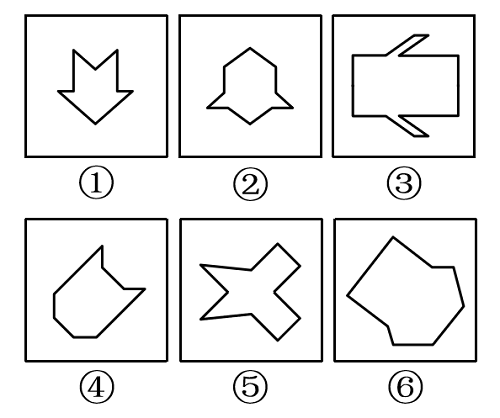

- **A**. ①②⑤，③④⑥　✅
- **B**. ①③④，②⑤⑥
- **C**. ①⑤⑥，②③④
- **D**. ①②④，③⑤⑥

**答案**：A

**官方解析**

本题为分组分类题目。元素组成不同，优先考虑属性规律。观察可知，题干图形比较规整，考虑对称性。图①②⑤一组，对称轴穿过图中的两个交点；图③④⑥一组，对称轴穿过图中的两条线，并且这两条线和对称轴垂直，对应A项。
故正确答案为A。

---

### 第 3 题　qid 4637313 · 出现于 2022 · 副省级/行政执法

> 共享材料同上一题。

从所给的四个选项中，选择最合适的一个填入问号处，使之呈现一定的规律性：

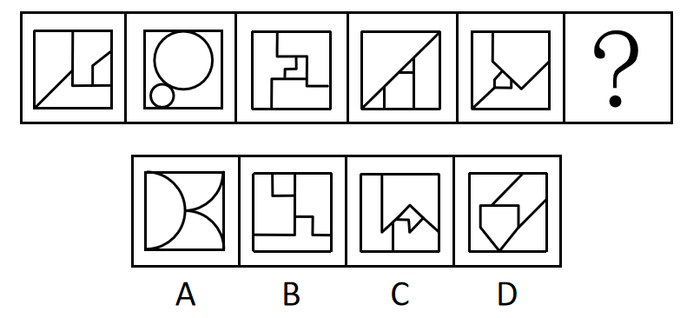

- **A**. A
- **B**. B
- **C**. C　✅
- **D**. D

**答案**：C

**官方解析**

图形元素组成不同，无明显属性规律，优先考虑数量规律。图形封闭面较多，优先考虑数面，但数面无规律。再观察发现题干图形存在明显最大面和最小面，且二者形状相同，按照此规律只有C项符合。
故正确答案为C。

---

### 第 4 题　qid 4637320 · 出现于 2022 · 副省级/行政执法

> 共享材料同上一题。

把下面的六个图形分为两类，使每一类图形都有各自的共同特征或规律，分类正确的一项是：

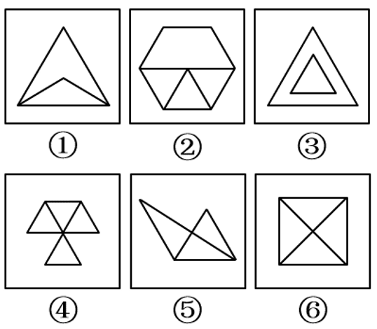

- **A**. ①②⑤，③④⑥
- **B**. ①②③，④⑤⑥
- **C**. ①③⑥，②④⑤
- **D**. ①④⑤，②③⑥　✅

**答案**：D

**官方解析**

本题为分组分类题目。元素组成不同，无明显属性规律，考虑数量规律。观察发现，图①和图⑥分别为“日”字、“田”字的变形图，考虑笔画数。图①④⑤为一笔画图形，图②③⑥为两笔画图形。即图①④⑤一组，图②③⑥一组。
故正确答案为D。

---

### 第 5 题　qid 4637321 · 出现于 2022 · 副省级/行政执法

> 共享材料同上一题。

从所给的四个选项中，选择最合适的一个填入问号处，使之呈现一定的规律性：

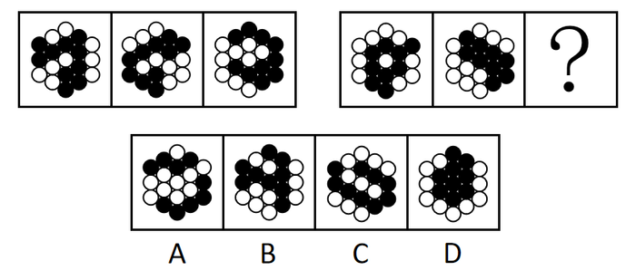

- **A**. A
- **B**. B
- **C**. C
- **D**. D　✅

**答案**：D

**官方解析**

图形元素组成相同，但无明显位置规律。观察发现，题干所有图形黑球全部相连，优先考虑部分数。第一组图形中黑球的部分数均是1，第二组图形中黑球的部分数也均是1，故？处应选择一个黑球的部分数为1的图形，排除A项。通过黑球的部分数无法得出唯一答案，再看白球的部分数，观察发现，第一组图形中白球的部分数依次为3、2、1，第二组图形中白球的部分数依次为3、2、？，故？处应选择一个白球的部分数为1的图形，只有D项符合。
故正确答案为D。

---

### 第 6 题　qid 4637330 · 出现于 2022 · 行政执法

#### 本题共享材料

某超市从前到后整齐排列着7排货架，放置着文具、零食、调料、日用品、酒、粮油和饮料7类商品，每类商品占据一排。已知：

（1）酒类排在调料类之前；

（2）文具类和调料类中间隔着3排；

（3）粮油类在零食类之后，中间隔着2排；

（4）日用品类紧挨在文具类前一排或者后一排。

从所给的四个选项中，选择最合适的一个填入问号处，使之呈现一定的规律性：

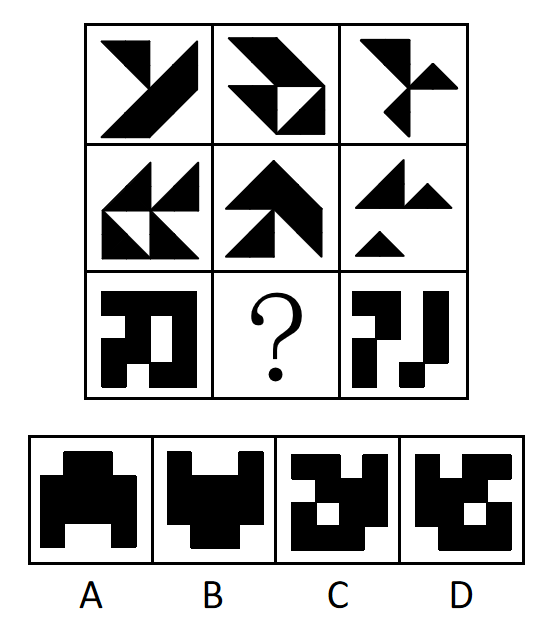

- **A**. A
- **B**. B
- **C**. C　✅
- **D**. D

**答案**：C

**官方解析**

图形元素组成相似，优先考虑样式规律。题干图形存在黑色和空白区域，优先考虑黑白运算。九宫格优先横向观察，第一行图形的黑白运算规律为：黑+黑=黑，黑+白=白，白+黑=白，白+白=白，第二行经验证符合此规律，第三行应用此规律，只有C项符合。
故正确答案为C。

---

### 第 7 题　qid 4637338 · 出现于 2022 · 副省级/地市级/行政执法

#### 本题共享材料

①老鼠生性胆小机警，我们常用“胆小如鼠”来形容一个人懦弱怕事。老鼠怕猫更被认为是天经地义的事情。这对冤家也常被搬上屏幕，例如《猫和老鼠》和《黑猫警长》。

②那么，老鼠有没有不怕猫的时候呢？

③答案是肯定的。比如当老鼠感染一种名叫刚地弓形虫的寄生虫的时候。1908年，细菌学家查尔斯·尼科尔在突尼斯的刚地疏趾鼠体内发现了这种只有几个微米大小的细胞内寄生原虫。随着研究深入，人们发现，弓形虫只在家猫和虎、狮等猫科动物体内进行有性生殖，其无性繁殖则可以发生在几乎所有温血动物（比如老鼠）的有核细胞中。

④值得一提的是，弓形虫的感染通常比较温和。在免疫力正常的动物体内，弓形虫以一种叫做组织包囊的形式存在于动物大脑或肌肉中，呈慢性感染。只有当动物免疫力低下时，弓形虫感染才会引起严重的临床后果，比如脑炎、视网膜脉络膜炎等。

⑤慢性感染并不表示弓形虫对动物没有影响，何况它感染的部位是大脑。早在2014年，分子与细胞生物学教授迈克·艾森团队就发现，慢性感染弓形虫的小鼠对猫尿液的畏惧程度降低了。研究人员将小鼠体内的弓形虫完全清除后，这种变化并没有发生反转。通俗地讲，老鼠胆子变大了，不再害怕猫留下的痕迹和气味，而且“一时感染，终生受用”。

⑥2020年1月，日内瓦大学医学院多米尼克·索达提——法威尔教授团队发表论文称，慢性感染弓形虫的小鼠，不只是针对猫的胆子变大，面对其他捕食者时胆子也会变大。

⑦“我们发现感染弓形虫的小鼠的恐惧感丧失不仅仅是针对猫的，”科研人员表示，“这些小鼠思维活跃，四处游走探索。”在该研究中，研究人员建立了弓形虫慢性感染的小鼠模型，惊奇地发现，在慢性感染状态下，小鼠的焦虑水平降低了，更喜欢探索未知的东西。

⑧难道小鼠的胆子真的变大了？研究人员检测了小鼠对不同动物尿液的恐惧程度，发现弓形虫慢性感染的小鼠对猫尿液的恐惧程度明显降低，也不惧怕狐狸和豚鼠的尿液。就算附近放置的是处于麻醉状态的活的大鼠，小鼠依然来去自如。这和未感染组小鼠的小心翼翼形成鲜明对比。

⑨研究人员进而发现，弓形虫感染的小鼠，其行为变化程度与其脑组织中的包囊数量呈一定的相关性，弓形虫感染量越大，小鼠的探索性行为就越明显。通过转录组学分析，研究人员发现弓形虫慢性感染的小鼠，脑组织中炎性因子的转录水平发生了明显变化，并且与脑组织中包囊的数量和行为的变化程度具有相关性。科研人员推测，弓形虫慢性感染会引起动物脑组织持续性的炎症反应，炎性因子的释放会影响神经细胞的功能，最终导致动物的“勇敢”行为。

⑩安徽医科大学一位病原生物学教授说，弓形虫感染引起动物行为的变化可以拉近猎物和捕食者之间的空间距离，有利于虫体的扩散传播；老鼠不怕猫则更有助于弓形虫在猫体内的有性生殖，促进弓形虫的进化以及对环境的适应。动物实验研究有助于揭示人体“慢性无症状感染”相关神经精神障碍性疾病的发病机制。

左图给定的是由相同正方体堆叠而成的多面体。该多面体可以由①、②和③三个多面体组合而成，以下哪项能填入问号处？

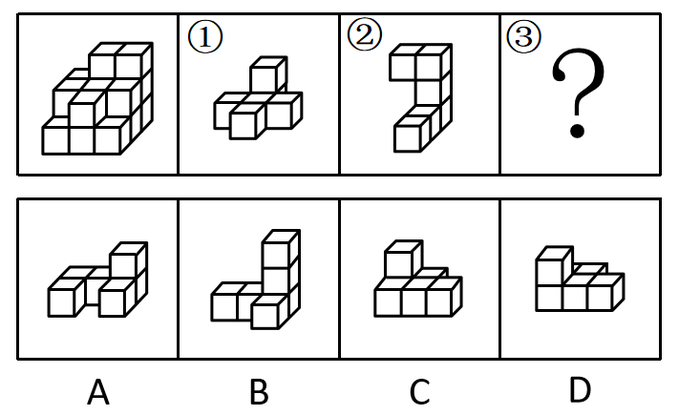

- **A**. A
- **B**. B
- **C**. C
- **D**. D　✅

**答案**：D

**官方解析**

本题考查立体拼合。

观察题干给出的多面体可知，图形可分为3层，由上至下第一层有2个小立方体，第二层有7个小立方体，第三层有9个小立方体。观察发现，图②共有3层，由上至下第一层有2个小立方体，第二层有1个小立方体，第三层有3个小立方体，可以拼合在多面体右侧，如下图所示，则题干多面体第二层还剩余6个小立方体，第三层还剩余6个小立方体。图①最下层的5个小立方体排列形状与题干多面体第二层剩余的形状相似，故图①最下层可以拼合在多面体第二层，最上层可以拼合在多面体第三层，如下图所示。根据凹凸一致的原则，剩余的形状只有D项符合。具体组合方式如下图所示：

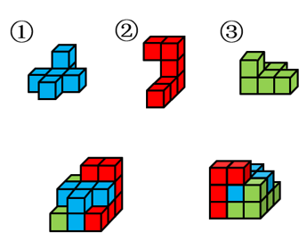

故正确答案为D。

---

### 第 8 题　qid 4637364 · 出现于 2022 · 行政执法

#### 本题共享材料

某超市从前到后整齐排列着7排货架，放置着文具、零食、调料、日用品、酒、粮油和饮料7类商品，每类商品占据一排。已知：

（1）酒类排在调料类之前；

（2）文具类和调料类中间隔着3排；

（3）粮油类在零食类之后，中间隔着2排；

（4）日用品类紧挨在文具类前一排或者后一排。

左图是给定的立体图形，将其从任一面剖开，以下哪项可能是该立体图形的截面？

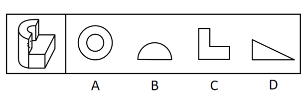

- **A**. A
- **B**. B
- **C**. C　✅
- **D**. D

**答案**：C

**官方解析**

本题考查截面图，逐一分析选项。

A项：无法截出完整的圆环，排除；

B项：无法截出半圆，排除；

C项：如下图所示，可以截出，当选；

 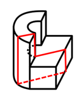

D项：长方体中无法截出直角三角形，排除。

故正确答案为C。

---

### 第 9 题　qid 4637369 · 出现于 2022 · 地市级/行政执法

> 共享材料同上一题。

把下面的六个图形分为两类，使每一类图形都有各自的共同特征或规律，分类正确的一项是：

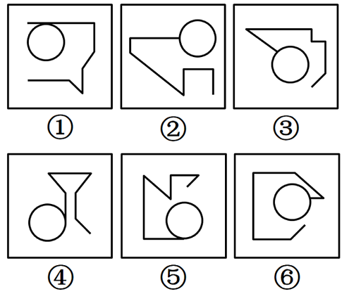

- **A**. ①②④，③⑤⑥
- **B**. ①③⑤，②④⑥
- **C**. ①④⑤，②③⑥　✅
- **D**. ①②⑥，③④⑤

**答案**：C

**官方解析**

本题为分组分类题目。元素组成不同，无明显属性规律，考虑数量规律。观察发现，每幅图形均有曲线与直线，且题干图形相切明显，考虑切点数量。图①④⑤的切点数均为1，图②③⑥的切点数均为0。即图①④⑤为一组，图②③⑥为一组。
故正确答案为C。

---

### 第 10 题　qid 4637401 · 出现于 2022 · 地市级/行政执法

> 共享材料同上一题。

下列纸盒的外表面展开图中，哪项折叠成的纸盒和其他三个不一样？

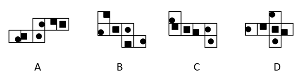

- **A**. A　✅
- **B**. B
- **C**. C
- **D**. D

**答案**：A

**官方解析**

将选项展开图标上序号，如下图所示（各选项面都相同，故相同的面用相同字母表示），逐一进行分析。

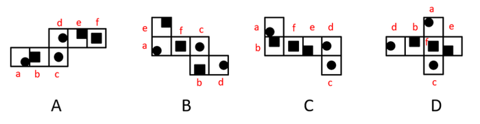

A项：以面e挨着黑块的点为起点进行顺时针画边（如下图所示），边1对应面f，边2对应面c，边3对应面d；

B项：以面e挨着黑块的点为起点进行顺时针画边（如下图所示），边1对应面f，边2对应面a，边3对应面d；

C项：以面e挨着黑块的点为起点进行顺时针画边（如下图所示），边1对应面f，边2对应面a，边3对应面d；

D项：以面e挨着黑块的点为起点进行顺时针画边（如下图所示），边1对应面f，边2对应面a，边3对应面d。

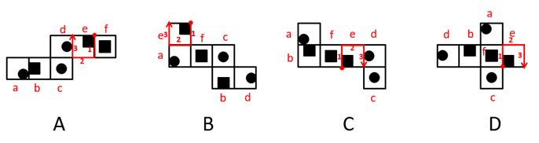

综上，只有A项与其他三项不同。

本题为选非题，故正确答案为A。

---

### 第 11 题　qid 4637544 · 出现于 2022 · 地市级

> 共享材料同上一题。

从所给的四个选项中，选择最合适的一个填入问号处，使之呈现一定的规律性：

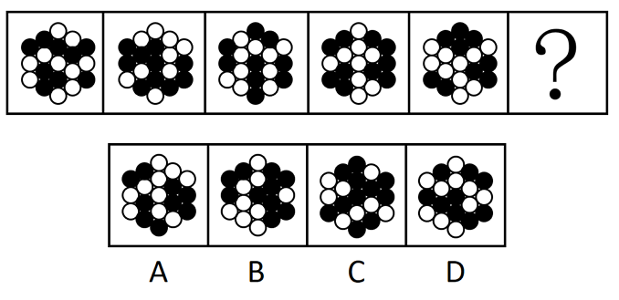

- **A**. A
- **B**. B　✅
- **C**. C
- **D**. D

**答案**：B

**官方解析**

图形组成不同，且无属性规律，优先考虑数量规律。观察发现图形均由黑球和白球构成，其中黑球的数量分别是9、10、9、10、9，故？处图形应有10个黑球，只有B项满足规律。
故正确答案为B。

---

### 第 12 题　qid 4637545 · 出现于 2022 · 副省级/地市级

#### 本题共享材料

①老鼠生性胆小机警，我们常用“胆小如鼠”来形容一个人懦弱怕事。老鼠怕猫更被认为是天经地义的事情。这对冤家也常被搬上屏幕，例如《猫和老鼠》和《黑猫警长》。

②那么，老鼠有没有不怕猫的时候呢？

③答案是肯定的。比如当老鼠感染一种名叫刚地弓形虫的寄生虫的时候。1908年，细菌学家查尔斯·尼科尔在突尼斯的刚地疏趾鼠体内发现了这种只有几个微米大小的细胞内寄生原虫。随着研究深入，人们发现，弓形虫只在家猫和虎、狮等猫科动物体内进行有性生殖，其无性繁殖则可以发生在几乎所有温血动物（比如老鼠）的有核细胞中。

④值得一提的是，弓形虫的感染通常比较温和。在免疫力正常的动物体内，弓形虫以一种叫做组织包囊的形式存在于动物大脑或肌肉中，呈慢性感染。只有当动物免疫力低下时，弓形虫感染才会引起严重的临床后果，比如脑炎、视网膜脉络膜炎等。

⑤慢性感染并不表示弓形虫对动物没有影响，何况它感染的部位是大脑。早在2014年，分子与细胞生物学教授迈克·艾森团队就发现，慢性感染弓形虫的小鼠对猫尿液的畏惧程度降低了。研究人员将小鼠体内的弓形虫完全清除后，这种变化并没有发生反转。通俗地讲，老鼠胆子变大了，不再害怕猫留下的痕迹和气味，而且“一时感染，终生受用”。

⑥2020年1月，日内瓦大学医学院多米尼克·索达提——法威尔教授团队发表论文称，慢性感染弓形虫的小鼠，不只是针对猫的胆子变大，面对其他捕食者时胆子也会变大。

⑦“我们发现感染弓形虫的小鼠的恐惧感丧失不仅仅是针对猫的，”科研人员表示，“这些小鼠思维活跃，四处游走探索。”在该研究中，研究人员建立了弓形虫慢性感染的小鼠模型，惊奇地发现，在慢性感染状态下，小鼠的焦虑水平降低了，更喜欢探索未知的东西。

⑧难道小鼠的胆子真的变大了？研究人员检测了小鼠对不同动物尿液的恐惧程度，发现弓形虫慢性感染的小鼠对猫尿液的恐惧程度明显降低，也不惧怕狐狸和豚鼠的尿液。就算附近放置的是处于麻醉状态的活的大鼠，小鼠依然来去自如。这和未感染组小鼠的小心翼翼形成鲜明对比。

⑨研究人员进而发现，弓形虫感染的小鼠，其行为变化程度与其脑组织中的包囊数量呈一定的相关性，弓形虫感染量越大，小鼠的探索性行为就越明显。通过转录组学分析，研究人员发现弓形虫慢性感染的小鼠，脑组织中炎性因子的转录水平发生了明显变化，并且与脑组织中包囊的数量和行为的变化程度具有相关性。科研人员推测，弓形虫慢性感染会引起动物脑组织持续性的炎症反应，炎性因子的释放会影响神经细胞的功能，最终导致动物的“勇敢”行为。

⑩安徽医科大学一位病原生物学教授说，弓形虫感染引起动物行为的变化可以拉近猎物和捕食者之间的空间距离，有利于虫体的扩散传播；老鼠不怕猫则更有助于弓形虫在猫体内的有性生殖，促进弓形虫的进化以及对环境的适应。动物实验研究有助于揭示人体“慢性无症状感染”相关神经精神障碍性疾病的发病机制。

把下面的六个图形分为两类，使每一类图形都有各自的共同特征或规律，分类正确的一项是：

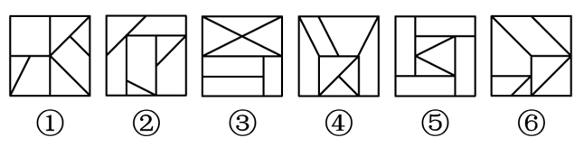

- **A**. ①②③，④⑤⑥
- **B**. ①④⑤，②③⑥
- **C**. ①②④，③⑤⑥
- **D**. ①③⑥，②④⑤　✅

**答案**：D

**官方解析**

本题为分组分类题目。元素组成不同，且无明显属性规律，考虑数量规律。观察发现，题干图形被分割明显，考虑面数量，但整体数面无法分组，所有图形的面数量均为7。再次观察发现，题干图形存在较多的三角形面，则考虑数三角形面的个数，图①③⑥均有4个三角形面，图②④⑤均有3个三角形面，故图①③⑥为一组，图②④⑤为一组。
故正确答案为D。

---

### 第 13 题　qid 4637564 · 出现于 2022 · 副省级/地市级

> 共享材料同上一题。

左图是给定的空心立体图形，将其从任一面剖开，右边哪项可能是该立体图形的截面？

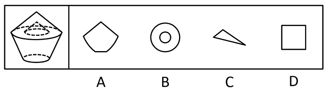

- **A**. A
- **B**. B　✅
- **C**. C
- **D**. D

**答案**：B

**官方解析**

本题考查截面图，逐一分析选项。

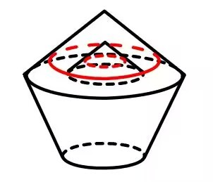

A项：无法切出，排除；

B项：从图形上半部分横着切，经过中间空心部分即可得到，当选；

C项：无法切出，排除；

D项：无法切出，排除。

故正确答案为B。

---

### 第 14 题　qid 4637577 · 出现于 2022 · 副省级/地市级

> 共享材料同上一题。

从所给的四个选项中，选择最合适的一个填入问号处，使之呈现一定的规律性：

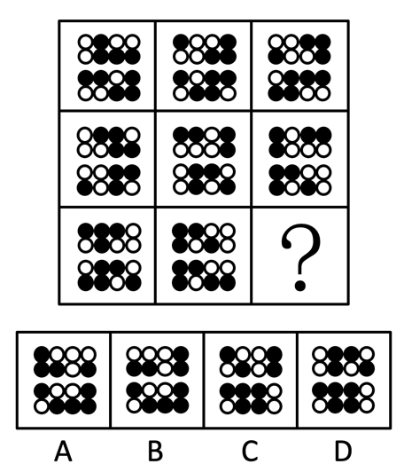

- **A**. A　✅
- **B**. B
- **C**. C
- **D**. D

**答案**：A

**官方解析**

题干每行图形均由相同的黑白球组成，元素组成相同，优先考虑位置规律。九宫格题目优先看横行。观察发现，在第一行图形中，上半部分的黑球每次逆时针平移一格，在前两行小球中转圈走，下半部分的黑球每次向左平移一格，在每一行小球中走到最左边后，再从最右边从头开始向左走（循环走）。观察可知，第二行图形同样符合此规律，同理第三行也应满足此规律。在第三行图形中，第三幅图应该在第二幅图的基础上，上半部分的黑球逆时针平移一格，下半部分的黑球向左平移一格（循环走），只有A项符合。
故正确答案为A。

---

### 第 15 题　qid 4637579 · 出现于 2022 · 副省级/地市级

> 共享材料同上一题。

从所给的四个选项中，选择最合适的一个填入问号处，使之呈现一定的规律性：

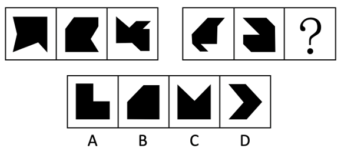

- **A**. A
- **B**. B　✅
- **C**. C
- **D**. D

**答案**：B

**官方解析**

元素组成不同，且无明显属性规律，考虑数量规律。题干所给的黑块图形出现多个明显的直角，优先考虑直角数。第一组图形中，黑块图形内部的直角个数依次为1、2、3。第二组图形运用规律，图1、图2黑块图形内部的直角个数分别为1、2，故“？”处应选择黑块图形内部直角个数为3的图形，只有B项符合。
故正确答案为B。

---

### 第 16 题　qid 4639349 · 出现于 2022 · 副省级

> 共享材料同上一题。

左图是给定纸盒的外表面，下面哪项能由它折叠而成？

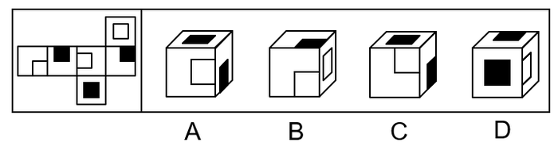

- **A**. A　✅
- **B**. B
- **C**. C
- **D**. D

**答案**：A

**官方解析**

将原展开图标上序号如下图，逐一进行分析。

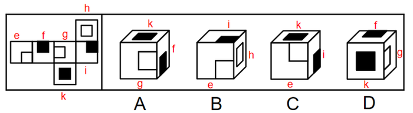

A项：选项出现了面g、面k和面f，选项与题干展开图一致，当选；

B项：选项出现了面e、面i和面h，面e和面h的公共边挨着面e中的小白块，而题干的面e和面h的公共边没有挨着面e中的小白块，选项与题干展开图不一致，排除；

C项：选项出现了面e、面k和面i，面e和面i的公共边挨着面e中的小白块，而题干的面e和面i的公共边没有挨着面e中的小白块，选项与题干展开图不一致，排除；

D项：选项出现了面k、面f和面g，面f和面g的公共边没有挨着面g中的小白块，而题干中面f和面g的公共边挨着面g中的小白块，选项与题干展开图不一致，排除。

故正确答案为A。

---

### 第 17 题　qid 5445768 · 出现于 2023 · 地市级/行政执法

#### 本题共享材料

6天休假期间，单位需要每天安排一人值班。财务、研发、人事、后勤、法务和销售6个部门各推荐了2人，值班人员从这12人中选择，每人至多值班一天。安排要求：

（1）第二天和第四天不安排法务部门的人值班；

（2）若安排后勤部门的人值班，则只能安排在法务部门的人值班的前一天；

（3）若安排研发部门的人值班，则只能安排在后勤部门的人值班的前一天。

把下面的六个图形分为两类，使每一类图形都有各自的共同特征或规律，分类正确的一项是：

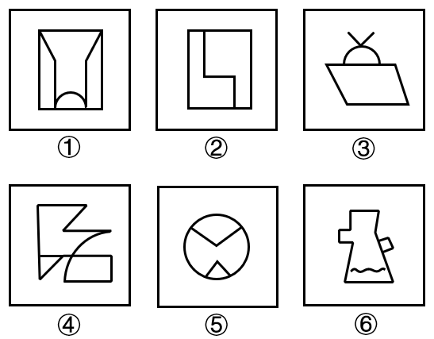

- **A**. ①③⑤，②④⑥
- **B**. ①④⑥，②③⑤
- **C**. ①③④，②⑤⑥
- **D**. ①②④，③⑤⑥　✅

**答案**：D

**官方解析**

本题为分组分类题目。元素组成不同，且无明显属性规律，考虑数量规律。观察发现，图2为“日”字变形图，图3为多端点图形，优先考虑笔画数。图①②④为一笔画图形，图③⑤⑥为两笔画图形，即图①②④为一组，图③⑤⑥为一组。
故正确答案为D。

---

### 第 18 题　qid 5445769 · 出现于 2023 · 行政执法

> 共享材料同上一题。

从所给的四个选项中，选择最合适的一个填入问号处，使之呈现一定的规律性：

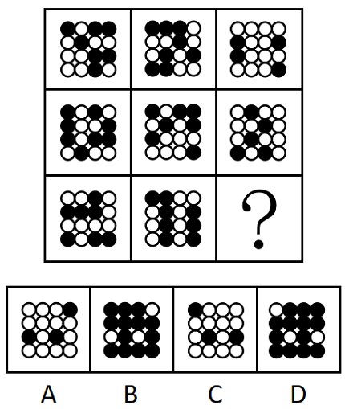

- **A**. A　✅
- **B**. B
- **C**. C
- **D**. D

**答案**：A

**官方解析**

图形元素组成相似，优先考虑样式规律。观察发现，题干图形均由黑球和白球构成，考虑黑白运算。九宫格优先横向观察，第一行图形的黑白运算规律为：黑+黑=白，黑+白=白，白+黑=白，白+白=黑，第二行图形经验证符合此规律，第三行图形应用此规律，只有A项符合。
故正确答案为A。

---

### 第 19 题　qid 5445778 · 出现于 2023 · 行政执法

> 共享材料同上一题。

从所给的四个选项中，选择最合适的一个填入问号处，使之呈现一定的规律性：

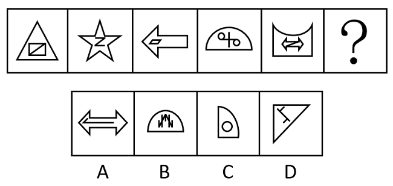

- **A**. A
- **B**. B
- **C**. C
- **D**. D　✅

**答案**：D

**官方解析**

图形元素组成不同，优先考虑属性规律。观察发现，题干图形均由内外两部分组成，考虑分内外看，且题干出现等腰三角形、平行四边形等特征图形，考虑对称性。题干图形外部均为轴对称图形，内部均为中心对称图形，故？处图形也应满足此规律，只有D项符合。
故正确答案为D。

---

### 第 20 题　qid 5445793 · 出现于 2023 · 行政执法

> 共享材料同上一题。

把下面的六个图形分为两类，使每一类图形都有各自的共同特征或规律，分类正确的一项是：

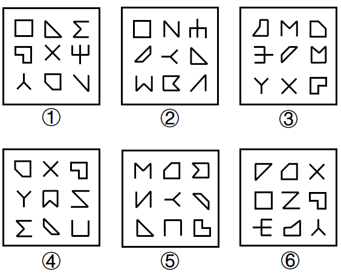

- **A**. ①③④，②⑤⑥
- **B**. ①②④，③⑤⑥　✅
- **C**. ①②⑥，③④⑤
- **D**. ①⑤⑥，②③④

**答案**：B

**官方解析**

解析一：本题为分组分类题目。元素组成不同，且封闭面明显，考虑数面。观察发现，图①②④中有4个面；图③⑤⑥中有5个面，即图①②④为一组，图③⑤⑥为一组。
故正确答案为B。
解析二：本题为分组分类题目。元素组成不同，优先考虑属性规律。观察发现，题干每幅图中均出现多个全开放图形，优先考虑开闭性。图①②④中有5个全开放图形、4个全封闭图形；图③⑤⑥中有4个全开放图形、5个全封闭图形，即图①②④为一组，图③⑤⑥为一组。
故正确答案为B。

---

### 第 21 题　qid 5445797 · 出现于 2023 · 副省级/地市级/行政执法

#### 本题共享材料

        降雨来源于云层，云层中的水蒸气遇到冷空气或某些成核物质后，就会很快冷凝而降落下来，所以冷暖空气相遇之处就是雨水多发的地带，这就是天气预报的基础；遇到干旱，给云层来一发干冰或碘化银炮弹，通过干冰降温或碘化银增加成核物质的手段增加降雨，也就成了最常见的人工降雨方式。不过，最近越来越多的科学家开始认为，除了天气变化，细菌也有很大可能控制着降雨。

        故事要从50年前说起。1970年，科学家在研究雨水时，发现其中含有微量的维生素B12。他们首先考虑，雨水由云层中的水蒸气凝结而成；云层中除了水蒸气，还有大量来自地表的灰尘，这些灰尘可能受人类活动影响而携带一些维生素B12上天，导致雨水中维生素B12的存在。不过在检查了云层中的灰尘后，他们发现云层中的灰尘含量与维生素B12含量并没有什么关系。云只是一团堆积的水蒸气和灰尘，在排除人类活动干扰后，这些维生素B12就只剩下一个来源——云层本身。

        科学家开始猜测，可能是由于有大量微生物生活在云层中，在生命活动中产生了维生素B12。不过由于当时技术条件有限，他们无法确定云层中到底存在哪些微生物。

        基因测序技术的出现，让科学家有了彻底调查云层生态系统的能力。2017年，法国科学家在一个海拔1465米的气象站中采集到干净无污染的降水水样，对其进行基因测序。结果发现，水样中存在超过28000种微生物的DNA或RNA，其中细菌和古菌有22000多种，真核生物有2600多种。这些微生物中既有能够进行光合作用的细菌和藻类，也有异养细菌，它们可能构成了一个完整的生态链：光合作用生物利用云层中的水分和大气中的二氧化碳等合成有机物，异养细菌则可能会以光合作用生物为食。

        云层中的紫外线极其强烈，很容易杀死位于高空的微生物。新的研究发现，其实有些细菌早就发展出抵抗紫外线的能力。无论是通过光合作用合成，还是通过掠食其他微生物获取，细菌们能将这些有机物分解为具有保护作用的胞外聚合物，这些物质基本由糖构成，类似一层“糖衣”，能够轻松抵御高空中的低温、干燥和紫外线破坏。芽孢杆菌就是最常见的能合成这种“糖衣”的细菌。该属包括许多种微生物，臭名昭著的炭疽杆菌就是其中之一。

        近年来，随着人类活动越来越强烈，大量有机物的微小颗粒飘散到云层上，所形成的效应就是，微生物们可能躺在云层里“无所事事”，就能吃到足够的食物。很多人小时候曾经幻想天上的云朵就是棉花糖，盼望自己能飞到云层上大吃特吃，现在看来，细菌的生活就是我们的美梦。

        每个带有防护性“糖衣”的细菌都相当于一个天然的凝聚核，<u>                    </u>。在天然条件下，云层中的纯水分子在低于时才会凝结；如果其中含有无机颗粒作为凝聚核，凝结温度就会变成；一旦存在细菌，水分子的凝结温度还会再次升高，有些细菌甚至能让水分子在时凝结。部分科学家相信，人类活动为微生物提供了童话般的生存环境，高空云层变得更为“宜居”，这就使得云层生态系统极度繁盛，这反过来将会引发频繁的雨雪。

        当然，这还不是全部。还有一些科学家认为，增加降水本身就是云层微生物的一种生存策略。许多云层微生物是因为风力吹动而从地面直达空中的，它们会借助高空气流在空中远距离旅行一段时间，之后再通过变成凝聚核的方式，以雨水的形式重回地表，寻找新的宿主。

        此外，这些微生物在享受云层中的有机物颗粒时，会将它们重新分解为二氧化碳。如此一来，原本以固体颗粒形式存在的二氧化碳又被微生物释放到大气中，成为日益暖化的地球上又一根新的稻草。据估算，大气中每年因此增加的二氧化碳约为100万吨，数量虽少，却会随着人类排放的有机污染物数量增加而增加。这种暖化的结果就是：地表温度升高，蒸发加强，云层增多，云层生态系统更加繁荣。这么一想，细菌似乎成了控制地球气候的幕后黑手？

从所给的四个选项中，选择最合适的一个填入问号处，使之呈现一定的规律性：

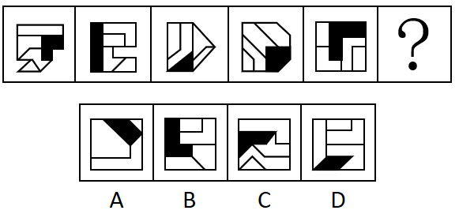

- **A**. A
- **B**. B
- **C**. C　✅
- **D**. D

**答案**：C

**官方解析**

图形元素组成不同，无明显属性规律，考虑数量规律。题干图形明显被分割，优先考虑面数量，发现题干图形均为4个面，据此排除A项；继续观察发现题干图形均由几个图形拼接而成，还可以考虑图形间关系。题干图形均有一个黑块，观察发现题干图形中黑块均与3个白块存在公共边，选项中只有C项符合。
故正确答案为C。

---

### 第 22 题　qid 5445798 · 出现于 2023 · 地市级/行政执法

#### 本题共享材料

6天休假期间，单位需要每天安排一人值班。财务、研发、人事、后勤、法务和销售6个部门各推荐了2人，值班人员从这12人中选择，每人至多值班一天。安排要求：

（1）第二天和第四天不安排法务部门的人值班；

（2）若安排后勤部门的人值班，则只能安排在法务部门的人值班的前一天；

（3）若安排研发部门的人值班，则只能安排在后勤部门的人值班的前一天。

左图为等大的3个灰色正方体和15个白色正方体组合成的多面体，其可以切割为①、②和③三个小多面体，问③代表的多面体可能是：

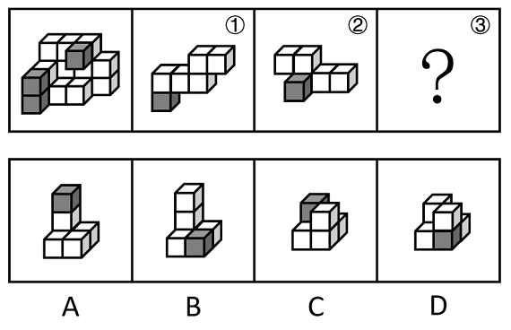

- **A**. A　✅
- **B**. B
- **C**. C
- **D**. D

**答案**：A

**官方解析**

本题考查立体拼合。如下图所示，将图①、图②进行旋转，结合A项，即可拼合成为左图的多面体。

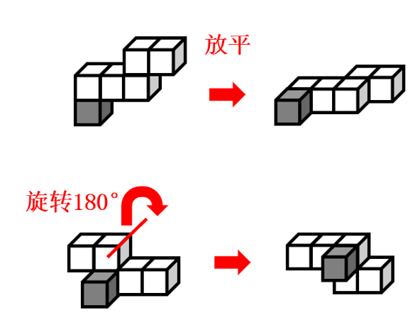

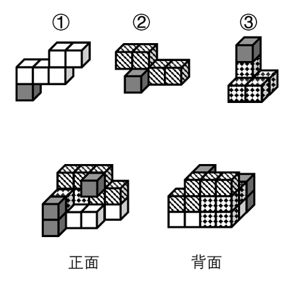

故正确答案为A。

---

### 第 23 题　qid 5445799 · 出现于 2023 · 地市级/行政执法

> 共享材料同上一题。

把下面六个图形分为两类，使每一类图形都有各自的共同特征或规律，分类正确的一项是：

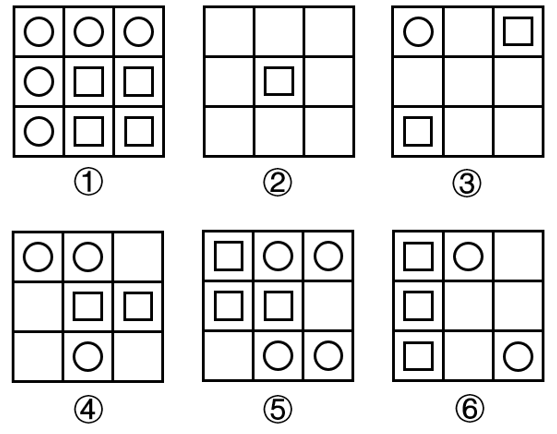

- **A**. ①②⑤，③④⑥
- **B**. ①②④，③⑤⑥
- **C**. ①④⑤，②③⑥　✅
- **D**. ①③⑤，②④⑥

**答案**：C

**官方解析**

本题为分组分类题目。元素组成不同，且无明显属性规律，考虑数量规律。观察发现，题干图形基本都由圆和正方形构成，优先考虑元素的个数，圆的数量依次为5、0、1、3、4、2，正方形的数量依次为4、1、2、2、3、3，单独看数量无规律，考虑二者运算图①④⑤中，圆的数量-正方形的数量=1；图②③⑥中，正方形的数量-圆的数量=1。故图①④⑤为一组，图②③⑥为一组。
故正确答案为C。

---

### 第 24 题　qid 5445802 · 出现于 2023 · 副省级/行政执法

#### 本题共享材料

        降雨来源于云层，云层中的水蒸气遇到冷空气或某些成核物质后，就会很快冷凝而降落下来，所以冷暖空气相遇之处就是雨水多发的地带，这就是天气预报的基础；遇到干旱，给云层来一发干冰或碘化银炮弹，通过干冰降温或碘化银增加成核物质的手段增加降雨，也就成了最常见的人工降雨方式。不过，最近越来越多的科学家开始认为，除了天气变化，细菌也有很大可能控制着降雨。

        故事要从50年前说起。1970年，科学家在研究雨水时，发现其中含有微量的维生素B12。他们首先考虑，雨水由云层中的水蒸气凝结而成；云层中除了水蒸气，还有大量来自地表的灰尘，这些灰尘可能受人类活动影响而携带一些维生素B12上天，导致雨水中维生素B12的存在。不过在检查了云层中的灰尘后，他们发现云层中的灰尘含量与维生素B12含量并没有什么关系。云只是一团堆积的水蒸气和灰尘，在排除人类活动干扰后，这些维生素B12就只剩下一个来源——云层本身。

        科学家开始猜测，可能是由于有大量微生物生活在云层中，在生命活动中产生了维生素B12。不过由于当时技术条件有限，他们无法确定云层中到底存在哪些微生物。

        基因测序技术的出现，让科学家有了彻底调查云层生态系统的能力。2017年，法国科学家在一个海拔1465米的气象站中采集到干净无污染的降水水样，对其进行基因测序。结果发现，水样中存在超过28000种微生物的DNA或RNA，其中细菌和古菌有22000多种，真核生物有2600多种。这些微生物中既有能够进行光合作用的细菌和藻类，也有异养细菌，它们可能构成了一个完整的生态链：光合作用生物利用云层中的水分和大气中的二氧化碳等合成有机物，异养细菌则可能会以光合作用生物为食。

        云层中的紫外线极其强烈，很容易杀死位于高空的微生物。新的研究发现，其实有些细菌早就发展出抵抗紫外线的能力。无论是通过光合作用合成，还是通过掠食其他微生物获取，细菌们能将这些有机物分解为具有保护作用的胞外聚合物，这些物质基本由糖构成，类似一层“糖衣”，能够轻松抵御高空中的低温、干燥和紫外线破坏。芽孢杆菌就是最常见的能合成这种“糖衣”的细菌。该属包括许多种微生物，臭名昭著的炭疽杆菌就是其中之一。

        近年来，随着人类活动越来越强烈，大量有机物的微小颗粒飘散到云层上，所形成的效应就是，微生物们可能躺在云层里“无所事事”，就能吃到足够的食物。很多人小时候曾经幻想天上的云朵就是棉花糖，盼望自己能飞到云层上大吃特吃，现在看来，细菌的生活就是我们的美梦。

        每个带有防护性“糖衣”的细菌都相当于一个天然的凝聚核，<u>                    </u>。在天然条件下，云层中的纯水分子在低于时才会凝结；如果其中含有无机颗粒作为凝聚核，凝结温度就会变成；一旦存在细菌，水分子的凝结温度还会再次升高，有些细菌甚至能让水分子在时凝结。部分科学家相信，人类活动为微生物提供了童话般的生存环境，高空云层变得更为“宜居”，这就使得云层生态系统极度繁盛，这反过来将会引发频繁的雨雪。

        当然，这还不是全部。还有一些科学家认为，增加降水本身就是云层微生物的一种生存策略。许多云层微生物是因为风力吹动而从地面直达空中的，它们会借助高空气流在空中远距离旅行一段时间，之后再通过变成凝聚核的方式，以雨水的形式重回地表，寻找新的宿主。

        此外，这些微生物在享受云层中的有机物颗粒时，会将它们重新分解为二氧化碳。如此一来，原本以固体颗粒形式存在的二氧化碳又被微生物释放到大气中，成为日益暖化的地球上又一根新的稻草。据估算，大气中每年因此增加的二氧化碳约为100万吨，数量虽少，却会随着人类排放的有机污染物数量增加而增加。这种暖化的结果就是：地表温度升高，蒸发加强，云层增多，云层生态系统更加繁荣。这么一想，细菌似乎成了控制地球气候的幕后黑手？

从所给的四个选项中，选择最合适的一个填入问号处，使之呈现一定的规律性：

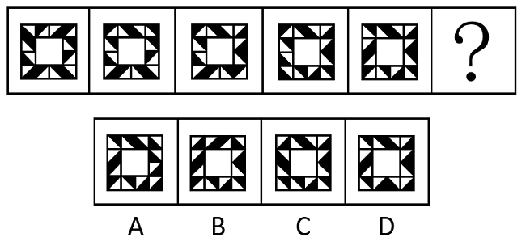

- **A**. A
- **B**. B　✅
- **C**. C
- **D**. D

**答案**：B

**官方解析**

元素组成相同，优先考虑位置规律。题干图形由黑色三角形构成，且数量较多、角度也较乱，考虑相邻比较。观察发现：从图1到图2，最上方一行相同位置上的黑色三角形均顺时针旋转了，其余位置的黑色三角形保持不变；从图2到图3，最右侧一列相同位置上的黑色三角形均顺时针旋转了，其余位置的黑色三角形保持不变；从图3到图4，最下方一行相同位置上的黑色三角形均顺时针旋转了，其余位置的黑色三角形保持不变；从图4到图5，最左侧一列相同位置上的黑色三角形均顺时针旋转了，其余位置的黑色三角形保持不变。因此，？处图形与图5相比，应为只有最上方一行相同位置上的黑色三角形顺时针旋转，其余位置的黑色三角形均保持不变，只有B项符合。

故正确答案为B。

---

### 第 25 题　qid 5445822 · 出现于 2023 · 地市级/行政执法

#### 本题共享材料

6天休假期间，单位需要每天安排一人值班。财务、研发、人事、后勤、法务和销售6个部门各推荐了2人，值班人员从这12人中选择，每人至多值班一天。安排要求：

（1）第二天和第四天不安排法务部门的人值班；

（2）若安排后勤部门的人值班，则只能安排在法务部门的人值班的前一天；

（3）若安排研发部门的人值班，则只能安排在后勤部门的人值班的前一天。

将一张直角三角形形状的纸片进行两次折叠，展开后的折痕将该三角形分成如图所示的a、b、c、d四个部分，则两次折叠后的纸片投影面积为：

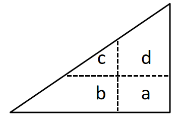

- **A**. b+d+c-a
- **B**. b+d-c
- **C**. b+c-a
- **D**. b+d-a　✅

**答案**：D

**官方解析**

第一步，将直角三角形先沿水平折痕进行折叠，即将面c和面d向下折叠，覆盖面b和面a，得到如下图形，此时折叠后面积为：b+d；

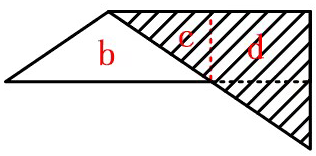

第二步，将直角三角形沿着竖直折痕进行折叠，即将面b和面c向右折叠，覆盖面d和面a，得到如下图形，此时折叠后面积为：d+b-a。

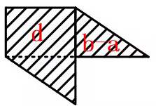

故正确答案为D。

---

### 第 26 题　qid 5445823 · 出现于 2023 · 行政执法

> 共享材料同上一题。

左图为给定的立体图形，从任一角度观看，下面哪项不可能是该立体图形的视图？

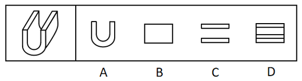

- **A**. A
- **B**. B
- **C**. C　✅
- **D**. D

**答案**：C

**官方解析**

本题考查三视图。如下图所示，A、B、D三项按图中箭头方向观察，均可看到，排除；C项为从上往下观察图形，则左右两侧应有两条竖线，当选。

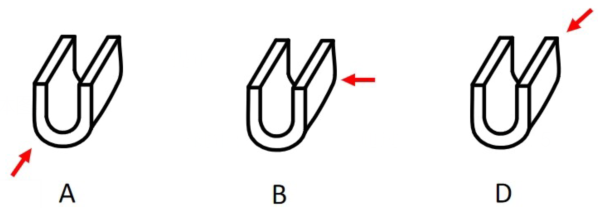

本题为选非题，故正确答案为C。

---

### 第 27 题　qid 5445839 · 出现于 2023 · 地市级

> 共享材料同上一题。

从所给的四个选项中，选择最合适的一个填入问号处，使之呈现一定的规律性：

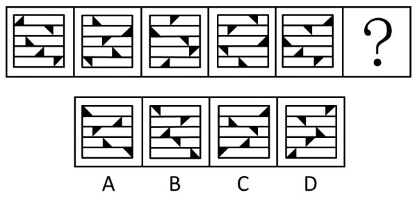

- **A**. A　✅
- **B**. B
- **C**. C
- **D**. D

**答案**：A

**官方解析**

题干图形均由相同数量的黑色三角形和被分成5行的矩形框架组成，元素组成相同，优先考虑位置规律。观察发现，每幅图形分行明显，优先按行看。黑色三角形于其所在行内每次向右移动一格，且移动到最右侧时循环走，回到最左侧从头 再来，方向不变继续向右移动，排 C、D两项。继续观察发现，黑色三角形在移动的过程中依次顺时针旋转 90°，排除B项，只有A项符合。
故正确答案为A。

---

### 第 28 题　qid 5445842 · 出现于 2023 · 副省级/地市级

#### 本题共享材料

        降雨来源于云层，云层中的水蒸气遇到冷空气或某些成核物质后，就会很快冷凝而降落下来，所以冷暖空气相遇之处就是雨水多发的地带，这就是天气预报的基础；遇到干旱，给云层来一发干冰或碘化银炮弹，通过干冰降温或碘化银增加成核物质的手段增加降雨，也就成了最常见的人工降雨方式。不过，最近越来越多的科学家开始认为，除了天气变化，细菌也有很大可能控制着降雨。

        故事要从50年前说起。1970年，科学家在研究雨水时，发现其中含有微量的维生素B12。他们首先考虑，雨水由云层中的水蒸气凝结而成；云层中除了水蒸气，还有大量来自地表的灰尘，这些灰尘可能受人类活动影响而携带一些维生素B12上天，导致雨水中维生素B12的存在。不过在检查了云层中的灰尘后，他们发现云层中的灰尘含量与维生素B12含量并没有什么关系。云只是一团堆积的水蒸气和灰尘，在排除人类活动干扰后，这些维生素B12就只剩下一个来源——云层本身。

        科学家开始猜测，可能是由于有大量微生物生活在云层中，在生命活动中产生了维生素B12。不过由于当时技术条件有限，他们无法确定云层中到底存在哪些微生物。

        基因测序技术的出现，让科学家有了彻底调查云层生态系统的能力。2017年，法国科学家在一个海拔1465米的气象站中采集到干净无污染的降水水样，对其进行基因测序。结果发现，水样中存在超过28000种微生物的DNA或RNA，其中细菌和古菌有22000多种，真核生物有2600多种。这些微生物中既有能够进行光合作用的细菌和藻类，也有异养细菌，它们可能构成了一个完整的生态链：光合作用生物利用云层中的水分和大气中的二氧化碳等合成有机物，异养细菌则可能会以光合作用生物为食。

        云层中的紫外线极其强烈，很容易杀死位于高空的微生物。新的研究发现，其实有些细菌早就发展出抵抗紫外线的能力。无论是通过光合作用合成，还是通过掠食其他微生物获取，细菌们能将这些有机物分解为具有保护作用的胞外聚合物，这些物质基本由糖构成，类似一层“糖衣”，能够轻松抵御高空中的低温、干燥和紫外线破坏。芽孢杆菌就是最常见的能合成这种“糖衣”的细菌。该属包括许多种微生物，臭名昭著的炭疽杆菌就是其中之一。

        近年来，随着人类活动越来越强烈，大量有机物的微小颗粒飘散到云层上，所形成的效应就是，微生物们可能躺在云层里“无所事事”，就能吃到足够的食物。很多人小时候曾经幻想天上的云朵就是棉花糖，盼望自己能飞到云层上大吃特吃，现在看来，细菌的生活就是我们的美梦。

        每个带有防护性“糖衣”的细菌都相当于一个天然的凝聚核，<u>                    </u>。在天然条件下，云层中的纯水分子在低于时才会凝结；如果其中含有无机颗粒作为凝聚核，凝结温度就会变成；一旦存在细菌，水分子的凝结温度还会再次升高，有些细菌甚至能让水分子在时凝结。部分科学家相信，人类活动为微生物提供了童话般的生存环境，高空云层变得更为“宜居”，这就使得云层生态系统极度繁盛，这反过来将会引发频繁的雨雪。

        当然，这还不是全部。还有一些科学家认为，增加降水本身就是云层微生物的一种生存策略。许多云层微生物是因为风力吹动而从地面直达空中的，它们会借助高空气流在空中远距离旅行一段时间，之后再通过变成凝聚核的方式，以雨水的形式重回地表，寻找新的宿主。

        此外，这些微生物在享受云层中的有机物颗粒时，会将它们重新分解为二氧化碳。如此一来，原本以固体颗粒形式存在的二氧化碳又被微生物释放到大气中，成为日益暖化的地球上又一根新的稻草。据估算，大气中每年因此增加的二氧化碳约为100万吨，数量虽少，却会随着人类排放的有机污染物数量增加而增加。这种暖化的结果就是：地表温度升高，蒸发加强，云层增多，云层生态系统更加繁荣。这么一想，细菌似乎成了控制地球气候的幕后黑手？

从所给的四个选项中，选择最合适的一个填入问号处，使之呈现一定的规律性：

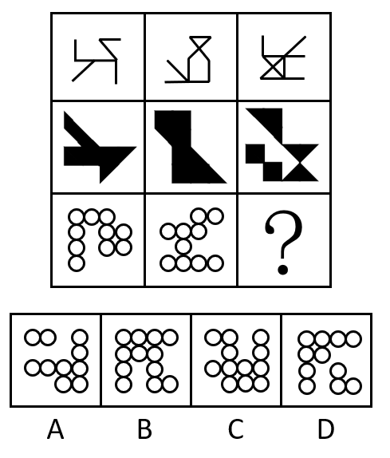

- **A**. A
- **B**. B
- **C**. C　✅
- **D**. D

**答案**：C

**官方解析**

题干每行图形元素组成相似，优先考虑样式规律。九宫格中优先横向看，第一行中，图一和图二求异得到图三；经验证，第二行也满足此规律；第三行应用此规律，图一和图二求异，只有C项符合。
故正确答案为C。

---

### 第 29 题　qid 5445843 · 出现于 2023 · 副省级/地市级

> 共享材料同上一题。

下图是给定的立体图形（大圆柱内的虚线部分为挖空部分），将其从任一面剖开，下面哪一项不可能是该立体图形的截面？

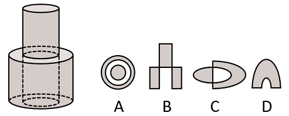

- **A**. A　✅
- **B**. B
- **C**. C
- **D**. D

**答案**：A

**官方解析**

本题考查截面图。逐一分析选项。

A项：无法截出，当选；

B项：如下图所示，从上方圆柱向下经过空心圆柱竖切，可以截出，排除；

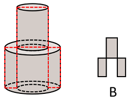

C项：如下图所示，从上方圆柱向下经过空心圆柱斜切，可以截出，排除；

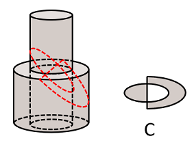

D项：如下图所示，斜切下方圆柱同时经过空心部分，可以截出，排除。

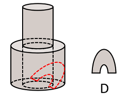

本题为选非题，故正确答案为A。

---

### 第 30 题　qid 5445852 · 出现于 2023 · 副省级/地市级

> 共享材料同上一题。

把下面的六个图形分为两类，使每一类图形都有各自的共同特征或规律，分类正确的一项是：

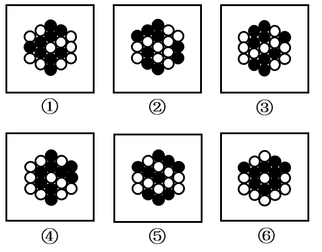

- **A**. ①⑤⑥，②③④
- **B**. ①④⑥，②③⑤　✅
- **C**. ①②⑥，③④⑤
- **D**. ①③④，②⑤⑥

**答案**：B

**官方解析**

本题为分组分类题目。元素组成相同，但无明显位置规律和属性规律，考虑数量规律。观察发现，题干每个图形均存在黑球或白球被分隔开的情况，考虑部分数。图①④⑥中，黑球的部分数均为1，白球的部分数均为3；图②③⑤中，黑球的部分数均为3，白球的部分数均为1。即图①④⑥为一组，图②③⑤为一组。
故正确答案为B。

---

### 第 31 题　qid 5445855 · 出现于 2023 · 副省级/地市级

> 共享材料同上一题。

从所给的四个选项中，选择最合适的一个填入问号处，使之呈现一定的规律性：

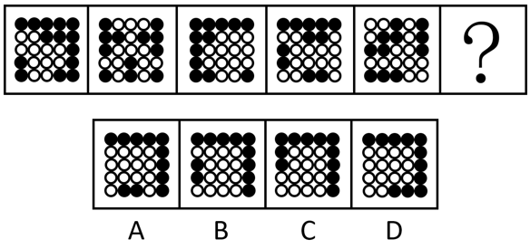

- **A**. A　✅
- **B**. B
- **C**. C
- **D**. D

**答案**：A

**官方解析**

元素组成不同，优先考虑属性规律。观察发现，整体无规律，题干所有图形均由黑球和白球构成，考虑黑白分开看，继续观察发现，每幅图形的白色区域均为轴对称图形，且对称轴每次顺时针旋转，因此？处图形的白色区域应为轴对称图形，且对称轴应为竖直方向。B项图形的白色区域为轴对称图形，但对称轴为水平方向，C、D两项图形的白色区域为非对称图形，均排除。只有A项符合。

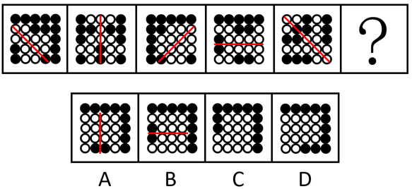

故正确答案为A。

---

### 第 32 题　qid 5445911 · 出现于 2023 · 副省级

> 共享材料同上一题。

把下面的六个图形分为两类，使每一类图形都有各自的共同特征或规律，分类正确的一项是：

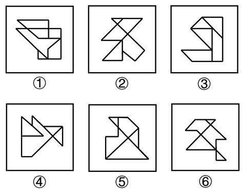

- **A**. ①③⑥，②④⑤
- **B**. ①④⑤，②③⑥
- **C**. ①②⑥，③④⑤　✅
- **D**. ①③④，②⑤⑥

**答案**：C

**官方解析**

本题为分组分类题目。元素组成不同，无明显属性规律，考虑数量规律。观察发现，题干图形封闭面较多，可优先考虑数面数量，但面数量无规律。继续观察发现，题干图形存在多个封闭面相交，均为“多圆相切”的变形图，考虑笔画数，图①②⑥均为一笔画图形，图③④⑤均为两笔画图形。即图①②⑥为一组，图③④⑤为一组。
故正确答案为C。

---

### 第 33 题　qid 5445914 · 出现于 2023 · 副省级

> 共享材料同上一题。

左图为等大的3个灰色正方体和15个白色正方体所组成的多面体，其可以切割为①、②和③三个小多面体，则③代表的多面体可能是：

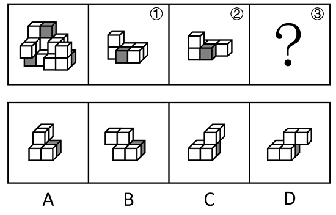

- **A**. A
- **B**. B
- **C**. C　✅
- **D**. D

**答案**：C

**官方解析**

本题考查立体拼合。如下图所示，立体图可以由①、②以及C项拼合而成。

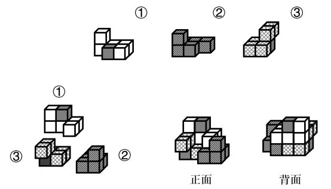

故正确答案为C。

---

### 第 34 题　qid 5445917 · 出现于 2023 · 副省级

> 共享材料同上一题。

把下面的六个图形分为两类，使每一类图形都有各自的共同特征或规律，分类正确的一项是：

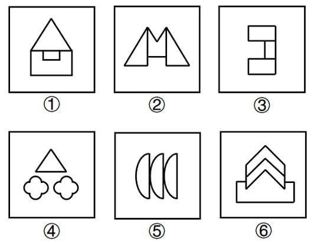

- **A**. ①③⑥，②④⑤
- **B**. ①③⑤，②④⑥
- **C**. ①②⑥，③④⑤
- **D**. ①⑤⑥，②③④　✅

**答案**：D

**官方解析**

元素组成不同，优先考虑属性规律。观察发现，题干图形均为轴对称图形，画出题干中每个图形的对称轴发现，图①⑤⑥的对称轴穿过图形的三个面，图②③④的对称轴穿过图形的一个面，即图①⑤⑥为一组，图②③④为一组。

故正确答案为D。

---

### 第 35 题　qid 5445923 · 出现于 2023 · 副省级

> 共享材料同上一题。

左边给定的是正方体的外表面展开图，下面哪一项能由它折叠而成？

- **A**. A
- **B**. B　✅
- **C**. C
- **D**. D

**答案**：B

**官方解析**

本题为空间重构题。对展开图进行编号，如下图所示：

面a、面d和面2为具有唯一公共点的三个面，面a和面2中加粗（标蓝）的两条线构成直角，为公共边，可知折成立体图形后，面2中箭头与面1中箭头平行，且方向相反，只有B项符合。

故正确答案为B。

---

### 第 36 题　qid 5893606 · 出现于 2024 · 副省级/地市级/行政执法

#### 本题共享材料

        人们观瞻南京长江大桥，莫不为其雄伟赞叹不已。然而很少有人知道，宋代曾在南京长江大桥的西南，即今安徽当涂县境采石矶一带，建造过一座跨江大浮桥，这也是世界桥梁史上的创举。

        采石自古以来是长江的重要渡口。北宋初，江南人樊若冰举进士不中第，钓鱼采石江上，以小舟装载丝绳，测得长江宽度，之后诣阙上书，创议修建浮桥，以攻江南。当时南唐军力居南方割据政权第一，水师颇强，国都金陵城池深固，易守难攻。宋太祖估计战事可能旷日持久，为保障兵力增援和后勤供给，采纳此议，修建浮桥。

        长江自西南方向流经采石矶，采石矶江面稍窄而水急。1采石矶上游江面宽阔而水缓，近似喇叭形，因上游泥沙沉积，形成现在的江心洲，已伸展至采石矶的下游。但在宋时，江心洲或尚未出现，或尚未伸展到采石一带。2宋人陈造《采石渡》诗说：“大江碍崇山，突起作湍悍。采石天下险，揭厉谁敢玩。”3据现代水文资料，在枯水期和涨水期，采石一带江水流速为0.96～2.03米/秒，江面宽度为5250～5900米，其中包括江心洲2000米。因历代泥沙淤积，江面逐渐变窄，估计宋代采石矶一带江面，当比现代更宽。在如此宽阔、风浪险恶的江面上修建大浮桥，即使从现代技术条件看来，也并不简单，在一千余年前的古代，更是不可思议的奇迹。4这种奇迹毕竟出现了。开宝七年（974年）冬天，宋人利用枯水期，在采石矶建成浮桥。《续资治通鉴长编》中说，宋人按照樊若冰的计策，造好几千艘大舰和黄黑龙船，用大舰装载“巨竹絙”，用黄黑龙船在采石矶跨江建成浮桥。南唐君臣听说宋人试图造桥，认为载籍以来，无有此事，宋人儿戏，必造不成。他们对跨江建浮桥缺乏足够估计，铸成大错。

        宋军建成浮桥后，沿江东下。南唐出兵，企图焚烧浮梁，并未得手。开宝八年（975年）宋军攻破金陵，南唐后主李煜被迫辞别“凤阁龙楼”，充当降王。采石跨江大浮桥对这次军事胜利，无疑起了很大作用。在一年多的时间里，浮桥经历了各种气象与水文条件的考验，安然无恙，<u>                    </u>。古代浮桥的构造，或在江河两岸以铁柱、石柱之类系几根牵缆，牵缆上缚工铺板，连接成桥，或以各船下锚碇为主，两岸系牵缆为辅。宋人造桥时记载的“巨竹絙”，应即浮桥的缆绳。然而在江阔水深的条件下，以粗竹绳系缆，强度毕竟有限，估计各船必须在江底下碇石，方能保证浮桥的牢固。宋时浮桥往往“治铁为琐，辫竹为缆”，使之稳固，采石浮桥应该不会只用竹缆而无铁锁之类的设备。

        依据现在采石的江面宽度，我们不妨估计宋代浮桥的长度约6000米上下。依1宋丈约为3.1米计，约合1935宋丈，须用船773～967艘。宋人记载中的“黄黑龙船数千艘”，当是构筑浮桥用的。

        这里不妨以南京长江大桥作比较。南京长江大桥江面正桥长1577米，连同两端引桥，铁路桥总长6772米，公路桥总长4589米。采石浮桥估计在6000米上下，其下所用黄黑龙船，少则七百，多则近千艘，十分壮观。在世界古代史上，建造如此长跨度的大浮桥，无疑是绝无仅有的。这是世界科技史上的一件大事，充分显示了中华民族的智慧和创造才能。

从所给的四个选项中，选择最合适的一项填入问号处，使之呈现一定的规律性：

- **A**. A
- **B**. B
- **C**. C
- **D**. D　✅

**答案**：D

**官方解析**

元素组成不同，且无明显属性规律，观察发现，题干图形均由黑块和白块组成，且色块分布均匀，优先考虑黑白块面积。题干图形的黑块面积依次为整体图形面积的、、、、，故？处图形的黑块面积应为整个图形的面积，即整个图形全为黑色，只有D项符合。

故正确答案为D。

---

### 第 37 题　qid 5893610 · 出现于 2024 · 行政执法

#### 本题共享材料

        有甲、乙、丙、丁、戊、己6个城市，其中的两个城市在2021年结成一对友好城市，其余4个城市中的2个在2022年结成一对友好城市，剩余的2个城市在2023年也结成一对友好城市，已知：

（1）乙的结对城市不是丁

（2）甲的结对城市不是乙就是丙

（3）甲和乙均不是在2021年结对的

（4）丁和戊均不是在2023年结对的

从所给的四个选项中，选择最合适的一项填入问号处，使之呈现一定的规律性：

- **A**. A　✅
- **B**. B
- **C**. C
- **D**. D

**答案**：A

**官方解析**

元素组成不同，且无明显属性规律，考虑数量规律。观察发现，图形均由黑色图形和白色图形构成，可以考虑分开看，每个图形都是简单多边形，可以优先考虑数黑色图形和白色图形的边数。题干中黑色图形的边数依次为5、3、4、5、6，白色图形的边数依次为4、4、3、6、5，单看无规律，考虑运算发现，图1、图3、图5中黑色图形边数-白色图形边数=1，图2、图4中白色图形边数-黑色图形边数=1，为交替规律，故？处图形的白色图形边数-黑色图形边数=1，只有A项符合。
故正确答案为A。

---

### 第 38 题　qid 5893613 · 出现于 2024 · 副省级/行政执法

#### 本题共享材料

        人们观瞻南京长江大桥，莫不为其雄伟赞叹不已。然而很少有人知道，宋代曾在南京长江大桥的西南，即今安徽当涂县境采石矶一带，建造过一座跨江大浮桥，这也是世界桥梁史上的创举。

        采石自古以来是长江的重要渡口。北宋初，江南人樊若冰举进士不中第，钓鱼采石江上，以小舟装载丝绳，测得长江宽度，之后诣阙上书，创议修建浮桥，以攻江南。当时南唐军力居南方割据政权第一，水师颇强，国都金陵城池深固，易守难攻。宋太祖估计战事可能旷日持久，为保障兵力增援和后勤供给，采纳此议，修建浮桥。

        长江自西南方向流经采石矶，采石矶江面稍窄而水急。1采石矶上游江面宽阔而水缓，近似喇叭形，因上游泥沙沉积，形成现在的江心洲，已伸展至采石矶的下游。但在宋时，江心洲或尚未出现，或尚未伸展到采石一带。2宋人陈造《采石渡》诗说：“大江碍崇山，突起作湍悍。采石天下险，揭厉谁敢玩。”3据现代水文资料，在枯水期和涨水期，采石一带江水流速为0.96～2.03米/秒，江面宽度为5250～5900米，其中包括江心洲2000米。因历代泥沙淤积，江面逐渐变窄，估计宋代采石矶一带江面，当比现代更宽。在如此宽阔、风浪险恶的江面上修建大浮桥，即使从现代技术条件看来，也并不简单，在一千余年前的古代，更是不可思议的奇迹。4这种奇迹毕竟出现了。开宝七年（974年）冬天，宋人利用枯水期，在采石矶建成浮桥。《续资治通鉴长编》中说，宋人按照樊若冰的计策，造好几千艘大舰和黄黑龙船，用大舰装载“巨竹絙”，用黄黑龙船在采石矶跨江建成浮桥。南唐君臣听说宋人试图造桥，认为载籍以来，无有此事，宋人儿戏，必造不成。他们对跨江建浮桥缺乏足够估计，铸成大错。

        宋军建成浮桥后，沿江东下。南唐出兵，企图焚烧浮梁，并未得手。开宝八年（975年）宋军攻破金陵，南唐后主李煜被迫辞别“凤阁龙楼”，充当降王。采石跨江大浮桥对这次军事胜利，无疑起了很大作用。在一年多的时间里，浮桥经历了各种气象与水文条件的考验，安然无恙，<u>                    </u>。古代浮桥的构造，或在江河两岸以铁柱、石柱之类系几根牵缆，牵缆上缚工铺板，连接成桥，或以各船下锚碇为主，两岸系牵缆为辅。宋人造桥时记载的“巨竹絙”，应即浮桥的缆绳。然而在江阔水深的条件下，以粗竹绳系缆，强度毕竟有限，估计各船必须在江底下碇石，方能保证浮桥的牢固。宋时浮桥往往“治铁为琐，辫竹为缆”，使之稳固，采石浮桥应该不会只用竹缆而无铁锁之类的设备。

        依据现在采石的江面宽度，我们不妨估计宋代浮桥的长度约6000米上下。依1宋丈约为3.1米计，约合1935宋丈，须用船773～967艘。宋人记载中的“黄黑龙船数千艘”，当是构筑浮桥用的。

        这里不妨以南京长江大桥作比较。南京长江大桥江面正桥长1577米，连同两端引桥，铁路桥总长6772米，公路桥总长4589米。采石浮桥估计在6000米上下，其下所用黄黑龙船，少则七百，多则近千艘，十分壮观。在世界古代史上，建造如此长跨度的大浮桥，无疑是绝无仅有的。这是世界科技史上的一件大事，充分显示了中华民族的智慧和创造才能。

从所给的四个选项中，选择最合适的一项填入问号处，使之呈现一定的规律性：

- **A**. A
- **B**. B　✅
- **C**. C
- **D**. D

**答案**：B

**官方解析**

图形元素组成相似，优先考虑样式规律。观察发现，题干图形均由黑球和白球构成，考虑黑白运算。九宫格优先横向看，第一行图形的黑白运算规律为：黑+白=白，白+白=黑，白+黑=白，黑+黑=空，第二行图形经验证符合此规律，第三行图形应用此规律，只有B项符合。
故正确答案为B。

---

### 第 39 题　qid 5893617 · 出现于 2024 · 行政执法

#### 本题共享材料

        有甲、乙、丙、丁、戊、己6个城市，其中的两个城市在2021年结成一对友好城市，其余4个城市中的2个在2022年结成一对友好城市，剩余的2个城市在2023年也结成一对友好城市，已知：

（1）乙的结对城市不是丁

（2）甲的结对城市不是乙就是丙

（3）甲和乙均不是在2021年结对的

（4）丁和戊均不是在2023年结对的

从所给的四个选项中，选择最合适的一项填入问号处，使之呈现一定的规律性：

- **A**. A
- **B**. B
- **C**. C　✅
- **D**. D

**答案**：C

**官方解析**

元素组成相同，优先考虑位置规律。题干图形均出现了二十五宫格，且中间黑块数量相同，优先考虑内外圈分开看平移。观察发现，内圈九宫格最中心黑块位置不变，其余两个黑块每次顺（逆）时针移动4格（也可以看成两个黑块左右两边位置交替），最外圈黑块每次顺时针平移1格，只有C项符合。

故正确答案为C。

---

### 第 40 题　qid 5893637 · 出现于 2024 · 副省级/地市级/行政执法

#### 本题共享材料

        人们观瞻南京长江大桥，莫不为其雄伟赞叹不已。然而很少有人知道，宋代曾在南京长江大桥的西南，即今安徽当涂县境采石矶一带，建造过一座跨江大浮桥，这也是世界桥梁史上的创举。

        采石自古以来是长江的重要渡口。北宋初，江南人樊若冰举进士不中第，钓鱼采石江上，以小舟装载丝绳，测得长江宽度，之后诣阙上书，创议修建浮桥，以攻江南。当时南唐军力居南方割据政权第一，水师颇强，国都金陵城池深固，易守难攻。宋太祖估计战事可能旷日持久，为保障兵力增援和后勤供给，采纳此议，修建浮桥。

        长江自西南方向流经采石矶，采石矶江面稍窄而水急。1采石矶上游江面宽阔而水缓，近似喇叭形，因上游泥沙沉积，形成现在的江心洲，已伸展至采石矶的下游。但在宋时，江心洲或尚未出现，或尚未伸展到采石一带。2宋人陈造《采石渡》诗说：“大江碍崇山，突起作湍悍。采石天下险，揭厉谁敢玩。”3据现代水文资料，在枯水期和涨水期，采石一带江水流速为0.96～2.03米/秒，江面宽度为5250～5900米，其中包括江心洲2000米。因历代泥沙淤积，江面逐渐变窄，估计宋代采石矶一带江面，当比现代更宽。在如此宽阔、风浪险恶的江面上修建大浮桥，即使从现代技术条件看来，也并不简单，在一千余年前的古代，更是不可思议的奇迹。4这种奇迹毕竟出现了。开宝七年（974年）冬天，宋人利用枯水期，在采石矶建成浮桥。《续资治通鉴长编》中说，宋人按照樊若冰的计策，造好几千艘大舰和黄黑龙船，用大舰装载“巨竹絙”，用黄黑龙船在采石矶跨江建成浮桥。南唐君臣听说宋人试图造桥，认为载籍以来，无有此事，宋人儿戏，必造不成。他们对跨江建浮桥缺乏足够估计，铸成大错。

        宋军建成浮桥后，沿江东下。南唐出兵，企图焚烧浮梁，并未得手。开宝八年（975年）宋军攻破金陵，南唐后主李煜被迫辞别“凤阁龙楼”，充当降王。采石跨江大浮桥对这次军事胜利，无疑起了很大作用。在一年多的时间里，浮桥经历了各种气象与水文条件的考验，安然无恙，<u>                    </u>。古代浮桥的构造，或在江河两岸以铁柱、石柱之类系几根牵缆，牵缆上缚工铺板，连接成桥，或以各船下锚碇为主，两岸系牵缆为辅。宋人造桥时记载的“巨竹絙”，应即浮桥的缆绳。然而在江阔水深的条件下，以粗竹绳系缆，强度毕竟有限，估计各船必须在江底下碇石，方能保证浮桥的牢固。宋时浮桥往往“治铁为琐，辫竹为缆”，使之稳固，采石浮桥应该不会只用竹缆而无铁锁之类的设备。

        依据现在采石的江面宽度，我们不妨估计宋代浮桥的长度约6000米上下。依1宋丈约为3.1米计，约合1935宋丈，须用船773～967艘。宋人记载中的“黄黑龙船数千艘”，当是构筑浮桥用的。

        这里不妨以南京长江大桥作比较。南京长江大桥江面正桥长1577米，连同两端引桥，铁路桥总长6772米，公路桥总长4589米。采石浮桥估计在6000米上下，其下所用黄黑龙船，少则七百，多则近千艘，十分壮观。在世界古代史上，建造如此长跨度的大浮桥，无疑是绝无仅有的。这是世界科技史上的一件大事，充分显示了中华民族的智慧和创造才能。

把下面六个图形分为两类，使每一类图形都有各自的共同特征或规律，分类正确的一项是：

- **A**. ①④⑤，②③⑥
- **B**. ①③④，②⑤⑥
- **C**. ①⑤⑥，②③④　✅
- **D**. ①②⑥，③④⑤

**答案**：C

**官方解析**

本题为分组分类题目。元素组成不同，且无明显属性规律，考虑数量规律。观察发现，题干图形被分割，考虑面数量，但面数量无规律，且框内有明显一笔构成的线条，考虑笔画数。图①⑤⑥均为两笔画图形，图②③④均为一笔画图形，故图①⑤⑥为一组，图②③④为一组。
故正确答案为C。

---

### 第 41 题　qid 5893647 · 出现于 2024 · 行政执法

#### 本题共享材料

        有甲、乙、丙、丁、戊、己6个城市，其中的两个城市在2021年结成一对友好城市，其余4个城市中的2个在2022年结成一对友好城市，剩余的2个城市在2023年也结成一对友好城市，已知：

（1）乙的结对城市不是丁

（2）甲的结对城市不是乙就是丙

（3）甲和乙均不是在2021年结对的

（4）丁和戊均不是在2023年结对的

把下面的六个图形分为两类，使每一类图形都有各自的共同特征或规律，分类正确的一项是：

- **A**. ①④⑥，②③⑤　✅
- **B**. ①⑤⑥，②③④
- **C**. ①②⑥，③④⑤
- **D**. ①③⑥，②④⑤

**答案**：A

**官方解析**

本题为分组分类题目。元素组成相同，但无明显位置规律和属性规律，考虑数量规律。观察发现，题干图形的黑球均被分隔为两部分，考虑每部分的黑球个数。图①④⑥中，黑球个数均按2、4分为两部分；图②③⑤中，黑球个数均按1、5分为两部分。即图①④⑥为一组，图②③⑤为一组。
故正确答案为A。

---

### 第 42 题　qid 5893648 · 出现于 2024 · 副省级/地市级/行政执法

#### 本题共享材料

        人们观瞻南京长江大桥，莫不为其雄伟赞叹不已。然而很少有人知道，宋代曾在南京长江大桥的西南，即今安徽当涂县境采石矶一带，建造过一座跨江大浮桥，这也是世界桥梁史上的创举。

        采石自古以来是长江的重要渡口。北宋初，江南人樊若冰举进士不中第，钓鱼采石江上，以小舟装载丝绳，测得长江宽度，之后诣阙上书，创议修建浮桥，以攻江南。当时南唐军力居南方割据政权第一，水师颇强，国都金陵城池深固，易守难攻。宋太祖估计战事可能旷日持久，为保障兵力增援和后勤供给，采纳此议，修建浮桥。

        长江自西南方向流经采石矶，采石矶江面稍窄而水急。1采石矶上游江面宽阔而水缓，近似喇叭形，因上游泥沙沉积，形成现在的江心洲，已伸展至采石矶的下游。但在宋时，江心洲或尚未出现，或尚未伸展到采石一带。2宋人陈造《采石渡》诗说：“大江碍崇山，突起作湍悍。采石天下险，揭厉谁敢玩。”3据现代水文资料，在枯水期和涨水期，采石一带江水流速为0.96～2.03米/秒，江面宽度为5250～5900米，其中包括江心洲2000米。因历代泥沙淤积，江面逐渐变窄，估计宋代采石矶一带江面，当比现代更宽。在如此宽阔、风浪险恶的江面上修建大浮桥，即使从现代技术条件看来，也并不简单，在一千余年前的古代，更是不可思议的奇迹。4这种奇迹毕竟出现了。开宝七年（974年）冬天，宋人利用枯水期，在采石矶建成浮桥。《续资治通鉴长编》中说，宋人按照樊若冰的计策，造好几千艘大舰和黄黑龙船，用大舰装载“巨竹絙”，用黄黑龙船在采石矶跨江建成浮桥。南唐君臣听说宋人试图造桥，认为载籍以来，无有此事，宋人儿戏，必造不成。他们对跨江建浮桥缺乏足够估计，铸成大错。

        宋军建成浮桥后，沿江东下。南唐出兵，企图焚烧浮梁，并未得手。开宝八年（975年）宋军攻破金陵，南唐后主李煜被迫辞别“凤阁龙楼”，充当降王。采石跨江大浮桥对这次军事胜利，无疑起了很大作用。在一年多的时间里，浮桥经历了各种气象与水文条件的考验，安然无恙，<u>                    </u>。古代浮桥的构造，或在江河两岸以铁柱、石柱之类系几根牵缆，牵缆上缚工铺板，连接成桥，或以各船下锚碇为主，两岸系牵缆为辅。宋人造桥时记载的“巨竹絙”，应即浮桥的缆绳。然而在江阔水深的条件下，以粗竹绳系缆，强度毕竟有限，估计各船必须在江底下碇石，方能保证浮桥的牢固。宋时浮桥往往“治铁为琐，辫竹为缆”，使之稳固，采石浮桥应该不会只用竹缆而无铁锁之类的设备。

        依据现在采石的江面宽度，我们不妨估计宋代浮桥的长度约6000米上下。依1宋丈约为3.1米计，约合1935宋丈，须用船773～967艘。宋人记载中的“黄黑龙船数千艘”，当是构筑浮桥用的。

        这里不妨以南京长江大桥作比较。南京长江大桥江面正桥长1577米，连同两端引桥，铁路桥总长6772米，公路桥总长4589米。采石浮桥估计在6000米上下，其下所用黄黑龙船，少则七百，多则近千艘，十分壮观。在世界古代史上，建造如此长跨度的大浮桥，无疑是绝无仅有的。这是世界科技史上的一件大事，充分显示了中华民族的智慧和创造才能。

把下面的六个图形分为两类，使每一类图形都有各自的共同特征或规律，分类正确的一项是：

- **A**. ①②⑥，③④⑤
- **B**. ①④⑥，②③⑤
- **C**. ①③⑤，②④⑥
- **D**. ①②③，④⑤⑥　✅

**答案**：D

**官方解析**

本题为分组分类题目。元素组成不同，且无明显属性规律，考虑数量规律。题干图形明显被分割，优先考虑面数量，题干图形均有四个白块和一个黑块，不能分组；继续观察发现，题干图形均由几个图形拼接而成，还可以考虑图形间关系。题干图形均有一个黑块，图①②③中黑块均与4个白块存在公共边，图④⑤⑥中黑块均与3个白块存在公共边。即图①②③为一组，图④⑤⑥为一组。
故正确答案为D。

---

### 第 43 题　qid 5893661 · 出现于 2024 · 地市级/行政执法

#### 本题共享材料

        有甲、乙、丙、丁、戊、己6个城市，其中的两个城市在2021年结成一对友好城市，其余4个城市中的2个在2022年结成一对友好城市，剩余的2个城市在2023年也结成一对友好城市，已知：

（1）乙的结对城市不是丁

（2）甲的结对城市不是乙就是丙

（3）甲和乙均不是在2021年结对的

（4）丁和戊均不是在2023年结对的

左图为8个白色正方体和4个黑色正方体粘接而成的长方体，问以下哪一个不可能是其外表面展开图？

- **A**. A
- **B**. B
- **C**. C
- **D**. D　✅

**答案**：D

**官方解析**

将长方体的外表面依次标上序号，如下图所示，面e为正面、面f为顶面、面k为右侧面、面i为左侧面，面g为背面，面h为底面，逐一分析选项。

A项：展开图的6个面（如上图所示）与长方体的外表面一一对应，选项与题干一致，排除；

B项：展开图的6个面（如上图所示）与长方体的外表面一一对应，选项与题干一致，排除；

C项：展开图的6个面（如上图所示）与长方体的外表面一一对应，选项与题干一致，排除；

D项：展开图中左下角的面和右侧的面为无中生有的面，选项与题干不一致，当选。

本题为选非题，故正确答案为D。

---

### 第 44 题　qid 5893669 · 出现于 2024 · 行政执法

> 共享材料同上一题。

左图为15个白色正方体和3个灰色正方体组合而成的多面体，其可以由①、②和③三个多面体组合而成，问哪项能填入问号处？

- **A**. A　✅
- **B**. B
- **C**. C
- **D**. D

**答案**：A

**官方解析**

本题考查立体拼合，如下图所示，立体图形可由①、②以及A项拼合而成。

故正确答案为A。

---

### 第 45 题　qid 5893673 · 出现于 2024 · 副省级/行政执法

#### 本题共享材料

        人们观瞻南京长江大桥，莫不为其雄伟赞叹不已。然而很少有人知道，宋代曾在南京长江大桥的西南，即今安徽当涂县境采石矶一带，建造过一座跨江大浮桥，这也是世界桥梁史上的创举。

        采石自古以来是长江的重要渡口。北宋初，江南人樊若冰举进士不中第，钓鱼采石江上，以小舟装载丝绳，测得长江宽度，之后诣阙上书，创议修建浮桥，以攻江南。当时南唐军力居南方割据政权第一，水师颇强，国都金陵城池深固，易守难攻。宋太祖估计战事可能旷日持久，为保障兵力增援和后勤供给，采纳此议，修建浮桥。

        长江自西南方向流经采石矶，采石矶江面稍窄而水急。1采石矶上游江面宽阔而水缓，近似喇叭形，因上游泥沙沉积，形成现在的江心洲，已伸展至采石矶的下游。但在宋时，江心洲或尚未出现，或尚未伸展到采石一带。2宋人陈造《采石渡》诗说：“大江碍崇山，突起作湍悍。采石天下险，揭厉谁敢玩。”3据现代水文资料，在枯水期和涨水期，采石一带江水流速为0.96～2.03米/秒，江面宽度为5250～5900米，其中包括江心洲2000米。因历代泥沙淤积，江面逐渐变窄，估计宋代采石矶一带江面，当比现代更宽。在如此宽阔、风浪险恶的江面上修建大浮桥，即使从现代技术条件看来，也并不简单，在一千余年前的古代，更是不可思议的奇迹。4这种奇迹毕竟出现了。开宝七年（974年）冬天，宋人利用枯水期，在采石矶建成浮桥。《续资治通鉴长编》中说，宋人按照樊若冰的计策，造好几千艘大舰和黄黑龙船，用大舰装载“巨竹絙”，用黄黑龙船在采石矶跨江建成浮桥。南唐君臣听说宋人试图造桥，认为载籍以来，无有此事，宋人儿戏，必造不成。他们对跨江建浮桥缺乏足够估计，铸成大错。

        宋军建成浮桥后，沿江东下。南唐出兵，企图焚烧浮梁，并未得手。开宝八年（975年）宋军攻破金陵，南唐后主李煜被迫辞别“凤阁龙楼”，充当降王。采石跨江大浮桥对这次军事胜利，无疑起了很大作用。在一年多的时间里，浮桥经历了各种气象与水文条件的考验，安然无恙，<u>                    </u>。古代浮桥的构造，或在江河两岸以铁柱、石柱之类系几根牵缆，牵缆上缚工铺板，连接成桥，或以各船下锚碇为主，两岸系牵缆为辅。宋人造桥时记载的“巨竹絙”，应即浮桥的缆绳。然而在江阔水深的条件下，以粗竹绳系缆，强度毕竟有限，估计各船必须在江底下碇石，方能保证浮桥的牢固。宋时浮桥往往“治铁为琐，辫竹为缆”，使之稳固，采石浮桥应该不会只用竹缆而无铁锁之类的设备。

        依据现在采石的江面宽度，我们不妨估计宋代浮桥的长度约6000米上下。依1宋丈约为3.1米计，约合1935宋丈，须用船773～967艘。宋人记载中的“黄黑龙船数千艘”，当是构筑浮桥用的。

        这里不妨以南京长江大桥作比较。南京长江大桥江面正桥长1577米，连同两端引桥，铁路桥总长6772米，公路桥总长4589米。采石浮桥估计在6000米上下，其下所用黄黑龙船，少则七百，多则近千艘，十分壮观。在世界古代史上，建造如此长跨度的大浮桥，无疑是绝无仅有的。这是世界科技史上的一件大事，充分显示了中华民族的智慧和创造才能。

上图为13个白色正方体和5个灰色正方体组合而成的多面体，现用经A、B、C三个顶点的平面对该多面体进行切割，正确的截面是：

- **A**. A
- **B**. B　✅
- **C**. C
- **D**. D

**答案**：B

**官方解析**

本题考查截面图。根据平面公理“过不在一条直线上的三点，有且只有一个平面”可以得出，A、B、C三个顶点可以确定一个唯一的截面，如下图所示：

从下往上看即可得到如下截图：

故正确答案为B。

---

### 第 46 题　qid 5893833 · 出现于 2024 · 副省级

> 共享材料同上一题。

从所给的四个选项中，选择最合适的一个填入问号处，使之呈现一定的规律性：

- **A**. A　✅
- **B**. B
- **C**. C
- **D**. D

**答案**：A

**官方解析**

元素组成相同，考虑位置规律。题干图形可分为内外圈，考虑内外圈分开看。位于内圈的黑球均依次顺时针平移1步，位于外圈的黑球均依次逆时针平移1步，只有A项符合。

故正确答案为A。

---

### 第 47 题　qid 5893838 · 出现于 2024 · 副省级/地市级

> 共享材料同上一题。

从所给的四个选项中，选择最合适的一个填入问号处，使之呈现一定的规律性：

- **A**. A
- **B**. B
- **C**. C　✅
- **D**. D

**答案**：C

**官方解析**

元素组成不同，且无明显属性规律，优先考虑数量规律。观察发现，题干图形均由线条和宫格构成，且线条将宫格中的小白球都分成了两部分，排除D项；继续观察发现，题干图形中两部分白球数量存在差异，个数分别为5、5和6、4交替出现，故？处图形两部分白球个数应为6、4，只有C项符合。
故正确答案为C。

---

### 第 48 题　qid 5893840 · 出现于 2024 · 副省级/地市级

> 共享材料同上一题。

把下面六个图形分为两类，使每一类图形都有各自的共同特征或规律，分类正确的一项是：

- **A**. ①②⑥，③④⑤
- **B**. ①③④，②⑤⑥
- **C**. ①③⑥，②④⑤　✅
- **D**. ①③⑤，②④⑥

**答案**：C

**官方解析**

本题为分组分类题目。题干每幅图形均由三个面和一个黑块拼接而成，考虑图形间关系。观察发现，题干中黑块与图形外框均相交于边，且图①③⑥中黑块与图形外框公共边的数量均为1，图②④⑤中黑块与图形外框公共边的数量均为2，即图①③⑥为一组，图②④⑤为一组。
故正确答案为C。

---

### 第 49 题　qid 5894887 · 出现于 2024 · 副省级/地市级

> 共享材料同上一题。

左图为15个白色正方体和3个灰色正方体组合而成的多面体，其可以由①、②、③三个多面体组合而成，问哪项能填入问号处？

- **A**. A　✅
- **B**. B
- **C**. C
- **D**. D

**答案**：A

**官方解析**

本题考查立体拼合。如下图所示，立体图可以由①、②以及A项拼合而成。

故正确答案为A。

---

### 第 50 题　qid 5894895 · 出现于 2024 · 地市级

#### 本题共享材料

        有甲、乙、丙、丁、戊、己6个城市，其中的两个城市在2021年结成一对友好城市，其余4个城市中的2个在2022年结成一对友好城市，剩余的2个城市在2023年也结成一对友好城市，已知：

（1）乙的结对城市不是丁

（2）甲的结对城市不是乙就是丙

（3）甲和乙均不是在2021年结对的

（4）丁和戊均不是在2023年结对的

从所给的四个选项中，选择最合适的一项填入问号处，使之呈现一定的规律性：

- **A**. A
- **B**. B　✅
- **C**. C
- **D**. D

**答案**：B

**官方解析**

元素组成不同，且无明显属性规律，考虑数量规律。观察发现，题干图形均由两个挨着的多边形构成，出现多边形优先考虑线数量，题干前五幅图多边形的边数量分别为（6，6）、（4，4）、（5，5）、（3，3）、（5，5），每幅图中两个封闭图形的边数相等，故？处两个多边形边数量也应相等，只有B项符合。
故正确答案为B。

---

### 第 51 题　qid 5894974 · 出现于 2024 · 地市级

> 共享材料同上一题。

从所给的四个选项中，选择最合适的一项填入问号处，使之呈现一定的规律性：

- **A**. A
- **B**. B　✅
- **C**. C
- **D**. D

**答案**：B

**官方解析**

解析一：九宫格每行元素组成相同，优先考虑位置规律。九宫格优先看横行，第一行图形中，图1所有黑球沿如下图所示方向往右上方移动一格后得图2。

图2所有黑球沿如下图所示方向往右下方移动一格后得图3。

经验证，第二行满足相同的规律（到头循环走），如下图所示：

第三行应用规律，图1所有黑球沿如下图所示方向往右上方移动一格后得图2（到头循环走）。

图2所有黑球沿如下图所示方向往右下方移动一格（到头循环走）得到B项。

故正确答案为B。

解析二：九宫格每行元素组成相同，优先考虑位置规律。九宫格优先看横行，每横行相邻比较发现，相邻的两幅图都有一部分区域黑白球的位置摆放相同，如下图所示，以此类推，？处应选择一个和第三行图2拥有一部分区域黑白球的位置摆放相同的图形，只有B项符合。

故正确答案为B。

备注：两种解析思路均可得出正确答案B，由于解析一考查的是全部黑球的平移规律，解析二相同的是部分区域，比较而言解析一的规律更为严谨，故粉笔更倾向于本题考查平移规律。

---

### 第 52 题　qid 5894980 · 出现于 2024 · 地市级

> 共享材料同上一题。

左图为13个白色正方体和5个灰色正方体组合而成的多面体，现用经A、B、C三个顶点的平面对该多面体进行切割，正确的截面是：

- **A**. A
- **B**. B　✅
- **C**. C
- **D**. D

**答案**：B

**官方解析**

本题考查截面图。根据平面公理“过不在一条直线上的三点，有且只有一个平面”得出A、B、C三个点可以确定一个唯一的截面，如下图所示：

将截面上下翻转后即可得到如下截图：

故正确答案为B。

---

### 第 53 题　qid 5895236 · 出现于 2024 · 副省级

#### 本题共享材料

        人们观瞻南京长江大桥，莫不为其雄伟赞叹不已。然而很少有人知道，宋代曾在南京长江大桥的西南，即今安徽当涂县境采石矶一带，建造过一座跨江大浮桥，这也是世界桥梁史上的创举。

        采石自古以来是长江的重要渡口。北宋初，江南人樊若冰举进士不中第，钓鱼采石江上，以小舟装载丝绳，测得长江宽度，之后诣阙上书，创议修建浮桥，以攻江南。当时南唐军力居南方割据政权第一，水师颇强，国都金陵城池深固，易守难攻。宋太祖估计战事可能旷日持久，为保障兵力增援和后勤供给，采纳此议，修建浮桥。

        长江自西南方向流经采石矶，采石矶江面稍窄而水急。1采石矶上游江面宽阔而水缓，近似喇叭形，因上游泥沙沉积，形成现在的江心洲，已伸展至采石矶的下游。但在宋时，江心洲或尚未出现，或尚未伸展到采石一带。2宋人陈造《采石渡》诗说：“大江碍崇山，突起作湍悍。采石天下险，揭厉谁敢玩。”3据现代水文资料，在枯水期和涨水期，采石一带江水流速为0.96～2.03米/秒，江面宽度为5250～5900米，其中包括江心洲2000米。因历代泥沙淤积，江面逐渐变窄，估计宋代采石矶一带江面，当比现代更宽。在如此宽阔、风浪险恶的江面上修建大浮桥，即使从现代技术条件看来，也并不简单，在一千余年前的古代，更是不可思议的奇迹。4这种奇迹毕竟出现了。开宝七年（974年）冬天，宋人利用枯水期，在采石矶建成浮桥。《续资治通鉴长编》中说，宋人按照樊若冰的计策，造好几千艘大舰和黄黑龙船，用大舰装载“巨竹絙”，用黄黑龙船在采石矶跨江建成浮桥。南唐君臣听说宋人试图造桥，认为载籍以来，无有此事，宋人儿戏，必造不成。他们对跨江建浮桥缺乏足够估计，铸成大错。

        宋军建成浮桥后，沿江东下。南唐出兵，企图焚烧浮梁，并未得手。开宝八年（975年）宋军攻破金陵，南唐后主李煜被迫辞别“凤阁龙楼”，充当降王。采石跨江大浮桥对这次军事胜利，无疑起了很大作用。在一年多的时间里，浮桥经历了各种气象与水文条件的考验，安然无恙，<u>                    </u>。古代浮桥的构造，或在江河两岸以铁柱、石柱之类系几根牵缆，牵缆上缚工铺板，连接成桥，或以各船下锚碇为主，两岸系牵缆为辅。宋人造桥时记载的“巨竹絙”，应即浮桥的缆绳。然而在江阔水深的条件下，以粗竹绳系缆，强度毕竟有限，估计各船必须在江底下碇石，方能保证浮桥的牢固。宋时浮桥往往“治铁为琐，辫竹为缆”，使之稳固，采石浮桥应该不会只用竹缆而无铁锁之类的设备。

        依据现在采石的江面宽度，我们不妨估计宋代浮桥的长度约6000米上下。依1宋丈约为3.1米计，约合1935宋丈，须用船773～967艘。宋人记载中的“黄黑龙船数千艘”，当是构筑浮桥用的。

        这里不妨以南京长江大桥作比较。南京长江大桥江面正桥长1577米，连同两端引桥，铁路桥总长6772米，公路桥总长4589米。采石浮桥估计在6000米上下，其下所用黄黑龙船，少则七百，多则近千艘，十分壮观。在世界古代史上，建造如此长跨度的大浮桥，无疑是绝无仅有的。这是世界科技史上的一件大事，充分显示了中华民族的智慧和创造才能。

左图为8个白色正方体和4个灰色正方体粘接而成的长方体，问以下哪一个可能是其外表面展开图？

- **A**. A
- **B**. B
- **C**. C
- **D**. D　✅

**答案**：D

**官方解析**

将长方体的外表面依次标上序号，如下图所示，面e为正面、面f为顶面、面k为右侧面、面i为左侧面、面g为背面、面h为底面，逐一进行分析。

A项：展开图的6个面与长方体的外表面可以对应（如上图所示），但在题干长方体中，面e和面i的公共边应挨着面i中的黑色方块，而A项中两面的公共边没有挨着面i中的黑色方块，选项与题干不一致，排除；

B项：展开图的6个面中，不存在面e和面f，选项与题干不一致，排除；

C项：展开图的6个面中，不存在面e和面f，选项与题干不一致，排除；

D项：展开图的6个面（如上图所示）与长方体的外表面一一对应，选项与题干一致，当选。

故正确答案为D。

---

### 第 54 题　qid 19283815 · 出现于 2025 · 副省级/行政执法

#### 本题共享材料

        在19世纪的欧洲，<u>                     </u>。精致的赛璐珞发梳一受热就可能突然起火，优雅的河狸礼帽要用剧毒汞盐来加工，而迷恋明亮鲜艳的翠绿色则可能引来名为砷中毒的死神。

        含砷绿颜料的历史从一种名为“舍勒绿”的物质开始。1775年，瑞典化学家卡尔·威廉·舍勒首先在实验室里得到了它。在加热的碳酸钠溶液里缓缓加入三氧化二砷，然后加进硫酸铜，再把产物过滤干燥，就得到了这种颜色有点像抹茶的绿色粉末，它的化学成分是铜的亚砷酸氢盐。25年后，一种更鲜艳的翠绿色颜料诞生了。它常被叫做“巴黎绿”，或者“翡翠绿”，背后的化学成分是乙酸亚砷酸铜。这两种绿颜料都有很强的毒性。按照当时的话说，“只要几格令就可以置人于死地”（一格令大约相当于65毫克）。

        在梵高、透纳等著名画家的作品中都有这种绿颜料的身影，同时，它在人们的生活中也普及到了令人吃惊的程度。这是名副其实的“维多利亚流行色”，它们被用于制作印花壁纸、人造花、包装纸和衣服，甚至还出现在食品和儿童玩具当中。

        公平地讲，在那个年代有问题的远不只是绿色颜料，不过鲜艳的巴黎绿和它制成的华美壁纸确实颇具代表性。在19世纪的欧洲和美国，鲜艳华丽的壁纸图案十分盛行。很多壁纸都描绘着花卉图案或者大幅的自然风景，要想表现它们的美，就需要大面积使用鲜艳的绿色颜料。砷绿颜料不易褪色、成本低廉，于是它自然受到了壁纸生产商的青睐。这些壁纸表面会“上胶”，但它却往往不能起到充分的固定作用。时间一长，壁纸上的绿色便渐渐褪去，同时房间里的各种东西都会覆盖上一层绿色的“灰尘”。除此之外，在潮湿环境和霉菌的作用下，壁纸中的砷颜料还会发生化学变化，产生带着大蒜味的三甲基胂气体，它同样有可能危害健康。

        除了壁纸，这些绿颜料在当时的应用非常普遍，即使不追求华美的装饰，人们也可能会在意想不到的地方中招。例如，一位波士顿的医生受到手指疼痛的困扰，最终发现原因是他玩的纸牌使用了有毒砷颜料来上色。而在一个位于马萨诸塞州的儿童福利院，孩子们持续不断地出现呼吸困难，甚至还有两名婴儿死亡，结果问题出在护士们制服上——其中也发现了含砷颜料。

        砷绿礼服刺激皮肤，含砷壁纸令人头疼、恶心，但真正承担最大风险的并不是消费者，而是生产它们的人。在开采、加工砷矿，以及用绿颜料装饰产品的过程中，工人们接触到的毒物剂量都远超过了消费者。即使面对恶劣的工作环境，他们也可能别无选择。

        其实在这些颜料问世之初，就已经有人提出了担忧。1815年，德国化学家利奥波德·格梅林就在报纸上指出，把砷颜料用于壁纸是危险的。从1850年开始，报纸、杂志和医学期刊上都刊登出了大量中毒案例，这些危险才真正开始得到关注。欧洲各国逐渐开始立法禁止含砷颜料在生活用品中的使用，但唯独在英国，禁令迟迟没有出台——这与砷矿开采和壁纸制造业的利益牵连有关。

        为复制大自然的美，人们选择了舍勒绿与巴黎绿，但这些颜料带来的后果却完全走向了“清新自然”的反面。现在再来欣赏那些维多利亚风格的壁纸图案，也会感到它们美得相当讽刺吧。

从所给的四个选项中，选择最合适的一项填入问号处，使之呈现一定的规律性：

- **A**. A
- **B**. B　✅
- **C**. C
- **D**. D

**答案**：B

**官方解析**

解法一：
元素组成相同，但无位置规律和属性规律，考虑数量规律。观察发现，题干图形中黑球和白球分堆明显，考虑部分数，题干图形中黑球部分数均为1，白球部分数均为2，？处图形也应遵循此规律，只有B项符合。
解法二：
元素组成相同，但无位置规律和属性规律，考虑数量规律。观察发现，题干图形中黑球和白球分堆明显，考虑部分数，题干图形中白球部分数均为2，且两部分的白球数量分别为12、1，11、2，10、3，9、4，8、5，一部分数量递减，另一部分数量递增，？处图形白球两部分数量应为7和6，只有B项符合。
故正确答案为B。

---

### 第 55 题　qid 19283818 · 出现于 2025 · 行政执法

#### 本题共享材料

某科研机构今年拟举办甲、乙、丙、丁、戊、己、庚、辛8次学术会议，每个季度最多举办3次，且各次会议举办时间不重叠。具体安排要求如下：

（1）丁、辛安排在第二季度；

（2）甲、戊安排在同一个季度；

（3）丁在乙之后丙之前举办；

（4）丙在甲之前己之后举办。

从所给的四个选项中，选择最合适的一个填入问号处，使之呈现一定的规律性：

- **A**. A
- **B**. B
- **C**. C　✅
- **D**. D

**答案**：C

**官方解析**

元素组成相同，优先考虑位置规律。观察发现，小短线在外圈依次逆时针平移1格，折线的拐点在内圈依次顺时针平移1格，折线整体依次顺时针旋转了，只有C项符合。

故正确答案为C。

---

### 第 56 题　qid 19283837 · 出现于 2025 · 副省级/行政执法

#### 本题共享材料

        在19世纪的欧洲，<u>                     </u>。精致的赛璐珞发梳一受热就可能突然起火，优雅的河狸礼帽要用剧毒汞盐来加工，而迷恋明亮鲜艳的翠绿色则可能引来名为砷中毒的死神。

        含砷绿颜料的历史从一种名为“舍勒绿”的物质开始。1775年，瑞典化学家卡尔·威廉·舍勒首先在实验室里得到了它。在加热的碳酸钠溶液里缓缓加入三氧化二砷，然后加进硫酸铜，再把产物过滤干燥，就得到了这种颜色有点像抹茶的绿色粉末，它的化学成分是铜的亚砷酸氢盐。25年后，一种更鲜艳的翠绿色颜料诞生了。它常被叫做“巴黎绿”，或者“翡翠绿”，背后的化学成分是乙酸亚砷酸铜。这两种绿颜料都有很强的毒性。按照当时的话说，“只要几格令就可以置人于死地”（一格令大约相当于65毫克）。

        在梵高、透纳等著名画家的作品中都有这种绿颜料的身影，同时，它在人们的生活中也普及到了令人吃惊的程度。这是名副其实的“维多利亚流行色”，它们被用于制作印花壁纸、人造花、包装纸和衣服，甚至还出现在食品和儿童玩具当中。

        公平地讲，在那个年代有问题的远不只是绿色颜料，不过鲜艳的巴黎绿和它制成的华美壁纸确实颇具代表性。在19世纪的欧洲和美国，鲜艳华丽的壁纸图案十分盛行。很多壁纸都描绘着花卉图案或者大幅的自然风景，要想表现它们的美，就需要大面积使用鲜艳的绿色颜料。砷绿颜料不易褪色、成本低廉，于是它自然受到了壁纸生产商的青睐。这些壁纸表面会“上胶”，但它却往往不能起到充分的固定作用。时间一长，壁纸上的绿色便渐渐褪去，同时房间里的各种东西都会覆盖上一层绿色的“灰尘”。除此之外，在潮湿环境和霉菌的作用下，壁纸中的砷颜料还会发生化学变化，产生带着大蒜味的三甲基胂气体，它同样有可能危害健康。

        除了壁纸，这些绿颜料在当时的应用非常普遍，即使不追求华美的装饰，人们也可能会在意想不到的地方中招。例如，一位波士顿的医生受到手指疼痛的困扰，最终发现原因是他玩的纸牌使用了有毒砷颜料来上色。而在一个位于马萨诸塞州的儿童福利院，孩子们持续不断地出现呼吸困难，甚至还有两名婴儿死亡，结果问题出在护士们制服上——其中也发现了含砷颜料。

        砷绿礼服刺激皮肤，含砷壁纸令人头疼、恶心，但真正承担最大风险的并不是消费者，而是生产它们的人。在开采、加工砷矿，以及用绿颜料装饰产品的过程中，工人们接触到的毒物剂量都远超过了消费者。即使面对恶劣的工作环境，他们也可能别无选择。

        其实在这些颜料问世之初，就已经有人提出了担忧。1815年，德国化学家利奥波德·格梅林就在报纸上指出，把砷颜料用于壁纸是危险的。从1850年开始，报纸、杂志和医学期刊上都刊登出了大量中毒案例，这些危险才真正开始得到关注。欧洲各国逐渐开始立法禁止含砷颜料在生活用品中的使用，但唯独在英国，禁令迟迟没有出台——这与砷矿开采和壁纸制造业的利益牵连有关。

        为复制大自然的美，人们选择了舍勒绿与巴黎绿，但这些颜料带来的后果却完全走向了“清新自然”的反面。现在再来欣赏那些维多利亚风格的壁纸图案，也会感到它们美得相当讽刺吧。

从所给的四个选项中，选择最合适的一个填入问号处，使之呈现一定的规律性：

- **A**. A　✅
- **B**. B
- **C**. C
- **D**. D

**答案**：A

**官方解析**

元素组成相似，优先考虑样式规律。九宫格优先看横行。观察发现，第一行图形中，图一和图二先求异，再将求异后的图形左右翻转，得到图三；经验证，第二行符合此规律；第三行应用此规律，图一和图二先求异，再将求异后的图形左右翻转，只有A项符合。
故正确答案为A。

---

### 第 57 题　qid 19283845 · 出现于 2025 · 行政执法

#### 本题共享材料

某科研机构今年拟举办甲、乙、丙、丁、戊、己、庚、辛8次学术会议，每个季度最多举办3次，且各次会议举办时间不重叠。具体安排要求如下：

（1）丁、辛安排在第二季度；

（2）甲、戊安排在同一个季度；

（3）丁在乙之后丙之前举办；

（4）丙在甲之前己之后举办。

以下除哪项外，都是同一正方体纸盒的外表面展开图？

- **A**. A
- **B**. B
- **C**. C
- **D**. D　✅

**答案**：D

**官方解析**

解法一：本题为空间重构题，如下图所示，A、B、C项中，两个“C”的开口方向一致，但D项中，两个“C”的开口方向不一致，因此D项折成的纸盒与其他三个不同。

解法二：本题为空间重构题，如下图所示，A、B、C项中，“A”的左右分别与“C”的开口和后背相邻，但D项中，一个“A”的左右均与“C”的后背相邻，另一个“A”的左右均与“C”的开口相邻，因此D项折成的纸盒与其他三个不同。

本题为选非题，故正确答案为D。

---

### 第 58 题　qid 19283847 · 出现于 2025 · 地市级/行政执法

> 共享材料同上一题。

从所给的四个选项中，选择最合适的一个填入问号处，使之呈现一定的规律性：

- **A**. A
- **B**. B
- **C**. C
- **D**. D　✅

**答案**：D

**官方解析**

元素组成不同，且无明显属性规律，考虑数量规律。观察发现，题干图形封闭面较多，优先考虑数面，但整体数面无规律。继续观察发现，题干图形均明显存在最大面，且最大面均为轴对称图形，只有D项符合。
故正确答案为D。

---

### 第 59 题　qid 19283859 · 出现于 2025 · 地市级/行政执法

> 共享材料同上一题。

左边为给定的多面体，现用经P、Q、R三点的平面对其进行切割，问哪个选项是其切面？

- **A**. A　✅
- **B**. B
- **C**. C
- **D**. D

**答案**：A

**官方解析**

本题考查截面图。根据平面公理“过不在一条直线上的三点，有且只有一个平面”可以得出，经过P、Q、R三点可以确定的唯一切面（即截面），即为A项，如下图所示：

故正确答案为A。

---

### 第 60 题　qid 19283870 · 出现于 2025 · 副省级/行政执法

#### 本题共享材料

        在19世纪的欧洲，<u>                     </u>。精致的赛璐珞发梳一受热就可能突然起火，优雅的河狸礼帽要用剧毒汞盐来加工，而迷恋明亮鲜艳的翠绿色则可能引来名为砷中毒的死神。

        含砷绿颜料的历史从一种名为“舍勒绿”的物质开始。1775年，瑞典化学家卡尔·威廉·舍勒首先在实验室里得到了它。在加热的碳酸钠溶液里缓缓加入三氧化二砷，然后加进硫酸铜，再把产物过滤干燥，就得到了这种颜色有点像抹茶的绿色粉末，它的化学成分是铜的亚砷酸氢盐。25年后，一种更鲜艳的翠绿色颜料诞生了。它常被叫做“巴黎绿”，或者“翡翠绿”，背后的化学成分是乙酸亚砷酸铜。这两种绿颜料都有很强的毒性。按照当时的话说，“只要几格令就可以置人于死地”（一格令大约相当于65毫克）。

        在梵高、透纳等著名画家的作品中都有这种绿颜料的身影，同时，它在人们的生活中也普及到了令人吃惊的程度。这是名副其实的“维多利亚流行色”，它们被用于制作印花壁纸、人造花、包装纸和衣服，甚至还出现在食品和儿童玩具当中。

        公平地讲，在那个年代有问题的远不只是绿色颜料，不过鲜艳的巴黎绿和它制成的华美壁纸确实颇具代表性。在19世纪的欧洲和美国，鲜艳华丽的壁纸图案十分盛行。很多壁纸都描绘着花卉图案或者大幅的自然风景，要想表现它们的美，就需要大面积使用鲜艳的绿色颜料。砷绿颜料不易褪色、成本低廉，于是它自然受到了壁纸生产商的青睐。这些壁纸表面会“上胶”，但它却往往不能起到充分的固定作用。时间一长，壁纸上的绿色便渐渐褪去，同时房间里的各种东西都会覆盖上一层绿色的“灰尘”。除此之外，在潮湿环境和霉菌的作用下，壁纸中的砷颜料还会发生化学变化，产生带着大蒜味的三甲基胂气体，它同样有可能危害健康。

        除了壁纸，这些绿颜料在当时的应用非常普遍，即使不追求华美的装饰，人们也可能会在意想不到的地方中招。例如，一位波士顿的医生受到手指疼痛的困扰，最终发现原因是他玩的纸牌使用了有毒砷颜料来上色。而在一个位于马萨诸塞州的儿童福利院，孩子们持续不断地出现呼吸困难，甚至还有两名婴儿死亡，结果问题出在护士们制服上——其中也发现了含砷颜料。

        砷绿礼服刺激皮肤，含砷壁纸令人头疼、恶心，但真正承担最大风险的并不是消费者，而是生产它们的人。在开采、加工砷矿，以及用绿颜料装饰产品的过程中，工人们接触到的毒物剂量都远超过了消费者。即使面对恶劣的工作环境，他们也可能别无选择。

        其实在这些颜料问世之初，就已经有人提出了担忧。1815年，德国化学家利奥波德·格梅林就在报纸上指出，把砷颜料用于壁纸是危险的。从1850年开始，报纸、杂志和医学期刊上都刊登出了大量中毒案例，这些危险才真正开始得到关注。欧洲各国逐渐开始立法禁止含砷颜料在生活用品中的使用，但唯独在英国，禁令迟迟没有出台——这与砷矿开采和壁纸制造业的利益牵连有关。

        为复制大自然的美，人们选择了舍勒绿与巴黎绿，但这些颜料带来的后果却完全走向了“清新自然”的反面。现在再来欣赏那些维多利亚风格的壁纸图案，也会感到它们美得相当讽刺吧。

把下面的六个图形分为两类，使每一类图形都有各自的共同特征或规律，分类正确的一项是：

- **A**. ①②③，④⑤⑥
- **B**. ①⑤⑥，②③④
- **C**. ①②④，③⑤⑥　✅
- **D**. ①③⑤，②④⑥

**答案**：C

**官方解析**

本题为分组分类题目。观察发现，题干图形均出现黑球与白球，且每幅图均有两个黑球和两个套圈白球，虽然元素组成相同，但黑球与套圈白球的位置无规律，考虑两点确定一条直线，将两个黑球连线，两个套圈白球连线，观察连线的规律。观察发现，图①②④中，黑球连线与套圈白球连线互相垂直，图③⑤⑥中，黑球连线与套圈白球连线互相平行，即图①②④为一组，图③⑤⑥为一组。
故正确答案为C。

---

### 第 61 题　qid 19283874 · 出现于 2025 · 地市级/行政执法

#### 本题共享材料

某科研机构今年拟举办甲、乙、丙、丁、戊、己、庚、辛8次学术会议，每个季度最多举办3次，且各次会议举办时间不重叠。具体安排要求如下：

（1）丁、辛安排在第二季度；

（2）甲、戊安排在同一个季度；

（3）丁在乙之后丙之前举办；

（4）丙在甲之前己之后举办。

把下面的六个图形分为两类，使每一类图形都有各自的共同特征或规律，分类正确的一项是：

- **A**. ①②⑥，③④⑤
- **B**. ①③④，②⑤⑥　✅
- **C**. ①③⑤，②④⑥
- **D**. ①④⑥，②③⑤

**答案**：B

**官方解析**

本题为分组分类题目。元素组成不同，且无明显属性规律，考虑数量规律。观察发现，图③为多端点图形，考虑笔画数。图①③④均为一笔画图形，图②⑤⑥均为两笔画图形。即图①③④为一组，图②⑤⑥为一组。
故正确答案为B。

---

### 第 62 题　qid 19283877 · 出现于 2025 · 行政执法

> 共享材料同上一题。

以下为4个由若干棱长为1的正方体拼成的多面体，将它们在3×3×4空间内进行拼接，不可能拼成以下四个选项中的哪一个多面体？

- **A**. A
- **B**. B
- **C**. C　✅
- **D**. D

**答案**：C

**官方解析**

本题考查立体拼合。如下图所示，A、B、D三项均能由题干多面体拼接而成。

本题为选非题，故正确答案为C。

---

### 第 63 题　qid 19283883 · 出现于 2025 · 副省级/行政执法

#### 本题共享材料

        在19世纪的欧洲，<u>                     </u>。精致的赛璐珞发梳一受热就可能突然起火，优雅的河狸礼帽要用剧毒汞盐来加工，而迷恋明亮鲜艳的翠绿色则可能引来名为砷中毒的死神。

        含砷绿颜料的历史从一种名为“舍勒绿”的物质开始。1775年，瑞典化学家卡尔·威廉·舍勒首先在实验室里得到了它。在加热的碳酸钠溶液里缓缓加入三氧化二砷，然后加进硫酸铜，再把产物过滤干燥，就得到了这种颜色有点像抹茶的绿色粉末，它的化学成分是铜的亚砷酸氢盐。25年后，一种更鲜艳的翠绿色颜料诞生了。它常被叫做“巴黎绿”，或者“翡翠绿”，背后的化学成分是乙酸亚砷酸铜。这两种绿颜料都有很强的毒性。按照当时的话说，“只要几格令就可以置人于死地”（一格令大约相当于65毫克）。

        在梵高、透纳等著名画家的作品中都有这种绿颜料的身影，同时，它在人们的生活中也普及到了令人吃惊的程度。这是名副其实的“维多利亚流行色”，它们被用于制作印花壁纸、人造花、包装纸和衣服，甚至还出现在食品和儿童玩具当中。

        公平地讲，在那个年代有问题的远不只是绿色颜料，不过鲜艳的巴黎绿和它制成的华美壁纸确实颇具代表性。在19世纪的欧洲和美国，鲜艳华丽的壁纸图案十分盛行。很多壁纸都描绘着花卉图案或者大幅的自然风景，要想表现它们的美，就需要大面积使用鲜艳的绿色颜料。砷绿颜料不易褪色、成本低廉，于是它自然受到了壁纸生产商的青睐。这些壁纸表面会“上胶”，但它却往往不能起到充分的固定作用。时间一长，壁纸上的绿色便渐渐褪去，同时房间里的各种东西都会覆盖上一层绿色的“灰尘”。除此之外，在潮湿环境和霉菌的作用下，壁纸中的砷颜料还会发生化学变化，产生带着大蒜味的三甲基胂气体，它同样有可能危害健康。

        除了壁纸，这些绿颜料在当时的应用非常普遍，即使不追求华美的装饰，人们也可能会在意想不到的地方中招。例如，一位波士顿的医生受到手指疼痛的困扰，最终发现原因是他玩的纸牌使用了有毒砷颜料来上色。而在一个位于马萨诸塞州的儿童福利院，孩子们持续不断地出现呼吸困难，甚至还有两名婴儿死亡，结果问题出在护士们制服上——其中也发现了含砷颜料。

        砷绿礼服刺激皮肤，含砷壁纸令人头疼、恶心，但真正承担最大风险的并不是消费者，而是生产它们的人。在开采、加工砷矿，以及用绿颜料装饰产品的过程中，工人们接触到的毒物剂量都远超过了消费者。即使面对恶劣的工作环境，他们也可能别无选择。

        其实在这些颜料问世之初，就已经有人提出了担忧。1815年，德国化学家利奥波德·格梅林就在报纸上指出，把砷颜料用于壁纸是危险的。从1850年开始，报纸、杂志和医学期刊上都刊登出了大量中毒案例，这些危险才真正开始得到关注。欧洲各国逐渐开始立法禁止含砷颜料在生活用品中的使用，但唯独在英国，禁令迟迟没有出台——这与砷矿开采和壁纸制造业的利益牵连有关。

        为复制大自然的美，人们选择了舍勒绿与巴黎绿，但这些颜料带来的后果却完全走向了“清新自然”的反面。现在再来欣赏那些维多利亚风格的壁纸图案，也会感到它们美得相当讽刺吧。

把下面的六个图形分为两类，使每一类图形都有各自的共同特征或规律，分类正确的一项是：

- **A**. ①②④，③⑤⑥
- **B**. ①③⑤，②④⑥
- **C**. ①③④，②⑤⑥　✅
- **D**. ①③⑥，②④⑤

**答案**：C

**官方解析**

本题为分组分类题目。元素组成相同，但整体看没有明显的位置规律。观察发现，每幅图中均有一个正方形，且图①③④中的正方形在图形的中心位置，图②⑤⑥中的正方形在图形的四周位置。故图①③④为一组，图②⑤⑥为一组。
故正确答案为C。

---

### 第 64 题　qid 19283909 · 出现于 2025 · 地市级

#### 本题共享材料

某科研机构今年拟举办甲、乙、丙、丁、戊、己、庚、辛8次学术会议，每个季度最多举办3次，且各次会议举办时间不重叠。具体安排要求如下：

（1）丁、辛安排在第二季度；

（2）甲、戊安排在同一个季度；

（3）丁在乙之后丙之前举办；

（4）丙在甲之前己之后举办。

把下面的六个图形分为两类，使每一类图形都有各自的共同特征或规律，分类正确的一项是：

- **A**. ①②⑥，③④⑤　✅
- **B**. ①③⑥，②④⑤
- **C**. ①②③，④⑤⑥
- **D**. ①②⑤，③④⑥

**答案**：A

**官方解析**

本题为分组分类题目。题干每幅图形均由多个面和一个黑块拼接而成，考虑图形间关系。观察发现，图①②⑥中黑块与图形外框均有1条公共边，图③④⑤中黑块与图形外框均有0条公共边，即图①②⑥为一组，图③④⑤为一组。
故正确答案为A。

---

### 第 65 题　qid 19283910 · 出现于 2025 · 副省级/地市级

#### 本题共享材料

        在19世纪的欧洲，<u>                     </u>。精致的赛璐珞发梳一受热就可能突然起火，优雅的河狸礼帽要用剧毒汞盐来加工，而迷恋明亮鲜艳的翠绿色则可能引来名为砷中毒的死神。

        含砷绿颜料的历史从一种名为“舍勒绿”的物质开始。1775年，瑞典化学家卡尔·威廉·舍勒首先在实验室里得到了它。在加热的碳酸钠溶液里缓缓加入三氧化二砷，然后加进硫酸铜，再把产物过滤干燥，就得到了这种颜色有点像抹茶的绿色粉末，它的化学成分是铜的亚砷酸氢盐。25年后，一种更鲜艳的翠绿色颜料诞生了。它常被叫做“巴黎绿”，或者“翡翠绿”，背后的化学成分是乙酸亚砷酸铜。这两种绿颜料都有很强的毒性。按照当时的话说，“只要几格令就可以置人于死地”（一格令大约相当于65毫克）。

        在梵高、透纳等著名画家的作品中都有这种绿颜料的身影，同时，它在人们的生活中也普及到了令人吃惊的程度。这是名副其实的“维多利亚流行色”，它们被用于制作印花壁纸、人造花、包装纸和衣服，甚至还出现在食品和儿童玩具当中。

        公平地讲，在那个年代有问题的远不只是绿色颜料，不过鲜艳的巴黎绿和它制成的华美壁纸确实颇具代表性。在19世纪的欧洲和美国，鲜艳华丽的壁纸图案十分盛行。很多壁纸都描绘着花卉图案或者大幅的自然风景，要想表现它们的美，就需要大面积使用鲜艳的绿色颜料。砷绿颜料不易褪色、成本低廉，于是它自然受到了壁纸生产商的青睐。这些壁纸表面会“上胶”，但它却往往不能起到充分的固定作用。时间一长，壁纸上的绿色便渐渐褪去，同时房间里的各种东西都会覆盖上一层绿色的“灰尘”。除此之外，在潮湿环境和霉菌的作用下，壁纸中的砷颜料还会发生化学变化，产生带着大蒜味的三甲基胂气体，它同样有可能危害健康。

        除了壁纸，这些绿颜料在当时的应用非常普遍，即使不追求华美的装饰，人们也可能会在意想不到的地方中招。例如，一位波士顿的医生受到手指疼痛的困扰，最终发现原因是他玩的纸牌使用了有毒砷颜料来上色。而在一个位于马萨诸塞州的儿童福利院，孩子们持续不断地出现呼吸困难，甚至还有两名婴儿死亡，结果问题出在护士们制服上——其中也发现了含砷颜料。

        砷绿礼服刺激皮肤，含砷壁纸令人头疼、恶心，但真正承担最大风险的并不是消费者，而是生产它们的人。在开采、加工砷矿，以及用绿颜料装饰产品的过程中，工人们接触到的毒物剂量都远超过了消费者。即使面对恶劣的工作环境，他们也可能别无选择。

        其实在这些颜料问世之初，就已经有人提出了担忧。1815年，德国化学家利奥波德·格梅林就在报纸上指出，把砷颜料用于壁纸是危险的。从1850年开始，报纸、杂志和医学期刊上都刊登出了大量中毒案例，这些危险才真正开始得到关注。欧洲各国逐渐开始立法禁止含砷颜料在生活用品中的使用，但唯独在英国，禁令迟迟没有出台——这与砷矿开采和壁纸制造业的利益牵连有关。

        为复制大自然的美，人们选择了舍勒绿与巴黎绿，但这些颜料带来的后果却完全走向了“清新自然”的反面。现在再来欣赏那些维多利亚风格的壁纸图案，也会感到它们美得相当讽刺吧。

从所给的四个选项中，选择最合适的一个填入问号处，使之呈现一定的规律性：

- **A**. A
- **B**. B
- **C**. C
- **D**. D　✅

**答案**：D

**官方解析**

元素组成相同，优先考虑位置规律。如下图所示，在正方形外框上标记8个位置，观察发现，圆形每次顺时针移动3步，方块每次逆时针移动3步，只有D项符合。

故正确答案为D。

---

### 第 66 题　qid 19283914 · 出现于 2025 · 地市级

#### 本题共享材料

某科研机构今年拟举办甲、乙、丙、丁、戊、己、庚、辛8次学术会议，每个季度最多举办3次，且各次会议举办时间不重叠。具体安排要求如下：

（1）丁、辛安排在第二季度；

（2）甲、戊安排在同一个季度；

（3）丁在乙之后丙之前举办；

（4）丙在甲之前己之后举办。

从所给的四个选项中，选择最合适的一个填入问号处，使之呈现一定的规律性：

- **A**. A
- **B**. B
- **C**. C
- **D**. D　✅

**答案**：D

**官方解析**

元素组成不同，且无明显属性规律，考虑数量规律。观察发现，题干第一组图形均是由3条线段组成的两条折线相交在一起，且相交的位置均在折线的一端；第二组图形中的前两幅图形均是由3条线段组成的两条折线相交在一起，且相交的位置均在折线的中间线段处，只有D项符合。

故正确答案为D。

---

### 第 67 题　qid 19283916 · 出现于 2025 · 副省级/地市级

#### 本题共享材料

        在19世纪的欧洲，<u>                     </u>。精致的赛璐珞发梳一受热就可能突然起火，优雅的河狸礼帽要用剧毒汞盐来加工，而迷恋明亮鲜艳的翠绿色则可能引来名为砷中毒的死神。

        含砷绿颜料的历史从一种名为“舍勒绿”的物质开始。1775年，瑞典化学家卡尔·威廉·舍勒首先在实验室里得到了它。在加热的碳酸钠溶液里缓缓加入三氧化二砷，然后加进硫酸铜，再把产物过滤干燥，就得到了这种颜色有点像抹茶的绿色粉末，它的化学成分是铜的亚砷酸氢盐。25年后，一种更鲜艳的翠绿色颜料诞生了。它常被叫做“巴黎绿”，或者“翡翠绿”，背后的化学成分是乙酸亚砷酸铜。这两种绿颜料都有很强的毒性。按照当时的话说，“只要几格令就可以置人于死地”（一格令大约相当于65毫克）。

        在梵高、透纳等著名画家的作品中都有这种绿颜料的身影，同时，它在人们的生活中也普及到了令人吃惊的程度。这是名副其实的“维多利亚流行色”，它们被用于制作印花壁纸、人造花、包装纸和衣服，甚至还出现在食品和儿童玩具当中。

        公平地讲，在那个年代有问题的远不只是绿色颜料，不过鲜艳的巴黎绿和它制成的华美壁纸确实颇具代表性。在19世纪的欧洲和美国，鲜艳华丽的壁纸图案十分盛行。很多壁纸都描绘着花卉图案或者大幅的自然风景，要想表现它们的美，就需要大面积使用鲜艳的绿色颜料。砷绿颜料不易褪色、成本低廉，于是它自然受到了壁纸生产商的青睐。这些壁纸表面会“上胶”，但它却往往不能起到充分的固定作用。时间一长，壁纸上的绿色便渐渐褪去，同时房间里的各种东西都会覆盖上一层绿色的“灰尘”。除此之外，在潮湿环境和霉菌的作用下，壁纸中的砷颜料还会发生化学变化，产生带着大蒜味的三甲基胂气体，它同样有可能危害健康。

        除了壁纸，这些绿颜料在当时的应用非常普遍，即使不追求华美的装饰，人们也可能会在意想不到的地方中招。例如，一位波士顿的医生受到手指疼痛的困扰，最终发现原因是他玩的纸牌使用了有毒砷颜料来上色。而在一个位于马萨诸塞州的儿童福利院，孩子们持续不断地出现呼吸困难，甚至还有两名婴儿死亡，结果问题出在护士们制服上——其中也发现了含砷颜料。

        砷绿礼服刺激皮肤，含砷壁纸令人头疼、恶心，但真正承担最大风险的并不是消费者，而是生产它们的人。在开采、加工砷矿，以及用绿颜料装饰产品的过程中，工人们接触到的毒物剂量都远超过了消费者。即使面对恶劣的工作环境，他们也可能别无选择。

        其实在这些颜料问世之初，就已经有人提出了担忧。1815年，德国化学家利奥波德·格梅林就在报纸上指出，把砷颜料用于壁纸是危险的。从1850年开始，报纸、杂志和医学期刊上都刊登出了大量中毒案例，这些危险才真正开始得到关注。欧洲各国逐渐开始立法禁止含砷颜料在生活用品中的使用，但唯独在英国，禁令迟迟没有出台——这与砷矿开采和壁纸制造业的利益牵连有关。

        为复制大自然的美，人们选择了舍勒绿与巴黎绿，但这些颜料带来的后果却完全走向了“清新自然”的反面。现在再来欣赏那些维多利亚风格的壁纸图案，也会感到它们美得相当讽刺吧。

左边为15个白色和3个灰色正方体组合而成多面体的正、反两面直观图，其可以由①、②和③三个多面体组合而成，问哪一项能填入问号处？

- **A**. A
- **B**. B　✅
- **C**. C
- **D**. D

**答案**：B

**官方解析**

本题考查立体拼合。题干立体图形可以由①、②以及B项旋转后拼合而成，如下图所示：

故正确答案为B。

---

### 第 68 题　qid 19283925 · 出现于 2025 · 地市级

#### 本题共享材料

某科研机构今年拟举办甲、乙、丙、丁、戊、己、庚、辛8次学术会议，每个季度最多举办3次，且各次会议举办时间不重叠。具体安排要求如下：

（1）丁、辛安排在第二季度；

（2）甲、戊安排在同一个季度；

（3）丁在乙之后丙之前举办；

（4）丙在甲之前己之后举办。

从所给的四个选项中，选择最合适的一个填入问号处，使之呈现一定的规律性：

- **A**. A
- **B**. B
- **C**. C　✅
- **D**. D

**答案**：C

**官方解析**

观察题干图形，整体无规律，通过相邻比较发现，图1和图2只有第一行黑块位置不同（第一行黑白块颜色互换），其他四行黑块位置相同；图2和图3只有第二行黑块位置不同（第二行黑白块颜色互换），其他四行黑块位置相同；图3和图4只有第三行黑块位置不同（第三行黑白块颜色互换），其他四行黑块位置相同；图4和图5只有第四行黑块位置不同（第四行黑白块颜色互换），其他四行黑块位置相同，以此类推，？处应该选择一个和图5只有第五行黑块位置不同（第五行黑白块颜色互换），其他四行黑块位置相同的图形，只有C项符合。
故正确答案为C。

---

### 第 69 题　qid 19283951 · 出现于 2025 · 地市级

> 共享材料同上一题。

把下面的六个图形分为两类，使每一类图形都有各自的共同特征或规律，分类正确的一项是：

- **A**. ①②⑥，③④⑤
- **B**. ①②④，③⑤⑥　✅
- **C**. ①③⑥，②④⑤
- **D**. ①④⑤，②③⑥

**答案**：B

**官方解析**

本题为分组分类题目。元素组成相同，且无明显位置规律，考虑属性规律。观察发现，题干图形均由黑球和白球构成，且黑球分布较为规整，考虑对称性。题干图形的黑球部分均为轴对称图形，且图①②④的对称轴均经过四个黑球，图③⑤⑥的对称轴均经过两个黑球，即图①②④为一组，图③⑤⑥为一组。

故正确答案为B。

---

### 第 70 题　qid 19283952 · 出现于 2025 · 副省级/地市级

#### 本题共享材料

        在19世纪的欧洲，<u>                     </u>。精致的赛璐珞发梳一受热就可能突然起火，优雅的河狸礼帽要用剧毒汞盐来加工，而迷恋明亮鲜艳的翠绿色则可能引来名为砷中毒的死神。

        含砷绿颜料的历史从一种名为“舍勒绿”的物质开始。1775年，瑞典化学家卡尔·威廉·舍勒首先在实验室里得到了它。在加热的碳酸钠溶液里缓缓加入三氧化二砷，然后加进硫酸铜，再把产物过滤干燥，就得到了这种颜色有点像抹茶的绿色粉末，它的化学成分是铜的亚砷酸氢盐。25年后，一种更鲜艳的翠绿色颜料诞生了。它常被叫做“巴黎绿”，或者“翡翠绿”，背后的化学成分是乙酸亚砷酸铜。这两种绿颜料都有很强的毒性。按照当时的话说，“只要几格令就可以置人于死地”（一格令大约相当于65毫克）。

        在梵高、透纳等著名画家的作品中都有这种绿颜料的身影，同时，它在人们的生活中也普及到了令人吃惊的程度。这是名副其实的“维多利亚流行色”，它们被用于制作印花壁纸、人造花、包装纸和衣服，甚至还出现在食品和儿童玩具当中。

        公平地讲，在那个年代有问题的远不只是绿色颜料，不过鲜艳的巴黎绿和它制成的华美壁纸确实颇具代表性。在19世纪的欧洲和美国，鲜艳华丽的壁纸图案十分盛行。很多壁纸都描绘着花卉图案或者大幅的自然风景，要想表现它们的美，就需要大面积使用鲜艳的绿色颜料。砷绿颜料不易褪色、成本低廉，于是它自然受到了壁纸生产商的青睐。这些壁纸表面会“上胶”，但它却往往不能起到充分的固定作用。时间一长，壁纸上的绿色便渐渐褪去，同时房间里的各种东西都会覆盖上一层绿色的“灰尘”。除此之外，在潮湿环境和霉菌的作用下，壁纸中的砷颜料还会发生化学变化，产生带着大蒜味的三甲基胂气体，它同样有可能危害健康。

        除了壁纸，这些绿颜料在当时的应用非常普遍，即使不追求华美的装饰，人们也可能会在意想不到的地方中招。例如，一位波士顿的医生受到手指疼痛的困扰，最终发现原因是他玩的纸牌使用了有毒砷颜料来上色。而在一个位于马萨诸塞州的儿童福利院，孩子们持续不断地出现呼吸困难，甚至还有两名婴儿死亡，结果问题出在护士们制服上——其中也发现了含砷颜料。

        砷绿礼服刺激皮肤，含砷壁纸令人头疼、恶心，但真正承担最大风险的并不是消费者，而是生产它们的人。在开采、加工砷矿，以及用绿颜料装饰产品的过程中，工人们接触到的毒物剂量都远超过了消费者。即使面对恶劣的工作环境，他们也可能别无选择。

        其实在这些颜料问世之初，就已经有人提出了担忧。1815年，德国化学家利奥波德·格梅林就在报纸上指出，把砷颜料用于壁纸是危险的。从1850年开始，报纸、杂志和医学期刊上都刊登出了大量中毒案例，这些危险才真正开始得到关注。欧洲各国逐渐开始立法禁止含砷颜料在生活用品中的使用，但唯独在英国，禁令迟迟没有出台——这与砷矿开采和壁纸制造业的利益牵连有关。

        为复制大自然的美，人们选择了舍勒绿与巴黎绿，但这些颜料带来的后果却完全走向了“清新自然”的反面。现在再来欣赏那些维多利亚风格的壁纸图案，也会感到它们美得相当讽刺吧。

下图为4个黑色、8个白色正方体粘接成的长方体，问哪一项可能是其正确的外表面展开图?

- **A**. A
- **B**. B
- **C**. C
- **D**. D　✅

**答案**：D

**官方解析**

本题为空间重构题，可以通过公共边进行判断，由构成直角的两条边为公共边可知，公共边两侧对应的黑白块颜色应相同，逐一进行分析。

A项：公共边①和②两侧黑白块颜色不同，选项与题干不一致，排除；

B项：公共边①和②两侧黑白块颜色不同，选项与题干不一致，排除；

C项：公共边①和②、③和④两侧黑白块颜色不同，选项与题干不一致，排除；

D项：公共边①和②、③和④、⑤和⑥两侧黑白块颜色均相同，选项与题干一致，当选。

故正确答案为D。 

---

### 第 71 题　qid 19283956 · 出现于 2025 · 副省级

> 共享材料同上一题。

把下面的六个图形分为两类，使每一类图形都有各自的共同特征或规律，分类正确的一项是：

- **A**. ①②④，③⑤⑥
- **B**. ①③④，②⑤⑥　✅
- **C**. ①②⑤，③④⑥
- **D**. ①④⑤，②③⑥

**答案**：B

**官方解析**

本题为分组分类题目。元素组成不同，且无明显属性规律，考虑数量规律。观察发现，图②为“田”字的变形图，图③有“日”字的变形图，考虑笔画数。图①③④为一笔画图形，图②⑤⑥为两笔画图形，即图①③④为一组，图②⑤⑥为一组。
故正确答案为B。

---

### 第 72 题　qid 19283957 · 出现于 2025 · 副省级

> 共享材料同上一题。

从所给的四个选项中，选择最合适的一个填入问号处，使之呈现一定的规律性：

- **A**. A
- **B**. B
- **C**. C
- **D**. D　✅

**答案**：D

**官方解析**

元素组成不同，优先考虑属性规律。观察发现，题干图形均出现规整的空白区域，考虑空白区域的对称性。题干图形空白区域对称轴方向依次顺时针旋转，故问号处应选择空白区域对称轴方向由左上到右下倾斜的，只有D项符合。

故正确答案为D。

---

### 第 73 题　qid 19283965 · 出现于 2025 · 副省级

> 共享材料同上一题。

左边为给定的多面体，现用经P、Q、R三个顶点的平面对其进行切割，问哪个选项是其切面？

- **A**. A
- **B**. B　✅
- **C**. C
- **D**. D

**答案**：B

**官方解析**

本题考查截面图。根据平面公理“过不在一条直线上的三点，有且只有一个平面”可以得出，经过P、Q、R三点可以确定唯一的平面，即切面为B项，如下图所示：

故正确答案为B。

---

### 第 74 题　qid 19526250 · 出现于 2026 · 行政执法

#### 本题共享材料

为倡导团结合作精神，某单位举办了若干项目的双打比赛。该单位后勤部由王、吴、韩和宋4人组成网球、乒乓球和羽毛球3支双打队伍参赛，每支队伍由其中2人组成，4人均至少参加了其中的一支队伍。已知：

（1）王和韩没有参加同一个项目；

（2）若韩参加羽毛球项目，则宋参加网球项目；

（3）若王参加乒乓球项目，则吴参加网球项目，若王不参加乒乓球项目，则吴也不参加网球项目。

把下面的六个图形分为两类，使每一类图形都有各自的共同特征或规律，分类正确的一项是：

- **A**. ①④⑤，②③⑥　✅
- **B**. ①③⑤，②④⑥
- **C**. ①③④，②⑤⑥
- **D**. ①②④，③⑤⑥

**答案**：A

**官方解析**

本题为分组分类题目。元素组成相同，但整体看没有明显的位置规律。观察发现，题干每幅图中均有一个黑菱形和一个白菱形，且图①④⑤中的黑菱形和白菱形相交于线，图②③⑥中的黑菱形和白菱形不相交。故图①④⑤为一组，图②③⑥为一组。
故正确答案为A。

---

### 第 75 题　qid 19526251 · 出现于 2026 · 行政执法

> 共享材料同上一题。

从所给的四个选项中，选择最合适的一个填入问号处，使之呈现一定的规律性：

- **A**. A
- **B**. B
- **C**. C　✅
- **D**. D

**答案**：C

**官方解析**

元素组成相似，优先考虑样式规律。观察发现，九宫格每行图形轮廓和分割区域相同，优先考虑黑白运算。第一行图形的运算规律为：白+黑=白，白+白=白，黑+白=白，黑+黑=黑；经验证，第二行图形符合此规律；第三行图形应用此规律，只有C项符合。
故正确答案为C。

---

### 第 76 题　qid 19526253 · 出现于 2026 · 副省级/地市级/行政执法

#### 本题共享材料

        悬泉置遗址位于敦煌与瓜州交界处的祁连山支脉三危山北麓戈壁边缘，在今瓜敦公路甜水井南侧1.5千米处。悬泉置是汉帝国设立在丝绸之路上的国家驿置机关，创立于汉武帝时期，担负传递信息、接待官员、迎送使者的重大任务，是截至目前丝绸之路长安-天山廊道路网上唯一现存也是最古老的官方邮驿机构。

        1987年全国第二次文物普查时，悬泉置遗址被发现。从1990年秋到1992年冬，经国家文物局批复后对遗址进行了清理发掘。历时三年的文物考古发掘，初步探明整个遗址包括主体建筑、灰区、马厩及其附属建筑，总面积22500平方米，出土各类文物残留碎片70000余件，仅汉简就出土了35000枚，其中写有字迹的有23000余枚，已被简牍学家辨识出来的有19000枚。虽然整个悬泉置遗址面积有22500平方米，但考古发掘面积只有4675平方米，真正出土文物的区域主要集中在院落和院落西墙后边的灰堆区。悬泉汉简的时间跨度长达百余年（从汉昭帝到王莽时期，公元前86年至公元23年），文字信息量非常浩大，绝大部分都是日常记录，是普通人和普通人的故事，很多内容是史书上所没有的。

        出土书信《元致子方书》是一名叫“元”的下级军吏写给朋友“子方”的信，是目前所知两汉地下出土物中保存最完整、字数最多的私人信件；出土册书《元康五年悬泉置过长罗侯费用簿》记录了汉宣帝元康五年长罗侯常惠出使乌孙时，悬泉置招待长罗侯部属384人的事项及费用；出土国宝级文物《四时月令》是迄今为止保存下来最古老的月令，其中50条条例，分属四季12个月，对如何伐木、狩猎、捕鱼以及建筑和水渠修建都做了详尽的规定，《四时月令》也被誉为中国目前保留下来最古老的一部“生态环境保护法”。

        汉朝在河西设置边塞并派遣戍卒，对防御匈奴侵扰寇掠发挥了重要作用，保障了河西走廊生活、生产的安宁，维护了丝绸之路的畅通。从汉简中我们也了解到当时戍边戍卒们日常的琐事和生活的艰辛。除巡边外，砍柴也是他们每天必须做的。年关辞旧迎新，戍卒们要清扫和粉刷墙壁；迎接外来宾客，他们要身着华服；大风天烽烟无法点燃时，他们需要快马加鞭甚至跑步去传送消息；没有战事时，戍卒们也需要扬帆报平安。汉简中虽然有医方的记载，但也留下了戍卒年幼的儿子得了急病，在送医过程中不幸离世的悲伤故事。

        除汉简外，悬泉置遗址出土了400多片纸张，其中10片写有字迹。这些都清晰证实了早在西汉，我国民间就已经有人在造纸，并将纸张用于文字书写和文化传播。汉简中大量关于悬泉置接待各国使者的记载表明，公元前60年于阗国王曾亲自率领1074人的使团途经悬泉置，这是已知该驿站接待过的规模最大的一批客人，也表明悬泉置作为联接大汉与西域诸国的交通枢纽所发挥的重要作用。

        作为丝绸之路上重要的驿站，悬泉置遗址中出土的大量丝绸、纸张、铁器等文物，见证了中西经贸交流的兴盛，勾勒出一幅波澜壮阔的多民族生活画卷。遗址出土的大量简牍文书，真实记载了2000年前丝绸之路的运营状况，证实丝绸之路长安-天山廊道路网真实存在。简牍生动记载了当时人们活动的情况。千年之后，我们仍然能从简牍所记小人物的小故事中，感受到扑面而来的生活气息。这些简牍文书具有不可复制性和唯一性，更凸显了其弥足珍贵的价值。

把下面的六个图形分为两类，使每一类图形都有各自的共同特征或规律，分类正确的一项是：

- **A**. ①②⑥，③④⑤
- **B**. ①②④，③⑤⑥　✅
- **C**. ①⑤⑥，②③④
- **D**. ①④⑥，②③⑤

**答案**：B

**官方解析**

元素组成不同，且无明显属性规律，优先考虑数量规律。观察发现，题干每幅图中均存在一个黑色面和四个白色面，但根据面的数量无法分组分类，故考虑面的细化。再次观察发现，每幅图中均有1-2个白色面形状与黑色面形状相同，故考虑相同形状的面，图①②④中黑色面的形状与2个白色面形状一致，图③⑤⑥中黑色面的形状与1个白色面形状一致，故图①②④为一组，图③⑤⑥为一组。
故正确答案为B。

---

### 第 77 题　qid 19526294 · 出现于 2026 · 副省级/行政执法

> 共享材料同上一题。

从所给的四个选项中，选择最合适的一个填入问号处，使之呈现一定的规律性：

- **A**. A　✅
- **B**. B
- **C**. C
- **D**. D

**答案**：A

**官方解析**

元素组成基本相同，优先考虑位置规律。题干图形出现十六宫格，可以优先考虑内外分开看。观察发现，题干图形中黑色三角形均存在三个顶点，其中外圈的两个顶点在外圈依次逆时针平移一格，内圈的顶点在内圈依次逆时针平移一格，故？处图形也应符合此规律，只有A项符合。

故正确答案为A。

---

### 第 78 题　qid 19526295 · 出现于 2026 · 地市级/行政执法

#### 本题共享材料

为倡导团结合作精神，某单位举办了若干项目的双打比赛。该单位后勤部由王、吴、韩和宋4人组成网球、乒乓球和羽毛球3支双打队伍参赛，每支队伍由其中2人组成，4人均至少参加了其中的一支队伍。已知：

（1）王和韩没有参加同一个项目；

（2）若韩参加羽毛球项目，则宋参加网球项目；

（3）若王参加乒乓球项目，则吴参加网球项目，若王不参加乒乓球项目，则吴也不参加网球项目。

从所给的四个选项中，选择最合适的一个填入问号处，使之呈现一定的规律性：

- **A**. A
- **B**. B
- **C**. C
- **D**. D　✅

**答案**：D

**官方解析**

元素组成不同，且无明显属性规律，考虑数量规律。观察发现，题干每幅图形均分为2个部分，且其中一个部分有1个黑球，另一个部分有2个黑球，只有D项符合规律。
故正确答案为D。

---

### 第 79 题　qid 19526305 · 出现于 2026 · 地市级/行政执法

> 共享材料同上一题。

把下面6个图形分为两类，使每一类图形都有各自的共同特征或规律，分类正确的一项是：

- **A**. ①④⑤，②③⑥　✅
- **B**. ①③⑥，②④⑤
- **C**. ①②⑥，③④⑤
- **D**. ①②④，③⑤⑥

**答案**：A

**官方解析**

题干图形均由正六边形宫格及若干线条组成，且线条之间都存在一个十字交叉点，观察十字交叉点的位置，图①④⑤中十字交叉点位于白球外部，图②③⑥中十字交叉点位于白球内部，故图①④⑤为一组，图②③⑥为一组，只有A项符合。
故正确答案为A。

---

### 第 80 题　qid 19526311 · 出现于 2026 · 副省级/行政执法

#### 本题共享材料

        悬泉置遗址位于敦煌与瓜州交界处的祁连山支脉三危山北麓戈壁边缘，在今瓜敦公路甜水井南侧1.5千米处。悬泉置是汉帝国设立在丝绸之路上的国家驿置机关，创立于汉武帝时期，担负传递信息、接待官员、迎送使者的重大任务，是截至目前丝绸之路长安-天山廊道路网上唯一现存也是最古老的官方邮驿机构。

        1987年全国第二次文物普查时，悬泉置遗址被发现。从1990年秋到1992年冬，经国家文物局批复后对遗址进行了清理发掘。历时三年的文物考古发掘，初步探明整个遗址包括主体建筑、灰区、马厩及其附属建筑，总面积22500平方米，出土各类文物残留碎片70000余件，仅汉简就出土了35000枚，其中写有字迹的有23000余枚，已被简牍学家辨识出来的有19000枚。虽然整个悬泉置遗址面积有22500平方米，但考古发掘面积只有4675平方米，真正出土文物的区域主要集中在院落和院落西墙后边的灰堆区。悬泉汉简的时间跨度长达百余年（从汉昭帝到王莽时期，公元前86年至公元23年），文字信息量非常浩大，绝大部分都是日常记录，是普通人和普通人的故事，很多内容是史书上所没有的。

        出土书信《元致子方书》是一名叫“元”的下级军吏写给朋友“子方”的信，是目前所知两汉地下出土物中保存最完整、字数最多的私人信件；出土册书《元康五年悬泉置过长罗侯费用簿》记录了汉宣帝元康五年长罗侯常惠出使乌孙时，悬泉置招待长罗侯部属384人的事项及费用；出土国宝级文物《四时月令》是迄今为止保存下来最古老的月令，其中50条条例，分属四季12个月，对如何伐木、狩猎、捕鱼以及建筑和水渠修建都做了详尽的规定，《四时月令》也被誉为中国目前保留下来最古老的一部“生态环境保护法”。

        汉朝在河西设置边塞并派遣戍卒，对防御匈奴侵扰寇掠发挥了重要作用，保障了河西走廊生活、生产的安宁，维护了丝绸之路的畅通。从汉简中我们也了解到当时戍边戍卒们日常的琐事和生活的艰辛。除巡边外，砍柴也是他们每天必须做的。年关辞旧迎新，戍卒们要清扫和粉刷墙壁；迎接外来宾客，他们要身着华服；大风天烽烟无法点燃时，他们需要快马加鞭甚至跑步去传送消息；没有战事时，戍卒们也需要扬帆报平安。汉简中虽然有医方的记载，但也留下了戍卒年幼的儿子得了急病，在送医过程中不幸离世的悲伤故事。

        除汉简外，悬泉置遗址出土了400多片纸张，其中10片写有字迹。这些都清晰证实了早在西汉，我国民间就已经有人在造纸，并将纸张用于文字书写和文化传播。汉简中大量关于悬泉置接待各国使者的记载表明，公元前60年于阗国王曾亲自率领1074人的使团途经悬泉置，这是已知该驿站接待过的规模最大的一批客人，也表明悬泉置作为联接大汉与西域诸国的交通枢纽所发挥的重要作用。

        作为丝绸之路上重要的驿站，悬泉置遗址中出土的大量丝绸、纸张、铁器等文物，见证了中西经贸交流的兴盛，勾勒出一幅波澜壮阔的多民族生活画卷。遗址出土的大量简牍文书，真实记载了2000年前丝绸之路的运营状况，证实丝绸之路长安-天山廊道路网真实存在。简牍生动记载了当时人们活动的情况。千年之后，我们仍然能从简牍所记小人物的小故事中，感受到扑面而来的生活气息。这些简牍文书具有不可复制性和唯一性，更凸显了其弥足珍贵的价值。

从所给的四个选项中，选择最合适的一个填入问号处，使之呈现一定的规律性：

- **A**. A
- **B**. B　✅
- **C**. C
- **D**. D

**答案**：B

**官方解析**

元素组成不同，优先考虑属性规律。观察发现，题干图形均由2个图形组成，且出现等腰元素，考虑对称性，题干均由1个中心对称图形和1个轴对称图形构成，排除D项；继续观察发现，题干图形出现明显的多端点图形，考虑笔画数，题干第一组图形笔画数均为3，其中轴对称图形为一笔画，中心对称图形为两笔画，第二组前两个图形笔画数均为3，其中中心对称图形为一笔画，轴对称图形为两笔画，故？处图形的笔画数应为3，且中心对称图形为一笔画，轴对称图形为两笔画，只有B项符合。
故正确答案为B。

---

### 第 81 题　qid 19526323 · 出现于 2026 · 地市级/行政执法

#### 本题共享材料

为倡导团结合作精神，某单位举办了若干项目的双打比赛。该单位后勤部由王、吴、韩和宋4人组成网球、乒乓球和羽毛球3支双打队伍参赛，每支队伍由其中2人组成，4人均至少参加了其中的一支队伍。已知：

（1）王和韩没有参加同一个项目；

（2）若韩参加羽毛球项目，则宋参加网球项目；

（3）若王参加乒乓球项目，则吴参加网球项目，若王不参加乒乓球项目，则吴也不参加网球项目。

左边为由12个白色正方体和3个灰色正方体组合而成的多面体前后两面直观图，问其可以由除哪项外的三个多面体组合而成？

- **A**. A
- **B**. B
- **C**. C　✅
- **D**. D

**答案**：C

**官方解析**

本题考查立体拼合。题干多面体可以由A、B、D三项中的立体图形拼合而成，具体拼合过程如下图所示：

本题为选非题，故正确答案为C。

---

### 第 82 题　qid 19526329 · 出现于 2026 · 副省级/行政执法

#### 本题共享材料

        悬泉置遗址位于敦煌与瓜州交界处的祁连山支脉三危山北麓戈壁边缘，在今瓜敦公路甜水井南侧1.5千米处。悬泉置是汉帝国设立在丝绸之路上的国家驿置机关，创立于汉武帝时期，担负传递信息、接待官员、迎送使者的重大任务，是截至目前丝绸之路长安-天山廊道路网上唯一现存也是最古老的官方邮驿机构。

        1987年全国第二次文物普查时，悬泉置遗址被发现。从1990年秋到1992年冬，经国家文物局批复后对遗址进行了清理发掘。历时三年的文物考古发掘，初步探明整个遗址包括主体建筑、灰区、马厩及其附属建筑，总面积22500平方米，出土各类文物残留碎片70000余件，仅汉简就出土了35000枚，其中写有字迹的有23000余枚，已被简牍学家辨识出来的有19000枚。虽然整个悬泉置遗址面积有22500平方米，但考古发掘面积只有4675平方米，真正出土文物的区域主要集中在院落和院落西墙后边的灰堆区。悬泉汉简的时间跨度长达百余年（从汉昭帝到王莽时期，公元前86年至公元23年），文字信息量非常浩大，绝大部分都是日常记录，是普通人和普通人的故事，很多内容是史书上所没有的。

        出土书信《元致子方书》是一名叫“元”的下级军吏写给朋友“子方”的信，是目前所知两汉地下出土物中保存最完整、字数最多的私人信件；出土册书《元康五年悬泉置过长罗侯费用簿》记录了汉宣帝元康五年长罗侯常惠出使乌孙时，悬泉置招待长罗侯部属384人的事项及费用；出土国宝级文物《四时月令》是迄今为止保存下来最古老的月令，其中50条条例，分属四季12个月，对如何伐木、狩猎、捕鱼以及建筑和水渠修建都做了详尽的规定，《四时月令》也被誉为中国目前保留下来最古老的一部“生态环境保护法”。

        汉朝在河西设置边塞并派遣戍卒，对防御匈奴侵扰寇掠发挥了重要作用，保障了河西走廊生活、生产的安宁，维护了丝绸之路的畅通。从汉简中我们也了解到当时戍边戍卒们日常的琐事和生活的艰辛。除巡边外，砍柴也是他们每天必须做的。年关辞旧迎新，戍卒们要清扫和粉刷墙壁；迎接外来宾客，他们要身着华服；大风天烽烟无法点燃时，他们需要快马加鞭甚至跑步去传送消息；没有战事时，戍卒们也需要扬帆报平安。汉简中虽然有医方的记载，但也留下了戍卒年幼的儿子得了急病，在送医过程中不幸离世的悲伤故事。

        除汉简外，悬泉置遗址出土了400多片纸张，其中10片写有字迹。这些都清晰证实了早在西汉，我国民间就已经有人在造纸，并将纸张用于文字书写和文化传播。汉简中大量关于悬泉置接待各国使者的记载表明，公元前60年于阗国王曾亲自率领1074人的使团途经悬泉置，这是已知该驿站接待过的规模最大的一批客人，也表明悬泉置作为联接大汉与西域诸国的交通枢纽所发挥的重要作用。

        作为丝绸之路上重要的驿站，悬泉置遗址中出土的大量丝绸、纸张、铁器等文物，见证了中西经贸交流的兴盛，勾勒出一幅波澜壮阔的多民族生活画卷。遗址出土的大量简牍文书，真实记载了2000年前丝绸之路的运营状况，证实丝绸之路长安-天山廊道路网真实存在。简牍生动记载了当时人们活动的情况。千年之后，我们仍然能从简牍所记小人物的小故事中，感受到扑面而来的生活气息。这些简牍文书具有不可复制性和唯一性，更凸显了其弥足珍贵的价值。

下图为由2个正方体组合而成的长方体，问这2个正方体的外表面展开图可能分别是：

- **A**. ②和④
- **B**. ②和③
- **C**. ①和④
- **D**. ①和③　✅

**答案**：D

**官方解析**

将题干2个正方体的面标上字母序号，并在立体图形和外表面展开图的“T”字形面（面e和面g）中以“T”字形中线端点为起始点，顺时针描边标号，如下图所示。

图①中，标出“T字形”面中对应的边2和边3后发现，二者与题干右侧正方体中面g的边2和边3对应一致，故图①可能是题干右侧正方体的外表面展开图；

图②中，标出“T字形”面中对应的边2和边3后发现，二者与题干右侧正方体中面g的边2和边3对应不一致，故图②不可能是题干右侧正方体的外表面展开图，标出“T字形”面中对应的边4后发现，与题干左侧正方体中面e的边4对应不一致，故图②不可能是题干左侧正方体的外表面展开图；

图③中，标出“T字形”面中对应的边4后发现，该公共边与题干左侧正方体中面e的边4对应一致，故图③可能是题干左侧正方体的外表面展开图；

图④中，标出“T字形”面中对应的边2和边3后发现，二者与题干右侧正方体中面g的边2和边3对应不一致，故图④不可能是题干右侧正方体的外表面展开图，标出“T字形”面中对应的边4后发现，与题干左侧正方体中面e的边4对应不一致，故图④不可能是题干左侧正方体的外表面展开图。

综上，2个正方体的外表面展开图可能是①和③，对应D项。

故正确答案为D。

---

### 第 83 题　qid 19526333 · 出现于 2026 · 行政执法

#### 本题共享材料

为倡导团结合作精神，某单位举办了若干项目的双打比赛。该单位后勤部由王、吴、韩和宋4人组成网球、乒乓球和羽毛球3支双打队伍参赛，每支队伍由其中2人组成，4人均至少参加了其中的一支队伍。已知：

（1）王和韩没有参加同一个项目；

（2）若韩参加羽毛球项目，则宋参加网球项目；

（3）若王参加乒乓球项目，则吴参加网球项目，若王不参加乒乓球项目，则吴也不参加网球项目。

左边为给定的多面体，现用经P、Q、R三点的平面对其进行切割，切面为：

- **A**. A
- **B**. B　✅
- **C**. C
- **D**. D

**答案**：B

**官方解析**

本题考查截面图。根据平面公理“过不在一条直线上的三点，有且只有一个平面”可以得出，经过P、Q、R三点可以确定唯一的切面（即截面），即为B项，如下图所示：

故正确答案为B。

---

### 第 84 题　qid 19526387 · 出现于 2026 · 地市级

> 共享材料同上一题。

从所给的四个选项中，选择最合适的一个填入问号处，使之呈现一定的规律性：

- **A**. A　✅
- **B**. B
- **C**. C
- **D**. D

**答案**：A

**官方解析**

元素组成相同，优先考虑位置规律。观察发现，题干每幅图形中四个黑色三角形均沿着折线逆时针方向每次走一步，且每次自身顺时针旋转，如下图所示。

因此？处图形也应满足此规律，只有A项符合。

故正确答案为A。

---

### 第 85 题　qid 19526391 · 出现于 2026 · 副省级/地市级

#### 本题共享材料

        悬泉置遗址位于敦煌与瓜州交界处的祁连山支脉三危山北麓戈壁边缘，在今瓜敦公路甜水井南侧1.5千米处。悬泉置是汉帝国设立在丝绸之路上的国家驿置机关，创立于汉武帝时期，担负传递信息、接待官员、迎送使者的重大任务，是截至目前丝绸之路长安-天山廊道路网上唯一现存也是最古老的官方邮驿机构。

        1987年全国第二次文物普查时，悬泉置遗址被发现。从1990年秋到1992年冬，经国家文物局批复后对遗址进行了清理发掘。历时三年的文物考古发掘，初步探明整个遗址包括主体建筑、灰区、马厩及其附属建筑，总面积22500平方米，出土各类文物残留碎片70000余件，仅汉简就出土了35000枚，其中写有字迹的有23000余枚，已被简牍学家辨识出来的有19000枚。虽然整个悬泉置遗址面积有22500平方米，但考古发掘面积只有4675平方米，真正出土文物的区域主要集中在院落和院落西墙后边的灰堆区。悬泉汉简的时间跨度长达百余年（从汉昭帝到王莽时期，公元前86年至公元23年），文字信息量非常浩大，绝大部分都是日常记录，是普通人和普通人的故事，很多内容是史书上所没有的。

        出土书信《元致子方书》是一名叫“元”的下级军吏写给朋友“子方”的信，是目前所知两汉地下出土物中保存最完整、字数最多的私人信件；出土册书《元康五年悬泉置过长罗侯费用簿》记录了汉宣帝元康五年长罗侯常惠出使乌孙时，悬泉置招待长罗侯部属384人的事项及费用；出土国宝级文物《四时月令》是迄今为止保存下来最古老的月令，其中50条条例，分属四季12个月，对如何伐木、狩猎、捕鱼以及建筑和水渠修建都做了详尽的规定，《四时月令》也被誉为中国目前保留下来最古老的一部“生态环境保护法”。

        汉朝在河西设置边塞并派遣戍卒，对防御匈奴侵扰寇掠发挥了重要作用，保障了河西走廊生活、生产的安宁，维护了丝绸之路的畅通。从汉简中我们也了解到当时戍边戍卒们日常的琐事和生活的艰辛。除巡边外，砍柴也是他们每天必须做的。年关辞旧迎新，戍卒们要清扫和粉刷墙壁；迎接外来宾客，他们要身着华服；大风天烽烟无法点燃时，他们需要快马加鞭甚至跑步去传送消息；没有战事时，戍卒们也需要扬帆报平安。汉简中虽然有医方的记载，但也留下了戍卒年幼的儿子得了急病，在送医过程中不幸离世的悲伤故事。

        除汉简外，悬泉置遗址出土了400多片纸张，其中10片写有字迹。这些都清晰证实了早在西汉，我国民间就已经有人在造纸，并将纸张用于文字书写和文化传播。汉简中大量关于悬泉置接待各国使者的记载表明，公元前60年于阗国王曾亲自率领1074人的使团途经悬泉置，这是已知该驿站接待过的规模最大的一批客人，也表明悬泉置作为联接大汉与西域诸国的交通枢纽所发挥的重要作用。

        作为丝绸之路上重要的驿站，悬泉置遗址中出土的大量丝绸、纸张、铁器等文物，见证了中西经贸交流的兴盛，勾勒出一幅波澜壮阔的多民族生活画卷。遗址出土的大量简牍文书，真实记载了2000年前丝绸之路的运营状况，证实丝绸之路长安-天山廊道路网真实存在。简牍生动记载了当时人们活动的情况。千年之后，我们仍然能从简牍所记小人物的小故事中，感受到扑面而来的生活气息。这些简牍文书具有不可复制性和唯一性，更凸显了其弥足珍贵的价值。

把下面的六个图形分为两类，使每一类图形都有各自的共同特征或规律，分类正确的一项是：

- **A**. ①②③，④⑤⑥
- **B**. ①③④，②⑤⑥
- **C**. ①③⑥，②④⑤　✅
- **D**. ①⑤⑥，②③④

**答案**：C

**官方解析**

本题为分组分类题目。元素组成相同，但无明显位置规律。观察发现，题干图形均出现两个黑块，在连接两个黑块的最短路径中，且图①③⑥中两个黑块均通过一条线连接，图②④⑤中两个黑块均通过一个面连接，即图①③⑥为一组，图②④⑤为一组。
故正确答案为C。

---

### 第 86 题　qid 19526393 · 出现于 2026 · 地市级

#### 本题共享材料

为倡导团结合作精神，某单位举办了若干项目的双打比赛。该单位后勤部由王、吴、韩和宋4人组成网球、乒乓球和羽毛球3支双打队伍参赛，每支队伍由其中2人组成，4人均至少参加了其中的一支队伍。已知：

（1）王和韩没有参加同一个项目；

（2）若韩参加羽毛球项目，则宋参加网球项目；

（3）若王参加乒乓球项目，则吴参加网球项目，若王不参加乒乓球项目，则吴也不参加网球项目。

左边为给定的正方体纸盒的外表面展开图，由2个该正方体纸盒组合而成的长方体可能是：

- **A**. A　✅
- **B**. B
- **C**. C
- **D**. D

**答案**：A

**官方解析**

将原展开图标上序号如下图，逐一进行分析。

A项：选项中左侧正方体纸盒由面f和面i构成，右侧正方体纸盒由面f、面g和面k构成，选项与题干展开图一致，当选；

B项：选项中右侧正方体纸盒由面e、面h和面i构成，题干展开图中三个面的公共点与面i上黑块的顶点重合，而选项中三个面的公共点与面i上的黑块不相交，选项与题干展开图不一致，排除；

C项：选项中左侧正方形纸盒由面f和面h构成，题干展开图中面f和面h为相对面，不能同时出现，选项与题干展开图不一致，排除；

D项：选项中右侧正方形纸盒由面f、面h和面i构成，题干展开图中面f和面h为相对面，不能同时出现，选项与题干展开图不一致，排除。

故正确答案为A。

---

### 第 87 题　qid 19526396 · 出现于 2026 · 副省级/地市级

#### 本题共享材料

        悬泉置遗址位于敦煌与瓜州交界处的祁连山支脉三危山北麓戈壁边缘，在今瓜敦公路甜水井南侧1.5千米处。悬泉置是汉帝国设立在丝绸之路上的国家驿置机关，创立于汉武帝时期，担负传递信息、接待官员、迎送使者的重大任务，是截至目前丝绸之路长安-天山廊道路网上唯一现存也是最古老的官方邮驿机构。

        1987年全国第二次文物普查时，悬泉置遗址被发现。从1990年秋到1992年冬，经国家文物局批复后对遗址进行了清理发掘。历时三年的文物考古发掘，初步探明整个遗址包括主体建筑、灰区、马厩及其附属建筑，总面积22500平方米，出土各类文物残留碎片70000余件，仅汉简就出土了35000枚，其中写有字迹的有23000余枚，已被简牍学家辨识出来的有19000枚。虽然整个悬泉置遗址面积有22500平方米，但考古发掘面积只有4675平方米，真正出土文物的区域主要集中在院落和院落西墙后边的灰堆区。悬泉汉简的时间跨度长达百余年（从汉昭帝到王莽时期，公元前86年至公元23年），文字信息量非常浩大，绝大部分都是日常记录，是普通人和普通人的故事，很多内容是史书上所没有的。

        出土书信《元致子方书》是一名叫“元”的下级军吏写给朋友“子方”的信，是目前所知两汉地下出土物中保存最完整、字数最多的私人信件；出土册书《元康五年悬泉置过长罗侯费用簿》记录了汉宣帝元康五年长罗侯常惠出使乌孙时，悬泉置招待长罗侯部属384人的事项及费用；出土国宝级文物《四时月令》是迄今为止保存下来最古老的月令，其中50条条例，分属四季12个月，对如何伐木、狩猎、捕鱼以及建筑和水渠修建都做了详尽的规定，《四时月令》也被誉为中国目前保留下来最古老的一部“生态环境保护法”。

        汉朝在河西设置边塞并派遣戍卒，对防御匈奴侵扰寇掠发挥了重要作用，保障了河西走廊生活、生产的安宁，维护了丝绸之路的畅通。从汉简中我们也了解到当时戍边戍卒们日常的琐事和生活的艰辛。除巡边外，砍柴也是他们每天必须做的。年关辞旧迎新，戍卒们要清扫和粉刷墙壁；迎接外来宾客，他们要身着华服；大风天烽烟无法点燃时，他们需要快马加鞭甚至跑步去传送消息；没有战事时，戍卒们也需要扬帆报平安。汉简中虽然有医方的记载，但也留下了戍卒年幼的儿子得了急病，在送医过程中不幸离世的悲伤故事。

        除汉简外，悬泉置遗址出土了400多片纸张，其中10片写有字迹。这些都清晰证实了早在西汉，我国民间就已经有人在造纸，并将纸张用于文字书写和文化传播。汉简中大量关于悬泉置接待各国使者的记载表明，公元前60年于阗国王曾亲自率领1074人的使团途经悬泉置，这是已知该驿站接待过的规模最大的一批客人，也表明悬泉置作为联接大汉与西域诸国的交通枢纽所发挥的重要作用。

        作为丝绸之路上重要的驿站，悬泉置遗址中出土的大量丝绸、纸张、铁器等文物，见证了中西经贸交流的兴盛，勾勒出一幅波澜壮阔的多民族生活画卷。遗址出土的大量简牍文书，真实记载了2000年前丝绸之路的运营状况，证实丝绸之路长安-天山廊道路网真实存在。简牍生动记载了当时人们活动的情况。千年之后，我们仍然能从简牍所记小人物的小故事中，感受到扑面而来的生活气息。这些简牍文书具有不可复制性和唯一性，更凸显了其弥足珍贵的价值。

从所给的四个选项中，选择最合适的一个填入问号处，使之呈现一定的规律性：

- **A**. A
- **B**. B
- **C**. C　✅
- **D**. D

**答案**：C

**官方解析**

元素组成相似，且有相同线条重复出现，优先考虑样式规律中的加减同异。九宫格优先看横行，观察发现，第一行中，图1和图2先求异，再逆时针旋转，即可得到图3；经验证，第二行满足此规律；第三行应用此规律，只有C项符合。

故正确答案为C。

---

### 第 88 题　qid 19526397 · 出现于 2026 · 副省级/地市级

> 共享材料同上一题。

左边为由15个白色正方体和3个黑色正方体组合而成的多面体俯视图和左视图，其正视图可能是：

- **A**. A
- **B**. B　✅
- **C**. C
- **D**. D

**答案**：B

**官方解析**

本题考查三视图。题干中俯视图中间一列最下方为黑色正方形，左视图最右列只有最下方一个黑色正方形，则对应选项中正视图中间一列最下方为黑色正方形，排除C、D两项。

俯视图、左视图结合选项主视图可以确定立体图形，逐一分析A、B选项。

A项：结合题干两个视图和A项，可能的立体图形有以下5种情况（注意图④和图⑤两个箭头指向的正方体的下方为黑色正方体），如下图所示。此时在所有情况下，立体图形均只有12个白色正方体，而题干中所给为15个白色正方体，不符合题干要求，排除；

B项：结合题干两个视图和B项，可以确定立体图形（注意第二层左上角为黑色正方体），如下图所示。此时立体图形有15个白色正方体和3个黑色正方体，符合题干要求，当选。

故正确答案为B。

---

### 第 89 题　qid 19526400 · 出现于 2026 · 副省级/地市级

> 共享材料同上一题。

从所给的四个选项中，选择最合适的一个填入问号处，使之呈现一定的规律性：

- **A**. A
- **B**. B
- **C**. C
- **D**. D　✅

**答案**：D

**官方解析**

元素组成相同，但无明显位置规律和属性规律，考虑数量规律。观察发现，题干图形均由不同形状小黑块连接而成，且黑色块之间围成封闭面，考虑面数量。题干图形面数量依次为0、1、2、3、4，故？处图形面数量应为5，只有D项符合。
故正确答案为D。

---

### 第 90 题　qid 19526427 · 出现于 2026 · 副省级

> 共享材料同上一题。

从所给四个选项中，选择最合适的一个填入问号处，使之呈现一定的规律性：

- **A**. A
- **B**. B
- **C**. C
- **D**. D　✅

**答案**：D

**官方解析**

元素组成不同，且每幅图均由几个图形拼接而成，考虑图形间关系。观察发现，题干图形均有一个黑块，黑块与4个白块共有4条公共边，且与每个白块均存在1条公共边，A项黑块与白块共有5条公共边，B项黑块与白块共有3条公共边，C项中黑块与右下角白块不存在公共边，排除A、B、C三项，只有D项符合。
故正确答案为D。

---

### 第 91 题　qid 19526428 · 出现于 2026 · 副省级

> 共享材料同上一题。

左边为由12个白色正方体和3个灰色正方体组合而成的多面体前后两面直观图，问其可以由除哪项外的三个多面体组合而成？

- **A**. A
- **B**. B　✅
- **C**. C
- **D**. D

**答案**：B

**官方解析**

本题考查立体拼合。题干立体图形可以由A、C、D三项旋转后拼合而成，具体过程如下图所示：

本题为选非题，故正确答案为B。

---

## 定义判断

### 第 92 题　qid 4637349 · 出现于 2022 · 地市级/行政执法

#### 本题共享材料

某超市从前到后整齐排列着7排货架，放置着文具、零食、调料、日用品、酒、粮油和饮料7类商品，每类商品占据一排。已知：

（1）酒类排在调料类之前；

（2）文具类和调料类中间隔着3排；

（3）粮油类在零食类之后，中间隔着2排；

（4）日用品类紧挨在文具类前一排或者后一排。

刑事科学技术是公安、司法机关依照刑事诉讼法的规定，应用现代科学技术的成果，收集、检验和鉴定与犯罪活动有关的物证，为侦查、起诉、审判工作提供线索和证据的专门技术。
根据上述定义，下列没有体现刑事科学技术的是：

- **A**. 通过核对公司台账、采购合同等文件资料，确定犯罪嫌疑人行贿的具体数额　✅
- **B**. 交通肇事伤亡案件中，根据车辆损毁情况推断车辆的接触点，行驶方向及事故成因
- **C**. 应用声谱仪对手机录音与犯罪嫌疑人的语音进行声学特征分析，作出是否为同一人的判断
- **D**. 对警犬识别出来的可疑物进行成分鉴定，判断嫌疑人所携带的物品是否为违禁品

**答案**：A

**官方解析**

第一步：找出定义关键词。
“公安、司法机关依照刑事诉讼法的规定”、“应用现代科学技术的成果”、“收集、检验和鉴定与犯罪活动有关的物证”、“为侦查、起诉、审判工作提供线索和证据”。
第二步：逐一分析选项。
A项：核对公司台账、采购合同等文件资料，只涉及资料核对，不符合“应用现代科学技术的成果”，不符合定义，当选；
B项：交通肇事伤亡案件中，根据车辆损毁情况推断车辆的接触点、行驶方向及事故成因，涉及应用现代科学技术中的痕迹检验，符合“应用现代科学技术的成果”、“收集、检验和鉴定与犯罪活动有关的物证”、“为侦查、起诉、审判工作提供线索和证据”，符合定义，排除；
C项：应用声谱仪对手机录音与犯罪嫌疑人的语音进行声学特征分析，涉及应用现代科学技术中的声像技术，符合“应用现代科学技术的成果”、“为侦查、起诉、审判工作提供线索和证据”，手机录音是犯罪活动的物证，符合“收集、检验和鉴定与犯罪活动有关的物证”，符合定义，排除；
D项：对警犬识别出来的可疑物进行成分鉴定，涉及应用现代科学技术中的刑事理化检验，符合“应用现代科学技术的成果”、“为侦查、起诉、审判工作提供线索和证据”，鉴定后的携带物品可以作为犯罪活动的物证，符合“收集、检验和鉴定与犯罪活动有关的物证”，符合定义，排除。
本题为选非题，故正确答案为A。

---

### 第 93 题　qid 4637353 · 出现于 2022 · 地市级/行政执法

> 共享材料同上一题。

在生物学、医学及其子科学的研究中，对从通常的生物学环境中分离出的生物体组织成分进行体外研究的实验称为体外实验；在活体生物机体之中进行研究的实验称为体内实验。
根据上述定义，下列属于体外实验的是：

- **A**. 在培养皿中对卵子授精后观察受精卵的发育情况　✅
- **B**. 在光学显微镜下观察枯草杆菌是否具有鞭毛
- **C**. 研究不同比例氮肥对玉米植株生长的影响
- **D**. 在试管中观察药剂与某溶液的化学反应

**答案**：A

**官方解析**

第一步：找出定义关键词。
体外实验：“从通常的生物学环境中分离出的生物体组织成分”、“进行体外研究”；
体内实验：“在活体生物机体之中进行研究”。
第二步：逐一分析选项。
A项：在培养皿中对卵子授精后观察受精卵的发育情况，“卵子”是从雌性体内分离出的生殖细胞，符合“从通常的生物学环境中分离出的生物体组织成分”，观察受精卵的发育情况，符合“进行体外研究”，符合“体外实验”，当选；
B项：观察枯草杆菌是否具有鞭毛，不是将鞭毛分离出来进行研究，不符合“从通常的生物学环境中分离出的生物体组织成分”，不符合“体外实验”，排除；
C项：研究不同比例氮肥对玉米植株生长的影响，是研究不同情况下的活体植株，符合“在活体生物机体之中进行研究”，符合“体内实验”，不符合“体外实验”，排除；
D项：在试管中观察药剂与某溶液的化学反应，“药剂”和“某溶液”都不是生物体组织成分，不符合“从通常的生物学环境中分离出的生物体组织成分”，不符合“体外实验”，排除。
故正确答案为A。

---

### 第 94 题　qid 4637365 · 出现于 2022 · 地市级/行政执法

> 共享材料同上一题。

回指是在语法描写中用来指一个语言单位（回指语）从先前某个已表达的单位或意义（先行语）得出自身释义的过程或结果。回指可分为直接回指和间接回指。直接回指是指回指语与先行语存在明显共指关系，回指语是对先行语的重复。间接回指是指回指语与先行语之间的关系不明显，必须通过特定语境进行判断才能确立。
根据上述定义，下列画横线部分所反映的先行语和回指语之间的关系属于直接回指的是：

- **A**. 
要向<u>前来参会的人</u>表示感谢，<u>人家</u>来参会就是对我们的支持
　✅
- **B**. 
门口停着好些<u>三轮车</u>，许多<u>车夫</u>在那里闲站着

- **C**. 
<u>这房子</u>相当讲究，<u>门</u>是楠木做的

- **D**. 
他午饭前来到<u>餐馆</u>点了一杯咖啡，<u>服务员</u>是一位意大利人

**答案**：A

**官方解析**

第一步：找出定义关键词。
回指：“用来指一个语言单位（回指语）从先前某个已表达的单位或意义（先行语）得出自身释义的过程或结果”；
直接回指：“回指语与先行语存在明显共指关系”、“回指语是对先行语的重复”；
间接回指：“回指语与先行语之间的关系不明显”、“必须通过特定语境进行判断才能确立”。
第二步：逐一分析选项。
A项：选项中先行语是“前来参会的人”，回指语是“人家”，“人家”用来指代前文中提到的“前来参会的人”，符合“回指语与先行语存在明显共指关系”、“回指语是对先行语的重复”，符合“直接回指”定义，当选；
B项：选项中先行语是“三轮车”，回指语是“车夫”，前者是物，后者是人，二者间无明显的共指关系，“车夫”也不是对“三轮车”的重复，不符合“回指语与先行语存在明显共指关系”、“回指语是对先行语的重复”，不符合“直接回指”定义，排除；
C项：选项中先行语是“这房子”，回指语是“门”，前者是整体，后者是前者的部分，二者间无明显的共指关系，“门”也不是对“房子”的重复，不符合“回指语与先行语存在明显共指关系”、“回指语是对先行语的重复”，不符合“直接回指”定义，排除；
D项：选项中先行语是“餐馆”，回指语是“服务员”，前者是场所，后者是人，二者间无明显的共指关系，“服务员”也不是对“餐馆”的重复，不符合“回指语与先行语存在明显共指关系”、“回指语是对先行语的重复”，不符合“直接回指”定义，排除。
故正确答案为A。

---

### 第 95 题　qid 4637367 · 出现于 2022 · 副省级/行政执法

#### 本题共享材料

①老鼠生性胆小机警，我们常用“胆小如鼠”来形容一个人懦弱怕事。老鼠怕猫更被认为是天经地义的事情。这对冤家也常被搬上屏幕，例如《猫和老鼠》和《黑猫警长》。

②那么，老鼠有没有不怕猫的时候呢？

③答案是肯定的。比如当老鼠感染一种名叫刚地弓形虫的寄生虫的时候。1908年，细菌学家查尔斯·尼科尔在突尼斯的刚地疏趾鼠体内发现了这种只有几个微米大小的细胞内寄生原虫。随着研究深入，人们发现，弓形虫只在家猫和虎、狮等猫科动物体内进行有性生殖，其无性繁殖则可以发生在几乎所有温血动物（比如老鼠）的有核细胞中。

④值得一提的是，弓形虫的感染通常比较温和。在免疫力正常的动物体内，弓形虫以一种叫做组织包囊的形式存在于动物大脑或肌肉中，呈慢性感染。只有当动物免疫力低下时，弓形虫感染才会引起严重的临床后果，比如脑炎、视网膜脉络膜炎等。

⑤慢性感染并不表示弓形虫对动物没有影响，何况它感染的部位是大脑。早在2014年，分子与细胞生物学教授迈克·艾森团队就发现，慢性感染弓形虫的小鼠对猫尿液的畏惧程度降低了。研究人员将小鼠体内的弓形虫完全清除后，这种变化并没有发生反转。通俗地讲，老鼠胆子变大了，不再害怕猫留下的痕迹和气味，而且“一时感染，终生受用”。

⑥2020年1月，日内瓦大学医学院多米尼克·索达提——法威尔教授团队发表论文称，慢性感染弓形虫的小鼠，不只是针对猫的胆子变大，面对其他捕食者时胆子也会变大。

⑦“我们发现感染弓形虫的小鼠的恐惧感丧失不仅仅是针对猫的，”科研人员表示，“这些小鼠思维活跃，四处游走探索。”在该研究中，研究人员建立了弓形虫慢性感染的小鼠模型，惊奇地发现，在慢性感染状态下，小鼠的焦虑水平降低了，更喜欢探索未知的东西。

⑧难道小鼠的胆子真的变大了？研究人员检测了小鼠对不同动物尿液的恐惧程度，发现弓形虫慢性感染的小鼠对猫尿液的恐惧程度明显降低，也不惧怕狐狸和豚鼠的尿液。就算附近放置的是处于麻醉状态的活的大鼠，小鼠依然来去自如。这和未感染组小鼠的小心翼翼形成鲜明对比。

⑨研究人员进而发现，弓形虫感染的小鼠，其行为变化程度与其脑组织中的包囊数量呈一定的相关性，弓形虫感染量越大，小鼠的探索性行为就越明显。通过转录组学分析，研究人员发现弓形虫慢性感染的小鼠，脑组织中炎性因子的转录水平发生了明显变化，并且与脑组织中包囊的数量和行为的变化程度具有相关性。科研人员推测，弓形虫慢性感染会引起动物脑组织持续性的炎症反应，炎性因子的释放会影响神经细胞的功能，最终导致动物的“勇敢”行为。

⑩安徽医科大学一位病原生物学教授说，弓形虫感染引起动物行为的变化可以拉近猎物和捕食者之间的空间距离，有利于虫体的扩散传播；老鼠不怕猫则更有助于弓形虫在猫体内的有性生殖，促进弓形虫的进化以及对环境的适应。动物实验研究有助于揭示人体“慢性无症状感染”相关神经精神障碍性疾病的发病机制。

总量指标动态数列是将反映某种社会经济现象的一系列总量指标按时间先后顺序排列形成的数列，可分为两类：（1）时期数列：每个指标都表示社会经济现象在一定时期内发展过程的总量，各指标值可以相加，指标数值的大小与时期长短有直接关系；（2）时点数列：每个指标都表示社会经济现象在某一时点（时刻）上的数量，各指标值不能相加，指标数值大小和“时点间隔”长短没有直接关系，每个指标通常都是定期（间断）登记取得的。
根据上述定义，下列属于时点数列的是：

- **A**. 
2016~2020年某市税收情况

- **B**. 
2017~2020年某公司员工人数情况

　✅
- **C**. 
2021年1~5月某地区城镇私营单位就业人员月均工资

- **D**. 
2020年某地区各季度电动汽车生产产量

**答案**：B

**官方解析**

第一步：找出定义关键词。
总量指标动态数列：“将反映某种社会经济现象的一系列总量指标按时间先后顺序排列”；
时期数列：“每个指标都表示社会经济现象在一定时期内发展过程的总量”、“各指标值可以相加”、“指标数值的大小与时期长短有直接关系”；
时点数列：“每个指标都表示社会经济现象在某一时点（时刻）上的数量”、“各指标值不能相加”、“指标数值大小和‘时点间隔’长短没有直接关系，每个指标通常都是定期（间断）登记取得的”。
第二步：逐一分析选项。
A项：选项中每项指标表示的是每一年的税收情况，属于一定时期内的总量，符合“每个指标都表示社会经济现象在一定时期内发展过程的总量”，符合“时期数列”定义，不符合“时点数列”定义，排除；
B项：选项中每项指标表示的是每一年的年末员工人数，“年末”是个时点，符合“每个指标都表示社会经济现象在某一时点（时刻）上的数量”，指标是年末的人数，不能相加，符合“各指标值不能相加”，且和时间长短没有直接关系，统计每年的年末数据，说明其是间断取得的，符合“指标数值大小和‘时点间隔’长短没有直接关系，每个指标通常都是定期（间断）登记取得的”，符合“时点数列”定义，当选； 
C项：选项中每项指标表示的是每月的平均工资，是一整月的工资平均值，不是某一时点（时刻）上的数量，不符合“每个指标都表示社会经济现象在某一时点（时刻）上的数量”，不符合“时点数列”定义，排除；
D项：选项中每项指标表示的是每一季度的生产产量，属于一定时期内的总量，符合“每个指标都表示社会经济现象在一定时期内发展过程的总量”，符合“时期数列”定义，不符合“时点数列”定义，排除。
故正确答案为B。

---

### 第 96 题　qid 4637370 · 出现于 2022 · 行政执法

#### 本题共享材料

某超市从前到后整齐排列着7排货架，放置着文具、零食、调料、日用品、酒、粮油和饮料7类商品，每类商品占据一排。已知：

（1）酒类排在调料类之前；

（2）文具类和调料类中间隔着3排；

（3）粮油类在零食类之后，中间隔着2排；

（4）日用品类紧挨在文具类前一排或者后一排。

除草剂必须具有良好的选择性，即在一定的用量与使用期内，能够防除杂草而又不伤害作物。其中，形态选择性是利用作物与杂草的形态结构差异而获得的选择性。生化选择性是利用作物和杂草在代谢过程中活化机制和解毒反应差异而产生的选择性。
根据上述定义，下列属于生化选择性的是：

- **A**. 将玉米种子事先用吸附性强的活性炭处理，通过这种保护物质避免或降低除草剂对种子的伤害
- **B**. 除草剂草甘膦用于作物播种、移栽或插秧之前，杀死已萌发的杂草，而这种除草剂在土壤中会很快失活或钝化，因此使用过后可安全地播种作物
- **C**. 小麦叶片窄、直立，表面有较厚的蜡质层和角质层，可使药液不易沾着，而杂草则因叶片宽、平、角质层薄，易接触除草剂而被杀伤
- **D**. 除草剂敌稗可被水稻含有的酰胺水解酶分解，而杂草不具备足量的酰胺水解酶，无法分解敌稗，易被杀死　✅

**答案**：D

**官方解析**

第一步：找出定义关键词。
形态选择性：“利用作物与杂草的形态结构差异而获得的选择性”；
生化选择性：“利用作物和杂草在代谢过程中活化机制和解毒反应差异而产生的选择性”。
第二步：逐一分析选项。
A项：通过活性炭处理的方式避免或降低除草剂对种子的伤害，没有体现除草剂在作物和杂草之间的选择性，不符合“利用作物和杂草在代谢过程中活化机制和解毒反应差异而产生的选择性”，不符合生化选择性的定义，排除；
B项：除草剂草甘膦可杀死土壤中的杂草，同时不会对土壤产生副作用，但这个过程发生在播种作物之前，没有体现除草剂在作物和杂草之间的选择性，不符合“利用作物和杂草在代谢过程中活化机制和解毒反应差异而产生的选择性”，不符合生化选择性的定义，排除；
C项：由于小麦和杂草的叶片形状及角质层的差异，除草剂可以选择性地杀伤杂草，体现了除草剂在作物和杂草之间的选择性，符合“利用作物与杂草的形态结构差异而获得的选择性”，符合形态选择性的定义，不符合生化选择性的定义，排除；
D项：水稻中含有的酰胺水解酶可以分解除草剂敌稗，而杂草因无法分解敌稗易被杀死，酰胺水解酶分解敌稗的过程体现了不同代谢过程中活化机制和解毒反应的差异，也体现了除草剂在作物和杂草之间的选择性，符合“利用作物和杂草在代谢过程中活化机制和解毒反应差异而产生的选择性”，符合生化选择性的定义，当选。
故正确答案为D。

---

### 第 97 题　qid 4637371 · 出现于 2022 · 副省级/地市级/行政执法

#### 本题共享材料

①老鼠生性胆小机警，我们常用“胆小如鼠”来形容一个人懦弱怕事。老鼠怕猫更被认为是天经地义的事情。这对冤家也常被搬上屏幕，例如《猫和老鼠》和《黑猫警长》。

②那么，老鼠有没有不怕猫的时候呢？

③答案是肯定的。比如当老鼠感染一种名叫刚地弓形虫的寄生虫的时候。1908年，细菌学家查尔斯·尼科尔在突尼斯的刚地疏趾鼠体内发现了这种只有几个微米大小的细胞内寄生原虫。随着研究深入，人们发现，弓形虫只在家猫和虎、狮等猫科动物体内进行有性生殖，其无性繁殖则可以发生在几乎所有温血动物（比如老鼠）的有核细胞中。

④值得一提的是，弓形虫的感染通常比较温和。在免疫力正常的动物体内，弓形虫以一种叫做组织包囊的形式存在于动物大脑或肌肉中，呈慢性感染。只有当动物免疫力低下时，弓形虫感染才会引起严重的临床后果，比如脑炎、视网膜脉络膜炎等。

⑤慢性感染并不表示弓形虫对动物没有影响，何况它感染的部位是大脑。早在2014年，分子与细胞生物学教授迈克·艾森团队就发现，慢性感染弓形虫的小鼠对猫尿液的畏惧程度降低了。研究人员将小鼠体内的弓形虫完全清除后，这种变化并没有发生反转。通俗地讲，老鼠胆子变大了，不再害怕猫留下的痕迹和气味，而且“一时感染，终生受用”。

⑥2020年1月，日内瓦大学医学院多米尼克·索达提——法威尔教授团队发表论文称，慢性感染弓形虫的小鼠，不只是针对猫的胆子变大，面对其他捕食者时胆子也会变大。

⑦“我们发现感染弓形虫的小鼠的恐惧感丧失不仅仅是针对猫的，”科研人员表示，“这些小鼠思维活跃，四处游走探索。”在该研究中，研究人员建立了弓形虫慢性感染的小鼠模型，惊奇地发现，在慢性感染状态下，小鼠的焦虑水平降低了，更喜欢探索未知的东西。

⑧难道小鼠的胆子真的变大了？研究人员检测了小鼠对不同动物尿液的恐惧程度，发现弓形虫慢性感染的小鼠对猫尿液的恐惧程度明显降低，也不惧怕狐狸和豚鼠的尿液。就算附近放置的是处于麻醉状态的活的大鼠，小鼠依然来去自如。这和未感染组小鼠的小心翼翼形成鲜明对比。

⑨研究人员进而发现，弓形虫感染的小鼠，其行为变化程度与其脑组织中的包囊数量呈一定的相关性，弓形虫感染量越大，小鼠的探索性行为就越明显。通过转录组学分析，研究人员发现弓形虫慢性感染的小鼠，脑组织中炎性因子的转录水平发生了明显变化，并且与脑组织中包囊的数量和行为的变化程度具有相关性。科研人员推测，弓形虫慢性感染会引起动物脑组织持续性的炎症反应，炎性因子的释放会影响神经细胞的功能，最终导致动物的“勇敢”行为。

⑩安徽医科大学一位病原生物学教授说，弓形虫感染引起动物行为的变化可以拉近猎物和捕食者之间的空间距离，有利于虫体的扩散传播；老鼠不怕猫则更有助于弓形虫在猫体内的有性生殖，促进弓形虫的进化以及对环境的适应。动物实验研究有助于揭示人体“慢性无症状感染”相关神经精神障碍性疾病的发病机制。

归因不变性原则是指人们会寻找某一特定结果与特定原因之间的不变联系，如果某种特定原因在许多情境下总是与某种结果相伴，人们就会把特定结果归结于那一原因。归因折扣原则是指人们不完全相信某一现象的形成确是由于某种原因所导致，即某一特定原因在产生特定结果中的作用，如果存在其他似是而非的原因，应该“打折扣”。
根据上述定义，两类归因原则均没有体现的是：

- **A**. 电视广告中明星推销洗发水时，观众觉得她的一头秀发不完全是因为洗发水才有的
- **B**. 创业失败总会使创业者背负债务，创业者小罗这几年债台高筑，朋友认为他一定是创业失败了
- **C**. 在代理了诸多离婚案件后，律师小林统计发现离婚诉讼中大多数争议与财产纠纷有关　✅
- **D**. 对一系列盗窃案的分析显示，现场都出现过同一个男人，人们容易假定该男人就是犯罪嫌疑人

**答案**：C

**官方解析**

第一步：找出定义关键词。
归因不变性原则：“某种特定原因在许多情境下总是与某种结果相伴”、“人们就会把特定结果归结于那一原因”；
归因折扣原则：“人们不完全相信某一现象的形成确是由于某种原因所导致”。
第二步：逐一分析选项。
A项：该项中观众觉得明星的秀发不完全是因为洗发水才有的，符合“人们不完全相信某一现象的形成确是由于某种原因所导致”，符合归因折扣原则定义，排除；
B项：该项中创业失败总会导致创业者背负债务，符合“某种特定原因在许多情境下总是与某种结果相伴”，朋友认为小罗这几年债台高筑的原因是创业失败，符合“人们就会把特定结果归结于那一原因”，符合归因不变性原则定义，排除；
C项：该项中律师小林发现离婚诉讼中大多数争议与财产纠纷有关，并没有体现人们是否将离婚诉讼这个结果归结于财产纠纷，不符合“某种特定原因在许多情境下总是与某种结果相伴”、“人们就会把特定结果归结于那一原因”，不符合归因不变性原则定义，同时该项也没有体现人们对于财产纠纷这个原因的质疑，不符合“人们不完全相信某一现象的形成确是由于某种原因所导致”，不符合归因折扣原则定义，当选；
D项：该项中盗窃案的现场都出现了同一个男人，符合“某种特定原因在许多情境下总是与某种结果相伴”，人们容易假定该男人就是盗窃案的犯罪嫌疑人，符合“人们就会把特定结果归结于那一原因”，符合归因不变性原则定义，排除。
本题为选非题，故正确答案为C。

---

### 第 98 题　qid 4637372 · 出现于 2022 · 行政执法

#### 本题共享材料

某超市从前到后整齐排列着7排货架，放置着文具、零食、调料、日用品、酒、粮油和饮料7类商品，每类商品占据一排。已知：

（1）酒类排在调料类之前；

（2）文具类和调料类中间隔着3排；

（3）粮油类在零食类之后，中间隔着2排；

（4）日用品类紧挨在文具类前一排或者后一排。

同种数罪是指行为人实施数个行为，符合数个性质相同的基本犯罪构成，触犯数个罪名相同的数罪。
根据上述定义，下列情形属于同种数罪的是：

- **A**. 甲为了自杀，在水中投入剧毒农药，其幼女误饮后身亡，甲见状也饮水身亡
- **B**. 乙为阻止警察抓捕其子，采用暴力手段妨害警察的执法行为，挥刀将警察砍成重伤
- **C**. 丙因缺钱，先是对某单位实施了盗窃，而后又使用暴力手段抢劫了素不相识的赵某
- **D**. 丁故意杀死了与其分手的女友张某，而后又杀死了在生意上与其竞争的李某　✅

**答案**：D

**官方解析**

第一步：找出定义关键词。
“行为人实施数个行为”、“符合数个性质相同的基本犯罪构成”、“触犯数个罪名相同的数罪”。
第二步：逐一分析选项。
A项：甲为了自杀，在水中投入剧毒农药，其幼女误饮后身亡，甲见状也饮水身亡，前者是幼女误饮身亡，后者是自杀，而自杀不是犯罪，不符合“符合数个性质相同的基本犯罪构成”，不符合定义，排除；
B项：乙采用暴力手段妨害警察的执法行为和挥刀将警察砍成重伤，是性质不相同的犯罪，不符合“符合数个性质相同的基本犯罪构成”、“触犯数个罪名相同的数罪”，不符合定义，排除；
C项：丙对某单位实施了盗窃和使用暴力手段抢劫赵某，是性质不相同的犯罪，不符合“符合数个性质相同的基本犯罪构成”、“触犯数个罪名相同的数罪”，不符合定义，排除；
D项：丁故意杀死了与其分手的女友张某和在生意上与其竞争的李某，丁实施的两个犯罪行为都是故意杀人，符合“行为人实施数个行为”、“符合数个性质相同的基本犯罪构成”、“触犯数个罪名相同的数罪”，符合定义，当选。
故正确答案为D。

---

### 第 99 题　qid 4637373 · 出现于 2022 · 行政执法

> 共享材料同上一题。

老年系数是指65岁及以上的人口数在总人口中所占的百分比；少年儿童系数是指14岁及以下人口数在总人口中的百分比；抚养比是指人口中非劳动年龄人数与劳动年龄人数之比（百分比），一般以15～64岁为劳动年龄，14岁及以下和65岁及以上称为非劳动年龄或被抚养年龄；老少比是65岁及以上的人口与14岁及以下人口数量之比（百分比）。
根据上述定义，下列说法正确的是：

- **A**. 一般情况下，抚养比大于老年系数与少年儿童系数之和　✅
- **B**. 当社会总人口不变，劳动年龄人数增加时，少年儿童系数就会减少
- **C**. 老年系数和少年儿童系数的乘积等于老少比
- **D**. 老少比通常表示的是每100名老年人对应多少少年儿童

**答案**：A

**官方解析**

第一步：找出定义关键词。 

老年系数：“65岁及以上的人口数在总人口中所占的百分比”；

少年儿童系数：“14岁及以下人口数在总人口中的百分比”；

抚养比：“人口中非劳动年龄人数与劳动年龄人数之比”、“一般以15～64岁为劳动年龄，14岁及以下和65岁及以上称为非劳动年龄或被抚养年龄”；

老少比：“65岁及以上的人口与14岁及以下人口数量之比”。

第二步：逐一分析选项。

A项：抚养比，老年系数＋少年儿童系数，劳动年龄人数一定是小于总人口的，所以一般情况下，抚养比大于老年系数与少年儿童系数之和，说法正确，当选；

B项：少年儿童系数，已知总人口不变，当劳动年龄人数增加时，65岁及以上人口数和14岁及以下人口数之和会减少，但14岁及以下人口数的具体情况不明，因此少年儿童系数不一定会减少，说法错误，排除；

C项：老年系数×少年儿童系数，老少比，两者之间不能划等号，说法错误，排除；

D项：题干中老少比是65岁及以上的人口数与14岁及以下人口数之比，正确的表述应该是每100名少年儿童对应多少老年人，说法错误，排除。

故正确答案为A。

---

### 第 100 题　qid 4637380 · 出现于 2022 · 副省级/行政执法

#### 本题共享材料

①老鼠生性胆小机警，我们常用“胆小如鼠”来形容一个人懦弱怕事。老鼠怕猫更被认为是天经地义的事情。这对冤家也常被搬上屏幕，例如《猫和老鼠》和《黑猫警长》。

②那么，老鼠有没有不怕猫的时候呢？

③答案是肯定的。比如当老鼠感染一种名叫刚地弓形虫的寄生虫的时候。1908年，细菌学家查尔斯·尼科尔在突尼斯的刚地疏趾鼠体内发现了这种只有几个微米大小的细胞内寄生原虫。随着研究深入，人们发现，弓形虫只在家猫和虎、狮等猫科动物体内进行有性生殖，其无性繁殖则可以发生在几乎所有温血动物（比如老鼠）的有核细胞中。

④值得一提的是，弓形虫的感染通常比较温和。在免疫力正常的动物体内，弓形虫以一种叫做组织包囊的形式存在于动物大脑或肌肉中，呈慢性感染。只有当动物免疫力低下时，弓形虫感染才会引起严重的临床后果，比如脑炎、视网膜脉络膜炎等。

⑤慢性感染并不表示弓形虫对动物没有影响，何况它感染的部位是大脑。早在2014年，分子与细胞生物学教授迈克·艾森团队就发现，慢性感染弓形虫的小鼠对猫尿液的畏惧程度降低了。研究人员将小鼠体内的弓形虫完全清除后，这种变化并没有发生反转。通俗地讲，老鼠胆子变大了，不再害怕猫留下的痕迹和气味，而且“一时感染，终生受用”。

⑥2020年1月，日内瓦大学医学院多米尼克·索达提——法威尔教授团队发表论文称，慢性感染弓形虫的小鼠，不只是针对猫的胆子变大，面对其他捕食者时胆子也会变大。

⑦“我们发现感染弓形虫的小鼠的恐惧感丧失不仅仅是针对猫的，”科研人员表示，“这些小鼠思维活跃，四处游走探索。”在该研究中，研究人员建立了弓形虫慢性感染的小鼠模型，惊奇地发现，在慢性感染状态下，小鼠的焦虑水平降低了，更喜欢探索未知的东西。

⑧难道小鼠的胆子真的变大了？研究人员检测了小鼠对不同动物尿液的恐惧程度，发现弓形虫慢性感染的小鼠对猫尿液的恐惧程度明显降低，也不惧怕狐狸和豚鼠的尿液。就算附近放置的是处于麻醉状态的活的大鼠，小鼠依然来去自如。这和未感染组小鼠的小心翼翼形成鲜明对比。

⑨研究人员进而发现，弓形虫感染的小鼠，其行为变化程度与其脑组织中的包囊数量呈一定的相关性，弓形虫感染量越大，小鼠的探索性行为就越明显。通过转录组学分析，研究人员发现弓形虫慢性感染的小鼠，脑组织中炎性因子的转录水平发生了明显变化，并且与脑组织中包囊的数量和行为的变化程度具有相关性。科研人员推测，弓形虫慢性感染会引起动物脑组织持续性的炎症反应，炎性因子的释放会影响神经细胞的功能，最终导致动物的“勇敢”行为。

⑩安徽医科大学一位病原生物学教授说，弓形虫感染引起动物行为的变化可以拉近猎物和捕食者之间的空间距离，有利于虫体的扩散传播；老鼠不怕猫则更有助于弓形虫在猫体内的有性生殖，促进弓形虫的进化以及对环境的适应。动物实验研究有助于揭示人体“慢性无症状感染”相关神经精神障碍性疾病的发病机制。

在卫生经济学评价中，直接成本是指与疾病有关的预防、诊断、治疗和康复等所支出的费用，包括直接医疗成本和直接非医疗成本。直接医疗成本是指与医疗服务的提供直接相关的医疗成本，包括一切必要的医学检验和检查的成本，以及卫生服务管理成本和所有后续治疗成本。直接非医疗成本是指与医疗服务的提供直接相关的非医疗成本。
根据上述定义，下列没有体现上述成本的是：

- **A**. 患者李某前往医院看夜间急诊的出租车费
- **B**. 患者赵某因右臂受伤停工造成的工资损失　✅
- **C**. 在口腔科拔取智齿前，患者于某支付的血常规化验费
- **D**. 在陪同女儿去外地做手术期间，何某住宾馆支付的住宿费

**答案**：B

**官方解析**

第一步：找出定义关键词。
直接成本：“与疾病有关的预防、诊断、治疗和康复等所支出的费用”；
直接医疗成本：“与医疗服务的提供直接相关的医疗成本”、“包括一切必要的医学检验和检查的成本”、“卫生服务管理成本和所有后续治疗成本”；
直接非医疗成本：“与医疗服务的提供直接相关的非医疗成本”。
第二步：逐一分析选项。
A项：患者李某前往医院看夜间急诊的出租车费，是前往医疗机构治疗疾病所支付的非医疗费用，符合“与医疗服务的提供直接相关的非医疗成本”，符合“直接非医疗成本”的定义，排除；
B项：患者赵某因受伤停工造成的工资损失，不是为疾病所支出的费用，不符合“与疾病有关的预防、诊断、治疗和康复等所支出的费用”，不符合“直接成本”的定义，即也不符合“直接医疗成本”和“直接非医疗成本”的定义，当选；
C项：患者于某支付的血常规化验费，是为诊断疾病所支出的费用，符合“与医疗服务的提供直接相关的医疗成本”、“包括一切必要的医学检验和检查的成本”，符合“直接医疗成本”的定义，排除；
D项：何某陪同女儿做手术期间支付的住宿费，是为了治疗疾病所支付的非医疗费用，符合“与医疗服务的提供直接相关的非医疗成本”，符合“直接非医疗成本”的定义，排除。
本题为选非题，故正确答案为B。

---

### 第 101 题　qid 4637404 · 出现于 2022 · 副省级/地市级/行政执法

> 共享材料同上一题。

由于人类建设活动的破坏和干扰，生物群体原来连续成片的生活环境被割裂，形成分散的岛状甚至碎片状的生境，生境廊道是指连接破碎化生境并适宜生物生活、移动或扩散的通道，便于实现物种基因、能量、物质的流动。
根据上述定义，下列不属于生境廊道的是：

- **A**. 国家公园内，两棵参天古树跨过公路上方枝叶相连，金丝猴借助古树跨越公路。不同区域的金丝猴群可以保持接触
- **B**. 为了让野生象群在两个自然保护区之间迁移，管理者设计建成了迁移通道，避开村寨，并保证该区域范围内有丰富的水和食物资源
- **C**. 某地将过去严重污染的河道改造为河滨公园，架设了多座拱桥，美化了环境，方便了交通，还吸引了大量鸟类来此栖息　✅
- **D**. 为避免青藏铁路隔断藏羚羊迁徙路线，动物学家设计了桥梁下方、隧道上方及路基缓坡3种形式的野生动物通路

**答案**：C

**官方解析**

第一步：找出定义关键词。
“连接破碎化生境”、“适宜生物生活、移动或扩散的通道”、“便于实现物种基因、能量、物质的流动”。
第二步：逐一分析选项。
A项：两棵参天古树跨过公路上方枝叶相连，符合“连接破碎化生境”，不同区域的金丝猴群可以通过相连的枝叶来保持接触，实现基因、能量、物质的流动，符合“适宜生物生活、移动或扩散的通道”、“便于实现物种基因、能量、物质的流动”，符合定义，排除；
B项：管理者在两个自然保护区之间建立迁移通道，符合“连接破碎化生境”，野生象群可以通过迁移通道实现基因、能量、物质的流动，符合“适宜生物生活、移动或扩散的通道”、“便于实现物种基因、能量、物质的流动”，符合定义，排除；
C项：某地将严重污染的河道改造为河滨公园，但河滨公园只是鸟类的栖息地，没有体现对于破碎化生境的连接，不符合“连接破碎化生境”、“适宜生物生活、移动或扩散的通道”，不符合定义，当选；
D项：动物学家设计野生动物通路来避免藏羚羊的迁移路线被阻隔，符合“连接破碎化生境”，多种形式的野生动物通路可以让藏羚羊之间实现基因、能量、物质的流动，符合“适宜生物生活、移动或扩散的通道”、“便于实现物种基因、能量、物质的流动”，符合定义，排除。
本题为选非题，故正确答案为C。

---

### 第 102 题　qid 4637546 · 出现于 2022 · 副省级/地市级

> 共享材料同上一题。

对于特定论域中的任意两个对象a、b而言，当对象a与对象b之间具有关系R时，对象b与对象a之间是否也具有关系R？基于此，对称性关系命题可分为正对称关系、反对称关系和半对称关系。（1）正对称关系：若对象a与b之间具有关系R，则对象b与a之间也具有关系R；（2）反对称关系：若对象a与b之间具有关系R，则对象b与a之间一定不具有关系R；（3）半对称关系：若对象a与b之间具有关系R，则对象b与a之间不一定具有关系R。
根据上述定义，下列关系属于半对称关系的是：

- **A**. 学生之间的同学关系
- **B**. 两个分数之间的小于关系
- **C**. 人与人之间的帮助关系　✅
- **D**. 城市与城市之间的相邻关系

**答案**：C

**官方解析**

第一步：找出定义关键词。
正对称关系：“若对象a与b之间具有关系R，则对象b与a之间也具有关系R”；
反对称关系：“若对象a与b之间具有关系R，则对象b与a之间一定不具有关系R”；
半对称关系：“若对象a与b之间具有关系R，则对象b与a之间不一定具有关系R”。
第二步：逐一分析选项。
A项：若学生a与学生b之间具有同学关系R，则学生b与学生a之间也具有同学关系R，符合“若对象a与b之间具有关系R，则对象b与a之间也具有关系R”，符合“正对称关系”定义，不符合“半对称关系”定义，排除；
B项：若分数a与分数b之间具有小于关系R，则分数b与分数a之间一定不具有小于关系R，而是具有大于关系，符合“若对象a与b之间具有关系R，则对象b与a之间一定不具有关系R”，符合“反对称关系”定义，不符合“半对称关系”定义，排除；
C项：若一个人a帮助了另一个人b（即a与b之间具有帮助关系R），不能确定b是否也帮助了a（即b与a之间不一定具有帮助关系R，可能有也可能没有），符合“若对象a与b之间具有关系R，则对象b与a之间不一定具有关系R”，符合“半对称关系”定义，当选；
D项：若城市a与城市b之间具有相邻关系R，则城市b与城市a之间也具有相邻关系R，符合“若对象a与b之间具有关系R，则对象b与a之间也具有关系R”，符合“正对称关系”定义，不符合“半对称关系”定义，排除。
故正确答案为C。

---

### 第 103 题　qid 4637549 · 出现于 2022 · 地市级

#### 本题共享材料

某超市从前到后整齐排列着7排货架，放置着文具、零食、调料、日用品、酒、粮油和饮料7类商品，每类商品占据一排。已知：

（1）酒类排在调料类之前；

（2）文具类和调料类中间隔着3排；

（3）粮油类在零食类之后，中间隔着2排；

（4）日用品类紧挨在文具类前一排或者后一排。

量表法是运用量表形式测定被调查者对问题的态度的方法。根据不同用途，量表可分为直接量表和间接量表。直接量表中，调查者设计问题并询问被调查者，被调查者在有关量表上直接表明其态度；间接量表中，被调查者按其态度或意愿，在备选问题或语句中选择出合适的语句代表其态度。
根据上述定义，下列属于间接量表的是：

- **A**. 
请给以下四部电影打分，要求其分数总和为100分：

《电影甲》<u>   </u>《电影乙》<u>   </u>《电影丙》<u>   </u>《电影丁》<u>   </u>

- **B**. 
请您按照个人喜欢的程度对下列品牌的洗衣粉进行编号，最喜欢者为1号，以此类推：

品牌甲□ 品牌乙□ 品牌丙□ 品牌丁□ 品牌戊□ 品牌己□

- **C**. 
请阅读下列语句，并在合适的一项上划“√”：

　✅
- **D**. 
请对电视剧《XX》中王小明的人物形象进行评价：

**答案**：C

**官方解析**

第一步：找出定义关键词。
量表法：“运用量表形式测定被调查者对问题的态度的方法”；
直接量表：“调查者设计问题并询问被调查者”、“被调查者直接表明其态度”；
间接量表：“被调查者按其态度或意愿”、“在备选问题或语句中选择出合适的语句代表其态度”。
第二步：逐一分析选项。
A项：给四部电影打分，分数总和为100分，被调查者可以直接分配分数，表明自己的态度，符合“调查者设计问题并询问被调查者”、“被调查者直接表明其态度”、“直接表明其态度”，符合“直接量表”的定义，不符合“间接量表”的定义，排除；
B项：按照个人喜好对六个品牌的洗衣粉进行编号，被调查者可以根据自己的喜好程度直接表明自己的态度，符合“调查者设计问题并询问被调查者”、“被调查者直接表明其态度”、“直接表明其态度”，符合“直接量表”的定义，不符合“间接量表”的定义，排除；
C项：被调查者可以从备选的五项中任选一个表明自己的态度，符合“被调查者按其态度或意愿”、“在备选问题或语句中选择出合适的语句代表其态度”，符合“间接量表”的定义，当选；
D项：对某人物形象进行评价，被调查者可以根据自己对人物的认识进行评价，表明态度，符合“调查者设计问题并询问被调查者”、“被调查者直接表明其态度”、“直接表明其态度”，符合“直接量表”的定义，不符合“间接量表”的定义，排除。
故正确答案为C。

---

### 第 104 题　qid 4637557 · 出现于 2022 · 副省级/地市级

#### 本题共享材料

①老鼠生性胆小机警，我们常用“胆小如鼠”来形容一个人懦弱怕事。老鼠怕猫更被认为是天经地义的事情。这对冤家也常被搬上屏幕，例如《猫和老鼠》和《黑猫警长》。

②那么，老鼠有没有不怕猫的时候呢？

③答案是肯定的。比如当老鼠感染一种名叫刚地弓形虫的寄生虫的时候。1908年，细菌学家查尔斯·尼科尔在突尼斯的刚地疏趾鼠体内发现了这种只有几个微米大小的细胞内寄生原虫。随着研究深入，人们发现，弓形虫只在家猫和虎、狮等猫科动物体内进行有性生殖，其无性繁殖则可以发生在几乎所有温血动物（比如老鼠）的有核细胞中。

④值得一提的是，弓形虫的感染通常比较温和。在免疫力正常的动物体内，弓形虫以一种叫做组织包囊的形式存在于动物大脑或肌肉中，呈慢性感染。只有当动物免疫力低下时，弓形虫感染才会引起严重的临床后果，比如脑炎、视网膜脉络膜炎等。

⑤慢性感染并不表示弓形虫对动物没有影响，何况它感染的部位是大脑。早在2014年，分子与细胞生物学教授迈克·艾森团队就发现，慢性感染弓形虫的小鼠对猫尿液的畏惧程度降低了。研究人员将小鼠体内的弓形虫完全清除后，这种变化并没有发生反转。通俗地讲，老鼠胆子变大了，不再害怕猫留下的痕迹和气味，而且“一时感染，终生受用”。

⑥2020年1月，日内瓦大学医学院多米尼克·索达提——法威尔教授团队发表论文称，慢性感染弓形虫的小鼠，不只是针对猫的胆子变大，面对其他捕食者时胆子也会变大。

⑦“我们发现感染弓形虫的小鼠的恐惧感丧失不仅仅是针对猫的，”科研人员表示，“这些小鼠思维活跃，四处游走探索。”在该研究中，研究人员建立了弓形虫慢性感染的小鼠模型，惊奇地发现，在慢性感染状态下，小鼠的焦虑水平降低了，更喜欢探索未知的东西。

⑧难道小鼠的胆子真的变大了？研究人员检测了小鼠对不同动物尿液的恐惧程度，发现弓形虫慢性感染的小鼠对猫尿液的恐惧程度明显降低，也不惧怕狐狸和豚鼠的尿液。就算附近放置的是处于麻醉状态的活的大鼠，小鼠依然来去自如。这和未感染组小鼠的小心翼翼形成鲜明对比。

⑨研究人员进而发现，弓形虫感染的小鼠，其行为变化程度与其脑组织中的包囊数量呈一定的相关性，弓形虫感染量越大，小鼠的探索性行为就越明显。通过转录组学分析，研究人员发现弓形虫慢性感染的小鼠，脑组织中炎性因子的转录水平发生了明显变化，并且与脑组织中包囊的数量和行为的变化程度具有相关性。科研人员推测，弓形虫慢性感染会引起动物脑组织持续性的炎症反应，炎性因子的释放会影响神经细胞的功能，最终导致动物的“勇敢”行为。

⑩安徽医科大学一位病原生物学教授说，弓形虫感染引起动物行为的变化可以拉近猎物和捕食者之间的空间距离，有利于虫体的扩散传播；老鼠不怕猫则更有助于弓形虫在猫体内的有性生殖，促进弓形虫的进化以及对环境的适应。动物实验研究有助于揭示人体“慢性无症状感染”相关神经精神障碍性疾病的发病机制。

按调查范围来看，可将调查分为全面调查和非全面调查。全面调查指的是一定范围内的情况普查；非全面调查是指从总体中抽取一部分对象进行情况调查，又可分为：根据随机原则选择样本的抽样调查和有意识选取若干样本进行的典型调查。
根据上述定义，下列说法正确的是：

- **A**. 对某市幼儿园所有儿童进行口腔卫生检查，这属于非全面调查
- **B**. 对省内1~3年级的全体学生进行体育活动时间的调查，这属于非全面调查
- **C**. 对全国招生规模较大的前30所医学院校进行学生就业情况调查，这属于典型调查　✅
- **D**. 对某市中考数学成绩最好的几所学校进行调查，总结相关经验，这属于抽样调查

**答案**：C

**官方解析**

第一步：找出定义关键词。
全面调查：“一定范围内的情况普查”；
非全面调查：“从总体中抽取一部分对象进行情况调查”；
抽样调查：“根据随机原则选择样本”；
典型调查：“有意识选取若干样本”。
第二步：逐一分析选项。
A项：对某市幼儿园所有儿童进行口腔卫生检查，符合“一定范围内的情况普查”，符合“全面调查”的定义，不符合“非全面调查”的定义，排除；
B项：对省内1~3年级的全体学生进行的调查，符合“一定范围内的情况普查”，符合“全面调查”的定义，不符合“非全面调查”的定义，排除；
C项：在医学院校里选取了规模较大的前30所院校进行调查，不是随机选择，是有意识地选取一部分进行调查，符合“有意识选取若干样本”，符合“典型调查”的定义，当选；
D项：对某市中考数学成绩最好的几所学校进行调查，不是随机选择，是有意识地选取一部分进行调查，符合“有意识选取若干样本”，符合“典型调查”的定义，不符合“抽样调查”的定义，排除。
故正确答案为C。

---

### 第 105 题　qid 4637575 · 出现于 2022 · 副省级/地市级

> 共享材料同上一题。

基因污染指原生物种基因库非预期或不受控制的基因流动，即外源基因通过转基因作物、外来入侵物种、家养动物等扩散到其他栽培作物或自然野生物种并成为后者基因的一部分。
根据上述定义，下列没有体现出基因污染的是：

- **A**. 某农场生产的大豆发现了转基因成分Bt基因，这些成分是附近地区种植的基因工程Bt大豆通过交叉授粉传播过来的
- **B**. 黑足猫是一种体型娇小但捕猎能力超强的野生猫，跑到野外的家猫和黑足猫交配后，生出血统不纯正的黑足猫，真正的黑足猫几近灭绝
- **C**. 转基因SL玉米获批做动物饲料，SL玉米只占某国玉米总产量的1%，但一年后该国22%的玉米样本被认定含有SL玉米基因
- **D**. 某国开发出耐除草剂的转基因油菜，油菜出油率提高，但这种油菜种子能在土壤中休眠数年，因此成为其他作物中的“杂草”　✅

**答案**：D

**官方解析**

第一步：找出定义关键词。
“外源基因通过转基因作物、外来入侵物种、家养动物等扩散到其他栽培作物或自然野生物种”、“成为后者基因的一部分”。
第二步：逐一分析选项。
A项：Bt基因通过基因工程种植的大豆扩散到了农场生产的大豆中，符合“外源基因通过转基因作物、外来入侵物种、家养动物等扩散到其他栽培作物或自然野生物种”、“成为后者基因的一部分”，符合定义，排除；
B项：家猫的基因扩散到了新生的黑足猫中，符合“外源基因通过转基因作物、外来入侵物种、家养动物等扩散到其他栽培作物或自然野生物种”、“成为后者基因的一部分”，符合定义，排除；
C项：SL玉米基因通过转基因SL玉米扩散到了该国的其他玉米中，符合“外源基因通过转基因作物、外来入侵物种、家养动物等扩散到其他栽培作物或自然野生物种”、“成为后者基因的一部分”，符合定义，排除；
D项：转基因油菜成为了其他作物中的“杂草”，没有体现通过基因扩散到了其他物种中，不符合“外源基因通过转基因作物、外来入侵物种、家养动物等扩散到其他栽培作物或自然野生物种”、“成为后者基因的一部分”，不符合定义，当选。
本题为选非题，故正确答案为D。

---

### 第 106 题　qid 4637578 · 出现于 2022 · 副省级/地市级

> 共享材料同上一题。

地球物理勘探是通过研究和观测各种地球物理场的变化来探测地层岩性、地质构造等地质条件的过程。由于组成地壳的不同岩层介质往往在密度、弹性、导电性等方面存在差异，这些差异将引起相应的地球物理场的局部变化，通过测量这些物理场的分布和变化特征，结合已知地质资料进行分析研究，就可以达到推断地质性状的目的。
根据上述定义，下列不属于地球物理勘探的是：

- **A**. 根据岩石和矿石导电性、电磁感应特性等来记录地层界面的深度和形态
- **B**. 利用人工激发的地震波在弹性不同地层内的传播规律，了解水文地质的分布情况
- **C**. 采集岩石样品，分析岩石内的微量元素，通过发现与矿化有关的原生异常来寻找矿床　✅
- **D**. 通过观测不同岩石引起的重力差异，判断地下地层的岩性及状态，确定沉积盆地范围

**答案**：C

**官方解析**

第一步：找出定义关键词。
“研究和观测各种地球物理场的变化”、“探测地层岩性、地质构造等地质条件”、“密度、弹性、导电性”、“达到推断地质性状的目的”。
第二步：逐一分析选项。
A项：导电性、电磁感应特性都属于物理场的范畴，符合“研究和观测各种地球物理场的变化”、“密度、弹性、导电性”，记录地层界面的深度和形态，符合“探测地层岩性、地质构造等地质条件”、“达到推断地质性状的目的”，符合定义，排除；
B项：利用人工激发的地震波在弹性不同地层内的传播规律，符合“研究和观测各种地球物理场的变化”、“密度、弹性、导电性”，了解水文地质的分布情况，符合“探测地层岩性、地质构造等地质条件”、“达到推断地质性状的目的”，符合定义，排除；
C项：分析岩石内的微量元素，是在分析岩石的化学成分，不属于物理场的范畴，不符合关键词“研究和观测各种地球物理场的变化”，不符合定义，当选；
D项：重力差异属于物理场的范畴，符合“研究和观测各种地球物理场的变化”，判断地下地层的岩性及状态，确定沉积盆地范围，符合“探测地层岩性、地质构造等地质条件”、“达到推断地质性状的目的”，符合定义，排除。
本题为选非题，故正确答案为C。

---

### 第 107 题　qid 4639313 · 出现于 2022 · 副省级

> 共享材料同上一题。

司法物理鉴定是运用物理学原理和方法，即通过检验确定物质的颜色、硬度、结构、比重、熔点、沸点、浓度、导电导热系数等物理属性，或显现肉眼看不见的痕迹特征，对与案件有关的痕迹、物品进行鉴认、识别的一种技术手段。
根据上述定义，下列仅使用了司法物理鉴定手段的是：

- **A**. 选用试剂对被害人胃内容物进行分离、提纯，明确其中毒类型
- **B**. 通过技术手段复原受害人被删除的手机信息，排查案件嫌疑人
- **C**. 使用天平称量案件中伪造文件的重量，并采用试剂染色法检验纸浆的种类
- **D**. 利用不同波长光对受害者衣物进行照射，通过观察颜色、透射率来辨别色料种类　✅

**答案**：D

**官方解析**

第一步：找出定义关键词。
“运用物理学原理和方法”、“检验确定物质的颜色、硬度、结构、比重、熔点、沸点、浓度、导电导热系数等物理属性”、“显现肉眼看不见的痕迹特征”、“与案件有关的痕迹、物品进行鉴认、识别”。
第二步：逐一分析选项。
A项：选用试剂对被害人胃内容物进行分离、提纯，是运用了化学分析的原理和方法，不符合“运用物理学原理和方法”、“检验确定物质的颜色、硬度、结构、比重、熔点、沸点、浓度、导电导热系数等物理属性”，不符合定义，排除；
B项：复原受害人被删除的手机信息，排查案件嫌疑人，是运用了技术手段进行分析，不符合“运用物理学原理和方法”、“检验确定物质的颜色、硬度、结构、比重、熔点、沸点、浓度、导电导热系数等物理属性”，不符合定义，排除；
C项：使用天平称量案件中伪造文件的重量，符合“运用物理学原理和方法”、“检验确定物质的颜色、硬度、结构、比重、熔点、沸点、浓度、导电导热系数等物理属性”，但采用试剂染色法检验纸浆的种类，试剂染色法主要利用化学试剂与被检物中某些物质发生显色、沉淀或结晶反应的现象来进行检验，不符合“运用物理学原理和方法”，不符合仅使用了司法物理鉴定手段，不符合定义，排除；
D项：利用不同波长光对衣物进行照射，观察颜色、透射率，光线照射衣物属于物理方法，符合“运用物理学原理和方法”、“检验确定物质的颜色”、“显现肉眼看不见的痕迹特征”，且检验的是受害者衣物，符合“与案件有关的痕迹、物品进行鉴认、识别”，符合定义，当选。
故正确答案为D。

---

### 第 108 题　qid 4639319 · 出现于 2022 · 副省级

> 共享材料同上一题。

领主属宾句是汉语中的一种句式，句子主干由主语、动词和宾语三个部分组成。这种句子的主语和宾语之间具有比较稳定的“领有——隶属”关系：主语是“领有”的一方，宾语是“隶属”的一方；句子的动词和主语没有直接的语义关系。
根据上述定义，下列属于领主属宾句的是：

- **A**. 他的脸上长了一点肉
- **B**. 从远处走来一个挑夫
- **C**. 去年他烂了一车苹果　✅
- **D**. 他头顶上飞过一只鸟

**答案**：C

**官方解析**

第一步：找出定义关键词。
“句子主干由主语、动词和宾语三个部分组成”、“主语和宾语之间具有比较稳定的‘领有——隶属’关系：主语是‘领有’的一方，宾语是‘隶属’的一方”、“句子的动词和主语没有直接的语义关系”。
第二步：逐一分析选项。
A项：“他的脸上长了一点肉”中，主语是“他的脸上”，动词是“长”，宾语是“一点肉”，符合“句子主干由主语、动词和宾语三个部分组成”、“主语和宾语之间具有比较稳定的‘领有——隶属’关系：主语是‘领有’的一方，宾语是‘隶属’的一方”，但是主语“他的脸上”和动词“长”是有直接语义关系的，不符合“句子的动词和主语没有直接的语义关系”，不符合定义，排除；
B项：“从远处走来一个挑夫”中，只有宾语“挑夫”，没有主语，不符合“句子主干由主语、动词和宾语三个部分组成”，不符合定义，排除；
C项：“去年他烂了一车苹果”中，主语是“他”，动词是“烂”，宾语是“一车苹果”，符合“句子主干由主语、动词和宾语三个部分组成”、“主语和宾语之间具有比较稳定的‘领有——隶属’关系：主语是‘领有’的一方，宾语是‘隶属’的一方”。主语“他”和动词“烂”没有直接的语义关系，符合“句子的动词和主语没有直接的语义关系”，符合定义，当选；
D项：“他头顶上飞过一只鸟”是倒装句，即“一只鸟从他头顶飞过”，该句中主语是“一只鸟”，动词是“飞过”，没有宾语，不符合“句子主干由主语、动词和宾语三个部分组成”，不符合定义，排除。
故正确答案为C。

---

### 第 109 题　qid 5445764 · 出现于 2023 · 行政执法

#### 本题共享材料

6天休假期间，单位需要每天安排一人值班。财务、研发、人事、后勤、法务和销售6个部门各推荐了2人，值班人员从这12人中选择，每人至多值班一天。安排要求：

（1）第二天和第四天不安排法务部门的人值班；

（2）若安排后勤部门的人值班，则只能安排在法务部门的人值班的前一天；

（3）若安排研发部门的人值班，则只能安排在后勤部门的人值班的前一天。

子弹时间即计算机辅助的摄影技术模拟变速特效，是一种使用在电影、电视节目或电脑游戏等领域的摄影技术模拟变速特效，例如强化的慢镜头、时间静止等效果。
根据上述定义，下列描述符合子弹时间的是：

- **A**. 电视剧中，男主角因车祸去世，女主角目睹了这个过程，此后很多年，她的眼前无数次闪现出车祸发生的过程
- **B**. 江阿姨的丈夫去世之后，她每天的大部分时间都用来反复看他们以前拍摄的视频，时间在她身上似乎静止了
- **C**. 科幻小说中，小明因考试结束时还没有答完卷子，祈祷时间暂停，然后他发现时间真的静止了，只有他可以答卷
- **D**. 通过电视转播，观众们看到滑雪运动员的身体缓慢地在空中划出优美的曲线，翻转瞬间的每个动作都无比清晰　✅

**答案**：D

**官方解析**

第一步：找出定义关键词。
“使用在电影、电视节目或电脑游戏等领域的摄影技术模拟变速特效”。
第二步：逐一分析选项。
A项：电视剧中女主角的眼前无数次闪现出男主角车祸发生的过程，并没有涉及摄影技术模拟变速特效，不符合“使用在电影、电视节目或电脑游戏等领域的摄影技术模拟变速特效”，不符合定义，排除；
B项：江阿姨反复看以前拍摄的视频，并未涉及到电影、电视节目或电脑游戏等领域，时间在她身上似乎静止了，也没有使用摄影技术模拟变速特效，不符合“使用在电影、电视节目或电脑游戏等领域的摄影技术模拟变速特效”，不符合定义，排除；
C项：科幻小说中的时间静止，并没有涉及摄影技术模拟变速特效，不符合“使用在电影、电视节目或电脑游戏等领域的摄影技术模拟变速特效”，不符合定义，排除；
D项：通过电视转播，观众们看到滑雪运动员在滑雪过程中的一些慢动作，符合“使用在电影、电视节目或电脑游戏等领域的摄影技术模拟变速特效”，符合定义，当选。
故正确答案为D。

---

### 第 110 题　qid 5445785 · 出现于 2023 · 行政执法

> 共享材料同上一题。

负性偏向是指负性信息比其他信息得到优先的注意和加工，这是人类在先天遗传和后天经验基础上存在的一种普遍性认知倾向，即给予负性事物更大的权重，并在注意、记忆、情绪、决策等方面遵循“坏比好重要”的心理原则。
根据上述定义，下列没有体现负性偏向的是：

- **A**. “3·15”晚会报道侵犯消费者权益的违法行为，以期政府各级管理部门有效管理　✅
- **B**. 被试对负面词汇的再认正确率比正面词汇高，能更精准识别某负面词汇是否在语料中
- **C**. 新闻传播过程中，模糊信息中的一些负面细节更容易被人们关注并作进一步负面解读
- **D**. 应聘者的优缺点与职位具有同等相关性，但招聘者往往更关注应聘者的缺点

**答案**：A

**官方解析**

第一步：找出定义关键词。
“负性信息比其他信息得到优先的注意和加工”、“坏比好重要”。
第二步：逐一分析选项。
A项：“3·15”晚会报道违法行为，该项仅提及了“负性信息”，没有提到“其他信息”，也不存在“负性信息”与“其他信息”之间的比较，不符合“负性信息比其他信息得到优先的注意和加工”、“坏比好重要”，不符合定义，当选；
B项：该项说被试对负面词汇的再认正确率比正面词汇高，能更精准识别负面词汇，体现了被试对负性信息更加注意，“比”和“更”体现了“负性信息”和“其他信息”之间的比较，符合“负性信息比其他信息得到优先的注意和加工”、“坏比好重要”，符合定义，排除；
C项：该项说模糊信息中的一些负面细节更容易被人们关注并作进一步负面解读，说明相较于“其他信息”，人们更优先注意和加工“负性信息”，符合“负性信息比其他信息得到优先的注意和加工”、“坏比好重要”，符合定义，排除；
D项：该项说在应聘者的优缺点中，招聘者更关注其缺点，说明相较于“其他信息”，招聘者更优先注意“负性信息”，符合“负性信息比其他信息得到优先的注意和加工”、“坏比好重要”，符合定义，排除。
本题为选非题，故正确答案为A。

---

### 第 111 题　qid 5445786 · 出现于 2023 · 地市级/行政执法

> 共享材料同上一题。

联合式构词法是由两个意义相同、相反或相对的词根联合起来构成新词的方法，在词内两个词根是平等的，没有主从、正副之分。
根据上述定义，下列使用了联合式构词法的是：

- **A**. “叮当”，因摹拟动作的声音而构成的词
- **B**. “椅子”，在单字“椅”后面附加“子”而构成的词
- **C**. “蹉跎”，由韵母相同的两个单字组合构成意义与单字无关的词
- **D**. “开关”，由“开”和“关”两个单字组合而构成的词　✅

**答案**：D

**官方解析**

第一步：找出定义关键词。
“由两个意义相同、相反或相对的词根联合起来构成新词”、“两个词根是平等的，没有主从、正副之分”。
第二步：逐一分析选项。
A项：“叮”和“当”代表两个不同的声音，二者不符合“由两个意义相同、相反或相对的词根联合起来构成新词”，不符合定义，排除；
B项：“椅子”中侧重于“椅”，即“椅”为主，“子”为从，不符合“两个词根是平等的，没有主从、正副之分”，不符合定义，排除；
C项：“蹉”的意思有失足、差错等，而“跎”的意思有背负、驼背等，二者不符合“由两个意义相同、相反或相对的词根联合起来构成新词”，不符合定义，排除；
D项：“开关”是指电器装置上接通和截断电路的设备，“开”有打开的意思，“关”有关闭的意思，二者意思相反且无主从之分，符合“由两个意义相同、相反或相对的词根联合起来构成新词”、“两个词根是平等的，没有主从、正副之分”，符合定义，当选。
故正确答案为D。

---

### 第 112 题　qid 5445787 · 出现于 2023 · 副省级/行政执法

#### 本题共享材料

        降雨来源于云层，云层中的水蒸气遇到冷空气或某些成核物质后，就会很快冷凝而降落下来，所以冷暖空气相遇之处就是雨水多发的地带，这就是天气预报的基础；遇到干旱，给云层来一发干冰或碘化银炮弹，通过干冰降温或碘化银增加成核物质的手段增加降雨，也就成了最常见的人工降雨方式。不过，最近越来越多的科学家开始认为，除了天气变化，细菌也有很大可能控制着降雨。

        故事要从50年前说起。1970年，科学家在研究雨水时，发现其中含有微量的维生素B12。他们首先考虑，雨水由云层中的水蒸气凝结而成；云层中除了水蒸气，还有大量来自地表的灰尘，这些灰尘可能受人类活动影响而携带一些维生素B12上天，导致雨水中维生素B12的存在。不过在检查了云层中的灰尘后，他们发现云层中的灰尘含量与维生素B12含量并没有什么关系。云只是一团堆积的水蒸气和灰尘，在排除人类活动干扰后，这些维生素B12就只剩下一个来源——云层本身。

        科学家开始猜测，可能是由于有大量微生物生活在云层中，在生命活动中产生了维生素B12。不过由于当时技术条件有限，他们无法确定云层中到底存在哪些微生物。

        基因测序技术的出现，让科学家有了彻底调查云层生态系统的能力。2017年，法国科学家在一个海拔1465米的气象站中采集到干净无污染的降水水样，对其进行基因测序。结果发现，水样中存在超过28000种微生物的DNA或RNA，其中细菌和古菌有22000多种，真核生物有2600多种。这些微生物中既有能够进行光合作用的细菌和藻类，也有异养细菌，它们可能构成了一个完整的生态链：光合作用生物利用云层中的水分和大气中的二氧化碳等合成有机物，异养细菌则可能会以光合作用生物为食。

        云层中的紫外线极其强烈，很容易杀死位于高空的微生物。新的研究发现，其实有些细菌早就发展出抵抗紫外线的能力。无论是通过光合作用合成，还是通过掠食其他微生物获取，细菌们能将这些有机物分解为具有保护作用的胞外聚合物，这些物质基本由糖构成，类似一层“糖衣”，能够轻松抵御高空中的低温、干燥和紫外线破坏。芽孢杆菌就是最常见的能合成这种“糖衣”的细菌。该属包括许多种微生物，臭名昭著的炭疽杆菌就是其中之一。

        近年来，随着人类活动越来越强烈，大量有机物的微小颗粒飘散到云层上，所形成的效应就是，微生物们可能躺在云层里“无所事事”，就能吃到足够的食物。很多人小时候曾经幻想天上的云朵就是棉花糖，盼望自己能飞到云层上大吃特吃，现在看来，细菌的生活就是我们的美梦。

        每个带有防护性“糖衣”的细菌都相当于一个天然的凝聚核，<u>                    </u>。在天然条件下，云层中的纯水分子在低于时才会凝结；如果其中含有无机颗粒作为凝聚核，凝结温度就会变成；一旦存在细菌，水分子的凝结温度还会再次升高，有些细菌甚至能让水分子在时凝结。部分科学家相信，人类活动为微生物提供了童话般的生存环境，高空云层变得更为“宜居”，这就使得云层生态系统极度繁盛，这反过来将会引发频繁的雨雪。

        当然，这还不是全部。还有一些科学家认为，增加降水本身就是云层微生物的一种生存策略。许多云层微生物是因为风力吹动而从地面直达空中的，它们会借助高空气流在空中远距离旅行一段时间，之后再通过变成凝聚核的方式，以雨水的形式重回地表，寻找新的宿主。

        此外，这些微生物在享受云层中的有机物颗粒时，会将它们重新分解为二氧化碳。如此一来，原本以固体颗粒形式存在的二氧化碳又被微生物释放到大气中，成为日益暖化的地球上又一根新的稻草。据估算，大气中每年因此增加的二氧化碳约为100万吨，数量虽少，却会随着人类排放的有机污染物数量增加而增加。这种暖化的结果就是：地表温度升高，蒸发加强，云层增多，云层生态系统更加繁荣。这么一想，细菌似乎成了控制地球气候的幕后黑手？

单元素导语是指在撰写新闻导语（即消息的开头）时，突出表现一个新闻事实的导语。单元素导语按新闻五要素可分为：①何人导语，突出报道显要或影响大的新闻人物；②何事导语，突出报道新闻事实本身；③何时导语，突出报道读者关心的事情什么时候会发生或进行；④何地导语，突出报道一些重要或有特殊意义的地方发生重大变化的消息；⑤为什么导语，突出报道一个事件的起因。
根据上述定义，下列导语与其分类对应正确的是：

- **A**. 亲爱的读者，你知道为什么夏天夜空里看到的星星比冬天夜空里看到的多？——④
- **B**. 1964年10月16日，我国第一颗原子弹爆炸成功——②　✅
- **C**. 杨先生带着2岁的女儿到市医院看病，没想到看一个“咳嗽”就要花1000多元——①
- **D**. 谁是高考状元？这个一年一度的热门话题，今年却在XX省消失了——③

**答案**：B

**官方解析**

第一步：找出定义关键词。
单元素导语：“在撰写新闻导语（即消息的开头）时，突出表现一个新闻事实”；
何人导语：“突出报道显要或影响大的新闻人物”；
何事导语：“突出报道新闻事实本身”；
何时导语：“突出报道读者关心的事情什么时候会发生或进行”；
何地导语：“突出报道一些重要或有特殊意义的地方发生重大变化的消息”；
为什么导语：“突出报道一个事件的起因”。
第二步：逐一分析选项。
A项：为什么夏天夜空看到的星星比冬天夜空里看到的多是想要表现事件的起因，符合“突出报道一个事件的起因”，符合“为什么导语”定义，不符合“何地导语”定义，对应错误，排除；
B项：1964年10月16日，第一颗原子弹爆炸成功是新闻事实本身，符合“突出报道新闻事实本身”，符合“何事导语”定义，对应正确，当选；
C项：杨先生带着女儿到医院看病，一个“咳嗽”花费1000多元是新闻事实本身，符合“突出报道新闻事实本身”，符合“何事导语”定义，不符合“何人导语”定义，对应错误，排除；
D项：高考状元今年在XX省消失了，报道该省发生的重大变化，符合“突出报道一些重要或有特殊意义的地方发生重大变化的消息”，符合“何地导语”定义，不符合“何时导语”定义，对应错误，排除。
故正确答案为B。

---

### 第 113 题　qid 5445800 · 出现于 2023 · 地市级/行政执法

#### 本题共享材料

6天休假期间，单位需要每天安排一人值班。财务、研发、人事、后勤、法务和销售6个部门各推荐了2人，值班人员从这12人中选择，每人至多值班一天。安排要求：

（1）第二天和第四天不安排法务部门的人值班；

（2）若安排后勤部门的人值班，则只能安排在法务部门的人值班的前一天；

（3）若安排研发部门的人值班，则只能安排在后勤部门的人值班的前一天。

预判设计是一种能够引导用户、缩短用户行为路径的有效设计手段。它可以根据用户的行为或用户所在的场景，让功能“主动找到”用户，并让用户与之产生自然的交互，为用户提供更好的使用体验，本质就是为用户多想一步，让用户使用起来尽量简单。
根据上述定义，下列不属于预判设计的是：

- **A**. 某购物软件，根据用户输入的搜索关键词，将商品按与关键词的相关性排列　✅
- **B**. 某翻译软件，用户第一次点击播放，语音速度正常；再次点击，语音速度变慢
- **C**. 某外卖软件，当用户对店家给出差评，系统自动勾选“将评价设为匿名评价”
- **D**. 某购物软件，所选商品缺货时，出现“找相似”按钮，点击可看到同款、相似商品

**答案**：A

**官方解析**

第一步：找出定义关键词。
“引导用户、缩短用户行为路径”、“让功能‘主动找到’用户”、“为用户多想一步，让用户使用起来尽量简单”。
第二步：逐一分析选项。
A项：用户在购物软件输入搜索关键词以后，购物软件列出与用户搜索关键词相关的商品，此时仅仅是该软件配合了用户的搜索行为，并没有对其下一步行为进行预判，更没有引导用户，不符合“引导用户、缩短用户行为路径”、“让功能‘主动找到’用户”、“为用户多想一步，让用户使用起来尽量简单”，不符合定义，当选；
B项：某翻译软件第一次点击播放，语速正常，再次点击，语速变慢，体现了产品会预判用户可能是刚刚没听清楚、或者想听清某个词的念法等，从而不用等用户自行操作，而主动将语音播放速度变慢，符合“引导用户、缩短用户行为路径”、“让功能‘主动找到’用户”、“为用户多想一步，让用户使用起来尽量简单”，符合定义，排除；
C项：某外卖软件，当用户给差评时，系统自动勾选“匿名评价”，因为绝大多数用户给商家差评时都不希望商家看到自己的身份，所以该软件不等用户自行勾选匿名评价，而自动帮用户勾选，缩短了用户行为路径，为用户多想一步，符合“引导用户、缩短用户行为路径”、“让功能‘主动找到’用户”、“为用户多想一步，让用户使用起来尽量简单”，符合定义，排除；
D项：大多数用户在购物软件上遇到想要的商品缺货时，接下来最可能的就是去找一些相似的商品，所以某购物软件为用户多想了一步，不用等用户自行搜索相似商品，而是当所选商品缺货时，自动出现“找相似”按钮，点击可看到同款、相似商品，符合“引导用户、缩短用户行为路径”、“让功能‘主动找到’用户”、“为用户多想一步，让用户使用起来尽量简单”，符合定义，排除。
本题为选非题，故正确答案为A。

---

### 第 114 题　qid 5445801 · 出现于 2023 · 行政执法

> 共享材料同上一题。

体验式采访是指直接投入到所要报道的新闻事件中去体验生活，以获得新闻报道所需要的素材，以及对新闻事件的认识。
根据上述定义，下列不属于体验式采访的是：

- **A**. 某报社要求年轻记者沉入生活，了解基层，以改变写官话、说套话的文风　✅
- **B**. 某作家为了解包身工的悲惨遭遇，深入到工厂中，写出报告文学《包身工》
- **C**. 某记者为了解传销组织的真面目，打入到传销组织内部，揭示传销组织的骗局
- **D**. 某电视台推出专栏《体验三百六十行》，派记者体验各职业一周并进行系列报道

**答案**：A

**官方解析**

第一步：找出定义关键词。

“直接投入到所要报道的新闻事件中”、“以获得新闻素材及认识”。

第二步：逐一分析选项。

A项：某报社要求年轻记者深入基层以改变写官话、说套话的文风，其目的是改变文风，而非获得新闻素材及认识，不符合“以获得新闻素材及认识”，不符合定义，当选；

B项：某作家深入到工厂中，符合“直接投入到所要报道的新闻事件中”，其目的是了解包身工的悲惨遭遇，之后写出报告文学《包身工》，而报告文学兼有新闻和文学的特点，用文学手段处理新闻题材，符合“以获得新闻素材及认识”，符合定义，排除；

C项：某记者打入到传销组织内部，符合“直接投入到所要报道的新闻事件中”，其目的是了解传销组织的真面目以揭示其骗局，符合“以获得新闻素材及认识”，符合定义，排除；

D项：记者体验各职业一周，符合“直接投入到所要报道的新闻事件中”，其目的是了解各行业以完成专栏《体验三百六十行》，符合“以获得新闻素材及认识”，符合定义，排除。

本题为选非题，故正确答案为A。

---

### 第 115 题　qid 5445804 · 出现于 2023 · 地市级/行政执法

> 共享材料同上一题。

微量鉴定是指运用物理学、化学和仪器分析等方法，通过对案件现场有关物质材料（材料特点多为体小量微、不易注意）的成分及其结构进行定性、定量分析，对检材的种类、检材和嫌疑样本的同类性和同一性进行鉴定。
根据以上定义，下列涉及交通事故的鉴定属于微量鉴定的是：

- **A**. 对车辆驾驶人采血，分析血液中的酒精含量，判断驾驶人是否存在酒后驾车嫌疑
- **B**. 现场提取、检验受害人毛发、衣物纤维，认定受害人是否与嫌疑人车辆存在接触　✅
- **C**. 拆解车辆特定部位，查明车辆故障原因，用以鉴定其属于人为责任还是机械故障
- **D**. 通过人体损伤程度检验，确定伤害损伤部位与交通事故伤害后果的关联程度

**答案**：B

**官方解析**

第一步：找出定义关键词。
“对案件现场体小量微、不易注意的物质材料成分及其结构进行分析”、“对检材的种类、检材和嫌疑样本的同类性和同一性进行鉴定”。
第二步：逐一分析选项。
A项：对车辆驾驶人采血，分析血液中的酒精含量，“血液”不符合“体小量微、不易注意的物质材料”，并且也不涉及与嫌疑样本的比对，不符合定义，排除；
B项：现场提取、检验受害人毛发、衣物纤维，“毛发，衣物纤维”符合“体小量微、不易注意的物质材料”，认定受害人是否与嫌疑人车辆存在接触，符合“对检材的种类、检材和嫌疑样本的同类性和同一性进行鉴定”，符合定义，当选；
C项：拆解车辆特定部位，查明车辆故障原因，“车辆特定部位”不符合“体小量微、不易注意的物质材料”，并且也不涉及与嫌疑样本的比对，不符合定义，排除；
D项：通过人体损伤程度检验，确定伤害损伤部位与交通事故伤害后果的关联程度，“人体”不符合“体小量微、不易注意的物质材料”，并且也不涉及与嫌疑样本的比对，不符合定义，排除。
故正确答案为B。

---

### 第 116 题　qid 5445814 · 出现于 2023 · 行政执法

> 共享材料同上一题。

伴性遗传是指控制性状的基因位于性染色体上，遗传总是与性别相关联，不同性别出现某一性状的概率不同的遗传。限性遗传是指控制性状的基因位于性染色体上，性状只在一种性别上得以表现，而在另一性别上完全不能表现的遗传。从性遗传是指控制性状的基因位于常染色体上，但由于受到性激素的作用，基因在不同性别中表达不同的遗传。
根据上述定义，下列属于限性遗传的是：

- **A**. 抗维生素D佝偻病是伴X染色体显性遗传病，女性发病率高，常表现为世代遗传
- **B**. 人类外耳道多毛症为伴Y染色体遗传病，在家族男性亲属中代代遗传　✅
- **C**. 遗传性斑秃为常染色体显性遗传病，男性会出现早秃，而女性则不会出现
- **D**. 红绿色盲症是伴X染色体隐性遗传病，男性发病率高，表现出交叉遗传和隔代遗传

**答案**：B

**官方解析**

第一步：找出定义关键词。

伴性遗传：“控制性状的基因位于性染色体上”、“不同性别出现某一性状的概率不同”；

限性遗传：“控制性状的基因位于性染色体上”、“只在一种性别上得以表现，而在另一性别上完全不能表现”；

从性遗传：“控制性状的基因位于常染色体上”、“由于受到性激素的作用，基因在不同性别中表达不同”。

第二步：逐一分析选项。

A项：抗维生素D佝偻病在女性中的发病率高，说明在女性中出现的概率高，符合“不同性别出现某一性状的概率不同”，符合伴性遗传定义，不符合“性状只在一种性别上得以表现，而在另一性别上完全不能表现”，不符合限性遗传定义，排除；

B项：人类外耳道多毛症为伴Y染色体遗传病，在家族男性亲属中代代遗传，说明该病仅在家族男性中遗传，符合“性状只在一种性别上得以表现，而在另一性别上完全不能表现”，符合限性遗传定义，当选；

C项：遗传性斑秃为常染色体显性遗传病，说明其控制性状的基因位于常染色体上，不符合“控制性状的基因位于性染色体上”，不符合限性遗传定义，下面资料显示，遗传性斑秃属于从性遗传，排除； 

D项：红绿色盲症在男性中发病率高，说明在男性中出现的概率高，符合“不同性别出现某一性状的概率不同”，符合伴性遗传定义，不符合“性状只在一种性别上得以表现，而在另一性别上完全不能表现”，不符合限性遗传定义，排除。

故正确答案为B。

---

### 第 117 题　qid 5445820 · 出现于 2023 · 行政执法

> 共享材料同上一题。

架构创新是指组成产品的基本元件不变，但是整体结构布局改变，即将相同元件进行整体结构的重新调整，进而产生新功能的创新。
根据上述定义，下列属于架构创新的是：

- **A**. 陶瓷底板电熨斗与传统不锈钢底板电熨斗相比，其底板的耐磨性更强，具有更高的光滑度，使用起来更顺畅
- **B**. 某款手机聊天软件增加了拜年红包功能，用户可以在给亲朋好友发送红包时，编辑拜年吉祥语、自定义红包图片，满足个性化需求
- **C**. 可拆卸手柄锅将原手柄设计成可从锅具上拆卸下来，并提供多个手柄可安装在锅具边缘的任意位置上，满足烹饪需要　✅
- **D**. 某板材厂改良制作工艺，将原来的轧制工序分成两步进行，同时增加砂光工序，生产出满足市场需要的薄板

**答案**：C

**官方解析**

第一步：找出定义关键词。
“组成产品的基本元件不变”、“重新调整相同元件的整体结构”、“产生新功能的创新”。
第二步：逐一分析选项。
A项：陶瓷底板电熨斗与传统不锈钢底板电熨斗，二者的底板分别为陶瓷和不锈钢，说明二者的基本元件不同，不符合“组成产品的基本元件不变”，不符合定义，排除；
B项：手机聊天软件增加了拜年红包功能，用户可以在红包上编辑拜年吉祥语、自定义红包图片，但是以前发红包不能自定义红包图片，现在能自己选择了，其实是新开发的功能，不是因整体结构布局改变而产生的功能，不符合“重新调整相同元件的整体结构”、“产生新功能的创新”，不符合定义，排除；
C项：可拆卸手柄锅提供多个手柄可安装在锅具边缘的任意位置上，说明安装手柄的结构布局改变，符合“重新调整相同元件的整体结构”，但有同学觉得 “提供多个手柄”，数量多了，不符合“组成产品的基本元件不变”，此处确实是C项纠结的地方，但宏观来看其实基本原件还是锅和手柄，但是商家给了多个手柄，其实就是提供了更多结构调整时的功能选择，比如一个手柄可以做炒锅，两个手柄可以做汤锅，取下手柄还可以当盘子用等，产生了很多的新功能（注：烹饪功能也可以细化成炒煮蒸炸等，不同的手柄带来了不同的功能），整体来说，比B项更符合关键词“重新调整相同元件的整体结构”、“产生新功能的创新”，择优选择C项；
D项：板材厂将原来的轧制工序分成两步进行，同时增加砂光工序，说明是产品的制作工艺改变，不符合“重新调整相同元件的整体结构”，不符合定义，排除。
故正确答案为C。

---

### 第 118 题　qid 5445821 · 出现于 2023 · 地市级/行政执法

> 共享材料同上一题。

民宿是指利用当地民居等相关闲置资源，经营用客房不超过4层、建筑面积不超过800平方米，主人参与接待，为游客提供体验当地自然、文化与生产生活方式的小型住宿设施。
根据上述定义，下列属于民宿的是：

- **A**. 王某在市中心有一套两居室的房子，过了马路就是知名的景区公园。王某将闲置房间租给那些节假日来旅游的家庭，并提供导游服务　✅
- **B**. 某家庭农场开发亲子休闲旅游业务，建设了农业科普、亲子游玩场所，为孩子和家长营造一处寓教于乐的乡村乐园
- **C**. 李某通过某网上平台找到心仪城市的会员“交换”旅行，即双方各自为对方提供住宿，住在对方家中深入体验当地的风土人情
- **D**. 张某在古镇上有一所老宅。他和某平台签订合同，将老宅租给该平台运营。该平台将老宅装修，并提供完善的酒店式服务机制

**答案**：A

**官方解析**

第一步：找出定义关键词。
“利用当地民居等相关闲置资源”、“经营用客房不超过4层、建筑面积不超过800平方米”、“主人参与接待，为游客提供体验当地自然、文化与生产生活方式”。
第二步：逐一分析选项。
A项：王某有一套两居室的房子，将闲置房间租给旅游家庭，符合“利用当地民居等相关闲置资源”、“经营用客房不超过4层、建筑面积不超过800平方米”，并提供导游服务，符合“主人参与接待，为游客提供体验当地自然、文化与生产生活方式”，符合定义，当选；
B项：某家庭农场开发亲子休闲旅游业务，未提及该农场是否为闲置资源，不符合“利用当地民居等相关闲置资源”，也未提及该农场是否有经营用客房，不符合“经营用客房不超过4层、建筑面积不超过800平方米”，建设了农业科普、亲子游玩场所，不符合“主人参与接待，为游客提供体验当地自然、文化与生产生活方式”，不符合定义，排除；
C项：李某与心仪城市的会员“交换”旅行，双方各自为对方提供住宿，说明双方是互相为对方提供住宿，而非用于经营，不符合“经营用客房”，不符合定义，排除；
D项：张某将古镇的老宅租给某平台，符合“利用当地民居等相关闲置资源”，将老宅租给该平台运营，由该平台提供完善的酒店式服务机制，说明该老宅的主人张某并不提供接待服务，不符合“主人参与接待，为游客提供体验当地自然、文化与生产生活方式”，不符合定义，排除。
故正确答案为A。

---

### 第 119 题　qid 5445845 · 出现于 2023 · 副省级/地市级

#### 本题共享材料

        降雨来源于云层，云层中的水蒸气遇到冷空气或某些成核物质后，就会很快冷凝而降落下来，所以冷暖空气相遇之处就是雨水多发的地带，这就是天气预报的基础；遇到干旱，给云层来一发干冰或碘化银炮弹，通过干冰降温或碘化银增加成核物质的手段增加降雨，也就成了最常见的人工降雨方式。不过，最近越来越多的科学家开始认为，除了天气变化，细菌也有很大可能控制着降雨。

        故事要从50年前说起。1970年，科学家在研究雨水时，发现其中含有微量的维生素B12。他们首先考虑，雨水由云层中的水蒸气凝结而成；云层中除了水蒸气，还有大量来自地表的灰尘，这些灰尘可能受人类活动影响而携带一些维生素B12上天，导致雨水中维生素B12的存在。不过在检查了云层中的灰尘后，他们发现云层中的灰尘含量与维生素B12含量并没有什么关系。云只是一团堆积的水蒸气和灰尘，在排除人类活动干扰后，这些维生素B12就只剩下一个来源——云层本身。

        科学家开始猜测，可能是由于有大量微生物生活在云层中，在生命活动中产生了维生素B12。不过由于当时技术条件有限，他们无法确定云层中到底存在哪些微生物。

        基因测序技术的出现，让科学家有了彻底调查云层生态系统的能力。2017年，法国科学家在一个海拔1465米的气象站中采集到干净无污染的降水水样，对其进行基因测序。结果发现，水样中存在超过28000种微生物的DNA或RNA，其中细菌和古菌有22000多种，真核生物有2600多种。这些微生物中既有能够进行光合作用的细菌和藻类，也有异养细菌，它们可能构成了一个完整的生态链：光合作用生物利用云层中的水分和大气中的二氧化碳等合成有机物，异养细菌则可能会以光合作用生物为食。

        云层中的紫外线极其强烈，很容易杀死位于高空的微生物。新的研究发现，其实有些细菌早就发展出抵抗紫外线的能力。无论是通过光合作用合成，还是通过掠食其他微生物获取，细菌们能将这些有机物分解为具有保护作用的胞外聚合物，这些物质基本由糖构成，类似一层“糖衣”，能够轻松抵御高空中的低温、干燥和紫外线破坏。芽孢杆菌就是最常见的能合成这种“糖衣”的细菌。该属包括许多种微生物，臭名昭著的炭疽杆菌就是其中之一。

        近年来，随着人类活动越来越强烈，大量有机物的微小颗粒飘散到云层上，所形成的效应就是，微生物们可能躺在云层里“无所事事”，就能吃到足够的食物。很多人小时候曾经幻想天上的云朵就是棉花糖，盼望自己能飞到云层上大吃特吃，现在看来，细菌的生活就是我们的美梦。

        每个带有防护性“糖衣”的细菌都相当于一个天然的凝聚核，<u>                    </u>。在天然条件下，云层中的纯水分子在低于时才会凝结；如果其中含有无机颗粒作为凝聚核，凝结温度就会变成；一旦存在细菌，水分子的凝结温度还会再次升高，有些细菌甚至能让水分子在时凝结。部分科学家相信，人类活动为微生物提供了童话般的生存环境，高空云层变得更为“宜居”，这就使得云层生态系统极度繁盛，这反过来将会引发频繁的雨雪。

        当然，这还不是全部。还有一些科学家认为，增加降水本身就是云层微生物的一种生存策略。许多云层微生物是因为风力吹动而从地面直达空中的，它们会借助高空气流在空中远距离旅行一段时间，之后再通过变成凝聚核的方式，以雨水的形式重回地表，寻找新的宿主。

        此外，这些微生物在享受云层中的有机物颗粒时，会将它们重新分解为二氧化碳。如此一来，原本以固体颗粒形式存在的二氧化碳又被微生物释放到大气中，成为日益暖化的地球上又一根新的稻草。据估算，大气中每年因此增加的二氧化碳约为100万吨，数量虽少，却会随着人类排放的有机污染物数量增加而增加。这种暖化的结果就是：地表温度升高，蒸发加强，云层增多，云层生态系统更加繁荣。这么一想，细菌似乎成了控制地球气候的幕后黑手？

政策工具是指实现政策目标所要运用的手段与方法。政策工具可分为以下三种：
（1）供给型政策工具，对政策目标起直接促进作用，通常体现政府的重要政策导向，包含资金、人才、设施、技术、信息等方面的有效支持；（2）需求型政策工具，对政策目标起到拉动作用，释放对政策目标的需求，减少外部干扰，包括服务外包、直接采购、国际交流与贸易管制等；（3）环境型政策工具，对政策目标起到间接促进作用，通常体现为通过目标、计划、法规、金融与税收等方式提供有利的政策环境，包括目标规划、金融服务、税收优惠、法规管制以及策略性措施等。
根据上述定义，下列属于促进养老服务的需求型政策工具的是：

- **A**. 政府向养老机构购买居家养老服务，为低保家庭60周岁以上失能老人提供服务　✅
- **B**. 政府提供资金建设社区食堂，解决失能、独居、空巢等老年人“舌尖养老”难题
- **C**. 政府鼓励技工院校开设老年服务与管理、健康服务与管理、护理等养老服务相关专业
- **D**. 商务部发布《关于推动养老服务产业发展的指导意见》，提出打造养老服务品牌

**答案**：A

**官方解析**

第一步：找出定义关键词。
供给型政策工具：“对政策目标起直接促进作用”、“通常体现政府的重要政策导向”、“包含资金、人才、设施、技术、信息等方面的有效支持”；
需求型政策工具：“对政策目标起到拉动作用，释放对政策目标的需求，减少外部干扰”、“包括服务外包、直接采购、国际交流与贸易管制等”；
环境型政策工具：“对政策目标起到间接促进作用”、“通常体现为通过目标、计划、法规、金融与税收等方式提供有利的政策环境”、“包括目标规划、金融服务、税收优惠、法规管制以及策略性措施等”。
第二步：逐一分析选项。
A项：政府向养老机构购买居家养老服务，体现了将服务外包给养老机构，符合“对政策目标起到拉动作用，释放对政策目标的需求，减少外部干扰”、“包括服务外包、直接采购、国际交流与贸易管制等”，符合“需求型政策工具”定义，当选；
B项：政府提供资金建设社区食堂，说明政府直接提供资金支持，不符合“包括服务外包、直接采购、国际交流与贸易管制等”，不符合“需求型政策工具”定义，符合“供给型政策工具”定义，排除；
C项：政府鼓励技工院校开设养老服务相关专业，说明进行人才培养，提供人才支持，不符合“包括服务外包、直接采购、国际交流与贸易管制等”，不符合“需求型政策工具”定义，符合“供给型政策工具”定义，排除；
D项：国务院发布《关于推动养老服务产业发展的指导意见》，说明提供有利的政策环境，提出目标规划，不符合“包括服务外包、直接采购、国际交流与贸易管制等”，不符合“需求型政策工具”定义，符合“环境型政策工具”定义，排除。
故正确答案为A。

---

### 第 120 题　qid 5445848 · 出现于 2023 · 地市级

#### 本题共享材料

6天休假期间，单位需要每天安排一人值班。财务、研发、人事、后勤、法务和销售6个部门各推荐了2人，值班人员从这12人中选择，每人至多值班一天。安排要求：

（1）第二天和第四天不安排法务部门的人值班；

（2）若安排后勤部门的人值班，则只能安排在法务部门的人值班的前一天；

（3）若安排研发部门的人值班，则只能安排在后勤部门的人值班的前一天。

异业合作是指两个或两个以上不同行业的企业，通过分享市场营销中的资源，以达到降低成本、提高效率、增强市场竞争力等目的的一种营销策略。
根据上述定义，下列体现了异业合作的是：

- **A**. 某集团下属的两家餐饮公司通过公众号互推产品信息，提升了各自的品牌影响力
- **B**. 某互联网公司和商业银行共同发行联名信用卡，办卡成员将享受更大购物优惠　✅
- **C**. 某日用品企业将不同尺寸的收纳盒组成套装促销，销量剧增，其他企业也纷纷效仿
- **D**. 某运动品牌在奥运会期间推出绘有奥运标志的限量款球鞋，搭配赠送新奥运吉祥物

**答案**：B

**官方解析**

第一步：找出定义关键词。
“两个或两个以上不同行业的企业”、“分享市场营销中的资源”、“降低成本、提高效率、增强市场竞争力”。
第二步：逐一分析选项。
A项：某集团下属的两家餐饮公司，都是餐饮行业，不符合“两个或两个以上不同行业的企业”，不符合定义，排除；
B项：某互联网公司和商业银行，分属两个不同的行业，符合“两个或两个以上不同行业的企业”，共同发行联名信用卡，符合“分享市场营销中的资源”，办卡成员将享受更大购物优惠，说明可以通过更大的购物优惠来吸引客户办卡，增强市场竞争力，符合“降低成本、提高效率、增强市场竞争力”，符合定义，当选；
C项：某日用品企业将不同尺寸的收纳盒组成套装促销的行为被其他企业效仿，说明其他企业也卖收纳盒，没有体现出是不同的行业，不符合“两个或两个以上不同行业的企业”，且其他企业只是效仿该企业的做法，并没有涉及到“分享市场营销中的资源”，不符合定义，排除；
D项：某运动品牌在奥运会期间推出绘有奥运标志的限量款球鞋，搭配赠送新奥运吉祥物，只涉及某运动品牌一个企业，不符合“两个或两个以上不同行业的企业”，不符合定义，排除。
故正确答案为B。

---

### 第 121 题　qid 5445856 · 出现于 2023 · 副省级/地市级

#### 本题共享材料

        降雨来源于云层，云层中的水蒸气遇到冷空气或某些成核物质后，就会很快冷凝而降落下来，所以冷暖空气相遇之处就是雨水多发的地带，这就是天气预报的基础；遇到干旱，给云层来一发干冰或碘化银炮弹，通过干冰降温或碘化银增加成核物质的手段增加降雨，也就成了最常见的人工降雨方式。不过，最近越来越多的科学家开始认为，除了天气变化，细菌也有很大可能控制着降雨。

        故事要从50年前说起。1970年，科学家在研究雨水时，发现其中含有微量的维生素B12。他们首先考虑，雨水由云层中的水蒸气凝结而成；云层中除了水蒸气，还有大量来自地表的灰尘，这些灰尘可能受人类活动影响而携带一些维生素B12上天，导致雨水中维生素B12的存在。不过在检查了云层中的灰尘后，他们发现云层中的灰尘含量与维生素B12含量并没有什么关系。云只是一团堆积的水蒸气和灰尘，在排除人类活动干扰后，这些维生素B12就只剩下一个来源——云层本身。

        科学家开始猜测，可能是由于有大量微生物生活在云层中，在生命活动中产生了维生素B12。不过由于当时技术条件有限，他们无法确定云层中到底存在哪些微生物。

        基因测序技术的出现，让科学家有了彻底调查云层生态系统的能力。2017年，法国科学家在一个海拔1465米的气象站中采集到干净无污染的降水水样，对其进行基因测序。结果发现，水样中存在超过28000种微生物的DNA或RNA，其中细菌和古菌有22000多种，真核生物有2600多种。这些微生物中既有能够进行光合作用的细菌和藻类，也有异养细菌，它们可能构成了一个完整的生态链：光合作用生物利用云层中的水分和大气中的二氧化碳等合成有机物，异养细菌则可能会以光合作用生物为食。

        云层中的紫外线极其强烈，很容易杀死位于高空的微生物。新的研究发现，其实有些细菌早就发展出抵抗紫外线的能力。无论是通过光合作用合成，还是通过掠食其他微生物获取，细菌们能将这些有机物分解为具有保护作用的胞外聚合物，这些物质基本由糖构成，类似一层“糖衣”，能够轻松抵御高空中的低温、干燥和紫外线破坏。芽孢杆菌就是最常见的能合成这种“糖衣”的细菌。该属包括许多种微生物，臭名昭著的炭疽杆菌就是其中之一。

        近年来，随着人类活动越来越强烈，大量有机物的微小颗粒飘散到云层上，所形成的效应就是，微生物们可能躺在云层里“无所事事”，就能吃到足够的食物。很多人小时候曾经幻想天上的云朵就是棉花糖，盼望自己能飞到云层上大吃特吃，现在看来，细菌的生活就是我们的美梦。

        每个带有防护性“糖衣”的细菌都相当于一个天然的凝聚核，<u>                    </u>。在天然条件下，云层中的纯水分子在低于时才会凝结；如果其中含有无机颗粒作为凝聚核，凝结温度就会变成；一旦存在细菌，水分子的凝结温度还会再次升高，有些细菌甚至能让水分子在时凝结。部分科学家相信，人类活动为微生物提供了童话般的生存环境，高空云层变得更为“宜居”，这就使得云层生态系统极度繁盛，这反过来将会引发频繁的雨雪。

        当然，这还不是全部。还有一些科学家认为，增加降水本身就是云层微生物的一种生存策略。许多云层微生物是因为风力吹动而从地面直达空中的，它们会借助高空气流在空中远距离旅行一段时间，之后再通过变成凝聚核的方式，以雨水的形式重回地表，寻找新的宿主。

        此外，这些微生物在享受云层中的有机物颗粒时，会将它们重新分解为二氧化碳。如此一来，原本以固体颗粒形式存在的二氧化碳又被微生物释放到大气中，成为日益暖化的地球上又一根新的稻草。据估算，大气中每年因此增加的二氧化碳约为100万吨，数量虽少，却会随着人类排放的有机污染物数量增加而增加。这种暖化的结果就是：地表温度升高，蒸发加强，云层增多，云层生态系统更加繁荣。这么一想，细菌似乎成了控制地球气候的幕后黑手？

植物病害分为侵染性病害和非侵染性病害。侵染性病害是由病原物引起的，可以在植物个体间互相传染的病害；非侵染性病害是由于环境不良、营养元素不足等非生物因素造成的病害，由于没有病原物的侵袭，所以不会在植物间相互传染。
根据上述定义，下列属于非侵染性病害的是：
①需要微酸性生长环境的杜鹃花，种植在偏碱性土壤中，叶片会黄化
②植株浇水过多，盆土积水后，由于植株根系缺氧，会导致植株萎蔫
③除草剂使用不当会引起西瓜苗嫩叶黄化，叶片枯焦，植株萎缩
④灰葡萄孢真菌会引起番茄灰霉病，发病后造成番茄大量烂果

- **A**. 仅①④
- **B**. 仅①②
- **C**. 仅①②③　✅
- **D**. 仅②③④

**答案**：C

**官方解析**

第一步：找出定义关键词。
侵染性病害：“由病原物引起”、“可以在植物个体间互相传染”；
非侵染性病害：“由于环境不良、营养元素不足等非生物因素造成”、“不会在植物间相互传染”。
第二步：逐一进行分析。
①：杜鹃花由于生长在偏碱性土壤环境中而导致其叶片黄化，其中偏碱性土壤属于环境因素，符合“由于环境不良、营养元素不足等非生物因素造成”、“不会在植物间相互传染”，符合“非侵染性病害”的定义；
②：植株由于盆土积水后，根系缺氧导致其萎蔫，其中盆土积水属于环境因素，符合“由于环境不良、营养元素不足等非生物因素造成”、“不会在植物间相互传染”，符合“非侵染性病害”的定义；
③：西瓜苗由于除草剂使用不当而导致其嫩叶黄化等后果，其中除草剂使用不当属于非生物因素，符合“由于环境不良、营养元素不足等非生物因素造成”、“不会在植物间相互传染”，符合“非侵染性病害”的定义；
④：番茄大量烂果是由灰葡萄孢真菌引起的，其中灰葡萄孢真菌属于病原物，而不是非生物因素，并且番茄因感染灰霉病而大量烂果，符合“由病原物引起”、“可以在植物个体间互相传染”，符合“侵染性病害”定义，不符合“非侵染性病害”的定义。
综上，仅①②③符合“非侵染性病害”的定义。
故正确答案为C。

---

### 第 122 题　qid 5445858 · 出现于 2023 · 副省级/地市级

> 共享材料同上一题。

细胞学检查是指对患者病变部位脱落、刮取或穿刺抽取的细胞，进行病理形态学的观察并做出定性诊断的检查方式。细胞学检查主要应用于肿瘤的诊断，也可用于某些疾病的检查和诊断，如内部器官炎症性疾病的诊断和激素水平的判定等。
根据上述定义，下列属于细胞学检查的是：

- **A**. 采集患者血液样本，分析血细胞比例变化，判断患者是否出现感染
- **B**. 针对外伤患者皮肤纤维细胞的过度增生，实行激光打磨法，抑制炎性细胞浸润，修复再生皮肤组织
- **C**. 通过拉网法收集食道癌患者的食道脱落细胞，鉴定细胞形态，明确癌变性质　✅
- **D**. 对脑疝患者脑室穿刺，放出脑室液以降低脑压，后再次穿刺注入造影剂，诊断其颅内占位病变的情况

**答案**：C

**官方解析**

第一步：找出定义关键词。
“患者病变部位脱落、刮取或穿刺抽取的细胞”、“进行病理形态学的观察”、“做出定性诊断的检查方式”。
第二步：逐一分析选项。
A项：采集患者血液样本，分析血细胞比例变化，不涉及病变部位的细胞，不符合“患者病变部位脱落、刮取或穿刺抽取的细胞”，不符合定义，排除；
B项：激光打磨抑制炎性细胞浸润，修复再生皮肤组织，属于一种治疗方法，而不是定性诊断的检查方式，不符合“做出定性诊断的检查方式”，不符合定义，排除；
C项：食道癌患者的食道脱落细胞，符合“患者病变部位脱落的细胞”，鉴定细胞形态，符合“进行病理形态学的观察”，明确癌变性质，符合“做出定性诊断的检查方式”，符合定义，当选；
D项：放出脑室液以降低脑压，后再次穿刺注入造影剂，诊断其颅内占位病变的情况，是通过注入造影剂进行观察诊断，而不是对细胞进行观察诊断，不符合“患者病变部位脱落、刮取或穿刺抽取的细胞”，不符合定义，排除。
故正确答案为C。

---

### 第 123 题　qid 5445859 · 出现于 2023 · 副省级/地市级

> 共享材料同上一题。

小中取大法是指在决策时，首先计算各方案在不同自然状态下的收益，并找出各方案在最差自然状态下的收益，然后进行比较，选择在最差自然状态下收益最大或损失最小的方案作为最终方案的一种决策方法。大中取大法是指在决策时，首先计算各方案在不同自然状态下的收益，并找出各方案在最好自然状态下的收益，然后进行比较，选择在最好自然状态下收益最大的方案作为最终方案的一种决策方法。

根据上述定义，分别使用小中取大法和大中取大法对上述方案进行决策，所选择的方案依次是：

- **A**. 方案二和方案二
- **B**. 方案二和方案一
- **C**. 方案三和方案一
- **D**. 方案三和方案二　✅

**答案**：D

**官方解析**

第一步：找出定义关键词。
小中取大法：“找出各方案在最差自然状态下的收益”、“选择在最差自然状态下收益最大或损失最小的方案”；
大中取大法：“找出各方案在最好自然状态下的收益”、“选择在最好自然状态下收益最大的方案作为最终方案”。
第二步：逐一分析选项。
依据设问使用“小中取大法”，需要符合“找出各方案在最差自然状态下的收益”、“选择在最差自然状态下收益最大或损失最小的方案”，表格中销路差此列对应的数据就是最差自然状态下的收益，方案三是销路差中收益最大的方案，因此根据“小中取大法”应选择方案三；
依据设问使用“大中取大法”，需要符合“找出各方案在最好自然状态下的收益”、“选择在最好自然状态下收益最大的方案作为最终方案”，表格中销路好此列对应的数据就是最好自然状态下的收益，方案二是销路好中收益最大的方案，因此根据“大中取大法”应选择方案二，只有D项符合。
故正确答案为D。

---

### 第 124 题　qid 5445862 · 出现于 2023 · 副省级/地市级

> 共享材料同上一题。

背信规避是指当风险来源为另一个体而不是自然条件时，人们普遍更不愿意冒险，即在同等条件下，人们对于人为风险的规避程度高于对客观风险的规避程度，体现在人们面对人为风险时比面对客观风险时表现得更保守。
根据上述定义，下列没有体现背信规避的是：

- **A**. 在对客观题阅卷方式意愿的调查中，学生更愿意选择机器阅卷而非人工阅卷
- **B**. 决定谁先开球时，双方球员都倾向于由裁判抛硬币决定而非裁判随机指定
- **C**. 在老师打算指派一个人多承担一项任务时，同学们纷纷表示要抽签决定
- **D**. 与老司机相比，坐新手司机开的车时，后排座上的乘客主动系安全带的更多　✅

**答案**：D

**官方解析**

第一步：找出定义关键词。
定义中比较易懂的关键词在于：“风险来源为另一个体而不是自然条件时”、“人为风险的规避程度高于对客观风险的规避程度”。
第二步：逐一分析选项。
A项：在客观题阅卷方式中，学生更愿意选择机器阅卷而非人工阅卷，机器阅卷对应客观风险，人工阅卷对应人为风险，“学生更愿意选择机器阅卷而非人工阅卷”，符合“人为风险的规避程度高于对客观风险的规避程度”，符合定义，排除；
B项：在决定谁先开球时，双方球员都倾向于由裁判抛硬币决定而非裁判随机指定，抛硬币对应客观风险，裁判指定对应人为风险，“双方球员都倾向于由裁判抛硬币决定而不是裁判指定”，符合“人为风险的规避程度高于对客观风险的规避程度”，符合定义，排除；
C项：在老师打算指派一个人多承担一项任务时，同学们纷纷表示要抽签决定，抽签对应客观风险，老师指派对应人为风险，“同学们纷纷表示要抽签决定”，符合“人为风险的规避程度高于对客观风险的规避程度”，符合定义，排除；
D项：与老司机相比，坐新手司机开的车时，后排座上的乘客主动系安全带的更多，老司机开车与新手司机开车都对应人为风险，没有体现客观风险，“坐新手司机开的车时后排座上的乘客主动系安全带的更多”，只是人为风险规避程度的比较，不符合“人为风险的规避程度高于对客观风险的规避程度”，不符合定义，当选。
本题为选非题，故正确答案为D。

---

### 第 125 题　qid 5445913 · 出现于 2023 · 副省级

> 共享材料同上一题。

化学动力学是研究化学反应速率和反应机理的化学分支学科，主要内容包括：（1）确定化学反应的速率以及温度、压力、催化剂、溶剂和光照等外界因素对反应速率的影响；（2）研究化学反应机理，揭示化学反应速率本质；（3）探求物质结构与反应能力之间的关系和规律。
根据上述定义，下列没有体现化学动力学研究的是：

- **A**. 研究表面积不同的各类煤块在相同温度条件下燃烧速率的变化
- **B**. 研究不同光照和温湿度条件下植物叶片蒸腾作用的强度和效率　✅
- **C**. 在馒头制作的过程中，研究酵母菌对面粉发酵的催化反应模型
- **D**. 在铁制品表面喷涂不同种类油漆，研究铁与水、氧气的反应情况，判断防锈效果

**答案**：B

**官方解析**

第一步：找出定义关键词。
“研究化学反应速率和反应机理的化学分支学科”、“确定化学反应的速率以及温度、压力、催化剂、溶剂和光照等外界因素对反应速率的影响”、“研究化学反应机理，揭示化学反应速率本质”、“探求物质结构与反应能力之间的关系和规律”。
第二步：逐一分析选项。
A项：研究的是外界温度对不同煤块燃烧速率的影响，燃烧是化学变化，符合“研究化学反应速率和反应机理的化学分支学科”、“确定化学反应的速率以及温度、压力、催化剂、溶剂和光照等外界因素对反应速率的影响”，符合定义，排除；
B项：研究的是不同光照和温湿度条件下植物叶片蒸腾作用的强度和效率，植物叶片的蒸腾作用是指植物体内的水通过叶片上的气孔散发出去的过程，也就是水从液态变成了气态，没有生成新的物质，所以是物理变化，不符合“研究化学反应速率和反应机理的化学分支学科”，不符合定义，当选；
C项：研究的是酵母菌对面粉发酵的催化反应模型，发酵是化学变化，符合“研究化学反应速率和反应机理的化学分支学科”、“研究化学反应机理，揭示化学反应速率本质”，符合定义，排除；
D项：研究的是铁与水、氧气的反应情况，判断防锈效果，生锈是化学变化，符合“研究化学反应速率和反应机理的化学分支学科”、“确定化学反应的速率以及温度、压力、催化剂、溶剂和光照等外界因素对反应速率的影响”，符合定义，排除。
本题为选非题，故正确答案为B。

---

### 第 126 题　qid 5445915 · 出现于 2023 · 副省级

> 共享材料同上一题。

数字农业是指用数字化技术，按人类需要的目标，对农业所涉及的对象和全过程进行数字化和可视化表达、设计、控制、管理等的农业。
根据上述定义，下列没有体现数字农业的是：

- **A**. 在大数据平台，点击任一块田地，就可以看到这块田地的土壤酸碱度、肥水条件、环境温度湿度等指标，农民可以根据这些信息进行田地管理
- **B**. 某柑橘生产大省建立“柑橘产业大数据中心”，以数据驱动柑橘产业结构性改革和高质量发展
- **C**. 通过电子标签等技术，对单个产品赋予身份编码及认证信息，在生产管理、仓储、物流、销售等环节实现信息追溯
- **D**. 遇到连绵阴雨天，果蔬容易滋生病害，需要及时喷药，采用轻型直升机几个小时就可以完成传统作业方式十多人几天才能完成的工作　✅

**答案**：D

**官方解析**

第一步：找出定义关键词。
“用数字化技术”、“对农业所涉及的对象和全过程进行数字化和可视化表达、设计、控制、管理等的农业”。
第二步：逐一分析选项。
A项：在大数据平台，点击任一块田地就可以看到田地的一系列指标，符合“用数字化技术”，农民可以根据这些信息进行田地管理，符合“对农业所涉及的对象和全过程进行数字化和可视化表达、设计、控制、管理等的农业”，符合定义，排除；
B项：建立“柑橘产业大数据中心”，符合“用数字化技术”，以数据驱动柑橘产业结构性改革和高质量发展，符合“对农业所涉及的对象和全过程进行数字化和可视化表达、设计、控制、管理等的农业”，符合定义，排除；
C项：通过电子标签等技术对单个产品赋予身份编码及认证信息，符合“用数字化技术”，在各种环节实现信息追溯，符合“对农业所涉及的对象和全过程进行数字化和可视化表达、设计、控制、管理等的农业”，符合定义，排除；
D项：采用轻型直升机对果蔬进行喷药，只是提高了工作效率，没有体现利用数字化技术以及全程数字化和可视化表达等，不符合“用数字化技术”、“对农业所涉及的对象和全过程进行数字化和可视化表达、设计、控制、管理等的农业”，不符合定义，当选。
本题为选非题，故正确答案为D。

---

### 第 127 题　qid 5445919 · 出现于 2023 · 副省级

> 共享材料同上一题。

分布区是指某生物的活动、生存范围。如下图所示，用黑色方块表示该生物已知、推断或预计出现的位点。分布区的划定是环绕所有已知、推断或预计出现的位点的最短连续边界所包含的面积，经常用最小凸边形来表示。该最小凸边形的每个内角不能超过180度，并要包含所有出现的位点。

根据上述定义，对于下列位点所划定的分布区正确的是：

- **A**. A　✅
- **B**. B
- **C**. C
- **D**. D

**答案**：A

**官方解析**

第一步：找出定义关键词。
“环绕所有已知、推断或预计出现的位点的最短连续边界所包含的面积”、“用最小凸边形来表示”、“该最小凸边形的每个内角不能超过180度，并要包含所有出现的位点”。
第二步：逐一分析选项。
A项：该项所示的区域划定范围为所有位点的最短连续边界，且范围的形状为每个内角不超过180度的凸边形，同时包含所有出现的位点，符合定义，当选；
B项：该项所示的区域划定范围内包含超过180度的内角，不符合“该最小凸边形的每个内角不能超过180度，并要包含所有出现的位点”，不符合定义，排除；
C项：该项所示的区域划定范围外存在位点，不符合“该最小凸边形的每个内角不能超过180度，并要包含所有出现的位点”，不符合定义，排除；
D项：该项所示的区域划定范围左下角及右侧未连接位点，不属于最短连续边界，不符合“环绕所有已知、推断或预计出现的位点的最短连续边界所包含的面积”，不符合定义，排除。
故正确答案为A。

---

### 第 128 题　qid 5445924 · 出现于 2023 · 副省级

> 共享材料同上一题。

对称推断法是辨析文言词义的一种方法，是指通过对运用了对偶修辞格或排比修辞格的句子内部已知词语词义的分析，推断其位置相对的文言词义的一种方法。
根据上述定义，下列使用了对称推断法的是：

- **A**. 归有光《项脊轩志》：“项脊轩，旧南阁子也。”其中的“也”，表判断的语气词，可不译
- **B**. 吴均《与朱元思书》：“急湍甚箭，猛浪若奔。”其中的“箭”为名词，可据此推断“奔”也为名词，为“奔马”的意思　✅
- **C**. 《荀子·劝学》：“故木受绳则直，金就砺则利。”其中的“砺”，形旁为“石”，说明“砺”与“石”有关，意思是磨刀石
- **D**. 《旧五代史·冯道传》：“臣所陈虽小，可以喻大。”成语“不言而喻”中的“喻”为“知晓”的意思，可据此推断此句中的“喻”为“知晓”的意思

**答案**：B

**官方解析**

第一步：找出定义关键词。
“通过对运用了对偶修辞格或排比修辞格的句子内部已知词语词义的分析”、“推断其位置相对的文言词义”。
第二步：逐一分析选项。
A项：“项脊轩，旧南阁子也。”的意思是项脊轩，是过去的南阁楼，这句话没有运用对偶修辞格或排比修辞格，不符合“通过对运用了对偶修辞格或排比修辞格的句子内部已知词语词义的分析”，不符合定义，排除；
B项：“急湍甚箭，猛浪若奔。”的意思是湍急的水流比箭还快，凶猛的巨浪就像奔腾的骏马，这句话运用了对偶修辞格，“箭”和“奔”是位置相对的词语，可用“箭”推断“奔”的含义为“奔马”，符合“通过对运用了对偶修辞格或排比修辞格的句子内部已知词语词义的分析”、“推断其位置相对的文言词义”，符合定义，当选；
C项：“故木受绳则直，金就砺则利。”的意思是所以木材经墨线比量过就变得笔直，金属制的刀剑拿到磨刀石上去磨就能变得锋利，选项根据“砺”与“石”有关，推断其意思是磨刀石，但“石”并不是句子内部的词语，不符合“通过对运用了对偶修辞格或排比修辞格的句子内部已知词语词义的分析”，不符合定义，排除；
D项：“臣所陈虽小，可以喻大。”的意思是臣所说的这件事虽小，却可以说明大道理，这句话没有运用对偶修辞格或排比修辞格，不符合“通过对运用了对偶修辞格或排比修辞格的句子内部已知词语词义的分析”，不符合定义，排除。
故正确答案为B。

---

### 第 129 题　qid 5893535 · 出现于 2024 · 副省级/地市级/行政执法

#### 本题共享材料

        人们观瞻南京长江大桥，莫不为其雄伟赞叹不已。然而很少有人知道，宋代曾在南京长江大桥的西南，即今安徽当涂县境采石矶一带，建造过一座跨江大浮桥，这也是世界桥梁史上的创举。

        采石自古以来是长江的重要渡口。北宋初，江南人樊若冰举进士不中第，钓鱼采石江上，以小舟装载丝绳，测得长江宽度，之后诣阙上书，创议修建浮桥，以攻江南。当时南唐军力居南方割据政权第一，水师颇强，国都金陵城池深固，易守难攻。宋太祖估计战事可能旷日持久，为保障兵力增援和后勤供给，采纳此议，修建浮桥。

        长江自西南方向流经采石矶，采石矶江面稍窄而水急。1采石矶上游江面宽阔而水缓，近似喇叭形，因上游泥沙沉积，形成现在的江心洲，已伸展至采石矶的下游。但在宋时，江心洲或尚未出现，或尚未伸展到采石一带。2宋人陈造《采石渡》诗说：“大江碍崇山，突起作湍悍。采石天下险，揭厉谁敢玩。”3据现代水文资料，在枯水期和涨水期，采石一带江水流速为0.96～2.03米/秒，江面宽度为5250～5900米，其中包括江心洲2000米。因历代泥沙淤积，江面逐渐变窄，估计宋代采石矶一带江面，当比现代更宽。在如此宽阔、风浪险恶的江面上修建大浮桥，即使从现代技术条件看来，也并不简单，在一千余年前的古代，更是不可思议的奇迹。4这种奇迹毕竟出现了。开宝七年（974年）冬天，宋人利用枯水期，在采石矶建成浮桥。《续资治通鉴长编》中说，宋人按照樊若冰的计策，造好几千艘大舰和黄黑龙船，用大舰装载“巨竹絙”，用黄黑龙船在采石矶跨江建成浮桥。南唐君臣听说宋人试图造桥，认为载籍以来，无有此事，宋人儿戏，必造不成。他们对跨江建浮桥缺乏足够估计，铸成大错。

        宋军建成浮桥后，沿江东下。南唐出兵，企图焚烧浮梁，并未得手。开宝八年（975年）宋军攻破金陵，南唐后主李煜被迫辞别“凤阁龙楼”，充当降王。采石跨江大浮桥对这次军事胜利，无疑起了很大作用。在一年多的时间里，浮桥经历了各种气象与水文条件的考验，安然无恙，<u>                    </u>。古代浮桥的构造，或在江河两岸以铁柱、石柱之类系几根牵缆，牵缆上缚工铺板，连接成桥，或以各船下锚碇为主，两岸系牵缆为辅。宋人造桥时记载的“巨竹絙”，应即浮桥的缆绳。然而在江阔水深的条件下，以粗竹绳系缆，强度毕竟有限，估计各船必须在江底下碇石，方能保证浮桥的牢固。宋时浮桥往往“治铁为琐，辫竹为缆”，使之稳固，采石浮桥应该不会只用竹缆而无铁锁之类的设备。

        依据现在采石的江面宽度，我们不妨估计宋代浮桥的长度约6000米上下。依1宋丈约为3.1米计，约合1935宋丈，须用船773～967艘。宋人记载中的“黄黑龙船数千艘”，当是构筑浮桥用的。

        这里不妨以南京长江大桥作比较。南京长江大桥江面正桥长1577米，连同两端引桥，铁路桥总长6772米，公路桥总长4589米。采石浮桥估计在6000米上下，其下所用黄黑龙船，少则七百，多则近千艘，十分壮观。在世界古代史上，建造如此长跨度的大浮桥，无疑是绝无仅有的。这是世界科技史上的一件大事，充分显示了中华民族的智慧和创造才能。

慢病也称为慢性非传染性疾病，是指长期的、不能自愈的、也几乎不能被治愈的疾病。慢病自我管理是指慢病患者主动监测自己的病情，以积极态度及行动，改善健康和情绪，通过对疾病的认识，学习与疾病长期共存。
根据上述定义，下列属于慢病自我管理的是：

- **A**. 老张在患了流感后多方查阅相关信息，每天监测血氧、心率、血压等指标，不做剧烈运动，避免着凉
- **B**. 老王因慢性肾功能衰竭需定期在医院进行透析治疗，医院为其建立了慢病管理档案，追踪监测肾功能等各项指标
- **C**. 老赵的父母都因胃癌去世，老赵深知该疾病的严重后果，每年全面体检一次，定期进行胃肠镜检查，不熬夜不喝酒，规律作息
- **D**. 患II型糖尿病的老李，平日生活格外谨慎，含糖量高的食物一概不碰，每天按时服药，定期监测血糖水平　✅

**答案**：D

**官方解析**

第一步：找出定义关键词。
慢病：“慢性非传染性疾病”、“长期的、不能自愈的、也几乎不能被治愈的疾病”；
慢病自我管理：“慢病患者主动监测自己的病情，积极改善健康和情绪，学习与疾病长期共存”。
第二步：逐一分析选项。
A项：“流感”属于传染性疾病，不符合“慢性非传染性疾病”，不符合“慢病”定义，因此也不符合“慢病自我管理”定义，排除；
B项：医院为老王建立慢病管理档案并追踪监测肾功能等各项指标，不是患者老王监测自己的病情，不符合“慢病患者主动监测自己的病情，积极改善健康和情绪，学习与疾病长期共存”，不符合“慢病自我管理”定义，排除；
C项：老赵并没有患病，不是患者，不符合“慢病患者主动监测自己的病情，积极改善健康和情绪，学习与疾病长期共存”，不符合“慢病自我管理”定义，排除；
D项：II型糖尿病属于慢性非传染性疾病，患II型糖尿病的老李按时服药，定期监测血糖水平，符合“慢病患者主动监测自己的病情，积极改善健康和情绪，学习与疾病长期共存”，符合“慢病自我管理”定义，当选。
故正确答案为D。

---

### 第 130 题　qid 5893541 · 出现于 2024 · 副省级/行政执法

> 共享材料同上一题。

民俗是指一个民族或一个社会群体在长期的生产实践和社会生活中逐渐形成并世代相传、较为稳定的文化事项，可以简单概括为民间流行的风尚、习俗，具有传承性、广泛性、稳定性。
根据上述定义，下列活动属于民俗的是：

- **A**. 清明节当天，黄帝陵举行隆重的公祭活动，按照既定祀典礼仪，缅怀始祖精神，传承中华文明
- **B**. 王老伯家有一个传承三代的习惯，每到重大节日，全家都要聚在一起，交流感情，品尝美食，共享天伦
- **C**. 农历九月九日为重阳节，自古以来，河洛地区的人们每逢这天都会结伴登高山、逛庙会、赏菊花　✅
- **D**. 近年来，一些大都市的公园每周都会举办“相亲角”活动，中老年父母聚在一起替儿女相亲

**答案**：C

**官方解析**

第一步：找出定义关键词。
“一个民族或一个社会群体”、“在长期的生产实践和社会生活中逐渐形成并世代相传、较为稳定的文化事项”、“民间流行的风尚、习俗”、“具有传承性、广泛性、稳定性”。
第二步：逐一分析选项。
A项：清明节当天在黄帝陵举行的公祭活动，是以官方名义组织的有严格规模、等级和仪式的大型祭祀活动，不符合“民间流行的风尚、习俗”，不符合定义，排除；
B项：该项说明的是王老伯的家庭内部习惯，该习惯仅适用于王老伯家，不具有广泛性，不符合“具有传承性、广泛性、稳定性”，不符合定义，排除；
C项：河洛地区的人们，符合“一个民族或一个社会群体”，自古以来，每逢重阳节都会结伴登高山、逛庙会、赏菊花，说明是世代相传，具有传承性，符合“在长期的生产实践和社会生活中逐渐形成并世代相传、较为稳定的文化事项”、“具有传承性、广泛性、稳定性”，符合定义，当选；
D项：一些大都市的公园每周都会举办“相亲角”活动，不符合“在长期的生产实践和社会生活中逐渐形成并世代相传、较为稳定的文化事项”，不符合定义，排除。
故正确答案为C。

---

### 第 131 题　qid 5893544 · 出现于 2024 · 副省级/行政执法

> 共享材料同上一题。

电力系统的电力设备根据其在运行中所起的作用，分为电力一次设备和电力二次设备。电力一次设备指的是直接参与生产、变换、传输、分配和消耗电能的设备；电力二次设备指的是为了保护并保证电力一次设备的正常运行，对其运行状态进行测量、监视、控制和调节等的设备。
根据上述定义，下列说法正确的是：

- **A**. 电路中用于升降交流电压的变压器，属于电力二次设备
- **B**. 将回路中高电压降低的电压互感器，属于电力一次设备　✅
- **C**. 由柴油驱动的发电机，属于电力二次设备
- **D**. 记录零序电流值并用于查找故障点的故障录波装置，属于电力一次设备

**答案**：B

**官方解析**

第一步：找出定义关键词。
电力一次设备：“直接参与生产、变换、传输、分配和消耗电能”；
电力二次设备：“保护并保证电力一次设备的正常运行”、“对其运行状态进行测量、监视、控制和调节等”。
第二步：逐一分析选项。
A项：用于升降交流电压的变压器，是直接参与变换电压的设备，符合“直接参与生产、变换、传输、分配和消耗电能”，符合“电力一次设备”定义，不符合“电力二次设备”定义，排除；
B项：将回路中高电压降低的电压互感器，是直接参与变换电压的设备，符合“直接参与生产、变换、传输、分配和消耗电能”，符合“电力一次设备”定义，当选；
C项：由柴油驱动的发电机，是生产电能的设备，符合“直接参与生产、变换、传输、分配和消耗电能”，符合“电力一次设备”定义，不符合“电力二次设备”定义，排除；
D项：记录零序电流值并用于查找故障点的故障录波装置，该装置是为了保护并保证电力一次设备的正常运行而对其进行监视的设备，符合“对其运行状态进行测量、监视、控制和调节等”，符合“电力二次设备”定义，不符合“电力一次设备”定义，排除。
故正确答案为B。

---

### 第 132 题　qid 5893546 · 出现于 2024 · 行政执法

#### 本题共享材料

        有甲、乙、丙、丁、戊、己6个城市，其中的两个城市在2021年结成一对友好城市，其余4个城市中的2个在2022年结成一对友好城市，剩余的2个城市在2023年也结成一对友好城市，已知：

（1）乙的结对城市不是丁

（2）甲的结对城市不是乙就是丙

（3）甲和乙均不是在2021年结对的

（4）丁和戊均不是在2023年结对的

甲类对象如果全部属于乙类对象，就把表达甲类对象的概念称为种概念，表达乙类对象的概念称为属概念。属种定义是一种明确概念的定义方法，其定义方法是首先找出与被定义概念相邻近的上位属概念，然后找出被定义概念与该邻近属概念下其他种概念之间的差别，以此来定义该概念。
根据上述定义，下列属于属种定义的是：

- **A**. 葛布是用葛的纤维织成的布　✅
- **B**. 吃香即受欢迎
- **C**. 摩天大厦指的是诸如上海金茂大厦、迪拜哈利法塔那样的高楼大厦
- **D**. 竹林七贤指的是魏晋时期的阮籍、嵇康、山涛、刘伶、阮咸、向秀和王戎等七位名士

**答案**：A

**官方解析**

第一步：找出定义关键词。
种概念：“甲类对象如果全部属于乙类对象，就把表达甲类对象的概念称为种概念”；
属概念：“甲类对象如果全部属于乙类对象，就把表达乙类对象的概念称为属概念”；
属种定义：“找出与被定义概念相邻近的上位属概念”、“找出被定义概念与该邻近属概念下其他种概念之间的差别，以此来定义该概念”。
第二步：逐一分析选项。
A项：葛布是用葛的纤维织成的布，其中被定义概念为“葛布”，与被定义概念相邻近的上位属概念为“布”，“用葛的纤维织成的”是被定义概念与该邻近属概念下其他种概念（如麻布）之间的差别，符合“属种定义”，当选；
B项：吃香即受欢迎，其中“吃香”与“受欢迎”表达的意思相同，“受欢迎”不是上位属概念，不符合“找出与被定义概念相邻近的上位属概念”，不符合“属种定义”，排除；
C项：摩天大厦指的是诸如上海金茂大厦、迪拜哈利法塔那样的高楼大厦，其中被定义概念为“摩天大厦”，与被定义概念相邻近的上位属概念为“高楼大厦”，但“上海金茂大厦、迪拜哈利法塔”是对摩天大厦的举例，不存在被定义概念与该邻近属概念下其他种概念之间的差别，不符合“找出被定义概念与该邻近属概念下其他种概念之间的差别，以此来定义该概念”，不符合“属种定义”，排除；
D项：竹林七贤指的是魏晋时期的阮籍、嵇康、山涛、刘伶、阮咸、向秀和王戎等七位名士，其中被定义概念为“竹林七贤”，与被定义概念相邻近的上位属概念为“名士”，但该定义只指出了竹林七贤所包含的全部对象，并没有指出被定义概念与该邻近属概念下其他种概念之间的差别，不符合“找出被定义概念与该邻近属概念下其他种概念之间的差别，以此来定义该概念”，不符合“属种定义”，排除。
故正确答案为A。

---

### 第 133 题　qid 5893555 · 出现于 2024 · 地市级/行政执法

> 共享材料同上一题。

中医七方指的是大方、小方、缓方、急方、奇方、偶方、复方七种方剂的总称。其中缓方是指药性缓和，治疗病势缓慢需长期服用的方剂；急方是指药性峻猛，治疗病势急重急于取效的方剂；奇方是指单数药物组成的方剂；偶方是指双数药物组成的方剂。
根据上述定义，下列既属于缓方又属于偶方的是：

- **A**. 参附汤：人参15克、附子30克，有回阳、益气、固脱之功，常用于元气大亏、阳气暴脱之症
- **B**. 甘草汤：甘草6克，主治少阴咽痛，兼治舌肿，有清热解毒之功效
- **C**. 四君子汤：人参、甘草、茯苓、白术各等分，主治脾胃气虚证，症见面色萎黄、语声低微、气短乏力等　✅
- **D**. 生脉散：人参9克、麦门冬9克、五味子6克，为补益剂，具有益气生津、敛阴止汗之功效

**答案**：C

**官方解析**

第一步：找出定义关键词。
缓方：“药性缓和”、“治疗病势缓慢需长期服用的方剂”；
急方：“药性峻猛”、“治疗病势急重急于取效的方剂”；
奇方：“单数药物组成的方剂”；
偶方：“双数药物组成的方剂”。
第二步：逐一分析选项。
A项：参附汤：人参15克、附子30克，符合“双数药物组成的方剂”，符合“偶方”定义；常用于元气大亏、阳气暴脱之症，说明其适用于病势急重的病症，不符合“治疗病势缓慢需长期服用的方剂”，不符合“缓方”定义，排除；
B项：甘草汤：甘草6克，不符合“双数药物组成的方剂”，不符合“偶方”定义，排除；
C项：四君子汤：人参、甘草、茯苓、白术各等分，符合“双数药物组成的方剂”，符合“偶方”定义；主治脾胃气虚证，症见面色萎黄、语声低微、气短乏力等，说明其适用于病势缓慢的病症，符合“治疗病势缓慢需长期服用的方剂”，符合“缓方”定义，当选；
D项：生脉散：人参9克、麦门冬9克、五味子6克，不符合“双数药物组成的方剂”，不符合“偶方”定义，排除。
故正确答案为C。

---

### 第 134 题　qid 5893595 · 出现于 2024 · 副省级/行政执法

#### 本题共享材料

        人们观瞻南京长江大桥，莫不为其雄伟赞叹不已。然而很少有人知道，宋代曾在南京长江大桥的西南，即今安徽当涂县境采石矶一带，建造过一座跨江大浮桥，这也是世界桥梁史上的创举。

        采石自古以来是长江的重要渡口。北宋初，江南人樊若冰举进士不中第，钓鱼采石江上，以小舟装载丝绳，测得长江宽度，之后诣阙上书，创议修建浮桥，以攻江南。当时南唐军力居南方割据政权第一，水师颇强，国都金陵城池深固，易守难攻。宋太祖估计战事可能旷日持久，为保障兵力增援和后勤供给，采纳此议，修建浮桥。

        长江自西南方向流经采石矶，采石矶江面稍窄而水急。1采石矶上游江面宽阔而水缓，近似喇叭形，因上游泥沙沉积，形成现在的江心洲，已伸展至采石矶的下游。但在宋时，江心洲或尚未出现，或尚未伸展到采石一带。2宋人陈造《采石渡》诗说：“大江碍崇山，突起作湍悍。采石天下险，揭厉谁敢玩。”3据现代水文资料，在枯水期和涨水期，采石一带江水流速为0.96～2.03米/秒，江面宽度为5250～5900米，其中包括江心洲2000米。因历代泥沙淤积，江面逐渐变窄，估计宋代采石矶一带江面，当比现代更宽。在如此宽阔、风浪险恶的江面上修建大浮桥，即使从现代技术条件看来，也并不简单，在一千余年前的古代，更是不可思议的奇迹。4这种奇迹毕竟出现了。开宝七年（974年）冬天，宋人利用枯水期，在采石矶建成浮桥。《续资治通鉴长编》中说，宋人按照樊若冰的计策，造好几千艘大舰和黄黑龙船，用大舰装载“巨竹絙”，用黄黑龙船在采石矶跨江建成浮桥。南唐君臣听说宋人试图造桥，认为载籍以来，无有此事，宋人儿戏，必造不成。他们对跨江建浮桥缺乏足够估计，铸成大错。

        宋军建成浮桥后，沿江东下。南唐出兵，企图焚烧浮梁，并未得手。开宝八年（975年）宋军攻破金陵，南唐后主李煜被迫辞别“凤阁龙楼”，充当降王。采石跨江大浮桥对这次军事胜利，无疑起了很大作用。在一年多的时间里，浮桥经历了各种气象与水文条件的考验，安然无恙，<u>                    </u>。古代浮桥的构造，或在江河两岸以铁柱、石柱之类系几根牵缆，牵缆上缚工铺板，连接成桥，或以各船下锚碇为主，两岸系牵缆为辅。宋人造桥时记载的“巨竹絙”，应即浮桥的缆绳。然而在江阔水深的条件下，以粗竹绳系缆，强度毕竟有限，估计各船必须在江底下碇石，方能保证浮桥的牢固。宋时浮桥往往“治铁为琐，辫竹为缆”，使之稳固，采石浮桥应该不会只用竹缆而无铁锁之类的设备。

        依据现在采石的江面宽度，我们不妨估计宋代浮桥的长度约6000米上下。依1宋丈约为3.1米计，约合1935宋丈，须用船773～967艘。宋人记载中的“黄黑龙船数千艘”，当是构筑浮桥用的。

        这里不妨以南京长江大桥作比较。南京长江大桥江面正桥长1577米，连同两端引桥，铁路桥总长6772米，公路桥总长4589米。采石浮桥估计在6000米上下，其下所用黄黑龙船，少则七百，多则近千艘，十分壮观。在世界古代史上，建造如此长跨度的大浮桥，无疑是绝无仅有的。这是世界科技史上的一件大事，充分显示了中华民族的智慧和创造才能。

伪装型反侦查行为是指犯罪行为人通过采取相应措施来隐蔽自身、迷惑侦查机关侦查活动的行为，其主要表现为三类：①栽赃嫁祸，通过将赃物、违禁品暗置别人处等方式来误导侦查方向；②主动报案，通过实施“贼喊捉贼”式的行为来蒙蔽侦查机关；③制造伪证，通过假人证、不知情的人或一些特定物品，制造出虚假的不在场证明或者自己与案件无关的假象，以达到混淆视听、误导侦查视线的目的。
根据上述定义，下列没有体现上述几类伪装型反侦查行为的是：

- **A**. 甲将乙杀害后，故意在网络上散布丙与乙不和的谣言，转移警方注意力
- **B**. 甲在作案后，拿走可以证明受害人乙身份的物品，隐藏其身份　✅
- **C**. 甲酒后与乙争吵并痛下杀手，事后甲主动报警，声称自己是目击证人
- **D**. 甲作案后接受警方讯问时，拿出案发当日的火车票谎称自己当时正在火车上

**答案**：B

**官方解析**

第一步：找出定义关键词。
伪装型反侦查行为：“犯罪行为人”、“隐蔽自身、迷惑侦查机关侦查活动的行为”；
栽赃嫁祸：“将赃物、违禁品暗置别人处等方式”、“误导侦查方向”；
主动报案：“实施‘贼喊捉贼’式的行为”、“蒙蔽侦查机关”；
制造伪证：“通过假人证、不知情的人或一些特定物品”、“制造出虚假的不在场证明或者自己与案件无关的假象”、“达到混淆视听、误导侦查视线的目的”。
第二步：逐一分析选项。
A项：甲将乙杀害后，故意散布丙与乙不和的谣言，符合“嫁祸”，转移警方注意力，符合“误导侦查方向”，属于栽赃嫁祸，符合定义，排除；
B项：甲作案后，拿走能证明受害人乙身份的物品，隐藏乙的身份，不符合“隐蔽自身、迷惑侦查机关侦查活动的行为”，不符合定义，当选；
C项：甲杀人后主动报警，声称自己是目击证人，符合“实施‘贼喊捉贼’式的行为”，属于主动报案，符合定义，排除；
D项：甲作案后拿出案发当日的火车票，谎称自己当时正在火车上，符合“通过假人证、不知情的人或一些特定物品”、“制造出虚假的不在场证明或者自己与案件无关的假象”，属于制造伪证，符合定义，排除。
本题为选非题，故正确答案为B。

---

### 第 135 题　qid 5893596 · 出现于 2024 · 行政执法

#### 本题共享材料

        有甲、乙、丙、丁、戊、己6个城市，其中的两个城市在2021年结成一对友好城市，其余4个城市中的2个在2022年结成一对友好城市，剩余的2个城市在2023年也结成一对友好城市，已知：

（1）乙的结对城市不是丁

（2）甲的结对城市不是乙就是丙

（3）甲和乙均不是在2021年结对的

（4）丁和戊均不是在2023年结对的

动物的战斗行为在进化中演变出一种既能决定胜负又能减少伤亡的相对固定的方式，这种方式被称为仪式化战斗。
根据上述定义，下列不属于仪式化战斗的是：

- **A**. 偶蹄动物通常用角互相推顶以比试力量，但并不攻击对方的要害部位
- **B**. 蟾蜍被其他动物捕食时，其体表会分泌毒液使捕食者产生不适，从而将其吐出　✅
- **C**. 蜜蚁发生争斗时，会鼓起并翘起腹部，使自己看起来更大一些，直至对方投降
- **D**. 响尾蛇争斗时，采用颈部侧贴并互相压制的方式，并不使用毒牙和毒液

**答案**：B

**官方解析**

第一步：找出定义关键词。
“动物的战斗行为”、“在进化中”、“能决定胜负又能减少伤亡”。
第二步：逐一分析选项。
A项：偶蹄动物用角推顶比试力量，符合“动物的战斗行为”，但不攻击对方的要害部位，符合“能决定胜负又能减少伤亡”，符合定义，排除；
B项：蟾蜍被其他动物捕食时，其毒液能对捕食者造成伤害，不符合“能决定胜负又能减少伤亡”，不符合定义，当选；
C项：蜜蚁发生争斗时，符合“动物的战斗行为”，通过鼓起并翘起腹部的方式使对方投降，没有对对方产生伤害，符合“能决定胜负又能减少伤亡”，符合定义，排除；
D项：响尾蛇争斗时，符合“动物的战斗行为”，采用颈部侧贴并互相压制的方式，并不使用毒牙和毒液，符合“能决定胜负又能减少伤亡”，符合定义，排除。
本题为选非题，故正确答案为B。

---

### 第 136 题　qid 5893597 · 出现于 2024 · 行政执法

> 共享材料同上一题。

品牌延伸是将著名或成名品牌使用到与原产品不同类型的产品上，是企业在推出新产品过程中经常采用的策略。如果品牌延伸到一个与原产品相对立或易引起消费者反感的产品上，就会对消费者造成心理冲突。消费者只会购买其一，或两者都不买，从而损害原有品牌的形象。
根据上述定义，下列情形属于品牌延伸导致消费者心理冲突的是：

- **A**. 某著名雪糕品牌“白雪”跟著名白酒品牌“九里香”合作推出一款雪糕新产品“雪里香”，很多家长以为这款雪糕含酒精，不敢买给孩子吃
- **B**. 某奢侈品手提包品牌突然走平民路线，推出百元手提包，还印上了该品牌商标，不少消费者放弃了该品牌
- **C**. 某世界知名服装品牌为打开甲国市场，特地将甲国标志性的动物印在新款服饰上，但被指伤害了该国民众的民族感情，遭到了严重抵制
- **D**. 某知名厨卫清洁品牌深受消费者喜爱，后该品牌又进军食品行业，推出功能饮料产品，消费者一时难以接受　✅

**答案**：D

**官方解析**

第一步：找出定义关键词。

品牌延伸：“将著名或成名品牌使用到与原产品不同类型的产品上”；

品牌延伸导致消费者心理冲突：“品牌延伸到一个与原产品相对立或易引起消费者反感的产品上”、“对消费者造成心理冲突”。

第二步：逐一分析选项。

A项：将著名白酒品牌延伸到雪糕的新产品上，其中白酒和雪糕都属于食品，并非是相对立的产品，二者结合一般不会引起消费者的反感，不符合“品牌延伸到一个与原产品相对立或易引起消费者反感的产品上”，不符合“品牌延伸导致消费者心理冲突”的定义，排除；

B项：奢侈品手提包品牌推出百元手提包，此处很多同学觉得都是手提包，所以不符合关键词“不同类型的产品”，其实不然，站在企业角度，百元包和万元包面向的客群不同，是属于“不同类型的产品”，通过此点排除B项并不严谨；提问是“品牌延伸导致消费者心理冲突”，B项的结果是直接放弃了，放弃了那就不纠结了，没有明确体现“心理冲突”，纠结先放着，对比择优；

C项：知名服装品牌将甲国标志性的动物印在新款服饰上，其中新款服饰与原服装产品属于同类型的产品，不符合“将著名或成名品牌使用到与原产品不同类型的产品上”，不符合“品牌延伸”的定义，也不符合“品牌延伸导致消费者心理冲突”的定义，排除；

D项：将知名厨卫清洁品牌延伸到食品行业，并推出功能饮料产品，其中厨卫清洁用品是不能喝的，而功能饮料产品是能喝的，二者的差异让消费者难以接受，符合“品牌延伸到一个与原产品相对立或易引起消费者反感的产品上”，难以接受，说明内心纠结、矛盾，可以体现出“心理冲突”。

对比B、D两项，其实B、D两项都符合“品牌延伸”，区别就是最后导致的结果，谁更能体现“心理冲突”，B项“放弃了该品牌”和D项的“难以接受”，前者很直接干脆，不买了那就不纠结了，而后者“难以接受，说明内心矛盾”更能体现“心理冲突”。

另外，小粉笔再次多渠道查询，如下图所示，在原文中，B项属于品牌延伸导致“损害原品牌的高品质形象”，D项属于品牌延伸导致“消费者心理冲突”，二者虽然都属于“品牌延伸”，但导致的结果是不同的，本题考查的结果是“导致消费者心理冲突”，因此择优选择D项。

故正确答案为D。

---

### 第 137 题　qid 5893601 · 出现于 2024 · 副省级/行政执法

#### 本题共享材料

        人们观瞻南京长江大桥，莫不为其雄伟赞叹不已。然而很少有人知道，宋代曾在南京长江大桥的西南，即今安徽当涂县境采石矶一带，建造过一座跨江大浮桥，这也是世界桥梁史上的创举。

        采石自古以来是长江的重要渡口。北宋初，江南人樊若冰举进士不中第，钓鱼采石江上，以小舟装载丝绳，测得长江宽度，之后诣阙上书，创议修建浮桥，以攻江南。当时南唐军力居南方割据政权第一，水师颇强，国都金陵城池深固，易守难攻。宋太祖估计战事可能旷日持久，为保障兵力增援和后勤供给，采纳此议，修建浮桥。

        长江自西南方向流经采石矶，采石矶江面稍窄而水急。1采石矶上游江面宽阔而水缓，近似喇叭形，因上游泥沙沉积，形成现在的江心洲，已伸展至采石矶的下游。但在宋时，江心洲或尚未出现，或尚未伸展到采石一带。2宋人陈造《采石渡》诗说：“大江碍崇山，突起作湍悍。采石天下险，揭厉谁敢玩。”3据现代水文资料，在枯水期和涨水期，采石一带江水流速为0.96～2.03米/秒，江面宽度为5250～5900米，其中包括江心洲2000米。因历代泥沙淤积，江面逐渐变窄，估计宋代采石矶一带江面，当比现代更宽。在如此宽阔、风浪险恶的江面上修建大浮桥，即使从现代技术条件看来，也并不简单，在一千余年前的古代，更是不可思议的奇迹。4这种奇迹毕竟出现了。开宝七年（974年）冬天，宋人利用枯水期，在采石矶建成浮桥。《续资治通鉴长编》中说，宋人按照樊若冰的计策，造好几千艘大舰和黄黑龙船，用大舰装载“巨竹絙”，用黄黑龙船在采石矶跨江建成浮桥。南唐君臣听说宋人试图造桥，认为载籍以来，无有此事，宋人儿戏，必造不成。他们对跨江建浮桥缺乏足够估计，铸成大错。

        宋军建成浮桥后，沿江东下。南唐出兵，企图焚烧浮梁，并未得手。开宝八年（975年）宋军攻破金陵，南唐后主李煜被迫辞别“凤阁龙楼”，充当降王。采石跨江大浮桥对这次军事胜利，无疑起了很大作用。在一年多的时间里，浮桥经历了各种气象与水文条件的考验，安然无恙，<u>                    </u>。古代浮桥的构造，或在江河两岸以铁柱、石柱之类系几根牵缆，牵缆上缚工铺板，连接成桥，或以各船下锚碇为主，两岸系牵缆为辅。宋人造桥时记载的“巨竹絙”，应即浮桥的缆绳。然而在江阔水深的条件下，以粗竹绳系缆，强度毕竟有限，估计各船必须在江底下碇石，方能保证浮桥的牢固。宋时浮桥往往“治铁为琐，辫竹为缆”，使之稳固，采石浮桥应该不会只用竹缆而无铁锁之类的设备。

        依据现在采石的江面宽度，我们不妨估计宋代浮桥的长度约6000米上下。依1宋丈约为3.1米计，约合1935宋丈，须用船773～967艘。宋人记载中的“黄黑龙船数千艘”，当是构筑浮桥用的。

        这里不妨以南京长江大桥作比较。南京长江大桥江面正桥长1577米，连同两端引桥，铁路桥总长6772米，公路桥总长4589米。采石浮桥估计在6000米上下，其下所用黄黑龙船，少则七百，多则近千艘，十分壮观。在世界古代史上，建造如此长跨度的大浮桥，无疑是绝无仅有的。这是世界科技史上的一件大事，充分显示了中华民族的智慧和创造才能。

某部落的计数法只有4个符号：。每个数字至多有两位，数位从高到低的顺序为从右到左。其中右边数位从大到小依次为；而左边数位从大到小依次为。

根据上述定义，下列哪项中的数字最大？

- **A**. 

　✅
- **B**. 

- **C**. 

- **D**. 

**答案**：A

**官方解析**

第一步：找出定义关键词。

“每个数字至多有两位，数位从高到低的顺序为从右到左”、“右边数位从大到小依次为”、“左边数位从大到小依次为”。

第二步：逐一分析选项。

本题提问方式为“下列哪项中的数字最大”，故根据定义关键词对选项进行排序即可。根据“每个数字至多有两位，数位从高到低的顺序为从右到左”可知，右边数位大的数字更大，所以根据“右边数位从大到小依次为”可知，大于，排除B、D两项；再根据“左边数位从大到小依次为”可知，大于，所以A项中的数字最大。

故正确答案为A。

---

### 第 138 题　qid 5893605 · 出现于 2024 · 地市级/行政执法

#### 本题共享材料

        有甲、乙、丙、丁、戊、己6个城市，其中的两个城市在2021年结成一对友好城市，其余4个城市中的2个在2022年结成一对友好城市，剩余的2个城市在2023年也结成一对友好城市，已知：

（1）乙的结对城市不是丁

（2）甲的结对城市不是乙就是丙

（3）甲和乙均不是在2021年结对的

（4）丁和戊均不是在2023年结对的

人际关系图，是用一套特定的符号来表示团体内成员之间各种关系的图形。依据前期的调查，将团体成员的关系分为“吸引”“排斥”“无关”三类。图中圆圈内的字母是团体内每一成员的代号。实线与虚线表示相互关系，其中实线表示吸引关系，虚线表示排斥关系，箭头表示方向（例如：表示A受B吸引，表示A排斥B），其中被实线箭头指向最多的人，就是处于团体中心位置的人。

根据上述定义，对下图的判断正确的是：

- **A**. 该团体中没有相互排斥的人　✅
- **B**. C是处于团体中心位置的人
- **C**. F是该团体中受排斥最多的人
- **D**. H和B是相互吸引的人

**答案**：A

**官方解析**

第一步：找出定义关键词。

实线：“表示吸引关系”；

虚线：“表示排斥关系”；

：“表示A受B吸引”；

：“表示A排斥B”；

团体中心位置的人：“被实线箭头指向最多的人”。

第二步：逐一分析选项。

A项：题干图示中没有双向虚线箭头，根据“虚线表示排斥关系”可知，该团体中没有相互排斥的人，表述正确，当选；

B项：题干图示中C被四个实线箭头指向，而B被五个实线箭头指向，根据“被实线箭头指向最多的人”可知，B是处于团体中心位置的人，而不是C，表述错误，排除；

C项：题干图示中F没有被虚线箭头指向，根据“虚线表示排斥关系”可知，F没有受到排斥，表述错误，排除；

D项：题干图示中H和B没有直接的双向实线关系，根据“实线表示吸引关系”可知，H和B不是相互吸引的人，表述错误，排除。

故正确答案为A。

---

### 第 139 题　qid 5893775 · 出现于 2024 · 副省级/地市级

#### 本题共享材料

        人们观瞻南京长江大桥，莫不为其雄伟赞叹不已。然而很少有人知道，宋代曾在南京长江大桥的西南，即今安徽当涂县境采石矶一带，建造过一座跨江大浮桥，这也是世界桥梁史上的创举。

        采石自古以来是长江的重要渡口。北宋初，江南人樊若冰举进士不中第，钓鱼采石江上，以小舟装载丝绳，测得长江宽度，之后诣阙上书，创议修建浮桥，以攻江南。当时南唐军力居南方割据政权第一，水师颇强，国都金陵城池深固，易守难攻。宋太祖估计战事可能旷日持久，为保障兵力增援和后勤供给，采纳此议，修建浮桥。

        长江自西南方向流经采石矶，采石矶江面稍窄而水急。1采石矶上游江面宽阔而水缓，近似喇叭形，因上游泥沙沉积，形成现在的江心洲，已伸展至采石矶的下游。但在宋时，江心洲或尚未出现，或尚未伸展到采石一带。2宋人陈造《采石渡》诗说：“大江碍崇山，突起作湍悍。采石天下险，揭厉谁敢玩。”3据现代水文资料，在枯水期和涨水期，采石一带江水流速为0.96～2.03米/秒，江面宽度为5250～5900米，其中包括江心洲2000米。因历代泥沙淤积，江面逐渐变窄，估计宋代采石矶一带江面，当比现代更宽。在如此宽阔、风浪险恶的江面上修建大浮桥，即使从现代技术条件看来，也并不简单，在一千余年前的古代，更是不可思议的奇迹。4这种奇迹毕竟出现了。开宝七年（974年）冬天，宋人利用枯水期，在采石矶建成浮桥。《续资治通鉴长编》中说，宋人按照樊若冰的计策，造好几千艘大舰和黄黑龙船，用大舰装载“巨竹絙”，用黄黑龙船在采石矶跨江建成浮桥。南唐君臣听说宋人试图造桥，认为载籍以来，无有此事，宋人儿戏，必造不成。他们对跨江建浮桥缺乏足够估计，铸成大错。

        宋军建成浮桥后，沿江东下。南唐出兵，企图焚烧浮梁，并未得手。开宝八年（975年）宋军攻破金陵，南唐后主李煜被迫辞别“凤阁龙楼”，充当降王。采石跨江大浮桥对这次军事胜利，无疑起了很大作用。在一年多的时间里，浮桥经历了各种气象与水文条件的考验，安然无恙，<u>                    </u>。古代浮桥的构造，或在江河两岸以铁柱、石柱之类系几根牵缆，牵缆上缚工铺板，连接成桥，或以各船下锚碇为主，两岸系牵缆为辅。宋人造桥时记载的“巨竹絙”，应即浮桥的缆绳。然而在江阔水深的条件下，以粗竹绳系缆，强度毕竟有限，估计各船必须在江底下碇石，方能保证浮桥的牢固。宋时浮桥往往“治铁为琐，辫竹为缆”，使之稳固，采石浮桥应该不会只用竹缆而无铁锁之类的设备。

        依据现在采石的江面宽度，我们不妨估计宋代浮桥的长度约6000米上下。依1宋丈约为3.1米计，约合1935宋丈，须用船773～967艘。宋人记载中的“黄黑龙船数千艘”，当是构筑浮桥用的。

        这里不妨以南京长江大桥作比较。南京长江大桥江面正桥长1577米，连同两端引桥，铁路桥总长6772米，公路桥总长4589米。采石浮桥估计在6000米上下，其下所用黄黑龙船，少则七百，多则近千艘，十分壮观。在世界古代史上，建造如此长跨度的大浮桥，无疑是绝无仅有的。这是世界科技史上的一件大事，充分显示了中华民族的智慧和创造才能。

多级养殖是指根据物种代谢产物或残余有机质的利用价值及其在食物链中所处的级次，依次放养相应生物，多级次利用营养物质的一种养殖方式。
根据上述定义，下列属于多级养殖的是：

- **A**. 将养殖过江蓠的海水用于放养贝类，以利用其中繁殖的浮游生物；再将养殖过贝类的水用于放养对虾；再以对虾代谢分解的产物养殖藻类　✅
- **B**. 将鱼、虾、贝类与藻类放在同一水槽混养，其代谢产物会为藻类提供必要的营养要素，藻类的光合作用又产生更多的溶解氧
- **C**. 在一台浮筏上，于冬春季养殖海带；至夏秋季养殖海湾扇贝或石花菜，从而更好利用海况条件，满足市场需要
- **D**. 同一池塘中，鲢、鳙生活在上层，主食浮游生物；草鱼、鳊生活在中下层，主食草类；鲤、鲫生活在底层，主食底栖动物和有机碎屑

**答案**：A

**官方解析**

第一步：找出定义关键词。
“根据物种代谢产物或残余有机质的利用价值及其在食物链中所处的级次”、“依次放养相应生物”、“多级次利用营养物质”。
第二步：逐一分析选项。
A项：养殖江蓠的海水放养贝类，再利用养殖贝类的水放养对虾，再利用对虾代谢分解的产物养殖藻类，符合“根据物种代谢产物或残余有机质的利用价值及其在食物链中所处的级次”、“依次放养相应生物”、“多级次利用营养物质”，符合定义，当选；
B项：将鱼、虾、贝类与藻类放在同一水槽混养，不符合“依次放养相应生物”等，不符合定义，排除；
C项：冬春季养殖海带，至夏秋季养殖海湾扇贝或石花菜，不符合“根据物种代谢产物或残余有机质的利用价值及其在食物链中所处的级次”、“多级次利用营养物质”，不符合定义，排除；
D项：同一池塘中生活在不同层的生物，不符合“依次放养相应生物”、“多级次利用营养物质”，不符合定义，排除。
故正确答案为A。

---

### 第 140 题　qid 5893778 · 出现于 2024 · 副省级/地市级

> 共享材料同上一题。

附性法推理是指将同一属性分别附加在原命题的主项和谓项前面，从而形成一个新命题的推理方法，以公式表示即为：“所有S（主项）是P（谓项）所有NS是NP”（其中“N”表示某种属性）。运用这种推理必须遵守的规则是：①原命题必须断定了某个类别的所有事物的某种共性；②附加的属性概念必须保持含义的同一；③结论中的主谓项关系应与前提中的主谓项关系相同。

根据上述定义，下列符合附性法推理规则的是：

- **A**. 蝴蝶是昆虫，所以，色彩斑斓的蝴蝶是色彩斑斓的昆虫　✅
- **B**. 教师是人，所以，老教师是老人
- **C**. 有些诗人是画家，所以，有些女诗人是女画家
- **D**. 音乐家是人，所以，无天赋的音乐家是无天赋的人

**答案**：A

**官方解析**

第一步：找出定义关键词。
“原命题必须断定了某个类别的所有事物的某种共性”、“附加的属性概念必须保持含义的同一”、“结论中的主谓项关系应与前提中的主谓项关系相同”。
第二步：逐一分析选项。
A项：蝴蝶是昆虫，所以，色彩斑斓的蝴蝶是色彩斑斓的昆虫，蝴蝶和昆虫前附加的“色彩斑斓”含义均是色彩灿烂的样子，符合“原命题必须断定了某个类别的所有事物的某种共性”、“附加的属性概念必须保持含义的同一”、“结论中的主谓项关系应与前提中的主谓项关系相同”，符合定义，当选；
B项：老教师中的“老”含义是经验丰富，老人中的“老”含义是上了年纪，两者含义不同，不符合“附加的属性概念必须保持含义的同一”，不符合定义，排除；
C项：有些诗人是画家，不符合“原命题必须断定了某个类别的所有事物的某种共性”，不符合定义，排除；
D项：无天赋的音乐家中的“无天赋”含义是在音乐领域没有天赋，无天赋的人中的“无天赋”含义是在所有领域没有天赋，两者含义不同，不符合“附加的属性概念必须保持含义的同一”，不符合定义，排除。
故正确答案为A。

---

### 第 141 题　qid 5893804 · 出现于 2024 · 副省级/地市级

> 共享材料同上一题。

复杂型消费行为是指消费者对价格昂贵，品牌差异大，功能复杂的商品，由于缺乏必要的商品知识，需要慎重选择，仔细对比，以求降低风险的购买行为；多变型消费行为是指如果消费者购买的商品价格低，可供选择的品牌很多时，他们并不花太多的时间选择品牌，而是经常变换品牌。
根据上述定义，下列说法正确的是：

- **A**. 老李给儿子换了十几个钢琴老师之后，发现还是第一个钢琴老师最好，于是一次性交了一年的学费。这属于复杂型消费行为
- **B**. 小明去超市买某品牌饼干，心想上次买了巧克力口味，这次买绿茶口味，下次再试一下夹心的。这属于多变型消费行为
- **C**. 老王打算买一辆越野车，网上查阅了各种型号参数，试驾了十几款品牌之后，才做出决定。这属于复杂型消费行为　✅
- **D**. 小丽逛街的时候本来只想买一条裤子，后来发现需要搭配一件合适的上衣和配套的手提包，所以买了全套。这属于多变型消费行为

**答案**：C

**官方解析**

第一步：找出定义关键词。
复杂型消费行为：“价格昂贵，品牌差异大，功能复杂的商品”、“慎重选择，仔细对比，以求降低购买风险”；
多变型消费行为：“价格低，可选品牌多的商品”、“不花太多的时间选择品牌，经常变换品牌”。
第二步：逐一分析选项。
A项：老李给儿子更换和对比了钢琴老师，但钢琴授课服务并不属于“功能复杂的商品”，不符合“价格昂贵，品牌差异大，功能复杂的商品”，不符合“复杂型消费行为”定义，排除；
B项：小明更换的是不同口味、类型的饼干，未体现变换品牌，不符合“不花太多的时间选择品牌，经常变换品牌”，不符合“多变型消费行为”定义，排除；
C项：老王购买越野车，其中越野车符合“价格昂贵，品牌差异大，功能复杂的商品”，老王试驾十几款品牌后才做决定，符合“慎重选择，仔细对比，以求降低购买风险”，符合“复杂型消费行为”定义，当选；
D项：小丽本来只想购买裤子，后为了搭配购买了全套，未体现价格是否昂贵，以及是否更换品牌，不符合“价格低，可选品牌多的商品”、“不花太多的时间选择品牌，经常变换品牌”，不符合“多变型消费行为”定义，排除。
故正确答案为C。

---

### 第 142 题　qid 5893807 · 出现于 2024 · 副省级/地市级

> 共享材料同上一题。

动态描写法是指记叙文中对人物、景物作运动状态的描写，创造具体而栩栩如生的形象的一种描写方法。动态描写法包括两类：一类是对运动着的景物的描写，一类是对静物所作的动态描写。动态描写法的目的在于赋予客观事物以运动感、活力感、变化感，克服形象的单调性，丰富形象的多样性，达到更好地表现事物、感染读者的艺术效果。
根据上述定义，下列没有体现动态描写法的是：

- **A**. 有的松树望穿秋水，不见你来，独自上到高处，斜着身子张望
- **B**. 夜阑人静，家养的大黄狗趴在院子里安静地睡了　✅
- **C**. 七股大水，从水库的桥孔跃出，仿佛七幅闪光的黄锦，直铺下去
- **D**. 一轮杏黄色的满月，悄悄从山嘴处爬出来，把倒影投入湖水中

**答案**：B

**官方解析**

第一步：找出定义关键词。
“对运动着的景物的描写”、“对静物所作的动态描写”、“目的在于赋予客观事物以运动感、活力感、变化感”。
第二步：逐一分析选项。
A项：该项中“松树上到高处，斜着身子张望”，将静态的松树写成动态，而且赋予它情感，生动形象地描绘了松树婀娜多姿的风貌，符合“对静物所作的动态描写”、“目的在于赋予客观事物以运动感、活力感、变化感”，符合定义，排除；
B项：该项中“大黄狗趴在院子里安静地睡了”，未体现动态的表达，大黄狗只是处于静止状态趴在院子里，不符合“对运动着的景物的描写”、“对静物所作的动态描写”、“目的在于赋予客观事物以运动感、活力感、变化感”，不符合定义，当选；
C项：该项中“水从桥孔跃出”，将动态的水描写得生动、壮观、有气势，符合“对运动着的景物的描写”、“目的在于赋予客观事物以运动感、活力感、变化感”，符合定义，排除；
D项：该项中“满月从山嘴处爬出来”，将月亮升起的动态生动地描绘出来，符合“对运动着的景物的描写”、“目的在于赋予客观事物以运动感、活力感、变化感”，符合定义，排除。
本题为选非题，故正确答案为B。

---

### 第 143 题　qid 5893810 · 出现于 2024 · 副省级

> 共享材料同上一题。

森林覆盖率是指森林面积占土地总面积的百分比。郁闭度是指森林中乔木树冠在阳光直射下地面总投影面积与此林地总面积的比，其最大值为1，表示树冠层全部连接形成完全郁闭的状态。郁闭度与森林气温日变化呈负相关，与相对湿度呈正相关。立木蓄积量是指森林中所有树木材积的总和，立木包括枯立木和活立木两类；森林蓄积量是指森林中现存各种活立木的材积总量，以立方米为计算单位。
根据上述定义，下列说法正确的是：

- **A**. 森林覆盖率能够反映一个国家（或地区）森林资源分布的实际状况
- **B**. 若某森林郁闭度为0.3，其阳光直射下乔木树冠的地面总投影面积为3万公顷，则该林地总面积为10万公顷　✅
- **C**. 一般来说，郁闭度大时森林白天气温降低，气温日变化增加，相对湿度增大
- **D**. 某区域森林蓄积量为14亿立方米，则该区域立木蓄积量一定少于14亿立方米

**答案**：B

**官方解析**

第一步：找出定义关键词。
森林覆盖率：“森林面积占土地总面积的百分比”；
郁闭度：“森林中乔木树冠在阳光直射下地面总投影面积与此林地总面积的比”、“与森林气温日变化呈负相关，与相对湿度呈正相关”；
立木蓄积量：“森林中所有树木材积的总和，立木包括枯立木和活立木两类”；
森林蓄积量：“森林中现存各种活立木的材积总量”。
第二步：逐一分析选项。
A项：森林覆盖率指“森林面积占土地总面积的百分比”，即森林覆盖率反映的是森林资源“占有”土地的情况，而不是森林资源“分布”的状况，说法错误，排除；
B项：根据“郁闭度=森林中乔木树冠在阳光直射下地面总投影面积/此林地总面积”可知，当某森林郁闭度为0.3，其阳光直射下乔木树冠的地面总投影面积为3万公顷时，该林地总面积为10万公顷，说法正确，当选；
C项：根据“郁闭度与森林气温日变化呈负相关，与相对湿度呈正相关”可知，当郁闭度大时，气温日变化应“减小”，而不是“增加”，说法错误，排除；
D项：立木蓄积量指“森林中所有树木材积的总和，立木包括枯立木和活立木两类”，森林蓄积量指“森林中现存各种活立木的材积总量”，即立木蓄积量包括森林蓄积量，当某区域森林蓄积量为14亿立方米时，该区域立木蓄积量应“不少于”14亿立方米，说法错误，排除。
故正确答案为B。

---

### 第 144 题　qid 5893817 · 出现于 2024 · 地市级

#### 本题共享材料

        有甲、乙、丙、丁、戊、己6个城市，其中的两个城市在2021年结成一对友好城市，其余4个城市中的2个在2022年结成一对友好城市，剩余的2个城市在2023年也结成一对友好城市，已知：

（1）乙的结对城市不是丁

（2）甲的结对城市不是乙就是丙

（3）甲和乙均不是在2021年结对的

（4）丁和戊均不是在2023年结对的

在图书馆统计指标中，文献流通数是指实际被阅读者借阅、利用的文献数。文献流通率是指文献流通数与馆藏中提供流通的文献数的比率。文献利用率是指文献流通数与馆藏文献总数的比率。文献拒借率是指读者未能借到的文献数与读者合理要求借阅的文献数的比率，即索书条拒借数占索书条总数的百分比。文献保障率是指图书馆提供读者借阅、利用的文献数与图书馆拥有的读者数的比率。
根据上述定义，下列说法正确的是：

- **A**. 对一个图书馆来说，文献流通率一定不低于文献利用率　✅
- **B**. 对一个图书馆来说，文献流通率反映了图书馆馆藏文献的规模及读者的需求
- **C**. 当文献拒借率越高时，文献保障率就越低
- **D**. 文献流通数越多而馆藏中提供流通的文献数越少，文献利用率就越高

**答案**：A

**官方解析**

第一步：找出定义关键词。

文献流通数：“实际被阅读者借阅、利用的文献数”；

文献流通率：“文献流通数与馆藏中提供流通的文献数的比率”；

文献利用率：“文献流通数与馆藏文献总数的比率”；

文献拒借率：“读者未能借到的文献数与读者合理要求借阅的文献数的比率”、“索书条拒借数占索书条总数的百分比”；

文献保障率：“图书馆提供读者借阅、利用的文献数与图书馆拥有的读者数的比率”。

第二步：逐一分析选项。

A项：文献流通率，文献利用率，二者的分子相同，但馆藏中提供流通的文献数一定小于或等于馆藏文献总数，即文献流通率的分母一定小于或等于文献利用率的分母，故文献流通率一定不低于文献利用率，说法正确，当选；

B项：文献流通率，无法体现图书馆馆藏文献的规模及读者的需求，说法错误，排除；

C项：文献拒借率，文献保障率，文献拒借率越高时，无法确定文献保障率的高低，说法错误，排除；

D项：文献利用率，当文献流通数越多而馆藏中提供流通的文献数越少时，因不确定馆藏文献总数的情况，故无法确定文献利用率的高低，说法错误，排除。

故正确答案为A。

---

### 第 145 题　qid 5893821 · 出现于 2024 · 地市级

> 共享材料同上一题。

电子测量是指利用电子技术为测量手段，进行电的或非电的各种测量，主要分两类：电参量的测量，是指对用电设备中用电参数的测量；非电参量的测量，是指通过不同类型的传感器将物理的、化学的、机械的非电参量转换成电信号，然后利用电子技术测出其相应的电参量，最后将其折合成非电参量数据。
根据上述定义，下列电子测量与其他三项类型不同的是：

- **A**. 利用电子仪表测量某机房电路的电压、电流　✅
- **B**. 用电子天平称出物体的重量
- **C**. 声波使话筒内的驻极体薄膜振动，产生随之变化的电压，这一电压被数据采集器接收，用于测量声音的振动频率
- **D**. 将电极放到体表采集患者心脏活动的电信号，经过放大传输到机器后形成心电图

**答案**：A

**官方解析**

第一步：找出定义关键词。
电参量的测量：“对用电设备中用电参数的测量”；
非电参量的测量：“通过不同类型的传感器将物理的、化学的、机械的非电参量转换成电信号”、“利用电子技术测出其相应的电参量并将其折合成非电参量数据”。
第二步：逐一分析选项。
A项：利用电子仪表测量某机房电路的电压、电流，符合“对用电设备中用电参数的测量”，符合“电参量的测量”定义；
B项：用电子天平称出物体的重量，是利用电磁力平衡测量被称物体的重力，符合“通过不同类型的传感器将物理的非电参量转换成电信号”、“利用电子技术测出其相应的电参量并将其折合成非电参量数据”，符合“非电参量的测量”定义；
C项：声波使话筒内的驻极体薄膜振动，产生随之变化的电压并被数据采集器接收，符合“通过不同类型的传感器将物理的非电参量转换成电信号”，用于测量声音的振动频率，符合“利用电子技术测出其相应的电参量并将其折合成非电参量数据”，符合“非电参量的测量”定义；
D项：通过电极采集心脏活动的电信号，符合“通过不同类型的传感器将物理的非电参量转换成电信号”，再经过放大传输到机器后形成心电图，符合“利用电子技术测出其相应的电参量并将其折合成非电参量数据”，符合“非电参量的测量”定义。
综上，A项为“电参量的测量”，B、C、D三项均为“非电参量的测量”，只有A项和其他三项不同。
本题为选非题，故正确答案为A。

---

### 第 146 题　qid 19283817 · 出现于 2025 · 副省级/行政执法

#### 本题共享材料

        在19世纪的欧洲，<u>                     </u>。精致的赛璐珞发梳一受热就可能突然起火，优雅的河狸礼帽要用剧毒汞盐来加工，而迷恋明亮鲜艳的翠绿色则可能引来名为砷中毒的死神。

        含砷绿颜料的历史从一种名为“舍勒绿”的物质开始。1775年，瑞典化学家卡尔·威廉·舍勒首先在实验室里得到了它。在加热的碳酸钠溶液里缓缓加入三氧化二砷，然后加进硫酸铜，再把产物过滤干燥，就得到了这种颜色有点像抹茶的绿色粉末，它的化学成分是铜的亚砷酸氢盐。25年后，一种更鲜艳的翠绿色颜料诞生了。它常被叫做“巴黎绿”，或者“翡翠绿”，背后的化学成分是乙酸亚砷酸铜。这两种绿颜料都有很强的毒性。按照当时的话说，“只要几格令就可以置人于死地”（一格令大约相当于65毫克）。

        在梵高、透纳等著名画家的作品中都有这种绿颜料的身影，同时，它在人们的生活中也普及到了令人吃惊的程度。这是名副其实的“维多利亚流行色”，它们被用于制作印花壁纸、人造花、包装纸和衣服，甚至还出现在食品和儿童玩具当中。

        公平地讲，在那个年代有问题的远不只是绿色颜料，不过鲜艳的巴黎绿和它制成的华美壁纸确实颇具代表性。在19世纪的欧洲和美国，鲜艳华丽的壁纸图案十分盛行。很多壁纸都描绘着花卉图案或者大幅的自然风景，要想表现它们的美，就需要大面积使用鲜艳的绿色颜料。砷绿颜料不易褪色、成本低廉，于是它自然受到了壁纸生产商的青睐。这些壁纸表面会“上胶”，但它却往往不能起到充分的固定作用。时间一长，壁纸上的绿色便渐渐褪去，同时房间里的各种东西都会覆盖上一层绿色的“灰尘”。除此之外，在潮湿环境和霉菌的作用下，壁纸中的砷颜料还会发生化学变化，产生带着大蒜味的三甲基胂气体，它同样有可能危害健康。

        除了壁纸，这些绿颜料在当时的应用非常普遍，即使不追求华美的装饰，人们也可能会在意想不到的地方中招。例如，一位波士顿的医生受到手指疼痛的困扰，最终发现原因是他玩的纸牌使用了有毒砷颜料来上色。而在一个位于马萨诸塞州的儿童福利院，孩子们持续不断地出现呼吸困难，甚至还有两名婴儿死亡，结果问题出在护士们制服上——其中也发现了含砷颜料。

        砷绿礼服刺激皮肤，含砷壁纸令人头疼、恶心，但真正承担最大风险的并不是消费者，而是生产它们的人。在开采、加工砷矿，以及用绿颜料装饰产品的过程中，工人们接触到的毒物剂量都远超过了消费者。即使面对恶劣的工作环境，他们也可能别无选择。

        其实在这些颜料问世之初，就已经有人提出了担忧。1815年，德国化学家利奥波德·格梅林就在报纸上指出，把砷颜料用于壁纸是危险的。从1850年开始，报纸、杂志和医学期刊上都刊登出了大量中毒案例，这些危险才真正开始得到关注。欧洲各国逐渐开始立法禁止含砷颜料在生活用品中的使用，但唯独在英国，禁令迟迟没有出台——这与砷矿开采和壁纸制造业的利益牵连有关。

        为复制大自然的美，人们选择了舍勒绿与巴黎绿，但这些颜料带来的后果却完全走向了“清新自然”的反面。现在再来欣赏那些维多利亚风格的壁纸图案，也会感到它们美得相当讽刺吧。

三维反求是测量技术、数据处理技术、图形处理技术和加工技术相结合的综合性技术，是指用一定的测量方法对实物进行测量，根据测量数据通过三维几何建模方法重构实物的数字化模型的过程。
根据上述定义，下列关于三维反求工程的步骤，排序正确的是：
①通过制造样品来验证模型是否满足精度和其他性能指标
②通过一定的算法，从测量数据中提取零件的设计与加工特征
③使用高精度的三维测量技术获取零件表面各点的空间坐标
④使用计算机辅助设计软件将数据与特征重构为三维模型

- **A**. ①③④②
- **B**. ①④③②
- **C**. ③①②④
- **D**. ③②④①　✅

**答案**：D

**官方解析**

第一步：找出定义关键词。
“用一定的测量方法对实物进行测量”、“根据测量数据通过三维几何建模方法重构实物的数字化模型”。
第二步：逐一对照选项并判断正确答案。
根据定义可知，三维反求工程的步骤应先“对实物进行测量”，再“根据测量数据通过三维几何建模方法重构实物的数字化模型”，故步骤③应位于首句，排除A、B两项。继续分析步骤①和步骤④可知，应先“重构三维模型”再“验证模型”，故步骤④应在步骤①之前，排除C项。
故正确答案为D。

---

### 第 147 题　qid 19283823 · 出现于 2025 · 副省级/行政执法

> 共享材料同上一题。

流域内降雨或融冰化雪都可以引起河水显著上涨。春季，气候转暖，流域内的季节性积雪融化、河流解冻或春雨，引起河水上涨称春汛。因正值桃花盛开时节，故亦称桃汛。我国北方，把春季河冰解冻引起的涨水现象专称为凌汛。夏季，流域内的暴雨或高山冰川和积雪融化，使河水急剧上涨，称夏汛。我国习惯上把发生在夏季三伏前后的汛水称为伏汛。秋季由于暴雨，河水发生急剧上涨称秋汛。
根据上述定义，下列判断错误的是：

- **A**. 春汛包含凌汛
- **B**. 夏汛包含伏汛
- **C**. 伏汛在凌汛前　✅
- **D**. 春汛就是桃汛

**答案**：C

**官方解析**

第一步：找出定义关键词。
春汛、桃汛：“春季，流域内的季节性积雪融化、河流解冻或春雨，引起河水上涨”、“因正值桃花盛开时节，故亦称桃汛”；
凌汛：“春季河冰解冻引起的涨水现象”；
夏汛：“夏季，流域内的暴雨或高山冰川和积雪融化，使河水急剧上涨”；
伏汛：“发生在夏季三伏前后的汛水”；
秋汛：“秋季由于暴雨，河水发生急剧上涨”。
第二步：逐一分析选项。
A项：凌汛是春季河冰解冻引起的涨水现象，说明是在春季因河流解冻引起的河水上涨，属于春汛的一种，所以春汛包含凌汛，判断正确，排除；
B项：伏汛是发生在夏季三伏前后的汛水，说明是在夏季发生的河水上涨，属于夏汛的一种，所以夏汛包含伏汛，判断正确，排除；
C项：伏汛是发生在夏季三伏前后的汛水，凌汛是春季河冰解冻引起的涨水现象，夏季在春季后，所以伏汛在凌汛后，判断错误，当选；
D项：春汛的发生因正值桃花盛开时节，故亦称桃汛，所以春汛就是桃汛，判断正确，排除。
本题为选非题，故正确答案为C。

---

### 第 148 题　qid 19283825 · 出现于 2025 · 地市级/行政执法

#### 本题共享材料

某科研机构今年拟举办甲、乙、丙、丁、戊、己、庚、辛8次学术会议，每个季度最多举办3次，且各次会议举办时间不重叠。具体安排要求如下：

（1）丁、辛安排在第二季度；

（2）甲、戊安排在同一个季度；

（3）丁在乙之后丙之前举办；

（4）丙在甲之前己之后举办。

土地监测是利用遥感、遥测技术，对一个国家或地区土地利用状况的动态变化进行定期或不定期的监视和测定，目的在于为国家和地区有关部门提供准确的土地利用变化情况，及时进行土地利用数据更新与对比分析，以便编制土地利用变化图解等。
根据上述定义，下列属于土地监测的是:

- **A**. 通过量化多时相遥感图像空间域、时间域、光谱域的耦合特征，获得土地变化的类型、位置和数量　✅
- **B**. 利用定期现场踏勘的方式标绘各土地使用单位及各类型土地的界线，对变化的地物界线作出修正
- **C**. 通过某地区土地权属变更资料的分析，梳理该地区土地所有权、使用权的变化，以及土地纠纷调解情况
- **D**. 利用植被具有红光强吸收特点，通过遥感设备监测植被的生长状态，并绘制植被的生长周期图

**答案**：A

**官方解析**

第一步：找出定义关键词。
“利用遥感、遥测技术，对一个国家或地区土地利用状况的动态变化进行定期或不定期的监视和测定”、“目的在于为国家和地区有关部门提供准确的土地利用变化情况，及时进行土地利用数据更新与对比分析，以便编制土地利用变化图解等”。
第二步：逐一分析选项。
A项：该项说的是通过遥感技术获得了土地变化的类型、位置和数量，即通过遥感技术获得土地利用情况，符合“利用遥感、遥测技术，对一个国家或地区土地利用状况的动态变化进行定期或不定期的监视和测定”、“目的在于为国家和地区有关部门提供准确的土地利用变化情况，及时进行土地利用数据更新与对比分析，以便编制土地利用变化图解等”，符合定义，当选；
B项：该项说的是定期现场踏勘土地使用单位及各类型土地的界线，没有提及是否运用了遥感、遥测技术，也未涉及土地利用情况，不符合“利用遥感、遥测技术，对一个国家或地区土地利用状况的动态变化进行定期或不定期的监视和测定”、“目的在于为国家和地区有关部门提供准确的土地利用变化情况，及时进行土地利用数据更新与对比分析，以便编制土地利用变化图解等”，不符合定义，排除；
C项：该项说的是土地的权属情况，未涉及土地利用情况，也未涉及遥感、遥测技术，不符合“利用遥感、遥测技术，对一个国家或地区土地利用状况的动态变化进行定期或不定期的监视和测定”、“目的在于为国家和地区有关部门提供准确的土地利用变化情况，及时进行土地利用数据更新与对比分析，以便编制土地利用变化图解等”，不符合定义，排除；
D项：该项说的是通过遥感设备监测植被的生长状态，并绘制植被的生长周期图，涉及的是植被情况，不是土地利用情况，不符合“利用遥感、遥测技术，对一个国家或地区土地利用状况的动态变化进行定期或不定期的监视和测定”、“目的在于为国家和地区有关部门提供准确的土地利用变化情况，及时进行土地利用数据更新与对比分析，以便编制土地利用变化图解等”，不符合定义，排除。
故正确答案为A。

---

### 第 149 题　qid 19283831 · 出现于 2025 · 地市级/行政执法

> 共享材料同上一题。

自动投案是指犯罪事实或者犯罪嫌疑人未被司法机关发觉，或者虽被发觉，但犯罪嫌疑人尚未受到讯问、未被采取强制措施时，主动、直接向公安机关、人民检察院或者人民法院投案。
根据上述定义，下列不属于自动投案的是：

- **A**. 甲实施多起电信诈骗，获利十余万元，在公安机关进行的一次隐患排查入户走访中，发现甲形迹可疑，经盘问甲主动交代了自己的罪行
- **B**. 乙致人重伤后潜逃，在公安机关经侦查确认乙为该案的犯罪嫌疑人时，乙正因酒后驾驶被行政拘留，经公安机关讯问后，乙交代了自己的罪行　✅
- **C**. 丙多次挪用公款，其父母发现异常后，多次规劝其投案自首无效，直至单位发现款项异常开始查账后，丙才到公安机关交代自己的罪行
- **D**. 丁因入室盗窃被判处有期徒刑，在服刑期间，丁主动向公安机关交代自己系公安机关久未破获的“7·26”走私案的主谋之一

**答案**：B

**官方解析**

第一步：找出定义关键词。
“犯罪事实或者犯罪嫌疑人未被司法机关发觉，或者虽被发觉，但犯罪嫌疑人尚未受到讯问、未被采取强制措施时”、“主动、直接向公安机关、人民检察院或者人民法院投案”。
第二步：逐一分析选项。
A项：甲实施多起电信诈骗，公安机关在入户走访中发现甲形迹可疑，对甲进行盘问，符合“犯罪事实或者犯罪嫌疑人未被司法机关发觉，或者虽被发觉，但犯罪嫌疑人尚未受到讯问、未被采取强制措施时”，甲主动交代了自己的罪行，符合“主动、直接向公安机关、人民检察院或者人民法院投案”，符合定义，排除；
B项：乙致人重伤后潜逃且被公安机关确认为该案的犯罪嫌疑人，后因酒后驾驶被行政拘留，经公安机关讯问后交代了自己的罪行，不符合“犯罪事实或者犯罪嫌疑人未被司法机关发觉，或者虽被发觉，但犯罪嫌疑人尚未受到讯问、未被采取强制措施时”，不符合定义，当选；
C项：丙多次挪用公款，其所在单位发现款项异常开始查账，符合“犯罪事实或者犯罪嫌疑人未被司法机关发觉，或者虽被发觉，但犯罪嫌疑人尚未受到讯问、未被采取强制措施时”，丙到公安机关交代自己的罪行，符合“主动、直接向公安机关、人民检察院或者人民法院投案”，符合定义，排除；
D项：丁在入室盗窃服刑期间，主动向公安机关交代自己系公安机关久未破获的“7·26”走私案的主谋之一，符合“犯罪事实或者犯罪嫌疑人未被司法机关发觉，或者虽被发觉，但犯罪嫌疑人尚未受到讯问、未被采取强制措施时”、“主动、直接向公安机关、人民检察院或者人民法院投案”，符合定义，排除。
本题为选非题，故正确答案为B。

---

### 第 150 题　qid 19283832 · 出现于 2025 · 副省级/行政执法

#### 本题共享材料

        在19世纪的欧洲，<u>                     </u>。精致的赛璐珞发梳一受热就可能突然起火，优雅的河狸礼帽要用剧毒汞盐来加工，而迷恋明亮鲜艳的翠绿色则可能引来名为砷中毒的死神。

        含砷绿颜料的历史从一种名为“舍勒绿”的物质开始。1775年，瑞典化学家卡尔·威廉·舍勒首先在实验室里得到了它。在加热的碳酸钠溶液里缓缓加入三氧化二砷，然后加进硫酸铜，再把产物过滤干燥，就得到了这种颜色有点像抹茶的绿色粉末，它的化学成分是铜的亚砷酸氢盐。25年后，一种更鲜艳的翠绿色颜料诞生了。它常被叫做“巴黎绿”，或者“翡翠绿”，背后的化学成分是乙酸亚砷酸铜。这两种绿颜料都有很强的毒性。按照当时的话说，“只要几格令就可以置人于死地”（一格令大约相当于65毫克）。

        在梵高、透纳等著名画家的作品中都有这种绿颜料的身影，同时，它在人们的生活中也普及到了令人吃惊的程度。这是名副其实的“维多利亚流行色”，它们被用于制作印花壁纸、人造花、包装纸和衣服，甚至还出现在食品和儿童玩具当中。

        公平地讲，在那个年代有问题的远不只是绿色颜料，不过鲜艳的巴黎绿和它制成的华美壁纸确实颇具代表性。在19世纪的欧洲和美国，鲜艳华丽的壁纸图案十分盛行。很多壁纸都描绘着花卉图案或者大幅的自然风景，要想表现它们的美，就需要大面积使用鲜艳的绿色颜料。砷绿颜料不易褪色、成本低廉，于是它自然受到了壁纸生产商的青睐。这些壁纸表面会“上胶”，但它却往往不能起到充分的固定作用。时间一长，壁纸上的绿色便渐渐褪去，同时房间里的各种东西都会覆盖上一层绿色的“灰尘”。除此之外，在潮湿环境和霉菌的作用下，壁纸中的砷颜料还会发生化学变化，产生带着大蒜味的三甲基胂气体，它同样有可能危害健康。

        除了壁纸，这些绿颜料在当时的应用非常普遍，即使不追求华美的装饰，人们也可能会在意想不到的地方中招。例如，一位波士顿的医生受到手指疼痛的困扰，最终发现原因是他玩的纸牌使用了有毒砷颜料来上色。而在一个位于马萨诸塞州的儿童福利院，孩子们持续不断地出现呼吸困难，甚至还有两名婴儿死亡，结果问题出在护士们制服上——其中也发现了含砷颜料。

        砷绿礼服刺激皮肤，含砷壁纸令人头疼、恶心，但真正承担最大风险的并不是消费者，而是生产它们的人。在开采、加工砷矿，以及用绿颜料装饰产品的过程中，工人们接触到的毒物剂量都远超过了消费者。即使面对恶劣的工作环境，他们也可能别无选择。

        其实在这些颜料问世之初，就已经有人提出了担忧。1815年，德国化学家利奥波德·格梅林就在报纸上指出，把砷颜料用于壁纸是危险的。从1850年开始，报纸、杂志和医学期刊上都刊登出了大量中毒案例，这些危险才真正开始得到关注。欧洲各国逐渐开始立法禁止含砷颜料在生活用品中的使用，但唯独在英国，禁令迟迟没有出台——这与砷矿开采和壁纸制造业的利益牵连有关。

        为复制大自然的美，人们选择了舍勒绿与巴黎绿，但这些颜料带来的后果却完全走向了“清新自然”的反面。现在再来欣赏那些维多利亚风格的壁纸图案，也会感到它们美得相当讽刺吧。

选择或然率理论解释的是影响受众对大众传播内容选择的决定性因素。该理论的核心公式是：选择或然率=报偿的保证/费力的程度。其中，报偿的保证指的是传播内容满足选择者需要的程度，即内容对于受众的吸引力和实用性；费力的程度指的是获取传播内容和使用传播途径的难度。
根据上述定义，下列属于提高选择或然率的传播行为的是：

- **A**. 视频号平台借助数据分析和个性化算法，给用户推荐符合其偏好的视频　✅
- **B**. 时下流行的某影视作品在播放之前被插入一段2分钟的广告
- **C**. 某商家优化了商品布局，将畅销商品放在出口处，顾客可直接扫码支付
- **D**. 电视内置视频播放软件，开机后须先注册登录，才可搜索相关内容观看

**答案**：A

**官方解析**

第一步：找出定义关键词。
选择或然率理论：“影响受众对大众传播内容选择的决定性因素”、“该理论的核心公式是：选择或然率=报偿的保证/费力的程度”；
报偿的保证：“传播内容满足选择者需要的程度”、“内容对于受众的吸引力和实用性”；
费力的程度：“获取传播内容和使用传播途径的难度”。
第二步：逐一分析选项。
A项：平台推荐用户偏好的视频，说明传播内容贴近用户需求，对用户具有吸引力，提高了“传播内容满足选择者需要的程度”和“内容对于受众的吸引力和实用性”，即“报偿的保证”提高了，平台推荐说明用户获取传播途径的难度小，降低了“获取传播内容和使用传播途径的难度”，即“费力的程度”降低了，而“选择或然率=报偿的保证/费力的程度”，因此属于提高选择或然率的传播行为，符合定义，当选；
B项：影视作品在播放之前被插入一段2分钟的广告，增加了用户观看影视作品的难度，提高了“获取传播内容和使用传播途径的难度”，即“费力的程度”提高了，而“选择或然率=报偿的保证/费力的程度”，因此属于降低选择或然率的传播行为，不符合定义，排除；
C项：某商家将畅销商品放在出口处，不涉及传播内容，不符合“影响受众对大众传播内容选择的决定性因素”，不符合定义，排除；
D项：电视内置视频播放软件，开机后须先注册登录，才可搜索相关内容观看，增加了用户看视频的难度，提高了“获取传播内容和使用传播途径的难度”，即“费力的程度”提高了，而“选择或然率=报偿的保证/费力的程度”，因此属于降低选择或然率的传播行为，不符合定义，排除。
故正确答案为A。

---

### 第 151 题　qid 19283840 · 出现于 2025 · 地市级/行政执法

#### 本题共享材料

某科研机构今年拟举办甲、乙、丙、丁、戊、己、庚、辛8次学术会议，每个季度最多举办3次，且各次会议举办时间不重叠。具体安排要求如下：

（1）丁、辛安排在第二季度；

（2）甲、戊安排在同一个季度；

（3）丁在乙之后丙之前举办；

（4）丙在甲之前己之后举办。

断取是修辞格的一种，引用词语时，只截取其中部分字眼的意义，而置其余于不顾，是一种“断章取义”的修辞方式。
根据上述定义，下列没有采用断取修辞方式的是:

- **A**. 相较于他之前见过的大阵仗，眼前的情形在他眼中就是“小儿科”
- **B**. 小林一心扑在科研项目上，他至今还是一个“光杆司令”呢
- **C**. 山林发生火灾，消防员“上刀山下火海”，奋力保卫人民的生命和财产安全
- **D**. 实在走投无路，他最终还是找老师“开药方”，问询这一困局的破解之道　✅

**答案**：D

**官方解析**

第一步：找出定义关键词。
“引用词语时，只截取其中部分字眼的意义，而置其余于不顾”。
第二步：逐一分析选项。
A项：该项引用“小儿科”时，只取“小”义而舍“儿科”义，表明了眼前的情形在他眼中只是小阵仗，符合“引用词语时，只截取其中部分字眼的意义，而置其余于不顾”，符合定义，排除；
B项：该项引用“光杆司令”时，只取“光杆”义而舍“司令”义，表明了小林因搞科研而至今未成婚，仍独身一人，符合“引用词语时，只截取其中部分字眼的意义，而置其余于不顾”，符合定义，排除；
C项：该项引用“上刀山下火海”时，只取“下火海”义而舍“上刀山”义，突出了消防员在扑救大火时不畏艰难险阻的勇敢精神，符合“引用词语时，只截取其中部分字眼的意义，而置其余于不顾”，符合定义，排除；
D项：该项引用“开药方”时，用了其完整的意思，表明了他在走投无路时，找老师寻求解决方法，不符合“引用词语时，只截取其中部分字眼的意义，而置其余于不顾”，不符合定义，当选。
本题为选非题，故正确答案为D。

---

### 第 152 题　qid 19283846 · 出现于 2025 · 副省级/行政执法

#### 本题共享材料

        在19世纪的欧洲，<u>                     </u>。精致的赛璐珞发梳一受热就可能突然起火，优雅的河狸礼帽要用剧毒汞盐来加工，而迷恋明亮鲜艳的翠绿色则可能引来名为砷中毒的死神。

        含砷绿颜料的历史从一种名为“舍勒绿”的物质开始。1775年，瑞典化学家卡尔·威廉·舍勒首先在实验室里得到了它。在加热的碳酸钠溶液里缓缓加入三氧化二砷，然后加进硫酸铜，再把产物过滤干燥，就得到了这种颜色有点像抹茶的绿色粉末，它的化学成分是铜的亚砷酸氢盐。25年后，一种更鲜艳的翠绿色颜料诞生了。它常被叫做“巴黎绿”，或者“翡翠绿”，背后的化学成分是乙酸亚砷酸铜。这两种绿颜料都有很强的毒性。按照当时的话说，“只要几格令就可以置人于死地”（一格令大约相当于65毫克）。

        在梵高、透纳等著名画家的作品中都有这种绿颜料的身影，同时，它在人们的生活中也普及到了令人吃惊的程度。这是名副其实的“维多利亚流行色”，它们被用于制作印花壁纸、人造花、包装纸和衣服，甚至还出现在食品和儿童玩具当中。

        公平地讲，在那个年代有问题的远不只是绿色颜料，不过鲜艳的巴黎绿和它制成的华美壁纸确实颇具代表性。在19世纪的欧洲和美国，鲜艳华丽的壁纸图案十分盛行。很多壁纸都描绘着花卉图案或者大幅的自然风景，要想表现它们的美，就需要大面积使用鲜艳的绿色颜料。砷绿颜料不易褪色、成本低廉，于是它自然受到了壁纸生产商的青睐。这些壁纸表面会“上胶”，但它却往往不能起到充分的固定作用。时间一长，壁纸上的绿色便渐渐褪去，同时房间里的各种东西都会覆盖上一层绿色的“灰尘”。除此之外，在潮湿环境和霉菌的作用下，壁纸中的砷颜料还会发生化学变化，产生带着大蒜味的三甲基胂气体，它同样有可能危害健康。

        除了壁纸，这些绿颜料在当时的应用非常普遍，即使不追求华美的装饰，人们也可能会在意想不到的地方中招。例如，一位波士顿的医生受到手指疼痛的困扰，最终发现原因是他玩的纸牌使用了有毒砷颜料来上色。而在一个位于马萨诸塞州的儿童福利院，孩子们持续不断地出现呼吸困难，甚至还有两名婴儿死亡，结果问题出在护士们制服上——其中也发现了含砷颜料。

        砷绿礼服刺激皮肤，含砷壁纸令人头疼、恶心，但真正承担最大风险的并不是消费者，而是生产它们的人。在开采、加工砷矿，以及用绿颜料装饰产品的过程中，工人们接触到的毒物剂量都远超过了消费者。即使面对恶劣的工作环境，他们也可能别无选择。

        其实在这些颜料问世之初，就已经有人提出了担忧。1815年，德国化学家利奥波德·格梅林就在报纸上指出，把砷颜料用于壁纸是危险的。从1850年开始，报纸、杂志和医学期刊上都刊登出了大量中毒案例，这些危险才真正开始得到关注。欧洲各国逐渐开始立法禁止含砷颜料在生活用品中的使用，但唯独在英国，禁令迟迟没有出台——这与砷矿开采和壁纸制造业的利益牵连有关。

        为复制大自然的美，人们选择了舍勒绿与巴黎绿，但这些颜料带来的后果却完全走向了“清新自然”的反面。现在再来欣赏那些维多利亚风格的壁纸图案，也会感到它们美得相当讽刺吧。

后视错觉是个体的一种认知偏差，是指在一件事情已经发生之后，即使个体之前没有对此做过预判，也认为自己“早就知道会这样”。
根据上述定义，下列符合后视错觉的是：

- **A**. 小瑾是一个悲观的人，她申请升职失败后，灰心丧气地说：“我早就知道，我什么都不如别人，什么也做不好。”
- **B**. 朋友邀阿欣去爬山，阿欣说高温预警不宜爬山，朋友坚持去，才到半山腰就汗流浃背，阿欣说：“我早就说会很热啊。”
- **C**. 晓琳参加一个重要会议迟到了。她懊悔地说：“我早该想到周一早上会堵车，不该按周末的情况预估通勤时间。”
- **D**. 晓菲在股票大跌之后，懊恼地说：“我早就觉察到那些信号了，觉得走势不太好，怎么就没有早卖出啊。”　✅

**答案**：D

**官方解析**

第一步：找出定义关键词。
“在一件事情已经发生之后”、“个体之前没有对此做过预判”、“认为自己‘早就知道会这样’”。
第二步：逐一分析选项。
A项：小瑾是一个“悲观”的人，说明她对自己升职的申请不抱有希望，认为自己会失败，在事情发生之前就预判了失败的结果，不符合“个体之前没有对此做过预判”，不符合定义，排除；
B项：阿欣在爬山前说高温预警不宜爬山，是朋友坚持爬山，说明在事情发生之前阿欣已经对“爬山会很热”做出了预判，不符合“个体之前没有对此做过预判”，不符合定义，排除；
C项：晓琳参加一个重要会议迟到了，符合“在一件事情已经发生之后”，她懊悔地说“我早该想到周一早上会堵车，不该按周末的情况预估通勤时间”，说明她在对“自己没有想到周一早上会堵车”这件事懊悔，不符合“认为自己‘早就知道会这样’”，不符合定义，排除；
D项：晓菲在股票大跌之后，符合“在一件事情已经发生之后”，懊恼地说“我早就觉察到那些信号了，觉得走势不太好”，说明晓菲认为自己早就觉察到股票会下跌，符合“认为自己‘早就知道会这样’”，符合定义，当选。
故正确答案为D。

---

### 第 153 题　qid 19283853 · 出现于 2025 · 行政执法

#### 本题共享材料

某科研机构今年拟举办甲、乙、丙、丁、戊、己、庚、辛8次学术会议，每个季度最多举办3次，且各次会议举办时间不重叠。具体安排要求如下：

（1）丁、辛安排在第二季度；

（2）甲、戊安排在同一个季度；

（3）丁在乙之后丙之前举办；

（4）丙在甲之前己之后举办。

细胞化学是研究细胞的化学成分及其在细胞活动中的变化和定位的学科。具体来说，细胞化学是在不破坏细胞形态结构的状况下，用生化的和物理的技术对细胞的各种组分做定量分析，研究其动态变化，了解细胞代谢过程中各种细胞组分的作用。
根据上述定义，下列属于细胞化学研究范围的是：

- **A**. 观察玉米根系细胞从周围环境中摄取营养的能力以及受环境影响产生的活动
- **B**. 根据哺乳动物细胞内核酸、蛋白质吸收不同紫外光的特点，分析其含量　✅
- **C**. 抽取患者骨髓液，根据显微镜下骨髓细胞的不同形态，判断患者的疾病种类
- **D**. 研究小鼠免疫细胞受病原体侵入后，病原体释放毒素杀死免疫细胞的动态过程

**答案**：B

**官方解析**

第一步：找出定义关键词。
“研究细胞的化学成分及其在细胞活动中的变化和定位”、“在不破坏细胞形态结构的状况下”、“对细胞的各种组分做定量分析”、“了解细胞代谢过程中各种细胞组分的作用”。
第二步：逐一分析选项。
A项：观察玉米根系细胞摄取营养的能力及受环境影响产生的活动，不涉及细胞的化学成分，也没有对细胞的各种组分做定量分析，不符合“研究细胞的化学成分及其在细胞活动中的变化和定位”、“对细胞的各种组分做定量分析”，不符合定义，排除；
B项：分析哺乳动物细胞内核酸、蛋白质的含量，是对细胞内化学成分“核酸”和“蛋白质”做定量分析，符合“研究细胞的化学成分及其在细胞活动中的变化和定位”、“对细胞的各种组分做定量分析”，符合定义，当选；
C项：根据显微镜下“骨髓细胞的不同形态”来判断患者的疾病种类，不是研究细胞的化学成分，也没有对细胞的各种组分做定量分析，不符合“研究细胞的化学成分及其在细胞活动中的变化和定位”、“对细胞的各种组分做定量分析”，不符合定义，排除；
D项：研究小鼠免疫细胞被病原体杀死的动态过程，其研究的是“病原体”释放毒素杀死免疫细胞的过程，不是研究免疫细胞的各种组分，不符合“研究细胞的化学成分及其在细胞活动中的变化和定位”、“对细胞的各种组分做定量分析”，不符合定义，排除。
故正确答案为B。

---

### 第 154 题　qid 19283886 · 出现于 2025 · 副省级/行政执法

#### 本题共享材料

        在19世纪的欧洲，<u>                     </u>。精致的赛璐珞发梳一受热就可能突然起火，优雅的河狸礼帽要用剧毒汞盐来加工，而迷恋明亮鲜艳的翠绿色则可能引来名为砷中毒的死神。

        含砷绿颜料的历史从一种名为“舍勒绿”的物质开始。1775年，瑞典化学家卡尔·威廉·舍勒首先在实验室里得到了它。在加热的碳酸钠溶液里缓缓加入三氧化二砷，然后加进硫酸铜，再把产物过滤干燥，就得到了这种颜色有点像抹茶的绿色粉末，它的化学成分是铜的亚砷酸氢盐。25年后，一种更鲜艳的翠绿色颜料诞生了。它常被叫做“巴黎绿”，或者“翡翠绿”，背后的化学成分是乙酸亚砷酸铜。这两种绿颜料都有很强的毒性。按照当时的话说，“只要几格令就可以置人于死地”（一格令大约相当于65毫克）。

        在梵高、透纳等著名画家的作品中都有这种绿颜料的身影，同时，它在人们的生活中也普及到了令人吃惊的程度。这是名副其实的“维多利亚流行色”，它们被用于制作印花壁纸、人造花、包装纸和衣服，甚至还出现在食品和儿童玩具当中。

        公平地讲，在那个年代有问题的远不只是绿色颜料，不过鲜艳的巴黎绿和它制成的华美壁纸确实颇具代表性。在19世纪的欧洲和美国，鲜艳华丽的壁纸图案十分盛行。很多壁纸都描绘着花卉图案或者大幅的自然风景，要想表现它们的美，就需要大面积使用鲜艳的绿色颜料。砷绿颜料不易褪色、成本低廉，于是它自然受到了壁纸生产商的青睐。这些壁纸表面会“上胶”，但它却往往不能起到充分的固定作用。时间一长，壁纸上的绿色便渐渐褪去，同时房间里的各种东西都会覆盖上一层绿色的“灰尘”。除此之外，在潮湿环境和霉菌的作用下，壁纸中的砷颜料还会发生化学变化，产生带着大蒜味的三甲基胂气体，它同样有可能危害健康。

        除了壁纸，这些绿颜料在当时的应用非常普遍，即使不追求华美的装饰，人们也可能会在意想不到的地方中招。例如，一位波士顿的医生受到手指疼痛的困扰，最终发现原因是他玩的纸牌使用了有毒砷颜料来上色。而在一个位于马萨诸塞州的儿童福利院，孩子们持续不断地出现呼吸困难，甚至还有两名婴儿死亡，结果问题出在护士们制服上——其中也发现了含砷颜料。

        砷绿礼服刺激皮肤，含砷壁纸令人头疼、恶心，但真正承担最大风险的并不是消费者，而是生产它们的人。在开采、加工砷矿，以及用绿颜料装饰产品的过程中，工人们接触到的毒物剂量都远超过了消费者。即使面对恶劣的工作环境，他们也可能别无选择。

        其实在这些颜料问世之初，就已经有人提出了担忧。1815年，德国化学家利奥波德·格梅林就在报纸上指出，把砷颜料用于壁纸是危险的。从1850年开始，报纸、杂志和医学期刊上都刊登出了大量中毒案例，这些危险才真正开始得到关注。欧洲各国逐渐开始立法禁止含砷颜料在生活用品中的使用，但唯独在英国，禁令迟迟没有出台——这与砷矿开采和壁纸制造业的利益牵连有关。

        为复制大自然的美，人们选择了舍勒绿与巴黎绿，但这些颜料带来的后果却完全走向了“清新自然”的反面。现在再来欣赏那些维多利亚风格的壁纸图案，也会感到它们美得相当讽刺吧。

同一认定是指侦查中具有专门知识的人或了解客体特征的人，通过比较先后出现的客体的特征而对客体是否同一做出的判断。这里所说的客体是指与案件有关联的人或物。
根据上述定义，下列属于同一认定的是：

- **A**. 通过对手机中所存储的信息进行检查，确定其是否为报案人所丢失的手机
- **B**. 通过对犯罪现场提取的DNA信息与DNA信息库进行比对，查找犯罪嫌疑人　✅
- **C**. 通过对走私案中所缴获的走私物品进行多次鉴定，认定其是否为国外某厂家所生产
- **D**. 通过对犯罪嫌疑人车上所收缴的各类物品进行检验，判断其是否属于违禁物品

**答案**：B

**官方解析**

第一步：找出定义关键词。
“侦查中具有专门知识的人或了解客体特征的人”、“通过比较先后出现的客体的特征”、“对客体是否同一做出的判断”。
第二步：逐一分析选项。
A项：通过对手机中所存储的信息进行检查，只是检查手机存储的信息，不符合“通过比较先后出现的客体的特征”，不符合定义，排除；
B项：通过对犯罪现场提取的DNA信息与DNA信息库进行比对，把现场提取的DNA信息与先录入到DNA信息库中的进行比对，符合“通过比较先后出现的客体的特征”，通过DNA比对查找犯罪嫌疑人，即判断现场提取的DNA信息与DNA信息库中储存的信息是否为同一人，符合“对客体是否同一做出的判断”，符合定义，当选；
C项：通过对走私案中所缴获的走私物品进行多次鉴定，判断是否是国外某厂家生产的物品，只能证明这些物品是否产自于国外某厂家，无法证明该物品与其他物品为同一个物品，不符合“对客体是否同一做出的判断”，不符合定义，排除；
D项：通过对犯罪嫌疑人车上所收缴的各类物品进行检验，只是检查收缴的物品，不符合“通过比较先后出现的客体的特征”，不符合定义，排除。
故正确答案为B。

---

### 第 155 题　qid 19283902 · 出现于 2025 · 地市级

#### 本题共享材料

某科研机构今年拟举办甲、乙、丙、丁、戊、己、庚、辛8次学术会议，每个季度最多举办3次，且各次会议举办时间不重叠。具体安排要求如下：

（1）丁、辛安排在第二季度；

（2）甲、戊安排在同一个季度；

（3）丁在乙之后丙之前举办；

（4）丙在甲之前己之后举办。

主体间性是指人对他人意图的判断与推测。主体间性有不同的级别，一级主体间性即人对另一个人意图的判断与推测，二级主体间性即人对另一人关于其他人意图的判断与推测的认知的认识。
根据上述定义，下列体现了二级主体间性的是：

- **A**. 小明饿了，去问妈妈饭做好没有，妈妈说爸爸正在做
- **B**. 老师知道学生们不喜欢做作业，周五就在班级群里通知本周末不留作业
- **C**. 小王知道老板爱挑毛病，每次提交的总结都得仔细检查好几遍
- **D**. 小花看见妈妈冲爸爸使了个眼色后，爸爸尴尬地放下酒杯，小花偷偷地笑了　✅

**答案**：D

**官方解析**

第一步：找出定义关键词。
主体间性：“人对他人意图的判断与推测”；
一级主体间性：“人对另一个人意图的判断与推测”；
二级主体间性：“人对另一人关于其他人意图的判断与推测的认知的认识”。
第二步：逐一分析选项。
A项：妈妈说爸爸正在做饭，做饭是客观事实而非某人的意图，所以该项不存在对他人意图的判断与推测，不符合“人对另一人关于其他人意图的判断与推测的认知的认识”，不符合“二级主体间性”定义，排除；
B项：老师知道学生们不喜欢做作业，说明老师对学生的意图有所判断，但未体现出第三个主体，即没有体现学生对其他人意图的判断与推测，不符合“人对另一人关于其他人意图的判断与推测的认知的认识”，不符合“二级主体间性”定义，排除；
C项：小王知道老板爱挑毛病，说明小王对老板的意图有所判断，但未体现出第三个主体，即没有体现老板对其他人意图的判断与推测，不符合“人对另一人关于其他人意图的判断与推测的认知的认识”，不符合“二级主体间性”定义，排除；
D项：妈妈冲爸爸使眼色后，爸爸尴尬地放下酒杯，说明爸爸对妈妈的意图有所判断，而小花看到这些偷偷笑了，说明小花认识到了爸爸知道妈妈的意图，符合“人对另一人关于其他人意图的判断与推测的认知的认识”，符合“二级主体间性”定义，当选。
故正确答案为D。

---

### 第 156 题　qid 19283903 · 出现于 2025 · 地市级

> 共享材料同上一题。

求证思维是指用自己掌握的知识和经验去验证某一结论的思维。转化思维是指在解决问题的过程中遇到障碍时，把问题转换成另一种形式，使问题变得更简单、更清晰。集中思维是指从许多资料中找出合乎逻辑的联系，从而导出一定的结论，或者对几种解决方案加以比较研究，进而导出一种解决办法。
根据上述定义，下列说法正确的是：

- **A**. 数学家根据自己所学，从多角度证明某一命题是否成立。这体现了求证思维　✅
- **B**. 修建铁路时，工程师依据施工方案采用爆破的方法开山劈岭，完成线路铺设。这体现了集中思维
- **C**. 当发现改变滚珠形状无法减少轴承摩擦时，有人设计出使旋转轴呈悬浮状的空气轴承。这体现了集中思维
- **D**. 商家通过分析药店互联网化的不同方案，权衡利弊后最终选定线上线下相结合的模式。这体现了转化思维

**答案**：A

**官方解析**

第一步：找出定义关键词。
求证思维：“用自己掌握的知识和经验”、“去验证某一结论”；
转化思维：“在解决问题的过程中遇到障碍时”、“把问题转换成另一种形式”、“使问题变得更简单、更清晰”；
集中思维：“从许多资料中找出合乎逻辑的联系，从而导出一定的结论”、“对几种解决方案加以比较研究，进而导出一种解决办法”。
第二步：逐一分析选项。
A项：数学家根据自己所学，符合“用自己掌握的知识和经验”，从多角度证明某一命题是否成立，符合“去验证某一结论”，符合“求证思维”定义，说法正确，当选；
B项：工程师依据施工方案完成一系列工作，其中施工方案属于明确的材料，不符合“从许多资料中找出合乎逻辑的联系，从而导出一定的结论”、“对几种解决方案加以比较研究，进而导出一种解决办法”，不符合“集中思维”定义，说法错误，排除；
C项：针对遇到的问题设计出相应的解决方案，并未体现“从许多资料中找出合乎逻辑的联系，从而导出一定的结论”、“对几种解决方案加以比较研究，进而导出一种解决办法”，不符合“集中思维”定义，说法错误，排除；
D项：商家通过分析药店互联网化的不同方案，最终选定线上线下相结合的模式，并未体现“在解决问题的过程中遇到障碍时”、“把问题转换成另一种形式”、“使问题变得更简单、更清晰”，不符合“转化思维”定义，说法错误，排除。
故正确答案为A。

---

### 第 157 题　qid 19283906 · 出现于 2025 · 地市级

> 共享材料同上一题。

企业薪酬策略主要包括两个方面：一是体现企业支付标准的策略，即薪酬水平策略，其本质是在市场既定的薪酬水平上设定一个对公司有利的最优报酬水平；二是体现企业支付差异的策略，即薪酬结构策略，其通过企业的工资等级和工资幅度、加薪条件、晋升降级、小时工资、加班休假、工作时间等方面的薪酬政策表现出来。
根据上述定义，下列说法正确的是：

- **A**. 甲企业根据市场调查结果，设定行政岗位的薪酬标准。这体现了薪酬结构策略
- **B**. 乙企业今年赢利颇丰，企业将全员工资普遍调高。这体现了薪酬水平策略　✅
- **C**. 丙企业工资分为基本工资和绩效工资两部分，绩效工资与员工绩效挂钩。这体现了薪酬水平策略
- **D**. 丁企业采取不同方式调整高、中、低三个职位层次人员的薪酬。这体现了薪酬水平策略

**答案**：B

**官方解析**

第一步：找出定义关键词。
薪酬水平策略：“体现企业支付标准”、“在市场既定的薪酬水平上”、“对公司有利的最优报酬水平”；
薪酬结构策略：“体现企业支付差异”、“通过企业的工资等级和工资幅度、加薪条件、晋升降级、小时工资、加班休假、工作时间等方面的薪酬政策表现”。
第二步：逐一分析选项。
A项：甲企业根据市场调查结果设定薪酬标准，符合“在市场既定的薪酬水平上”、“对公司有利的最优报酬水平”，符合“薪酬水平策略”定义，不符合“薪酬结构策略”定义，排除； 
B项：乙企业因今年赢利提高全员工资，符合“体现企业支付标准”、“在市场既定的薪酬水平上”、“对公司有利的最优报酬水平”，符合“薪酬水平策略”定义，当选；
C项：丙企业员工工资分为两部分，且绩效工资与员工绩效挂钩，符合“体现企业支付差异”、“通过企业的工资等级和工资幅度、加薪条件、晋升降级、小时工资、加班休假、工作时间等方面的薪酬政策表现”，符合“薪酬结构策略”定义，不符合“薪酬水平策略”定义，排除；
D项：丁企业采取不同方式调整三个职位层次的人员薪酬，符合“体现企业支付差异”、“通过企业的工资等级和工资幅度、加薪条件、晋升降级、小时工资、加班休假、工作时间等方面的薪酬政策表现”，符合“薪酬结构策略”定义，不符合“薪酬水平策略”定义，排除。
故正确答案为B。

---

### 第 158 题　qid 19283915 · 出现于 2025 · 副省级/地市级

#### 本题共享材料

        在19世纪的欧洲，<u>                     </u>。精致的赛璐珞发梳一受热就可能突然起火，优雅的河狸礼帽要用剧毒汞盐来加工，而迷恋明亮鲜艳的翠绿色则可能引来名为砷中毒的死神。

        含砷绿颜料的历史从一种名为“舍勒绿”的物质开始。1775年，瑞典化学家卡尔·威廉·舍勒首先在实验室里得到了它。在加热的碳酸钠溶液里缓缓加入三氧化二砷，然后加进硫酸铜，再把产物过滤干燥，就得到了这种颜色有点像抹茶的绿色粉末，它的化学成分是铜的亚砷酸氢盐。25年后，一种更鲜艳的翠绿色颜料诞生了。它常被叫做“巴黎绿”，或者“翡翠绿”，背后的化学成分是乙酸亚砷酸铜。这两种绿颜料都有很强的毒性。按照当时的话说，“只要几格令就可以置人于死地”（一格令大约相当于65毫克）。

        在梵高、透纳等著名画家的作品中都有这种绿颜料的身影，同时，它在人们的生活中也普及到了令人吃惊的程度。这是名副其实的“维多利亚流行色”，它们被用于制作印花壁纸、人造花、包装纸和衣服，甚至还出现在食品和儿童玩具当中。

        公平地讲，在那个年代有问题的远不只是绿色颜料，不过鲜艳的巴黎绿和它制成的华美壁纸确实颇具代表性。在19世纪的欧洲和美国，鲜艳华丽的壁纸图案十分盛行。很多壁纸都描绘着花卉图案或者大幅的自然风景，要想表现它们的美，就需要大面积使用鲜艳的绿色颜料。砷绿颜料不易褪色、成本低廉，于是它自然受到了壁纸生产商的青睐。这些壁纸表面会“上胶”，但它却往往不能起到充分的固定作用。时间一长，壁纸上的绿色便渐渐褪去，同时房间里的各种东西都会覆盖上一层绿色的“灰尘”。除此之外，在潮湿环境和霉菌的作用下，壁纸中的砷颜料还会发生化学变化，产生带着大蒜味的三甲基胂气体，它同样有可能危害健康。

        除了壁纸，这些绿颜料在当时的应用非常普遍，即使不追求华美的装饰，人们也可能会在意想不到的地方中招。例如，一位波士顿的医生受到手指疼痛的困扰，最终发现原因是他玩的纸牌使用了有毒砷颜料来上色。而在一个位于马萨诸塞州的儿童福利院，孩子们持续不断地出现呼吸困难，甚至还有两名婴儿死亡，结果问题出在护士们制服上——其中也发现了含砷颜料。

        砷绿礼服刺激皮肤，含砷壁纸令人头疼、恶心，但真正承担最大风险的并不是消费者，而是生产它们的人。在开采、加工砷矿，以及用绿颜料装饰产品的过程中，工人们接触到的毒物剂量都远超过了消费者。即使面对恶劣的工作环境，他们也可能别无选择。

        其实在这些颜料问世之初，就已经有人提出了担忧。1815年，德国化学家利奥波德·格梅林就在报纸上指出，把砷颜料用于壁纸是危险的。从1850年开始，报纸、杂志和医学期刊上都刊登出了大量中毒案例，这些危险才真正开始得到关注。欧洲各国逐渐开始立法禁止含砷颜料在生活用品中的使用，但唯独在英国，禁令迟迟没有出台——这与砷矿开采和壁纸制造业的利益牵连有关。

        为复制大自然的美，人们选择了舍勒绿与巴黎绿，但这些颜料带来的后果却完全走向了“清新自然”的反面。现在再来欣赏那些维多利亚风格的壁纸图案，也会感到它们美得相当讽刺吧。

回应型预算要求政府基于与人民的民主协商作出预算决策，相关责任部门应当及时反应并积极回复人民的质疑和诉求。
根据上述定义，下列属于回应型预算的是：

- **A**. 甲国突发大规模严重旱情，财政部门从中央及各级政府应急预算中，通过多种财政政策安排，保障应急救援经费
- **B**. 乙省是地质灾害高发地区，年初该省编制《乙省地质灾害应急中心XX年度部门预算公开说明》并在官网上发布
- **C**. 丙市在年初将上一年度的地方预算执行情况在官网进行公布，诚邀广大市民和社会公众踊跃监督并提出意见
- **D**. 丁区实行预算听证制度，对与公共服务和社会民生相关的重大支出项目开展听证，并就意见和建议进行书面答复　✅

**答案**：D

**官方解析**

第一步：找出定义关键词。
“政府基于与人民的民主协商作出预算决策”、“相关责任部门及时反应并积极回复人民的质疑和诉求”。
第二步：逐一分析选项。
A项：甲国财政部门从应急预算中安排保障应急救援经费，只是在应对旱情时进行经费安排，未体现出基于与人民的民主协商作出预算决策，也没有涉及回复人民的质疑和诉求，不符合“政府基于与人民的民主协商作出预算决策”、“相关责任部门及时反应并积极回复人民的质疑和诉求”，不符合定义，排除；
B项：乙省编制并发布预算公开说明，只是将预算情况公开，没有体现出基于与人民的民主协商作出预算决策以及回复人民的质疑和诉求，不符合“政府基于与人民的民主协商作出预算决策”、“相关责任部门及时反应并积极回复人民的质疑和诉求”，不符合定义，排除；
C项：丙市是将上一年度的地方预算执行情况公布并邀请监督、提出意见，但这是对上一年度已执行情况的公开，并非作出预算决策的过程，不符合“政府基于与人民的民主协商作出预算决策”，不符合定义，排除；
D项：丁区实行预算听证制度，开展听证意味着是与人民进行民主协商的过程，符合“政府基于与人民的民主协商作出预算决策”，对相关重大支出项目听取意见，并且就意见和建议进行书面答复，体现了相关责任部门及时反应并积极回复人民的质疑和诉求，符合“相关责任部门及时反应并积极回复人民的质疑和诉求”，符合定义，当选。
故正确答案为D。

---

### 第 159 题　qid 19283917 · 出现于 2025 · 副省级/地市级

> 共享材料同上一题。

形象史学是指把形与象作为主要材料，用以研究历史的一门学问。具体来说，是指把传世的包括出土（水）的具有研究价值的石刻、陶塑、壁画、雕砖、铜玉、织绣、漆器、木器、绘画等历史实物、文本图像以及文化史迹作为主要研究对象，并结合传统文献来综合考察历史的一种新的史学研究模式。
根据上述定义，下列属于形象史学研究范畴的是：

- **A**. 结合《晋书》等史书，通过对吉林集安长川1号墓礼佛图主佛形象及莲花纹的考察，研究三燕文化对高句丽佛教产生的影响　✅
- **B**. 通过对现存的汉画像石（汉代人雕刻在墓室、祠堂四壁的装饰石刻壁画）的实地考察，分析汉画像石的雕刻风格和雕刻技法
- **C**. 根据史诗《伊利亚特》的记载，找到特洛伊城的遗址，并在其中发掘出王冠、银瓶、短剑等大量器物
- **D**. 通过对二十世纪二三十年代齐白石、傅抱石等人具有代表性的国画作品进行研究，分析当时国画中所蕴含的思想意境

**答案**：A

**官方解析**

第一步：找出定义关键词。
“把传世的包括出土（水）的具有研究价值的石刻、陶塑、壁画、雕砖、铜玉、织绣、漆器、木器、绘画等历史实物、文本图像以及文化史迹作为主要研究对象”、“结合传统文献”、“综合考察历史”。
第二步：逐一分析选项。
A项：结合《晋书》等史书，符合“结合传统文献”，对吉林集安长川1号墓礼佛图主佛形象及莲花纹的考察，符合“把传世的包括出土（水）的具有研究价值的石刻、陶塑、壁画、雕砖、铜玉、织绣、漆器、木器、绘画等历史实物、文本图像以及文化史迹作为主要研究对象”，研究三燕文化对高句丽佛教产生的影响，符合“综合考察历史”，符合定义，当选；
B项：只有对现存的汉画像石的实地考察，没有结合文献资料，不符合“结合传统文献”，分析汉画像石的雕刻风格和雕刻技法，不符合“综合考察历史”，不符合定义，排除；
C项：根据史诗《伊利亚特》的记载，找到特洛伊城的遗址，目的是发掘出王冠、银瓶、短剑等大量器物，而不是结合出土的器物考察历史，不符合“把传世的包括出土（水）的具有研究价值的石刻、陶塑、壁画、雕砖、铜玉、织绣、漆器、木器、绘画等历史实物、文本图像以及文化史迹作为主要研究对象”、“综合考察历史”，不符合定义，排除；
D项：只是对齐白石、傅抱石等人的国画作品进行研究，没有结合文献资料，不符合“结合传统文献”，分析当时国画中所蕴含的思想意境，不符合“综合考察历史”，不符合定义，排除。
故正确答案为A。

---

### 第 160 题　qid 19283926 · 出现于 2025 · 副省级/地市级

> 共享材料同上一题。

深度优先搜索是指从初始节点出发，按照一定的顺序扩展到下一个节点，然后从下一个节点出发继续扩展到新的节点，不断递归执行这个过程，直到某个节点不能再扩展到下一个节点，此时返回上一个节点重新寻找一个新的节点继续扩展，如此搜索下去，直到找到目标节点，或者搜索完所有节点为止。

根据上述定义，如果以“1”为初始节点，“12”为目标节点，下列搜索路径符合深度优先搜索的是：

- **A**. 
121361112

- **B**. 
148413612
　✅
- **C**. 
135373612

- **D**. 
135105313612

**答案**：B

**官方解析**

第一步：找出定义关键词。

“从初始节点出发，按照一定的顺序不断扩展到下一个节点，直到不能再扩展”、“此时返回上一个节点重新寻找一个新的节点继续扩展，直到找到目标节点，或者搜索完所有节点为止”。

第二步：逐一分析选项。

A项：121361112，图中显示，扩展到节点11时已无法继续扩展，且未找到目标节点，此时应返回到上一个节点6，而该项直接扩展到同级的节点12，不符合“此时返回上一个节点重新寻找一个新的节点继续扩展，如此搜索下去，直到找到目标节点，或者搜索完所有节点为止”，不符合定义，排除；

B项：148413612，图中显示，从初始节点1出发，扩展到下一个节点4，继续扩展到下一个节点8，此时已无法继续扩展，且未找到目标节点，应返回到上一个节点4，同理继续返回上一个节点1，扩展到下一个节点3，继续扩展到下一个节点6，再扩展到下一个节点12，此时已找到目标节点，搜索完成，符合“从初始节点出发，按照一定的顺序不断扩展到下一个节点，直到不能再扩展”、“此时返回上一个节点重新寻找一个新的节点继续扩展，直到找到目标节点，或者搜索完所有节点为止”，符合定义，当选；

C项：135373612，图中显示，扩展到节点5时直接返回到上一个节点3，而节点5含有节点9和节点10两个下级节点，属于扩展不完整，不符合“从初始节点出发，按照一定的顺序不断扩展到下一个节点，直到不能再扩展”，不符合定义，排除；

D项：135105313612，图中显示，从节点10返回到节点5时又返回到节点3，而节点5还含有节点9这一下级节点，返回到节点5时需要继续扩展到节点9，因此扩展顺序有误，不符合“此时返回上一个节点重新寻找一个新的节点继续扩展，如此搜索下去，直到找到目标节点，或者搜索完所有节点为止”，不符合定义，排除。

故正确答案为B。

---

### 第 161 题　qid 19283953 · 出现于 2025 · 地市级

#### 本题共享材料

某科研机构今年拟举办甲、乙、丙、丁、戊、己、庚、辛8次学术会议，每个季度最多举办3次，且各次会议举办时间不重叠。具体安排要求如下：

（1）丁、辛安排在第二季度；

（2）甲、戊安排在同一个季度；

（3）丁在乙之后丙之前举办；

（4）丙在甲之前己之后举办。

温度习服是指机体长期在高温或低温环境中，逐渐产生的对环境温度的耐受现象，包括热习服和冷习服。热习服是指机体长期生活或工作在炎热或高温环境后产生的适应性变化；冷习服是指机体长期暴露于寒冷环境后逐渐出现的适应性变化。
根据上述定义，下列属于温度习服的是：

- **A**. 长期接受滑雪训练的人都会穿着防水防风、透气保暖的滑雪服进行运动
- **B**. 生活在北极的因纽特人常表现出较高的基础代谢率以维持体温　✅
- **C**. 生活在缺氧、干燥、紫外线照射强烈的高原地区的人，脸部呈现出“高原红”特征
- **D**. 在寒冷天气进行体育锻炼的人，倾向于增加热身时间以适应气温

**答案**：B

**官方解析**

第一步：找出定义关键词。
温度习服：“机体长期在高温或低温环境中”、“产生的对环境温度的耐受现象”；
热习服：“机体长期生活或工作在炎热或高温环境”、“产生的适应性变化”；
冷习服：“机体长期暴露于寒冷环境”、“逐渐出现的适应性变化”。
第二步：逐一分析选项。
A项：穿着防水防风、透气保暖的滑雪服，是为了滑雪时保暖，而不是身体本身形成的耐受，不符合“对环境温度的耐受现象”，不符合“温度习服”定义，排除；
B项：因纽特人生活在北极，而北极地区的温度终年较低，符合“机体长期在高温或低温环境中”，因纽特人常表现出较高的基础代谢率以维持体温，符合“产生的对环境温度的耐受现象”，符合“温度习服”定义，当选；
C项：高原地区的人，脸部呈现出“高原红”的特征，是因为缺氧、干燥、紫外线照射强烈，没有提到高原地区温度的影响，不符合“长期在高温或低温环境中”，不符合“温度习服”定义，排除；
D项：增加热身时间以适应气温，是为了运动时避免伤害，而不是身体本身形成的耐受，不符合“对环境温度的耐受现象”，不符合“温度习服”定义，排除。
故正确答案为B。

---

### 第 162 题　qid 19283978 · 出现于 2025 · 副省级

#### 本题共享材料

        在19世纪的欧洲，<u>                     </u>。精致的赛璐珞发梳一受热就可能突然起火，优雅的河狸礼帽要用剧毒汞盐来加工，而迷恋明亮鲜艳的翠绿色则可能引来名为砷中毒的死神。

        含砷绿颜料的历史从一种名为“舍勒绿”的物质开始。1775年，瑞典化学家卡尔·威廉·舍勒首先在实验室里得到了它。在加热的碳酸钠溶液里缓缓加入三氧化二砷，然后加进硫酸铜，再把产物过滤干燥，就得到了这种颜色有点像抹茶的绿色粉末，它的化学成分是铜的亚砷酸氢盐。25年后，一种更鲜艳的翠绿色颜料诞生了。它常被叫做“巴黎绿”，或者“翡翠绿”，背后的化学成分是乙酸亚砷酸铜。这两种绿颜料都有很强的毒性。按照当时的话说，“只要几格令就可以置人于死地”（一格令大约相当于65毫克）。

        在梵高、透纳等著名画家的作品中都有这种绿颜料的身影，同时，它在人们的生活中也普及到了令人吃惊的程度。这是名副其实的“维多利亚流行色”，它们被用于制作印花壁纸、人造花、包装纸和衣服，甚至还出现在食品和儿童玩具当中。

        公平地讲，在那个年代有问题的远不只是绿色颜料，不过鲜艳的巴黎绿和它制成的华美壁纸确实颇具代表性。在19世纪的欧洲和美国，鲜艳华丽的壁纸图案十分盛行。很多壁纸都描绘着花卉图案或者大幅的自然风景，要想表现它们的美，就需要大面积使用鲜艳的绿色颜料。砷绿颜料不易褪色、成本低廉，于是它自然受到了壁纸生产商的青睐。这些壁纸表面会“上胶”，但它却往往不能起到充分的固定作用。时间一长，壁纸上的绿色便渐渐褪去，同时房间里的各种东西都会覆盖上一层绿色的“灰尘”。除此之外，在潮湿环境和霉菌的作用下，壁纸中的砷颜料还会发生化学变化，产生带着大蒜味的三甲基胂气体，它同样有可能危害健康。

        除了壁纸，这些绿颜料在当时的应用非常普遍，即使不追求华美的装饰，人们也可能会在意想不到的地方中招。例如，一位波士顿的医生受到手指疼痛的困扰，最终发现原因是他玩的纸牌使用了有毒砷颜料来上色。而在一个位于马萨诸塞州的儿童福利院，孩子们持续不断地出现呼吸困难，甚至还有两名婴儿死亡，结果问题出在护士们制服上——其中也发现了含砷颜料。

        砷绿礼服刺激皮肤，含砷壁纸令人头疼、恶心，但真正承担最大风险的并不是消费者，而是生产它们的人。在开采、加工砷矿，以及用绿颜料装饰产品的过程中，工人们接触到的毒物剂量都远超过了消费者。即使面对恶劣的工作环境，他们也可能别无选择。

        其实在这些颜料问世之初，就已经有人提出了担忧。1815年，德国化学家利奥波德·格梅林就在报纸上指出，把砷颜料用于壁纸是危险的。从1850年开始，报纸、杂志和医学期刊上都刊登出了大量中毒案例，这些危险才真正开始得到关注。欧洲各国逐渐开始立法禁止含砷颜料在生活用品中的使用，但唯独在英国，禁令迟迟没有出台——这与砷矿开采和壁纸制造业的利益牵连有关。

        为复制大自然的美，人们选择了舍勒绿与巴黎绿，但这些颜料带来的后果却完全走向了“清新自然”的反面。现在再来欣赏那些维多利亚风格的壁纸图案，也会感到它们美得相当讽刺吧。

具有包含与被包含关系的三个概念，如植物、乔木、水杉等，可至少形成三个正确的命题：所有的水杉都是乔木，所有的乔木都是植物，所有的水杉都是植物，由“所有的乔木都是植物”“所有的水杉都是植物”而得出“所有的水杉都是乔木”，这样的推理被称为排序推理。
根据上述定义，下列属于排序推理的是：

- **A**. 所有的平行四边形都是四边形，所有的菱形都是四边形，所以，所有的菱形都是平行四边形　✅
- **B**. 所有的昆虫都是动物，所有的蝴蝶都是昆虫，所以，所有的蝴蝶都是动物
- **C**. 所有的文字都是符号，所有的文字都是图形，所以，所有的符号都是图形
- **D**. 这个花园的花都是迎春花，迎春花都在冬、春季开放，所以，这个花园的花都在冬、春季开放

**答案**：A

**官方解析**

第一步：找出定义关键词。
“具有包含与被包含关系的三个概念”。
题干“排序推理”的例子可以理解为：由“所有的乔木（a）都是植物（b），所有的水杉（c）都是植物（b）”而得出“所有的水杉（c）都是乔木（a）”，即逻辑结构为：“所有a都是b，所有c都是b，所以，所有c都是a”。
第二步：逐一分析选项。
A项：菱形、平行四边形、四边形符合“具有包含与被包含关系的三个概念”，选项可以理解为：“所有的平行四边形（a）都是四边形（b），所有的菱形（c）都是四边形（b），所以，所有的菱形（c）都是平行四边形（a）”，即逻辑结构为：“所有a都是b，所有c都是b，所以，所有c都是a”，符合定义，当选；
B项：蝴蝶、昆虫、动物符合“具有包含与被包含关系的三个概念”，选项可以理解为：“所有的昆虫（a）都是动物（b），所有的蝴蝶（c）都是昆虫（a），所以，所有的蝴蝶（c）都是动物（b）”，即逻辑结构为：“所有a都是b，所有c都是a，所以，所有c都是b”，不符合定义，排除；
C项：文字、符号、图形不符合“具有包含与被包含关系的三个概念”，不符合定义，排除；
D项：这个花园的花、迎春花、冬春季开放的花不符合“具有包含与被包含关系的三个概念”，不符合定义，排除。
故正确答案为A。

---

### 第 163 题　qid 19283981 · 出现于 2025 · 副省级

> 共享材料同上一题。

元科学也称元理论，是一种以科学为研究对象的学科，它研究科学的性质、特征、形成和发展规律。科学概念是“科学内部”出现的概念，如“质量”“频率”等；而元科学概念是“谈论科学的”，表示科学的陈述或活动特征的概念。
根据上述定义，下列说法正确的是:

- **A**. “黑洞”是科学概念，“量子”是元科学概念
- **B**. “物质波”“科学”都是科学概念
- **C**. “理论”“确证”都是元科学概念　✅
- **D**. “经验”是科学概念，“宇宙”是元科学概念

**答案**：C

**官方解析**

第一步：找出定义关键词。
元科学：“是一种以科学为研究对象的学科”、“它研究科学的性质、特征、形成和发展规律”；
科学概念：“‘科学内部’出现的概念”；
元科学概念：“是‘谈论科学的’，表示科学的陈述或活动特征的概念”。
第二步：逐一分析选项。
A项：“黑洞”“量子”都是“科学内部”出现的概念，符合“科学概念”，排除；
B项：“物质波”是“科学内部”出现的概念，符合“科学概念”；“科学”是元科学的研究对象，不是“科学内部”出现的概念，不符合“科学概念”，排除；
C项：“理论”“确证”都是用来“谈论科学的”，表示科学的陈述或活动特征，符合“元科学概念”，当选；
D项：“经验”不是“科学内部”出现的概念，不符合“科学概念”；“宇宙”是“科学内部”出现的概念，符合“科学概念”，排除。
故正确答案为C。

---

### 第 164 题　qid 19526243 · 出现于 2026 · 副省级/地市级/行政执法

#### 本题共享材料

        悬泉置遗址位于敦煌与瓜州交界处的祁连山支脉三危山北麓戈壁边缘，在今瓜敦公路甜水井南侧1.5千米处。悬泉置是汉帝国设立在丝绸之路上的国家驿置机关，创立于汉武帝时期，担负传递信息、接待官员、迎送使者的重大任务，是截至目前丝绸之路长安-天山廊道路网上唯一现存也是最古老的官方邮驿机构。

        1987年全国第二次文物普查时，悬泉置遗址被发现。从1990年秋到1992年冬，经国家文物局批复后对遗址进行了清理发掘。历时三年的文物考古发掘，初步探明整个遗址包括主体建筑、灰区、马厩及其附属建筑，总面积22500平方米，出土各类文物残留碎片70000余件，仅汉简就出土了35000枚，其中写有字迹的有23000余枚，已被简牍学家辨识出来的有19000枚。虽然整个悬泉置遗址面积有22500平方米，但考古发掘面积只有4675平方米，真正出土文物的区域主要集中在院落和院落西墙后边的灰堆区。悬泉汉简的时间跨度长达百余年（从汉昭帝到王莽时期，公元前86年至公元23年），文字信息量非常浩大，绝大部分都是日常记录，是普通人和普通人的故事，很多内容是史书上所没有的。

        出土书信《元致子方书》是一名叫“元”的下级军吏写给朋友“子方”的信，是目前所知两汉地下出土物中保存最完整、字数最多的私人信件；出土册书《元康五年悬泉置过长罗侯费用簿》记录了汉宣帝元康五年长罗侯常惠出使乌孙时，悬泉置招待长罗侯部属384人的事项及费用；出土国宝级文物《四时月令》是迄今为止保存下来最古老的月令，其中50条条例，分属四季12个月，对如何伐木、狩猎、捕鱼以及建筑和水渠修建都做了详尽的规定，《四时月令》也被誉为中国目前保留下来最古老的一部“生态环境保护法”。

        汉朝在河西设置边塞并派遣戍卒，对防御匈奴侵扰寇掠发挥了重要作用，保障了河西走廊生活、生产的安宁，维护了丝绸之路的畅通。从汉简中我们也了解到当时戍边戍卒们日常的琐事和生活的艰辛。除巡边外，砍柴也是他们每天必须做的。年关辞旧迎新，戍卒们要清扫和粉刷墙壁；迎接外来宾客，他们要身着华服；大风天烽烟无法点燃时，他们需要快马加鞭甚至跑步去传送消息；没有战事时，戍卒们也需要扬帆报平安。汉简中虽然有医方的记载，但也留下了戍卒年幼的儿子得了急病，在送医过程中不幸离世的悲伤故事。

        除汉简外，悬泉置遗址出土了400多片纸张，其中10片写有字迹。这些都清晰证实了早在西汉，我国民间就已经有人在造纸，并将纸张用于文字书写和文化传播。汉简中大量关于悬泉置接待各国使者的记载表明，公元前60年于阗国王曾亲自率领1074人的使团途经悬泉置，这是已知该驿站接待过的规模最大的一批客人，也表明悬泉置作为联接大汉与西域诸国的交通枢纽所发挥的重要作用。

        作为丝绸之路上重要的驿站，悬泉置遗址中出土的大量丝绸、纸张、铁器等文物，见证了中西经贸交流的兴盛，勾勒出一幅波澜壮阔的多民族生活画卷。遗址出土的大量简牍文书，真实记载了2000年前丝绸之路的运营状况，证实丝绸之路长安-天山廊道路网真实存在。简牍生动记载了当时人们活动的情况。千年之后，我们仍然能从简牍所记小人物的小故事中，感受到扑面而来的生活气息。这些简牍文书具有不可复制性和唯一性，更凸显了其弥足珍贵的价值。

均变论认为，支配各种地质过程的法则在地质历史上没有发生过变化，现在起作用的各种自然营力在漫长的地质过程中具有普遍的均一性，即地质演变是一个渐变的过程，具有相同方式和相同的强度；地球上生物的种与种之间有过渡关系，生物进化过程是极其漫长的。灾变论认为，在整个地质发展的过程中，地球经常发生各种突如其来的、短暂的全球性灾难性变化，这些变化强烈地改变了地球的面貌；地球上生物的变化是反复多次灾变的结果。
根据上述定义，下列说法最能体现灾变论观点的是：

- **A**. “我们找不到开始的痕迹，也看不到结束的迹象”
- **B**. “地质记录是一部被鲜血和火焰写成的史诗”　✅
- **C**. “现在是通往过去的一把钥匙”
- **D**. “自然界里没有飞跃”

**答案**：B

**官方解析**

第一步：找出定义关键词。
均变论：“支配各种地质过程的法则在地质历史上没有发生过变化”、“现在起作用的各种自然营力在漫长的地质过程中具有普遍的均一性”、“地球上生物的种与种之间有过渡关系，生物进化过程是极其漫长的”。
灾变论：“地球经常发生各种突如其来的、短暂的全球性灾难性变化，这些变化强烈地改变了地球的面貌”、“地球上生物的变化是反复多次灾变的结果”。
第二步：逐一分析选项。
A项：“我们找不到开始的痕迹，也看不到结束的迹象”，体现了“支配各种地质过程的法则在地质历史上没有发生过变化”、“地球上生物的种与种之间有过渡关系，生物进化过程是极其漫长的”，符合“均变论”定义，不符合“灾变论”定义，排除；
B项：“地质记录是一部被鲜血和火焰写成的史诗”，“鲜血和火焰”隐喻的是灾难，体现了“地球经常发生各种突如其来的、短暂的全球性灾难性变化，这些变化强烈地改变了地球的面貌”，符合“灾变论”定义，当选；
C项：“现在是通往过去的一把钥匙”，体现了“支配各种地质过程的法则在地质历史上没有发生过变化”、“现在起作用的各种自然营力在漫长的地质过程中具有普遍的均一性”、“地球上生物的种与种之间有过渡关系，生物进化过程是极其漫长的”，符合“均变论”定义，不符合“灾变论”定义，排除；
D项：“自然界里没有飞跃”，体现了“地球上生物的种与种之间有过渡关系，生物进化过程是极其漫长的”，符合“均变论”定义，不符合“灾变论”定义，排除。
故正确答案为B。

---

### 第 165 题　qid 19526245 · 出现于 2026 · 行政执法

#### 本题共享材料

为倡导团结合作精神，某单位举办了若干项目的双打比赛。该单位后勤部由王、吴、韩和宋4人组成网球、乒乓球和羽毛球3支双打队伍参赛，每支队伍由其中2人组成，4人均至少参加了其中的一支队伍。已知：

（1）王和韩没有参加同一个项目；

（2）若韩参加羽毛球项目，则宋参加网球项目；

（3）若王参加乒乓球项目，则吴参加网球项目，若王不参加乒乓球项目，则吴也不参加网球项目。

假对是指借用同音或多义的字或词作形（音）此义彼的表达，构成形式上相对的一种修辞方式。假对也是对偶的形式之一，多用于古汉语作品中。根据其构成方式，假对可以分为谐音假对和衍义假对两类：谐音假对是利用语音的相同或相近构成的假对，衍义假对是利用字或词的一形多义现象构成的假对。
根据上述定义，下列对偶句中的一对画线字属于衍义假对的是：

- **A**. 
明月<u>松</u>间照，清泉<u>石</u>上流

- **B**. 
厨人具<u>鸡</u>黍，稚子摘<u>杨</u>梅

- **C**. 
本无<u>丹</u>灶术，那免<u>白</u>头翁
　✅
- **D**. 
<u>枸</u>杞因吾有，<u>鸡</u>栖奈汝何

**答案**：C

**官方解析**

第一步：找出定义关键词。
假对：“同音或多义的字或词作形（音）此义彼的表达”、“构成形式上相对”；
谐音假对：“利用语音的相同或相近构成的假对”；
衍义假对：“利用字或词的一形多义现象构成的假对”。
第二步：逐一分析选项。
A项：该句意思为，明月透过松林洒落斑驳的静影，清泉轻轻地在大石上叮咚流淌，“松”“石”二字均没有利用其一字多义的现象，不符合“利用字或词的一形多义现象构成的假对”，不符合定义，排除；
B项：该句意思为，厨房里的仆人准备了鸡肉和黍米，年幼的孩子采摘了杨梅，“鸡”“杨”二字均没有利用其一字多义的现象，不符合“利用字或词的一形多义现象构成的假对”，不符合定义，排除；
C项：该句意思为，我本来就没有炼丹求仙的方术，又怎能避免成为白头老翁呢？其中“丹”字在这句诗中意为“依成方制成的颗粒状或粉末状的中药”，同时取其另外的含义“红色”与“白”对应，符合“利用字或词的一形多义现象构成的假对”，符合定义，当选；
D项：该句意思为，枸杞树因为我才得以留存下来，鸡栖木啊，又能把你怎么样呢？“枸”“鸡”二字均没有利用其一字多义的现象，不符合“利用字或词的一形多义现象构成的假对”，不符合定义，排除。
故正确答案为C。

---

### 第 166 题　qid 19526247 · 出现于 2026 · 行政执法

> 共享材料同上一题。

药学服务是指药师应用药学专业知识向公众（包括医护人员、患者及家属）提供直接的、负责任的、与药物使用有关的服务，以提高药物治疗的安全性、有效性和经济性。
根据上述定义，下列没有体现药学服务的是：

- **A**. 药师与主治医生协商，调整了某患者的用药方案，并给予其相应的用药教育和指导
- **B**. 药师在社区药房开展咨询活动，为长期服药的慢病患者提供个性化的健康用药建议
- **C**. 药师给去药房拿药的患者一个条码，患者扫码后手机就会显示出药物的使用医嘱　✅
- **D**. 药师在调剂工作中审核某患者处方的合法性，评估病情与用药匹配度及疗程合理性

**答案**：C

**官方解析**

第一步：找出定义关键词。
“药师应用药学专业知识”、“向公众（包括医护人员、患者及家属）提供直接的、负责任的、与药物使用有关的服务”、“提高药物治疗的安全性、有效性和经济性”。
第二步：逐一分析选项。
A项：该项说的是药师与主治医生协商调整了患者的用药方案，并给予其相应的用药教育和指导，说明药师向患者直接提供了药物相关指导，符合“药师应用药学专业知识”、“向公众（包括医护人员、患者及家属）提供直接的、负责任的、与药物使用有关的服务”、“提高药物治疗的安全性、有效性和经济性”，符合定义，排除；
B项：该项说的是药师在社区药房为长期服药的患者提供健康用药建议，说明药师用专业知识直接向患者提供健康用药建议，符合“药师应用药学专业知识”、“向公众（包括医护人员、患者及家属）提供直接的、负责任的、与药物使用有关的服务”、“提高药物治疗的安全性、有效性和经济性”，符合定义，排除；
C项：该项说的是药师给患者条码，患者扫码后会显示药物的使用医嘱，首先药师提供给患者的是条码，而非直接提供药物相关服务，不符合“药师应用药学专业知识”、“向公众（包括医护人员、患者及家属）提供直接的、负责任的、与药物使用有关的服务”，不符合定义，当选；
D项：该项说的是药师审核某患者处方的合法性，评估病情与用药匹配度及疗程合理性，说明药师用专业知识直接向患者提供了用药匹配度的建议，能够提升药物的安全性和有效性，符合“药师应用药学专业知识”、“向公众（包括医护人员、患者及家属）提供直接的、负责任的、与药物使用有关的服务”、“提高药物治疗的安全性、有效性和经济性”，符合定义，排除。
本题为选非题，故正确答案为C。

---

### 第 167 题　qid 19526248 · 出现于 2026 · 行政执法

> 共享材料同上一题。

联想的相似律是指两种在性质、特征上相似的事物或属性可形成联想；对比律是指具有相反特点的事物或属性可形成联想；接近律是指在空间与时间上接近的事物或属性可形成联想。
根据上述定义，下列说法正确的是：

- **A**. 由树木想到森林、由蓝天想到飞机，都运用了对比律
- **B**. 由狐狸想到狡猾、由电灯想到房间，都运用了相似律
- **C**. 由钢铁想到坚强、由酷暑想到严寒，分别运用了接近律和对比律
- **D**. 由黑暗想到光明、由花圃想到蝴蝶，分别运用了对比律和接近律　✅

**答案**：D

**官方解析**

第一步：找出定义关键词。
相似律：“两种在性质、特征上相似的事物或属性可形成联想”；
对比律：“具有相反特点的事物或属性可形成联想”；
接近律：“在空间与时间上接近的事物或属性可形成联想”。
第二步：逐一分析选项。
A项：由树木想到森林，森林由树木组成，空间上接近，符合“在空间与时间上接近的事物或属性可形成联想”，符合“接近律”定义。由蓝天想到飞机，飞机在天空中飞，符合“在空间与时间上接近的事物或属性可形成联想”，符合“接近律”定义，二者均不符合“对比律”定义，说法错误，排除；
B项：由狐狸想到狡猾，狐狸的特征是狡猾，符合“两种在性质、特征上相似的事物或属性可形成联想”，符合“相似律”定义。由电灯想到房间，电灯安装在房间里，空间接近，符合“在空间与时间上接近的事物或属性可形成联想”，符合“接近律”定义，不符合“相似律”定义，说法错误，排除；
C项：由钢铁想到坚强，钢铁性质坚硬，用来比喻坚强，符合“两种在性质、特征上相似的事物或属性可形成联想”，符合“相似律”定义，不符合“接近律”定义。由酷暑想到严寒，酷暑和严寒在温度上相反，符合“具有相反特点的事物或属性可形成联想”，符合“对比律”定义，说法错误，排除；
D项：由黑暗想到光明，黑暗与光明是相反概念，符合“具有相反特点的事物或属性可形成联想”，符合“对比律”定义。由花圃想到蝴蝶，花圃里有蝴蝶，空间接近，符合“在空间与时间上接近的事物或属性可形成联想”，符合“接近律”定义，说法正确，当选。
故正确答案为D。

---

### 第 168 题　qid 19526261 · 出现于 2026 · 副省级/行政执法

#### 本题共享材料

        悬泉置遗址位于敦煌与瓜州交界处的祁连山支脉三危山北麓戈壁边缘，在今瓜敦公路甜水井南侧1.5千米处。悬泉置是汉帝国设立在丝绸之路上的国家驿置机关，创立于汉武帝时期，担负传递信息、接待官员、迎送使者的重大任务，是截至目前丝绸之路长安-天山廊道路网上唯一现存也是最古老的官方邮驿机构。

        1987年全国第二次文物普查时，悬泉置遗址被发现。从1990年秋到1992年冬，经国家文物局批复后对遗址进行了清理发掘。历时三年的文物考古发掘，初步探明整个遗址包括主体建筑、灰区、马厩及其附属建筑，总面积22500平方米，出土各类文物残留碎片70000余件，仅汉简就出土了35000枚，其中写有字迹的有23000余枚，已被简牍学家辨识出来的有19000枚。虽然整个悬泉置遗址面积有22500平方米，但考古发掘面积只有4675平方米，真正出土文物的区域主要集中在院落和院落西墙后边的灰堆区。悬泉汉简的时间跨度长达百余年（从汉昭帝到王莽时期，公元前86年至公元23年），文字信息量非常浩大，绝大部分都是日常记录，是普通人和普通人的故事，很多内容是史书上所没有的。

        出土书信《元致子方书》是一名叫“元”的下级军吏写给朋友“子方”的信，是目前所知两汉地下出土物中保存最完整、字数最多的私人信件；出土册书《元康五年悬泉置过长罗侯费用簿》记录了汉宣帝元康五年长罗侯常惠出使乌孙时，悬泉置招待长罗侯部属384人的事项及费用；出土国宝级文物《四时月令》是迄今为止保存下来最古老的月令，其中50条条例，分属四季12个月，对如何伐木、狩猎、捕鱼以及建筑和水渠修建都做了详尽的规定，《四时月令》也被誉为中国目前保留下来最古老的一部“生态环境保护法”。

        汉朝在河西设置边塞并派遣戍卒，对防御匈奴侵扰寇掠发挥了重要作用，保障了河西走廊生活、生产的安宁，维护了丝绸之路的畅通。从汉简中我们也了解到当时戍边戍卒们日常的琐事和生活的艰辛。除巡边外，砍柴也是他们每天必须做的。年关辞旧迎新，戍卒们要清扫和粉刷墙壁；迎接外来宾客，他们要身着华服；大风天烽烟无法点燃时，他们需要快马加鞭甚至跑步去传送消息；没有战事时，戍卒们也需要扬帆报平安。汉简中虽然有医方的记载，但也留下了戍卒年幼的儿子得了急病，在送医过程中不幸离世的悲伤故事。

        除汉简外，悬泉置遗址出土了400多片纸张，其中10片写有字迹。这些都清晰证实了早在西汉，我国民间就已经有人在造纸，并将纸张用于文字书写和文化传播。汉简中大量关于悬泉置接待各国使者的记载表明，公元前60年于阗国王曾亲自率领1074人的使团途经悬泉置，这是已知该驿站接待过的规模最大的一批客人，也表明悬泉置作为联接大汉与西域诸国的交通枢纽所发挥的重要作用。

        作为丝绸之路上重要的驿站，悬泉置遗址中出土的大量丝绸、纸张、铁器等文物，见证了中西经贸交流的兴盛，勾勒出一幅波澜壮阔的多民族生活画卷。遗址出土的大量简牍文书，真实记载了2000年前丝绸之路的运营状况，证实丝绸之路长安-天山廊道路网真实存在。简牍生动记载了当时人们活动的情况。千年之后，我们仍然能从简牍所记小人物的小故事中，感受到扑面而来的生活气息。这些简牍文书具有不可复制性和唯一性，更凸显了其弥足珍贵的价值。

选矿是指用物理、化学或者物理与化学相结合的方法，将原矿中的有用矿物与伴生的无用固定物质（脉石）或有害矿物分开的过程。选矿可显著提高矿石的质量，减少运输费用，降低冶炼成本，进而实现综合利用。
根据上述定义，下列没有体现选矿过程的是：

- **A**. 利用矿物颗粒电性的差别，在高压电场中挑选出白钨矿、赤铁矿等，通过电机分离除尘
- **B**. 利用水枪和洗矿槽等设备，将锡矿石中的泥土等杂质洗去，同时也可以将部分轻矿物冲走，实现锡石初步富集
- **C**. 经验丰富的老师傅通过敲击、光照、观察皮壳等方法对开采的翡翠原石进行筛选，挑选优质原石　✅
- **D**. 将铜矿矿石破碎到一定的粒度后，混以少量的食盐和煤粉隔氧加热，矿石中的铜便以金属状态析出，由此获得铜精矿

**答案**：C

**官方解析**

第一步：找出定义关键词。
“用物理、化学或者物理与化学相结合的方法”、“将原矿中的有用矿物与伴生的无用固定物质（脉石）或有害矿物分开的过程”。
第二步：逐一分析选项。
A项：利用矿物颗粒电性的差别，属于物理方法，符合“用物理、化学或者物理与化学相结合的方法”，在高压电场中挑选出白钨矿、赤铁矿等（有用物质），通过电机分离除尘（伴生的无用固定物质），符合“将原矿中的有用矿物与伴生的无用固定物质（脉石）或有害矿物分开的过程”，符合定义，排除；
B项：利用水枪和洗矿槽等设备清洗锡矿石，属于物理方法，符合“用物理、化学或者物理与化学相结合的方法”，将锡矿石中的泥土等杂质（伴生的无用固定物质）洗去，同时也可以将部分轻矿物冲走，实现锡石（有用矿物）初步富集，符合“将原矿中的有用矿物与伴生的无用固定物质（脉石）或有害矿物分开的过程”，符合定义，排除；
C项：通过敲击、光照、观察皮壳等方法对开采的翡翠原石进行筛选，挑选优质原石，仅是对原石整体品质进行判断与挑选，不涉及对原石中的物质分开的过程，不符合“将原矿中的有用矿物与伴生的无用固定物质（脉石）或有害矿物分开的过程”，不符合定义，当选；
D项：将铜矿矿石破碎到一定的粒度后，属于物理方法，混以少量的食盐和煤粉隔氧加热，属于化学方法，符合“用物理、化学或者物理与化学相结合的方法”，矿石中的铜（有用矿物）便以金属状态析出，由此获得铜精矿，符合“将原矿中的有用矿物与伴生的无用固定物质（脉石）或有害矿物分开的过程”，符合定义，排除。
本题为选非题，故正确答案为C。

---

### 第 169 题　qid 19526274 · 出现于 2026 · 副省级/地市级/行政执法

> 共享材料同上一题。

波特五力模型是一种竞争分析工具，用于评估一个行业的竞争力和吸引力。该模型通过对同行业竞争对手的威胁、潜在进入者的威胁、替代品的威胁、上游供应商的议价能力和下游购买者的议价能力这五个方面的分析，帮助企业了解其所处行业的竞争环境，以制定相应的竞争策略。
根据上述定义，关于康复机器人行业，对下列问题的分析不能归入波特五力模型的是：

- **A**. 康复机器人行业准入门槛高吗？需要强大的技术能力和创新能力吗？
- **B**. 医院和康复中心患者规模如何？对于康复机器人的需求有多大？
- **C**. 与传统物理治疗等康复治疗方法相比，康复机器人有竞争力吗？
- **D**. 康复机器人企业内部各部门之间的协同合作程度高吗？　✅

**答案**：D

**官方解析**

第一步：找出定义关键词。
“同行业竞争对手的威胁”、“潜在进入者的威胁”、“替代品的威胁”、“上游供应商的议价能力”、“下游购买者的议价能力”、“帮助企业了解其所处行业的竞争环境，以制定相应的竞争策略”。
第二步：逐一分析选项。
A项：康复机器人行业准入门槛高吗？需要强大的技术能力和创新能力吗？问题中的“准入门槛”、“技术能力和创新能力”直接关系到潜在企业能否进入康复机器人行业，符合波特五力模型中的“潜在进入者的威胁”，符合定义，排除；
B项：医院和康复中心患者规模如何？对于康复机器人的需求有多大？问题中的“医院”和“康复中心”是康复机器人的“下游购买者”，“患者规模”与“需求程度”会直接影响购买者采购时的“议价能力”，符合波特五力模型中的“下游购买者的议价能力”，符合定义，排除；
C项：与传统物理治疗等康复治疗方法相比，康复机器人有竞争力吗？问题中的“传统物理治疗”是康复机器人的“替代方案”，是在分析“替代品”的竞争力对行业的威胁，符合波特五力模型中的“替代品的威胁”，符合定义，排除；
D项：康复机器人企业内部各部门之间的协同合作程度高吗？问题中的“企业内部各部门之间的协同合作程度”属于企业“内部管理”的范畴，不符合波特五力模型中的任何一个，不符合定义，当选。
本题为选非题，故正确答案为D。

---

### 第 170 题　qid 19526275 · 出现于 2026 · 地市级/行政执法

#### 本题共享材料

为倡导团结合作精神，某单位举办了若干项目的双打比赛。该单位后勤部由王、吴、韩和宋4人组成网球、乒乓球和羽毛球3支双打队伍参赛，每支队伍由其中2人组成，4人均至少参加了其中的一支队伍。已知：

（1）王和韩没有参加同一个项目；

（2）若韩参加羽毛球项目，则宋参加网球项目；

（3）若王参加乒乓球项目，则吴参加网球项目，若王不参加乒乓球项目，则吴也不参加网球项目。

商品动销率是指在售的商品品种数与库存商品总品种数的比率。商品库销比是指商品库存量与销售额的比率。商品滞销率是指滞销的商品品种数占库存商品总品种数的比率。商品损耗率是指在一定的保管条件下，某商品在储存保管期间，其自然损耗量与商品在库总量的比例。
根据上述定义，下列说法正确的是：

- **A**. 若商品动销率超过100%，说明商品在售品种数高于库存商品总品种数　✅
- **B**. 商品损耗率高表明有库存积压风险，商品损耗率低表明销售态势良好
- **C**. 库存商品数一定时，商品滞销率越高，说明滞销的商品越多
- **D**. 当商品库存量越大，销售额越高时，商品库销比就会越大

**答案**：A

**官方解析**

第一步：找出定义关键词。

商品动销率：“在售的商品品种数与库存商品总品种数的比率”；

商品库销比：“商品库存量与销售额的比率”；

商品滞销率：“滞销的商品品种数占库存商品总品种数的比率”；

商品损耗率：“一定的保管条件下，某商品在储存保管期间”、“自然损耗量与商品在库总量的比例”。

第二步：逐一分析选项。

A项：根据商品动销率，若商品动销率超过100%，说明商品在售品种数高于库存商品总品种数，说法正确，当选；

B项：根据商品损耗率，若商品损耗率高，表明商品自然损耗量相对升高或者商品在库总量相对降低，无法必然得到库存积压情况或销售态势情况，说法错误，排除；

C项：根据商品滞销率，若库存商品数一定时，商品滞销率越高，说明滞销的“商品品种数”越多，而不是滞销的“商品”越多（可能仅指商品数量），说法错误，排除；

D项：根据商品库销比，当商品库存量越大，销售额越高时，因无法确定比值的大小关系，所以无法得知商品库销比一定会越大，说法错误，排除。

故正确答案为A。

---

### 第 171 题　qid 19526298 · 出现于 2026 · 副省级/地市级/行政执法

#### 本题共享材料

        悬泉置遗址位于敦煌与瓜州交界处的祁连山支脉三危山北麓戈壁边缘，在今瓜敦公路甜水井南侧1.5千米处。悬泉置是汉帝国设立在丝绸之路上的国家驿置机关，创立于汉武帝时期，担负传递信息、接待官员、迎送使者的重大任务，是截至目前丝绸之路长安-天山廊道路网上唯一现存也是最古老的官方邮驿机构。

        1987年全国第二次文物普查时，悬泉置遗址被发现。从1990年秋到1992年冬，经国家文物局批复后对遗址进行了清理发掘。历时三年的文物考古发掘，初步探明整个遗址包括主体建筑、灰区、马厩及其附属建筑，总面积22500平方米，出土各类文物残留碎片70000余件，仅汉简就出土了35000枚，其中写有字迹的有23000余枚，已被简牍学家辨识出来的有19000枚。虽然整个悬泉置遗址面积有22500平方米，但考古发掘面积只有4675平方米，真正出土文物的区域主要集中在院落和院落西墙后边的灰堆区。悬泉汉简的时间跨度长达百余年（从汉昭帝到王莽时期，公元前86年至公元23年），文字信息量非常浩大，绝大部分都是日常记录，是普通人和普通人的故事，很多内容是史书上所没有的。

        出土书信《元致子方书》是一名叫“元”的下级军吏写给朋友“子方”的信，是目前所知两汉地下出土物中保存最完整、字数最多的私人信件；出土册书《元康五年悬泉置过长罗侯费用簿》记录了汉宣帝元康五年长罗侯常惠出使乌孙时，悬泉置招待长罗侯部属384人的事项及费用；出土国宝级文物《四时月令》是迄今为止保存下来最古老的月令，其中50条条例，分属四季12个月，对如何伐木、狩猎、捕鱼以及建筑和水渠修建都做了详尽的规定，《四时月令》也被誉为中国目前保留下来最古老的一部“生态环境保护法”。

        汉朝在河西设置边塞并派遣戍卒，对防御匈奴侵扰寇掠发挥了重要作用，保障了河西走廊生活、生产的安宁，维护了丝绸之路的畅通。从汉简中我们也了解到当时戍边戍卒们日常的琐事和生活的艰辛。除巡边外，砍柴也是他们每天必须做的。年关辞旧迎新，戍卒们要清扫和粉刷墙壁；迎接外来宾客，他们要身着华服；大风天烽烟无法点燃时，他们需要快马加鞭甚至跑步去传送消息；没有战事时，戍卒们也需要扬帆报平安。汉简中虽然有医方的记载，但也留下了戍卒年幼的儿子得了急病，在送医过程中不幸离世的悲伤故事。

        除汉简外，悬泉置遗址出土了400多片纸张，其中10片写有字迹。这些都清晰证实了早在西汉，我国民间就已经有人在造纸，并将纸张用于文字书写和文化传播。汉简中大量关于悬泉置接待各国使者的记载表明，公元前60年于阗国王曾亲自率领1074人的使团途经悬泉置，这是已知该驿站接待过的规模最大的一批客人，也表明悬泉置作为联接大汉与西域诸国的交通枢纽所发挥的重要作用。

        作为丝绸之路上重要的驿站，悬泉置遗址中出土的大量丝绸、纸张、铁器等文物，见证了中西经贸交流的兴盛，勾勒出一幅波澜壮阔的多民族生活画卷。遗址出土的大量简牍文书，真实记载了2000年前丝绸之路的运营状况，证实丝绸之路长安-天山廊道路网真实存在。简牍生动记载了当时人们活动的情况。千年之后，我们仍然能从简牍所记小人物的小故事中，感受到扑面而来的生活气息。这些简牍文书具有不可复制性和唯一性，更凸显了其弥足珍贵的价值。

动作预期是指运动员在比赛过程中，根据已有信息，对即将发生的动作结果进行预测的过程。在这一过程中，运动员主要依赖两类信息：运动学信息和情境先验信息。运动学信息包括对手的动作、器材的运动轨迹或队员之间的相对位置，情境先验信息则涉及比赛情境中事件发生的概率。
根据上述定义，下列不涉及上述任何一种信息的是：

- **A**. 篮球队员甲在双方比分紧咬的情况下，基于对手今日比赛罚篮命中率不高，在对手投篮时选择直接犯规
- **B**. 网球运动员乙知道对手在比赛前有一系列习惯性动作，包括整理球衣、球裤、头发等，暗自提醒自己不要被其干扰　✅
- **C**. 羽毛球双打运动员丙发现对方准备接发球的球员位置稍微靠前，可能来不及转身或后退接球，便发了个后场球
- **D**. 乒乓球运动员丁发现对方发过来的球位置较低、速度较慢，极有可能擦网变线，便没有后退，向前伸拍做好接球准备

**答案**：B

**官方解析**

第一步：找出定义关键词。
动作预期：“运动员”、“在比赛过程中”、“根据已有信息，对即将发生的动作结果进行预测”；
运动学信息：“对手的动作”、“器材的运动轨迹”、“队员之间的相对位置”；
情境先验信息：“比赛情境中事件发生的概率”。
第二步：逐一分析选项。
A项：篮球队员甲，符合“运动员”，根据对手今日比赛罚篮命中率不高，在对手投篮时选择直接犯规，即预测犯规后对手会罚篮不中，符合“在比赛过程中”、“根据已有信息，对即将发生的动作结果进行预测”、“比赛情境中事件发生的概率”，符合“情境先验信息”定义，排除；
B项：网球运动员乙知道对手在比赛前有一系列习惯性动作，不符合“在比赛过程中”，且乙是暗自提醒自己不要被干扰，未利用这些信息进行预测，不符合“对即将发生的动作结果进行预测”，不符合“动作预期”定义，进而也不符合“运动学信息”定义和“情境先验信息”定义，当选；
C项：羽毛球双打运动员丙，符合“运动员”，根据对方准备接发球的球员位置稍微靠前，预测对方来不及转身或后退接球，符合“在比赛过程中”、“根据已有信息，对即将发生的动作结果进行预测”、“比赛情境中事件发生的概率”，符合“情境先验信息”定义，排除；
D项：乒乓球运动员丁，符合“运动员”，根据对方发过来的球位置较低、速度较慢，预测球会擦网变线，符合“在比赛过程中”、“根据已有信息，对即将发生的动作结果进行预测”、“器材的运动轨迹”、“比赛情境中事件发生的概率”，符合“运动学信息”定义，也符合“情境先验信息”定义，排除。
本题为选非题，故正确答案为B。

---

### 第 172 题　qid 19526303 · 出现于 2026 · 行政执法

#### 本题共享材料

为倡导团结合作精神，某单位举办了若干项目的双打比赛。该单位后勤部由王、吴、韩和宋4人组成网球、乒乓球和羽毛球3支双打队伍参赛，每支队伍由其中2人组成，4人均至少参加了其中的一支队伍。已知：

（1）王和韩没有参加同一个项目；

（2）若韩参加羽毛球项目，则宋参加网球项目；

（3）若王参加乒乓球项目，则吴参加网球项目，若王不参加乒乓球项目，则吴也不参加网球项目。

在民法理论上，可以将条件划分为随意条件、混合条件与偶成条件。随意条件又分为纯粹随意条件和非纯粹随意条件。纯粹随意条件的成就与否完全由一方当事人的意思决定；非纯粹随意条件的成就与否除一方当事人的意思外，尚须另一方当事人发生某种事件；混合条件的成就与否取决于一方当事人与第三人的意思；偶成条件的成就与否无关当事人的意思，但可能受制于第三人的意思。
根据上述定义，下列属于混合条件的是：

- **A**. 小王与爸爸约定，如果小王考上的研究生院校让爸爸满意，爸爸就资助其旅游经费
- **B**. 某店铺与供应商约定，如果三伏的第一天下雨，则今年的雨伞就多进货30%
- **C**. 甲厂与乙厂约定，如果甲厂能与丙公司签订承揽合同，甲厂就在乙厂购置原料板材　✅
- **D**. 小李与哥哥约定，如果小李能在开学前考取驾照，哥哥就把现在开的这台车赠送给小李

**答案**：C

**官方解析**

第一步：找出定义关键词。
纯粹随意条件：“成就与否完全由一方当事人的意思决定”；
非纯粹随意条件：“成就与否除一方当事人的意思外，尚须另一方当事人发生某种事件”；
混合条件：“成就与否取决于一方当事人与第三人的意思”；
偶成条件：“成就与否无关当事人的意思，但可能受制于第三人的意思”。
第二步：逐一分析选项。
A项：小王与爸爸约定，如果小王考上的研究生院校让爸爸满意，爸爸就资助其旅游经费，双方约定的达成完全取决于爸爸是否满意，符合“成就与否完全由一方当事人的意思决定”，符合“纯粹随意条件”定义，不符合“混合条件”定义，排除；
B项：某店铺与供应商约定，如果三伏的第一天下雨，则今年的雨伞就多进货30%，是否多进货30%取决于天气，与双方当事人无关，符合“成就与否无关当事人的意思，但可能受制于第三人的意思”，符合“偶成条件”定义，不符合“混合条件”定义，排除；
C项：甲厂与乙厂约定，如果甲厂能与丙公司签订承揽合同，甲厂就在乙厂购置原料板材，甲厂与乙厂达成合作，需要甲厂（一方当事人）有签订意愿，丙公司（第三人）同意签订，符合“成就与否取决于一方当事人与第三人的意思”，符合“混合条件”定义，当选；
D项：小李与哥哥约定，如果小李能在开学前考取驾照，哥哥就把现在开的这台车赠送给小李，哥哥有赠送车给小李的意愿，且需要小李在开学前考取驾照，符合“成就与否除一方当事人的意思外，尚须另一方当事人发生某种事件”，符合“非纯粹随意条件”定义，不符合“混合条件”定义，排除。
故正确答案为C。

---

### 第 173 题　qid 19526309 · 出现于 2026 · 副省级/行政执法

#### 本题共享材料

        悬泉置遗址位于敦煌与瓜州交界处的祁连山支脉三危山北麓戈壁边缘，在今瓜敦公路甜水井南侧1.5千米处。悬泉置是汉帝国设立在丝绸之路上的国家驿置机关，创立于汉武帝时期，担负传递信息、接待官员、迎送使者的重大任务，是截至目前丝绸之路长安-天山廊道路网上唯一现存也是最古老的官方邮驿机构。

        1987年全国第二次文物普查时，悬泉置遗址被发现。从1990年秋到1992年冬，经国家文物局批复后对遗址进行了清理发掘。历时三年的文物考古发掘，初步探明整个遗址包括主体建筑、灰区、马厩及其附属建筑，总面积22500平方米，出土各类文物残留碎片70000余件，仅汉简就出土了35000枚，其中写有字迹的有23000余枚，已被简牍学家辨识出来的有19000枚。虽然整个悬泉置遗址面积有22500平方米，但考古发掘面积只有4675平方米，真正出土文物的区域主要集中在院落和院落西墙后边的灰堆区。悬泉汉简的时间跨度长达百余年（从汉昭帝到王莽时期，公元前86年至公元23年），文字信息量非常浩大，绝大部分都是日常记录，是普通人和普通人的故事，很多内容是史书上所没有的。

        出土书信《元致子方书》是一名叫“元”的下级军吏写给朋友“子方”的信，是目前所知两汉地下出土物中保存最完整、字数最多的私人信件；出土册书《元康五年悬泉置过长罗侯费用簿》记录了汉宣帝元康五年长罗侯常惠出使乌孙时，悬泉置招待长罗侯部属384人的事项及费用；出土国宝级文物《四时月令》是迄今为止保存下来最古老的月令，其中50条条例，分属四季12个月，对如何伐木、狩猎、捕鱼以及建筑和水渠修建都做了详尽的规定，《四时月令》也被誉为中国目前保留下来最古老的一部“生态环境保护法”。

        汉朝在河西设置边塞并派遣戍卒，对防御匈奴侵扰寇掠发挥了重要作用，保障了河西走廊生活、生产的安宁，维护了丝绸之路的畅通。从汉简中我们也了解到当时戍边戍卒们日常的琐事和生活的艰辛。除巡边外，砍柴也是他们每天必须做的。年关辞旧迎新，戍卒们要清扫和粉刷墙壁；迎接外来宾客，他们要身着华服；大风天烽烟无法点燃时，他们需要快马加鞭甚至跑步去传送消息；没有战事时，戍卒们也需要扬帆报平安。汉简中虽然有医方的记载，但也留下了戍卒年幼的儿子得了急病，在送医过程中不幸离世的悲伤故事。

        除汉简外，悬泉置遗址出土了400多片纸张，其中10片写有字迹。这些都清晰证实了早在西汉，我国民间就已经有人在造纸，并将纸张用于文字书写和文化传播。汉简中大量关于悬泉置接待各国使者的记载表明，公元前60年于阗国王曾亲自率领1074人的使团途经悬泉置，这是已知该驿站接待过的规模最大的一批客人，也表明悬泉置作为联接大汉与西域诸国的交通枢纽所发挥的重要作用。

        作为丝绸之路上重要的驿站，悬泉置遗址中出土的大量丝绸、纸张、铁器等文物，见证了中西经贸交流的兴盛，勾勒出一幅波澜壮阔的多民族生活画卷。遗址出土的大量简牍文书，真实记载了2000年前丝绸之路的运营状况，证实丝绸之路长安-天山廊道路网真实存在。简牍生动记载了当时人们活动的情况。千年之后，我们仍然能从简牍所记小人物的小故事中，感受到扑面而来的生活气息。这些简牍文书具有不可复制性和唯一性，更凸显了其弥足珍贵的价值。

分项累进淘汰法是指在对植株进行选种时，根据性状的相对重要性顺序排列，先按第一重要性状进行选择，然后在入选株内按第二重要性状进行选择，依此顺次累进的一种选种方法。
根据上述定义，下列对南瓜的选种方法属于分项累进淘汰法的是：

- **A**. 按株选目标性状出现的先后顺序，先淘汰蔓生植株，然后淘汰第一雌花节位高的植株，再淘汰单瓜重量低的植株
- **B**. 首先在群体内选择无病植株，再在这些无病植株内选择丰产性好的植株，再根据产量性状顺次进行选择　✅
- **C**. 在收获时按照果实的大小、果型等性状初选，在初选瓜内再按照综合性状入选标准进行复选
- **D**. 将需要鉴定的性状，如蔓长、单瓜重、果实籽粒数、籽粒长等，分别规定一个最低的入选标准，将低于入选标准的淘汰

**答案**：B

**官方解析**

第一步：找出定义关键词。
“根据性状的相对重要性顺序排列进行选择”、“先按第一重要性状进行选择，然后在入选株内按第二重要性状进行选择”、“顺次累进”。
第二步：逐一分析选项。
A项：按株选目标性状出现的先后顺序进行淘汰，并非根据性状的相对重要性顺序排列进行选择，不符合“根据性状的相对重要性顺序排列进行选择”，不符合定义，排除；
B项：群体内的植株中无病是存活的基础，是第一重要性状，丰产性好体现经济价值，是第二重要性状，再根据产量性状顺次进行选择，在群体内先选择无病植株，再在这些无病植株内选择丰产性好的植株，最后根据产量性状顺次进行选择，是根据性状的相对重要性顺序排列进行选择，符合“根据性状的相对重要性顺序排列进行选择”、“先按第一重要性状进行选择，然后在入选株内按第二重要性状进行选择”、“顺次累进”，符合定义，当选；
C项：按照果实的大小、果型等性状初选，没有明确体现第一重要性状，且再按照综合性状入选标准进行复选，并非按照性状的相对重要性顺序排列进行选择，不符合“根据性状的相对重要性顺序排列进行选择”、“先按第一重要性状进行选择，然后在入选株内按第二重要性状进行选择”，不符合定义，排除；
D项：将需要鉴定的多个性状分别规定最低的入选标准，将低于入选标准的淘汰，没有明确体现性状的重要性顺序，并非按照性状的相对重要性顺序排列进行选择，不符合“根据性状的相对重要性顺序排列进行选择”、“先按第一重要性状进行选择，然后在入选株内按第二重要性状进行选择”，不符合定义，排除。
故正确答案为B。

---

### 第 174 题　qid 19526356 · 出现于 2026 · 副省级/地市级

> 共享材料同上一题。

《中国共产党纪律处分条例》规定，主动交代本人应当受到党纪处分的问题，可以从轻或者减轻处分。这里所称的主动交代主要包括两种情况：一是涉嫌违纪的党员在组织谈话函询、初步核实前向有关组织交代自己的问题。二是在谈话函询、初步核实和立案审查期间交代组织未掌握的问题。
假定下列人员均受该条例约束，根据上述定义，下列属于主动交代的是：

- **A**. 甲在参加违纪违法典型案例警示教育大会后，主动找到单位领导反映同事的违纪问题
- **B**. 乙在组织对其进行廉政谈话时，组织举证一项他才承认一项，对未涉及的情况闭口不谈
- **C**. 丙在纪委对其个人财产有关事项进行函询时，将其利用职权为自己和他人谋利的情况如实交代　✅
- **D**. 丁在纪委对其立案审查期间，面对确凿的证据，交代了之前没有交代的收受大额礼金的问题

**答案**：C

**官方解析**

第一步：找出定义关键词。
“主动交代本人应当受到党纪处分的问题”、“涉嫌违纪的党员在组织谈话函询、初步核实前向有关组织交代自己的问题”、“在谈话函询、初步核实和立案审查期间交代组织未掌握的问题”。
第二步：逐一分析选项。
A项：甲主动找到单位领导反映同事的违纪问题，并非交代本人的违纪问题，不符合“主动交代本人应当受到党纪处分的问题”，不符合定义，排除；
B项：乙在组织对其进行廉政谈话时，组织举证一项他才承认一项，不符合“主动交代本人应当受到党纪处分的问题”，不符合定义，排除；
C项：丙在纪委对其个人财产有关事项进行函询时，如实交代了自己利用职权谋利的问题，符合“在谈话函询、初步核实和立案审查期间交代组织未掌握的问题”，符合定义，当选；
D项：丁在纪委立案审查期间，面对确凿证据才交代了之前未交代的收受大额礼金的问题，不符合“主动交代本人应当受到党纪处分的问题”、“在谈话函询、初步核实和立案审查期间交代组织未掌握的问题”，不符合定义，排除。
故正确答案为C。

---

### 第 175 题　qid 19526359 · 出现于 2026 · 地市级

#### 本题共享材料

为倡导团结合作精神，某单位举办了若干项目的双打比赛。该单位后勤部由王、吴、韩和宋4人组成网球、乒乓球和羽毛球3支双打队伍参赛，每支队伍由其中2人组成，4人均至少参加了其中的一支队伍。已知：

（1）王和韩没有参加同一个项目；

（2）若韩参加羽毛球项目，则宋参加网球项目；

（3）若王参加乒乓球项目，则吴参加网球项目，若王不参加乒乓球项目，则吴也不参加网球项目。

自主动机是指人们出于兴趣或内在满足感而从事某种活动，外部动机是指人们为获得外部奖励或避免惩罚而从事某种活动，这些动机背后的心理需求又分为三种：（1）自主性需求，即人们希望自己能控制和选择自己的行为，而不是受到外部强制；（2）胜任性需求，即人们希望能在自己做的事上获得成就感和自我效能感；（3）归属感需求，即人们希望与他人建立有意义的联系，感受到归属和支持。
根据上述定义，下列说法错误的是：

- **A**. 小张参加了一项感兴趣的社交活动，他认为这能帮助自己结交新朋友。这体现了自主动机和归属感需求
- **B**. 小李参加公司的培训课程，虽然对课程内容不感兴趣，但他担心如果不参加就会被扣绩效。这体现了外部动机和自主性需求　✅
- **C**. 小王每天晨跑，很享受锻炼带来的满足感，也坚信这是促进健康的必要努力。这体现了自主动机和胜任性需求
- **D**. 小陈和队友为实现团体奖牌零的突破一直在努力，在艰苦的训练中与队友相互鼓励。这体现了胜任性需求和归属感需求

**答案**：B

**官方解析**

第一步：找出定义关键词。
自主动机：“出于兴趣或内在满足感”、“从事某种活动”；
外部动机：“为获得外部奖励或避免惩罚”、“从事某种活动”；
自主性需求：“希望自己能控制和选择自己的行为，而不是受到外部强制”；
胜任性需求：“希望能在自己做的事上获得成就感和自我效能感”；
归属感需求：“希望与他人建立有意义的联系，感受到归属和支持”。
第二步：逐一分析选项。
A项：小张参加了一项感兴趣的社交活动，符合“出于兴趣或内在满足感”、“从事某种活动”，体现了自主动机；他认为这能帮助自己结交新朋友，符合“希望与他人建立有意义的联系，感受到归属和支持”，体现了归属感需求，说法正确，排除；
B项：小李担心不参加被扣绩效，符合“为获得外部奖励或避免惩罚”、“从事某种活动”，体现了外部动机；但小李担心如果不参加就会被扣绩效，说明其受到外部约束，不符合“希望自己能控制和选择自己的行为，而不是受到外部强制”，没有体现自主性需求，说法错误，当选；
C项：小王每天晨跑，很享受锻炼带来的满足感，符合“出于兴趣或内在满足感”、“从事某种活动”，体现了自主动机；他坚信这是促进健康的必要努力，符合“希望能在自己做的事上获得成就感和自我效能感”，体现了胜任性需求，说法正确，排除；
D项：小陈和队友为实现团体奖牌零的突破而努力，追求的是成就感，符合“希望能在自己做的事上获得成就感和自我效能感”，体现了胜任性需求；他与队友相互鼓励，符合“希望与他人建立有意义的联系，感受到归属和支持”，体现了归属感需求，说法正确，排除。
本题为选非题，故正确答案为B。

---

### 第 176 题　qid 19526362 · 出现于 2026 · 地市级

> 共享材料同上一题。

预防性维修是指在机械设备没有发生故障或尚未造成损坏的前提下，通过对产品的系统性检查、设备测试或更换以防止设备发生故障，使其保持在正常状态所进行的全部活动。
根据上述定义，下列属于预防性维修的是：

- **A**. 公路管理部门定期巡视道路两旁护栏并涂刷、除锈，发现护栏松动、断裂时进行修复
- **B**. 某车间在正式制造某种设备前，测量将要安装在该设备中的关键零部件是否符合相应标准
- **C**. 某数控车床突然发生摇动，无法切削物品，检查后发现电机出现故障，更换电机后车床可正常运行
- **D**. 雨季来临前，供电公司对辖区内变压器、配电盘、电缆线路等电力设备设施隐患进行专项排查　✅

**答案**：D

**官方解析**

第一步：找出定义关键词。
“机械设备没有发生故障或尚未造成损坏”、“对产品的系统性检查、设备测试或更换以防止设备发生故障”。
第二步：逐一分析选项。
A项：道路两旁护栏不是机械设备，且发现护栏松动、断裂时进行修复，是护栏出现问题之后的维修，不符合“机械设备没有发生故障或尚未造成损坏”，不符合定义，排除；
B项：正式制造某种设备前的测量，是生产环节的质量检查，不是对已有设备的维护，不符合“机械设备没有发生故障或尚未造成损坏”、“对产品的系统性检查、设备测试或更换以防止设备发生故障”，不符合定义，排除；
C项：某数控车床突然发生摇动，检查后发现电机出现故障，更换电机后车床可正常运行，说明是电机出现问题之后的维修，不符合“机械设备没有发生故障或尚未造成损坏”，不符合定义，排除；
D项：对辖区内变压器、配电盘、电缆线路等电力设备设施隐患进行专项排查，符合“机械设备没有发生故障或尚未造成损坏”、“对产品的系统性检查、设备测试或更换以防止设备发生故障”，符合定义，当选。
故正确答案为D。

---

### 第 177 题　qid 19526389 · 出现于 2026 · 地市级

> 共享材料同上一题。

在制品控制是企业生产控制的基础工作，是企业对生产运作过程中各工序原材料、半成品等按照位置、数量、质量及车间之间的物料转运等进行的控制。
根据上述定义，下列没有直接体现在制品控制的是：

- **A**. 服装厂梳理了运动裤制作流程并制定规范，确保衣料在不同流水线上流转有序
- **B**. 食品厂设立质检员，定时对各个工序的食材抽样进行微生物检测，剔除不良品
- **C**. 制药厂规定员工进入洁净区后，每两小时洗手一次，避免药品生产环境被污染　✅
- **D**. 家具厂对板材进行定期盘点，并合理摆放，确保板材库存合理且满足生产需要

**答案**：C

**官方解析**

第一步：找出定义关键词。
“企业对生产运作过程中各工序原材料、半成品”、“按照位置、数量、质量及车间之间的物料转运等进行的控制”。
第二步：逐一分析选项。
A项：服装厂确保衣料在不同流水线上流转有序，其中衣料属于生产运作过程中的原材料，符合“企业对生产运作过程中各工序原材料、半成品”，在流水线上流转属于在车间内的物料转运，符合“按照位置、数量、质量及车间之间的物料转运等进行的控制”，符合定义，排除；
B项：食品厂设立质检员，定时对各个工序的食材抽样进行衍生物检测，剔除不良品，其中对各个工序的食材抽样属于在生产运作过程中的原材料、半成品，符合“企业对生产运作过程中各工序原材料、半成品”，质检员抽样检测是对产品质量的把控，符合“按照位置、数量、质量及车间之间的物料转运等进行的控制”，符合定义，排除；
C项：制药厂规定员工进入洁净区后需每两小时洗手一次，这是对员工进行要求，并非对原材料、半成品进行把控，不符合“企业对生产运作过程中各工序原材料、半成品”进行控制，不符合定义，当选；
D项：家具厂对板材进行定期盘点，并合理摆放，体现了企业对在生产过程中的板材进行数量把控，符合“企业对生产运作过程中各工序原材料、半成品”、“按照位置、数量、质量及车间之间的物料转运等进行的控制”，符合定义，排除。
本题为选非题，故正确答案为C。

---

### 第 178 题　qid 19526392 · 出现于 2026 · 副省级/地市级

#### 本题共享材料

        悬泉置遗址位于敦煌与瓜州交界处的祁连山支脉三危山北麓戈壁边缘，在今瓜敦公路甜水井南侧1.5千米处。悬泉置是汉帝国设立在丝绸之路上的国家驿置机关，创立于汉武帝时期，担负传递信息、接待官员、迎送使者的重大任务，是截至目前丝绸之路长安-天山廊道路网上唯一现存也是最古老的官方邮驿机构。

        1987年全国第二次文物普查时，悬泉置遗址被发现。从1990年秋到1992年冬，经国家文物局批复后对遗址进行了清理发掘。历时三年的文物考古发掘，初步探明整个遗址包括主体建筑、灰区、马厩及其附属建筑，总面积22500平方米，出土各类文物残留碎片70000余件，仅汉简就出土了35000枚，其中写有字迹的有23000余枚，已被简牍学家辨识出来的有19000枚。虽然整个悬泉置遗址面积有22500平方米，但考古发掘面积只有4675平方米，真正出土文物的区域主要集中在院落和院落西墙后边的灰堆区。悬泉汉简的时间跨度长达百余年（从汉昭帝到王莽时期，公元前86年至公元23年），文字信息量非常浩大，绝大部分都是日常记录，是普通人和普通人的故事，很多内容是史书上所没有的。

        出土书信《元致子方书》是一名叫“元”的下级军吏写给朋友“子方”的信，是目前所知两汉地下出土物中保存最完整、字数最多的私人信件；出土册书《元康五年悬泉置过长罗侯费用簿》记录了汉宣帝元康五年长罗侯常惠出使乌孙时，悬泉置招待长罗侯部属384人的事项及费用；出土国宝级文物《四时月令》是迄今为止保存下来最古老的月令，其中50条条例，分属四季12个月，对如何伐木、狩猎、捕鱼以及建筑和水渠修建都做了详尽的规定，《四时月令》也被誉为中国目前保留下来最古老的一部“生态环境保护法”。

        汉朝在河西设置边塞并派遣戍卒，对防御匈奴侵扰寇掠发挥了重要作用，保障了河西走廊生活、生产的安宁，维护了丝绸之路的畅通。从汉简中我们也了解到当时戍边戍卒们日常的琐事和生活的艰辛。除巡边外，砍柴也是他们每天必须做的。年关辞旧迎新，戍卒们要清扫和粉刷墙壁；迎接外来宾客，他们要身着华服；大风天烽烟无法点燃时，他们需要快马加鞭甚至跑步去传送消息；没有战事时，戍卒们也需要扬帆报平安。汉简中虽然有医方的记载，但也留下了戍卒年幼的儿子得了急病，在送医过程中不幸离世的悲伤故事。

        除汉简外，悬泉置遗址出土了400多片纸张，其中10片写有字迹。这些都清晰证实了早在西汉，我国民间就已经有人在造纸，并将纸张用于文字书写和文化传播。汉简中大量关于悬泉置接待各国使者的记载表明，公元前60年于阗国王曾亲自率领1074人的使团途经悬泉置，这是已知该驿站接待过的规模最大的一批客人，也表明悬泉置作为联接大汉与西域诸国的交通枢纽所发挥的重要作用。

        作为丝绸之路上重要的驿站，悬泉置遗址中出土的大量丝绸、纸张、铁器等文物，见证了中西经贸交流的兴盛，勾勒出一幅波澜壮阔的多民族生活画卷。遗址出土的大量简牍文书，真实记载了2000年前丝绸之路的运营状况，证实丝绸之路长安-天山廊道路网真实存在。简牍生动记载了当时人们活动的情况。千年之后，我们仍然能从简牍所记小人物的小故事中，感受到扑面而来的生活气息。这些简牍文书具有不可复制性和唯一性，更凸显了其弥足珍贵的价值。

根据动词对其后所接的宾语小句（作宾语的句子）真值的不同预设能力可以把现代汉语中的相关动词分为叙实动词、非叙实动词和反叙实动词。叙实动词的肯定式和否定式都预设其宾语小句为真；非叙实动词的肯定式和否定式都不预设其宾语小句为真，也不预设其宾语小句为假；反叙实动词的肯定式和否定式都预设其宾语小句为假。
根据上述定义，下列画线的动词属于非叙实动词的是：

- **A**. 
我<u>听说</u>他来过这里
　✅
- **B**. 
我<u>庆幸</u>听了你的建议

- **C**. 
我<u>知道</u>你帮助过我

- **D**. 
我<u>幻想</u>成为一只小鸟

**答案**：A

**官方解析**

第一步：找出定义关键词。
叙实动词：“肯定式和否定式都预设其宾语小句为真”；
非叙实动词：“肯定式和否定式都不预设其宾语小句为真，也不预设其宾语小句为假”；
反叙实动词：“肯定式和否定式都预设其宾语小句为假”。
第二步：逐一分析选项。
A项：“我听说他来过这里”中的“听说”只是陈述信息的来源，没有预设“来过这里”为真或为假，符合“肯定式和否定式都不预设其宾语小句为真，也不预设其宾语小句为假”，符合“非叙实动词”定义，当选；
B项：“我庆幸听了你的建议”中的“庆幸”意味着听了建议是已经发生的事实，是预设其为真，符合“肯定式和否定式都预设其宾语小句为真”，符合“叙实动词”定义，不符合“非叙实动词”定义，排除；
C项：“我知道你帮助过我”中的“知道”意味着帮助过我是真实存在的事实，是预设其为真，符合“肯定式和否定式都预设其宾语小句为真”，符合“叙实动词”定义，不符合“非叙实动词”定义，排除；
D项：“我幻想成为一只小鸟”中的“幻想”是不可能发生的事，是预设其为假，符合“肯定式和否定式都预设其宾语小句为假”，符合“反叙实动词”定义，不符合“非叙实动词”定义，排除。
故正确答案为A。

---

### 第 179 题　qid 19526398 · 出现于 2026 · 副省级/地市级

> 共享材料同上一题。

组织结构可以划分为以下几种类型：（1）直线型组织结构，即每一个部门只对其直接的下属部门下达工作指令，不能越级指挥，每一个部门也只有一个直接的上级部门；（2）职能型组织结构，即每一个部门都可对其下属部门下达工作指令，每一个下属部门可能得到不同上级部门下达的多个工作指令；（3）直线职能型组织结构，即在主管之下设置相应的职能部门，实行主管统一指挥与职能部门参谋指导相结合的管理方式，各部门既受上级的管理，又受同级职能管理部门的业务指导和监督；（4）事业部组织结构，即由相对独立的事业部组成的组织结构，通常按照地区或项目来划分事业部，每个事业部拥有较大的自主权。

根据上述定义，下列组织结构图代表的组织结构类型属于：

- **A**. 直线型组织结构
- **B**. 职能型组织结构　✅
- **C**. 直线职能型组织结构
- **D**. 事业部组织结构

**答案**：B

**官方解析**

第一步：找出定义关键词。
直线型组织结构：“每一个部门只对其直接的下属部门下达工作指令”、“不能越级指挥”、“每一个部门也只有一个直接的上级部门”；
职能型组织结构：“每一个部门都可对其下属部门下达工作指令”、“每一个下属部门可能得到不同上级部门下达的多个工作指令”；
直线职能型组织结构：“在主管之下设置相应的职能部门，实行主管统一指挥与职能部门参谋指导相结合的管理方式”、“各部门既受上级的管理，又受同级职能管理部门的业务指导和监督”；
事业部组织结构：“由相对独立的事业部组成的组织结构”、“通常按照地区或项目来划分事业部”、“每个事业部拥有较大的自主权”。
第二步：逐一分析选项。
A项：结构图中项目二组和项目三组等存在多个上级部门下达指令，不符合“每一个部门也只有一个直接的上级部门”，不符合“直线型组织结构”定义，排除；
B项：结构图中的每一个部门都有上级部门，且项目二组和项目三组等存在多个上级部门下达工作指令，符合“每一个部门都可对其下属部门下达工作指令”、“每一个下属部门可能得到不同上级部门下达的多个工作指令”，符合“职能型组织结构”定义，当选；
C项：结构图中的每个部门都不存在同级职能管理部门的业务指导和监督，不符合“各部门既受上级的管理，又受同级职能管理部门的业务指导和监督”，不符合“直线职能型组织结构”定义，排除；
D项：结构图中工程技术部、财务管理部、合同管理部以及项目二组、项目三组等都需要按照上级下达的指令工作，不符合“每个事业部拥有较大的自主权”，不符合“事业部组织结构”定义，排除。
故正确答案为B。

---

### 第 180 题　qid 19526430 · 出现于 2026 · 副省级

> 共享材料同上一题。

设备利用率是指每年度设备实际使用时间占计划用时的百分比。设备完好率是根据各类设备完好标准，对企业设备进行逐台检查所确定的完好台数与设备总台数之比。设备总台数是指企业在用的、备用的、停用的以及正在检修的全部生产设备台数，完好台数是指设备性能良好、运转正常，且原料、燃料、油料等消耗正常的设备台数。设备负荷率是指设备需要台数与实际选用设备的台数之比。设备闲置率是指闲置不用的设备台数与设备总台数的比值。
根据上述定义，下列说法错误的是：

- **A**. 若年度设备实际使用时间为9个月、设备利用率为75%，则计划用时为12个月
- **B**. 企业正在检修的、零部件出现磨损或腐蚀的设备应当纳入设备总台数的计算中
- **C**. 设备负荷率可用来考核设备选用的合理性程度，可用于量化分析设备运行状态
- **D**. 设备闲置率可以反映出设备资产投资的回报程度，其数值一般小于设备完好率　✅

**答案**：D

**官方解析**

第一步：找出定义关键词。
设备利用率：“每年度设备实际使用时间占计划用时的百分比”；
设备完好率：“完好台数与设备总台数之比”；
设备总台数：“企业在用的、备用的、停用的以及正在检修的全部生产设备台数”；
完好台数：“设备性能良好、运转正常，且原料、燃料、油料等消耗正常的设备台数”；
设备负荷率：“设备需要台数与实际选用设备的台数之比”；
设备闲置率：“闲置不用的设备台数与设备总台数的比值”。
第二步：逐一分析选项。
A项：年度设备实际使用时间为9个月、设备利用率为75%，根据设备利用率为“每年度设备实际使用时间占计划用时的百分比”，计划用时应为9个月/75%=12个月，说法正确，排除；
B项：设备总台数为“企业在用的、备用的、停用的以及正在检修的全部生产设备台数”，所以设备总台数包括正在检修的设备台数，即使零部件出现磨损或腐蚀，也应计入设备总台数，说法正确，排除；
C项：设备负荷率为“设备需要台数与实际选用设备的台数之比”，这个比率可以反映设备选用是否合理，该比率大于1表示设备不足，该比率小于1表示设备有余，可用于量化分析设备运行状态，说法正确，排除；
D项：设备闲置率=闲置台数/总台数,设备完好率=完好台数/总台数，完好设备可能闲置，不完好设备也可能在用（例：10台设备中，闲置8台（3台完好+5台不完好），完好台数共5台，此时设备闲置率80%＞设备完好率50%），所以设备闲置率与设备完好率没有必然的数值大小关系，说法错误，当选。
本题为选非题，故正确答案为D。

---

### 第 181 题　qid 19526431 · 出现于 2026 · 副省级

> 共享材料同上一题。

心理护理是指在护理过程中，护士发现了影响患者治疗及康复的心理问题后，运用心理学的理论作指导，通过自身的语言、态度和行为等，或通过改善环境（包括人文环境及物理环境）去影响或调整患者的心理状态和行为，进而帮助患者康复的护理方法。
根据上述定义，下列没有体现心理护理的是：

- **A**. 护士协助医生让青少年患者进行心理量表的测试，进而评估患者心理问题的类型　✅
- **B**. 护士发现患儿害怕用药后，在更换伤口敷料时动作轻柔、耐心细致，使患儿不再抵触换药
- **C**. 护士建议家属及时安抚患者的消极情绪并多加陪伴，以增强患者战胜疾病的信心
- **D**. 针对患者手术前的紧张情绪，护士教会患者放松的技巧，帮助患者正确对待手术

**答案**：A

**官方解析**

第一步：找出定义关键词。
“在护理过程中，护士发现了影响患者治疗及康复的心理问题后”、“通过自身的语言、态度和行为等，或通过改善环境（包括人文环境及物理环境）去影响或调整患者的心理状态和行为”、“帮助患者康复”。
第二步：逐一分析选项。
A项：护士协助医生让青少年患者进行心理量表测试，评估心理问题类型，是心理问题的评估和发现过程，不符合“通过自身的语言、态度和行为等，或通过改善环境（包括人文环境及物理环境）去影响或调整患者的心理状态和行为”、“帮助患者康复”，不符合定义，当选；
B项：护士发现患儿害怕用药，符合“在护理过程中，护士发现了影响患者治疗及康复的心理问题后”，在更换伤口敷料时动作轻柔、耐心细致，使患儿不再抵触换药，符合“通过自身的语言、态度和行为等，或通过改善环境（包括人文环境及物理环境）去影响或调整患者的心理状态和行为”、“帮助患者康复”，符合定义，排除；
C项：护士建议家属及时安抚患者的消极情绪并多加陪伴，以增强患者战胜疾病的信心，符合“在护理过程中，护士发现了影响患者治疗及康复的心理问题后”、“通过自身的语言、态度和行为等，或通过改善环境（包括人文环境及物理环境）去影响或调整患者的心理状态和行为”、“帮助患者康复”，符合定义，排除；
D项：针对患者手术前的紧张情绪，护士教会患者放松的技巧，帮助患者正确对待手术，符合“在护理过程中，护士发现了影响患者治疗及康复的心理问题后”，“通过自身的语言、态度和行为等，或通过改善环境（包括人文环境及物理环境）去影响或调整患者的心理状态和行为”、“帮助患者康复”，符合定义，排除。
本题为选非题，故正确答案为A。

---

## 类比推理

### 第 182 题　qid 4637304 · 出现于 2022 · 地市级/行政执法

#### 本题共享材料

某超市从前到后整齐排列着7排货架，放置着文具、零食、调料、日用品、酒、粮油和饮料7类商品，每类商品占据一排。已知：

（1）酒类排在调料类之前；

（2）文具类和调料类中间隔着3排；

（3）粮油类在零食类之后，中间隔着2排；

（4）日用品类紧挨在文具类前一排或者后一排。

下列各项中，哪一类商品不可能排在第一排？

- **A**. 文具类
- **B**. 粮油类　✅
- **C**. 酒类
- **D**. 日用品类

**答案**：B

**官方解析**

第一步：分析题干条件。
（1）酒类排在调料类之前；
（2）文具类和调料类中间隔着3排；
（3）粮油类在零食类之后，中间隔着2排；
（4）日用品类紧挨在文具类前一排或者后一排。
第二步：根据题干条件进行推理。
根据条件（3）可知，粮油类排在零食类之后，中间隔着2排，故粮油类不可能排在第一排。
本题为选非题，故正确答案为B。

---

### 第 183 题　qid 4637333 · 出现于 2022 · 地市级/行政执法

> 共享材料同上一题。

零食类和文具类中间最多可能隔几排？

- **A**. 2排
- **B**. 3排
- **C**. 4排
- **D**. 5排　✅

**答案**：D

**官方解析**

第一步：分析题干条件。

（1）酒类排在调料类之前；

（2）文具类和调料类中间隔着3排；

（3）粮油类在零食类之后，中间隔着2排；

（4）日用品类紧挨在文具类前一排或者后一排。

第二步：根据题干分析选项。

题干设问是“最多可能隔几排”，应以最远的距离摆放零食类和文具类，可以从涉及零食类和文具类的条件开始推理。

根据条件（3）可知，零食类在粮油类之前，且中间隔着2排，即零食类肯定不可能在第5排之后，但零食类可能在第1排，故此时可以假设二者相隔最远的情况，即文具类在第7排，零食类在第1排，验证是否符合题干条件。当文具类在第7排，零食类在第1排时，根据条件（2）、条件（3）和条件（4）可得调料类在第3排、粮油类在第4排、日用品类在第6排，再结合条件（1）可得酒类在第2排，则饮料类在第5排。此时满足题干所有条件，可能为真，故零食类和文具类最多可能隔5排。

故正确答案为D。

---

### 第 184 题　qid 4637344 · 出现于 2022 · 地市级/行政执法

> 共享材料同上一题。

如果零食类排在第1排，那么下列哪项中的两类商品不可能是相邻的两排？

- **A**. 文具类和粮油类
- **B**. 零食类和文具类
- **C**. 日用品类和酒类　✅
- **D**. 零食类和日用品类

**答案**：C

**官方解析**

第一步：分析题干条件。

（1）酒类排在调料类之前；

（2）文具类和调料类中间隔着3排；

（3）粮油类在零食类之后，中间隔着2排；

（4）日用品类紧挨在文具类前一排或者后一排。

第二步：根据题干条件进行推理。

若零食类排在第1排，根据条件（3）可知，粮油类在第4排，如下表：

提问为“不可能”，所以考虑代入法。

代入A项，若文具类和粮油类相邻，根据条件（2）可知，文具类在第3排，调料类在第7排；根据条件（4）可知，日用品类在第2排；根据条件（1）可知，酒类在第5排或第6排，题干条件均满足，可能为真，排除；

代入B项，若零食类和文具类相邻，则文具类在第2排；根据条件（2）可知，调料类在第6排；根据条件（4）可知，日用品类在第3排；根据条件（1）可知，酒类在第5排；则饮料类在第7排，题干条件均满足，可能为真，排除；

代入C项，若日用品类和酒类相邻，根据条件（4）可知，日用品类、酒类和文具类相邻，则此三类只能占据第5、6、7排的位置，而调料类和饮料类只能在第2排或第3排，与条件（1）矛盾，不可能为真，当选；

代入D项，若零食类和日用品类相邻，则日用品类在第2排；根据条件（4）可知，文具类在第3排；根据条件（2）可知，调料类在第7排；根据条件（1）可知，酒类在第5排或第6排，题干条件均满足，可能为真，排除。

本题为选非题，故正确答案为C。

---

### 第 185 题　qid 4637376 · 出现于 2022 · 副省级/行政执法

#### 本题共享材料

①老鼠生性胆小机警，我们常用“胆小如鼠”来形容一个人懦弱怕事。老鼠怕猫更被认为是天经地义的事情。这对冤家也常被搬上屏幕，例如《猫和老鼠》和《黑猫警长》。

②那么，老鼠有没有不怕猫的时候呢？

③答案是肯定的。比如当老鼠感染一种名叫刚地弓形虫的寄生虫的时候。1908年，细菌学家查尔斯·尼科尔在突尼斯的刚地疏趾鼠体内发现了这种只有几个微米大小的细胞内寄生原虫。随着研究深入，人们发现，弓形虫只在家猫和虎、狮等猫科动物体内进行有性生殖，其无性繁殖则可以发生在几乎所有温血动物（比如老鼠）的有核细胞中。

④值得一提的是，弓形虫的感染通常比较温和。在免疫力正常的动物体内，弓形虫以一种叫做组织包囊的形式存在于动物大脑或肌肉中，呈慢性感染。只有当动物免疫力低下时，弓形虫感染才会引起严重的临床后果，比如脑炎、视网膜脉络膜炎等。

⑤慢性感染并不表示弓形虫对动物没有影响，何况它感染的部位是大脑。早在2014年，分子与细胞生物学教授迈克·艾森团队就发现，慢性感染弓形虫的小鼠对猫尿液的畏惧程度降低了。研究人员将小鼠体内的弓形虫完全清除后，这种变化并没有发生反转。通俗地讲，老鼠胆子变大了，不再害怕猫留下的痕迹和气味，而且“一时感染，终生受用”。

⑥2020年1月，日内瓦大学医学院多米尼克·索达提——法威尔教授团队发表论文称，慢性感染弓形虫的小鼠，不只是针对猫的胆子变大，面对其他捕食者时胆子也会变大。

⑦“我们发现感染弓形虫的小鼠的恐惧感丧失不仅仅是针对猫的，”科研人员表示，“这些小鼠思维活跃，四处游走探索。”在该研究中，研究人员建立了弓形虫慢性感染的小鼠模型，惊奇地发现，在慢性感染状态下，小鼠的焦虑水平降低了，更喜欢探索未知的东西。

⑧难道小鼠的胆子真的变大了？研究人员检测了小鼠对不同动物尿液的恐惧程度，发现弓形虫慢性感染的小鼠对猫尿液的恐惧程度明显降低，也不惧怕狐狸和豚鼠的尿液。就算附近放置的是处于麻醉状态的活的大鼠，小鼠依然来去自如。这和未感染组小鼠的小心翼翼形成鲜明对比。

⑨研究人员进而发现，弓形虫感染的小鼠，其行为变化程度与其脑组织中的包囊数量呈一定的相关性，弓形虫感染量越大，小鼠的探索性行为就越明显。通过转录组学分析，研究人员发现弓形虫慢性感染的小鼠，脑组织中炎性因子的转录水平发生了明显变化，并且与脑组织中包囊的数量和行为的变化程度具有相关性。科研人员推测，弓形虫慢性感染会引起动物脑组织持续性的炎症反应，炎性因子的释放会影响神经细胞的功能，最终导致动物的“勇敢”行为。

⑩安徽医科大学一位病原生物学教授说，弓形虫感染引起动物行为的变化可以拉近猎物和捕食者之间的空间距离，有利于虫体的扩散传播；老鼠不怕猫则更有助于弓形虫在猫体内的有性生殖，促进弓形虫的进化以及对环境的适应。动物实验研究有助于揭示人体“慢性无症状感染”相关神经精神障碍性疾病的发病机制。

载歌：载舞

- **A**. 人云：亦云
- **B**. 且战：且退　✅
- **C**. 自作：自受
- **D**. 全心：全意

**答案**：B

**官方解析**

第一步：判断题干词语间逻辑关系。
“载歌”指一边唱歌，“载舞”是指一边跳舞，二者为并列关系，是两个同时进行的动作。
第二步：判断选项词语间逻辑关系。
A项：“人云”指人家说什么，“亦云”指自己也跟着说什么，两个动作存在时间先后顺序，与题干逻辑关系不一致，排除；
B项：“且战”指一边战斗，“且退”指一边向后移动，二者为并列关系，是两个同时进行的动作，与题干逻辑关系一致，当选；
C项：“自作”指自己做错了事，“自受”指自己承担不好的后果，二者存在时间先后顺序，与题干逻辑关系不一致，排除；
D项：“全心”和“全意”均是指用全部的精力，二者为近义关系，不是两个同时进行的动作，与题干逻辑关系不一致，排除。
故正确答案为B。

---

### 第 186 题　qid 4637377 · 出现于 2022 · 地市级/行政执法

#### 本题共享材料

某超市从前到后整齐排列着7排货架，放置着文具、零食、调料、日用品、酒、粮油和饮料7类商品，每类商品占据一排。已知：

（1）酒类排在调料类之前；

（2）文具类和调料类中间隔着3排；

（3）粮油类在零食类之后，中间隔着2排；

（4）日用品类紧挨在文具类前一排或者后一排。

微型无人机：旋翼无人机

- **A**. 热带植物：香料植物　✅
- **B**. 集体决策：个人决策
- **C**. 形象思维：抽象思维
- **D**. 开环系统：闭环系统

**答案**：A

**官方解析**

第一步：判断题干词语间逻辑关系。
微型无人机是指尺寸只有手掌大小（约15cm）的飞行器，旋翼无人机是指用旋翼提供升力的无人驾驶飞行器，有的微型无人机是旋翼无人机，有的微型无人机不是旋翼无人机，有的旋翼无人机是微型无人机，有的旋翼无人机不是微型无人机，二者为交叉关系。
第二步：判断选项词语间逻辑关系。
A项：热带植物是指生活在热带地区的植物，香料植物是指能分泌和积累具有芳香气味物质的一类植物，有的热带植物是香料植物，有的热带植物不是香料植物，有的香料植物是热带植物，有的香料植物不是热带植物，二者为交叉关系，与题干逻辑关系一致，当选；
B项：集体决策是通过集体做出的决策，个人决策是指由一个人单独做出的决策，二者为并列关系，与题干逻辑关系不一致，排除；
C项：形象思维是以直观形象和表象为支柱的思维过程，抽象思维是指用词进行判断、推理并得出结论的过程，二者为并列关系，与题干逻辑关系不一致，排除；
D项：开环系统是指在一个控制系统中系统的输入信号不受输出信号影响的控制系统，闭环系统是指系统的输入影响输出，同时又受输出的直接或间接影响的系统，二者为并列关系，与题干逻辑关系不一致，排除。
故正确答案为A。

---

### 第 187 题　qid 4637382 · 出现于 2022 · 副省级/地市级/行政执法

#### 本题共享材料

①老鼠生性胆小机警，我们常用“胆小如鼠”来形容一个人懦弱怕事。老鼠怕猫更被认为是天经地义的事情。这对冤家也常被搬上屏幕，例如《猫和老鼠》和《黑猫警长》。

②那么，老鼠有没有不怕猫的时候呢？

③答案是肯定的。比如当老鼠感染一种名叫刚地弓形虫的寄生虫的时候。1908年，细菌学家查尔斯·尼科尔在突尼斯的刚地疏趾鼠体内发现了这种只有几个微米大小的细胞内寄生原虫。随着研究深入，人们发现，弓形虫只在家猫和虎、狮等猫科动物体内进行有性生殖，其无性繁殖则可以发生在几乎所有温血动物（比如老鼠）的有核细胞中。

④值得一提的是，弓形虫的感染通常比较温和。在免疫力正常的动物体内，弓形虫以一种叫做组织包囊的形式存在于动物大脑或肌肉中，呈慢性感染。只有当动物免疫力低下时，弓形虫感染才会引起严重的临床后果，比如脑炎、视网膜脉络膜炎等。

⑤慢性感染并不表示弓形虫对动物没有影响，何况它感染的部位是大脑。早在2014年，分子与细胞生物学教授迈克·艾森团队就发现，慢性感染弓形虫的小鼠对猫尿液的畏惧程度降低了。研究人员将小鼠体内的弓形虫完全清除后，这种变化并没有发生反转。通俗地讲，老鼠胆子变大了，不再害怕猫留下的痕迹和气味，而且“一时感染，终生受用”。

⑥2020年1月，日内瓦大学医学院多米尼克·索达提——法威尔教授团队发表论文称，慢性感染弓形虫的小鼠，不只是针对猫的胆子变大，面对其他捕食者时胆子也会变大。

⑦“我们发现感染弓形虫的小鼠的恐惧感丧失不仅仅是针对猫的，”科研人员表示，“这些小鼠思维活跃，四处游走探索。”在该研究中，研究人员建立了弓形虫慢性感染的小鼠模型，惊奇地发现，在慢性感染状态下，小鼠的焦虑水平降低了，更喜欢探索未知的东西。

⑧难道小鼠的胆子真的变大了？研究人员检测了小鼠对不同动物尿液的恐惧程度，发现弓形虫慢性感染的小鼠对猫尿液的恐惧程度明显降低，也不惧怕狐狸和豚鼠的尿液。就算附近放置的是处于麻醉状态的活的大鼠，小鼠依然来去自如。这和未感染组小鼠的小心翼翼形成鲜明对比。

⑨研究人员进而发现，弓形虫感染的小鼠，其行为变化程度与其脑组织中的包囊数量呈一定的相关性，弓形虫感染量越大，小鼠的探索性行为就越明显。通过转录组学分析，研究人员发现弓形虫慢性感染的小鼠，脑组织中炎性因子的转录水平发生了明显变化，并且与脑组织中包囊的数量和行为的变化程度具有相关性。科研人员推测，弓形虫慢性感染会引起动物脑组织持续性的炎症反应，炎性因子的释放会影响神经细胞的功能，最终导致动物的“勇敢”行为。

⑩安徽医科大学一位病原生物学教授说，弓形虫感染引起动物行为的变化可以拉近猎物和捕食者之间的空间距离，有利于虫体的扩散传播；老鼠不怕猫则更有助于弓形虫在猫体内的有性生殖，促进弓形虫的进化以及对环境的适应。动物实验研究有助于揭示人体“慢性无症状感染”相关神经精神障碍性疾病的发病机制。

自然声源 对于 （    ） 相当于 （    ） 对于 煤炭

- **A**. 人工声源；植物遗骸
- **B**. 燕语莺声；矿石燃料　✅
- **C**. 传播介质；社区供暖
- **D**. 物体振动；地质危害

**答案**：B

**官方解析**

逐一代入选项。
A项：自然声源与人工声源二者是并列关系，煤炭是古代植物遗骸在地下经历了复杂的生物化学和物理化学变化逐渐形成的固体可燃性矿物，二者为原材料对应关系，前后逻辑关系不一致，排除；
B项：燕语莺声的意思是燕子的话语，黄鹂的歌声，燕语莺声是自然声源，二者为种属关系，煤炭是矿石燃料，二者为种属关系，前后逻辑关系一致，当选；
C项：自然声源需要在传播介质的条件下才能传播出声音，二者为必要条件对应关系，社区供暖需要煤炭来提供能量，二者为对应关系，但不是必要条件对应关系，前后逻辑关系不一致，排除；
D项：物体振动产生自然声源，二者为对应关系，煤炭与地质危害无明显逻辑关系，前后逻辑关系不一致，排除。
故正确答案为B。
备注：本题所给词语“自然声源”、“矿石燃料”与专有名词存在区别，如果按照专有名词的释义进行分析，则本题没有答案，所以解析时按照日常理解进行题干分析。

---

### 第 188 题　qid 4637384 · 出现于 2022 · 副省级/行政执法

> 共享材料同上一题。

纪录片 对于 （    ） 相当于 （    ） 对于 客观题

- **A**. 电影；主观题
- **B**. 国产片；选择题
- **C**. 动画片；考试题
- **D**. 译制片；必答题　✅

**答案**：D

**官方解析**

逐一代入选项。
A项：有的纪录片是电影，有的纪录片不是电影，有的电影是纪录片，有的电影不是纪录片，二者为交叉关系。主观题是自由应答型试题，包括论述题、材料分析题等，客观题是固定应答型试题，包括判断题、选择题等，二者为矛盾关系，前后逻辑关系不一致，排除；
B项：有的纪录片是国产片，有的纪录片不是国产片，有的国产片是纪录片，有的国产片不是纪录片，二者为交叉关系。选择题是一种客观题，二者为种属关系，前后逻辑关系不一致，排除；
C项：纪录片是以真实生活为创作素材，以展现真实为本质的电影或电视艺术形式，动画片是在动画的基础上，由制作者赋予艺术内涵与思想内涵，所产生的艺术作品，二者为并列关系。有的考试题是客观题，有的考试题不是客观题，有的客观题是考试题，有的客观题不是考试题，二者为交叉关系，前后逻辑关系不一致，排除；
D项：译制片是指将原版影片的对白或解说翻译成另一种语言后，以该种语言配音混录或叠加字幕后的影片，有的纪录片是译制片，有的纪录片不是译制片，有的译制片是纪录片，有的译制片不是纪录片，二者为交叉关系。有的必答题是客观题，有的必答题不是客观题，有的客观题是必答题，有的客观题不是必答题，二者也为交叉关系，前后逻辑关系一致，当选。
故正确答案为D。

---

### 第 189 题　qid 4637387 · 出现于 2022 · 地市级/行政执法

#### 本题共享材料

某超市从前到后整齐排列着7排货架，放置着文具、零食、调料、日用品、酒、粮油和饮料7类商品，每类商品占据一排。已知：

（1）酒类排在调料类之前；

（2）文具类和调料类中间隔着3排；

（3）粮油类在零食类之后，中间隔着2排；

（4）日用品类紧挨在文具类前一排或者后一排。

贸易摩擦：出口下滑

- **A**. 醉酒驾驶：例行检查
- **B**. 行政处罚：违规生产
- **C**. 商业垄断：市场失灵　✅
- **D**. 职务犯罪：谋取私利

**答案**：C

**官方解析**

第一步：判断题干词语间逻辑关系。
因为贸易摩擦，所以出口下滑，二者为因果对应关系。
第二步：判断选项词语间逻辑关系。
A项：通过例行检查可以发现是否有人醉酒驾驶，二者并非因果对应关系，与题干逻辑关系不一致，排除；
B项：因为违规生产，所以遭受行政处罚，二者为因果关系，但词语顺序与题干相反，与题干逻辑关系不一致，排除；
C项：因为商业垄断，所以市场失灵，二者为因果关系，与题干逻辑关系一致，当选；
D项：职务犯罪的目的是谋取私利，二者为方式与目的对应关系，与题干逻辑关系不一致，排除。
故正确答案为C。

---

### 第 190 题　qid 4637392 · 出现于 2022 · 副省级/地市级/行政执法

#### 本题共享材料

①老鼠生性胆小机警，我们常用“胆小如鼠”来形容一个人懦弱怕事。老鼠怕猫更被认为是天经地义的事情。这对冤家也常被搬上屏幕，例如《猫和老鼠》和《黑猫警长》。

②那么，老鼠有没有不怕猫的时候呢？

③答案是肯定的。比如当老鼠感染一种名叫刚地弓形虫的寄生虫的时候。1908年，细菌学家查尔斯·尼科尔在突尼斯的刚地疏趾鼠体内发现了这种只有几个微米大小的细胞内寄生原虫。随着研究深入，人们发现，弓形虫只在家猫和虎、狮等猫科动物体内进行有性生殖，其无性繁殖则可以发生在几乎所有温血动物（比如老鼠）的有核细胞中。

④值得一提的是，弓形虫的感染通常比较温和。在免疫力正常的动物体内，弓形虫以一种叫做组织包囊的形式存在于动物大脑或肌肉中，呈慢性感染。只有当动物免疫力低下时，弓形虫感染才会引起严重的临床后果，比如脑炎、视网膜脉络膜炎等。

⑤慢性感染并不表示弓形虫对动物没有影响，何况它感染的部位是大脑。早在2014年，分子与细胞生物学教授迈克·艾森团队就发现，慢性感染弓形虫的小鼠对猫尿液的畏惧程度降低了。研究人员将小鼠体内的弓形虫完全清除后，这种变化并没有发生反转。通俗地讲，老鼠胆子变大了，不再害怕猫留下的痕迹和气味，而且“一时感染，终生受用”。

⑥2020年1月，日内瓦大学医学院多米尼克·索达提——法威尔教授团队发表论文称，慢性感染弓形虫的小鼠，不只是针对猫的胆子变大，面对其他捕食者时胆子也会变大。

⑦“我们发现感染弓形虫的小鼠的恐惧感丧失不仅仅是针对猫的，”科研人员表示，“这些小鼠思维活跃，四处游走探索。”在该研究中，研究人员建立了弓形虫慢性感染的小鼠模型，惊奇地发现，在慢性感染状态下，小鼠的焦虑水平降低了，更喜欢探索未知的东西。

⑧难道小鼠的胆子真的变大了？研究人员检测了小鼠对不同动物尿液的恐惧程度，发现弓形虫慢性感染的小鼠对猫尿液的恐惧程度明显降低，也不惧怕狐狸和豚鼠的尿液。就算附近放置的是处于麻醉状态的活的大鼠，小鼠依然来去自如。这和未感染组小鼠的小心翼翼形成鲜明对比。

⑨研究人员进而发现，弓形虫感染的小鼠，其行为变化程度与其脑组织中的包囊数量呈一定的相关性，弓形虫感染量越大，小鼠的探索性行为就越明显。通过转录组学分析，研究人员发现弓形虫慢性感染的小鼠，脑组织中炎性因子的转录水平发生了明显变化，并且与脑组织中包囊的数量和行为的变化程度具有相关性。科研人员推测，弓形虫慢性感染会引起动物脑组织持续性的炎症反应，炎性因子的释放会影响神经细胞的功能，最终导致动物的“勇敢”行为。

⑩安徽医科大学一位病原生物学教授说，弓形虫感染引起动物行为的变化可以拉近猎物和捕食者之间的空间距离，有利于虫体的扩散传播；老鼠不怕猫则更有助于弓形虫在猫体内的有性生殖，促进弓形虫的进化以及对环境的适应。动物实验研究有助于揭示人体“慢性无症状感染”相关神经精神障碍性疾病的发病机制。

独幕剧：歌剧：话剧

- **A**. 流行歌曲：通俗歌曲：现代歌曲
- **B**. 自由体操：竞技体操：艺术体操
- **C**. 远程面试：单独面试：小组面试　✅
- **D**. 顺序作业：流水作业：平行作业

**答案**：C

**官方解析**

第一步：判断题干词语间逻辑关系。
独幕剧指不分幕的小型戏剧，歌剧指综合诗歌、音乐、舞蹈等艺术而以歌唱为主的戏剧，话剧指用对话和动作来表演的戏剧。歌剧和话剧为并列关系，同时二者与独幕剧均构成交叉关系。
第二步：判断选项词语间逻辑关系。
A项：通俗歌曲又叫流行歌曲，二者为全同关系，与题干逻辑关系不一致，排除；
B项：自由体操是竞技体操的一种，二者为种属关系；体操主要包括竞技体操、艺术体操、蹦床等项目，竞技体操和艺术体操构成并列关系，与题干逻辑关系不一致，排除；
C项：远程面试是根据面试的距离远近进行分类的面试类型，单独面试和小组面试是根据面试的主体数量进行分类的面试类型，单独面试和小组面试为并列关系，二者与远程面试均构成交叉关系，与题干逻辑关系一致，当选；
D项：顺序作业、流水作业、平行作业均为施工组织的作业方式，三者为并列关系，与题干逻辑关系不一致，排除。
故正确答案为C。

---

### 第 191 题　qid 4637399 · 出现于 2022 · 副省级/地市级/行政执法

> 共享材料同上一题。

呼吸系统：生殖系统

- **A**. 生产计划：年度计划
- **B**. 观赏花卉：药用花卉
- **C**. 水面舰艇：巡洋舰艇
- **D**. 简牍公文：纸质公文　✅

**答案**：D

**官方解析**

第一步：判断题干词语间逻辑关系。
呼吸系统和生殖系统是两种不同的人体系统，二者是并列关系。
第二步：判断选项词语间逻辑关系。
A项：年度计划是对一年的工作、活动等所做的规划，不同的人、不同的工作的年度计划不同，生产计划是企业对生产任务作出的规划，有的生产计划是年度计划，有的生产计划不是年度计划，有的年度计划是生产计划，有的年度计划不是生产计划，二者是交叉关系，与题干逻辑关系不一致，排除；
B项：观赏花卉是具有观赏价值的花卉，药用花卉是能够防病、治病的花卉，有的观赏花卉是药用花卉，有的观赏花卉不是药用花卉，有的药用花卉是观赏花卉，有的药用花卉不是观赏花卉，二者是交叉关系，与题干逻辑关系不一致，排除；
C项：巡洋舰艇是一种在远洋活动的大型水面舰艇，与水面舰艇是种属关系，与题干逻辑关系不一致，排除；
D项：简牍公文是在竹简、木简、竹牍或木牍上书写的公文，与纸质公文是并列关系，与题干逻辑关系一致，当选。
故正确答案为D。

---

### 第 192 题　qid 4637400 · 出现于 2022 · 地市级/行政执法

#### 本题共享材料

某超市从前到后整齐排列着7排货架，放置着文具、零食、调料、日用品、酒、粮油和饮料7类商品，每类商品占据一排。已知：

（1）酒类排在调料类之前；

（2）文具类和调料类中间隔着3排；

（3）粮油类在零食类之后，中间隔着2排；

（4）日用品类紧挨在文具类前一排或者后一排。

城市公园：公共设施：休闲娱乐

- **A**. 国宾礼炮：电子礼炮：国事庆祝
- **B**. 医用口罩：卫生用品：过滤空气　✅
- **C**. 升降舞台：露天剧场：演出空间
- **D**. 云服务器：虚拟技术：信息备份

**答案**：B

**官方解析**

第一步：判断题干词语间逻辑关系。
“城市公园”是一种“公共设施”，二者为种属关系；“城市公园”具有“休闲娱乐”的功能，二者为功能对应关系。
第二步：判断选项词语间逻辑关系。
A项：有的“国宾礼炮”是“电子礼炮”，有的“国宾礼炮”不是“电子礼炮”，有的“电子礼炮”是“国宾礼炮”，有的“电子礼炮”不是“国宾礼炮”，二者为交叉关系；“国宾礼炮”和“电子礼炮”都有用于“国事庆祝”的功能，三者构成功能对应关系，与题干逻辑关系不一致，排除；
B项：“医用口罩”是一种“卫生用品”，二者为种属关系；“医用口罩”具有“过滤空气”的功能，二者为功能对应关系，与题干逻辑关系一致，当选；
C项：“升降舞台”是“露天剧场”的组成部分，二者为组成关系；“露天剧场”是一种“演出空间”，二者为种属关系，与题干逻辑关系不一致，排除；
D项：“云服务器”运用了“虚拟技术”，二者不是种属关系；“云服务器”具有“信息备份”的功能，二者为功能对应关系，与题干逻辑关系不一致，排除。
故正确答案为B。

---

### 第 193 题　qid 4637403 · 出现于 2022 · 副省级/行政执法

#### 本题共享材料

①老鼠生性胆小机警，我们常用“胆小如鼠”来形容一个人懦弱怕事。老鼠怕猫更被认为是天经地义的事情。这对冤家也常被搬上屏幕，例如《猫和老鼠》和《黑猫警长》。

②那么，老鼠有没有不怕猫的时候呢？

③答案是肯定的。比如当老鼠感染一种名叫刚地弓形虫的寄生虫的时候。1908年，细菌学家查尔斯·尼科尔在突尼斯的刚地疏趾鼠体内发现了这种只有几个微米大小的细胞内寄生原虫。随着研究深入，人们发现，弓形虫只在家猫和虎、狮等猫科动物体内进行有性生殖，其无性繁殖则可以发生在几乎所有温血动物（比如老鼠）的有核细胞中。

④值得一提的是，弓形虫的感染通常比较温和。在免疫力正常的动物体内，弓形虫以一种叫做组织包囊的形式存在于动物大脑或肌肉中，呈慢性感染。只有当动物免疫力低下时，弓形虫感染才会引起严重的临床后果，比如脑炎、视网膜脉络膜炎等。

⑤慢性感染并不表示弓形虫对动物没有影响，何况它感染的部位是大脑。早在2014年，分子与细胞生物学教授迈克·艾森团队就发现，慢性感染弓形虫的小鼠对猫尿液的畏惧程度降低了。研究人员将小鼠体内的弓形虫完全清除后，这种变化并没有发生反转。通俗地讲，老鼠胆子变大了，不再害怕猫留下的痕迹和气味，而且“一时感染，终生受用”。

⑥2020年1月，日内瓦大学医学院多米尼克·索达提——法威尔教授团队发表论文称，慢性感染弓形虫的小鼠，不只是针对猫的胆子变大，面对其他捕食者时胆子也会变大。

⑦“我们发现感染弓形虫的小鼠的恐惧感丧失不仅仅是针对猫的，”科研人员表示，“这些小鼠思维活跃，四处游走探索。”在该研究中，研究人员建立了弓形虫慢性感染的小鼠模型，惊奇地发现，在慢性感染状态下，小鼠的焦虑水平降低了，更喜欢探索未知的东西。

⑧难道小鼠的胆子真的变大了？研究人员检测了小鼠对不同动物尿液的恐惧程度，发现弓形虫慢性感染的小鼠对猫尿液的恐惧程度明显降低，也不惧怕狐狸和豚鼠的尿液。就算附近放置的是处于麻醉状态的活的大鼠，小鼠依然来去自如。这和未感染组小鼠的小心翼翼形成鲜明对比。

⑨研究人员进而发现，弓形虫感染的小鼠，其行为变化程度与其脑组织中的包囊数量呈一定的相关性，弓形虫感染量越大，小鼠的探索性行为就越明显。通过转录组学分析，研究人员发现弓形虫慢性感染的小鼠，脑组织中炎性因子的转录水平发生了明显变化，并且与脑组织中包囊的数量和行为的变化程度具有相关性。科研人员推测，弓形虫慢性感染会引起动物脑组织持续性的炎症反应，炎性因子的释放会影响神经细胞的功能，最终导致动物的“勇敢”行为。

⑩安徽医科大学一位病原生物学教授说，弓形虫感染引起动物行为的变化可以拉近猎物和捕食者之间的空间距离，有利于虫体的扩散传播；老鼠不怕猫则更有助于弓形虫在猫体内的有性生殖，促进弓形虫的进化以及对环境的适应。动物实验研究有助于揭示人体“慢性无症状感染”相关神经精神障碍性疾病的发病机制。

提起公诉：宣告判决：收押罪犯

- **A**. 撰写教案：课堂教学：解答疑问
- **B**. 手机点餐：外卖送餐：五星好评
- **C**. 违章行驶：交警处罚：行人受伤
- **D**. 方案设计：建筑施工：竣工验收　✅

**答案**：D

**官方解析**

第一步：判断题干词语间逻辑关系。
首先“提起公诉”，其次“宣告判决”，最后“收押罪犯”，三者为时间先后顺序的对应关系，且“提起公诉”的主体为检察院，“宣告判决”的主体为法院，“收押罪犯”的主体为监狱或看守所，三者主体不一致。
第二步：判断选项词语间逻辑关系。
A项：首先“撰写教案”，其次“课堂教学”，最后“解答疑问”，三者为时间先后顺序的对应关系，但三者的主体均为老师，与题干逻辑关系不一致，排除；
B项：首先“手机点餐”，其次“外卖送餐”，最后“五星好评”，三者为时间先后顺序的对应关系，但“手机点餐”和“五星好评”的主体均为顾客，与题干逻辑关系不一致，排除；
C项：首先“违章行驶”，其次“行人受伤”，最后“交警处罚”，三者为时间先后顺序的对应关系，但与题干顺序不一致，与题干逻辑关系不一致，排除；
D项：首先“方案设计”，其次“建筑施工”，最后“竣工验收”，三者为时间先后顺序的对应关系，且“方案设计”的主体为建筑设计研究院，“建筑施工”的主体为建设单位，“竣工验收”的主体为监理单位，三者主体不一致，与题干逻辑关系一致，当选。
故正确答案为D。

---

### 第 194 题　qid 4637415 · 出现于 2022 · 地市级/行政执法

#### 本题共享材料

某超市从前到后整齐排列着7排货架，放置着文具、零食、调料、日用品、酒、粮油和饮料7类商品，每类商品占据一排。已知：

（1）酒类排在调料类之前；

（2）文具类和调料类中间隔着3排；

（3）粮油类在零食类之后，中间隔着2排；

（4）日用品类紧挨在文具类前一排或者后一排。

青铜器物：商朝礼器：文化遗产

- **A**. 科幻小说：微型小说：文学作品　✅
- **B**. 中式建筑：苏州园林：特色建筑
- **C**. 仰韶文化：半坡遗址：华夏文明
- **D**. 进口食品：速冻海鲜：冷冻食品

**答案**：A

**官方解析**

第一步：判断题干词语间逻辑关系。

青铜器物与商朝礼器构成交叉关系，同时二者均是文化遗产的一种，二者均与文化遗产构成种属关系。

第二步：判断选项词语间逻辑关系。

A项：科幻小说与微型小说构成交叉关系，同时二者均是文学作品的一种，二者均与文学作品构成种属关系，与题干逻辑关系一致，当选；

B项：苏州园林是一种中式建筑，二者为种属关系，中式建筑和特色建筑构成交叉关系，与题干逻辑关系不一致，排除；

C项：半坡遗址是新石器时代仰韶文化聚落遗址，二者为对应关系；仰韶文化是华夏文明的组成部分，二者为组成关系，与题干逻辑关系不一致，排除； 

D项：进口食品与速冻海鲜构成交叉关系，但进口食品与冷冻食品也构成交叉关系，与题干逻辑关系不一致，排除。

故正确答案为A。

注：青铜器物不仅是红铜与其他化学元素锡、铅等的合金，而且因为刚刚铸造完成的青铜器是金色，出土的青铜因为时间流失产生锈蚀后变为青绿色，所以被称为青铜。因此现在仅仅由红铜与其他化学元素锡、铅等物质制成的器具是不能称之为青铜器的，只能称之为铜器物。故题干青铜器物和文化遗产间是种属关系。

---

### 第 195 题　qid 4637551 · 出现于 2022 · 副省级/地市级

#### 本题共享材料

①老鼠生性胆小机警，我们常用“胆小如鼠”来形容一个人懦弱怕事。老鼠怕猫更被认为是天经地义的事情。这对冤家也常被搬上屏幕，例如《猫和老鼠》和《黑猫警长》。

②那么，老鼠有没有不怕猫的时候呢？

③答案是肯定的。比如当老鼠感染一种名叫刚地弓形虫的寄生虫的时候。1908年，细菌学家查尔斯·尼科尔在突尼斯的刚地疏趾鼠体内发现了这种只有几个微米大小的细胞内寄生原虫。随着研究深入，人们发现，弓形虫只在家猫和虎、狮等猫科动物体内进行有性生殖，其无性繁殖则可以发生在几乎所有温血动物（比如老鼠）的有核细胞中。

④值得一提的是，弓形虫的感染通常比较温和。在免疫力正常的动物体内，弓形虫以一种叫做组织包囊的形式存在于动物大脑或肌肉中，呈慢性感染。只有当动物免疫力低下时，弓形虫感染才会引起严重的临床后果，比如脑炎、视网膜脉络膜炎等。

⑤慢性感染并不表示弓形虫对动物没有影响，何况它感染的部位是大脑。早在2014年，分子与细胞生物学教授迈克·艾森团队就发现，慢性感染弓形虫的小鼠对猫尿液的畏惧程度降低了。研究人员将小鼠体内的弓形虫完全清除后，这种变化并没有发生反转。通俗地讲，老鼠胆子变大了，不再害怕猫留下的痕迹和气味，而且“一时感染，终生受用”。

⑥2020年1月，日内瓦大学医学院多米尼克·索达提——法威尔教授团队发表论文称，慢性感染弓形虫的小鼠，不只是针对猫的胆子变大，面对其他捕食者时胆子也会变大。

⑦“我们发现感染弓形虫的小鼠的恐惧感丧失不仅仅是针对猫的，”科研人员表示，“这些小鼠思维活跃，四处游走探索。”在该研究中，研究人员建立了弓形虫慢性感染的小鼠模型，惊奇地发现，在慢性感染状态下，小鼠的焦虑水平降低了，更喜欢探索未知的东西。

⑧难道小鼠的胆子真的变大了？研究人员检测了小鼠对不同动物尿液的恐惧程度，发现弓形虫慢性感染的小鼠对猫尿液的恐惧程度明显降低，也不惧怕狐狸和豚鼠的尿液。就算附近放置的是处于麻醉状态的活的大鼠，小鼠依然来去自如。这和未感染组小鼠的小心翼翼形成鲜明对比。

⑨研究人员进而发现，弓形虫感染的小鼠，其行为变化程度与其脑组织中的包囊数量呈一定的相关性，弓形虫感染量越大，小鼠的探索性行为就越明显。通过转录组学分析，研究人员发现弓形虫慢性感染的小鼠，脑组织中炎性因子的转录水平发生了明显变化，并且与脑组织中包囊的数量和行为的变化程度具有相关性。科研人员推测，弓形虫慢性感染会引起动物脑组织持续性的炎症反应，炎性因子的释放会影响神经细胞的功能，最终导致动物的“勇敢”行为。

⑩安徽医科大学一位病原生物学教授说，弓形虫感染引起动物行为的变化可以拉近猎物和捕食者之间的空间距离，有利于虫体的扩散传播；老鼠不怕猫则更有助于弓形虫在猫体内的有性生殖，促进弓形虫的进化以及对环境的适应。动物实验研究有助于揭示人体“慢性无症状感染”相关神经精神障碍性疾病的发病机制。

边防检查：走私

- **A**. 科普宣传：迷信　✅
- **B**. 农药喷洒：除害
- **C**. 个税申报：偷税
- **D**. 手术治疗：患病

**答案**：A

**官方解析**

第一步：判断题干词语间逻辑关系。
边防检查是为了防止走私，二者是对应关系，且“走私”是动词。
第二步：判断选项词语间逻辑关系。
A项：科普宣传是为了防止迷信，二者是对应关系，且“迷信”是动词，与题干逻辑关系一致，当选；
B项：农药喷洒是为了除害，而不是为了防止除害，与题干逻辑关系不一致，排除；
C项：个税申报是为了防止偷税，二者是对应关系，但“偷税”是动宾结构，与题干逻辑关系不一致，排除； 
D项：手术治疗是为了治病，而不是为了防止患病，与题干逻辑关系不一致，排除。
故正确答案为A。

---

### 第 196 题　qid 4637576 · 出现于 2022 · 地市级

#### 本题共享材料

某超市从前到后整齐排列着7排货架，放置着文具、零食、调料、日用品、酒、粮油和饮料7类商品，每类商品占据一排。已知：

（1）酒类排在调料类之前；

（2）文具类和调料类中间隔着3排；

（3）粮油类在零食类之后，中间隔着2排；

（4）日用品类紧挨在文具类前一排或者后一排。

国色天香 对于 （    ） 相当于 （    ） 对于 玉树临风

- **A**. 面如冠玉；螓首蛾眉　✅
- **B**. 倾国倾城；明眸皓齿
- **C**. 一表人才；仪表堂堂
- **D**. 才高八斗；亭亭玉立

**答案**：A

**官方解析**

逐一代入选项。
A项：国色天香原指色香俱美的牡丹花，后用以形容女性容貌美丽，面如冠玉形容男子面貌俊美，有如镶饰在帽上的美玉，二者是近义关系，且国色天香形容女性，面如冠玉形容男性；螓首蛾眉形容女子美丽的容貌，玉树临风形容人风度潇洒，秀美多姿，二者是近义关系，且螓首蛾眉形容女性，玉树临风形容男性，前后逻辑关系一致，当选；
B项：国色天香原指色香俱美的牡丹花，后用以形容女性容貌美丽，倾国倾城形容女子容貌极其美丽，二者是近义关系，且二者均用来形容女性；明眸皓齿形容面容美丽，玉树临风形容人风度潇洒，秀美多姿，二者是近义关系，但明眸皓齿形容女性，玉树临风形容男性，前后逻辑关系不一致，排除；
C项：国色天香原指色香俱美的牡丹花，后用以形容女性容貌美丽，一表人才形容人容貌俊秀端正，二者是近义关系，且国色天香形容女性，一表人才形容男性；仪表堂堂形容人容貌、风度庄严大方，玉树临风形容人风度潇洒，秀美多姿，二者是近义关系，但二者均用来形容男性，前后逻辑关系不一致，排除；
D项：国色天香原指色香俱美的牡丹花，后用以形容女性容貌美丽，才高八斗比喻人极有才华，二者无明显逻辑关系；亭亭玉立形容女子身材细长，也形容花木等形体挺拔，玉树临风形容人风度潇洒，秀美多姿，二者无明显逻辑关系，前后逻辑关系不一致，排除。
故正确答案为A。

---

### 第 197 题　qid 4637580 · 出现于 2022 · 副省级/地市级

#### 本题共享材料

①老鼠生性胆小机警，我们常用“胆小如鼠”来形容一个人懦弱怕事。老鼠怕猫更被认为是天经地义的事情。这对冤家也常被搬上屏幕，例如《猫和老鼠》和《黑猫警长》。

②那么，老鼠有没有不怕猫的时候呢？

③答案是肯定的。比如当老鼠感染一种名叫刚地弓形虫的寄生虫的时候。1908年，细菌学家查尔斯·尼科尔在突尼斯的刚地疏趾鼠体内发现了这种只有几个微米大小的细胞内寄生原虫。随着研究深入，人们发现，弓形虫只在家猫和虎、狮等猫科动物体内进行有性生殖，其无性繁殖则可以发生在几乎所有温血动物（比如老鼠）的有核细胞中。

④值得一提的是，弓形虫的感染通常比较温和。在免疫力正常的动物体内，弓形虫以一种叫做组织包囊的形式存在于动物大脑或肌肉中，呈慢性感染。只有当动物免疫力低下时，弓形虫感染才会引起严重的临床后果，比如脑炎、视网膜脉络膜炎等。

⑤慢性感染并不表示弓形虫对动物没有影响，何况它感染的部位是大脑。早在2014年，分子与细胞生物学教授迈克·艾森团队就发现，慢性感染弓形虫的小鼠对猫尿液的畏惧程度降低了。研究人员将小鼠体内的弓形虫完全清除后，这种变化并没有发生反转。通俗地讲，老鼠胆子变大了，不再害怕猫留下的痕迹和气味，而且“一时感染，终生受用”。

⑥2020年1月，日内瓦大学医学院多米尼克·索达提——法威尔教授团队发表论文称，慢性感染弓形虫的小鼠，不只是针对猫的胆子变大，面对其他捕食者时胆子也会变大。

⑦“我们发现感染弓形虫的小鼠的恐惧感丧失不仅仅是针对猫的，”科研人员表示，“这些小鼠思维活跃，四处游走探索。”在该研究中，研究人员建立了弓形虫慢性感染的小鼠模型，惊奇地发现，在慢性感染状态下，小鼠的焦虑水平降低了，更喜欢探索未知的东西。

⑧难道小鼠的胆子真的变大了？研究人员检测了小鼠对不同动物尿液的恐惧程度，发现弓形虫慢性感染的小鼠对猫尿液的恐惧程度明显降低，也不惧怕狐狸和豚鼠的尿液。就算附近放置的是处于麻醉状态的活的大鼠，小鼠依然来去自如。这和未感染组小鼠的小心翼翼形成鲜明对比。

⑨研究人员进而发现，弓形虫感染的小鼠，其行为变化程度与其脑组织中的包囊数量呈一定的相关性，弓形虫感染量越大，小鼠的探索性行为就越明显。通过转录组学分析，研究人员发现弓形虫慢性感染的小鼠，脑组织中炎性因子的转录水平发生了明显变化，并且与脑组织中包囊的数量和行为的变化程度具有相关性。科研人员推测，弓形虫慢性感染会引起动物脑组织持续性的炎症反应，炎性因子的释放会影响神经细胞的功能，最终导致动物的“勇敢”行为。

⑩安徽医科大学一位病原生物学教授说，弓形虫感染引起动物行为的变化可以拉近猎物和捕食者之间的空间距离，有利于虫体的扩散传播；老鼠不怕猫则更有助于弓形虫在猫体内的有性生殖，促进弓形虫的进化以及对环境的适应。动物实验研究有助于揭示人体“慢性无症状感染”相关神经精神障碍性疾病的发病机制。

剪发：烫发剂：烫发

- **A**. 催熟：防腐剂：防腐　✅
- **B**. 伐树：植树节：植树
- **C**. 风蚀：碳酸钙：溶蚀
- **D**. 镇痛：止痛药：止痛

**答案**：A

**官方解析**

第一步：判断题干词语间逻辑关系。
剪发和烫发是两种不同的美发方式，二者为并列关系；烫发剂的功能是烫发，二者为功能对应关系。
第二步：判断选项词语间逻辑关系。
A项：催熟和防腐是两种不同的技术，二者为并列关系；防腐剂的功能是防腐，二者为功能对应关系，与题干逻辑关系一致，当选；
B项：伐树和植树是两个不同的行为，二者为并列关系；在植树节植树，二者为节日和活动的对应关系，与题干逻辑关系不一致，排除；
C项：风蚀和溶蚀是两种不同的侵蚀作用，二者为并列关系；碳酸钙本身不具备溶蚀的功能，是因为碳酸盐岩等可溶岩的构成物是碳酸钙，碳酸钙能够与水中的碳酸发生反应，所以才会发生溶蚀，二者不是功能对应关系，与题干逻辑关系不一致，排除；
D项：镇痛指对急慢性疼痛等的治疗，有减少疼痛的意思，和止痛是近义关系，与题干逻辑关系不一致，排除。
故正确答案为A。

---

### 第 198 题　qid 4639324 · 出现于 2022 · 副省级

> 共享材料同上一题。

珍珠：珍珠婚

- **A**. 蘑菇：蘑菇云
- **B**. 母亲：母亲河　✅
- **C**. 面包：面包树
- **D**. 槐花：槐花蜜

**答案**：B

**官方解析**

第一步：判断题干词语间逻辑关系。
珍珠婚是指像珍珠一样珍贵的婚姻关系，后者是根据前者的内在特性进行类比而命名的，二者是对应关系。
第二步：判断选项词语间逻辑关系。
A项：蘑菇云是指由于爆炸而产生的强大的爆炸云，是因为其形状类似于蘑菇而命名的，后者是根据前者的外在特性进行类比而命名的，与题干逻辑关系不一致，排除；
B项：母亲河是指像母亲一样哺育人民的河流，后者是根据前者的内在特性进行类比而命名的，二者是对应关系，与题干逻辑关系一致，当选；
C项：面包树是一种木本植物，果实淀粉含量非常丰富，是因为其果实风味类似面包而命名的，与题干逻辑关系不一致，排除；
D项：槐花蜜是蜜蜂采集洋槐花蜜酿造而成的蜂蜜，是根据其原材料而命名的，与题干逻辑关系不一致，排除。
故正确答案为B。

---

### 第 199 题　qid 4639334 · 出现于 2022 · 副省级

> 共享材料同上一题。

二线城市：港口城市：商业城市

- **A**. 海上战争：常规战争：空中战争
- **B**. 科技期刊：电子期刊：纸本期刊
- **C**. 自助旅游：国内旅游：探亲旅游　✅
- **D**. 街心公园：森林公园：湿地公园

**答案**：C

**官方解析**

第一步：判断题干词语间逻辑关系。
二线城市、港口城市和商业城市是从不同的划分角度去命名的，三者互为交叉关系。
第二步：判断选项词语间逻辑关系。
A项：海上战争和空中战争为并列关系，二者与常规战争均为交叉关系，与题干逻辑关系不一致，排除；
B项：电子期刊和纸本期刊为并列关系，二者与科技期刊均为交叉关系，与题干逻辑关系不一致，排除；
C项：自助旅游、国内旅游和探亲旅游是从不同的划分角度去命名的，三者互为交叉关系，与题干逻辑关系一致，当选；
D项：森林公园和湿地公园为并列关系，与题干逻辑关系不一致，排除。
故正确答案为C。

---

### 第 200 题　qid 5445762 · 出现于 2023 · 行政执法

#### 本题共享材料

6天休假期间，单位需要每天安排一人值班。财务、研发、人事、后勤、法务和销售6个部门各推荐了2人，值班人员从这12人中选择，每人至多值班一天。安排要求：

（1）第二天和第四天不安排法务部门的人值班；

（2）若安排后勤部门的人值班，则只能安排在法务部门的人值班的前一天；

（3）若安排研发部门的人值班，则只能安排在后勤部门的人值班的前一天。

脱脂棉：原棉

- **A**. 白酒：烧酒
- **B**. 黑陶：黏土　✅
- **C**. 摄像头：镜头
- **D**. 视力：视力表

**答案**：B

**官方解析**

第一步：判断题干词语间逻辑关系。
原棉是制造脱脂棉的原材料，二者为原材料对应关系。
第二步：判断选项词语间逻辑关系。
A项：烧酒也称白酒，二者为全同关系，与题干逻辑关系不一致，排除；
B项：黏土是制造黑陶的原材料，二者为原材料对应关系，与题干逻辑关系一致，当选；
C项：镜头是摄像头的组成部分，二者为组成关系，与题干逻辑关系不一致，排除；
D项：视力表用于测量视力，二者不是原材料对应关系，与题干逻辑关系不一致，排除。
故正确答案为B。

---

### 第 201 题　qid 5445775 · 出现于 2023 · 行政执法

> 共享材料同上一题。

海棠红：南瓜橙

- **A**. 苏丹红：景泰蓝
- **B**. 孔雀蓝：柠檬黄
- **C**. 日落黄：鱼肚白
- **D**. 橄榄绿：梅子青　✅

**答案**：D

**官方解析**

第一步：判断题干词语间逻辑关系。
“海棠红”和“南瓜橙”是两种不同的颜色，二者为并列关系，且都是根据植物命名的。
第二步：判断选项词语间逻辑关系。
A项：“苏丹红”是一种化学染色剂，而“景泰蓝”正名“铜胎掐丝珐琅”，是一种在铜质的胎型上，用柔软的扁铜丝，掐成各种花纹焊上，然后把珐琅质的色釉填充在花纹内烧制而成的器物，且二者不是根据植物命名的，“景泰蓝”是因“明代景泰年间”该工艺技术制作达到巅峰而得名的，与题干逻辑关系不一致，排除；
B项：“孔雀蓝”和“柠檬黄”是两种不同的颜色，二者为并列关系，但“孔雀蓝”不是根据植物命名的，与题干逻辑关系不一致，排除；
C项：“日落黄”和“鱼肚白”是两种不同的颜色，二者为并列关系，但二者不是根据植物命名的，与题干逻辑关系不一致，排除；
D项：“橄榄绿”和“梅子青”是两种不同的颜色，二者为并列关系，且二者都是根据植物命名的，与题干逻辑关系一致，当选。
故正确答案为D。

---

### 第 202 题　qid 5445777 · 出现于 2023 · 地市级/行政执法

> 共享材料同上一题。

资产评估：审核通过：股票发售

- **A**. 预定新车：加装内饰：购买车险
- **B**. 修剪草坪：设备检修：园林养护
- **C**. 选购家电：上门安装：维修保养　✅
- **D**. 收看节目：视频连线：观众互动

**答案**：C

**官方解析**

第一步：判断题干词语间逻辑关系。
先资产评估，再审核通过，最后股票发售，三者为时间先后顺序的对应关系。
第二步：判断选项词语间逻辑关系。
A项：先预定新车，但购买车险和加装内饰并无固定的先后顺序，与题干逻辑关系不一致，排除；
B项：修剪草坪是园林养护的一部分，与题干逻辑关系不一致，排除；
C项：先选购家电，再上门安装，最后维修保养，三者为时间先后顺序的对应关系，与题干逻辑关系一致，当选；
D项：视频连线是观众互动的一种方式，与题干逻辑关系不一致，排除。
故正确答案为C。

---

### 第 203 题　qid 5445779 · 出现于 2023 · 副省级/地市级/行政执法

#### 本题共享材料

        降雨来源于云层，云层中的水蒸气遇到冷空气或某些成核物质后，就会很快冷凝而降落下来，所以冷暖空气相遇之处就是雨水多发的地带，这就是天气预报的基础；遇到干旱，给云层来一发干冰或碘化银炮弹，通过干冰降温或碘化银增加成核物质的手段增加降雨，也就成了最常见的人工降雨方式。不过，最近越来越多的科学家开始认为，除了天气变化，细菌也有很大可能控制着降雨。

        故事要从50年前说起。1970年，科学家在研究雨水时，发现其中含有微量的维生素B12。他们首先考虑，雨水由云层中的水蒸气凝结而成；云层中除了水蒸气，还有大量来自地表的灰尘，这些灰尘可能受人类活动影响而携带一些维生素B12上天，导致雨水中维生素B12的存在。不过在检查了云层中的灰尘后，他们发现云层中的灰尘含量与维生素B12含量并没有什么关系。云只是一团堆积的水蒸气和灰尘，在排除人类活动干扰后，这些维生素B12就只剩下一个来源——云层本身。

        科学家开始猜测，可能是由于有大量微生物生活在云层中，在生命活动中产生了维生素B12。不过由于当时技术条件有限，他们无法确定云层中到底存在哪些微生物。

        基因测序技术的出现，让科学家有了彻底调查云层生态系统的能力。2017年，法国科学家在一个海拔1465米的气象站中采集到干净无污染的降水水样，对其进行基因测序。结果发现，水样中存在超过28000种微生物的DNA或RNA，其中细菌和古菌有22000多种，真核生物有2600多种。这些微生物中既有能够进行光合作用的细菌和藻类，也有异养细菌，它们可能构成了一个完整的生态链：光合作用生物利用云层中的水分和大气中的二氧化碳等合成有机物，异养细菌则可能会以光合作用生物为食。

        云层中的紫外线极其强烈，很容易杀死位于高空的微生物。新的研究发现，其实有些细菌早就发展出抵抗紫外线的能力。无论是通过光合作用合成，还是通过掠食其他微生物获取，细菌们能将这些有机物分解为具有保护作用的胞外聚合物，这些物质基本由糖构成，类似一层“糖衣”，能够轻松抵御高空中的低温、干燥和紫外线破坏。芽孢杆菌就是最常见的能合成这种“糖衣”的细菌。该属包括许多种微生物，臭名昭著的炭疽杆菌就是其中之一。

        近年来，随着人类活动越来越强烈，大量有机物的微小颗粒飘散到云层上，所形成的效应就是，微生物们可能躺在云层里“无所事事”，就能吃到足够的食物。很多人小时候曾经幻想天上的云朵就是棉花糖，盼望自己能飞到云层上大吃特吃，现在看来，细菌的生活就是我们的美梦。

        每个带有防护性“糖衣”的细菌都相当于一个天然的凝聚核，<u>                    </u>。在天然条件下，云层中的纯水分子在低于时才会凝结；如果其中含有无机颗粒作为凝聚核，凝结温度就会变成；一旦存在细菌，水分子的凝结温度还会再次升高，有些细菌甚至能让水分子在时凝结。部分科学家相信，人类活动为微生物提供了童话般的生存环境，高空云层变得更为“宜居”，这就使得云层生态系统极度繁盛，这反过来将会引发频繁的雨雪。

        当然，这还不是全部。还有一些科学家认为，增加降水本身就是云层微生物的一种生存策略。许多云层微生物是因为风力吹动而从地面直达空中的，它们会借助高空气流在空中远距离旅行一段时间，之后再通过变成凝聚核的方式，以雨水的形式重回地表，寻找新的宿主。

        此外，这些微生物在享受云层中的有机物颗粒时，会将它们重新分解为二氧化碳。如此一来，原本以固体颗粒形式存在的二氧化碳又被微生物释放到大气中，成为日益暖化的地球上又一根新的稻草。据估算，大气中每年因此增加的二氧化碳约为100万吨，数量虽少，却会随着人类排放的有机污染物数量增加而增加。这种暖化的结果就是：地表温度升高，蒸发加强，云层增多，云层生态系统更加繁荣。这么一想，细菌似乎成了控制地球气候的幕后黑手？

春季过敏：花粉：喷嚏

- **A**. 肺炎：咳嗽：支原体
- **B**. 乙型脑炎：病毒：发热　✅
- **C**. 失眠：恐惧：噩梦
- **D**. 秋季腹泻：饮食：脱水

**答案**：B

**官方解析**

第一步：判断题干词语间逻辑关系。
花粉可能会导致春季过敏，前两词为因果关系；打喷嚏是春季过敏的症状，第一词和第三词为对应关系。
第二步：判断选项词语间逻辑关系。
A项：咳嗽是肺炎的症状，前两词为对应关系；支原体感染可能会导致肺炎，第一词和第三词为因果关系，与题干逻辑关系不一致，排除；
B项：病毒感染可能会导致乙型脑炎，前两词为因果关系；发热是乙型脑炎的症状，第一词和第三词为对应关系，与题干逻辑关系一致，当选；
C项：恐惧可能会导致失眠，前两词为因果关系；噩梦不是失眠的症状，与题干逻辑关系不一致，排除；
D项：秋季腹泻指发生在秋冬季的腹泻病，原因可能是饮食不当或饮食不洁，而非饮食，前两词不是因果关系，与题干逻辑关系不一致，排除。
故正确答案为B。

---

### 第 204 题　qid 5445780 · 出现于 2023 · 地市级/行政执法

#### 本题共享材料

6天休假期间，单位需要每天安排一人值班。财务、研发、人事、后勤、法务和销售6个部门各推荐了2人，值班人员从这12人中选择，每人至多值班一天。安排要求：

（1）第二天和第四天不安排法务部门的人值班；

（2）若安排后勤部门的人值班，则只能安排在法务部门的人值班的前一天；

（3）若安排研发部门的人值班，则只能安排在后勤部门的人值班的前一天。

铜镜：化妆镜

- **A**. 门帘：纱帘
- **B**. 木碗：汤碗　✅
- **C**. 金簪：发簪
- **D**. 瓷瓶：古瓶

**答案**：B

**官方解析**

第一步：判断题干词语间逻辑关系。
铜镜一般是指由含锡量较高的青铜铸造的镜子，化妆镜一般指专门用于化妆的镜子。有的铜镜是化妆镜，有的铜镜不是化妆镜，有的化妆镜是铜镜，有的化妆镜不是铜镜，二者为交叉关系，且前者是根据材质命名，后者是根据功能命名。
第二步：判断选项词语间逻辑关系。
A项：有的门帘是纱帘，有的门帘不是纱帘，有的纱帘是门帘，有的纱帘不是门帘，二者为交叉关系，但前者是根据悬挂的位置命名，与题干逻辑关系不一致，排除；
B项：有的木碗是汤碗，有的木碗不是汤碗，有的汤碗是木碗，有的汤碗不是木碗，二者为交叉关系，且前者是根据材质命名，后者是根据功能命名，与题干逻辑关系一致，当选；
C项：金簪是发簪的一种，二者为种属关系，与题干逻辑关系不一致，排除；
D项：古瓶可指古董瓶子或古代的瓶子，有的瓷瓶是古瓶，有的瓷瓶不是古瓶，有的古瓶是瓷瓶，有的古瓶不是瓷瓶，二者为交叉关系，但后者是根据历史时代命名，与题干逻辑关系不一致，排除。
故正确答案为B。

---

### 第 205 题　qid 5445781 · 出现于 2023 · 地市级/行政执法

> 共享材料同上一题。

小计：总计

- **A**. 平均值：总值
- **B**. 被乘数：总数
- **C**. 单科分：总分　✅
- **D**. 分目录：总目

**答案**：C

**官方解析**

第一步：判断题干词语间逻辑关系。
“小计”是数字列表中一部分数字的总和，“总计”是数字列表中所有数字的总和，因此，所有“小计”相加可以得到“总计”，二者是对应关系。
第二步：判断选项词语间逻辑关系。
A项：“平均值”乘以群体总个数等于“总值”，与题干逻辑关系不一致，排除；
B项：“被乘数”指乘法中被乘的数字，一般放在算式的前面，“总数”是所有数的总和，二者无明显逻辑关系，与题干逻辑关系不一致，排除；
C项：所有“单科分”相加可以得到“总分”，二者是对应关系，与题干逻辑关系一致，当选；
D项：“分目录”指在各部分之前的目录，“总目”指在整个文档之前的目录，“总目”是对“分目录”的汇总，不存在相加的计算关系，与题干逻辑关系不一致，排除。
故正确答案为C。

---

### 第 206 题　qid 5445788 · 出现于 2023 · 地市级/行政执法

> 共享材料同上一题。

深空探测 对于 （    ） 相当于 （    ） 对于 公益组织

- **A**. 无人采样；慈善捐款
- **B**. 遥感技术；红十字会
- **C**. 宇宙空间；公益事业
- **D**. 火星探测；社会组织　✅

**答案**：D

**官方解析**

逐一代入选项。
A项：深空探测是指脱离地球引力场，进入太阳系空间和宇宙空间的探测。探测方式上，一般包括飞越、硬着陆（撞击）、环绕、软着陆（+巡视）、无人采样返回、载人探测等形式，无人采样是一种深空探测的方式，二者为种属关系；公益组织一般为组织慈善捐款的主体，二者为对应关系，前后逻辑关系不一致，排除；
B项：遥感技术是从人造卫星、飞机或其他飞行器上收集地物目标的电磁辐射信息，判认地球环境和资源的技术，在深空探测中会应用到遥感技术，二者为对应关系；红十字会是公益组织，二者为种属关系，前后逻辑关系不一致，排除；
C项：深空探测的对象之一是宇宙空间，二者为工作对象的对应关系；公益组织是致力于社会公益事业和解决各种社会性问题的民间志愿性的社会中介组织，公益组织的工作对象之一是公益事业，二者为工作对象的对应关系，但前后顺序相反，前后逻辑关系不一致，排除；
D项：火星探测是一种深空探测，二者为种属关系；公益组织是一种社会组织，二者为种属关系，前后逻辑关系一致，当选。
故正确答案为D。

---

### 第 207 题　qid 5445790 · 出现于 2023 · 副省级/地市级/行政执法

#### 本题共享材料

        降雨来源于云层，云层中的水蒸气遇到冷空气或某些成核物质后，就会很快冷凝而降落下来，所以冷暖空气相遇之处就是雨水多发的地带，这就是天气预报的基础；遇到干旱，给云层来一发干冰或碘化银炮弹，通过干冰降温或碘化银增加成核物质的手段增加降雨，也就成了最常见的人工降雨方式。不过，最近越来越多的科学家开始认为，除了天气变化，细菌也有很大可能控制着降雨。

        故事要从50年前说起。1970年，科学家在研究雨水时，发现其中含有微量的维生素B12。他们首先考虑，雨水由云层中的水蒸气凝结而成；云层中除了水蒸气，还有大量来自地表的灰尘，这些灰尘可能受人类活动影响而携带一些维生素B12上天，导致雨水中维生素B12的存在。不过在检查了云层中的灰尘后，他们发现云层中的灰尘含量与维生素B12含量并没有什么关系。云只是一团堆积的水蒸气和灰尘，在排除人类活动干扰后，这些维生素B12就只剩下一个来源——云层本身。

        科学家开始猜测，可能是由于有大量微生物生活在云层中，在生命活动中产生了维生素B12。不过由于当时技术条件有限，他们无法确定云层中到底存在哪些微生物。

        基因测序技术的出现，让科学家有了彻底调查云层生态系统的能力。2017年，法国科学家在一个海拔1465米的气象站中采集到干净无污染的降水水样，对其进行基因测序。结果发现，水样中存在超过28000种微生物的DNA或RNA，其中细菌和古菌有22000多种，真核生物有2600多种。这些微生物中既有能够进行光合作用的细菌和藻类，也有异养细菌，它们可能构成了一个完整的生态链：光合作用生物利用云层中的水分和大气中的二氧化碳等合成有机物，异养细菌则可能会以光合作用生物为食。

        云层中的紫外线极其强烈，很容易杀死位于高空的微生物。新的研究发现，其实有些细菌早就发展出抵抗紫外线的能力。无论是通过光合作用合成，还是通过掠食其他微生物获取，细菌们能将这些有机物分解为具有保护作用的胞外聚合物，这些物质基本由糖构成，类似一层“糖衣”，能够轻松抵御高空中的低温、干燥和紫外线破坏。芽孢杆菌就是最常见的能合成这种“糖衣”的细菌。该属包括许多种微生物，臭名昭著的炭疽杆菌就是其中之一。

        近年来，随着人类活动越来越强烈，大量有机物的微小颗粒飘散到云层上，所形成的效应就是，微生物们可能躺在云层里“无所事事”，就能吃到足够的食物。很多人小时候曾经幻想天上的云朵就是棉花糖，盼望自己能飞到云层上大吃特吃，现在看来，细菌的生活就是我们的美梦。

        每个带有防护性“糖衣”的细菌都相当于一个天然的凝聚核，<u>                    </u>。在天然条件下，云层中的纯水分子在低于时才会凝结；如果其中含有无机颗粒作为凝聚核，凝结温度就会变成；一旦存在细菌，水分子的凝结温度还会再次升高，有些细菌甚至能让水分子在时凝结。部分科学家相信，人类活动为微生物提供了童话般的生存环境，高空云层变得更为“宜居”，这就使得云层生态系统极度繁盛，这反过来将会引发频繁的雨雪。

        当然，这还不是全部。还有一些科学家认为，增加降水本身就是云层微生物的一种生存策略。许多云层微生物是因为风力吹动而从地面直达空中的，它们会借助高空气流在空中远距离旅行一段时间，之后再通过变成凝聚核的方式，以雨水的形式重回地表，寻找新的宿主。

        此外，这些微生物在享受云层中的有机物颗粒时，会将它们重新分解为二氧化碳。如此一来，原本以固体颗粒形式存在的二氧化碳又被微生物释放到大气中，成为日益暖化的地球上又一根新的稻草。据估算，大气中每年因此增加的二氧化碳约为100万吨，数量虽少，却会随着人类排放的有机污染物数量增加而增加。这种暖化的结果就是：地表温度升高，蒸发加强，云层增多，云层生态系统更加繁荣。这么一想，细菌似乎成了控制地球气候的幕后黑手？

标清：高清：超清

- **A**. 亚音速：音速：超音速　✅
- **B**. 厅级：市级：省级
- **C**. 迁怒：愤怒：暴怒
- **D**. 幽静：寂静：安静

**答案**：A

**官方解析**

第一步：判断题干词语间逻辑关系。
三者均对清晰度进行分类，构成并列关系，且清晰度依次递增。
第二步：判断选项词语间逻辑关系。
A项：三者均对速度进行分类，构成并列关系，且速度依次递增，与题干逻辑关系一致，当选；
B项：厅级是我国的一个行政级别，而市级和省级属于我国的行政区划，三者不构成并列关系，与题干逻辑关系不一致，排除；
C项：迁怒为动词，指把怒气发泄到别人身上，愤怒为形容词，指因极度不满而情绪激动，暴怒指极端愤怒，三者不构成并列关系，与题干逻辑关系不一致，排除；
D项：幽静指清幽寂静，寂静指没有声音、很静，安静指安稳平静、没有声音，三者均是对静的描述，构成并列关系，但不是静的程度从低到高的依次递增，与题干逻辑关系不一致，排除。
故正确答案为A。

---

### 第 208 题　qid 5445791 · 出现于 2023 · 副省级/行政执法

> 共享材料同上一题。

刑事警察 对于 （    ） 相当于 （    ） 对于 对外交涉

- **A**. 公安机关；维护主权
- **B**. 刑事案件；驻外武官
- **C**. 打击犯罪；外交人员　✅
- **D**. 交通警察；外交领事

**答案**：C

**官方解析**

逐一代入选项。
A项：刑事警察是构成公安机关的一部分，二者为组成关系；对外交涉的目的是为了维护主权，二者为方式目的对应关系，前后逻辑关系不一致，排除；
B项：刑事警察的主要任务是侦查刑事案件，刑事案件本身是一个名词，只是刑事警察的工作对象，二者为职业与工作对象的对应关系；驻外武官的主要任务是对外交涉，二者为职业与工作内容的对应关系，前后逻辑关系不一致，排除；
C项：刑事警察的工作内容是打击犯罪，二者为职业与工作内容的对应关系；外交人员的工作内容是对外交涉，二者为职业与工作内容的对应关系，前后逻辑关系一致，当选；
D项：刑事警察和交通警察都是警察，二者为并列关系中的反对关系；外交领事是一国根据协议派驻他国某城市或某地区的代表，是进行对外交涉的代表人物，二者是职业与工作内容的对应关系，前后逻辑关系不一致，排除。
故正确答案为C。

---

### 第 209 题　qid 5445805 · 出现于 2023 · 地市级/行政执法

#### 本题共享材料

6天休假期间，单位需要每天安排一人值班。财务、研发、人事、后勤、法务和销售6个部门各推荐了2人，值班人员从这12人中选择，每人至多值班一天。安排要求：

（1）第二天和第四天不安排法务部门的人值班；

（2）若安排后勤部门的人值班，则只能安排在法务部门的人值班的前一天；

（3）若安排研发部门的人值班，则只能安排在后勤部门的人值班的前一天。

后勤部门的人可以安排在哪几天值班？

- **A**. 只有第二天、第四天、第五天　✅
- **B**. 只有第一天、第三天、第五天
- **C**. 只有第二天、第六天
- **D**. 只有第一天、第三天

**答案**：A

**官方解析**

第一步：分析题干条件。

6天假期每天需安排一人值班，6个部门各推荐2人，从12人中选择6人，每人值班一天。安排要求如下：

（1）法务部第二、四天；

（2）后勤值班后勤安排在法务前一天；

（3）研发值班研发安排在后勤前一天。

第二步：根据题干条件进行推理。

提问为“可以”，优先考虑代入选项。因为选项表述均为“只有”，说明是要列举后勤部门值班的所有可能情况，此时可以从选项中只出现一次的情况入手，即A项中的“后勤部门的人是否可以安排在第四天”，如果可以，即A项当选，如果不可以，即排除A项。

如果后勤部门安排在第四天，根据条件（2）可知，法务部门安排在第五天，题干所有条件均可满足，即后勤部门可以安排在第四天，排除B、C、D三项。

故正确答案为A。

---

### 第 210 题　qid 5445816 · 出现于 2023 · 行政执法

> 共享材料同上一题。

匿名投票：实名投票：现场投票

- **A**. 早间会议：午间会议：工作会议　✅
- **B**. 战国文字：象形文字：古代汉字
- **C**. 金融危机：粮食危机：生态危机
- **D**. 油料作物：糖料作物：经济作物

**答案**：A

**官方解析**

第一步：判断题干词语间逻辑关系。
匿名投票与实名投票是两种投票方式，二者为并列关系；有的现场投票是匿名投票，有的现场投票是实名投票，前两个词语与第三个词语均为交叉关系。
第二步：判断选项词语间逻辑关系。
A项：早间会议和午间会议是两种会议类型，二者为并列关系；有的工作会议是早间会议，有的工作会议是午间会议，前两个词语与第三个词语均为交叉关系，与题干逻辑关系一致，当选；
B项：战国文字是战国时期不同地区使用的汉字的统称；象形文字是由图画文字演化而来的一种最古老的字体，如埃及的象形文字、苏美尔文、古印度文以及中国的甲骨文。战国文字是一种古代汉字，二者为种属关系；有的象形文字是古代汉字，有的象形文字不是古代汉字，有的古代汉字是象形文字，有的古代汉字不是象形文字，二者为交叉关系，与题干逻辑关系不一致，排除；
C项：金融危机是指金融资产、金融机构、金融市场的危机；粮食危机指因粮食供应不足造成的危机；生态危机指生态环境被严重破坏使人类的生存与发展受到威胁的现象，三者是不同领域的危机，为并列关系，与题干逻辑关系不一致，排除；
D项：油料作物和糖料作物是两种经济作物，前两个词语为并列关系，与第三个词语均为种属关系，与题干逻辑关系不一致，排除。
故正确答案为A。

---

### 第 211 题　qid 5445817 · 出现于 2023 · 地市级/行政执法

> 共享材料同上一题。

如果在第三天、第五天分别安排两个财务部门的人值班，则第一天、第六天可安排的值班人员可能分别来自：

- **A**. 后勤部门和法务部门
- **B**. 法务部门和销售部门　✅
- **C**. 财务部门和销售部门
- **D**. 研发部门和人事部门

**答案**：B

**官方解析**

第一步：分析题干条件。

6天假期每天需安排一人值班，6个部门各推荐2人，从12人中选择6人，每人值班一天。安排要求如下：

（1）法务部第二、四天；

（2）后勤值班后勤安排在法务前一天；

（3）研发值班研发安排在后勤前一天；

（4）在第三天、第五天分别安排两个财务部门的人值班。

第二步：根据题干条件进行推理。

提问方式为“可能”，优先使用代入法。

代入A项：如果第一天、第六天安排的值班人员分别来自后勤部门和法务部门，根据条件（2）后勤值班后勤安排在法务前一天，可知第二天为法务，不满足条件（1），排除；

代入B项：如果第一天、第六天安排的值班人员分别来自法务部门和销售部门，根据条件（4）在第三天、第五天分别安排财务，根据条件（2）后勤值班后勤安排在法务前一天，可知第二天和第四天不能安排后勤，根据条件（1），可知第二天和第四天不能安排法务，根据条件（3）研发值班研发安排在后勤前一天，可知第二天和第四天不能安排研发，所以第二天和第四天可以安排人事或者销售，可进行如下安排，满足题干条件，当选；

代入C项：如果第一天、第六天安排的值班人员分别来自财务部门和销售部门，此时第一天、第三天和第五天安排的值班人员均来自财务部门，不符合题干条件“6个部门各推荐2人”，不满足题干条件，排除；

代入D项：如果第一天、第六天安排的值班人员分别来自研发部门和人事部门，根据条件（3）研发值班研发安排在后勤前一天，可知第二天的值班人员来自后勤部门，根据条件（2）后勤值班后勤安排在法务前一天，可知第三天的值班人员来自法务部门，此时不符合条件（4）“第三天安排财务部门的人值班”，不满足题干条件，排除。

故正确答案为B。

---

### 第 212 题　qid 5445853 · 出现于 2023 · 副省级/地市级

#### 本题共享材料

        降雨来源于云层，云层中的水蒸气遇到冷空气或某些成核物质后，就会很快冷凝而降落下来，所以冷暖空气相遇之处就是雨水多发的地带，这就是天气预报的基础；遇到干旱，给云层来一发干冰或碘化银炮弹，通过干冰降温或碘化银增加成核物质的手段增加降雨，也就成了最常见的人工降雨方式。不过，最近越来越多的科学家开始认为，除了天气变化，细菌也有很大可能控制着降雨。

        故事要从50年前说起。1970年，科学家在研究雨水时，发现其中含有微量的维生素B12。他们首先考虑，雨水由云层中的水蒸气凝结而成；云层中除了水蒸气，还有大量来自地表的灰尘，这些灰尘可能受人类活动影响而携带一些维生素B12上天，导致雨水中维生素B12的存在。不过在检查了云层中的灰尘后，他们发现云层中的灰尘含量与维生素B12含量并没有什么关系。云只是一团堆积的水蒸气和灰尘，在排除人类活动干扰后，这些维生素B12就只剩下一个来源——云层本身。

        科学家开始猜测，可能是由于有大量微生物生活在云层中，在生命活动中产生了维生素B12。不过由于当时技术条件有限，他们无法确定云层中到底存在哪些微生物。

        基因测序技术的出现，让科学家有了彻底调查云层生态系统的能力。2017年，法国科学家在一个海拔1465米的气象站中采集到干净无污染的降水水样，对其进行基因测序。结果发现，水样中存在超过28000种微生物的DNA或RNA，其中细菌和古菌有22000多种，真核生物有2600多种。这些微生物中既有能够进行光合作用的细菌和藻类，也有异养细菌，它们可能构成了一个完整的生态链：光合作用生物利用云层中的水分和大气中的二氧化碳等合成有机物，异养细菌则可能会以光合作用生物为食。

        云层中的紫外线极其强烈，很容易杀死位于高空的微生物。新的研究发现，其实有些细菌早就发展出抵抗紫外线的能力。无论是通过光合作用合成，还是通过掠食其他微生物获取，细菌们能将这些有机物分解为具有保护作用的胞外聚合物，这些物质基本由糖构成，类似一层“糖衣”，能够轻松抵御高空中的低温、干燥和紫外线破坏。芽孢杆菌就是最常见的能合成这种“糖衣”的细菌。该属包括许多种微生物，臭名昭著的炭疽杆菌就是其中之一。

        近年来，随着人类活动越来越强烈，大量有机物的微小颗粒飘散到云层上，所形成的效应就是，微生物们可能躺在云层里“无所事事”，就能吃到足够的食物。很多人小时候曾经幻想天上的云朵就是棉花糖，盼望自己能飞到云层上大吃特吃，现在看来，细菌的生活就是我们的美梦。

        每个带有防护性“糖衣”的细菌都相当于一个天然的凝聚核，<u>                    </u>。在天然条件下，云层中的纯水分子在低于时才会凝结；如果其中含有无机颗粒作为凝聚核，凝结温度就会变成；一旦存在细菌，水分子的凝结温度还会再次升高，有些细菌甚至能让水分子在时凝结。部分科学家相信，人类活动为微生物提供了童话般的生存环境，高空云层变得更为“宜居”，这就使得云层生态系统极度繁盛，这反过来将会引发频繁的雨雪。

        当然，这还不是全部。还有一些科学家认为，增加降水本身就是云层微生物的一种生存策略。许多云层微生物是因为风力吹动而从地面直达空中的，它们会借助高空气流在空中远距离旅行一段时间，之后再通过变成凝聚核的方式，以雨水的形式重回地表，寻找新的宿主。

        此外，这些微生物在享受云层中的有机物颗粒时，会将它们重新分解为二氧化碳。如此一来，原本以固体颗粒形式存在的二氧化碳又被微生物释放到大气中，成为日益暖化的地球上又一根新的稻草。据估算，大气中每年因此增加的二氧化碳约为100万吨，数量虽少，却会随着人类排放的有机污染物数量增加而增加。这种暖化的结果就是：地表温度升高，蒸发加强，云层增多，云层生态系统更加繁荣。这么一想，细菌似乎成了控制地球气候的幕后黑手？

缄口不言 对于 （    ） 相当于 （    ） 对于 虚怀若谷

- **A**. 三缄其口；大智若愚
- **B**. 畅所欲言；放荡不羁
- **C**. 守口如瓶；礼贤下士
- **D**. 口若悬河；矜功伐善　✅

**答案**：D

**官方解析**

逐一代入选项。
A项：缄口不言意思是封住嘴巴，不开口说话，形容畏惧权势，言语谨慎，怕招惹是非，应当说的而不敢说或不愿意说。三缄其口形容说话极其谨慎、不轻易开口，二者为近义关系；大智若愚指有智慧有才能的人，看起来好像很愚笨，也比喻有智慧的人极有涵养，不露锋芒。虚怀若谷指胸怀像山谷一样深广，形容十分谦虚，能容纳别人的意见，二者不是近义关系，前后逻辑关系不一致，排除；
B项：缄口不言意思是封住嘴巴，不开口说话，形容畏惧权势，言语谨慎，怕招惹是非，应当说的而不敢说或不愿意说。畅所欲言指尽情地说出想说的话，没有约束地把心里话吐露出来，二者为反义关系；放荡不羁意思是放纵任性，不加检点，不受约束。虚怀若谷指胸怀像山谷一样深广，形容十分谦虚，能容纳别人的意见，二者不是反义关系，前后逻辑关系不一致，排除；
C项：缄口不言意思是封住嘴巴，不开口说话，形容畏惧权势，言语谨慎，怕招惹是非，应当说的而不敢说或不愿意说。守口如瓶意思是闭口不谈，像瓶口塞紧了一般，形容说话谨慎，严守秘密，二者为近义关系；礼贤下士形容重视人才。虚怀若谷指胸怀像山谷一样深广，形容十分谦虚，能容纳别人的意见，二者不是近义关系，前后逻辑关系不一致，排除；
D项：缄口不言意思是封住嘴巴，不开口说话，形容畏惧权势，言语谨慎，怕招惹是非，应当说的而不敢说或不愿意说。口若悬河意为说话滔滔不绝，像河水倾泄一样，形容能说善辩，话语不断，二者为反义关系；矜功伐善意思是夸耀自己的功劳和才能，形容极不虚心。虚怀若谷指胸怀像山谷一样深广，形容十分谦虚，能容纳别人的意见，二者为反义关系，前后逻辑关系一致，当选。
故正确答案为D。

---

### 第 213 题　qid 5445863 · 出现于 2023 · 副省级/地市级

> 共享材料同上一题。

猛药去疴：重典治乱

- **A**. 民生在勤：勤则不匮
- **B**. 从善如登：从恶如崩
- **C**. 静以修身：俭以养德　✅
- **D**. 名非天造：必从其实

**答案**：C

**官方解析**

第一步：判断题干词语间逻辑关系。
“猛药去疴”意思是通过威力大的药达到去除疾病的目的，“重典治乱”意思是通过严酷的刑罚达到惩治坏人的目的，二者都可指问题很严重，必须采取有力的措施来处理，二者是近义关系，但选项没有近义关系，考虑拆词看结构，“猛药去疴”和“重典治乱”拆词后都能构成方式目的对应关系。
第二步：判断选项词语间逻辑关系。
A项：“民生在勤”的意思是人民的生计在于勤劳，“勤则不匮”意思是勤劳就不会缺乏财物，二者拆词之后不存在方式目的对应关系，与题干逻辑关系不一致，排除；
B项：“从善如登”意思是顺随良善像登山一样难，比喻学好向善很难，“从恶如崩”意思是顺随恶行像山崩一样容易，比喻学坏很容易，二者拆词之后不存在方式目的对应关系，与题干逻辑关系不一致，排除；
C项：“静以修身”意思是通过内心安静精力集中来修养身心，“俭以养德”意思是通过俭朴的作风来培养品德，二者拆词后都能构成方式目的对应关系，与题干逻辑关系一致，当选；
D项：“名非天造”的意思是名称不是天生就有的，“必从其实”的意思是必须依据其客观现实，二者拆词之后不存在方式目的对应关系，与题干逻辑关系不一致，排除。
故正确答案为C。

---

### 第 214 题　qid 5445868 · 出现于 2023 · 副省级/地市级

> 共享材料同上一题。

片剂：散剂：气雾剂

- **A**. 边塞诗：山水诗：抒情诗
- **B**. 口头契约：君子协定：书面协议
- **C**. 泉水：湖水：天然水
- **D**. 头部理疗：腰部理疗：腿部理疗　✅

**答案**：D

**官方解析**

第一步：判断题干词语间逻辑关系。
片剂是药物与辅料均匀混合后压制而成的片状或异形片状的固体制剂，散剂是指药物或与适宜的辅料经粉碎、均匀混合制成的干燥粉末状制剂，气雾剂是指药物和抛射剂共同封装于带有阀门的耐压容器中，使用时借抛射剂气化所产生的压力，定量或非定量地将药物以雾状喷出的制剂。三者是根据药物的剂型划分的，为并列关系中的反对关系。
第二步：判断选项词语间逻辑关系。
A项：边塞诗是以边疆地区军民生活和自然风光为题材的诗，山水诗是描写山水风景的诗，抒情诗是抒发诗人思想感情的诗，三者互为交叉关系，与题干逻辑关系不一致，排除；
B项：口头契约是指不用书面的形式，通过口头达成的协议，书面协议指以书面形式达成的协议，二者均以协议形式进行划分，为并列关系，但君子协定是借指彼此之间互相信任的约定，并不是以协议形式进行划分，与另外两词不构成并列关系，与题干逻辑关系不一致，排除；
C项：泉水是指从地下流出来的水，一般是天然水，二者为种属关系，与题干逻辑关系不一致，排除；
D项：头部理疗、腰部理疗和腿部理疗是根据理疗的身体部位划分的，三者为并列关系中的反对关系，与题干逻辑关系一致，当选。
故正确答案为D。

---

### 第 215 题　qid 5445873 · 出现于 2023 · 副省级/地市级

> 共享材料同上一题。

强光照射：视力损伤

- **A**. 台风过境：渔业停产　✅
- **B**. 网络招聘：业务扩张
- **C**. 原油进口：能源紧缺
- **D**. 风险防范：消防演练

**答案**：A

**官方解析**

第一步：判断题干词语间逻辑关系。
“强光照射”会导致“视力损伤”，二者为因果对应关系。
第二步：判断选项词语间逻辑关系。
A项：“台风过境”会导致“渔业停产”，二者为因果对应关系，与题干逻辑关系一致，当选；
B项：“业务扩张”会导致“网络招聘”，二者为因果对应关系，但词语顺序与题干相反，与题干逻辑关系不一致，排除；
C项：“能源紧缺”会导致“原油进口”，二者为因果对应关系，但词语顺序与题干相反，与题干逻辑关系不一致，排除；
D项：“风险防范”是“消防演练”的目的，二者为方式与目的对应关系，与题干逻辑关系不一致，排除。
故正确答案为A。

---

### 第 216 题　qid 5445912 · 出现于 2023 · 副省级

> 共享材料同上一题。

一望无垠：辽阔

- **A**. 人云亦云：重复
- **B**. 耳提面命：教导　✅
- **C**. 方兴未艾：失败
- **D**. 厉兵秣马：战斗

**答案**：B

**官方解析**

第一步：判断题干词语间逻辑关系。
“一望无垠”意思是宽广、辽阔，一眼望去看不到边际，与“辽阔”是近义关系。
第二步：判断选项词语间逻辑关系。
A项：“人云亦云”意思是人家怎么说，自己也跟着怎么说，指没有主见，随声附和别人，是贬义词；“重复”指相同的事物又一次出现，“重复”并不局限于重复他人的观点，且是中性的词语，二者不是近义关系，与题干逻辑关系不一致，排除；
B项：“耳提面命”意思是拉着耳朵，面对面地教导，形容恳切地教诲，与“教导”是近义关系，与题干逻辑关系一致，当选；
C项：“方兴未艾”意思是事物正在兴起、发展，一时不会终止，与“失败”是反义关系，与题干逻辑关系不一致，排除；
D项：“厉兵秣马”意思是把兵器磨快，把战马喂饱，形容做好战前准备，强调的是事前做好准备工作，与“战斗”不是近义关系，与题干逻辑关系不一致，排除。
故正确答案为B。

---

### 第 217 题　qid 5445916 · 出现于 2023 · 副省级

> 共享材料同上一题。

特征提取：模式匹配：语音识别

- **A**. 接诊病人：网上挂号：健康宣教
- **B**. 提交资料：资格审核：报名成功　✅
- **C**. 询问证人：勘验现场：接到报警
- **D**. 海事损害：请求赔偿：租赁船只

**答案**：B

**官方解析**

第一步：判断题干词语间逻辑关系。
先特征提取，再模式匹配，最后语音识别，三者为时间先后顺序的对应关系。
第二步：判断选项词语间逻辑关系。
A项：先网上挂号，再接诊病人，第一词与第二词的顺序与题干相反，与题干逻辑关系不一致，排除；
B项：先提交资料，再资格审核，最后报名成功，与题干逻辑关系一致，当选；
C项：先接到报警，再询问证人和勘验现场，与题干逻辑关系不一致，排除；
D项：先租赁船只，再海事损害，最后请求赔偿，与题干逻辑关系不一致，排除。
故正确答案为B。

---

### 第 218 题　qid 5445920 · 出现于 2023 · 副省级

> 共享材料同上一题。

花海：书山

- **A**. 怒火：苦雨
- **B**. 车流：人潮　✅
- **C**. 雪白：麦浪
- **D**. 龙舟：木马

**答案**：B

**官方解析**

第一步：判断题干词语间逻辑关系。
花海指的是像海洋般广阔的花群，书山指的是像山峰般高耸的书籍，二者为并列关系，且后一个字修饰前一个字。
第二步：判断选项词语间逻辑关系。
A项：怒火和苦雨不是并列关系，并且是“苦”修饰“雨”，前一个字修饰后一个字，与题干顺序不一致，排除；
B项：车流指的是像河流般连续不断的车辆，人潮指的是像潮水一样的人群，二者为并列关系，且“流”修饰“车”，“潮”修饰“人”，与题干逻辑关系一致，当选；
C项：雪白和麦浪无明显逻辑关系，与题干逻辑关系不一致，排除；
D项：龙舟和木马为并列关系，但龙舟是指龙形船，“龙”修饰“舟”，“木”修饰“马”，都是前一个字修饰后一个字，与题干顺序不一致，排除。
故正确答案为B。

---

### 第 219 题　qid 5893534 · 出现于 2024 · 副省级/地市级/行政执法

#### 本题共享材料

        人们观瞻南京长江大桥，莫不为其雄伟赞叹不已。然而很少有人知道，宋代曾在南京长江大桥的西南，即今安徽当涂县境采石矶一带，建造过一座跨江大浮桥，这也是世界桥梁史上的创举。

        采石自古以来是长江的重要渡口。北宋初，江南人樊若冰举进士不中第，钓鱼采石江上，以小舟装载丝绳，测得长江宽度，之后诣阙上书，创议修建浮桥，以攻江南。当时南唐军力居南方割据政权第一，水师颇强，国都金陵城池深固，易守难攻。宋太祖估计战事可能旷日持久，为保障兵力增援和后勤供给，采纳此议，修建浮桥。

        长江自西南方向流经采石矶，采石矶江面稍窄而水急。1采石矶上游江面宽阔而水缓，近似喇叭形，因上游泥沙沉积，形成现在的江心洲，已伸展至采石矶的下游。但在宋时，江心洲或尚未出现，或尚未伸展到采石一带。2宋人陈造《采石渡》诗说：“大江碍崇山，突起作湍悍。采石天下险，揭厉谁敢玩。”3据现代水文资料，在枯水期和涨水期，采石一带江水流速为0.96～2.03米/秒，江面宽度为5250～5900米，其中包括江心洲2000米。因历代泥沙淤积，江面逐渐变窄，估计宋代采石矶一带江面，当比现代更宽。在如此宽阔、风浪险恶的江面上修建大浮桥，即使从现代技术条件看来，也并不简单，在一千余年前的古代，更是不可思议的奇迹。4这种奇迹毕竟出现了。开宝七年（974年）冬天，宋人利用枯水期，在采石矶建成浮桥。《续资治通鉴长编》中说，宋人按照樊若冰的计策，造好几千艘大舰和黄黑龙船，用大舰装载“巨竹絙”，用黄黑龙船在采石矶跨江建成浮桥。南唐君臣听说宋人试图造桥，认为载籍以来，无有此事，宋人儿戏，必造不成。他们对跨江建浮桥缺乏足够估计，铸成大错。

        宋军建成浮桥后，沿江东下。南唐出兵，企图焚烧浮梁，并未得手。开宝八年（975年）宋军攻破金陵，南唐后主李煜被迫辞别“凤阁龙楼”，充当降王。采石跨江大浮桥对这次军事胜利，无疑起了很大作用。在一年多的时间里，浮桥经历了各种气象与水文条件的考验，安然无恙，<u>                    </u>。古代浮桥的构造，或在江河两岸以铁柱、石柱之类系几根牵缆，牵缆上缚工铺板，连接成桥，或以各船下锚碇为主，两岸系牵缆为辅。宋人造桥时记载的“巨竹絙”，应即浮桥的缆绳。然而在江阔水深的条件下，以粗竹绳系缆，强度毕竟有限，估计各船必须在江底下碇石，方能保证浮桥的牢固。宋时浮桥往往“治铁为琐，辫竹为缆”，使之稳固，采石浮桥应该不会只用竹缆而无铁锁之类的设备。

        依据现在采石的江面宽度，我们不妨估计宋代浮桥的长度约6000米上下。依1宋丈约为3.1米计，约合1935宋丈，须用船773～967艘。宋人记载中的“黄黑龙船数千艘”，当是构筑浮桥用的。

        这里不妨以南京长江大桥作比较。南京长江大桥江面正桥长1577米，连同两端引桥，铁路桥总长6772米，公路桥总长4589米。采石浮桥估计在6000米上下，其下所用黄黑龙船，少则七百，多则近千艘，十分壮观。在世界古代史上，建造如此长跨度的大浮桥，无疑是绝无仅有的。这是世界科技史上的一件大事，充分显示了中华民族的智慧和创造才能。

感想：主观性：体会

- **A**. 典范：示范性：表率　✅
- **B**. 发明：创造性：方法
- **C**. 泥土：可塑性：材料
- **D**. 规律：普适性：定理

**答案**：A

**官方解析**

第一步：判断题干词语间逻辑关系。
感想是指由接触外界事物而引起的思想反应，体会指的是体验领会，二者为近义关系；感想和体会均具有主观性，与第二个词构成必然属性对应关系。
第二步：判断选项词语间逻辑关系。
A项：典范是指可以作为学习、仿效标准的人或事物，表率是指好的榜样，二者为近义关系；典范和表率均具有示范性，与第二个词构成必然属性对应关系，与题干逻辑关系一致，当选；
B项：发明需要一定的方法，二者为对应关系，与题干逻辑关系不一致，排除；
C项：泥土是一种材料，二者为种属关系；材料不一定具有可塑性，与第二个词构成或然属性对应关系，与题干逻辑关系不一致，排除；
D项：规律是指事物之间的内在必然联系，定理是指已经证明具有正确性、可以作为原则或规律的命题或公式，定理是规律的一种，二者为种属关系，与题干逻辑关系不一致，排除。
故正确答案为A。

---

### 第 220 题　qid 5893549 · 出现于 2024 · 副省级/地市级/行政执法

> 共享材料同上一题。

蚜虫：七星瓢虫：小麦

- **A**. 蛇：鸟：谷子
- **B**. 稗草：螳螂：水稻
- **C**. 蚊子：青蛙：高粱
- **D**. 老鼠：黄鼬：玉米　✅

**答案**：D

**官方解析**

第一步：判断题干词语间逻辑关系。
蚜虫会吸食小麦的汁液，二者为捕食者与被捕食对象的对应关系；七星瓢虫会捕食蚜虫，二者为捕食者与被捕食对象的对应关系。
第二步：判断选项词语间逻辑关系。
A项：有的蛇会吃鸟，有的鸟会吃蛇，二者是相互捕食的对应关系，与题干逻辑关系不一致，排除；
B项：稗草是一种常见的田间杂草，会和水稻竞争稻田里的资源，二者是竞争关系，并非捕食者与被捕食对象的对应关系，与题干逻辑关系不一致，排除；
C项：蚊子和高粱没有必然关系，与题干逻辑关系不一致，排除；
D项：老鼠吃玉米，二者为捕食者与被捕食对象的对应关系；黄鼬即黄鼠狼，会捕食老鼠，二者为捕食者与被捕食对象的对应关系，与题干逻辑关系一致，当选。
故正确答案为D。

---

### 第 221 题　qid 5893565 · 出现于 2024 · 行政执法

#### 本题共享材料

        有甲、乙、丙、丁、戊、己6个城市，其中的两个城市在2021年结成一对友好城市，其余4个城市中的2个在2022年结成一对友好城市，剩余的2个城市在2023年也结成一对友好城市，已知：

（1）乙的结对城市不是丁

（2）甲的结对城市不是乙就是丙

（3）甲和乙均不是在2021年结对的

（4）丁和戊均不是在2023年结对的

质证：法庭

- **A**. 缴费：窗口
- **B**. 监狱：拘役
- **C**. 监考：考场　✅
- **D**. 采访：现场

**答案**：C

**官方解析**

第一步：判断题干词语间逻辑关系。
“质证”是指诉讼中，在法庭上对证人证言进一步提出问题，要求证人做进一步的陈述，以解除疑义，确认证言的证明作用。在“法庭”“质证”，二者为地点和动作的对应关系。
第二步：判断选项词语间逻辑关系。
A项：在“窗口”“缴费”，二者为地点和动作的对应关系，与题干逻辑关系一致，保留；
B项：“监狱”不是“拘役”的地点，二者不是地点和动作的对应关系，与题干逻辑关系不一致，排除；
C项：在“考场”“监考”，二者为地点和动作的对应关系，与题干逻辑关系一致，保留；
D项：在“现场”“采访”，二者为地点和动作的对应关系，与题干逻辑关系一致，保留。
对比A、C、D三项，题干“质证”一定发生在“法庭”，且“法庭”是“质证”的指定地点，C项“监考”一定发生在“考场”，且“考场”是“监考”的指定地点，而A项“缴费”并不一定发生在“窗口”，还可以线上缴费，D项“采访”并不一定发生在“现场”，还可以在摄影棚里采访，故C项与题干逻辑关系更为一致，当选。
故正确答案为C。

---

### 第 222 题　qid 5893567 · 出现于 2024 · 副省级/地市级/行政执法

#### 本题共享材料

        人们观瞻南京长江大桥，莫不为其雄伟赞叹不已。然而很少有人知道，宋代曾在南京长江大桥的西南，即今安徽当涂县境采石矶一带，建造过一座跨江大浮桥，这也是世界桥梁史上的创举。

        采石自古以来是长江的重要渡口。北宋初，江南人樊若冰举进士不中第，钓鱼采石江上，以小舟装载丝绳，测得长江宽度，之后诣阙上书，创议修建浮桥，以攻江南。当时南唐军力居南方割据政权第一，水师颇强，国都金陵城池深固，易守难攻。宋太祖估计战事可能旷日持久，为保障兵力增援和后勤供给，采纳此议，修建浮桥。

        长江自西南方向流经采石矶，采石矶江面稍窄而水急。1采石矶上游江面宽阔而水缓，近似喇叭形，因上游泥沙沉积，形成现在的江心洲，已伸展至采石矶的下游。但在宋时，江心洲或尚未出现，或尚未伸展到采石一带。2宋人陈造《采石渡》诗说：“大江碍崇山，突起作湍悍。采石天下险，揭厉谁敢玩。”3据现代水文资料，在枯水期和涨水期，采石一带江水流速为0.96～2.03米/秒，江面宽度为5250～5900米，其中包括江心洲2000米。因历代泥沙淤积，江面逐渐变窄，估计宋代采石矶一带江面，当比现代更宽。在如此宽阔、风浪险恶的江面上修建大浮桥，即使从现代技术条件看来，也并不简单，在一千余年前的古代，更是不可思议的奇迹。4这种奇迹毕竟出现了。开宝七年（974年）冬天，宋人利用枯水期，在采石矶建成浮桥。《续资治通鉴长编》中说，宋人按照樊若冰的计策，造好几千艘大舰和黄黑龙船，用大舰装载“巨竹絙”，用黄黑龙船在采石矶跨江建成浮桥。南唐君臣听说宋人试图造桥，认为载籍以来，无有此事，宋人儿戏，必造不成。他们对跨江建浮桥缺乏足够估计，铸成大错。

        宋军建成浮桥后，沿江东下。南唐出兵，企图焚烧浮梁，并未得手。开宝八年（975年）宋军攻破金陵，南唐后主李煜被迫辞别“凤阁龙楼”，充当降王。采石跨江大浮桥对这次军事胜利，无疑起了很大作用。在一年多的时间里，浮桥经历了各种气象与水文条件的考验，安然无恙，<u>                    </u>。古代浮桥的构造，或在江河两岸以铁柱、石柱之类系几根牵缆，牵缆上缚工铺板，连接成桥，或以各船下锚碇为主，两岸系牵缆为辅。宋人造桥时记载的“巨竹絙”，应即浮桥的缆绳。然而在江阔水深的条件下，以粗竹绳系缆，强度毕竟有限，估计各船必须在江底下碇石，方能保证浮桥的牢固。宋时浮桥往往“治铁为琐，辫竹为缆”，使之稳固，采石浮桥应该不会只用竹缆而无铁锁之类的设备。

        依据现在采石的江面宽度，我们不妨估计宋代浮桥的长度约6000米上下。依1宋丈约为3.1米计，约合1935宋丈，须用船773～967艘。宋人记载中的“黄黑龙船数千艘”，当是构筑浮桥用的。

        这里不妨以南京长江大桥作比较。南京长江大桥江面正桥长1577米，连同两端引桥，铁路桥总长6772米，公路桥总长4589米。采石浮桥估计在6000米上下，其下所用黄黑龙船，少则七百，多则近千艘，十分壮观。在世界古代史上，建造如此长跨度的大浮桥，无疑是绝无仅有的。这是世界科技史上的一件大事，充分显示了中华民族的智慧和创造才能。

花生壳：核桃仁

- **A**. 刺梨汁：桃花扇
- **B**. 丝瓜络：石榴籽　✅
- **C**. 杏仁露：葡萄皮
- **D**. 葛根茶：芡实粉

**答案**：B

**官方解析**

第一步：判断题干词语间逻辑关系。
“花生壳”是花生的组成部分；“核桃仁”是核桃的组成部分，二者都是组成各自植物果实的一部分。
第二步：判断选项词语间逻辑关系。
A项：“刺梨汁”是一种以刺梨为原材料制成的果汁；“桃花扇”是指扇面上画有桃花的扇子，二者不是组成各自植物果实的一部分，与题干逻辑关系不一致，排除；
B项：“丝瓜络”是干燥成熟丝瓜的网状纤维，“丝瓜络”是丝瓜的组成部分；“石榴籽”是石榴的组成部分，二者都是组成各自植物果实的一部分，与题干逻辑关系一致，当选；
C项：“杏仁露”是一种以杏仁为原材料制成的饮料；“葡萄皮”是葡萄的组成部分，与题干逻辑关系不一致，排除；
D项：“葛根茶”是一种以葛根为原材料制成的茶饮料；“芡实粉”是一种以芡实为原材料磨成的粉，与题干逻辑关系不一致，排除。
故正确答案为B。

---

### 第 223 题　qid 5893570 · 出现于 2024 · 副省级/地市级/行政执法

> 共享材料同上一题。

诛禁不当：反受其央

- **A**. 为者常成：行者常至
- **B**. 君子检身：常若有过
- **C**. 其身不正：虽令不从　✅
- **D**. 麻雀虽小：五脏俱全

**答案**：C

**官方解析**

第一步：判断题干词语间逻辑关系。
诛禁不当，反受其央，意思是惩罚得不恰当，反而受其祸害。因为诛禁不当，所以反受其央，二者是因果对应关系。
第二步：判断选项词语间逻辑关系。
A项：为者常成，行者常至，意思是努力去做的人常常可以成功，不倦前行的人常常可以达到目的，二者是并列关系，与题干逻辑关系不一致，排除；
B项：君子检身，常若有过，意思是君子要时时反省检查自己，就像自己经常会有缺点过失那样，二者不是因果对应关系，与题干逻辑关系不一致，排除；
C项：其身不正，虽令不从，意思是在上位的管理者本身言行不正，即使发出命令，大家也不会服从遵守。因为其身不正，所以虽令不从，二者是因果对应关系，与题干逻辑关系一致，当选；
D项：麻雀虽小，五脏俱全，比喻事物的体积或规模虽小，具备的内容却很齐全，二者不是因果对应关系，与题干逻辑关系不一致，排除。
故正确答案为C。

---

### 第 224 题　qid 5893573 · 出现于 2024 · 副省级/行政执法

> 共享材料同上一题。

花香四溢：分子运动

- **A**. 波光粼粼：光的反射　✅
- **B**. 聚沙成塔：质量互变
- **C**. 水落石出：水的浮力
- **D**. 炉火纯青：金属炼制

**答案**：A

**官方解析**

第一步：判断题干词语间逻辑关系。
花香四溢是花朵的气味分子进入空气，扩散到周围环境中，供人们嗅觉感知。花香四溢的原理是分子运动，二者为对应关系。
第二步：判断选项词语间逻辑关系。
A项：波光粼粼是光照在动态的水面上，除少许穿透形成折射外，多数都反射回空气中从而形成的现象。波光粼粼的原理是光的反射，二者为对应关系，与题干逻辑关系一致，当选；
B项：聚沙成塔是把沙子堆成宝塔，体现了积少成多。聚沙成塔的原理不是质量互变，与题干逻辑关系不一致，排除；
C项：水落石出指水落下去，水底的石头就露出来，比喻事情的真相完全显露出来，体现了自然界中动态与静态的辩证关系。水落石出的原理不是水的浮力，与题干逻辑关系不一致，排除；
D项：炉火纯青是认为炼到炉里发出纯青色的火焰就算成功了，火焰的温度对应相应的颜色（即火焰的温度越低，颜色会偏黄；温度越高，颜色会偏蓝），后用来比喻功夫达到了纯熟完美的境界，体现的是火焰温度和颜色之间的对应关系。炉火纯青的原理不是金属炼制，与题干逻辑关系不一致，排除。
故正确答案为A。

---

### 第 225 题　qid 5893578 · 出现于 2024 · 行政执法

#### 本题共享材料

        有甲、乙、丙、丁、戊、己6个城市，其中的两个城市在2021年结成一对友好城市，其余4个城市中的2个在2022年结成一对友好城市，剩余的2个城市在2023年也结成一对友好城市，已知：

（1）乙的结对城市不是丁

（2）甲的结对城市不是乙就是丙

（3）甲和乙均不是在2021年结对的

（4）丁和戊均不是在2023年结对的

发酵：灌装：生产红酒

- **A**. 摇晃：搅拌：冲泡奶粉
- **B**. 下载：打印：检索资料
- **C**. 养殖：运输：销售对虾
- **D**. 折叠：粘合：制作信封　✅

**答案**：D

**官方解析**

第一步：判断题干词语间逻辑关系。
生产红酒的过程包括发酵和灌装，前两词与第三词构成组成关系；且先发酵再灌装，前两词构成时间先后顺序的对应关系。
第二步：判断选项词语间逻辑关系。
A项：冲泡奶粉的过程需要摇晃和搅拌，但摇晃和搅拌没有必然的先后顺序，与题干逻辑关系不一致，排除；
B项：检索资料的过程并不包括下载和打印，与题干逻辑关系不一致，排除；
C项：销售对虾的过程包括运输，但是并不包括养殖，与题干逻辑关系不一致，排除；
D项：制作信封的过程包括折叠和粘合，前两词与第三词构成组成关系；且先折叠再粘合，前两词构成时间先后顺序的对应关系，与题干逻辑关系一致，当选。
故正确答案为D。

---

### 第 226 题　qid 5893582 · 出现于 2024 · 地市级/行政执法

> 共享材料同上一题。

重型战机 对于 （    ） 相当于 （    ） 对于 分辨率

- **A**. 隐形战机 清晰度
- **B**. 战斗机 性能指标
- **C**. 轻型战机 订单量
- **D**. 载弹量 显示器　✅

**答案**：D

**官方解析**

逐一代入选项。
A项：重型战机是指战斗机中体型相对较大，航程相对较远，载弹量相对较大的战斗机，隐形战机是指雷达一般探测不到的战斗机，有的重型战机是隐形战机，有的重型战机不是隐形战机，有的隐形战机是重型战机，有的隐形战机不是重型战机，二者是交叉关系；分辨率是表征清晰度的一个因素，二者是对应关系，前后逻辑关系不一致，排除；
B项：重型战机是指战斗机中体型相对较大，航程相对较远，载弹量相对较大的战斗机，二者是种属关系；分辨率是一种性能指标，二者是种属关系，但顺序反了，前后逻辑关系不一致，排除；
C项：重型战机与轻型战机是并列关系；分辨率可能会影响订单量，二者为对应关系，前后逻辑关系不一致，排除；
D项：载弹量是重型战机的一个性能指标，二者为对应关系；分辨率是显示器的一个性能指标，二者为对应关系，前后逻辑关系一致，当选。
故正确答案为D。

---

### 第 227 题　qid 5893592 · 出现于 2024 · 行政执法

> 共享材料同上一题。

嬗变 对于 （    ） 相当于 （    ） 对于 生肖

- **A**. 改变；中国
- **B**. 演变；属相　✅
- **C**. 剧变；动物
- **D**. 巨变；传统

**答案**：B

**官方解析**

逐一代入选项。
A项：嬗变指蜕变、演变，与改变是近义关系；生肖指十二生肖，又叫属相，是中国与十二地支相配以人出生年份的十二种动物，与中国是对应关系，前后逻辑关系不一致，排除；
B项：嬗变指蜕变、演变，与演变意思相同；属相也叫生肖，与生肖意思相同，前后逻辑关系一致，当选；
C项：剧变指急剧的变化，与嬗变均有改变的意思，二者是近义关系；生肖特指与十二地支相配以人出生年份的十二种动物，与动物是对应关系，前后逻辑关系不一致，排除；
D项：巨变指巨大或剧烈的变化，与嬗变均有改变的意思，二者是近义关系；生肖是中国传统文化的重要组成部分，与传统是包容关系，前后逻辑关系不一致，排除。
故正确答案为B。

---

### 第 228 题　qid 5893609 · 出现于 2024 · 行政执法

> 共享材料同上一题。

放养过密：饲喂不当：鱼病发生

- **A**. 任务繁重：临时加班：积劳成疾
- **B**. 材料审核：实地考核：评估通过
- **C**. 地基下沉：结构老化：房屋倾斜　✅
- **D**. 市场饱和：利润下降：分红减少

**答案**：C

**官方解析**

第一步：判断题干词语间逻辑关系。
“放养过密”和“饲喂不当”都是不科学的饲养方式，二者为反对关系，二者都是导致“鱼病发生”的原因，前两词与第三词是因果关系。
第二步：判断选项词语间逻辑关系。
A项：因为“任务繁重”，所以“临时加班”，二者为因果关系，“任务繁重”导致“积劳成疾”，二者为因果关系，与题干逻辑关系不一致，排除；
B项：“材料审核”和“实地考核”都是审核的一种，二者为并列关系，但“材料审核”和“实地考核”都是“评估通过”的条件，前两词与第三词是条件对应关系，与题干逻辑关系不一致，排除；
C项：“地基下沉”和“结构老化”都是建筑的问题，二者为反对关系，二者都是导致“房屋倾斜”的原因，前两词与第三词是因果关系，与题干逻辑关系一致，当选；
D项：“市场饱和”导致“利润下降”，二者为因果关系，“利润下降”导致“分红减少”，二者为因果关系，与题干逻辑关系不一致，排除。
故正确答案为C。

---

### 第 229 题　qid 5893684 · 出现于 2024 · 地市级/行政执法

> 共享材料同上一题。

如果己是2023年结对的，那么戊一定是和哪个城市结对的？

- **A**. 甲
- **B**. 乙
- **C**. 丙
- **D**. 丁　✅

**答案**：D

**官方解析**

第一步：分析题干条件。

（1）乙的结对城市不是丁；

（2）甲乙/甲丙；

（3）甲和乙均不是在2021年结对的；

（4）丁和戊均不是在2023年结对的；

（5）己是2023年结对的。

第二步：根据题干条件进行推理。

根据条件（2）（4）（5）可知，己的结对城市不是甲、丁、戊，即己的结对城市是乙或丙，且甲不在2023年结对；再结合条件（2）（3）可知，甲在2022年结对，结对城市是乙或丙；剩余的丁和戊只能在2021年结对，即戊一定是和丁结对的，对应D项。

故正确答案为D。

---

### 第 230 题　qid 5893686 · 出现于 2024 · 地市级/行政执法

> 共享材料同上一题。

如果丁是2022年结对的，那么下列各项中，哪两个城市可能结对？

- **A**. 丙和戊　✅
- **B**. 乙和己
- **C**. 甲和戊
- **D**. 乙和戊

**答案**：A

**官方解析**

第一步：分析题干条件。
（1）乙的结对城市不是丁；
（2）甲的结对城市不是乙就是丙；
（3）甲和乙均不是在2021年结对的；
（4）丁和戊均不是在2023年结对的；
（5）在2021年2个城市结对，其余4个城市中的2个在2022年结对，剩余的2个城市在2023年结对；
（6）丁是2022年结对的。
第二步：根据题干条件进行推理。
提问方式为“可能”，优先使用代入法。
代入A项：若丙和戊结对，根据条件（2）可知，甲和乙结对，结合条件（5）（6）可知，每年只有2个城市结对，因此甲和乙不在2022年结对，再结合条件（3）可知，甲和乙在2023年结对。根据条件（5）（6）可知，丙和戊在2021年结对，此时己和丁在2022年结对，满足题干所有条件，可能为真，当选；
代入B项：若乙和己结对，根据条件（2）可知，甲和丙结对，结合条件（5）（6）可知，每年只有2个城市结对，因此甲和丙不在2022年结对，再结合条件（3）可知，甲和丙在2023年结对。根据条件（5）（6）可知，乙和己在2021年结对，此时不满足题干条件（3），不可能为真，排除；
代入C项：若甲和戊结对，不满足题干条件（2），不可能为真，排除；
代入D项：若乙和戊结对，根据条件（2）可知，甲和丙结对，结合条件（5）（6）可知，每年只有2个城市结对，因此甲和丙不在2022年结对，再结合条件（3）可知，甲和丙在2023年结对。根据条件（5）（6）可知，乙和戊在2021年结对，此时不满足题干条件（3），不可能为真，排除。
故正确答案为A。

---

### 第 231 题　qid 5893687 · 出现于 2024 · 地市级/行政执法

> 共享材料同上一题。

如果甲和丙结对，下列哪一项一定为真？

- **A**. 丙是2023年结对的
- **B**. 己是2023年结对的
- **C**. 丁是2021年结对的　✅
- **D**. 戊是2021年结对的

**答案**：C

**官方解析**

第一步：分析题干条件。

（1）乙的结对城市不是丁；

（2）甲乙/甲丙；

（3）甲和乙均不是在2021年结对的；

（4）丁和戊均不是在2023年结对的；

（5）甲和丙结对。

第二步：根据题干条件进行推理。

提问方式为“一定为真”，可利用假设法进行解题。

根据条件（3）（5）可知，甲和丙在2022年或2023年结对。

假设甲和丙是在2022年结对的。根据条件（4）可知，丁和戊在2021年结对，则剩余的乙和己在2023年结对。（如下图所示）

假设甲和丙是在2023年结对的。根据条件（4）可知，丁、戊均可在2021年或2022年结对。根据条件（1）（3）可知，乙的结对城市不是丁，且乙不在2021年结对，因此，乙在2022年结对，则丁只能在2021年结对。（如下图所示）

综上，丁是2021年结对的一定为真。

故正确答案为C。

---

### 第 232 题　qid 5893689 · 出现于 2024 · 地市级/行政执法

> 共享材料同上一题。

有几个城市可能是在2022年与其他城市结对的？

- **A**. 6个　✅
- **B**. 5个
- **C**. 4个
- **D**. 3个

**答案**：A

**官方解析**

第一步：分析题干条件。

（1）乙的结对城市不是丁；

（2）甲乙/甲丙；

（3）甲和乙均不是在2021年结对的；

（4）丁和戊均不是在2023年结对的。

第二步：根据题干条件进行推理。

根据条件（2）可知，甲的结对城市是乙或丙，因此可优先从甲和乙入手进行假设。

假设一：当甲和乙结对时，根据条件（3）可知，甲和乙只能在2022年或2023年结对。当甲和乙在2022年结对时，根据条件（4）可知，丁和戊在2021年结对，那么丙和己在2023年结对；当甲和乙在2023年结对时，丙、丁、戊、己均可在2021年或2022年结对。

假设二：当甲和丙结对时，根据条件（3）可知，甲和丙只能在2022年或2023年结对。当甲和丙在2022年结对时，根据条件（4）可知，丁和戊在2021年结对，那么乙和己在2023年结对；当甲和丙在2023年结对时，根据条件（1）可知，乙和丁不能结对，根据条件（3）（4）可知，丁和戊不在2023年结对，乙不在2021年结对，因此，丁/戊/己可在2021年结对，乙/戊/己可在2022年结对。

综上，6个城市均可能是在2022年与其他城市结对的。

故正确答案为A。

---

### 第 233 题　qid 5893771 · 出现于 2024 · 副省级

#### 本题共享材料

        人们观瞻南京长江大桥，莫不为其雄伟赞叹不已。然而很少有人知道，宋代曾在南京长江大桥的西南，即今安徽当涂县境采石矶一带，建造过一座跨江大浮桥，这也是世界桥梁史上的创举。

        采石自古以来是长江的重要渡口。北宋初，江南人樊若冰举进士不中第，钓鱼采石江上，以小舟装载丝绳，测得长江宽度，之后诣阙上书，创议修建浮桥，以攻江南。当时南唐军力居南方割据政权第一，水师颇强，国都金陵城池深固，易守难攻。宋太祖估计战事可能旷日持久，为保障兵力增援和后勤供给，采纳此议，修建浮桥。

        长江自西南方向流经采石矶，采石矶江面稍窄而水急。1采石矶上游江面宽阔而水缓，近似喇叭形，因上游泥沙沉积，形成现在的江心洲，已伸展至采石矶的下游。但在宋时，江心洲或尚未出现，或尚未伸展到采石一带。2宋人陈造《采石渡》诗说：“大江碍崇山，突起作湍悍。采石天下险，揭厉谁敢玩。”3据现代水文资料，在枯水期和涨水期，采石一带江水流速为0.96～2.03米/秒，江面宽度为5250～5900米，其中包括江心洲2000米。因历代泥沙淤积，江面逐渐变窄，估计宋代采石矶一带江面，当比现代更宽。在如此宽阔、风浪险恶的江面上修建大浮桥，即使从现代技术条件看来，也并不简单，在一千余年前的古代，更是不可思议的奇迹。4这种奇迹毕竟出现了。开宝七年（974年）冬天，宋人利用枯水期，在采石矶建成浮桥。《续资治通鉴长编》中说，宋人按照樊若冰的计策，造好几千艘大舰和黄黑龙船，用大舰装载“巨竹絙”，用黄黑龙船在采石矶跨江建成浮桥。南唐君臣听说宋人试图造桥，认为载籍以来，无有此事，宋人儿戏，必造不成。他们对跨江建浮桥缺乏足够估计，铸成大错。

        宋军建成浮桥后，沿江东下。南唐出兵，企图焚烧浮梁，并未得手。开宝八年（975年）宋军攻破金陵，南唐后主李煜被迫辞别“凤阁龙楼”，充当降王。采石跨江大浮桥对这次军事胜利，无疑起了很大作用。在一年多的时间里，浮桥经历了各种气象与水文条件的考验，安然无恙，<u>                    </u>。古代浮桥的构造，或在江河两岸以铁柱、石柱之类系几根牵缆，牵缆上缚工铺板，连接成桥，或以各船下锚碇为主，两岸系牵缆为辅。宋人造桥时记载的“巨竹絙”，应即浮桥的缆绳。然而在江阔水深的条件下，以粗竹绳系缆，强度毕竟有限，估计各船必须在江底下碇石，方能保证浮桥的牢固。宋时浮桥往往“治铁为琐，辫竹为缆”，使之稳固，采石浮桥应该不会只用竹缆而无铁锁之类的设备。

        依据现在采石的江面宽度，我们不妨估计宋代浮桥的长度约6000米上下。依1宋丈约为3.1米计，约合1935宋丈，须用船773～967艘。宋人记载中的“黄黑龙船数千艘”，当是构筑浮桥用的。

        这里不妨以南京长江大桥作比较。南京长江大桥江面正桥长1577米，连同两端引桥，铁路桥总长6772米，公路桥总长4589米。采石浮桥估计在6000米上下，其下所用黄黑龙船，少则七百，多则近千艘，十分壮观。在世界古代史上，建造如此长跨度的大浮桥，无疑是绝无仅有的。这是世界科技史上的一件大事，充分显示了中华民族的智慧和创造才能。

识别敌舰：发射鱼雷：击毁目标

- **A**. 线上挂号：远程问诊：开具处方　✅
- **B**. 环境评估：铁路铺设：桥梁建造
- **C**. 立案审查：提起公诉：证据确凿
- **D**. 交通事故：保险赔付：救治伤员

**答案**：A

**官方解析**

第一步：判断题干词语间逻辑关系。
军舰在大洋中巡查时，先识别敌舰，再发射鱼雷，最后击毁目标，三者为先后顺序的对应关系。
第二步：判断选项词语间逻辑关系。
A项：网络就医一般先线上挂号，再远程问诊，最后开具处方，三者为先后顺序的对应关系，与题干逻辑关系一致，当选；
B项：铁路铺设和桥梁建造没有必然的先后顺序，与题干逻辑关系不一致，排除；
C项：在我国刑事案件一般是先立案审查，再提起公诉，但证据确凿不是动作行为，和前两词不存在动作行为的先后顺序，与题干逻辑关系不一致，排除；
D项：发生交通事故后一般先救治伤员，再进行保险赔付，先后顺序与题干不同，与题干逻辑关系不一致，排除。
故正确答案为A。

---

### 第 234 题　qid 5893803 · 出现于 2024 · 副省级

> 共享材料同上一题。

酒器：尊：爵

- **A**. 门楣：门框：门槛
- **B**. 服装：礼服：常服　✅
- **C**. 人居：巢居：穴居
- **D**. 木柱：石柱：砖柱

**答案**：B

**官方解析**

第一步：判断题干词语间逻辑关系。
尊和爵是古代两种不同的酒器，二者为并列关系，分别与酒器构成种属关系。
第二步：判断选项词语间逻辑关系。
A项：门楣、门框、门槛是中国古代建筑大门的三个不同的组成部分，三者为并列关系，与题干逻辑关系不一致，排除；
B项：礼服和常服是两种不同穿着场合的服装，二者为并列关系，分别与服装构成种属关系，与题干逻辑关系一致，当选；
C项：巢居和穴居是两种不同的居住形式，二者为并列关系，分别与人居构成交叉关系，与题干逻辑关系不一致，排除；
D项：木柱、石柱、砖柱是三种不同材质的柱子，三者为并列关系，与题干逻辑关系不一致，排除。
故正确答案为B。

---

### 第 235 题　qid 5893805 · 出现于 2024 · 副省级

> 共享材料同上一题。

牛皮纸 对于 （    ） 相当于 （    ） 对于 背筐

- **A**. 包装；运输
- **B**. 木纤维；拎筐
- **C**. 纸袋；柳条　✅
- **D**. 羊皮纸；竹筐

**答案**：C

**官方解析**

逐一代入选项。
A项：牛皮纸可用来包装，背筐可用来运输，均为功能对应关系，但前后顺序相反，前后逻辑关系不一致，排除；
B项：木纤维是制作牛皮纸的原材料，二者为原材料对应关系；背筐指背在背上的筐，拎筐指用手拎着的筐，二者为并列关系，前后逻辑关系不一致，排除；
C项：牛皮纸是制作纸袋的原材料，柳条是制作背筐的原材料，均为原材料对应关系，前后逻辑关系一致，当选；
D项：牛皮纸和羊皮纸为并列关系；有的竹筐是背筐，有的竹筐不是背筐，有的背筐是竹筐，有的背筐不是竹筐，二者为交叉关系，前后逻辑关系不一致，排除。
故正确答案为C。

---

### 第 236 题　qid 5893812 · 出现于 2024 · 副省级/地市级

> 共享材料同上一题。

卫冕：夺冠

- **A**. 庄园：田园
- **B**. 追讨：诉讼
- **C**. 续约：签约　✅
- **D**. 姓名：笔名

**答案**：C

**官方解析**

第一步：判断题干词语间逻辑关系。
卫冕指竞赛中保住上次获得的冠军称号，所以卫冕是再次夺冠，二者为对应关系。
第二步：判断选项词语间逻辑关系。
A项：庄园指封建主占有和经营的大片地产，田园指田地和园圃，借指农村，二者不是对应关系，与题干逻辑关系不一致，排除；
B项：追讨指追赶讨伐，诉讼指司法机关在案件当事人和其他有关人员的参与下，按照法定程序解决案件时所进行的活动，俗称“打官司”，二者无明显逻辑关系，与题干逻辑关系不一致，排除；
C项：续约指合同、合约期满后继续签约，所以续约是再次签约，二者为对应关系，与题干逻辑关系一致，当选；
D项：姓名指人的姓氏和名字，笔名指作者发表作品时用的别名，二者不是对应关系，与题干逻辑关系不一致，排除。
故正确答案为C。

---

### 第 237 题　qid 5893813 · 出现于 2024 · 地市级

#### 本题共享材料

        有甲、乙、丙、丁、戊、己6个城市，其中的两个城市在2021年结成一对友好城市，其余4个城市中的2个在2022年结成一对友好城市，剩余的2个城市在2023年也结成一对友好城市，已知：

（1）乙的结对城市不是丁

（2）甲的结对城市不是乙就是丙

（3）甲和乙均不是在2021年结对的

（4）丁和戊均不是在2023年结对的

总被引频次是指期刊自创刊以来登载的全部论文在统计当年被引用的总次数。扩散因子是一个用于评估期刊影响力的学术指标，显示总被引频次扩散的范围，具体意义为期刊当年每被引100次所涉及的期刊数，即扩散因子。

甲刊：创刊于1980年，2022年总被引频次为2000，涉及期刊800种

乙刊：创刊于2000年，2022年总被引频次为1500，涉及期刊500种

丙刊：创刊于2020年，2022年总被引频次为200，涉及期刊60种

根据定义，在2022年，上述三种期刊按照扩散因子由大到小排序正确的是：

- **A**. 丙、甲、乙
- **B**. 丙、乙、甲
- **C**. 乙、丙、甲
- **D**. 甲、乙、丙　✅

**答案**：D

**官方解析**

第一步：找出定义关键词。

总被引频次：“期刊自创刊以来登载的全部论文在统计当年被引用的总次数”；

扩散因子：“期刊当年每被引100次所涉及的期刊数”、“扩散因子”。

第二步：逐一分析选项。

甲刊扩散因子；

乙刊扩散因子；

丙刊扩散因子。

综上，三种期刊按照扩散因子由大到小排序应为甲、乙、丙。

故正确答案为D。

---

### 第 238 题　qid 5893815 · 出现于 2024 · 副省级/地市级

#### 本题共享材料

        人们观瞻南京长江大桥，莫不为其雄伟赞叹不已。然而很少有人知道，宋代曾在南京长江大桥的西南，即今安徽当涂县境采石矶一带，建造过一座跨江大浮桥，这也是世界桥梁史上的创举。

        采石自古以来是长江的重要渡口。北宋初，江南人樊若冰举进士不中第，钓鱼采石江上，以小舟装载丝绳，测得长江宽度，之后诣阙上书，创议修建浮桥，以攻江南。当时南唐军力居南方割据政权第一，水师颇强，国都金陵城池深固，易守难攻。宋太祖估计战事可能旷日持久，为保障兵力增援和后勤供给，采纳此议，修建浮桥。

        长江自西南方向流经采石矶，采石矶江面稍窄而水急。1采石矶上游江面宽阔而水缓，近似喇叭形，因上游泥沙沉积，形成现在的江心洲，已伸展至采石矶的下游。但在宋时，江心洲或尚未出现，或尚未伸展到采石一带。2宋人陈造《采石渡》诗说：“大江碍崇山，突起作湍悍。采石天下险，揭厉谁敢玩。”3据现代水文资料，在枯水期和涨水期，采石一带江水流速为0.96～2.03米/秒，江面宽度为5250～5900米，其中包括江心洲2000米。因历代泥沙淤积，江面逐渐变窄，估计宋代采石矶一带江面，当比现代更宽。在如此宽阔、风浪险恶的江面上修建大浮桥，即使从现代技术条件看来，也并不简单，在一千余年前的古代，更是不可思议的奇迹。4这种奇迹毕竟出现了。开宝七年（974年）冬天，宋人利用枯水期，在采石矶建成浮桥。《续资治通鉴长编》中说，宋人按照樊若冰的计策，造好几千艘大舰和黄黑龙船，用大舰装载“巨竹絙”，用黄黑龙船在采石矶跨江建成浮桥。南唐君臣听说宋人试图造桥，认为载籍以来，无有此事，宋人儿戏，必造不成。他们对跨江建浮桥缺乏足够估计，铸成大错。

        宋军建成浮桥后，沿江东下。南唐出兵，企图焚烧浮梁，并未得手。开宝八年（975年）宋军攻破金陵，南唐后主李煜被迫辞别“凤阁龙楼”，充当降王。采石跨江大浮桥对这次军事胜利，无疑起了很大作用。在一年多的时间里，浮桥经历了各种气象与水文条件的考验，安然无恙，<u>                    </u>。古代浮桥的构造，或在江河两岸以铁柱、石柱之类系几根牵缆，牵缆上缚工铺板，连接成桥，或以各船下锚碇为主，两岸系牵缆为辅。宋人造桥时记载的“巨竹絙”，应即浮桥的缆绳。然而在江阔水深的条件下，以粗竹绳系缆，强度毕竟有限，估计各船必须在江底下碇石，方能保证浮桥的牢固。宋时浮桥往往“治铁为琐，辫竹为缆”，使之稳固，采石浮桥应该不会只用竹缆而无铁锁之类的设备。

        依据现在采石的江面宽度，我们不妨估计宋代浮桥的长度约6000米上下。依1宋丈约为3.1米计，约合1935宋丈，须用船773～967艘。宋人记载中的“黄黑龙船数千艘”，当是构筑浮桥用的。

        这里不妨以南京长江大桥作比较。南京长江大桥江面正桥长1577米，连同两端引桥，铁路桥总长6772米，公路桥总长4589米。采石浮桥估计在6000米上下，其下所用黄黑龙船，少则七百，多则近千艘，十分壮观。在世界古代史上，建造如此长跨度的大浮桥，无疑是绝无仅有的。这是世界科技史上的一件大事，充分显示了中华民族的智慧和创造才能。

领头雁 对于 （    ） 相当于 （    ） 对于 先驱

- **A**. 领导者；拓荒牛　✅
- **B**. 鸟类；革命
- **C**. 迁徙；先锋
- **D**. 出头鸟；先行者

**答案**：A

**官方解析**

逐一代入选项。
A项：领头雁比喻在众人眼里有一定的号召力和领导能力，具有榜样力量的人，与领导者构成比喻象征关系；拓荒牛比喻开拓创新的先行者，先驱指前行开路的人，二者构成比喻象征关系，前后逻辑关系一致，当选；
B项：领头雁是鸟类，二者为种属关系；革命的先驱，二者为偏正关系，前后逻辑关系不一致，排除；
C项：迁徙是领头雁的一种习性，二者为对应关系；先锋指行军或作战时的先遣将领或先头部队，先驱指前行开路的人，二者为近义关系，前后逻辑关系不一致，排除；
D项：领头雁比喻在众人眼里有一定的号召力和领导能力，具有榜样力量的人，出头鸟比喻表现突出或领头的人，也比喻因出头露面而招人注目的人，二者是并列关系；先行者指首先倡导的人，先驱指前行开路的人，二者是近义/全同关系，前后逻辑关系不一致，排除。
故正确答案为A。

---

### 第 239 题　qid 5893819 · 出现于 2024 · 地市级

#### 本题共享材料

        有甲、乙、丙、丁、戊、己6个城市，其中的两个城市在2021年结成一对友好城市，其余4个城市中的2个在2022年结成一对友好城市，剩余的2个城市在2023年也结成一对友好城市，已知：

（1）乙的结对城市不是丁

（2）甲的结对城市不是乙就是丙

（3）甲和乙均不是在2021年结对的

（4）丁和戊均不是在2023年结对的

明辨是非：静待成败

- **A**. 判若云泥：开释左右
- **B**. 洞鉴古今：博观始终　✅
- **C**. 一争高低：弱肉强食
- **D**. 惩恶劝善：天差地别

**答案**：B

**官方解析**

第一步：判断题干词语间逻辑关系。
“明辨是非”指把是非分清楚，“静待成败”指安静地等待成功或失败，二者没有明显的语义关系，考虑拆分，两个词语中的第三个字和第四个字（即“是”和“非”、“成”和“败”）均是反义关系。
第二步：判断选项词语间逻辑关系。
A项：“判若云泥”指高低差别好像天上的云彩和地下的泥土的距离那样远，形容差别极大，“开释左右”指用劝慰、开导的话消除对方的忧愁、疑虑和烦恼，但第一个词语中的第三个字和第四个字（即“云”和“泥”）并不是反义关系，与题干逻辑关系不一致，排除；
B项：“洞鉴古今”指深入透彻地了解历史与现实世事，“博观始终”指广博地观察事物的始终，两个词语中的第三个字和第四个字（即“古”和“今”、“始”和“终”）均是反义关系，与题干逻辑关系一致，当选；
C项：“一争高低”指争一争，谁的本事高，“弱肉强食”指动物中弱者被强者吃掉，泛指弱者被强者欺凌、吞并，但第二个词语中的第三个字和第四个字（即“强”和“食”）并不是反义关系，与题干逻辑关系不一致，排除；
D项：“惩恶劝善”指惩罚坏人，奖励好人，“天差地别”指两种或多种事物之间的差距很大，就像天和地之间的距离一样，但两个词语中的第三个字和第四个字（即“劝”和“善”、“地”和“别”）均不是反义关系，与题干逻辑关系不一致，排除。
故正确答案为B。

---

### 第 240 题　qid 5893820 · 出现于 2024 · 地市级

> 共享材料同上一题。

轮作休耕：耕地保护：严禁占用

- **A**. 植树造林：碳中和：节能减排　✅
- **B**. 登月计划：空间站：太空探索
- **C**. 商品交换：国际贸易：技术服务
- **D**. 观众评选：荣获大奖：出类拔萃

**答案**：A

**官方解析**

第一步：判断题干词语间逻辑关系。
轮作休耕和严禁占用的目的都是耕地保护，第一个词和第三个词分别与第二个词构成方式目的的对应关系。
第二步：判断选项词语间逻辑关系。
A项：植树造林和节能减排的目的都是实现碳中和，第一个词和第三个词分别与第二个词构成方式目的的对应关系，与题干逻辑关系一致，当选；
B项：空间站是在近地轨道上运行的载人航天器，可以在登月计划中发挥作用，但登月计划的目的不是空间站，前两个词不是方式目的的对应关系，与题干逻辑关系不一致，排除；
C项：国际贸易是指商品和劳务的国际交换活动，国际贸易是商品交换的一种形式，前两个词不是方式目的的对应关系，与题干逻辑关系不一致，排除；
D项：观众评选的目的不是荣获大奖，前两个词不是方式目的的对应关系，与题干逻辑关系不一致，排除。
故正确答案为A。

---

### 第 241 题　qid 5893822 · 出现于 2024 · 地市级

> 共享材料同上一题。

自发裂变：核裂变：诱发裂变

- **A**. 波浪能：太阳能：可再生能源
- **B**. 铁路交通：现代交通：公路交通
- **C**. 贸易逆差：贸易平衡：贸易顺差
- **D**. 负有理数：负实数：负无理数　✅

**答案**：D

**官方解析**

第一步：判断题干词语间逻辑关系。
“核裂变”是指由重的原子核分裂成两个或多个质量较小的原子的一种核反应形式。“核裂变”分为“自发裂变”和“诱发裂变”两种。前者指在无外部激发情况下，重核自发裂变；后者指重核受到中子或其它粒子激发而发生的裂变。因此，第一词和第三词为矛盾关系，与第二词均为种属关系。
第二步：判断选项词语间逻辑关系。
A项：“波浪能”和“太阳能”都是“可再生能源”的一种，前两词为反对关系，与第三词均为种属关系，与题干逻辑关系不一致，排除；
B项：“铁路交通”和“公路交通”都是“现代交通”的一种，第一词和第三词为反对关系，与第二词均为种属关系，与题干逻辑关系不一致，排除；
C项：“贸易逆差”指进口总值大于出口总值，“贸易平衡”指出口总值与进口总值相等，“贸易顺差”指出口总值大于进口总值，三者为反对关系，与题干逻辑关系不一致，排除；
D项：“负实数”分为“负有理数”和“负无理数”，第一词和第三词为矛盾关系，与第二词均为种属关系，与题干逻辑关系一致，当选。
故正确答案为D。

---

### 第 242 题　qid 19283727 · 出现于 2025 · 副省级/行政执法

#### 本题共享材料

        在19世纪的欧洲，<u>                     </u>。精致的赛璐珞发梳一受热就可能突然起火，优雅的河狸礼帽要用剧毒汞盐来加工，而迷恋明亮鲜艳的翠绿色则可能引来名为砷中毒的死神。

        含砷绿颜料的历史从一种名为“舍勒绿”的物质开始。1775年，瑞典化学家卡尔·威廉·舍勒首先在实验室里得到了它。在加热的碳酸钠溶液里缓缓加入三氧化二砷，然后加进硫酸铜，再把产物过滤干燥，就得到了这种颜色有点像抹茶的绿色粉末，它的化学成分是铜的亚砷酸氢盐。25年后，一种更鲜艳的翠绿色颜料诞生了。它常被叫做“巴黎绿”，或者“翡翠绿”，背后的化学成分是乙酸亚砷酸铜。这两种绿颜料都有很强的毒性。按照当时的话说，“只要几格令就可以置人于死地”（一格令大约相当于65毫克）。

        在梵高、透纳等著名画家的作品中都有这种绿颜料的身影，同时，它在人们的生活中也普及到了令人吃惊的程度。这是名副其实的“维多利亚流行色”，它们被用于制作印花壁纸、人造花、包装纸和衣服，甚至还出现在食品和儿童玩具当中。

        公平地讲，在那个年代有问题的远不只是绿色颜料，不过鲜艳的巴黎绿和它制成的华美壁纸确实颇具代表性。在19世纪的欧洲和美国，鲜艳华丽的壁纸图案十分盛行。很多壁纸都描绘着花卉图案或者大幅的自然风景，要想表现它们的美，就需要大面积使用鲜艳的绿色颜料。砷绿颜料不易褪色、成本低廉，于是它自然受到了壁纸生产商的青睐。这些壁纸表面会“上胶”，但它却往往不能起到充分的固定作用。时间一长，壁纸上的绿色便渐渐褪去，同时房间里的各种东西都会覆盖上一层绿色的“灰尘”。除此之外，在潮湿环境和霉菌的作用下，壁纸中的砷颜料还会发生化学变化，产生带着大蒜味的三甲基胂气体，它同样有可能危害健康。

        除了壁纸，这些绿颜料在当时的应用非常普遍，即使不追求华美的装饰，人们也可能会在意想不到的地方中招。例如，一位波士顿的医生受到手指疼痛的困扰，最终发现原因是他玩的纸牌使用了有毒砷颜料来上色。而在一个位于马萨诸塞州的儿童福利院，孩子们持续不断地出现呼吸困难，甚至还有两名婴儿死亡，结果问题出在护士们制服上——其中也发现了含砷颜料。

        砷绿礼服刺激皮肤，含砷壁纸令人头疼、恶心，但真正承担最大风险的并不是消费者，而是生产它们的人。在开采、加工砷矿，以及用绿颜料装饰产品的过程中，工人们接触到的毒物剂量都远超过了消费者。即使面对恶劣的工作环境，他们也可能别无选择。

        其实在这些颜料问世之初，就已经有人提出了担忧。1815年，德国化学家利奥波德·格梅林就在报纸上指出，把砷颜料用于壁纸是危险的。从1850年开始，报纸、杂志和医学期刊上都刊登出了大量中毒案例，这些危险才真正开始得到关注。欧洲各国逐渐开始立法禁止含砷颜料在生活用品中的使用，但唯独在英国，禁令迟迟没有出台——这与砷矿开采和壁纸制造业的利益牵连有关。

        为复制大自然的美，人们选择了舍勒绿与巴黎绿，但这些颜料带来的后果却完全走向了“清新自然”的反面。现在再来欣赏那些维多利亚风格的壁纸图案，也会感到它们美得相当讽刺吧。

嘤其鸣矣：求其友声

- **A**. 遏其生气：以求重价　✅
- **B**. 求之其本：经旬必得
- **C**. 道不拾遗：夜不闭户
- **D**. 避其锐气：击其惰归

**答案**：A

**官方解析**

第一步：判断题干词语间逻辑关系。
“嘤其鸣矣，求其友声”指小鸟那嘤嘤的叫声，是为了寻求知音，二者为方式目的的对应关系。
第二步：判断选项词语间逻辑关系。
A项：“遏其生气，以求重价”指阻抑它（梅花）的生机，这样做是为了谋求高价，二者为方式目的的对应关系，与题干逻辑关系一致，当选；
B项：“求之其本，经旬必得”指做事情如果从根本做起，经过一段时间必定能够收效，二者为条件对应关系，与题干逻辑关系不一致，排除；
C项：“道不拾遗，夜不闭户”指东西丢在路上没有人拾走，夜里睡觉都不需要关门防盗，二者为并列关系，与题干逻辑关系不一致，排除；
D项：“避其锐气，击其惰归”指先避开敌人初来时的气势，等敌人疲惫时再狠狠打击，二者为时间先后顺序的对应关系，与题干逻辑关系不一致，排除。
故正确答案为A。

---

### 第 243 题　qid 19283730 · 出现于 2025 · 地市级/行政执法

#### 本题共享材料

某科研机构今年拟举办甲、乙、丙、丁、戊、己、庚、辛8次学术会议，每个季度最多举办3次，且各次会议举办时间不重叠。具体安排要求如下：

（1）丁、辛安排在第二季度；

（2）甲、戊安排在同一个季度；

（3）丁在乙之后丙之前举办；

（4）丙在甲之前己之后举办。

群众来访：窗口接访：调查督办

- **A**. 地面试验：点火飞行：燃料加注
- **B**. 支付本币：兑换外币：确认汇率
- **C**. 建造堤坝：潮汐发电：送电入户　✅
- **D**. 重启谈判：临时休战：边境冲突

**答案**：C

**官方解析**

第一步：判断题干词语间逻辑关系。
先群众来访，再窗口接访，最后调查督办，三者为时间先后顺序的对应关系。
第二步：判断选项词语间逻辑关系。
A项：先燃料加注，再点火飞行，第二词和第三词的时间先后顺序与题干不同，与题干逻辑关系不一致，排除；
B项：一般是先确认汇率，再兑换外币，第二词和第三词的时间先后顺序与题干不同，与题干逻辑关系不一致，排除；
C项：先建造堤坝，再潮汐发电，最后送电入户，三者为时间先后顺序的对应关系，与题干逻辑关系一致，当选；
D项：先临时休战，再重启谈判，第一词和第二词的时间先后顺序与题干不同，与题干逻辑关系不一致，排除。
故正确答案为C。

---

### 第 244 题　qid 19283736 · 出现于 2025 · 行政执法

> 共享材料同上一题。

行政文书 对于 （    ） 相当于 （    ） 对于 汇编语言

- **A**. 行政机关；编程人员
- **B**. 行政管理；传送指令
- **C**. 商务文书；符号语言
- **D**. 监管函；计算机语言　✅

**答案**：D

**官方解析**

逐一代入选项。
A项：行政文书是国家行政机关处理公务所形成的具有特定格式的文字材料，行政机关发布行政文书，二者构成主宾关系；汇编语言是任何一种用于电子计算机、微处理器、微控制器或其他可编程器件的低级语言，编程人员编写汇编语言，二者构成主宾关系，但词语前后顺序相反，前后逻辑关系不一致，排除；
B项：利用行政文书进行行政管理，二者为工具对应关系；利用汇编语言传送指令，二者为工具对应关系，但词语前后顺序相反，前后逻辑关系不一致，排除；
C项：行政文书是国家行政机关处理公务所形成的具有特定格式的文字材料，商务文书是指企业在经营运作、贸易往来、开拓发展等一系列商务活动中所使用的各种文书的总称，二者为并列关系；汇编语言又被称为符号语言，二者为全同关系，前后逻辑关系不一致，排除；
D项：监管函是一种由监管部门向被监管对象发出的书面通知，旨在告知其存在的违规事实或风险状况，并要求其及时补救、改正或防范，监管函是一种行政文书，二者为种属关系；汇编语言是一种计算机语言，二者为种属关系，前后逻辑关系一致，当选。
故正确答案为D。

---

### 第 245 题　qid 19283739 · 出现于 2025 · 行政执法

> 共享材料同上一题。

收集罪证：提取指纹：透明胶

- **A**. 温度不当：叶子发黄：营养液
- **B**. 逃生自救：敲碎车窗：安全锤　✅
- **C**. 道路施工：设置防护：混凝土
- **D**. 冷风侵入：肩周疼痛：艾草贴

**答案**：B

**官方解析**

第一步：判断题干词语间逻辑关系。
提取指纹是为了收集罪证，二者为方式目的的对应关系；透明胶是提取指纹的工具，二者为工具对应关系。
第二步：判断选项词语间逻辑关系。
A项：温度不当会导致叶子发黄，二者为因果对应关系，与题干逻辑关系不一致，排除；
B项：敲碎车窗是为了逃生自救，二者为方式目的的对应关系；安全锤是敲碎车窗的工具，二者为工具对应关系，与题干逻辑关系一致，当选；
C项：设置防护是为了道路施工，二者为方式目的的对应关系，但混凝土不是设置防护的工具，二者不是工具对应关系，与题干逻辑关系不一致，排除；
D项：冷风侵入会导致肩周疼痛，二者为因果对应关系，与题干逻辑关系不一致，排除。
故正确答案为B。

---

### 第 246 题　qid 19283774 · 出现于 2025 · 副省级/地市级

#### 本题共享材料

        在19世纪的欧洲，<u>                     </u>。精致的赛璐珞发梳一受热就可能突然起火，优雅的河狸礼帽要用剧毒汞盐来加工，而迷恋明亮鲜艳的翠绿色则可能引来名为砷中毒的死神。

        含砷绿颜料的历史从一种名为“舍勒绿”的物质开始。1775年，瑞典化学家卡尔·威廉·舍勒首先在实验室里得到了它。在加热的碳酸钠溶液里缓缓加入三氧化二砷，然后加进硫酸铜，再把产物过滤干燥，就得到了这种颜色有点像抹茶的绿色粉末，它的化学成分是铜的亚砷酸氢盐。25年后，一种更鲜艳的翠绿色颜料诞生了。它常被叫做“巴黎绿”，或者“翡翠绿”，背后的化学成分是乙酸亚砷酸铜。这两种绿颜料都有很强的毒性。按照当时的话说，“只要几格令就可以置人于死地”（一格令大约相当于65毫克）。

        在梵高、透纳等著名画家的作品中都有这种绿颜料的身影，同时，它在人们的生活中也普及到了令人吃惊的程度。这是名副其实的“维多利亚流行色”，它们被用于制作印花壁纸、人造花、包装纸和衣服，甚至还出现在食品和儿童玩具当中。

        公平地讲，在那个年代有问题的远不只是绿色颜料，不过鲜艳的巴黎绿和它制成的华美壁纸确实颇具代表性。在19世纪的欧洲和美国，鲜艳华丽的壁纸图案十分盛行。很多壁纸都描绘着花卉图案或者大幅的自然风景，要想表现它们的美，就需要大面积使用鲜艳的绿色颜料。砷绿颜料不易褪色、成本低廉，于是它自然受到了壁纸生产商的青睐。这些壁纸表面会“上胶”，但它却往往不能起到充分的固定作用。时间一长，壁纸上的绿色便渐渐褪去，同时房间里的各种东西都会覆盖上一层绿色的“灰尘”。除此之外，在潮湿环境和霉菌的作用下，壁纸中的砷颜料还会发生化学变化，产生带着大蒜味的三甲基胂气体，它同样有可能危害健康。

        除了壁纸，这些绿颜料在当时的应用非常普遍，即使不追求华美的装饰，人们也可能会在意想不到的地方中招。例如，一位波士顿的医生受到手指疼痛的困扰，最终发现原因是他玩的纸牌使用了有毒砷颜料来上色。而在一个位于马萨诸塞州的儿童福利院，孩子们持续不断地出现呼吸困难，甚至还有两名婴儿死亡，结果问题出在护士们制服上——其中也发现了含砷颜料。

        砷绿礼服刺激皮肤，含砷壁纸令人头疼、恶心，但真正承担最大风险的并不是消费者，而是生产它们的人。在开采、加工砷矿，以及用绿颜料装饰产品的过程中，工人们接触到的毒物剂量都远超过了消费者。即使面对恶劣的工作环境，他们也可能别无选择。

        其实在这些颜料问世之初，就已经有人提出了担忧。1815年，德国化学家利奥波德·格梅林就在报纸上指出，把砷颜料用于壁纸是危险的。从1850年开始，报纸、杂志和医学期刊上都刊登出了大量中毒案例，这些危险才真正开始得到关注。欧洲各国逐渐开始立法禁止含砷颜料在生活用品中的使用，但唯独在英国，禁令迟迟没有出台——这与砷矿开采和壁纸制造业的利益牵连有关。

        为复制大自然的美，人们选择了舍勒绿与巴黎绿，但这些颜料带来的后果却完全走向了“清新自然”的反面。现在再来欣赏那些维多利亚风格的壁纸图案，也会感到它们美得相当讽刺吧。

逐客令：挡箭牌

- **A**. 急先锋：领航者
- **B**. 避风港：马后炮
- **C**. 敲门砖：绊脚石　✅
- **D**. 鸿门宴：攻心计

**答案**：C

**官方解析**

第一步：判断题干词语间逻辑关系。
“逐客令”本为驱逐客卿的命令，后用于指主人对客人不欢迎时，用明说或暗示的方式，催客人离去。“挡箭牌”指古代防御武器中可以抵挡刀箭的盾牌，比喻推掉事情的借口或可以掩护的东西。“逐客令”与“挡箭牌”均根据功能进行命名。
第二步：判断选项词语间逻辑关系。
A项：“急先锋”比喻冲锋在前或积极领头的人。“领航者”通常指的是在特定领域或活动中，为其他人或组织提供指导和方向的人。其中“急先锋”不是根据功能进行命名，与题干逻辑关系不一致，排除；
B项：“避风港”意思是供船只躲避大风浪的港湾，比喻供躲避激烈斗争的地方。“马后炮”是象棋术语，比喻事后才采取措施，但已无济于事。其中“马后炮”不是根据功能进行命名，与题干逻辑关系不一致，排除；
C项：“敲门砖”是指敲门的砖石，比喻借以谋取名利的工具，目的一旦达到就被抛弃。“绊脚石”是指行走时使脚受阻而跌倒的石块，喻指前进道路上的障碍物。“敲门砖”与“绊脚石”均根据功能进行命名，与题干逻辑关系一致，当选；
D项：“鸿门宴”意指不怀好意、居心不良的邀宴，比喻想要加害客人的宴会。“攻心计”指的是从心理上、精神上分析对方，从而瓦解对方，达到目的的一种心理战术。其中“鸿门宴”不是根据功能进行命名，与题干逻辑关系不一致，排除。
故正确答案为C。

---

### 第 247 题　qid 19283775 · 出现于 2025 · 副省级

> 共享材料同上一题。

光伏电站：电池板：发电

- **A**. 跨海大桥：桥墩支架：交通　✅
- **B**. 射电望远镜：电磁波：信号
- **C**. 海底气田：油气管道：钻井
- **D**. 游乐设施：球幕电影：娱乐

**答案**：A

**官方解析**

第一步：判断题干词语间逻辑关系。
电池板是光伏电站的组成部分，前两词为组成关系，光伏电站具有发电的功能，第一个词和第三个词为功能对应关系。
第二步：判断选项词语间逻辑关系。
A项：桥墩支架是跨海大桥的组成部分，前两词为组成关系，跨海大桥具有交通功能，第一个词和第三个词为功能对应关系，与题干逻辑关系一致，当选；
B项：射电望远镜的工作原理是接收来自宇宙空间的电磁波，二者不是组成关系，与题干逻辑关系不一致，排除；
C项：油气管道是海底气田开发生产系统的组成部分，但钻井是开发海底气田的一项工程，二者不是功能对应关系，与题干逻辑关系不一致，排除；
D项：球幕电影是一种电影形式，游乐设施是指用于经营目的，承载游客游乐的载体，二者不是组成关系，与题干逻辑关系不一致，排除。
故正确答案为A。

---

### 第 248 题　qid 19283777 · 出现于 2025 · 副省级/地市级

> 共享材料同上一题。

直观性：即时性：网络直播

- **A**. 等边性：对称性：等腰梯形
- **B**. 公开性：权威性：行政法律　✅
- **C**. 周期性：延展性：机械钟摆
- **D**. 挥发性：保温性：石棉纤维

**答案**：B

**官方解析**

第一步：判断题干词语间逻辑关系。
网络直播具有直观性和即时性，前两词与第三词构成属性对应关系。
第二步：判断选项词语间逻辑关系。
A项：等边性是指图形中各边的长度都相等，等腰梯形只有一组对边相等，不具有等边性，与题干逻辑关系不一致，排除；
B项：行政法律具有公开性和权威性，前两词与第三词构成属性对应关系，与题干逻辑关系一致，当选；
C项：延展性是表示材料在受力而产生破裂之前，其塑性变形的能力，机械钟摆作为一个整体装置，不具有延展性，与题干逻辑关系不一致，排除；
D项：挥发性是指液态物质在低于沸点的温度条件下转变成气态的能力，以及一些气体溶质从溶液中逸出的能力，石棉纤维是天然纤维状的硅质矿物的泛称，不具有挥发性，与题干逻辑关系不一致，排除。
故正确答案为B。

---

### 第 249 题　qid 19283778 · 出现于 2025 · 副省级/地市级

> 共享材料同上一题。

稀树草原 对于 （    ） 相当于 （    ） 对于 国际公约

- **A**. 物种多样性；缔约国家
- **B**. 落叶阔叶林；多边条约
- **C**. 气候变迁；政治协调
- **D**. 植被类型；联合国宪章　✅

**答案**：D

**官方解析**

逐一代入选项。
A项：稀树草原是炎热、季节性干旱气候条件下长成的植被类型，稀树草原物种丰富，具有物种多样性，二者为属性对应关系；缔约国家是条约制定国以及自愿加入或者遵守并同意签约的其他主权国家，只有签订国际公约才是缔约国家，二者为条件对应关系，前后逻辑关系不一致，排除；
B项：稀树草原是炎热、季节性干旱气候条件下长成的植被类型，落叶阔叶林也是一种植被类型，二者为并列关系；国际公约是国家之间签署的公约，多边条约是指外交条约，国际公约是外交条约，二者为种属关系，前后逻辑关系不一致，排除；
C项：气候变迁可能会导致形成稀树草原，二者为因果对应关系；国际公约有政治协调的功能，二者为功能对应关系，前后逻辑关系不一致，排除；
D项：稀树草原是炎热、季节性干旱气候条件下长成的植被类型，二者为种属关系；联合国宪章是联合国的基本大法，是国际公约，二者为种属关系，前后逻辑关系一致，当选。
故正确答案为D。

---

### 第 250 题　qid 19283814 · 出现于 2025 · 地市级/行政执法

#### 本题共享材料

某科研机构今年拟举办甲、乙、丙、丁、戊、己、庚、辛8次学术会议，每个季度最多举办3次，且各次会议举办时间不重叠。具体安排要求如下：

（1）丁、辛安排在第二季度；

（2）甲、戊安排在同一个季度；

（3）丁在乙之后丙之前举办；

（4）丙在甲之前己之后举办。

殚精竭虑：费尽心机

- **A**. 狐假虎威：虚张声势
- **B**. 舍生忘死：死里逃生
- **C**. 侃侃而谈：喋喋不休　✅
- **D**. 光怪陆离：五光十色

**答案**：C

**官方解析**

第一步：判断题干词语间逻辑关系。
“殚精竭虑”指用尽精力、费尽心思，“费尽心机”指挖空心思、想尽办法，二者是近义关系。
第二步：判断选项词语间逻辑关系。
A项：“狐假虎威”指狐狸假借老虎的威势吓跑百兽，比喻倚仗别人的势力来欺压、恐吓人，“虚张声势”形容假装出强大的气势，指假造声势，借以吓人，二者是近义关系，与题干逻辑关系一致，保留；
B项：“舍生忘死”形容不顾性命危险，“死里逃生”指从极其危险的境地中逃脱，二者不是近义关系，与题干逻辑关系不一致，排除；
C项：“侃侃而谈”指理直气壮、不慌不忙地说话，“喋喋不休”指说话唠唠叨叨、没完没了，二者是近义关系，与题干逻辑关系一致，保留；
D项：“光怪陆离”形容现象奇异、色彩繁杂，“五光十色”形容色彩鲜艳、样式繁多，二者是近义关系，与题干逻辑关系一致，保留。
比较A、C、D三项，题干中“殚精竭虑”是褒义词，“费尽心机”是贬义词，A项中“狐假虎威”和“虚张声势”都是贬义词，D项中“光怪陆离”是中性词，“五光十色”是褒义词，C项中“侃侃而谈”是褒义词，“喋喋不休”是贬义词，故C项更为合适。
故正确答案为C。

---

### 第 251 题　qid 19283855 · 出现于 2025 · 地市级/行政执法

> 共享材料同上一题。

如果第二季度只安排2次会议，那么以下哪次会议一定安排在第一季度？

- **A**. 甲
- **B**. 乙　✅
- **C**. 庚
- **D**. 丙

**答案**：B

**官方解析**

第一步：分析题干条件。
（1）丁、辛在第二季度；
（2）甲、戊在同一个季度；
（3）丁在乙之后丙之前举办；
（4）丙在甲之前己之后举办；
（5）第二季度只安排2次会议。
第二步：根据题干条件进行推理。
根据条件（1）和（5）可知，第二季度只安排了丁、辛两次会议，结合条件（3）可知，丁在乙之后举办，因此乙会议一定在第一季度举办，对应B项。
故正确答案为B。

---

### 第 252 题　qid 19283866 · 出现于 2025 · 地市级/行政执法

> 共享材料同上一题。

下列哪2次会议可以安排在第一季度？

- **A**. 甲和戊
- **B**. 丙和丁
- **C**. 丁和己
- **D**. 己和庚　✅

**答案**：D

**官方解析**

第一步：分析题干条件。
（1）丁、辛在第二季度；
（2）甲、戊在同一个季度；
（3）丁在乙之后丙之前举办；
（4）丙在甲之前己之后举办；
（5）甲、乙、丙、丁、戊、己、庚、辛8次学术会议，每个季度最多举办3次。
第二步：根据题干条件进行推理。
根据条件（1）可知，丁在第二季度举办，排除B、C两项；根据条件（3）和（4）可知，甲的前面一定有乙、丁、己、丙4次会议，结合条件（5）“每个季度最多举办3次”可知，甲一定不在第一季度举办，排除A项，只有D项符合。
故正确答案为D。

---

### 第 253 题　qid 19283867 · 出现于 2025 · 地市级/行政执法

> 共享材料同上一题。

如果每个季度至少安排1次会议，并且最后一个季度仅安排1次会议，下列哪2次会议一定安排在第三季度？

- **A**. 甲和戊　✅
- **B**. 乙和丙
- **C**. 丙和己
- **D**. 己和庚

**答案**：A

**官方解析**

第一步：分析题干条件。
（1）丁、辛在第二季度；
（2）甲、戊在同一个季度；
（3）丁在乙之后丙之前举办；
（4）丙在甲之前己之后举办；
（5）甲、乙、丙、丁、戊、己、庚、辛8次学术会议，每个季度最多举办3次；
（6）每个季度至少安排1次会议；
（7）第四季度仅安排1次会议。
第二步：根据题干条件进行推理。 
根据条件（1）（2）（5）可知，甲和戊不可能安排在第二季度；此时结合条件（7）可知，甲和戊不可能安排在第四季度；再结合条件（4）可知，甲前面已经有己、丙，而每个季度最多举办3次，所以甲和戊在同一季度的情况下，不可能安排在第一季度，因此甲和戊只能安排在第三季度，对应A项。
故正确答案为A。

---

### 第 254 题　qid 19283868 · 出现于 2025 · 地市级/行政执法

> 共享材料同上一题。

如果丙、戊安排在第四季度，下列哪2次会议可以安排在第三季度？

- **A**. 甲和庚
- **B**. 乙和丁
- **C**. 乙和己
- **D**. 己和庚　✅

**答案**：D

**官方解析**

第一步：分析题干条件。
（1）丁、辛在第二季度；
（2）甲、戊同一季度；
（3）丁在乙之后，在丙之前；
（4）丙在甲之前，在己之后；
（5）乙、丙、丁、戊、己、庚、辛8次学术会议，每个季度最多举办3次；
（6）丙、戊在第四季度。
第二步：根据题干条件进行推理。
本题题干信息确定，选项信息充分，优先考虑排除法。
根据条件（1）（3）可知，乙在第二季度或者之前，不可能安排在第三季度，排除B、C两项；
根据条件（2）（6）可知，甲一定在第四季度，排除A项。
经验证，D项满足题干所有条件，当选。
故正确答案为D。

---

### 第 255 题　qid 19283869 · 出现于 2025 · 地市级/行政执法

> 共享材料同上一题。

如果甲安排在第三季度，第四季度不安排会议，庚不可能和哪次会议安排在同一个季度？

- **A**. 乙
- **B**. 丙　✅
- **C**. 己
- **D**. 辛

**答案**：B

**官方解析**

第一步：分析题干条件。

（1）丁、辛在第二季度；

（2）甲、戊同一季度；

（3）丁在乙之后，在丙之前；

（4）丙在甲之前，在己之后；

（5）甲、乙、丙、丁、戊、己、庚、辛8次学术会议，每个季度最多举办3次；

（6）甲在第三季度，第四季度不安排会议。

第二步：根据题干条件进行推理。

根据题干条件（3）和条件（4）可知，丙前有乙、丁和己，情况较少，因此可优先从丙入手进行假设。

假设丙被安排在第一季度，由条件（1）可知，丁、辛在第二季度，此时，丙在第一季度，丁在第二季度，不符合条件（3），因此，丙不能安排在第一季度。

假设丙被安排在第二季度，由条件（1）（2）（6）可知，丁、辛在第二季度，甲、戊在第三季度。结合条件（3）（4）（5）可知，乙和己在丙之前的第一季度，此时第一季度和第三季度均可安排庚，庚可能和乙、己、甲、戊安排在同一个季度。

假设丙被安排在第三季度，由条件（1）（2）（6）可知，丁、辛在第二季度，甲、戊在第三季度。结合条件（3）（4）（5）可知，乙和己在丙之前的第一季度或第二季度（如下图所示）。此时第一季度和第二季度均可安排庚，庚可能和乙、己、丁、辛安排在同一个季度。

或或

综上，庚不可能和丙安排在同一个季度。

本题为选非题，故正确答案为B。

---

### 第 256 题　qid 19283975 · 出现于 2025 · 副省级

#### 本题共享材料

        在19世纪的欧洲，<u>                     </u>。精致的赛璐珞发梳一受热就可能突然起火，优雅的河狸礼帽要用剧毒汞盐来加工，而迷恋明亮鲜艳的翠绿色则可能引来名为砷中毒的死神。

        含砷绿颜料的历史从一种名为“舍勒绿”的物质开始。1775年，瑞典化学家卡尔·威廉·舍勒首先在实验室里得到了它。在加热的碳酸钠溶液里缓缓加入三氧化二砷，然后加进硫酸铜，再把产物过滤干燥，就得到了这种颜色有点像抹茶的绿色粉末，它的化学成分是铜的亚砷酸氢盐。25年后，一种更鲜艳的翠绿色颜料诞生了。它常被叫做“巴黎绿”，或者“翡翠绿”，背后的化学成分是乙酸亚砷酸铜。这两种绿颜料都有很强的毒性。按照当时的话说，“只要几格令就可以置人于死地”（一格令大约相当于65毫克）。

        在梵高、透纳等著名画家的作品中都有这种绿颜料的身影，同时，它在人们的生活中也普及到了令人吃惊的程度。这是名副其实的“维多利亚流行色”，它们被用于制作印花壁纸、人造花、包装纸和衣服，甚至还出现在食品和儿童玩具当中。

        公平地讲，在那个年代有问题的远不只是绿色颜料，不过鲜艳的巴黎绿和它制成的华美壁纸确实颇具代表性。在19世纪的欧洲和美国，鲜艳华丽的壁纸图案十分盛行。很多壁纸都描绘着花卉图案或者大幅的自然风景，要想表现它们的美，就需要大面积使用鲜艳的绿色颜料。砷绿颜料不易褪色、成本低廉，于是它自然受到了壁纸生产商的青睐。这些壁纸表面会“上胶”，但它却往往不能起到充分的固定作用。时间一长，壁纸上的绿色便渐渐褪去，同时房间里的各种东西都会覆盖上一层绿色的“灰尘”。除此之外，在潮湿环境和霉菌的作用下，壁纸中的砷颜料还会发生化学变化，产生带着大蒜味的三甲基胂气体，它同样有可能危害健康。

        除了壁纸，这些绿颜料在当时的应用非常普遍，即使不追求华美的装饰，人们也可能会在意想不到的地方中招。例如，一位波士顿的医生受到手指疼痛的困扰，最终发现原因是他玩的纸牌使用了有毒砷颜料来上色。而在一个位于马萨诸塞州的儿童福利院，孩子们持续不断地出现呼吸困难，甚至还有两名婴儿死亡，结果问题出在护士们制服上——其中也发现了含砷颜料。

        砷绿礼服刺激皮肤，含砷壁纸令人头疼、恶心，但真正承担最大风险的并不是消费者，而是生产它们的人。在开采、加工砷矿，以及用绿颜料装饰产品的过程中，工人们接触到的毒物剂量都远超过了消费者。即使面对恶劣的工作环境，他们也可能别无选择。

        其实在这些颜料问世之初，就已经有人提出了担忧。1815年，德国化学家利奥波德·格梅林就在报纸上指出，把砷颜料用于壁纸是危险的。从1850年开始，报纸、杂志和医学期刊上都刊登出了大量中毒案例，这些危险才真正开始得到关注。欧洲各国逐渐开始立法禁止含砷颜料在生活用品中的使用，但唯独在英国，禁令迟迟没有出台——这与砷矿开采和壁纸制造业的利益牵连有关。

        为复制大自然的美，人们选择了舍勒绿与巴黎绿，但这些颜料带来的后果却完全走向了“清新自然”的反面。现在再来欣赏那些维多利亚风格的壁纸图案，也会感到它们美得相当讽刺吧。

甲、乙、丙、丁、戊、己、庚7人报名参加象棋比赛，对于比赛结果，大家预测如下：
（1）戊、己、庚至少有2人获奖；
（2）如果甲、丙、戊至少有1人获奖，则丁、己均不获奖；
（3）如果乙、戊、己至少有1人获奖，则丁获奖而丙不获奖。
比赛结束后，发现上述预测完全正确。
根据上述信息，一定获奖的是：

- **A**. 甲
- **B**. 乙
- **C**. 丙
- **D**. 丁　✅

**答案**：D

**官方解析**

第一步：分析题干条件。

（1）戊、己、庚至少有2人获奖；

（2）甲、丙、戊至少有1人获奖丁获奖 且 己获奖；

（3）乙、戊、己至少有1人获奖丁获奖 且 丙获奖。

第二步：根据题干条件进行推理。

题干中“戊、己”提及次数最多，可优先从此处入手进行推理。

根据条件（1）“戊、己、庚至少有2人获奖”可知，戊、己至少有1人获奖，因此乙、戊、己也至少有1人获奖，这是对条件（3）的肯前，根据“肯前必肯后”可知，丁获奖而丙不获奖，因此一定获奖的是丁，对应D项。

故正确答案为D。

---

### 第 257 题　qid 19283980 · 出现于 2025 · 副省级

> 共享材料同上一题。

甲、乙、丙、丁4人按顺时针依次围坐在四方桌前，每人坐一面，4人中只有1人说真话。
甲：坐在东面的人说谎；
乙：坐在南面的人说谎；
丙：我坐在西面或者北面；
丁：我坐在北面。
根据以上陈述，可以得出：

- **A**. 甲坐在北面　✅
- **B**. 甲坐在东面
- **C**. 乙坐在西面
- **D**. 乙坐在南面

**答案**：A

**官方解析**

第一步：分析题干条件。
（1）甲：东面的人说谎；
（2）乙：南面的人说谎；
（3）丙：丙西面 或 丙北面；
（4）丁：丁北面；
（5）4人按顺时针顺序依次围坐，每人坐一面；
（6）4人中只有1人说真话。
第二步：根据题干条件进行推理。
根据条件（6）可知，甲乙不能同时说假话（如果甲乙都说假话，那么坐在东面和南面的人都说真话，与条件（6）矛盾），即甲、乙当中1人说真话，1人说假话，所以可以推出丙、丁都说假话。
丙说假话意味着，丙不坐在西面也不坐在北面，即丙要么坐在东面，要么坐在南面。
假设丙坐在东面，结合条件（5）可知，丁坐在南面，此时坐在东面和南面的人都说假话，即甲、乙都说真话，与条件（6）矛盾，故假设不成立，丙不坐在东面，而坐在南面。此时，甲坐在北面，乙坐在东面，丁坐在西面。
故正确答案为A。

---

### 第 258 题　qid 19526246 · 出现于 2026 · 地市级/行政执法

#### 本题共享材料

为倡导团结合作精神，某单位举办了若干项目的双打比赛。该单位后勤部由王、吴、韩和宋4人组成网球、乒乓球和羽毛球3支双打队伍参赛，每支队伍由其中2人组成，4人均至少参加了其中的一支队伍。已知：

（1）王和韩没有参加同一个项目；

（2）若韩参加羽毛球项目，则宋参加网球项目；

（3）若王参加乒乓球项目，则吴参加网球项目，若王不参加乒乓球项目，则吴也不参加网球项目。

与“经年：积岁”在逻辑关系上最相近的是：

- **A**. 善本：版本
- **B**. 秘方：偏方
- **C**. 仲夏：夏季
- **D**. 黎民：百姓　✅

**答案**：D

**官方解析**

第一步：判断题干词语间逻辑关系。
“经年”指经过一年或若干年，“积岁”指累积多年，二者均可指经过多年，为近义关系。
第二步：判断选项词语间逻辑关系。
A项：“善本”指古代书籍中文字讹误较少、学术或艺术价值上比一般本子优异的刻本或写本，“版本”指同一部书因编辑、传抄、刻版、排版或装订形式等的不同而产生的不同的本子，“善本”是“版本”的一种类型，二者不是近义关系，与题干逻辑关系不一致，排除；
B项：“秘方”指不公开的有显著医疗效果的药方，“偏方”指民间流传不见于古典医学著作的中药方，前者从是否公开角度划分，后者从是否正规角度划分，二者为交叉关系，与题干逻辑关系不一致，排除；
C项：“仲夏”指夏季的第二个月，是“夏季”的一部分，二者为组成关系，与题干逻辑关系不一致，排除；
D项：“黎民”指平民、民众，“百姓”指军人和官员以外的人，二者均可指普通民众，为近义关系，与题干逻辑关系一致，当选。
故正确答案为D。

---

### 第 259 题　qid 19526255 · 出现于 2026 · 副省级/地市级/行政执法

#### 本题共享材料

        悬泉置遗址位于敦煌与瓜州交界处的祁连山支脉三危山北麓戈壁边缘，在今瓜敦公路甜水井南侧1.5千米处。悬泉置是汉帝国设立在丝绸之路上的国家驿置机关，创立于汉武帝时期，担负传递信息、接待官员、迎送使者的重大任务，是截至目前丝绸之路长安-天山廊道路网上唯一现存也是最古老的官方邮驿机构。

        1987年全国第二次文物普查时，悬泉置遗址被发现。从1990年秋到1992年冬，经国家文物局批复后对遗址进行了清理发掘。历时三年的文物考古发掘，初步探明整个遗址包括主体建筑、灰区、马厩及其附属建筑，总面积22500平方米，出土各类文物残留碎片70000余件，仅汉简就出土了35000枚，其中写有字迹的有23000余枚，已被简牍学家辨识出来的有19000枚。虽然整个悬泉置遗址面积有22500平方米，但考古发掘面积只有4675平方米，真正出土文物的区域主要集中在院落和院落西墙后边的灰堆区。悬泉汉简的时间跨度长达百余年（从汉昭帝到王莽时期，公元前86年至公元23年），文字信息量非常浩大，绝大部分都是日常记录，是普通人和普通人的故事，很多内容是史书上所没有的。

        出土书信《元致子方书》是一名叫“元”的下级军吏写给朋友“子方”的信，是目前所知两汉地下出土物中保存最完整、字数最多的私人信件；出土册书《元康五年悬泉置过长罗侯费用簿》记录了汉宣帝元康五年长罗侯常惠出使乌孙时，悬泉置招待长罗侯部属384人的事项及费用；出土国宝级文物《四时月令》是迄今为止保存下来最古老的月令，其中50条条例，分属四季12个月，对如何伐木、狩猎、捕鱼以及建筑和水渠修建都做了详尽的规定，《四时月令》也被誉为中国目前保留下来最古老的一部“生态环境保护法”。

        汉朝在河西设置边塞并派遣戍卒，对防御匈奴侵扰寇掠发挥了重要作用，保障了河西走廊生活、生产的安宁，维护了丝绸之路的畅通。从汉简中我们也了解到当时戍边戍卒们日常的琐事和生活的艰辛。除巡边外，砍柴也是他们每天必须做的。年关辞旧迎新，戍卒们要清扫和粉刷墙壁；迎接外来宾客，他们要身着华服；大风天烽烟无法点燃时，他们需要快马加鞭甚至跑步去传送消息；没有战事时，戍卒们也需要扬帆报平安。汉简中虽然有医方的记载，但也留下了戍卒年幼的儿子得了急病，在送医过程中不幸离世的悲伤故事。

        除汉简外，悬泉置遗址出土了400多片纸张，其中10片写有字迹。这些都清晰证实了早在西汉，我国民间就已经有人在造纸，并将纸张用于文字书写和文化传播。汉简中大量关于悬泉置接待各国使者的记载表明，公元前60年于阗国王曾亲自率领1074人的使团途经悬泉置，这是已知该驿站接待过的规模最大的一批客人，也表明悬泉置作为联接大汉与西域诸国的交通枢纽所发挥的重要作用。

        作为丝绸之路上重要的驿站，悬泉置遗址中出土的大量丝绸、纸张、铁器等文物，见证了中西经贸交流的兴盛，勾勒出一幅波澜壮阔的多民族生活画卷。遗址出土的大量简牍文书，真实记载了2000年前丝绸之路的运营状况，证实丝绸之路长安-天山廊道路网真实存在。简牍生动记载了当时人们活动的情况。千年之后，我们仍然能从简牍所记小人物的小故事中，感受到扑面而来的生活气息。这些简牍文书具有不可复制性和唯一性，更凸显了其弥足珍贵的价值。

颅内疾病 对于 （    ） 相当于 （    ） 对于 岩石断裂
依次填入括号中最恰当的是：

- **A**. 颅内感染；岩石熔融
- **B**. 机体疾病；地壳应力
- **C**. 核磁共振；地下采样
- **D**. 视野缺失；冰川运动　✅

**答案**：D

**官方解析**

逐一代入选项。
A项：颅内感染是颅内疾病的一种，二者为种属关系；岩石熔融和岩石断裂是两种不同的地质现象，二者为并列关系，前后逻辑关系不一致，排除；
B项：颅内疾病是机体疾病的一种，二者为种属关系；地壳应力是导致岩石断裂的原因，二者为因果关系，前后逻辑关系不一致，排除；
C项：核磁共振是用来诊断颅内疾病的方法，二者为诊断方法与疾病的对应关系；地下采样可以判断岩石是否有断裂，但顺序反了，前后逻辑关系不一致，排除；
D项：颅内疾病会导致视野缺失，二者为因果对应关系；冰川运动会导致岩石断裂，二者为因果对应关系，前后逻辑关系一致，当选。
故正确答案为D。

---

### 第 260 题　qid 19526272 · 出现于 2026 · 地市级/行政执法

#### 本题共享材料

为倡导团结合作精神，某单位举办了若干项目的双打比赛。该单位后勤部由王、吴、韩和宋4人组成网球、乒乓球和羽毛球3支双打队伍参赛，每支队伍由其中2人组成，4人均至少参加了其中的一支队伍。已知：

（1）王和韩没有参加同一个项目；

（2）若韩参加羽毛球项目，则宋参加网球项目；

（3）若王参加乒乓球项目，则吴参加网球项目，若王不参加乒乓球项目，则吴也不参加网球项目。

与“护士人数：护患比：患者人数”在逻辑关系上最相近的是：

- **A**. 理赔总额：平均理赔金额：理赔次数　✅
- **B**. 签收率：实际签收数量：应签收数量
- **C**. 流动资产：流动负债：流动比率
- **D**. 旅客数：入住率：客房数

**答案**：A

**官方解析**

第一步：判断题干词语间逻辑关系。

护患比=护士人数/患者人数，三者满足公式关系。

第二步：判断选项词语间逻辑关系。

A项：平均理赔金额=理赔总额/理赔次数，与题干逻辑关系一致，当选；

B项：签收率=实际签收数量/应签收数量，但词语顺序与题干不一致，排除；

C项：流动比率=流动资产/流动负债，但词语顺序与题干不一致，排除；

D项：入住率=入住客房数/客房数，而入住客房数旅客数，每间客房入住的旅客数可能不同，与题干逻辑关系不一致，排除。

故正确答案为A。

---

### 第 261 题　qid 19526290 · 出现于 2026 · 副省级/行政执法

#### 本题共享材料

        悬泉置遗址位于敦煌与瓜州交界处的祁连山支脉三危山北麓戈壁边缘，在今瓜敦公路甜水井南侧1.5千米处。悬泉置是汉帝国设立在丝绸之路上的国家驿置机关，创立于汉武帝时期，担负传递信息、接待官员、迎送使者的重大任务，是截至目前丝绸之路长安-天山廊道路网上唯一现存也是最古老的官方邮驿机构。

        1987年全国第二次文物普查时，悬泉置遗址被发现。从1990年秋到1992年冬，经国家文物局批复后对遗址进行了清理发掘。历时三年的文物考古发掘，初步探明整个遗址包括主体建筑、灰区、马厩及其附属建筑，总面积22500平方米，出土各类文物残留碎片70000余件，仅汉简就出土了35000枚，其中写有字迹的有23000余枚，已被简牍学家辨识出来的有19000枚。虽然整个悬泉置遗址面积有22500平方米，但考古发掘面积只有4675平方米，真正出土文物的区域主要集中在院落和院落西墙后边的灰堆区。悬泉汉简的时间跨度长达百余年（从汉昭帝到王莽时期，公元前86年至公元23年），文字信息量非常浩大，绝大部分都是日常记录，是普通人和普通人的故事，很多内容是史书上所没有的。

        出土书信《元致子方书》是一名叫“元”的下级军吏写给朋友“子方”的信，是目前所知两汉地下出土物中保存最完整、字数最多的私人信件；出土册书《元康五年悬泉置过长罗侯费用簿》记录了汉宣帝元康五年长罗侯常惠出使乌孙时，悬泉置招待长罗侯部属384人的事项及费用；出土国宝级文物《四时月令》是迄今为止保存下来最古老的月令，其中50条条例，分属四季12个月，对如何伐木、狩猎、捕鱼以及建筑和水渠修建都做了详尽的规定，《四时月令》也被誉为中国目前保留下来最古老的一部“生态环境保护法”。

        汉朝在河西设置边塞并派遣戍卒，对防御匈奴侵扰寇掠发挥了重要作用，保障了河西走廊生活、生产的安宁，维护了丝绸之路的畅通。从汉简中我们也了解到当时戍边戍卒们日常的琐事和生活的艰辛。除巡边外，砍柴也是他们每天必须做的。年关辞旧迎新，戍卒们要清扫和粉刷墙壁；迎接外来宾客，他们要身着华服；大风天烽烟无法点燃时，他们需要快马加鞭甚至跑步去传送消息；没有战事时，戍卒们也需要扬帆报平安。汉简中虽然有医方的记载，但也留下了戍卒年幼的儿子得了急病，在送医过程中不幸离世的悲伤故事。

        除汉简外，悬泉置遗址出土了400多片纸张，其中10片写有字迹。这些都清晰证实了早在西汉，我国民间就已经有人在造纸，并将纸张用于文字书写和文化传播。汉简中大量关于悬泉置接待各国使者的记载表明，公元前60年于阗国王曾亲自率领1074人的使团途经悬泉置，这是已知该驿站接待过的规模最大的一批客人，也表明悬泉置作为联接大汉与西域诸国的交通枢纽所发挥的重要作用。

        作为丝绸之路上重要的驿站，悬泉置遗址中出土的大量丝绸、纸张、铁器等文物，见证了中西经贸交流的兴盛，勾勒出一幅波澜壮阔的多民族生活画卷。遗址出土的大量简牍文书，真实记载了2000年前丝绸之路的运营状况，证实丝绸之路长安-天山廊道路网真实存在。简牍生动记载了当时人们活动的情况。千年之后，我们仍然能从简牍所记小人物的小故事中，感受到扑面而来的生活气息。这些简牍文书具有不可复制性和唯一性，更凸显了其弥足珍贵的价值。

与“口腔：唾液：淀粉酶”在逻辑关系上最相近的是：

- **A**. 种子：孜然：调味品
- **B**. 叶片：叶肉：叶绿体
- **C**. 松树：松脂：树脂醇　✅
- **D**. 试剂：试纸：pH试纸

**答案**：C

**官方解析**

第一步：判断题干词语间逻辑关系。
唾液是口腔的分泌物，前两词是对应关系，淀粉酶是唾液的组成成分，后两词是组成关系。
第二步：判断选项词语间逻辑关系。
A项：孜然是一种常用的中草药，其种子可以制作为调味品，与题干逻辑关系不一致，排除；
B项：叶肉是叶片的组成部分，前两词是组成关系，与题干逻辑关系不一致，排除；
C项：松脂是松树的分泌物，前两词是对应关系，树脂醇是松脂的组成成分，后两词是组成关系，与题干逻辑关系一致，当选；
D项：试纸是一种浸渍化学试剂的纸质检测工具，试剂和试纸是配套使用的对应关系，与题干逻辑关系不一致，排除。
故正确答案为C。

---

### 第 262 题　qid 19526395 · 出现于 2026 · 地市级

#### 本题共享材料

为倡导团结合作精神，某单位举办了若干项目的双打比赛。该单位后勤部由王、吴、韩和宋4人组成网球、乒乓球和羽毛球3支双打队伍参赛，每支队伍由其中2人组成，4人均至少参加了其中的一支队伍。已知：

（1）王和韩没有参加同一个项目；

（2）若韩参加羽毛球项目，则宋参加网球项目；

（3）若王参加乒乓球项目，则吴参加网球项目，若王不参加乒乓球项目，则吴也不参加网球项目。

与“细胞凋亡：基因调控：细胞增殖”在逻辑关系上最相近的是：

- **A**. 成本降低：税率调整：成本增加　✅
- **B**. 经济萧条：经济周期：经济复苏
- **C**. 价格尺度：货币职能：流通手段
- **D**. 人工智能：智能时代：具身智能

**答案**：A

**官方解析**

第一步：判断题干词语间逻辑关系。
基因调控是控制细胞凋亡和细胞增殖的机制，细胞凋亡和细胞增殖是两种相反的细胞过程，第一个词和第三个词为并列关系，均与第二个词构成影响因素的对应。
第二步：判断选项词语间逻辑关系。
A项：税率调整是影响成本降低和成本增加的机制，成本降低和成本增加是两种相反的结果，第一个词和第三个词为并列关系，均与第二个词构成影响因素的对应，与题干逻辑关系一致，当选；
B项：经济萧条和经济复苏是经济周期中的不同阶段，是经济周期的组成部分，第一个词和第三个词为并列关系，均与第二个词构成组成关系，与题干逻辑关系不一致，排除；
C项：价格尺度和流通手段均属于货币职能，第一个词和第三个词为并列关系，均与第二个词构成种属关系，与题干逻辑关系不一致，排除；
D项：具身智能就是具身化的人工智能，具身智能属于人工智能，智能时代是所处的背景，第一个词和第三个词为种属关系，均与第二个词构成所处背景的对应关系，与题干逻辑关系不一致，排除。
故正确答案为A。

---

### 第 263 题　qid 19526432 · 出现于 2026 · 副省级

#### 本题共享材料

        悬泉置遗址位于敦煌与瓜州交界处的祁连山支脉三危山北麓戈壁边缘，在今瓜敦公路甜水井南侧1.5千米处。悬泉置是汉帝国设立在丝绸之路上的国家驿置机关，创立于汉武帝时期，担负传递信息、接待官员、迎送使者的重大任务，是截至目前丝绸之路长安-天山廊道路网上唯一现存也是最古老的官方邮驿机构。

        1987年全国第二次文物普查时，悬泉置遗址被发现。从1990年秋到1992年冬，经国家文物局批复后对遗址进行了清理发掘。历时三年的文物考古发掘，初步探明整个遗址包括主体建筑、灰区、马厩及其附属建筑，总面积22500平方米，出土各类文物残留碎片70000余件，仅汉简就出土了35000枚，其中写有字迹的有23000余枚，已被简牍学家辨识出来的有19000枚。虽然整个悬泉置遗址面积有22500平方米，但考古发掘面积只有4675平方米，真正出土文物的区域主要集中在院落和院落西墙后边的灰堆区。悬泉汉简的时间跨度长达百余年（从汉昭帝到王莽时期，公元前86年至公元23年），文字信息量非常浩大，绝大部分都是日常记录，是普通人和普通人的故事，很多内容是史书上所没有的。

        出土书信《元致子方书》是一名叫“元”的下级军吏写给朋友“子方”的信，是目前所知两汉地下出土物中保存最完整、字数最多的私人信件；出土册书《元康五年悬泉置过长罗侯费用簿》记录了汉宣帝元康五年长罗侯常惠出使乌孙时，悬泉置招待长罗侯部属384人的事项及费用；出土国宝级文物《四时月令》是迄今为止保存下来最古老的月令，其中50条条例，分属四季12个月，对如何伐木、狩猎、捕鱼以及建筑和水渠修建都做了详尽的规定，《四时月令》也被誉为中国目前保留下来最古老的一部“生态环境保护法”。

        汉朝在河西设置边塞并派遣戍卒，对防御匈奴侵扰寇掠发挥了重要作用，保障了河西走廊生活、生产的安宁，维护了丝绸之路的畅通。从汉简中我们也了解到当时戍边戍卒们日常的琐事和生活的艰辛。除巡边外，砍柴也是他们每天必须做的。年关辞旧迎新，戍卒们要清扫和粉刷墙壁；迎接外来宾客，他们要身着华服；大风天烽烟无法点燃时，他们需要快马加鞭甚至跑步去传送消息；没有战事时，戍卒们也需要扬帆报平安。汉简中虽然有医方的记载，但也留下了戍卒年幼的儿子得了急病，在送医过程中不幸离世的悲伤故事。

        除汉简外，悬泉置遗址出土了400多片纸张，其中10片写有字迹。这些都清晰证实了早在西汉，我国民间就已经有人在造纸，并将纸张用于文字书写和文化传播。汉简中大量关于悬泉置接待各国使者的记载表明，公元前60年于阗国王曾亲自率领1074人的使团途经悬泉置，这是已知该驿站接待过的规模最大的一批客人，也表明悬泉置作为联接大汉与西域诸国的交通枢纽所发挥的重要作用。

        作为丝绸之路上重要的驿站，悬泉置遗址中出土的大量丝绸、纸张、铁器等文物，见证了中西经贸交流的兴盛，勾勒出一幅波澜壮阔的多民族生活画卷。遗址出土的大量简牍文书，真实记载了2000年前丝绸之路的运营状况，证实丝绸之路长安-天山廊道路网真实存在。简牍生动记载了当时人们活动的情况。千年之后，我们仍然能从简牍所记小人物的小故事中，感受到扑面而来的生活气息。这些简牍文书具有不可复制性和唯一性，更凸显了其弥足珍贵的价值。

与“军事演习：作战能力”在逻辑关系上最相近的是：

- **A**. 正当防卫：人身危险
- **B**. 定速巡航：车辆速度
- **C**. 财政赤字：通货膨胀
- **D**. 土壤改良：作物产量　✅

**答案**：D

**官方解析**

第一步：判断题干词语间逻辑关系。
军事演习的目的是提升作战能力，二者为方式目的对应关系。
第二步：判断选项词语间逻辑关系。
A项：正当防卫的目的是防御人身危险，并非提升人身危险，与题干逻辑关系不一致，排除；
B项：定速巡航的目的是控制并维持车辆速度，并非提升车辆速度，与题干逻辑关系不一致，排除；
C项：财政赤字可能会导致通货膨胀，二者为因果对应关系，与题干逻辑关系不一致，排除；
D项：土壤改良的目的是提升作物产量，二者为方式目的对应关系，与题干逻辑关系一致，当选。
故正确答案为D。

---

### 第 264 题　qid 19526433 · 出现于 2026 · 副省级

> 共享材料同上一题。

与“减数：被减数：差”在逻辑关系上最相近的是：

- **A**. 粮食产量：播种面积：粮食单产
- **B**. 溶质质量：溶液质量：溶剂质量　✅
- **C**. 可售天数：库存总量：日均销量
- **D**. 间隔天数：结束日期：开始日期

**答案**：B

**官方解析**

第一步：判断题干词语间逻辑关系。
被减数-减数=差，三者为减法运算的对应关系。
第二步：判断选项词语间逻辑关系。
A项：粮食单产×播种面积=粮食产量，三者为乘法运算的对应关系，与题干逻辑关系不一致，排除；
B项：溶液质量-溶质质量=溶剂质量，三者为减法运算的对应关系，与题干逻辑关系一致，当选；
C项：库存总量÷日均销量=可售天数，三者为除法运算的对应关系，与题干逻辑关系不一致，排除；
D项：当结束日期和开始日期在同一月份时，结束日期-间隔天数-1=开始日期；当结束日期和开始日期不在同一月份时，计算间隔天数不能直接相减，三者不是减法运算的对应关系，与题干逻辑关系不一致，排除。
故正确答案为B。

---

### 第 265 题　qid 19526436 · 出现于 2026 · 副省级

> 共享材料同上一题。

某学术会议共有甲、乙、丙、丁、戊、己、庚7名代表参加，在专题讨论环节，受时间限制，对于代表发言的安排，有如下考虑：
（1）甲、丁至多安排其中一人发言；
（2）如果丙、戊至少安排其一，则安排甲而不安排己发言；
（3）如果乙、庚至少安排其一，则安排丁而不安排甲发言。
专题讨论最终安排了4名代表发言，上述考虑均被满足。下列说法正确的是：

- **A**. 安排了乙、庚发言　✅
- **B**. 安排了丙、丁发言
- **C**. 安排了己、戊发言
- **D**. 安排了甲、乙发言

**答案**：A

**官方解析**

第一步：分析题干条件。

（1）甲 或 丁；

（2）丙 或 戊甲 且 己；

（3）乙 或 庚丁 且 甲；

（4）甲、乙、丙、丁、戊、己、庚7名代表选4名发言。

第二步：根据题干条件进行推理。

本题没有确定信息，且题干条件中“甲”提及次数最多，可优先从甲入手进行假设。

假设安排甲发言，根据条件（1）和或关系中的否一推一可知，没有安排丁发言。再根据条件（3）和否后必否前可知，没有安排乙和庚发言，结合条件（4）可知，应安排甲、丙、戊、己发言，此时与条件（2）矛盾，故假设不成立，可推出没有安排甲发言。根据条件（2）和和否后必否前可知，没有安排丙和戊发言，因此应安排乙、丁、己、庚发言，只有A项符合。

故正确答案为A。

---

### 第 266 题　qid 19526440 · 出现于 2026 · 副省级

> 共享材料同上一题。

R市最近出现较强降雨。因为冷空气与暖湿气流交汇时会产生强降雨，可见R市最近出现了冷空气与暖湿气流的交汇。
以下哪项与上述论证方式最为相似？

- **A**. 某草场今年牧草稀疏，因为牧草稀疏时绵羊无法摄入足够的营养，进而影响生长发育，所以该草场今年绵羊的生长发育会受到影响
- **B**. 某地图书馆春节期间图书借阅量减少，因为旅游人数增加不会导致图书借阅量减少，可见该地图书馆图书借阅量减少与旅游人数增加无关
- **C**. 由于地质松软会导致建设隧道时工期延长，某区域建设隧道时工期延长，所以该区域的地质松软　✅
- **D**. 因为小质量恒星坍缩后大多会变成白矮星，科学家发现某个小质量恒星正在发生坍缩，所以这个小质量恒星会变成白矮星

**答案**：C

**官方解析**

第一步：分析题干论证方式。
指出两个现象（强降雨、冷空气与暖湿气流的交汇）之间存在因果关系，根据结果（强降雨）已发生，得到原因（冷空气与暖湿气流的交汇）已发生的结论。
第二步：逐一分析选项。
A项：指出两个现象（牧草稀疏、影响绵羊的生长发育）之间存在因果关系，根据原因（牧草稀疏）已发生，得到结果（影响绵羊的生长发育）会发生的结论，与题干论证方式不一致，排除；
B项：指出两个现象（旅游人数、图书借阅量）之间不存在因果关系，根据结果（图书借阅量）已发生，得到不是该原因（旅游人数）导致的结论，与题干论证方式不一致，排除；
C项：指出两个现象（地质松软、工期延长）之间存在因果关系，根据结果（工期延长）已发生，得到原因（地质松软）已发生的结论，与题干论证方式一致，当选；
D项：指出两个现象（小质量恒星坍缩、变成白矮星）之间存在因果关系，根据原因（小质量恒星坍缩）已发生，得到结果（变成白矮星）会发生的结论，与题干论证方式不一致，排除。
故正确答案为C。

---

## 逻辑判断

### 第 267 题　qid 2579001 · 出现于 2023 · 副省级

#### 本题共享材料

        降雨来源于云层，云层中的水蒸气遇到冷空气或某些成核物质后，就会很快冷凝而降落下来，所以冷暖空气相遇之处就是雨水多发的地带，这就是天气预报的基础；遇到干旱，给云层来一发干冰或碘化银炮弹，通过干冰降温或碘化银增加成核物质的手段增加降雨，也就成了最常见的人工降雨方式。不过，最近越来越多的科学家开始认为，除了天气变化，细菌也有很大可能控制着降雨。

        故事要从50年前说起。1970年，科学家在研究雨水时，发现其中含有微量的维生素B12。他们首先考虑，雨水由云层中的水蒸气凝结而成；云层中除了水蒸气，还有大量来自地表的灰尘，这些灰尘可能受人类活动影响而携带一些维生素B12上天，导致雨水中维生素B12的存在。不过在检查了云层中的灰尘后，他们发现云层中的灰尘含量与维生素B12含量并没有什么关系。云只是一团堆积的水蒸气和灰尘，在排除人类活动干扰后，这些维生素B12就只剩下一个来源——云层本身。

        科学家开始猜测，可能是由于有大量微生物生活在云层中，在生命活动中产生了维生素B12。不过由于当时技术条件有限，他们无法确定云层中到底存在哪些微生物。

        基因测序技术的出现，让科学家有了彻底调查云层生态系统的能力。2017年，法国科学家在一个海拔1465米的气象站中采集到干净无污染的降水水样，对其进行基因测序。结果发现，水样中存在超过28000种微生物的DNA或RNA，其中细菌和古菌有22000多种，真核生物有2600多种。这些微生物中既有能够进行光合作用的细菌和藻类，也有异养细菌，它们可能构成了一个完整的生态链：光合作用生物利用云层中的水分和大气中的二氧化碳等合成有机物，异养细菌则可能会以光合作用生物为食。

        云层中的紫外线极其强烈，很容易杀死位于高空的微生物。新的研究发现，其实有些细菌早就发展出抵抗紫外线的能力。无论是通过光合作用合成，还是通过掠食其他微生物获取，细菌们能将这些有机物分解为具有保护作用的胞外聚合物，这些物质基本由糖构成，类似一层“糖衣”，能够轻松抵御高空中的低温、干燥和紫外线破坏。芽孢杆菌就是最常见的能合成这种“糖衣”的细菌。该属包括许多种微生物，臭名昭著的炭疽杆菌就是其中之一。

        近年来，随着人类活动越来越强烈，大量有机物的微小颗粒飘散到云层上，所形成的效应就是，微生物们可能躺在云层里“无所事事”，就能吃到足够的食物。很多人小时候曾经幻想天上的云朵就是棉花糖，盼望自己能飞到云层上大吃特吃，现在看来，细菌的生活就是我们的美梦。

        每个带有防护性“糖衣”的细菌都相当于一个天然的凝聚核，<u>                    </u>。在天然条件下，云层中的纯水分子在低于时才会凝结；如果其中含有无机颗粒作为凝聚核，凝结温度就会变成；一旦存在细菌，水分子的凝结温度还会再次升高，有些细菌甚至能让水分子在时凝结。部分科学家相信，人类活动为微生物提供了童话般的生存环境，高空云层变得更为“宜居”，这就使得云层生态系统极度繁盛，这反过来将会引发频繁的雨雪。

        当然，这还不是全部。还有一些科学家认为，增加降水本身就是云层微生物的一种生存策略。许多云层微生物是因为风力吹动而从地面直达空中的，它们会借助高空气流在空中远距离旅行一段时间，之后再通过变成凝聚核的方式，以雨水的形式重回地表，寻找新的宿主。

        此外，这些微生物在享受云层中的有机物颗粒时，会将它们重新分解为二氧化碳。如此一来，原本以固体颗粒形式存在的二氧化碳又被微生物释放到大气中，成为日益暖化的地球上又一根新的稻草。据估算，大气中每年因此增加的二氧化碳约为100万吨，数量虽少，却会随着人类排放的有机污染物数量增加而增加。这种暖化的结果就是：地表温度升高，蒸发加强，云层增多，云层生态系统更加繁荣。这么一想，细菌似乎成了控制地球气候的幕后黑手？

汞在环境中有三种存在形态：金属汞、无机汞、有机汞。这三种形态下的汞均有毒性，其毒性由小到大依次为：无机汞＜金属汞＜有机汞。其中，金属汞是常温下唯一的液态金属。烷基汞是已知毒性最大的汞化合物，甲基汞毒性比无机汞大50~100倍。
由此不能推出的是：

- **A**. 烷基汞属于有机汞
- **B**. 甲基汞不是无机汞
- **C**. 有机汞和无机汞不能呈现出液态　✅
- **D**. 常温下的金属，除汞外均不呈液态

**答案**：C

**官方解析**

日常结论题，根据题干信息逐一分析选项。
A项：题干指出汞在环境中三种存在形态的毒性大小为：无机汞＜金属汞＜有机汞，且烷基汞是已知毒性最大的汞化合物，说明烷基汞是有机汞，可以推出，排除；
B项：题干指出甲基汞毒性比无机汞大50~100倍，说明甲基汞不是无机汞，可以推出，排除；
C项：题干只指出金属汞是常温下唯一的液态“金属”，而有机汞和无机汞均不是金属，因此无法推出“有机汞和无机汞不能呈现出液态”，当选；
D项：题干指出金属汞是常温下唯一的液态金属，说明在常温下其他金属都不呈现出液态，可以推出，排除。
本题为选非题，故正确答案为C。

---

### 第 268 题　qid 4637319 · 出现于 2022 · 地市级/行政执法

#### 本题共享材料

某超市从前到后整齐排列着7排货架，放置着文具、零食、调料、日用品、酒、粮油和饮料7类商品，每类商品占据一排。已知：

（1）酒类排在调料类之前；

（2）文具类和调料类中间隔着3排；

（3）粮油类在零食类之后，中间隔着2排；

（4）日用品类紧挨在文具类前一排或者后一排。

按照从前到后，下列哪项排列是可能的？

- **A**. 文具类、零食类、日用品类、酒类、调料类、粮油类、饮料类
- **B**. 零食类、文具类、日用品类、粮油类、饮料类、调料类、酒类
- **C**. 日用品类、文具类、零食类、酒类、粮油类、调料类、饮料类
- **D**. 日用品类、文具类、酒类、零食类、饮料类、调料类、粮油类　✅

**答案**：D

**官方解析**

第一步：分析题干条件。
（1）酒类排在调料类之前；
（2）文具类和调料类中间隔着3排；
（3）粮油类在零食类之后，中间隔着2排；
（4）日用品类紧挨在文具类前一排或者后一排。
第二步：根据题干条件进行推理。
本题题干信息确定，选项信息充分，优先考虑排除法。
根据条件（1）“酒类排在调料类之前”，排除B项。
根据条件（3）“粮油类在零食类之后，中间隔着2排”，排除A、C两项。
故正确答案为D。

---

### 第 269 题　qid 4637352 · 出现于 2022 · 地市级/行政执法

> 共享材料同上一题。

如果饮料类排在第1排，则以下哪项是可能的？

- **A**. 零食类排在文具类前一排　✅
- **B**. 粮油类排在调料类前一排
- **C**. 日用品类排在文具类前一排
- **D**. 酒类排在文具类前一排

**答案**：A

**官方解析**

第一步：分析题干条件。

（1）酒类排在调料类之前；

（2）文具类和调料类中间隔着3排；

（3）粮油类在零食类之后，中间隔着2排；

（4）日用品类紧挨在文具类前一排或者后一排。

第二步：根据题干条件进行推理。

若饮料类排在第1排，如下表：

提问为“可能”，所以考虑代入法。

代入A项，若零食类排在文具前一排，根据条件（4）可知，零食类、文具类和日用品类先后相邻，可以分别放在第2排、第3排和第4排；根据条件（2）可知，调料类在第7排；根据条件（3）可知，粮油类在第5排；此时酒类放在第6排，符合条件（1）；与题干所有条件均不矛盾，可能为真，当选。

代入B项，若粮油类排在调料类前一排，结合条件（3）可知，零食类和调料类中间隔着3排，这与条件（2）矛盾，排除；

代入C项，若日用品类排在文具类前一排，根据条件（2），文具类和调料类中间隔着3排，假设文具类在调料类前，一共只有7排，则文具类只能在第3排，调料类在第7排，日用品类在第2排，如图所示，现只剩下第4、5、6排空缺，与条件（3）矛盾，排除；

假设文具类在调料类后，根据条件（1），调料类只能在第3排，文具类在第7排，酒类在第2排，根据条件（4），日用品类在第6排，如图所示，现只剩下第4、5排空缺，与条件（3）矛盾，排除；

代入D项，若酒类排在文具类前一排，根据条件（4）可知，酒类、文具类和日用品类先后相邻；根据条件（1）、（2）可知，文具类只能在调料类前面，且为文具类×××调料类，进一步推出文具类在第3排，调料类在第7排，酒类在第2排，日用品类在第4排，如图所示，现只剩下第5、6排空缺，与条件（3）矛盾，排除。

故正确答案为A。

---

### 第 270 题　qid 4637385 · 出现于 2022 · 行政执法

> 共享材料同上一题。

研究员让流行音乐爱好者听一组流行歌曲，同时用功能磁共振成像监测他们的大脑活动。在进行扫描前，研究员通过经颅磁刺激间接刺激或抑制大脑的奖赏回路。结果发现，在听音乐之前刺激奖赏回路会增加被试听音乐时的愉悦感，而抑制它则会降低愉悦感。因此，研究员认为，大脑的奖赏回路会影响人们对音乐的喜欢程度。
以下哪项如果为真，最能支持上述结论？

- **A**. 缺乏音乐快感的人听音乐时，其大脑奖赏回路的活动很微弱　✅
- **B**. 人们在享受美食时，也会出现大脑奖赏回路活动性升高
- **C**. 不喜欢流行音乐的人在听流行歌曲时，也会出现大脑奖赏回路的活动
- **D**. 音乐家喜欢的音乐，对“乐盲”而言可能是噪音，因为两者的大脑活动机制不同

**答案**：A

**官方解析**

第一步：找出论点和论据。
论点：大脑的奖赏回路会影响人们对音乐的喜欢程度。
论据：在听音乐之前刺激奖赏回路会增加被试听音乐时的愉悦感，而抑制它则会降低愉悦感。
本题论点论据都是在说明大脑的奖赏回路会影响人们对音乐的喜欢程度，论点论据话题一致，所以加强可以优先考虑补充论据，可以举例子，也可以解释原因。
第二步：逐一分析选项。
A项：举了缺乏音乐快感的人听音乐时其大脑奖赏回路的活动很微弱的例子说明了大脑奖赏回路确实可以影响人对音乐的喜欢程度，补充论据，当选；
B项：论点说的是大脑奖赏回路会影响人们对音乐的喜欢程度，该项说的是享受美食和大脑奖赏回路活动性的关系，没有提及对音乐的喜欢程度的话题，与论点话题不一致，无法加强，排除；
C项：不喜欢流行音乐的人在听流行歌曲时，也会出现大脑奖赏回路的活动，说明无论是否喜欢流行音乐，都会出现大脑奖赏回路活动，即大脑奖赏回路活动与人对音乐的喜欢程度无关，削弱项，无法加强，排除；
D项：没有具体说明对于两者的大脑活动机制不同是否与大脑奖赏回路的活动有关，不明确项，无法加强，排除。
故正确答案为A。

---

### 第 271 题　qid 4637402 · 出现于 2022 · 副省级/行政执法

#### 本题共享材料

①老鼠生性胆小机警，我们常用“胆小如鼠”来形容一个人懦弱怕事。老鼠怕猫更被认为是天经地义的事情。这对冤家也常被搬上屏幕，例如《猫和老鼠》和《黑猫警长》。

②那么，老鼠有没有不怕猫的时候呢？

③答案是肯定的。比如当老鼠感染一种名叫刚地弓形虫的寄生虫的时候。1908年，细菌学家查尔斯·尼科尔在突尼斯的刚地疏趾鼠体内发现了这种只有几个微米大小的细胞内寄生原虫。随着研究深入，人们发现，弓形虫只在家猫和虎、狮等猫科动物体内进行有性生殖，其无性繁殖则可以发生在几乎所有温血动物（比如老鼠）的有核细胞中。

④值得一提的是，弓形虫的感染通常比较温和。在免疫力正常的动物体内，弓形虫以一种叫做组织包囊的形式存在于动物大脑或肌肉中，呈慢性感染。只有当动物免疫力低下时，弓形虫感染才会引起严重的临床后果，比如脑炎、视网膜脉络膜炎等。

⑤慢性感染并不表示弓形虫对动物没有影响，何况它感染的部位是大脑。早在2014年，分子与细胞生物学教授迈克·艾森团队就发现，慢性感染弓形虫的小鼠对猫尿液的畏惧程度降低了。研究人员将小鼠体内的弓形虫完全清除后，这种变化并没有发生反转。通俗地讲，老鼠胆子变大了，不再害怕猫留下的痕迹和气味，而且“一时感染，终生受用”。

⑥2020年1月，日内瓦大学医学院多米尼克·索达提——法威尔教授团队发表论文称，慢性感染弓形虫的小鼠，不只是针对猫的胆子变大，面对其他捕食者时胆子也会变大。

⑦“我们发现感染弓形虫的小鼠的恐惧感丧失不仅仅是针对猫的，”科研人员表示，“这些小鼠思维活跃，四处游走探索。”在该研究中，研究人员建立了弓形虫慢性感染的小鼠模型，惊奇地发现，在慢性感染状态下，小鼠的焦虑水平降低了，更喜欢探索未知的东西。

⑧难道小鼠的胆子真的变大了？研究人员检测了小鼠对不同动物尿液的恐惧程度，发现弓形虫慢性感染的小鼠对猫尿液的恐惧程度明显降低，也不惧怕狐狸和豚鼠的尿液。就算附近放置的是处于麻醉状态的活的大鼠，小鼠依然来去自如。这和未感染组小鼠的小心翼翼形成鲜明对比。

⑨研究人员进而发现，弓形虫感染的小鼠，其行为变化程度与其脑组织中的包囊数量呈一定的相关性，弓形虫感染量越大，小鼠的探索性行为就越明显。通过转录组学分析，研究人员发现弓形虫慢性感染的小鼠，脑组织中炎性因子的转录水平发生了明显变化，并且与脑组织中包囊的数量和行为的变化程度具有相关性。科研人员推测，弓形虫慢性感染会引起动物脑组织持续性的炎症反应，炎性因子的释放会影响神经细胞的功能，最终导致动物的“勇敢”行为。

⑩安徽医科大学一位病原生物学教授说，弓形虫感染引起动物行为的变化可以拉近猎物和捕食者之间的空间距离，有利于虫体的扩散传播；老鼠不怕猫则更有助于弓形虫在猫体内的有性生殖，促进弓形虫的进化以及对环境的适应。动物实验研究有助于揭示人体“慢性无症状感染”相关神经精神障碍性疾病的发病机制。

由于集合了榨汁机、豆浆机、料理机、研磨机等产品功能，破壁机近年来一直备受消费者青睐。某公司生产了R型和W型两款功能相同的破壁机，相比而言R型清洗更方便，W型噪音更小。上市三年后的数据显示，R型销量更好，所以公司认为消费者更喜欢易于清洗的破壁机产品。
以下哪项如果为真，最能削弱上述观点？

- **A**. 相比W型产品，R型网上促销力度更大，价格更具优势　✅
- **B**. W型产品的外观设计更美观，许多白领上班族都更倾向于买W型
- **C**. 和其他生产破壁机产品的公司相比，该公司具有更高的市场占有率
- **D**. R型和W型产品在全国的销售渠道一致，主要投放在超市、购物中心

**答案**：A

**官方解析**

第一步：找出论点和论据。
论点：消费者更喜欢易于清洗的破壁机产品。
论据：R型清洗更方便，W型噪音更小，上市三年后的数据显示，R型销量更好。
第二步：逐一分析选项。
A项：R型除了清洗更方便，价格也更具有优势，即消费者不一定是因为R型更易清洗而购买，也可能是因为价格便宜，可以削弱，当选；
B项：该项只是说明许多白领上班族倾向于买W型，但无法得知其他类型的消费者倾向于买哪种类型，不明确选项，不能削弱，排除；
C项：该项说的是该公司市场占有率更高，并未提及消费者是否更喜欢易于清洗的破壁机产品，与论点话题不一致，不能削弱，排除；
D项：该项说的是两款破壁机的销售渠道一致，并未提及消费者是否更喜欢易于清洗的破壁机产品，与论点话题不一致，不能削弱，排除。
故正确答案为A。

---

### 第 272 题　qid 4637413 · 出现于 2022 · 地市级/行政执法

#### 本题共享材料

某超市从前到后整齐排列着7排货架，放置着文具、零食、调料、日用品、酒、粮油和饮料7类商品，每类商品占据一排。已知：

（1）酒类排在调料类之前；

（2）文具类和调料类中间隔着3排；

（3）粮油类在零食类之后，中间隔着2排；

（4）日用品类紧挨在文具类前一排或者后一排。

一家全国连锁珠宝店的H分店，去年在当地投放大量电梯促销广告。广告投放后，客流量激增，净利润和前一年同期相比增长了30%。可见电梯促销广告对于提高企业利润十分有效。假设G、M、R、S是与H分店规模、位置等具有可比性的其他4家分店，则下列最能削弱上述论证的是：

- **A**. G分店，去年没有投放电梯广告，利润比H分店更高
- **B**. M分店，去年选择投放了报纸广告，销售额同比提升了30%
- **C**. R分店，去年投放大量电梯广告，销售额却比H分店低
- **D**. S分店，去年投放大量电梯广告，利润同比下降了10%　✅

**答案**：D

**官方解析**

第一步：找出论点和论据。
论点：电梯促销广告对于提高企业利润十分有效。
论据：H分店，去年在当地投放大量电梯促销广告。广告投放后，客流量激增，净利润和前一年同期相比增长了30%。
本题的论点和论据都在讨论投放电梯促销广告和企业利润之间的关系，论点论据话题一致，优先考虑否定论点。
第二步：逐一分析选项。
A项：G分店去年没有投放电梯广告，但是利润却比H分店更高，只能说明G分店去年利润高于H分店，但是没有说明投放电梯广告能否进一步提高G分店的利润，而题干论点讨论的是投放电梯广告能否提高利润，话题不一致，无法削弱，排除；
B项：M分店投放的是报纸广告，题干论点讨论的是电梯广告，话题不一致，无法削弱，排除；
C项：R分店投放了电梯广告，销售额比H分店低，论点讨论的是利润，该项给出的是销售额，话题不一致，无法削弱，排除；
D项：S分店投放了电梯广告但是利润同比下降了，说明投放电梯广告反而使得该店利润下降，举反例削弱论点，当选。
故正确答案为D。

---

### 第 273 题　qid 4637419 · 出现于 2022 · 副省级/行政执法

#### 本题共享材料

①老鼠生性胆小机警，我们常用“胆小如鼠”来形容一个人懦弱怕事。老鼠怕猫更被认为是天经地义的事情。这对冤家也常被搬上屏幕，例如《猫和老鼠》和《黑猫警长》。

②那么，老鼠有没有不怕猫的时候呢？

③答案是肯定的。比如当老鼠感染一种名叫刚地弓形虫的寄生虫的时候。1908年，细菌学家查尔斯·尼科尔在突尼斯的刚地疏趾鼠体内发现了这种只有几个微米大小的细胞内寄生原虫。随着研究深入，人们发现，弓形虫只在家猫和虎、狮等猫科动物体内进行有性生殖，其无性繁殖则可以发生在几乎所有温血动物（比如老鼠）的有核细胞中。

④值得一提的是，弓形虫的感染通常比较温和。在免疫力正常的动物体内，弓形虫以一种叫做组织包囊的形式存在于动物大脑或肌肉中，呈慢性感染。只有当动物免疫力低下时，弓形虫感染才会引起严重的临床后果，比如脑炎、视网膜脉络膜炎等。

⑤慢性感染并不表示弓形虫对动物没有影响，何况它感染的部位是大脑。早在2014年，分子与细胞生物学教授迈克·艾森团队就发现，慢性感染弓形虫的小鼠对猫尿液的畏惧程度降低了。研究人员将小鼠体内的弓形虫完全清除后，这种变化并没有发生反转。通俗地讲，老鼠胆子变大了，不再害怕猫留下的痕迹和气味，而且“一时感染，终生受用”。

⑥2020年1月，日内瓦大学医学院多米尼克·索达提——法威尔教授团队发表论文称，慢性感染弓形虫的小鼠，不只是针对猫的胆子变大，面对其他捕食者时胆子也会变大。

⑦“我们发现感染弓形虫的小鼠的恐惧感丧失不仅仅是针对猫的，”科研人员表示，“这些小鼠思维活跃，四处游走探索。”在该研究中，研究人员建立了弓形虫慢性感染的小鼠模型，惊奇地发现，在慢性感染状态下，小鼠的焦虑水平降低了，更喜欢探索未知的东西。

⑧难道小鼠的胆子真的变大了？研究人员检测了小鼠对不同动物尿液的恐惧程度，发现弓形虫慢性感染的小鼠对猫尿液的恐惧程度明显降低，也不惧怕狐狸和豚鼠的尿液。就算附近放置的是处于麻醉状态的活的大鼠，小鼠依然来去自如。这和未感染组小鼠的小心翼翼形成鲜明对比。

⑨研究人员进而发现，弓形虫感染的小鼠，其行为变化程度与其脑组织中的包囊数量呈一定的相关性，弓形虫感染量越大，小鼠的探索性行为就越明显。通过转录组学分析，研究人员发现弓形虫慢性感染的小鼠，脑组织中炎性因子的转录水平发生了明显变化，并且与脑组织中包囊的数量和行为的变化程度具有相关性。科研人员推测，弓形虫慢性感染会引起动物脑组织持续性的炎症反应，炎性因子的释放会影响神经细胞的功能，最终导致动物的“勇敢”行为。

⑩安徽医科大学一位病原生物学教授说，弓形虫感染引起动物行为的变化可以拉近猎物和捕食者之间的空间距离，有利于虫体的扩散传播；老鼠不怕猫则更有助于弓形虫在猫体内的有性生殖，促进弓形虫的进化以及对环境的适应。动物实验研究有助于揭示人体“慢性无症状感染”相关神经精神障碍性疾病的发病机制。

在我国北方的春天，树木花粉是一种主要的过敏原，它们通过空气传播，不可避免地被吸入体内，使过敏体质人群产生或轻或重的炎症反应。与此同时，作为树木种子的杨柳飞絮同样使过敏人群感到不适。有研究人员认为，杨柳飞絮虽然会使呼吸道产生不适，但它不是过敏原，许多声称杨柳飞絮过敏的人实际上是花粉过敏。
以下哪项如果为真，不能支持研究人员的论证？

- **A**. 杨柳飞絮容易进入人的呼吸道，并粘附其上产生刺激作用，出现类似过敏的症状
- **B**. 杨柳飞絮漫天飞舞之时，正值很多种树开花之际，二者在时间上存在着重叠
- **C**. 杨柳飞絮含有油质和多糖类物质，作用在皮肤上可通过一系列反应变成一种过敏原　✅
- **D**. 由于被杨柳飞絮包裹携带，风媒花粉更容易进入呼吸道引起过敏反应

**答案**：C

**官方解析**

第一步：找出论点和论据。
论点：杨柳飞絮虽然会使呼吸道产生不适，但它不是过敏原，许多声称杨柳飞絮过敏的人实际上是花粉过敏。
论据：无。
本题只有论点，没有论据，因为是加强选非题，找到可证明杨柳飞絮不是过敏原或者花粉才是过敏原的三个选项排除即可。
第二步：逐一分析选项。
A项：杨柳飞絮让人出现类似过敏的症状，说明杨柳飞絮没有产生过敏反应，不是过敏原，补充论据，可以加强，排除；
B项：杨柳飞絮和树开花产生的花粉在时间上存在着重叠，说明引起人过敏的可能不是杨柳飞絮而是花粉，补充论据，可以加强，排除；
C项：杨柳飞絮可通过一系列反应变成一种过敏原，可以致敏，削弱论点，无法加强，当选； 
D项：花粉被杨柳飞絮包裹携带更容易引起过敏反应，说明引起人过敏的可能不是杨柳飞絮而是花粉，补充论据，可以加强，排除。
本题为选非题，故正确答案为C。

---

### 第 274 题　qid 4637420 · 出现于 2022 · 副省级/地市级/行政执法

> 共享材料同上一题。

不同的读者在阅读时，会对文章进行不同的加工编码，一种是浏览，从文章中收集观点和信息，使知识作为独立的单元输入大脑，称为线性策略；一种是做笔记，在阅读时会构建一个层次清晰的架构，就像用信息积木搭建了一个“金字塔”，称为结构策略。做笔记能够对文章的主要内容进行标注，因此与单纯的浏览相比，做笔记能够取得更优的阅读效果。
要使上述论证成立，还需基于以下哪一前提？

- **A**. 阅读效果的好坏取决于能否在阅读时抓住要点　✅
- **B**. 用浏览的方式进行阅读属于知识加工的线性策略
- **C**. 做笔记涉及到了更加复杂的认知加工过程
- **D**. 与线性策略相比，结构策略能够让学习提升速度

**答案**：A

**官方解析**

第一步：找出论点和论据。
论点：与单纯的浏览相比，做笔记能够取得更优的阅读效果。
论据：做笔记能够对文章的主要内容进行标注。
本题提问为“基于以下哪一前提”，优先考虑搭桥和必要条件。论点讨论的是做笔记能够取得更优的阅读效果，而论据讨论的是做笔记是在标注文章的主要内容，二者话题不一致，优先考虑搭桥，即建立“标注文章主要内容”和“阅读效果”的联系。
第二步：逐一分析选项。
A项：该项说阅读效果的好坏取决于能否在阅读时抓住要点，将“标注文章主要内容（抓住要点）”和“阅读效果”建立了联系，属于搭桥项，可以加强，当选；
B项：该项说的是浏览阅读属于知识加工的线性策略，而论点讨论的是笔记阅读的效果，话题不一致，无法加强，排除；
C项：该项说做笔记涉及到了更加复杂的认知加工过程，但通过这个复杂的认知加工过程能否取得更优的阅读效果并不明确，属于不明确项，无法加强，排除；
D项：该项说结构策略比线性策略更能提升学习速度，强调的是两种阅读方式在提升学习速度方面的差异，而论点讨论的是阅读效果，话题不一致，无法加强，排除。
故正确答案为A。

---

### 第 275 题　qid 4637555 · 出现于 2022 · 副省级/地市级

> 共享材料同上一题。

最近，主打白噪音的助眠产品引起很多人的兴趣。有人认为，白噪音可以掩盖环境中干扰性的刺激，有助于促进睡眠、改善睡眠质量。但研究者对此持怀疑态度，认为白噪音可改善睡眠的研究证据不足，持续白噪音甚至会对睡眠造成影响。
以下哪项如果为真，不能支持研究者的观点？

- **A**. 持续暴露在白噪音下，听觉系统会不断将声音信号转换成神经信号，上传大脑，大脑会持续保持活跃，无法充分休息
- **B**. 持续的白噪音会引起听力的损害，甚至会导致认知功能障碍，严重者还会导致失眠或嗜睡
- **C**. 白噪音会使健康志愿者睡眠期间脑电波的循环交替模式显著改变，这意味着健康人睡眠结构受到干扰
- **D**. 白噪音掩盖环境中干扰性的刺激，也会掩盖环境中有意义的声音，可能对人的生活甚至对生命造成威胁　✅

**答案**：D

**官方解析**

第一步：找出论点和论据。
论点：白噪音可改善睡眠的研究证据不足，持续白噪音甚至会对睡眠造成影响。
论据：无。
题干只有论点无论据，因是加强选非题，找到说明白噪音不可改善睡眠、持续白噪音会对睡眠造成影响的三个选项排除即可。
第二步：逐一分析选项。
A项：持续白噪音通过不断的神经信号让大脑持续保持活跃，无法休息，即从原理说明持续白噪音会对睡眠造成影响，解释原因，可以加强，排除；
B项：持续白噪音可以导致部分人失眠或嗜睡，举例说明持续白噪音会对睡眠造成影响，可以加强，排除；
C项：白噪音可通过改变脑电波使健康人睡眠结构受到干扰，即从原理说明持续白噪音会对睡眠造成影响，解释原因，可以加强，排除；
D项：白噪音会掩盖住有意义的声音或对生命造成威胁，但论点讨论的是白噪音和睡眠之间的关系，话题不一致，无关选项，无法加强，当选。
本题为选非题，故正确答案为D。

---

### 第 276 题　qid 4637569 · 出现于 2022 · 地市级

#### 本题共享材料

某超市从前到后整齐排列着7排货架，放置着文具、零食、调料、日用品、酒、粮油和饮料7类商品，每类商品占据一排。已知：

（1）酒类排在调料类之前；

（2）文具类和调料类中间隔着3排；

（3）粮油类在零食类之后，中间隔着2排；

（4）日用品类紧挨在文具类前一排或者后一排。

动物实验发现，和处于寒冷环境的同等大小的小鼠相比，温暖环境小鼠的骨密度明显增强，很少出现骨质疏松。与此同时，温暖环境中小鼠的肠道菌群更为活跃，当把这些小鼠的肠道菌群移植到寒冷环境的小鼠肠道后，后者骨密度也增强了。由此可见，只要改善肠道菌群活性就可以增强骨密度。
以下哪项如果为真，最能削弱上述论证？

- **A**. 肠道中不是所有的细菌都会引起成骨细胞的增加，从而增加骨密度
- **B**. 改善肠道菌群活性还须与生活环境和饮食习惯相结合才能增强骨密度
- **C**. 改善肠道菌群活性对于年老小鼠增加骨密度的作用不十分明显
- **D**. 接受菌群移植的小鼠若持续处于寒冷环境，骨密度会很快再次降低至原有水平　✅

**答案**：D

**官方解析**

第一步：找出论点和论据。

论点：只要改善肠道菌群活性就可以增强骨密度。

论据：动物实验发现，和处于寒冷环境的同等大小的小鼠相比，温暖环境小鼠的骨密度明显增强，很少出现骨质疏松。与此同时，温暖环境中小鼠的肠道菌群更为活跃，当把这些小鼠的肠道菌群移植到寒冷环境的小鼠肠道后，后者骨密度也增强了。

本题论点说的是只要改善肠道菌群活性就可以增强骨密度，论据说的是将温暖环境中小鼠的肠道菌群移植到寒冷环境的小鼠肠道后，后者骨密度增强了。论点论据话题一致，削弱优先考虑否定论点。

第二步：逐一分析选项。

A项：该项说肠道中不是所有的细菌都会增加骨密度，而论点说的是只要改善肠道菌群活性就可以增强骨密度，与是否所有细菌都能增强骨密度无关，话题不一致，无法削弱，排除；

B项：该项说的是改善肠道菌群活性还须与生活环境和饮食习惯相结合才能增强骨密度，说明只改善肠道菌群无法增强骨密度，还需要生活环境和饮食习惯的配合，直接否定论点，可以削弱，保留；

C项：该项通过举老年小鼠的例子，说明改善肠道菌群活性不一定可以增强骨密度，还与年龄有关，举例否定论点，可以削弱，保留；

D项：该项说的是接受菌群移植的小鼠若持续处于寒冷环境，骨密度会很快再次降低至原有水平，说明只改善肠道菌群无法增强骨密度，骨密度还受环境温度的影响，直接否定论点，可以削弱，保留。

对比B、C、D三项，B项和D项是直接否定论点，力度均比C项要强。其中D项提到的其他影响因素为“环境温度”，而文段正是在探讨温暖环境和寒冷环境小鼠骨密度的区别，D项恰恰证明了不同的环境温度会影响骨密度，与题干文段相关性更强，因此，D项削弱力度更强，当选。

注：若对该题答案仍有疑问的同学可进一步参照以下的原文表述。

通过原文可知，温度对肠道菌群能产生影响，因此影响骨密度的根本原因是环境温度，D项削弱力度更强。

故正确答案为D。

---

### 第 277 题　qid 4637581 · 出现于 2022 · 副省级/地市级

#### 本题共享材料

①老鼠生性胆小机警，我们常用“胆小如鼠”来形容一个人懦弱怕事。老鼠怕猫更被认为是天经地义的事情。这对冤家也常被搬上屏幕，例如《猫和老鼠》和《黑猫警长》。

②那么，老鼠有没有不怕猫的时候呢？

③答案是肯定的。比如当老鼠感染一种名叫刚地弓形虫的寄生虫的时候。1908年，细菌学家查尔斯·尼科尔在突尼斯的刚地疏趾鼠体内发现了这种只有几个微米大小的细胞内寄生原虫。随着研究深入，人们发现，弓形虫只在家猫和虎、狮等猫科动物体内进行有性生殖，其无性繁殖则可以发生在几乎所有温血动物（比如老鼠）的有核细胞中。

④值得一提的是，弓形虫的感染通常比较温和。在免疫力正常的动物体内，弓形虫以一种叫做组织包囊的形式存在于动物大脑或肌肉中，呈慢性感染。只有当动物免疫力低下时，弓形虫感染才会引起严重的临床后果，比如脑炎、视网膜脉络膜炎等。

⑤慢性感染并不表示弓形虫对动物没有影响，何况它感染的部位是大脑。早在2014年，分子与细胞生物学教授迈克·艾森团队就发现，慢性感染弓形虫的小鼠对猫尿液的畏惧程度降低了。研究人员将小鼠体内的弓形虫完全清除后，这种变化并没有发生反转。通俗地讲，老鼠胆子变大了，不再害怕猫留下的痕迹和气味，而且“一时感染，终生受用”。

⑥2020年1月，日内瓦大学医学院多米尼克·索达提——法威尔教授团队发表论文称，慢性感染弓形虫的小鼠，不只是针对猫的胆子变大，面对其他捕食者时胆子也会变大。

⑦“我们发现感染弓形虫的小鼠的恐惧感丧失不仅仅是针对猫的，”科研人员表示，“这些小鼠思维活跃，四处游走探索。”在该研究中，研究人员建立了弓形虫慢性感染的小鼠模型，惊奇地发现，在慢性感染状态下，小鼠的焦虑水平降低了，更喜欢探索未知的东西。

⑧难道小鼠的胆子真的变大了？研究人员检测了小鼠对不同动物尿液的恐惧程度，发现弓形虫慢性感染的小鼠对猫尿液的恐惧程度明显降低，也不惧怕狐狸和豚鼠的尿液。就算附近放置的是处于麻醉状态的活的大鼠，小鼠依然来去自如。这和未感染组小鼠的小心翼翼形成鲜明对比。

⑨研究人员进而发现，弓形虫感染的小鼠，其行为变化程度与其脑组织中的包囊数量呈一定的相关性，弓形虫感染量越大，小鼠的探索性行为就越明显。通过转录组学分析，研究人员发现弓形虫慢性感染的小鼠，脑组织中炎性因子的转录水平发生了明显变化，并且与脑组织中包囊的数量和行为的变化程度具有相关性。科研人员推测，弓形虫慢性感染会引起动物脑组织持续性的炎症反应，炎性因子的释放会影响神经细胞的功能，最终导致动物的“勇敢”行为。

⑩安徽医科大学一位病原生物学教授说，弓形虫感染引起动物行为的变化可以拉近猎物和捕食者之间的空间距离，有利于虫体的扩散传播；老鼠不怕猫则更有助于弓形虫在猫体内的有性生殖，促进弓形虫的进化以及对环境的适应。动物实验研究有助于揭示人体“慢性无症状感染”相关神经精神障碍性疾病的发病机制。

熊蜂是一类多食性昆虫，与蜜蜂相比，熊蜂体型更大且多毛，颜色各异，大多有着经典的黄黑条纹，黑身红尾。人们发现，由于密集管理型农业系统的推广，熊蜂在这些地方开始衰落，有的种类已经灭绝，相对而言，普通蜜蜂的数量并没有明显减少。因此，相比普通蜜蜂，农田利用方式的改变对熊蜂的生存威胁更大。
以下哪项如果为真，最能支持上述结论？

- **A**. 蜜蜂采食会派出“侦查员”，回来后通过一种“摆动舞”告知蜂群食源在哪里，而熊蜂不会跳舞，因此大多独自采食
- **B**. 蜜蜂会在蜂巢内储藏大量食物，熊蜂的蜂巢储存食物量较少，一旦出现食物短缺，熊蜂就会处于劣势
- **C**. 蜜蜂属于大型化社群，而熊蜂属于小型化社群，这会导致基因分异度降低，更易受到寄生虫感染而大量死亡
- **D**. 密集型农田往往种植单一植物，如果植物不是处于花期，熊蜂就会因无法如蜜蜂般进行远距离飞行而岌岌可危　✅

**答案**：D

**官方解析**

第一步：找出论点和论据。
论点：相比普通蜜蜂，农田利用方式的改变对熊蜂的生存威胁更大。
论据：由于密集管理型农业系统的推广，熊蜂在这些地方开始衰落，有的种类已经灭绝，相对而言，普通蜜蜂的数量并没有明显减少。
论点和论据都在讨论熊蜂生存情况和农田利用方式的关系，话题一致，加强优先考虑补充论据。
第二步：逐一分析选项。
A项：该项讨论蜜蜂和熊蜂的采食方式，与题干论点讨论的话题无关，无法加强，排除；
B项：该项讨论蜜蜂和熊蜂储存食物的习惯不同，出现食物短缺时熊蜂更容易受到影响，但农田利用方式的改变是否会出现食物短缺情况文段并未提及，与题干论点讨论的话题无关，无法加强，排除；
C项：该项讨论熊蜂因基因分异度降低更易受到寄生虫感染，但农田利用方式的改变是否会有寄生虫感染的风险文段并未提及，与题干论点讨论的话题无关，无法加强，排除；
D项：该项指出密集型农田对熊蜂影响更大，熊蜂无法远距离飞行而岌岌可危，解释农田利用方式的改变为什么更能威胁熊蜂的生存，解释原因，可以加强，当选。
故正确答案为D。

---

### 第 278 题　qid 4639321 · 出现于 2022 · 副省级

> 共享材料同上一题。

小陈、小李、小刘3人从学校脱颖而出，到市里参加竞赛。5人预测：
小陈、小李都获奖；
小陈、小李至多有1人获奖；
小陈获奖，小李未获奖；
小陈未获奖，小李获奖；
若小陈获奖，则小刘也获奖。
结果发现，只有1人预测正确。
由此可以推出：

- **A**. 小陈、小李都未获奖
- **B**. 小陈、小刘都获奖
- **C**. 小李、小刘都未获奖
- **D**. 小陈、小李都获奖　✅

**答案**：D

**官方解析**

第一步：找出题干矛盾命题。

（1）小陈 且 小李；

（2）小陈 或 小李；

（3）小陈 且 小李；

（4）小陈 且 小李；

（5）小陈小刘。

分析题干条件，（1）与（2）为矛盾关系，必有一真一假。

第二步：根据题干条件进行推理。

根据题干条件可知，只有一人预测正确，故（3）（4）（5）均为假话；根据（5）为假话可知，其矛盾命题“小陈 且 小刘”为真，即小陈获奖、小刘未获奖，排除A、B两项；根据（3）为假话可知，其矛盾命题“小陈 或 小李”为真，已知小陈获奖，否定了或关系的其中一项，则另一项一定为真，可知小李一定获奖；最终可推出小陈、小李获奖，小刘未获奖，只有D项符合。

故正确答案为D。

---

### 第 279 题　qid 4639338 · 出现于 2022 · 副省级

> 共享材料同上一题。

地理老师在五个柜子里放入了五种矿物，每个柜子只放一种矿物：赤铁矿、黑云母、绿泥石、黄铜矿、方铅矿。已知：（1）如果一号柜放赤铁矿，那么二号柜不放黑云母；（2）或者三号柜放赤铁矿，或者一号柜放赤铁矿；（3）如果二号柜不放黑云母，那么四号柜不放绿泥石；（4）若五号柜放方铅矿，则四号柜放绿泥石。
以下哪项如果为真，可以得出“三号柜放赤铁矿”的结论？

- **A**. 二号柜不放黑云母
- **B**. 一号柜不放黄铜矿
- **C**. 五号柜放的是方铅矿　✅
- **D**. 四号柜不放绿泥石

**答案**：C

**官方解析**

第一步：翻译题干。

（1）一号柜放赤铁矿二号柜不放黑云母；

（2）三号柜放赤铁矿 或 一号柜放赤铁矿；

（3）二号柜不放黑云母四号柜不放绿泥石；

（4）五号柜放方铅矿四号柜放绿泥石。

第二步：逐一分析选项。

提问为“得出‘三号柜放赤铁矿’”，本题给出了结论，需要从结论出发倒推条件。

根据条件（2）可知：想要推出“三号柜放赤铁矿”，需要一号柜不放赤铁矿；

根据条件（1）可知：想要得到“一号柜不放赤铁矿”，需要二号柜放黑云母；

根据条件（3）可知：想要得到“二号柜放黑云母”，需要四号柜放绿泥石；

根据条件（4）可知：想要得到“四号柜放绿泥石”，需要五号柜放方铅矿。

故正确答案为C。

---

### 第 280 题　qid 4639340 · 出现于 2022 · 副省级

> 共享材料同上一题。

聚苯乙烯泡沫塑料广泛用于制造一次性咖啡杯等用品，但其原料来自石油等不可再生能源，生成的聚苯乙烯高温条件下可能产生对人体有害组分，且无法自然降解，燃烧时还会造成环境污染。研究人员开发出一种源自特定植物的环保材料，这种环保材料质量较轻，可支撑自身重量200倍的物体而不变形，还可自然降解，燃烧不会产生污染性烟尘。研究人员认为，这种环保材料有望成为制造一次性咖啡杯等用品的重要材料。
以下哪项如果为真，最能削弱上述结论？

- **A**. 这种环保材料不具有一次性咖啡杯所需的良好隔热性能，盛装液体后也很难具有聚苯乙烯泡沫塑料的耐久性　✅
- **B**. 这种环保材料大规模投入生产后，会挤垮生产聚苯乙烯泡沫塑料的厂家，减少市场上一次性咖啡杯等用品的供应量
- **C**. 对该植物有过敏反应的人群使用这种环保材料会产生过敏反应，该环保材料不适用于这类过敏人群
- **D**. 这种环保材料还不能完全替代聚苯乙烯泡沫材料，还有很多用品仍然需要使用聚苯乙烯泡沫材料生产

**答案**：A

**官方解析**

第一步：找出论点和论据。
论点：这种环保材料有望成为制造一次性咖啡杯等用品的重要材料。
论据：聚苯乙烯泡沫塑料广泛用于制造一次性咖啡杯等用品，但其原料来自石油等不可再生能源，生成的聚苯乙烯高温条件下可能产生对人体有害组分，且无法自然降解，燃烧时还会造成环境污染。研究人员开发出一种源自特定植物的环保材料，这种环保材料质量较轻，可支撑自身重量200倍的物体而不变形，还可自然降解，燃烧不会产生污染性烟尘。
本题论据讨论的是研发出的特定环保材料比聚苯乙烯泡沫塑料更环保、更安全，论点讨论的是这种环保材料有望成为制造一次性咖啡杯等用品的重要材料，本质都是在说研发出的特定环保材料比聚苯乙烯泡沫塑料更好，更适合制造一次性咖啡杯等用品，论点论据话题一致，削弱优先考虑否定论点。
第二步：逐一分析选项。
A项：该项说这种环保材料不具有一次性咖啡杯所需的良好隔热性能且耐久性不如聚苯乙烯泡沫塑料，说明即使这种环保材料更环保，但也不能成为制造一次性咖啡杯等用品的重要材料，直接否定论点，可以削弱，保留；
B项：该项说的是这种环保材料大规模生产后，一次性咖啡杯等用品的供应量会减少，而论点说的是这种环保材料是否能够成为制造一次性咖啡杯等用品的重要材料，话题不一致，无法削弱，排除；
C项：该项说过敏人群无法使用这种环保材料，说明这种材料在适用范围上有缺陷，可能无法成为制造一次性咖啡杯等用品的重要材料，举例削弱论点，可以削弱，保留；
D项：该项讨论的是这种环保材料是否能够完全替代聚苯乙烯泡沫材料，而论点说的是这种环保材料是否能成为制造一次性咖啡杯等用品的重要材料，成为重要材料不代表要完全替代聚苯乙烯泡沫材料，话题不一致，无法削弱，排除。
比较A、C两项，A项直接否定论点的削弱力度强于C项举例削弱论点，A项当选。
故正确答案为A。

---

### 第 281 题　qid 4639345 · 出现于 2022 · 副省级

> 共享材料同上一题。

一颗恒星足够大且经过超新星爆发，才会坍缩为一颗中子星并伴随磁场增强。在这些中子星中，只有拥有强大磁场和高自转速度才能成为磁星。一般认为，磁星的磁场是在恒星变成中子星的首十秒透过炽热内核物质的对流所产生的，只有在对流现象发生期间拥有高自转速度（周期约10毫秒左右），产生的电流才会传遍整颗天体。
由此可以推出：

- **A**. 能演变成磁星的星体一定是中子星
- **B**. 拥有高自转速度的中子星会产生强大磁场
- **C**. 如果不经历超新星爆发，大质量恒星是不会成为中子星的　✅
- **D**. 只要中子星的内核物质产生强烈对流，就会在整个星体内出现电流

**答案**：C

**官方解析**

第一步：翻译题干。

（1）坍缩为一颗中子星足够大 且 经过超新星爆发；

（2）成为磁星的中子星中子星拥有强大磁场 且 高自转速度；

（3）产生的电流传遍整颗天体在对流现象发生期间 且 拥有高自转速度。

第二步：逐一分析选项。

A项：选项翻译为“变成磁星中子星”，二者不存在逻辑关系，无法推出，排除；

B项：选项指出拥有高自转速度的中子星会产生强大磁场，根据（2）可知，中子星拥有强大磁场和高自转速度为且关系的两项，二者不存在逻辑关系，无法推出，排除；

C项：选项翻译为“经历超新星爆发成为中子星”，是对（1）且关系其中一项的否定，且关系其中一项为假，整个关系为假，因此是对（1）的否后，否后必否前，可以推出，当选；

D项：选项翻译为“中子星的内核物质产生强烈对流在整个星体内出现电流”，“强烈对流”肯定了（3）后面“且关系”中的一项，另一项无法判断，无法推出星体内是否有电流，排除。

故正确答案为C。

---

### 第 282 题　qid 4639350 · 出现于 2022 · 副省级

> 共享材料同上一题。

为满足乘客用餐多样化的需要，某地区推出了旅客列车的互联网订餐服务。该服务上线一年以来，通过线上渠道（官网、订票APP等）进行了大量的宣传，但订单量除了刚推出的前三个月有小幅增长外，其他月份并未增长，甚至下降。由此可见，该地区出行的旅客对列车提供的网上订餐服务需求量不高。
以下能够削弱上述结论的有几项？
①接受旅客列车网络订餐的餐厅数量较少，食物品种相对单一
②即使推出了互联网订餐，大部分乘客还是愿意去空间较大的餐车用餐
③该地区的短程列车数量较多，相比短程列车，长程列车的网上订餐量更大
④线上宣传缺少对用户的精准定位，许多订票用户并未注意到列车有网上订餐服务

- **A**. 1项
- **B**. 2项　✅
- **C**. 3项
- **D**. 4项

**答案**：B

**官方解析**

第一步：找出论点和论据。
论点：该地区出行的旅客对列车提供的网上订餐服务需求量不高。
论据：该服务上线一年以来，通过线上渠道（官网、订票APP等）进行了大量的宣传，但订单量除了刚推出的前三个月有小幅增长外，其他月份并未增长，甚至下降。
本题论据阐述了互联网订餐服务订单量的变化，论点是基于此得出的旅客对列车提供的网上订餐服务需求量不高，论点和论据话题一致，削弱优先考虑削弱论点。
第二步：逐一分析。
①项：指出订单量少的原因可能是餐厅数量少和食物品种单一，而非需求量小，是对论点的间接否定，可以削弱；
②项：大部分乘客还是愿意去餐车用餐，说愿意去哪吃饭和是否在网上订餐不是一回事儿，无关选项（如果理解成愿意去餐车吃饭说明确实网上订餐量小的话，那是个加强项，总之不能削弱）；
③项：相比短程列车，长程列车的网上订餐量更大，说明短程列车的订餐量相对不大，而该地区又是短程列车较多，说明该地区的订餐量确实可能不高，顺着题干在说，不能削弱；
④项：指出订单量少的原因可能是许多用户并未注意到网上订餐服务，而非需求量小，是对论点的间接否定，可以削弱。
综上所述，能够削弱结论的有①、④共2项。
故正确答案为B。

---

### 第 283 题　qid 5445773 · 出现于 2023 · 行政执法

#### 本题共享材料

6天休假期间，单位需要每天安排一人值班。财务、研发、人事、后勤、法务和销售6个部门各推荐了2人，值班人员从这12人中选择，每人至多值班一天。安排要求：

（1）第二天和第四天不安排法务部门的人值班；

（2）若安排后勤部门的人值班，则只能安排在法务部门的人值班的前一天；

（3）若安排研发部门的人值班，则只能安排在后勤部门的人值班的前一天。

调查显示，84.8%的家长倾向于给孩子购买标有“儿童”字样的食品。几乎每一款“儿童食品”都宣称“无添加，适合孩子健康成长”。家长热衷于购买有“儿童”标签的食品是因为他们觉得，标有“儿童”字样的食品更加营养健康，更适合儿童。
以下哪项如果为真，最能质疑家长的观点？

- **A**. 我国目前并没有设置专门的“儿童食品”分类，“儿童食品”缺乏专门的法律法规与食品安全国家标准
- **B**. 孩子在不同年龄阶段，对各种营养物质的需求量会发生变化，而几乎所有“儿童食品”都没有明确的年龄分段和食用提示
- **C**. 所谓的“儿童食品”，成分通常与普通食品没什么区别，甚至可能因为添加过量的调味物质而有害儿童健康　✅
- **D**. 儿童食品的外包装设计和食品形状设计都更符合儿童的审美，会导致儿童因为喜欢外形而过量进食

**答案**：C

**官方解析**

第一步：找出论点和论据。
论点：家长热衷于购买有“儿童”标签的食品是因为他们觉得，标有“儿童”字样的食品更加营养健康，更适合儿童。
论据：无。
本题只有论点没有论据，削弱可以优先考虑削弱论点。
第二步：逐一分析选项。
A项：选项说的是“儿童食品”缺乏专门的法律法规与食品安全国家标准，但不明确“儿童食品”本身是否营养健康，为不明确项，无法削弱，排除；
B项：选项说的是“儿童食品”没有明确的年龄分段和食用提示，但不明确“儿童食品”是否具备不同年龄阶段所需的营养物质，为不明确项，无法削弱，排除；
C项：选项说的是“儿童食品”成分和普通食品一样，甚至可能对儿童产生危害，说明“儿童食品”并不是营养健康的，否定论点，可以削弱，当选；
D项：选项说的是儿童会因为产品的外形而过量进食，而论点讨论的是“儿童食品”是否营养健康，与论点讨论的话题不一致，为无关项，无法削弱，排除。
故正确答案为C。

---

### 第 284 题　qid 5445782 · 出现于 2023 · 地市级/行政执法

> 共享材料同上一题。

关于6天中的人选，以下哪项安排符合上述条件？

- **A**. 财务、人事、后勤、法务、财务、人事
- **B**. 销售、财务、法务、人事、财务、销售　✅
- **C**. 人事、财务、法务、研发、法务、后勤
- **D**. 法务、销售、人事、后勤、财务、销售

**答案**：B

**官方解析**

第一步：分析题干条件。

6天假期每天需安排一人值班，6个部门各推荐2人，从12人中选择6人，每人值班一天。安排要求如下：

（1）法务部第二、四天；

（2）后勤值班后勤安排在法务前一天；

（3）研发值班研发安排在后勤前一天。

第二步：根据题干条件进行推理。

本题题干信息确定，选项信息充分，优先考虑排除法。

根据条件（1）“法务部第二、四天”，排除A项。

根据条件（2）“后勤值班后勤安排在法务前一天”，排除C、D两项。

经验证，B项满足题干所有条件，当选。

故正确答案为B。

---

### 第 285 题　qid 5445783 · 出现于 2023 · 行政执法

> 共享材料同上一题。

电商直播可以为农产品的营销提供一条有效的渠道，在农产品供应链的运作上要明显优于传统的“农户批发商分销商消费者”模式。但目前在很多地方，电商直播营销模式并没有有效解决农产品卖难买难的问题。有从业者认为只要完善农产品物流配送体系，提高直播人员素质，就能有效解决这一问题。

以下哪项如果为真，不能支持上述从业者的观点？

- **A**. 直播内容重复单调，易引起消费者审美疲劳，不利于树立起良好的产品形象，影响了农产品直播的效果
- **B**. 部分地区没有对农产品的生产、包装、运输以及销售等环节制定统一的标准，对农产品的质检投入不足　✅
- **C**. 在电商直播模式下，对物流的需求会增加，现有的冷链物流水平无法满足日益增长的农产品消费需求
- **D**. 许多地区的农户居住比较分散，农产品出村进城“最先一公里”的物流运输难题，始终未能完全得到解决

**答案**：B

**官方解析**

第一步：找出论点和论据。
论点：只要完善农产品物流配送体系，提高直播人员素质，就能有效解决农产品卖难买难的问题。
论据：无。
本题只有论点没有论据，加强优先考虑补充论据，因是加强选非题，找到说明完善农产品物流配送体系或提高直播人员素质能有效解决农产品卖难买难的问题的选项排除即可。
第二步：逐一分析选项。
A项：该项说明目前直播内容重复单调，易引起消费者审美疲劳，影响了农产品直播的效果，直播内容和直播人员素质有关，也就是说提高人员素质可以有效解决农产品卖难买难的问题，可以加强，排除；
B项：该项说明部分地区还存在对农产品的质检投入不足等问题，而论点说只要“完善农产品物流配送体系”“提高直播人员素质”，就能有效解决卖难买难的问题，选项却指出“即使完善农产品物流配送体系，提高直播人员素质，因为农产品还存在其他问题，也不一定能解决卖难买难的问题”，具有削弱力度，无法加强，当选；
C项：该项说明现有的冷链物流水平无法满足农产品消费需求，即物流配送体系不完善，也就是说完善农产品物流配送体系能有效解决农产品卖难买难的问题，可以加强，排除；
D项：该项说明农产品出村进城的物流运输难题未能得到解决，即物流配送体系不完善，也就是说完善农产品物流配送体系能有效解决农产品卖难买难的问题，可以加强，排除。
本题为选非题，故正确答案为B。

---

### 第 286 题　qid 5445784 · 出现于 2023 · 地市级/行政执法

> 共享材料同上一题。

深度学习是一系列复杂的算法，使计算机能够识别数据中的模式并作出预测。研究人员利用深度学习技术训练AI系统自动读取视网膜扫描数据，并识别那些在接下来的一年中患心脏病风险较高的人。研究人员认为该项技术有可能彻底改变传统的心脏病筛查方式。
上述论证的成立须补充以下哪项作为前提？

- **A**. 视网膜扫描数据反映的微小血管变化是预测心脏疾病较为灵敏的指标　✅
- **B**. 心脏病筛查需要进行复杂且昂贵的超声心动图或心脏磁共振成像检查
- **C**. 视网膜扫描相对便宜，并且在许多配镜服务中被使用
- **D**. AI系统是解开自然界中存在的复杂模式的绝佳工具

**答案**：A

**官方解析**

第一步：找出论点和论据。
论点：深度学习技术有可能彻底改变传统的心脏病筛查方式。
论据：研究人员利用深度学习技术训练AI系统自动读取视网膜扫描数据，并识别那些在接下来的一年中患心脏病风险较高的人。
本题提问为“须补充以下哪项作为前提”，优先考虑搭桥和必要条件。论点讨论的是深度学习技术有可能彻底改变传统的心脏病筛查方式，而论据讨论的是利用深度学习技术可以训练AI系统自动读取视网膜扫描数据，二者话题不一致，优先考虑搭桥，即建立“视网膜扫描数据”和“心脏病筛查”的联系。
第二步：逐一分析选项。
A项：该项说的是视网膜扫描数据反映的微小血管变化可以用来预测心脏疾病，将“视网膜扫描数据”和“心脏病筛查”建立了联系，属于搭桥项，可以加强，当选；
B项：该项说的是心脏病筛查需要进行复杂且昂贵的超声心动图或心脏磁共振成像检查，而论点讨论的是深度学习技术有可能彻底改变传统的心脏病筛查方式，话题不一致，无法加强，排除；
C项：该项说的是视网膜扫描相对便宜且在配镜中使用很多，而论点讨论的是深度学习技术有可能彻底改变传统的心脏病筛查方式，话题不一致，无法加强，排除；
D项：该项说的是AI系统是解开自然界中存在的复杂模式的绝佳工具，而论点讨论的是深度学习技术有可能彻底改变传统的心脏病筛查方式，话题不一致，无法加强，排除。
故正确答案为A。

---

### 第 287 题　qid 5445794 · 出现于 2023 · 副省级/行政执法

#### 本题共享材料

        降雨来源于云层，云层中的水蒸气遇到冷空气或某些成核物质后，就会很快冷凝而降落下来，所以冷暖空气相遇之处就是雨水多发的地带，这就是天气预报的基础；遇到干旱，给云层来一发干冰或碘化银炮弹，通过干冰降温或碘化银增加成核物质的手段增加降雨，也就成了最常见的人工降雨方式。不过，最近越来越多的科学家开始认为，除了天气变化，细菌也有很大可能控制着降雨。

        故事要从50年前说起。1970年，科学家在研究雨水时，发现其中含有微量的维生素B12。他们首先考虑，雨水由云层中的水蒸气凝结而成；云层中除了水蒸气，还有大量来自地表的灰尘，这些灰尘可能受人类活动影响而携带一些维生素B12上天，导致雨水中维生素B12的存在。不过在检查了云层中的灰尘后，他们发现云层中的灰尘含量与维生素B12含量并没有什么关系。云只是一团堆积的水蒸气和灰尘，在排除人类活动干扰后，这些维生素B12就只剩下一个来源——云层本身。

        科学家开始猜测，可能是由于有大量微生物生活在云层中，在生命活动中产生了维生素B12。不过由于当时技术条件有限，他们无法确定云层中到底存在哪些微生物。

        基因测序技术的出现，让科学家有了彻底调查云层生态系统的能力。2017年，法国科学家在一个海拔1465米的气象站中采集到干净无污染的降水水样，对其进行基因测序。结果发现，水样中存在超过28000种微生物的DNA或RNA，其中细菌和古菌有22000多种，真核生物有2600多种。这些微生物中既有能够进行光合作用的细菌和藻类，也有异养细菌，它们可能构成了一个完整的生态链：光合作用生物利用云层中的水分和大气中的二氧化碳等合成有机物，异养细菌则可能会以光合作用生物为食。

        云层中的紫外线极其强烈，很容易杀死位于高空的微生物。新的研究发现，其实有些细菌早就发展出抵抗紫外线的能力。无论是通过光合作用合成，还是通过掠食其他微生物获取，细菌们能将这些有机物分解为具有保护作用的胞外聚合物，这些物质基本由糖构成，类似一层“糖衣”，能够轻松抵御高空中的低温、干燥和紫外线破坏。芽孢杆菌就是最常见的能合成这种“糖衣”的细菌。该属包括许多种微生物，臭名昭著的炭疽杆菌就是其中之一。

        近年来，随着人类活动越来越强烈，大量有机物的微小颗粒飘散到云层上，所形成的效应就是，微生物们可能躺在云层里“无所事事”，就能吃到足够的食物。很多人小时候曾经幻想天上的云朵就是棉花糖，盼望自己能飞到云层上大吃特吃，现在看来，细菌的生活就是我们的美梦。

        每个带有防护性“糖衣”的细菌都相当于一个天然的凝聚核，<u>                    </u>。在天然条件下，云层中的纯水分子在低于时才会凝结；如果其中含有无机颗粒作为凝聚核，凝结温度就会变成；一旦存在细菌，水分子的凝结温度还会再次升高，有些细菌甚至能让水分子在时凝结。部分科学家相信，人类活动为微生物提供了童话般的生存环境，高空云层变得更为“宜居”，这就使得云层生态系统极度繁盛，这反过来将会引发频繁的雨雪。

        当然，这还不是全部。还有一些科学家认为，增加降水本身就是云层微生物的一种生存策略。许多云层微生物是因为风力吹动而从地面直达空中的，它们会借助高空气流在空中远距离旅行一段时间，之后再通过变成凝聚核的方式，以雨水的形式重回地表，寻找新的宿主。

        此外，这些微生物在享受云层中的有机物颗粒时，会将它们重新分解为二氧化碳。如此一来，原本以固体颗粒形式存在的二氧化碳又被微生物释放到大气中，成为日益暖化的地球上又一根新的稻草。据估算，大气中每年因此增加的二氧化碳约为100万吨，数量虽少，却会随着人类排放的有机污染物数量增加而增加。这种暖化的结果就是：地表温度升高，蒸发加强，云层增多，云层生态系统更加繁荣。这么一想，细菌似乎成了控制地球气候的幕后黑手？

人们感受气味通过嗅觉受体实现。研究发现：随着人类的演化，编码人类嗅觉受体的基因不断突变，许多在过去能强烈感觉气味的嗅觉受体已经突变为对气味不敏感的受体，与此同时，人类嗅觉受体的总体数目也随时间推移逐渐变少。由此可以认为，人类的嗅觉经历着不断削弱、逐渐退化的过程。
以下哪项如果为真，最能支持上述结论？

- **A**. 随着人类进化，嗅觉中枢在大脑皮层中所占面积逐渐减少　✅
- **B**. 相对于视觉而言，嗅觉在人类感觉系统中的重要性较低
- **C**. 人类有大约1000个嗅觉受体相关基因，其中只有390个可以编码嗅觉受体
- **D**. 不同人群之间嗅觉存在很大差异，老年人的嗅觉敏感性明显低于年轻人

**答案**：A

**官方解析**

第一步：找出论点和论据。
论点：人类的嗅觉经历着不断削弱、逐渐退化的过程。
论据：随着人类的演化，编码人类嗅觉受体的基因不断突变，许多在过去能强烈感觉气味的嗅觉受体已经突变为对气味不敏感的受体，与此同时，人类嗅觉受体的总体数目也随时间推移逐渐变少。
本题论点论据均在讨论人类的嗅觉在逐渐退化，二者话题一致，加强优先考虑补充论据。
第二步：逐一分析选项。
A项：该项指出嗅觉中枢在大脑皮层中所占面积逐渐减少，说明嗅觉能力在降低，补充论据，可以加强，当选；
B项：该项比较了视觉和嗅觉在人类感觉系统中的重要性，而论点讨论的是人类的嗅觉是否退化，话题不一致，无法加强，排除；
C项：该项指出了人类的1000个嗅觉受体相关基因中有390个可以编码嗅觉受体，没有体现出数量变化的多少，而题干讨论的是嗅觉逐渐退化的过程，话题不一致，无法加强，排除；
D项：该项讨论的是老年人和年轻人的嗅觉敏感性，而论点讨论的是人类的嗅觉是否退化，话题不一致，无法加强，排除。
故正确答案为A。

---

### 第 288 题　qid 5445803 · 出现于 2023 · 副省级/行政执法

> 共享材料同上一题。

R行星是位于太阳系的一颗小行星，质量不大，平均直径不足500米。在对R行星进行长达一年的观测后，人们发现其表面长期漂浮着砂粒，且砂粒在漂浮一段时间后，还会重新落在行星表面。由于R行星表面没有稳定的大气层，因此人们认为砂粒漂浮的现象主要来自静电，原因是太阳风进入行星表面产生电场时，砂粒会因静电力的作用离开行星表面漂浮游动起来，当没有太阳风时，砂粒又会回落下来。
以下哪项如果为真，没有质疑上述观点？

- **A**. R行星与彗星组成类似，彗星靠近太阳时，受太阳风产生的静电影响，其表面砂粒将会漂浮　✅
- **B**. R行星表面存在一氧化碳、干冰等挥发性物质，其升华会带动砂粒的释放与漂浮
- **C**. R行星质量小，静电作用只能扬起毫米级的砂粒，但目前其表面漂浮的砂粒尺寸都很大
- **D**. R行星自转速度快，星球上的物体受到离心作用强，其表面尘埃与石块会脱离引力束缚，剥落散逸

**答案**：A

**官方解析**

第一步：找出论点和论据。
论点：R行星砂粒漂浮的现象主要来自静电。
论据：R行星表面没有稳定的大气层，太阳风进入行星表面产生电场时，砂粒会因静电力的作用离开行星表面漂浮游动起来，当没有太阳风时，砂粒又会回落下来。
本题论点和论据讨论的都是砂粒漂浮和静电的关系，论点论据话题一致，本题为削弱选非题，排除能够削弱的选项即可。
第二步：逐一分析选项。
A项：该项指出R行星与彗星组成类似，彗星表面砂粒漂浮的原因是静电，所以R行星表面砂粒漂浮的原因也可能是静电，属于类比加强，无法削弱，当选；
B项：该项指出R行星表面的一氧化碳、干冰等挥发性物质升华会带动砂粒漂浮，说明R行星砂粒漂浮存在其他原因，他因削弱，可以削弱，排除；
C项：该项指出R行星的静电只能扬起毫米级的砂粒，但其表面漂浮的砂粒尺寸很大，因此R行星的静电无法使R行星砂粒漂浮，说明R行星砂粒漂浮的现象并非主要来自静电，削弱论点，可以削弱，排除；
D项：该项指出R行星自转速度快导致砂粒漂浮，说明R行星砂粒漂浮存在其他原因，他因削弱，可以削弱，排除。
本题为选非题，故正确答案为A。

---

### 第 289 题　qid 5445808 · 出现于 2023 · 地市级/行政执法

#### 本题共享材料

6天休假期间，单位需要每天安排一人值班。财务、研发、人事、后勤、法务和销售6个部门各推荐了2人，值班人员从这12人中选择，每人至多值班一天。安排要求：

（1）第二天和第四天不安排法务部门的人值班；

（2）若安排后勤部门的人值班，则只能安排在法务部门的人值班的前一天；

（3）若安排研发部门的人值班，则只能安排在后勤部门的人值班的前一天。

如果安排后勤部门的两人值班，则以下哪项一定是错误的？

- **A**. 第一天安排研发部门的人值班
- **B**. 第六天安排人事部门的人值班
- **C**. 第三天安排财务部门的人值班　✅
- **D**. 第五天安排法务部门的人值班

**答案**：C

**官方解析**

第一步：分析题干条件。

6天假期每天需安排一人值班，6个部门各推荐2人，从12人中选择6人，每人值班一天。安排要求如下：

（1）法务部第二、四天；

（2）后勤值班后勤安排在法务前一天；

（3）研发值班研发安排在后勤前一天；

（4）后勤有两人值班。

第二步：根据题干条件进行推理。

条件（4）表明后勤有两人值班，结合条件（2）可知，法务也应有两人值班，且后勤紧挨在法务值班的前一天，据此可知，法务不能安排在第一天。

再结合条件（1）可知，法务的两人只能安排在第三天、第五天、第六天这三天中的两天。由于法务两人值班的前一天均应是后勤的人在值班，所以法务的两人不能同时安排在第五天和第六天，因此法务一定有一人是安排在第三天的，则C项第三天安排财务部门的人值班是错误的。

本题为选非题，故正确答案为C。

---

### 第 290 题　qid 5445818 · 出现于 2023 · 地市级/行政执法

> 共享材料同上一题。

如果没有安排财务和后勤部门的人值班，则以下哪项一定是正确的？

- **A**. 第四天安排销售部门的人值班
- **B**. 第五天安排法务部门的人值班
- **C**. 第二天安排销售部门或者人事部门的人值班　✅
- **D**. 第三天安排法务部门或者人事部门的人值班

**答案**：C

**官方解析**

第一步：分析题干条件。

6天假期每天需安排一人值班，6个部门各推荐2人，从12人中选择6人，每人值班一天。安排要求如下：

（1）法务部第二、四天；

（2）后勤值班后勤安排在法务前一天；

（3）研发值班研发安排在后勤前一天；

（4）没有安排财务和后勤部门的人值班。

第二步：根据题干条件进行推理。

根据条件（4）没有安排后勤部门的人值班，可知研发部门不可能安排在后勤部门的前一天，结合条件（3）可知，没有安排研发部门的人值班。此时已知没有安排研发、财务和后勤这3个部门的人值班，结合题干开头给出的信息可知，值班人员只能从剩下的人事、法务、销售这3个部门中选择。再结合条件（1）可知，第二天不能安排法务部门的人值班，所以第二天只能安排销售部门或者人事部门的人值班。

故正确答案为C。

---

### 第 291 题　qid 5445857 · 出现于 2023 · 副省级/地市级

#### 本题共享材料

        降雨来源于云层，云层中的水蒸气遇到冷空气或某些成核物质后，就会很快冷凝而降落下来，所以冷暖空气相遇之处就是雨水多发的地带，这就是天气预报的基础；遇到干旱，给云层来一发干冰或碘化银炮弹，通过干冰降温或碘化银增加成核物质的手段增加降雨，也就成了最常见的人工降雨方式。不过，最近越来越多的科学家开始认为，除了天气变化，细菌也有很大可能控制着降雨。

        故事要从50年前说起。1970年，科学家在研究雨水时，发现其中含有微量的维生素B12。他们首先考虑，雨水由云层中的水蒸气凝结而成；云层中除了水蒸气，还有大量来自地表的灰尘，这些灰尘可能受人类活动影响而携带一些维生素B12上天，导致雨水中维生素B12的存在。不过在检查了云层中的灰尘后，他们发现云层中的灰尘含量与维生素B12含量并没有什么关系。云只是一团堆积的水蒸气和灰尘，在排除人类活动干扰后，这些维生素B12就只剩下一个来源——云层本身。

        科学家开始猜测，可能是由于有大量微生物生活在云层中，在生命活动中产生了维生素B12。不过由于当时技术条件有限，他们无法确定云层中到底存在哪些微生物。

        基因测序技术的出现，让科学家有了彻底调查云层生态系统的能力。2017年，法国科学家在一个海拔1465米的气象站中采集到干净无污染的降水水样，对其进行基因测序。结果发现，水样中存在超过28000种微生物的DNA或RNA，其中细菌和古菌有22000多种，真核生物有2600多种。这些微生物中既有能够进行光合作用的细菌和藻类，也有异养细菌，它们可能构成了一个完整的生态链：光合作用生物利用云层中的水分和大气中的二氧化碳等合成有机物，异养细菌则可能会以光合作用生物为食。

        云层中的紫外线极其强烈，很容易杀死位于高空的微生物。新的研究发现，其实有些细菌早就发展出抵抗紫外线的能力。无论是通过光合作用合成，还是通过掠食其他微生物获取，细菌们能将这些有机物分解为具有保护作用的胞外聚合物，这些物质基本由糖构成，类似一层“糖衣”，能够轻松抵御高空中的低温、干燥和紫外线破坏。芽孢杆菌就是最常见的能合成这种“糖衣”的细菌。该属包括许多种微生物，臭名昭著的炭疽杆菌就是其中之一。

        近年来，随着人类活动越来越强烈，大量有机物的微小颗粒飘散到云层上，所形成的效应就是，微生物们可能躺在云层里“无所事事”，就能吃到足够的食物。很多人小时候曾经幻想天上的云朵就是棉花糖，盼望自己能飞到云层上大吃特吃，现在看来，细菌的生活就是我们的美梦。

        每个带有防护性“糖衣”的细菌都相当于一个天然的凝聚核，<u>                    </u>。在天然条件下，云层中的纯水分子在低于时才会凝结；如果其中含有无机颗粒作为凝聚核，凝结温度就会变成；一旦存在细菌，水分子的凝结温度还会再次升高，有些细菌甚至能让水分子在时凝结。部分科学家相信，人类活动为微生物提供了童话般的生存环境，高空云层变得更为“宜居”，这就使得云层生态系统极度繁盛，这反过来将会引发频繁的雨雪。

        当然，这还不是全部。还有一些科学家认为，增加降水本身就是云层微生物的一种生存策略。许多云层微生物是因为风力吹动而从地面直达空中的，它们会借助高空气流在空中远距离旅行一段时间，之后再通过变成凝聚核的方式，以雨水的形式重回地表，寻找新的宿主。

        此外，这些微生物在享受云层中的有机物颗粒时，会将它们重新分解为二氧化碳。如此一来，原本以固体颗粒形式存在的二氧化碳又被微生物释放到大气中，成为日益暖化的地球上又一根新的稻草。据估算，大气中每年因此增加的二氧化碳约为100万吨，数量虽少，却会随着人类排放的有机污染物数量增加而增加。这种暖化的结果就是：地表温度升高，蒸发加强，云层增多，云层生态系统更加繁荣。这么一想，细菌似乎成了控制地球气候的幕后黑手？

调查显示，某地区第二产业从业人员与五年前相比减少了10.4%，对于第二产业从业人员减少的原因，一种观点认为，产业优化升级是第二产业从业人员减少的原因，第二产业在实现产业规模快速扩大的同时，不断加快技术改造，实现“机器换工”，客观上降低了工业企业的用工需求。另一种观点则认为，这与第二产业的优化升级无关，第三产业的蓬勃发展发挥了就业“蓄水池”的功能，吸纳了大量第二产业从业人员。
以下哪项如果为真，最能削弱第二种观点？

- **A**. 第二产业优化升级拉动了第三产业蓬勃发展　✅
- **B**. 该地区第三产业的整体规模比第二产业要小
- **C**. 第三产业的发展得益于持续优化的营商环境
- **D**. 第二产业和第三产业都对吸纳就业作出贡献

**答案**：A

**官方解析**

第一步：找出论点和论据。
论点：第二产业从业人员减少的原因，与第二产业的优化升级无关，第三产业的蓬勃发展发挥了就业“蓄水池”的功能，吸纳了大量第二产业从业人员。
论据：无。
本题只有论点没有论据，削弱优先考虑直接否定论点。
第二步：逐一分析选项。
A项：该项说的是第二产业优化升级拉动了第三产业蓬勃发展，进而导致第二产业从业人员减少，也就是说，导致第二产业从业人员减少的根本原因还是第二产业优化升级，直接削弱了论点，可以削弱，当选；
B项：该项说的是该地区第三产业的整体规模比第二产业要小，与题干讨论的第二产业从业人员减少的原因无关，话题不一致，无法削弱，排除；
C项：该项说的是第三产业发展的原因，与题干讨论的第二产业从业人员减少的原因无关，话题不一致，无法削弱，排除；
D项：该项说的是第二产业和第三产业都对吸纳就业作出贡献，与题干讨论的第二产业从业人员减少的原因无关，话题不一致，无法削弱，排除。
故正确答案为A。

---

### 第 292 题　qid 5445883 · 出现于 2023 · 副省级/地市级

> 共享材料同上一题。

近来，国际大宗商品市场中，原油和天然气价格达到近十年以来的高位，锌矿价格也上涨了7%左右，有分析人士认为，大宗商品市场将进入“超级周期”（大宗商品价格高于长期平均价格的时期）。从宏观层面看，大宗商品进入“超级周期”是全球经济出现新的增长动力的结果。历史上大宗商品进入“超级周期”往往会带动全球经济复苏，这也预示着当下全球经济正在复苏。
以下哪项如果为真，最能削弱上述论证？

- **A**. 地缘政治的风险加剧了大宗商品供应的紧张局势，引发本轮大宗商品价格上涨　✅
- **B**. 飙升的天然气价格推高了化肥的主要成分——氨的价格，进而推高全球粮食价格
- **C**. 全球经济将更注重环保，碳中和与碳达峰将改变能源产业格局，进而影响金属和原油产业的发展远景
- **D**. 全球主要经济体正在加紧出台强有力的救市计划，以寻求本国新的经济增长动力

**答案**：A

**官方解析**

第一步：找出论点和论据。
论点：大宗商品市场将进入“超级周期”（大宗商品价格高于长期平均价格的时期）。从宏观层面看，大宗商品进入“超级周期”是全球经济出现新的增长动力的结果。历史上大宗商品进入“超级周期”往往会带动全球经济复苏，这也预示着当下全球经济正在复苏。
论据：无。
本题的论点的逻辑是“全球经济出现新的增长动力”导致大宗商品市场将进入“超级周期”，进而预示当下全球经济正在复苏，本题只有论点，没有论据，削弱优先考虑削弱论点。
第二步：逐一分析选项。
A项：论点的逻辑是“全球经济新的增长动力导致大宗商品价格上涨”，该项给出了导致“大宗商品价格上涨”的另一个原因，削弱论点，可以削弱，当选；
B项：该项说的是天然气价格推高了氨的价格，进而推高全球粮食价格，只说明了部分商品之间的价格关联度，而论点讨论的是大宗商品价格高于平均的原因以及产生的结果，话题不一致，无法削弱，排除；
C项：该项说的是全球经济将更注重环保，碳中和与碳达峰将改变能源产业格局，而论点讨论的是大宗商品价格高于平均的原因以及产生的结果，话题不一致，无法削弱，排除；
D项：该项说的是全球主要经济体为寻求本国新的经济增长动力而出台救市计划，而论点讨论的是大宗商品价格高于平均的原因以及产生的结果，话题不一致，无法削弱，排除。
故正确答案为A。

---

### 第 293 题　qid 5445884 · 出现于 2023 · 副省级/地市级

> 共享材料同上一题。

传统污水处理，或通过重力沉降、混凝澄清、浮力浮上、离心力分离、磁力分离等物理方法对不溶态污染物进行分离，或通过酸碱中和法、化学沉淀法、氧化还原法等化学方法让污染物发生转化，而新兴的微生物治理技术则是通过水体微生物来净化污水。有专家认为，与传统手段相比，微生物治理技术是一种处理污水的更佳手段。
以下哪项如果为真，不能支持上述观点？

- **A**. 近年来，微生物技术的科研投入持续扩大，相关技术成果在土壤改良等领域已经得到了有效转化　✅
- **B**. 物理方法进行污水治理的处理厂，通常占地面积大，基建费、运行费高，能耗大，易出现污泥膨胀现象
- **C**. 化学方法进行污水治理运行成本高，需消耗大量的化学试剂，易产生二次污染
- **D**. 微生物技术污水治理的能耗低，效率高，剩余污泥量少，操作管理方便

**答案**：A

**官方解析**

第一步：找出论点和论据。
论点：与传统手段相比，微生物治理技术是一种处理污水的更佳手段。
论据：传统污水处理，或通过重力沉降、混凝澄清、浮力浮上、离心力分离、磁力分离等物理方法对不溶态污染物进行分离，或通过酸碱中和法、化学沉淀法、氧化还原法等化学方法让污染物发生转化，而新兴的微生物治理技术则是通过水体微生物来净化污水。
本题论点和论据话题一致，都是在对传统手段和微生物治理技术进行比较，加强优先考虑补充论据，本题为选非题，将可以加强的选项排除即可。
第二步：逐一分析选项。
A项：该项指出近年来微生物技术的科研投入持续扩大，相关技术成果在土壤改良等领域已经得到了有效转化，仅说明微生物技术对土壤改良的作用，没有提及对污水处理的作用，为无关项，无法加强，当选；
B项：该项指出物理方法进行污水治理的处理厂，通常占地面积大，基建费、运行费高，能耗大，易出现污泥膨胀现象，补充说明传统手段具有成本高、能耗高、污染环境等缺点，补充论据，可以加强，排除；
C项：该项指出化学方法进行污水治理运行成本高，需消耗大量的化学试剂，易产生二次污染，补充说明传统手段存在成本高、污染环境等缺点，补充论据，可以加强，排除；
D项：该项指出微生物技术污水治理的能耗低，效率高，剩余污泥量少，操作管理方便，补充说明微生物技术治理污水有优势，补充论据，可以加强，排除。
本题为选非题，故正确答案为A。

---

### 第 294 题　qid 5445896 · 出现于 2023 · 地市级

#### 本题共享材料

6天休假期间，单位需要每天安排一人值班。财务、研发、人事、后勤、法务和销售6个部门各推荐了2人，值班人员从这12人中选择，每人至多值班一天。安排要求：

（1）第二天和第四天不安排法务部门的人值班；

（2）若安排后勤部门的人值班，则只能安排在法务部门的人值班的前一天；

（3）若安排研发部门的人值班，则只能安排在后勤部门的人值班的前一天。

太平洋中部的海底，散落着大量的矿石，这些矿石名为“多金属结核”，是镍、钴、锰等稀有金属的混合物。支持深海开采的人认为，多金属结核可以提供开发清洁能源所需的矿物，同时海洋每年吸收约四分之一的全球碳排放量，开采结核的过程本身对海洋的碳吸收能力影响不大，反对者则认为海洋本就已经受到过度捕捞、工业污染和塑料垃圾等人类活动的威胁，在这种情况下，深海开采将加剧人类活动对海洋产生不利的影响。
以下哪项如果为真，最能支持反对者的观点？

- **A**. 目前人类对深海生物及环境的研究还不够深入，还不足以支持对深海进行大规模开采矿物的活动
- **B**. 即使海洋开采活动能够为日益增加的能源需求提供更多的金属，人类对金属的需求仍然得不到满足，只会与日俱增
- **C**. 地球上的海洋彼此相连，并共享一个环绕地球的洋流系统，开采活动的评估应该进行全局考虑
- **D**. 深海开采过程中释放的泥浆会威胁矿区之上深海中层水域的生态环境，还会产生很大的噪音向上层水域扩散　✅

**答案**：D

**官方解析**

第一步：找出论点和论据。
论点：海洋本就已经受到过度捕捞、工业污染和塑料垃圾等人类活动的威胁，在这种情况下，深海开采将加剧人类活动对海洋产生不利的影响。
论据：无。
本题只有论点，没有论据，加强优先考虑补充论据，即解释原因或举例。
第二步：逐一分析选项。
A项：该项讨论的是已有研究还不够深入，无法支持在深海大规模开采矿物，但不清楚深海开采后会不会对海洋环境产生不利影响，为不明确项，不能加强，排除；
B项：该项讨论的是深海开采的金属能否满足人类的需要，和论点讨论的深海开采对海洋环境的影响无关，话题不一致，不能加强，排除；
C项：该项讨论的是地球上的海洋彼此相连并相互影响，开采活动的评估应该进行全局考虑，但是没有明确说明是否开采深海，以及深海开采后会不会对海洋环境产生不利影响，为不明确项，不能加强，排除；
D项：该项指出深海开采中释放的泥浆影响中层水域，噪音污染向上层水域扩散，补充说明深海开采会影响海洋水域、造成噪音污染等不利影响，解释原因，可以加强，当选。
故正确答案为D。

---

### 第 295 题　qid 5445918 · 出现于 2023 · 副省级

#### 本题共享材料

        降雨来源于云层，云层中的水蒸气遇到冷空气或某些成核物质后，就会很快冷凝而降落下来，所以冷暖空气相遇之处就是雨水多发的地带，这就是天气预报的基础；遇到干旱，给云层来一发干冰或碘化银炮弹，通过干冰降温或碘化银增加成核物质的手段增加降雨，也就成了最常见的人工降雨方式。不过，最近越来越多的科学家开始认为，除了天气变化，细菌也有很大可能控制着降雨。

        故事要从50年前说起。1970年，科学家在研究雨水时，发现其中含有微量的维生素B12。他们首先考虑，雨水由云层中的水蒸气凝结而成；云层中除了水蒸气，还有大量来自地表的灰尘，这些灰尘可能受人类活动影响而携带一些维生素B12上天，导致雨水中维生素B12的存在。不过在检查了云层中的灰尘后，他们发现云层中的灰尘含量与维生素B12含量并没有什么关系。云只是一团堆积的水蒸气和灰尘，在排除人类活动干扰后，这些维生素B12就只剩下一个来源——云层本身。

        科学家开始猜测，可能是由于有大量微生物生活在云层中，在生命活动中产生了维生素B12。不过由于当时技术条件有限，他们无法确定云层中到底存在哪些微生物。

        基因测序技术的出现，让科学家有了彻底调查云层生态系统的能力。2017年，法国科学家在一个海拔1465米的气象站中采集到干净无污染的降水水样，对其进行基因测序。结果发现，水样中存在超过28000种微生物的DNA或RNA，其中细菌和古菌有22000多种，真核生物有2600多种。这些微生物中既有能够进行光合作用的细菌和藻类，也有异养细菌，它们可能构成了一个完整的生态链：光合作用生物利用云层中的水分和大气中的二氧化碳等合成有机物，异养细菌则可能会以光合作用生物为食。

        云层中的紫外线极其强烈，很容易杀死位于高空的微生物。新的研究发现，其实有些细菌早就发展出抵抗紫外线的能力。无论是通过光合作用合成，还是通过掠食其他微生物获取，细菌们能将这些有机物分解为具有保护作用的胞外聚合物，这些物质基本由糖构成，类似一层“糖衣”，能够轻松抵御高空中的低温、干燥和紫外线破坏。芽孢杆菌就是最常见的能合成这种“糖衣”的细菌。该属包括许多种微生物，臭名昭著的炭疽杆菌就是其中之一。

        近年来，随着人类活动越来越强烈，大量有机物的微小颗粒飘散到云层上，所形成的效应就是，微生物们可能躺在云层里“无所事事”，就能吃到足够的食物。很多人小时候曾经幻想天上的云朵就是棉花糖，盼望自己能飞到云层上大吃特吃，现在看来，细菌的生活就是我们的美梦。

        每个带有防护性“糖衣”的细菌都相当于一个天然的凝聚核，<u>                    </u>。在天然条件下，云层中的纯水分子在低于时才会凝结；如果其中含有无机颗粒作为凝聚核，凝结温度就会变成；一旦存在细菌，水分子的凝结温度还会再次升高，有些细菌甚至能让水分子在时凝结。部分科学家相信，人类活动为微生物提供了童话般的生存环境，高空云层变得更为“宜居”，这就使得云层生态系统极度繁盛，这反过来将会引发频繁的雨雪。

        当然，这还不是全部。还有一些科学家认为，增加降水本身就是云层微生物的一种生存策略。许多云层微生物是因为风力吹动而从地面直达空中的，它们会借助高空气流在空中远距离旅行一段时间，之后再通过变成凝聚核的方式，以雨水的形式重回地表，寻找新的宿主。

        此外，这些微生物在享受云层中的有机物颗粒时，会将它们重新分解为二氧化碳。如此一来，原本以固体颗粒形式存在的二氧化碳又被微生物释放到大气中，成为日益暖化的地球上又一根新的稻草。据估算，大气中每年因此增加的二氧化碳约为100万吨，数量虽少，却会随着人类排放的有机污染物数量增加而增加。这种暖化的结果就是：地表温度升高，蒸发加强，云层增多，云层生态系统更加繁荣。这么一想，细菌似乎成了控制地球气候的幕后黑手？

杂草稻是稻田里不种自生、伴随栽培稻生长的一种“杂草型稻”。研究者在杂草稻基因组中发现了与干旱胁迫下叶片干枯程度显著相关的基因——PAPH1。消除该基因后的株系，其叶肉细胞膜内外钙离子和钾离子流速降低；而PAPH1基因过度表达的株系，其叶肉细胞膜内外钙离子和钾离子流速增加。因此研究者指出，PAPH1基因在杂草稻抗旱性中发挥关键作用。
上述论证的成立须补充以下哪项作为前提？

- **A**. 正常状态下的栽培稻长期生长在有水的环境中，不含PAPH1基因
- **B**. 叶肉细胞膜内外钙离子和钾离子的流速也促进PAPH1基因的表达
- **C**. 叶肉细胞膜内外钙离子和钾离子流速越高，杂草稻的抗旱性越强　✅
- **D**. 杂草稻与栽培稻存在基因交流，其演化与栽培稻选育品种密切相关

**答案**：C

**官方解析**

第一步：找出论点和论据。
论点：PAPH1基因在杂草稻抗旱性中发挥关键作用。
论据：研究者在杂草稻基因组中发现了与干旱胁迫下叶片干枯程度显著相关的基因——PAPH1。消除该基因后的株系，其叶肉细胞膜内外钙离子和钾离子流速降低；而PAPH1基因过度表达的株系，其叶肉细胞膜内外钙离子和钾离子流速增加。
本题的论点谈论的是“PAPH1基因”与“杂草稻抗旱性”的关系，论据谈论的是“PAPH1基因”与“钙离子和钾离子流速”的关系，话题不一致，加强优先考虑搭桥，即建立“杂草稻抗旱性”与“钙离子和钾离子流速”的关系。
第二步：逐一分析选项。
A项：指出“栽培稻”生长在有水环境下且不含PAPH1基因，但没提到“杂草稻”是否具有抗旱性，无法说明PAPH1基因在“杂草稻抗旱性”中是否发挥关键作用，主体不一致，无法加强，排除；
B项：指出“钙离子和钾离子的流速”可以“促进PAPH1基因的表达”，是对论据的因果倒置，可以削弱，无法加强，排除；
C项：指出“钙离子和钾离子流速”越高，“杂草稻的抗旱性”越强，建立了“杂草稻抗旱性”与“钙离子和钾离子流速”的关系，属于搭桥项，可以加强，当选；
D项：指出杂草稻与栽培稻存在“基因交流”，且杂草稻的演化与栽培稻选育品种密切相关，但没提到“抗旱性”，无法说明PAPH1基因在“杂草稻抗旱性”中是否发挥关键作用，话题不一致，无法加强，排除。
故正确答案为C。

---

### 第 296 题　qid 5445921 · 出现于 2023 · 副省级

> 共享材料同上一题。

面对需求收缩、供给冲击、预期转弱三重压力，要想实现国内经济发展稳中求进，关键是要稳住市场主体。只有围绕市场主体需求实施更大力度减税降费，才能帮助其渡过资金难关。除了减税降费外，还需继续深化“放管服”改革，才能为市场主体营造更加市场化、法治化的营商环境。只有营商环境更加市场化、法治化，市场主体才会获得内生动力，从而进一步增强国内经济的吸引力、创造力、竞争力。
由此可以推出：

- **A**. 实施更大力度减税降费，是帮助市场主体渡过资金难关的必要举措　✅
- **B**. 只要稳住市场主体，就能实现国内经济发展稳中求进
- **C**. 如果深化“放管服”改革，就能营造更加市场化、法治化的营商环境
- **D**. 若市场主体不具有内生动力，国内经济就不会有吸引力、创造力、竞争力

**答案**：A

**官方解析**

第一步：翻译题干。

①实现国内经济发展稳中求进稳住市场主体；

②帮助市场主体渡过资金难关围绕市场主体需求实施更大力度减税降费；

③为市场主体营造更加市场化、法治化的营商环境减税降费 且 继续深化“放管服”改革；

④市场主体获得内生动力营商环境更加市场化、法治化；

⑤进一步增强国内经济的吸引力、创造力、竞争力市场主体获得内生动力。

第二步：逐一分析选项。

A项：该项翻译为“帮助市场主体渡过资金难关实施更大力度减税降费”，是对②的肯前，肯前必肯后，可以推出，当选；

B项：该项翻译为“稳住市场主体实现国内经济发展稳中求进”，是对①的肯后，但肯后得不到确定性的结论，无法推出，排除；

C项：该项翻译为“深化‘放管服’改革营造更加市场化、法治化的营商环境”，肯定了③后“且”关系中的一项，得不到确定性的结论，无法推出，排除；

D项：该项翻译为“市场主体不具有内生动力国内经济就不会有吸引力、创造力、竞争力”，是对⑤的否后，否后必否前，得到“进一步增强国内经济的吸引力、创造力、竞争力”，但进一步增强即“本来就有”且需要增强，否后得到的“不会进一步增强”国内经济的吸引力、创造力、竞争力与选项的“不会有”吸引力、创造力、竞争力，不是同义替换，无法推出，排除。

故正确答案为A。

---

### 第 297 题　qid 5445922 · 出现于 2023 · 副省级

> 共享材料同上一题。

石、方、白、于、叶5人参加单板滑雪、跳台滑雪、越野滑雪和高山滑雪4个项目的比赛，每人参加一个项目，每个项目均有1-2人参加。
已知：（1）如果石和白至少有一人参加高山滑雪，则方参加单板滑雪，而于参加高山滑雪；
（2）如果于和方至少有一人参加高山滑雪，则白和叶均参加单板滑雪。
如果叶未参加高山滑雪，则可以得出以下哪项？

- **A**. 方参加了越野滑雪
- **B**. 叶未参加单板滑雪
- **C**. 石参加了高山滑雪
- **D**. 白未参加跳台滑雪　✅

**答案**：D

**官方解析**

第一步：分析题干条件。

（1）每人参加一个项目，每个项目均有1-2人参加；

（2）石高山滑雪 或 白高山滑雪方单板滑雪 且 于高山滑雪；

（3）于高山滑雪 或 方高山滑雪白单板滑雪 且 叶单板滑雪；

（4）叶高山滑雪；

将（2）和（3）串联得到条件（5）石高山滑雪 或 白高山滑雪方单板滑雪 且 于高山滑雪白单板滑雪 且 叶单板滑雪。

第二步：根据题干条件进行推理。

题干条件（4）为确定信息，根据条件（4）叶高山滑雪可知，其余4人均可能参加高山滑雪，考虑采用假设法做题。根据条件（5）假设石高山滑雪 或 白高山滑雪，能够推出方参加单板滑雪，进而得出白和叶都参加单板滑雪，此时有3人参加单板滑雪，明显违背条件（1）每人参加一个项目，每个项目均有1-2人参加，因此石和白均不参加高山滑雪，排除C项；此时再结合条件（4）可知，叶、石和白均不参加高山滑雪，故而得出于高山滑雪 或 方高山滑雪，代入条件（3）可知白和叶均参加单板滑雪，排除B项；结合条件（1）每人参加一个项目，因此白不可能再参加跳台滑雪，D项正确。

故正确答案为D。

---

### 第 298 题　qid 5445925 · 出现于 2023 · 副省级

> 共享材料同上一题。

考古人员对岳阳新墙河流域的大马古城址及其相关东周遗存进行调查研究，推测这里是东周时期麋子国城的遗址。东周时期麋子国被楚灭亡后迁徙江南，最后定居在今岳阳新墙河流域，因此大马古城址应是麋子国遗民南迁后所筑的麋子国城遗址。凤形嘴山、将军潭、尧岭山所在的这一区域应是麋子国遗民生产活动和生活栖息的地方。
以下哪项如果为真，不能支持考古人员的推测？

- **A**. 据明隆庆《岳州府志》记载，先秦时期被楚灭国后迁来岳州的有罗、麋、许三国遗民，其中麋子国遗民定居在巴陵（今湖南岳阳）境内
- **B**. 大马古城址、凤形嘴山、将军潭、尧岭山墓地均为楚系，而麋与楚本来同源同祖同姓，二者在文化上相通是顺理成章的
- **C**. 麋子国原为周初的一个子爵小国，与楚国同姓。它最早居于今山东梁山县，又辗转多地，后定居锡穴（今陕西白河县）　✅
- **D**. 大马古城位于今岳阳市东南，与《读史方舆纪要》中记载的岳州“府东三十里，相传古麋子国”所记位置大体一致

**答案**：C

**官方解析**

第一步：找出论点和论据。
论点：大马古城址应是麋子国遗民南迁后所筑的麋子国城遗址。
论据：东周时期麋子国被楚灭亡后迁徙江南，最后定居在今岳阳新墙河流域。凤形嘴山、将军潭、尧岭山所在的这一区域应是麋子国遗民生产活动和生活栖息的地方。
本题为选非题，可以使用排除法，将可以加强的选项排除，选择无法加强的选项。且本题论点、论据讨论的都是麋子国的遗址，二者讨论的话题一致，可以通过补充论据的方式进行加强。
第二步：逐一分析选项。
A项：《岳州府志》记载，先秦时期被楚灭国后的麋子国遗民定居在巴陵（今湖南岳阳）境内，通过列举史书记载，说明麋子国遗民确实定居在今岳阳境内，补充论据，可以加强，排除；
B项：大马古城址、凤形嘴山、将军潭、尧岭山墓地均为楚系，而麋与楚在文化上相通，说明大马城址、凤形嘴山、将军潭、尧岭山墓地等区域确实有可能是麋子国遗民生产活动和生活栖息的地方，补充论据，可以加强，排除；
C项：麋子国最早居于今山东梁山县，又辗转多地，后定居在今陕西白河县，讨论的是麋子国曾经的定居地点，但这些地点中是否包含大马古城址并不明确，为不明确项，无法加强，当选；
D项：大马古城的位置与《读史方舆纪要》中所记关于麋子国的位置大体一致，说明大马古城址确实可能是麋子国的遗址，补充论据，可以加强，排除。
本题为选非题，故正确答案为C。

---

### 第 299 题　qid 5893682 · 出现于 2024 · 地市级/行政执法

#### 本题共享材料

        有甲、乙、丙、丁、戊、己6个城市，其中的两个城市在2021年结成一对友好城市，其余4个城市中的2个在2022年结成一对友好城市，剩余的2个城市在2023年也结成一对友好城市，已知：

（1）乙的结对城市不是丁

（2）甲的结对城市不是乙就是丙

（3）甲和乙均不是在2021年结对的

（4）丁和戊均不是在2023年结对的

下列哪项是可能的先后依次结对的城市名单？

- **A**. 甲和丙，丁和戊，乙和己
- **B**. 丙和丁，甲和乙，戊和己
- **C**. 丁和己，丙和戊，甲和乙　✅
- **D**. 丙和戊，甲和丁，乙和己

**答案**：C

**官方解析**

第一步：分析题干条件。
（1）乙的结对城市不是丁；
（2）甲乙/甲丙；
（3）甲和乙均不是在2021年结对的；
（4）丁和戊均不是在2023年结对的。
第二步：根据题干条件进行推理。
本题题干信息确定，选项信息充分，优先考虑排除法。
根据条件（2）“甲乙/甲丙”，排除D项；
根据条件（3）“甲和乙均不是在2021年结对”，排除A项；
根据条件（4）“丁和戊均不是在2023年结对”，排除B项。
经验证，C项满足题干所有条件，当选。
故正确答案为C。

---

### 第 300 题　qid 5893685 · 出现于 2024 · 行政执法

> 共享材料同上一题。

对体外环境的感知是人类生存、交流和进化的基本能力。人体的味觉系统是信息感知的重要组成部分。有学者认为，苦味的感知是人类长期进化的一种防御机制，这意味其担负着保护人体免于摄入有毒物质的预警任务。
以下哪项最可能是上述学者论述的前提？

- **A**. 苦味受体能监测味觉分子并将信号传递至大脑
- **B**. 已发现人体的25种苦味受体分布于舌头的不同部位
- **C**. 苦味分子与苦味受体结合，激活大脑味觉皮层，产生味觉感知
- **D**. 已有研究表明，自然界的大部分有毒物质是苦的　✅

**答案**：D

**官方解析**

第一步：找出论点和论据。
论点：苦味的感知担负着保护人体免于摄入有毒物质的预警任务。
论据：苦味的感知是人类长期进化的一种防御机制。
论点说的是“苦味的感知”担负着“免于摄入有毒物质的预警任务”，论据说的是“苦味的感知”是一种“防御机制”，“免于摄入有毒物质的预警任务”和“防御机制”二者联系紧密，故论点论据话题一致，且本题提问方式为“前提”，优先考虑必要条件。
第二步：逐一分析选项。
A项：该项讨论的是苦味受体如何将信号传递到大脑，而论点讨论的是苦味的感知担负着保护人体免于摄入有毒物质的预警任务，话题不一致，无法加强，排除；
B项：该项讨论的是苦味受体分布在舌头不同部位，而论点讨论的是苦味的感知担负着保护人体免于摄入有毒物质的预警任务，话题不一致，无法加强，排除；
C项：该项讨论的是苦味分子与苦味受体如何激活大脑皮层，产生味觉感知，而论点讨论的是苦味的感知担负着保护人体免于摄入有毒物质的预警任务，话题不一致，无法加强，排除；
D项：该项指出自然界的大部分有毒物质是苦的，否定代入，如果自然界的大部分有毒物质不是苦的，那么苦味的感知就不能担负着保护人体免于摄入有毒物质的预警任务，即该项不成立则论点不成立，故该项为论点成立的必要条件，可以加强，当选。
故正确答案为D。

---

### 第 301 题　qid 5893688 · 出现于 2024 · 地市级/行政执法

> 共享材料同上一题。

在过去，药物的研发主要来自于陆地生物，这与陆地生物更被熟知且容易获得有关。近几十年来，越来越多的药物开始从海洋生物中产生，海洋生态环境极具复杂性，因而海洋生物相比于陆地生物有着更为广泛的多样性。有人据此认为，海洋生物产业潜力巨大，海洋生物更有可能是未来新型抗生素、抗癌药物的来源。
以下除哪项外，均能支持上述观点？

- **A**. 目前抗生素都来源于陆地微生物，病菌耐药性不断上升，而海洋微生物药物已经对一些感染性疾病提供了替代性疗法
- **B**. 借助计算机工具，人们已经将庞大的生物基因组库和具有生物活性的化合物库进行关联，用以探索新药物　✅
- **C**. 一些海洋生物如鲸、鲨等终身不得癌症，有近300种海洋生物含有抗肿瘤物质，它们是研究抗癌药物的重要资源
- **D**. 当前已经发现的3.5万个海洋天然产物中有一半以上都具有生物活性，还有更多数以万计的未知海洋天然产物亟待开发

**答案**：B

**官方解析**

第一步：找出论点和论据。
论点：海洋生物产业潜力巨大，海洋生物更有可能是未来新型抗生素、抗癌药物的来源。
论据：近几十年来，越来越多的药物开始从海洋生物中产生，海洋生态环境极具复杂性，因而海洋生物相比于陆地生物有着更为广泛的多样性。
本题论点说的是“海洋生物”更有可能是“未来抗生素、抗癌药物的来源”，论据是越来越多的“药物”开始从“海洋生物”中产生，且海洋生物有着更为广泛的多样性。论点论据话题一致，因为本题是选非题，找到可加强的选项排除即可。
第二步：逐一分析选项。
A项：该项指出陆地微生物生产抗生素的不足，而海洋微生物提供了替代性疗法，举例说明海洋微生物确实可能是新型抗生素的来源，补充论据，可以加强，排除；
B项：该项说明人们将庞大的“生物基因组库”和“具有生物活性的化合物库”进行关联，用以探索新药物，并未说明“海洋生物”是否是“未来抗生素，抗癌药物的来源”，话题不一致，无法加强，当选；
C项：该项用“鲸、鲨”等海洋生物终身不得癌症，并且有近300种海洋生物含有抗肿瘤物质，举例说明海洋生物是研究抗癌药物的重要资源，补充论据，可以加强，排除；
D项：该项说明大量海洋天然产物具有生物活性，还有很多海洋天然产物亟待开发，这就说明海洋生物产业潜力巨大，补充论据，可以加强，排除。
本题为选非题，故正确答案为B。

---

### 第 302 题　qid 5893690 · 出现于 2024 · 行政执法

> 共享材料同上一题。

W国对咖啡领域的调查显示，过去W国咖啡领域的融资金额高达5亿元，该国许多知名企业跨界进入咖啡领域，本土咖啡品牌在快速崛起。然而经过去年一年的销售发现，W国线下咖啡门店的总数量虽然有所增加，但咖啡销量与往年相比并未明显增加，因此有人认为：咖啡在W国居民中不是很受欢迎。
以下哪项如果为真，最能削弱上述观点？

- **A**. W国个别线下门店提供的速溶咖啡添加了植脂末、白砂糖等成分，摄入过多不利于身体健康
- **B**. 与一些咖啡销量高的国家相比，W国咖啡的单价过高，在一定程度上阻碍了消费欲望　✅
- **C**. W国的一些企业开始倾向咖啡液、速溶咖啡、袋泡咖啡等全品类进军
- **D**. 当前，W国的咖啡文化并不成熟，作为消费主体的年轻人喝咖啡也大多是赶潮流

**答案**：B

**官方解析**

第一步：找出论点和论据。
论点：咖啡在W国居民中不是很受欢迎。
论据：经过去年一年的销售发现，W国线下咖啡门店的总数量虽然有所增加，但咖啡销量与往年相比并未明显增加。
本题论据描述了W国线下咖啡门店增加但销量并未增加的现象，论点是基于此得出的咖啡在W国不受欢迎，二者话题一致，削弱优先考虑削弱论点。
第二步：逐一分析选项。
A项：选项指出W国“个别门店”的速溶咖啡添加的某些成分摄入过多对身体健康不利，只是“个别门店”，不确定对整体是否有影响，即使产生影响也是对咖啡在W国的受欢迎程度产生不利影响，无法削弱，排除；
B项：选项指出W国线下咖啡门店增加但销量并未增加是因为咖啡单价过高，说明不是咖啡不受欢迎，而是咖啡太贵降低了居民的消费欲望，削弱论点，可以削弱，当选；
C项：选项指出W国的一些企业“开始倾向”咖啡液等全品类咖啡产品，题干讨论的是“去年一年”的销量，时间不重叠，且未说明咖啡液等全品类咖啡产品是否在线下门店销售，无法削弱，排除；
D项：选项指出W国的咖啡文化不成熟，消费主体喝咖啡大多是赶潮流，这对咖啡在W国的受欢迎程度有不利影响，具有加强作用，无法削弱，排除。
故正确答案为B。

---

### 第 303 题　qid 5893691 · 出现于 2024 · 副省级/行政执法

#### 本题共享材料

        人们观瞻南京长江大桥，莫不为其雄伟赞叹不已。然而很少有人知道，宋代曾在南京长江大桥的西南，即今安徽当涂县境采石矶一带，建造过一座跨江大浮桥，这也是世界桥梁史上的创举。

        采石自古以来是长江的重要渡口。北宋初，江南人樊若冰举进士不中第，钓鱼采石江上，以小舟装载丝绳，测得长江宽度，之后诣阙上书，创议修建浮桥，以攻江南。当时南唐军力居南方割据政权第一，水师颇强，国都金陵城池深固，易守难攻。宋太祖估计战事可能旷日持久，为保障兵力增援和后勤供给，采纳此议，修建浮桥。

        长江自西南方向流经采石矶，采石矶江面稍窄而水急。1采石矶上游江面宽阔而水缓，近似喇叭形，因上游泥沙沉积，形成现在的江心洲，已伸展至采石矶的下游。但在宋时，江心洲或尚未出现，或尚未伸展到采石一带。2宋人陈造《采石渡》诗说：“大江碍崇山，突起作湍悍。采石天下险，揭厉谁敢玩。”3据现代水文资料，在枯水期和涨水期，采石一带江水流速为0.96～2.03米/秒，江面宽度为5250～5900米，其中包括江心洲2000米。因历代泥沙淤积，江面逐渐变窄，估计宋代采石矶一带江面，当比现代更宽。在如此宽阔、风浪险恶的江面上修建大浮桥，即使从现代技术条件看来，也并不简单，在一千余年前的古代，更是不可思议的奇迹。4这种奇迹毕竟出现了。开宝七年（974年）冬天，宋人利用枯水期，在采石矶建成浮桥。《续资治通鉴长编》中说，宋人按照樊若冰的计策，造好几千艘大舰和黄黑龙船，用大舰装载“巨竹絙”，用黄黑龙船在采石矶跨江建成浮桥。南唐君臣听说宋人试图造桥，认为载籍以来，无有此事，宋人儿戏，必造不成。他们对跨江建浮桥缺乏足够估计，铸成大错。

        宋军建成浮桥后，沿江东下。南唐出兵，企图焚烧浮梁，并未得手。开宝八年（975年）宋军攻破金陵，南唐后主李煜被迫辞别“凤阁龙楼”，充当降王。采石跨江大浮桥对这次军事胜利，无疑起了很大作用。在一年多的时间里，浮桥经历了各种气象与水文条件的考验，安然无恙，<u>                    </u>。古代浮桥的构造，或在江河两岸以铁柱、石柱之类系几根牵缆，牵缆上缚工铺板，连接成桥，或以各船下锚碇为主，两岸系牵缆为辅。宋人造桥时记载的“巨竹絙”，应即浮桥的缆绳。然而在江阔水深的条件下，以粗竹绳系缆，强度毕竟有限，估计各船必须在江底下碇石，方能保证浮桥的牢固。宋时浮桥往往“治铁为琐，辫竹为缆”，使之稳固，采石浮桥应该不会只用竹缆而无铁锁之类的设备。

        依据现在采石的江面宽度，我们不妨估计宋代浮桥的长度约6000米上下。依1宋丈约为3.1米计，约合1935宋丈，须用船773～967艘。宋人记载中的“黄黑龙船数千艘”，当是构筑浮桥用的。

        这里不妨以南京长江大桥作比较。南京长江大桥江面正桥长1577米，连同两端引桥，铁路桥总长6772米，公路桥总长4589米。采石浮桥估计在6000米上下，其下所用黄黑龙船，少则七百，多则近千艘，十分壮观。在世界古代史上，建造如此长跨度的大浮桥，无疑是绝无仅有的。这是世界科技史上的一件大事，充分显示了中华民族的智慧和创造才能。

软件通常存在漏洞，攻击者为接近并操控目标主机，往往会主动寻找漏洞，攻击者会花费大量时间区分软件中“真正危险的漏洞”和“良性漏洞”，并在找到前者后实施攻击。因此有观点认为：如果添加大量良性漏洞欺骗攻击者，使其耗尽资源去寻找和测试那些毫无攻击用途的漏洞，将会减少对软件“真正危险的漏洞”的攻击，从而保证软件不被攻击者恶意控制。
以下哪项如果为真，最能削弱上述观点？

- **A**. 与软件中“真正危险的漏洞”相比，良性漏洞被攻击后只会导致程序崩溃
- **B**. 添加漏洞意味着要更改代码，有时候代码运行不良可能会影响软件的功能
- **C**. 许多军用飞机、舰艇都配有假目标系统，与此类似，良性漏洞也将起到干扰作用
- **D**. 大量添加良性漏洞会让其呈现很多人为特征，攻击者可利用其识别并忽略良性漏洞　✅

**答案**：D

**官方解析**

第一步：找出论点和论据。
论点：如果添加大量良性漏洞欺骗攻击者，使其耗尽资源去寻找和测试那些毫无攻击用途的漏洞，将会减少对软件“真正危险的漏洞”的攻击，从而保证软件不被攻击者恶意控制。
论据：攻击者会花费大量时间区分软件中“真正危险的漏洞”和“良性漏洞”，并在找到前者后实施攻击。
本题的论点和论据讨论的都是利用良性漏洞防止软件被攻击者恶意控制的话题，二者话题一致，削弱优先考虑削弱论点。
第二步：逐一分析选项。
A项：该项说的是良性漏洞遭到攻击后对程序的影响，论点讨论的是否可以通过添加大量良性漏洞保证软件不被攻击者恶意控制，话题不一致，无法削弱，排除；
B项：该项说的是添加漏洞可能会影响软件功能，论点讨论的是否可以通过添加大量良性漏洞保证软件不被攻击者恶意控制，话题不一致，无法削弱，排除；
C项：该项说的是与军用飞机等的假目标系统类似，良性漏洞将起到干扰作用，即良性漏洞的添加有利于软件的安全，具有加强作用，无法削弱，排除；
D项：该项说的是攻击者可以利用大量添加的良性漏洞的特征来忽略它们，说明通过大量添加良性漏洞的方法无法保证软件不被攻击者恶意控制，削弱论点，可以削弱，当选。
故正确答案为D。

---

### 第 304 题　qid 5893692 · 出现于 2024 · 地市级/行政执法

#### 本题共享材料

        有甲、乙、丙、丁、戊、己6个城市，其中的两个城市在2021年结成一对友好城市，其余4个城市中的2个在2022年结成一对友好城市，剩余的2个城市在2023年也结成一对友好城市，已知：

（1）乙的结对城市不是丁

（2）甲的结对城市不是乙就是丙

（3）甲和乙均不是在2021年结对的

（4）丁和戊均不是在2023年结对的

研究发现，一种被称为EPAS1的特殊基因能调节机体生理状态，使人类适应缺氧环境。考古研究表明这种特殊基因最早可追溯至16万年前已居住于青藏高原的古人类。由于16万年前全国同时生活着尼安德特人、丹尼索瓦人及古老的直立人，其中只有丹尼索瓦人拥有这一基因，考古学家推测丹尼索瓦人很有可能在16万年前居住于青藏高原。
以下除哪项外，均能支持考古学家的推测？

- **A**. 通过对牙齿形态的扫描，发现青藏高原古人类的牙齿齿列和丹尼索瓦人最为相似
- **B**. 分析青藏高原人骨化石中的蛋白质序列，发现这些人类与丹尼索瓦人同属一类
- **C**. 考古人员在青藏高原东北部的白石崖溶洞遗址提取到丹尼索瓦人的线粒体DNA
- **D**. 丹尼索瓦人曾在亚洲广泛分布，他们曾在西伯利亚生活过，可耐受高寒环境　✅

**答案**：D

**官方解析**

第一步：找出论点和论据。
论点：丹尼索瓦人很有可能在16万年前居住于青藏高原。
论据：研究发现，一种被称为EPAS1的特殊基因能调节机体生理状态，使人类适应缺氧环境。考古研究表明这种特殊基因最早可追溯至16万年前已居住于青藏高原的古人类。由于16万年前全国同时生活着尼安德特人、丹尼索瓦人及古老的直立人，其中只有丹尼索瓦人拥有这一基因。
本题论点和论据话题一致，都在讨论“丹尼索瓦人”与“青藏高原”的关系，加强优先考虑补充论据。本题为选非题，将可以加强的选项排除即可。
第二步：逐一分析选项。
A项：该项指出青藏高原古人类的牙齿齿列和丹尼索瓦人最为相似，说明二者存在相似之处，则丹尼索瓦人很有可能曾居住于青藏高原，补充论据，可以加强，排除；
B项：该项指出青藏高原人骨化石中的蛋白质序列与丹尼索瓦人同属一类，说明二者存在相似之处，则丹尼索瓦人很有可能曾居住于青藏高原，补充论据，可以加强，排除；
C项：该项指出在青藏高原的白石崖溶洞遗址提取到丹尼索瓦人的线粒体DNA，说明丹尼索瓦人曾在青藏高原出现过，则丹尼索瓦人很有可能曾居住于青藏高原，补充论据，可以加强，排除；
D项：该项指出丹尼索瓦人曾在亚洲广泛分布，曾在西伯利亚生活过，可耐受高寒环境，没有提及丹尼索瓦人是否曾居住于青藏高原，无法加强，当选。
本题为选非题，故正确答案为D。

---

### 第 305 题　qid 5893802 · 出现于 2024 · 副省级

#### 本题共享材料

        人们观瞻南京长江大桥，莫不为其雄伟赞叹不已。然而很少有人知道，宋代曾在南京长江大桥的西南，即今安徽当涂县境采石矶一带，建造过一座跨江大浮桥，这也是世界桥梁史上的创举。

        采石自古以来是长江的重要渡口。北宋初，江南人樊若冰举进士不中第，钓鱼采石江上，以小舟装载丝绳，测得长江宽度，之后诣阙上书，创议修建浮桥，以攻江南。当时南唐军力居南方割据政权第一，水师颇强，国都金陵城池深固，易守难攻。宋太祖估计战事可能旷日持久，为保障兵力增援和后勤供给，采纳此议，修建浮桥。

        长江自西南方向流经采石矶，采石矶江面稍窄而水急。1采石矶上游江面宽阔而水缓，近似喇叭形，因上游泥沙沉积，形成现在的江心洲，已伸展至采石矶的下游。但在宋时，江心洲或尚未出现，或尚未伸展到采石一带。2宋人陈造《采石渡》诗说：“大江碍崇山，突起作湍悍。采石天下险，揭厉谁敢玩。”3据现代水文资料，在枯水期和涨水期，采石一带江水流速为0.96～2.03米/秒，江面宽度为5250～5900米，其中包括江心洲2000米。因历代泥沙淤积，江面逐渐变窄，估计宋代采石矶一带江面，当比现代更宽。在如此宽阔、风浪险恶的江面上修建大浮桥，即使从现代技术条件看来，也并不简单，在一千余年前的古代，更是不可思议的奇迹。4这种奇迹毕竟出现了。开宝七年（974年）冬天，宋人利用枯水期，在采石矶建成浮桥。《续资治通鉴长编》中说，宋人按照樊若冰的计策，造好几千艘大舰和黄黑龙船，用大舰装载“巨竹絙”，用黄黑龙船在采石矶跨江建成浮桥。南唐君臣听说宋人试图造桥，认为载籍以来，无有此事，宋人儿戏，必造不成。他们对跨江建浮桥缺乏足够估计，铸成大错。

        宋军建成浮桥后，沿江东下。南唐出兵，企图焚烧浮梁，并未得手。开宝八年（975年）宋军攻破金陵，南唐后主李煜被迫辞别“凤阁龙楼”，充当降王。采石跨江大浮桥对这次军事胜利，无疑起了很大作用。在一年多的时间里，浮桥经历了各种气象与水文条件的考验，安然无恙，<u>                    </u>。古代浮桥的构造，或在江河两岸以铁柱、石柱之类系几根牵缆，牵缆上缚工铺板，连接成桥，或以各船下锚碇为主，两岸系牵缆为辅。宋人造桥时记载的“巨竹絙”，应即浮桥的缆绳。然而在江阔水深的条件下，以粗竹绳系缆，强度毕竟有限，估计各船必须在江底下碇石，方能保证浮桥的牢固。宋时浮桥往往“治铁为琐，辫竹为缆”，使之稳固，采石浮桥应该不会只用竹缆而无铁锁之类的设备。

        依据现在采石的江面宽度，我们不妨估计宋代浮桥的长度约6000米上下。依1宋丈约为3.1米计，约合1935宋丈，须用船773～967艘。宋人记载中的“黄黑龙船数千艘”，当是构筑浮桥用的。

        这里不妨以南京长江大桥作比较。南京长江大桥江面正桥长1577米，连同两端引桥，铁路桥总长6772米，公路桥总长4589米。采石浮桥估计在6000米上下，其下所用黄黑龙船，少则七百，多则近千艘，十分壮观。在世界古代史上，建造如此长跨度的大浮桥，无疑是绝无仅有的。这是世界科技史上的一件大事，充分显示了中华民族的智慧和创造才能。

人民是创作的源头活水，只有扎根人民，创作才能获得取之不尽、用之不竭的源泉。文化文艺工作者要走进实践深处，观照人民生活，表达人民心声，用心用情用功抒写人民、描绘人民、歌唱人民。哲学社会科学工作者要多到实地调查研究，了解百姓生活状况，把握群众思想脉搏，着眼群众需要解疑释惑、阐明道理，把学问写进群众心坎儿里。
由此可以推出：

- **A**. 文化文艺工作者只有走进实践深处，才能观照人民生活
- **B**. 如果不扎根人民，创作就不能获得取之不尽、用之不竭的源泉　✅
- **C**. 哲学社会科学工作者只有到实地调查研究，才能了解百姓生活状况，把握群众思想脉搏
- **D**. 如果哲学社会科学工作者没有着眼群众需要解疑释惑、阐明道理，就说明他们没有进行实地调查研究

**答案**：B

**官方解析**

第一步：翻译题干。

创作获得取之不尽、用之不竭的源泉扎根人民。

第二步：逐一分析选项。

A项：翻译为“观照人民生活文化文艺工作者走进实践深处”，但是题干二者之间没有推出关系，无法推出，排除；

B项：翻译为“扎根人民创作获得取之不尽、用之不竭的源泉”，是对题干“创作获得取之不尽、用之不竭的源泉扎根人民”的否后，否后必否前，可以推出，当选；

C项：翻译为“了解百姓生活状况，把握群众思想脉搏哲学社会科学工作者到实地调查研究”，但是题干二者之间没有推出关系，无法推出，排除；

D项：翻译为“哲学社会科学工作者着眼群众需要解疑释惑、阐明道理他们进行实地调查研究”，但是题干二者之间没有推出关系，无法推出，排除。

故正确答案为B。

---

### 第 306 题　qid 5893806 · 出现于 2024 · 副省级/地市级

> 共享材料同上一题。

多重宇宙理论通常也称为平行宇宙理论，该理论认为有无数个宇宙与我们所在的宇宙并存，虽然我们无法意识到这一点。这些宇宙可能与我们所处的宇宙截然不同，但也可能与我们的宇宙极其相似，在更广的意义上，要证明多重宇宙存在远比单纯想象它困难得多。甚至从一开始，有一部分科学家就认为这个理论称不上是“真正意义上的科学”。因为没有人能证明多重宇宙理论是错误的——即它无法被证伪。
以下哪项可能是上述科学家论证的前提？

- **A**. 平行宇宙理论至今未获证实，只是单纯的想象
- **B**. 只有能被证伪的理论，才能称得上是“真正意义上的科学”　✅
- **C**. 平行宇宙理论即使变成现实，对于人类的文明进步也未必是坏事
- **D**. 如果平行宇宙的数量足够多，那可能意味着在我们认为的虚拟世界中发生的事情也会真实地发生在平行宇宙中

**答案**：B

**官方解析**

第一步：找出论点和论据。
论点：多重宇宙理论称不上是“真正意义上的科学”。
论据：没有人能证明多重宇宙理论是错误的——即它无法被证伪。
论点讨论的是“多重宇宙理论”和“真正意义上的科学”的关系，论据讨论的是“多重宇宙理论”和“被证伪”的关系，论点和论据话题不一致，且提问方式为“前提”，加强优先考虑搭桥，即建立“被证伪”和“真正意义上的科学”之间的联系。
第二步：逐一分析选项。
A项：该项说的是平行宇宙理论至今未获证实，与论据讨论的平行宇宙理论是否能被证伪无关，也与论点讨论的平行宇宙理论是否能称得上是“真正意义上的科学”无关，无法加强，排除；
B项：该项说的是只有能被证伪的理论，才能称得上是“真正意义上的科学”，即建立了“被证伪”和“真正意义上的科学”之间的联系，为搭桥项，是论证成立的前提，可以加强，当选；
C项：该项说的是平行宇宙理论对于人类文明的影响，与论点讨论的平行宇宙理论是否能称得上是“真正意义上的科学”无关，话题不一致，无法加强，排除；
D项：该项说的是如果平行宇宙的数量足够多会出现的情况，与论点讨论的平行宇宙理论是否能称得上是“真正意义上的科学”无关，话题不一致，无法加强，排除。
故正确答案为B。

---

### 第 307 题　qid 5893808 · 出现于 2024 · 副省级

> 共享材料同上一题。

蕨类植物是一类无性繁殖的植物，通过释放孢子进行繁殖，不会开花结果。人们发现，与开花植物相比，蕨类植物的基因组极为庞大，一种普通树蕨就拥有超过60亿个DNA碱基对。此外，与开花植物相比，蕨类植物在地球上出现的时间更为久远，因此人们认为：蕨类植物的这一特征有助于它们长期应对地球环境的变化。
以下哪项如果为真，最能支持上述观点？

- **A**. 蕨类植物寿命较长，演变得更慢，这可能是它们保留大量遗传物质的原因
- **B**. 不同生境类型中，蕨类植物的基因组大小差异显著，基因组较大的更多是附生蕨类植物
- **C**. 对于无性繁殖的植物，庞大的基因组可增加有益突变的概率，以适应环境　✅
- **D**. 与蕨类植物相比，开花植物更擅长去除多余的基因，在少量复制后缩减染色体大小

**答案**：C

**官方解析**

第一步：找出论点和论据。
论点：蕨类植物庞大的基因组有助于它们长期应对地球环境的变化。
论据：蕨类植物的基因组庞大，且在地球上出现的时间更为久远。
本题论点和论据讨论的都是蕨类植物基因组庞大，与在地球上生活时间久远能适应地球环境变化之间的关系，论点论据话题一致，加强优先考虑补充论据，即解释原因或者举例子。 
第二步：逐一分析选项。
A项：选项指出蕨类植物保留大量遗传物质的原因，而论点讨论的是蕨类植物庞大的基因组有助于它们长期应对地球环境的变化，话题不一致，无法加强，排除；
B项：选项指出不同生境类型中，蕨类植物的基因组存在显著差异，而论点讨论的是蕨类植物庞大的基因组有助于它们长期应对地球环境的变化，话题不一致，无法加强，排除；
C项：选项指出无性繁殖的植物庞大的基因组可增加有益突变的概率以适应环境，解释了为什么蕨类植物庞大的基因组有助于它们长期应对地球环境的变化，补充论据，可以加强，当选；
D项：选项指出开花植物比蕨类植物更擅长去除多余的基因，缩减染色体大小，但不明确该特性对于其应对地球环境变化的影响，为不明确项，无法加强，排除。
故正确答案为C。

---

### 第 308 题　qid 5893809 · 出现于 2024 · 副省级/地市级

> 共享材料同上一题。

研究中，实验组小鼠每天晚上接受两小时的蓝光照射，对照组小鼠白天接受两个小时的蓝光照射。三周之后，所有小鼠进行“强迫游泳”和“糖水偏好”测试。这两项测试常用来检测小鼠是否出现了类似抑郁的症状。结果发现，相比于白天接受光照的小鼠，夜间接受光照的小鼠明显表现出类似抑郁的症状。研究者认为，长期在夜间暴露于蓝光下，人们出现抑郁情绪的风险会提高。
以下除哪项外，均能削弱研究者的观点？

- **A**. 小鼠与人的生活习性完全不同，小鼠昼伏夜出，而人类基本是白天活动，晚上休息
- **B**. 光对于小鼠是厌恶型刺激，小鼠回避光以降低被发现和捕食的风险，而人通常在光明的环境感觉更加安全
- **C**. 行为测试是否能够测试主观情绪体验，类似抑郁的症状是否等同于出现抑郁的情绪体验，尚存在争议
- **D**. 相比白天，夜间的光照更容易通过视网膜神经节细胞激活伏隔核，该脑区与负性情绪的产生有关　✅

**答案**：D

**官方解析**

第一步：找出论点和论据。
论点：长期在夜间暴露于蓝光下，人们出现抑郁情绪的风险会提高。
论据：研究中，实验组小鼠每天晚上接受两小时的蓝光照射，对照组小鼠白天接受两个小时的蓝光照射。三周之后，所有小鼠进行“强迫游泳”和“糖水偏好”测试。这两项测试常用来检测小鼠是否出现了类似抑郁的症状。结果发现，相比于白天接受光照的小鼠，夜间接受光照的小鼠明显表现出类似抑郁的症状。
本题论点讨论的是长期在夜间暴露于蓝光下，人们出现抑郁情绪的风险会提高，论据讨论的是通过两组对照实验发现夜间暴露于蓝光照射下的小鼠出现了类似抑郁的症状，论点和论据讨论的主体不一致，可以优先考虑拆桥，但本题为选非题，排除能削弱的选项即可。
第二步：逐一分析选项。
A项：该项说的是小鼠昼伏夜出，而人类白天活动，晚上休息，说明小鼠和人类的作息习惯并不相同，不能通过小鼠实验直接得出人类的情况，拆断了小鼠和人类之间的必然联系，为拆桥项，可以削弱，排除；
B项：该项说的是小鼠回避光，而人类通常在光明的环境中感觉更安全，说明小鼠和人类对于光的反应不同，不能通过小鼠实验直接得出人类的情况，拆断了小鼠和人类之间的必然联系，为拆桥项，可以削弱，排除；
C项：该项说的是类似抑郁的症状是否等同于出现抑郁情绪，此说法存在争议，说明出现了类似抑郁的症状不能直接等同于出现了抑郁情绪，拆断了论据中“实验小鼠在经过夜间蓝光照射后出现了类似抑郁的症状”和论点中“出现抑郁情绪的风险提高”之间的必然联系，为拆桥项，可以削弱，排除；
D项：该项说的是夜间光照通过视网膜神经节细胞激活了伏隔核，而伏隔核与负性情绪的产生有关，解释了夜间光照确实会提高出现抑郁情绪的风险的原因，属于补充论据，为加强项，无法削弱，当选。
本题为选非题，故正确答案为D。

---

### 第 309 题　qid 5893811 · 出现于 2024 · 副省级

> 共享材料同上一题。

研究团队对欧洲各地发现的古代遗骸进行DNA分析，这些遗骸的年代可追溯到12000年前欧洲出现农业之前和之后的一段时期。数据显示，从狩猎—采集生活方式转变为种植农作物方式，人们的平均身高降低了约3.8厘米。因此，研究团队认为：农业的兴起是欧洲人在那一历史时期身高改变的重要因素。
以下哪项如果为真，最能支持上述观点？

- **A**. 早期农业社会的古代人类遗骸中存在海绵状及多孔性骨组织区域
- **B**. 早期狩猎—采集社会并未留下能做出规模性统计的遗址，古代人的样本量十分有限
- **C**. 欧洲工业革命后，劳动条件改善及营养的增强使欧洲人在近百年时间里平均身高迅速增加
- **D**. 相比种植农作物的生活方式，狩猎—采集生活方式下人类肉食比例较高，虽然食物总体相对缺乏，但仍能达到较高的平均身高　✅

**答案**：D

**官方解析**

第一步：找出论点和论据。
论点：农业的兴起是欧洲人在那一历史时期身高改变的重要因素。
论据：从狩猎—采集生活方式转变为种植农作物方式，人们的平均身高降低了约3.8厘米。
本题论点讨论的是农业兴起改变了欧洲人身高，论据讨论的是通过分析欧洲各地古代遗骸DNA，得到从狩猎—采集生活方式转变为种植农作物方式后人们身高降低了，故论据和论点讨论的话题一致，加强优先考虑补充论据，即解释农业兴起改变了欧洲人身高的原因或举例证明。
第二步：逐一分析选项。
A项：该项说的是古代人类遗骸中存在海绵状及多孔性骨组织区域的特点，而论点讨论的是农业兴起是否改变了身高，话题不一致，无法加强，排除；
B项：该项说早期狩猎—采集社会古代人的样本量十分有限，说明利用这些有限的样本分析出的结果不一定可靠，无法加强，排除；
C项：该项说的是欧洲工业革命后欧洲人的平均身高增加，讨论的时期为工业革命后，而论点讨论的是从狩猎—采集生活方式转变为种植农作物方式这一时期，故该项讨论的时间点与论点不一致，话题不一致，无法加强，排除；
D项：该项说的是相比种植农作物的生活方式，狩猎—采集生活方式下人类肉食比例较高能达到较高的平均身高，可以解释为什么农业兴起改变了欧洲人的身高，补充论据，可以加强，当选。
故正确答案为D。

---

### 第 310 题　qid 5893814 · 出现于 2024 · 副省级/地市级

> 共享材料同上一题。

冰雪旅游是利用冰雪气候资源体验冰雪文化的旅游活动，包括冰雪观光演艺、运动竞技等内容。H地区冰雪旅游开展了五年，调查显示：在近万名受访者中，有90%的人曾以不同形式体验过冰雪旅游，平均每年有65%的人体验过1~2次冰雪旅游，有25%的人体验过3~4次，且这一比例逐年升高。这说明H地区冰雪旅游的需求较高，常态化多次消费正成为H地区越来越多人的选择。
以下哪项如果为真，最能削弱上述结论？

- **A**. 参与调查的受访者几乎都是了解或喜爱冰雪旅游的年轻人　✅
- **B**. 近五年，H地区冰雪旅游产业的年均投资额接近，没有增加
- **C**. H地区位于北半球北部，冬季较长，许多游客会来此体验冰雪旅游
- **D**. 为扩大宣传，H地区许多冰雪项目会推出优惠组合套餐，吸引人们多次消费

**答案**：A

**官方解析**

第一步：找出论点和论据。
论点：H地区冰雪旅游的需求较高，常态化多次消费正成为H地区越来越多人的选择。
论据：在近万名受访者中，有90%的人曾以不同形式体验过冰雪旅游，平均每年有65%的人体验过1~2次冰雪旅游，有25%的人体验过3~4次，且这一比例逐年升高。
本题通过调查受访者进行冰雪旅游的次数，得出H地区冰雪旅游需求较高，越来越多的人会常态化多次消费的结论，论点论据话题不一致，削弱优先考虑拆桥，即不能通过“受访者冰雪旅游次数增多”推出“H地区冰雪旅游需求较高，越来越多的人会常态化多次消费”。
第二步：逐一分析选项。
A项：选项说的是参与调查的受访者几乎都是了解或喜爱冰雪旅游的年轻人，调查的都是原本就喜爱冰雪旅游的人，那么通过受访者的冰雪旅游次数，无法得出H地区冰雪旅游需求的真实情况，为拆桥项，可以削弱，当选；
B项：选项说的是近五年H地区冰雪旅游产业的年均投资额接近，与论点讨论的选择冰雪旅游的人数是否增加无关，为无关项，无法削弱，排除；
C项：论点说的是H地区的人旅游需求高，该项说的是许多游客来H地区体验冰雪旅游，主体不一致，无法削弱，排除；
D项：选项说的是H地区许多冰雪项目推出的优惠组合套餐会吸引人们多次消费，解释了为什么越来越多的人会常态化多次消费，补充论据进行加强，无法削弱，排除。
故正确答案为A。

---

### 第 311 题　qid 5893816 · 出现于 2024 · 副省级

> 共享材料同上一题。

墨西哥丽脂鲤是一类洞穴鱼，生活在寒冷漆黑的洞穴中，它们的身体不产生色素，因此呈现白化状态。与其他鱼类相比，墨西哥丽脂鲤的某一基因发生突变，使其难以合成酪氨酸，因此抑制了黑色素的形成。研究人员认为这一基因改变并不是生物进化中的偶然事件，而是鱼类为了生存所做出的适应性策略。
以下除哪项外，均能支持研究人员的观点？

- **A**. 酪氨酸是合成多巴胺等激素的前体，许多动物在应对生存压力时都会分泌多巴胺类物质　✅
- **B**. 与墨西哥丽脂鲤类似，一些生存在阴暗寒冷环境中的海底生物也会出现身体白化现象
- **C**. 这一基因改变促使墨西哥丽脂鲤血液中的红细胞体积更大，血红蛋白容量更高，更能应对缺氧环境
- **D**. 形成黑色素需要耗费能量，而墨西哥丽脂鲤长期处在能量匮乏的环境中，减少酪氨酸的合成有助于自身能量的储备

**答案**：A

**官方解析**

第一步：找出论点和论据。
论点：这一基因改变并不是生物进化中的偶然事件，而是鱼类为了生存所做出的适应性策略。
论据：无。
本题只有论点，没有论据，可以考虑补充论据来加强，且本题为选非题，排除加强项即可。
第二步：逐一分析选项。
A项：选项说的是许多动物在应对生存压力时会分泌多巴胺类物质，但并未提及墨西哥丽脂鲤是否也会发生相同的变化，为不明确项，无法加强，当选；
B项：选项说的是一些与墨西哥丽脂鲤生存环境相似的海底生物也会出现身体白化现象，说明墨西哥丽脂鲤的基因突变不是偶然，而是为了适应生存的环境，补充论据，可以加强，排除；
C项：选项说的是墨西哥丽脂鲤的基因突变会使其更能应对缺氧环境，说明基因突变确实是为了适应生存的环境，补充论据，可以加强，排除；
D项：选项说的是墨西哥丽脂鲤为了长期应对能量匮乏的环境，会减少酪氨酸的合成，提高自身能量储备，说明墨西哥丽脂鲤的突变基因让其难以合成酪氨酸是为了适应生存的环境，补充论据，可以加强，排除。
本题为选非题，故正确答案为A。

---

### 第 312 题　qid 5894947 · 出现于 2024 · 副省级

> 共享材料同上一题。

今年1-4月，张、王、李、杨4人到长三角城市上海、苏州、杭州和南京调研，每个城市每人调研1个月，每个月中4人调研的城市均不同。已知：
（1）王3月在苏州调研；
（2）李1月在南京调研；
（3）杨2月在杭州调研；
（4）张1月、3月分别在苏州、上海调研。
根据以上信息，以下哪项是不可能的？

- **A**. 杨3月在南京调研
- **B**. 张4月在杭州调研
- **C**. 王4月在上海调研　✅
- **D**. 李2月在苏州调研

**答案**：C

**官方解析**

第一步：分析题干条件。

（1）王3月在苏州调研；

（2）李1月在南京调研；

（3）杨2月在杭州调研；

（4）张1月在苏州、3月在上海调研；

（5）每个城市每人调研1个月，每个月中4人调研的城市均不同。

第二步：根据题干条件进行推理。

本题信息较多，故采用列表法辅助推理。将已知信息填入表格：

根据条件（5）可得张2月和4月只能去杭州和南京调研，已知杨2月在杭州，那么张2月不能在杭州，张2月只能在南京，4月在杭州。

已知杨2月在杭州，张4月在杭州，那么王要么1月、要么3月在杭州，结合条件（1）王3月在苏州可得王1月只能在杭州，李3月在杭州。

已知王3月在苏州，1月在杭州，那么要么2月、要么4月在南京，但张2月在南京，因此王只能4月在南京，2月在上海。

已知张3月在上海，王2月在上海，那么李要么1月、要么4月在上海，但李1月在南京，因此李4月在上海，2月在苏州。

根据以上信息，可最终确定杨1月在上海，3月在南京，4月在苏州。

具体信息如下表所示：

本题为选非题，故正确答案为C。

---

### 第 313 题　qid 5894948 · 出现于 2024 · 副省级

> 共享材料同上一题。

甲、乙、丙、丁4人参加预选赛。对于预选赛结果，几位教练预测如下：
（1）如果甲、乙均未通过，则丙通过；
（2）如果乙、丙至少有1人通过，则丁也通过；
（3）如果甲、乙至少有1人通过，则丙也通过，但是丁不通过。
根据几位教练的预测，可以推出：

- **A**. 丙和丁通过　✅
- **B**. 甲和丁通过
- **C**. 甲和乙通过
- **D**. 乙和丙通过

**答案**：A

**官方解析**

第一步：翻译题干。

（1）甲 且 乙丙；

（2）乙 或 丙丁；

（3）甲 或 乙 丙 且 丁；

第二步：根据题干条件进行推理。

题干没有明显的确定信息，故采用假设法进行推理。

假设甲通过，由条件（3）可知，丙通过，丁不通过，“丁不通过”是对条件（2）的否后，根据“否后必否前”可知，乙和丙均未通过，此时与“丙通过”矛盾，故假设不成立，甲未通过，排除B、C两项；

同理，假设乙通过，由条件（3）可知，丙通过，丁不通过，“丁不通过”是对条件（2）的否后，根据“否后必否前”可知，乙和丙均未通过，此时与“丙通过”矛盾，故假设不成立，乙未通过，排除D项。

故正确答案为A。

---

### 第 314 题　qid 19283830 · 出现于 2025 · 地市级/行政执法

#### 本题共享材料

某科研机构今年拟举办甲、乙、丙、丁、戊、己、庚、辛8次学术会议，每个季度最多举办3次，且各次会议举办时间不重叠。具体安排要求如下：

（1）丁、辛安排在第二季度；

（2）甲、戊安排在同一个季度；

（3）丁在乙之后丙之前举办；

（4）丙在甲之前己之后举办。

研究者设计了一个“拔河比赛”的实验，要求被试分别在单独和群体的情境下拔河，同时用仪器来测量他们的拉力。结果发现随着被试人数的增加，平均每个被试使出的力减少了。据此研究者认为，提高团队业绩的最佳途径就是减少团队人数。
下列选项如果为真，除哪项外均能质疑上述研究者的观点？

- **A**. 团队合作中各取所长很重要，人数过少效率也会随之下降
- **B**. 团队一起工作时，个人的贡献不被凸显，很容易失去积极性　✅
- **C**. 团队的合作与管理方式要比拔河复杂得多，不能一概而论
- **D**. 增强个体对团队的归属感、责任感，能够更好地提高团队业绩

**答案**：B

**官方解析**

第一步：找出论点和论据。
论点：提高团队业绩的最佳途径就是减少团队人数。
论据：随着被试人数的增加，平均每个被试使出的力减少了。
本题论点讨论的是减少团队人数是提高团队业绩的最佳途径。论据讨论的是在“拔河比赛”的实验中被试人数增加，则平均每个被试使出的力会减少，即人数减少有利于每个被试使出的力增加。二者话题不一致，削弱可以考虑拆桥、削弱论点、削弱论据等。本题为选非题，排除能削弱的选项即可。
第二步：逐一分析选项。
A项：团队中人数过少则效率也会随之下降，说明减少团队人数可能不会提高团队业绩，削弱论点，可以削弱，排除；
B项：团队中个人的贡献不被凸显，很容易失去积极性，解释了为什么随着被试人数的增加，平均每个被试使出的力减少了，为加强项，无法削弱，当选；
C项：团队的合作和管理方式比拔河更复杂，说明不能将拔河得到的结论应用在团队合作中，拆断了拔河比赛与团队合作、管理方式之间的联系，为拆桥项，可以削弱，排除；
D项：增强个体对团队的归属感、责任感能更好地提高团队业绩，说明减少团队人数并非提高团队业绩的最佳途径，削弱论点，可以削弱，排除。
本题为选非题，故正确答案为B。

---

### 第 315 题　qid 19283839 · 出现于 2025 · 副省级/行政执法

#### 本题共享材料

        在19世纪的欧洲，<u>                     </u>。精致的赛璐珞发梳一受热就可能突然起火，优雅的河狸礼帽要用剧毒汞盐来加工，而迷恋明亮鲜艳的翠绿色则可能引来名为砷中毒的死神。

        含砷绿颜料的历史从一种名为“舍勒绿”的物质开始。1775年，瑞典化学家卡尔·威廉·舍勒首先在实验室里得到了它。在加热的碳酸钠溶液里缓缓加入三氧化二砷，然后加进硫酸铜，再把产物过滤干燥，就得到了这种颜色有点像抹茶的绿色粉末，它的化学成分是铜的亚砷酸氢盐。25年后，一种更鲜艳的翠绿色颜料诞生了。它常被叫做“巴黎绿”，或者“翡翠绿”，背后的化学成分是乙酸亚砷酸铜。这两种绿颜料都有很强的毒性。按照当时的话说，“只要几格令就可以置人于死地”（一格令大约相当于65毫克）。

        在梵高、透纳等著名画家的作品中都有这种绿颜料的身影，同时，它在人们的生活中也普及到了令人吃惊的程度。这是名副其实的“维多利亚流行色”，它们被用于制作印花壁纸、人造花、包装纸和衣服，甚至还出现在食品和儿童玩具当中。

        公平地讲，在那个年代有问题的远不只是绿色颜料，不过鲜艳的巴黎绿和它制成的华美壁纸确实颇具代表性。在19世纪的欧洲和美国，鲜艳华丽的壁纸图案十分盛行。很多壁纸都描绘着花卉图案或者大幅的自然风景，要想表现它们的美，就需要大面积使用鲜艳的绿色颜料。砷绿颜料不易褪色、成本低廉，于是它自然受到了壁纸生产商的青睐。这些壁纸表面会“上胶”，但它却往往不能起到充分的固定作用。时间一长，壁纸上的绿色便渐渐褪去，同时房间里的各种东西都会覆盖上一层绿色的“灰尘”。除此之外，在潮湿环境和霉菌的作用下，壁纸中的砷颜料还会发生化学变化，产生带着大蒜味的三甲基胂气体，它同样有可能危害健康。

        除了壁纸，这些绿颜料在当时的应用非常普遍，即使不追求华美的装饰，人们也可能会在意想不到的地方中招。例如，一位波士顿的医生受到手指疼痛的困扰，最终发现原因是他玩的纸牌使用了有毒砷颜料来上色。而在一个位于马萨诸塞州的儿童福利院，孩子们持续不断地出现呼吸困难，甚至还有两名婴儿死亡，结果问题出在护士们制服上——其中也发现了含砷颜料。

        砷绿礼服刺激皮肤，含砷壁纸令人头疼、恶心，但真正承担最大风险的并不是消费者，而是生产它们的人。在开采、加工砷矿，以及用绿颜料装饰产品的过程中，工人们接触到的毒物剂量都远超过了消费者。即使面对恶劣的工作环境，他们也可能别无选择。

        其实在这些颜料问世之初，就已经有人提出了担忧。1815年，德国化学家利奥波德·格梅林就在报纸上指出，把砷颜料用于壁纸是危险的。从1850年开始，报纸、杂志和医学期刊上都刊登出了大量中毒案例，这些危险才真正开始得到关注。欧洲各国逐渐开始立法禁止含砷颜料在生活用品中的使用，但唯独在英国，禁令迟迟没有出台——这与砷矿开采和壁纸制造业的利益牵连有关。

        为复制大自然的美，人们选择了舍勒绿与巴黎绿，但这些颜料带来的后果却完全走向了“清新自然”的反面。现在再来欣赏那些维多利亚风格的壁纸图案，也会感到它们美得相当讽刺吧。

随着通货膨胀的蔓延，H国电子企业主要产品的原材料价格大幅上涨。该国最大的电子企业公报显示，今年该企业智能手机应用处理器价格较上年上涨30%，用于智能手机的相机模块价格上涨11%，用于电视和显示器的面板价格上涨9%。H国经济界认为，电子企业原材料价格居高不下，将严重削弱该国电子企业在国际市场上的竞争力。
以下哪项如果为真，最能支持上述结论？

- **A**. 近年来，无论是国际还是国内，硅化合物价格始终呈上涨趋势，这是导致H国电子企业主要产品原材料价格大幅上涨的原因
- **B**. 在H国电子企业主要产品的原材料价格大幅上涨的同时，由于购买力下降等原因，电子产品的全球消费需求在缩减
- **C**. 其他国家电子企业都在通过科技创新降低产品原材料价格上涨的影响，以求通过低价在竞争激烈的国际电子产品市场中脱颖而出　✅
- **D**. 一直以来，H国电子企业生产的产品以其卓越的技术和质量优势在国际市场上极具竞争力，近年来这种竞争优势在逐渐减弱

**答案**：C

**官方解析**

第一步：找出论点和论据。
论点：电子企业原材料价格居高不下，将严重削弱该国电子企业在国际市场上的竞争力。
论据：随着通货膨胀的蔓延，H国电子企业主要产品的原材料价格大幅上涨。该国最大的电子企业公报显示，今年该企业智能手机应用处理器价格较上年上涨30%，用于智能手机的相机模块价格上涨11%，用于电视和显示器的面板价格上涨9%。
本题论点讨论的是H国电子企业原材料价格上涨与国际市场竞争力之间的关系，论据讨论的是H国最大的电子企业原材料价格上涨，故论点和论据的话题一致，加强优先考虑补充论据，即解释H国电子企业原材料价格上涨将削弱其在国际市场上的竞争力的原因或举例证明。
第二步：逐一分析选项。
A项：该项讨论的是电子企业主要产品原材料价格大幅上涨的原因，而论点讨论的是H国电子企业原材料价格上涨与国际市场竞争力之间的关系，话题不一致，无法加强，排除；
B项：该项讨论的是电子产品的全球消费需求在缩减的原因，而论点讨论的是H国电子企业原材料价格上涨与国际市场竞争力之间的关系，话题不一致，无法加强，排除；
C项：该项讨论的是其他国家电子企业通过科技创新降低产品原材料价格上涨的影响，以求通过低价在国际市场中脱颖而出，说明H国的电子企业相较于其他国家的电子企业，可能因原材料价格更高，在国际市场上的竞争中处于劣势，补充论据，可以加强，当选；
D项：该项讨论的是近年来H国电子企业的产品在技术和质量上的竞争优势正在逐渐减弱，但不明确原材料价格上涨是否会进一步削弱其在国际市场上的竞争力，为不明确项，无法加强，排除。
故正确答案为C。

---

### 第 316 题　qid 19283848 · 出现于 2025 · 地市级/行政执法

#### 本题共享材料

某科研机构今年拟举办甲、乙、丙、丁、戊、己、庚、辛8次学术会议，每个季度最多举办3次，且各次会议举办时间不重叠。具体安排要求如下：

（1）丁、辛安排在第二季度；

（2）甲、戊安排在同一个季度；

（3）丁在乙之后丙之前举办；

（4）丙在甲之前己之后举办。

考古人员发现了近300枚16亿年前的丝状体生物化石，这些丝状体均由巨型细胞组成，直径20~194微米不等。化石中，有些丝状体直径保持不变，细胞呈短柱状至长柱状；有些丝状体整体向一端均匀收缩，细胞呈柱状、桶状或杯状；而有的丝状体仅一端变细，形态呈现了一定的复杂性。考古人员据此认为，这些丝状体很可能属于真核生物。
以下各项如果为真，除哪项外均能支持上述观点？

- **A**. 这些化石中被发现有类似于现生繁殖细胞——孢子一样的圆形结构，这一结构只出现在真核生物中
- **B**. 原核生物细胞的直径一般小于2微米，而真核生物细胞的直径一般在10~100微米之间
- **C**. 在目前已知的原核生物中，大多数的丝状体形态都比较简单，只有个别呈现出过渡期形态　✅
- **D**. 经比对，该化石中丝状体与一些现生绿藻（一种真核生物）的藻丝体形态、细胞大小分布和繁殖方式等最为接近

**答案**：C

**官方解析**

第一步：找出论点和论据。
论点：这些丝状体很可能属于真核生物。
论据：这些丝状体均由巨型细胞组成，直径20~194微米不等。化石中，有些丝状体直径保持不变，细胞呈短柱状至长柱状；有些丝状体整体向一端均匀收缩，细胞呈柱状、桶状或杯状；而有的丝状体仅一端变细，形态呈现了一定的复杂性。
本题论点说的是这些丝状体很可能属于真核生物，而论据说的是这些丝状体化石有哪些形态特征，论点和论据话题不一致，加强优先考虑搭桥，且本题为选非题，将可以加强的选项排除即可。
第二步：逐一分析选项。
A项：该项说的是这些丝状体生物化石中发现了类似于真核生物的圆形结构，建立了论据中“丝状体化石”与论点中“真核生物”的联系，为搭桥项，可以加强，排除；
B项：该项说的是真核生物细胞的直径一般在10~100微米之间，与丝状体生物化石中的巨型细胞直径20~194微米范围类似，建立了论据中“丝状体化石”与论点中“真核生物”的联系，为搭桥项，可以加强，排除；
C项：该项说的是原核生物的形态特点，与论点讨论的真核生物以及论据讨论的丝状体化石均无关系，为无关项，无法加强，当选；
D项：该项说的是化石中丝状体的形态等特征与一种真核生物绿藻相似，建立了论据中“丝状体化石”与论点中“真核生物”的联系，为搭桥项，可以加强，排除。
本题为选非题，故正确答案为C。

---

### 第 317 题　qid 19283850 · 出现于 2025 · 行政执法

> 共享材料同上一题。

都、国、鄙、邑四个词在古汉语中表示不同的概念。“国”既可以指诸侯的封地，又可以指天子或诸侯的都城。“都”本义是大城邑，后引申为具有重要政治地位的大城邑。“鄙”在古汉语中是指边邑，即边远的小城。“邑”在古汉语中是指城镇。
下列图示对上述概念关系的描述，正确的是：

- **A**. 

- **B**. 

- **C**. 

- **D**. 

　✅

**答案**：D

**官方解析**

第一步：找出定义关键词。

国：“天子或诸侯的都城”；

都：“具有重要政治地位的大城邑”；

鄙：“边远的小城”；

邑：“城镇”。

图示中，

表示：P包含于Q；

表示：Q和P是并列关系。

第二步：逐一分析选项。

A项：“都”指具有重要政治地位的大城邑，“邑”指城镇，“都”包含于“邑”，而图片表示为“邑”包含于“都”，图示关系错误，排除；

B项：“国”指天子或诸侯的都城，“都”指具有重要政治地位的大城邑，有些“国”是“都”，有些“国”不是“都”，有些“都”是“国”，有些“都”不是“国”，“国”和“都”是交叉关系，而图片表示为“都”包含于“国”，图示关系错误，排除；

C项：“都”指具有重要政治地位的大城邑，“邑”指城镇，“都”包含于“邑”，而图片表示为“邑”和“都”是并列关系，图示关系错误，排除；

D项：“都”指具有重要政治地位的大城邑，“邑”指城镇，“鄙”指边远的小城，“都”包含于“邑”，“鄙”包含于“邑”，“都”和“鄙”是并列关系，图示关系正确，当选。

故正确答案为D。

---

### 第 318 题　qid 19283852 · 出现于 2025 · 副省级/行政执法

#### 本题共享材料

        在19世纪的欧洲，<u>                     </u>。精致的赛璐珞发梳一受热就可能突然起火，优雅的河狸礼帽要用剧毒汞盐来加工，而迷恋明亮鲜艳的翠绿色则可能引来名为砷中毒的死神。

        含砷绿颜料的历史从一种名为“舍勒绿”的物质开始。1775年，瑞典化学家卡尔·威廉·舍勒首先在实验室里得到了它。在加热的碳酸钠溶液里缓缓加入三氧化二砷，然后加进硫酸铜，再把产物过滤干燥，就得到了这种颜色有点像抹茶的绿色粉末，它的化学成分是铜的亚砷酸氢盐。25年后，一种更鲜艳的翠绿色颜料诞生了。它常被叫做“巴黎绿”，或者“翡翠绿”，背后的化学成分是乙酸亚砷酸铜。这两种绿颜料都有很强的毒性。按照当时的话说，“只要几格令就可以置人于死地”（一格令大约相当于65毫克）。

        在梵高、透纳等著名画家的作品中都有这种绿颜料的身影，同时，它在人们的生活中也普及到了令人吃惊的程度。这是名副其实的“维多利亚流行色”，它们被用于制作印花壁纸、人造花、包装纸和衣服，甚至还出现在食品和儿童玩具当中。

        公平地讲，在那个年代有问题的远不只是绿色颜料，不过鲜艳的巴黎绿和它制成的华美壁纸确实颇具代表性。在19世纪的欧洲和美国，鲜艳华丽的壁纸图案十分盛行。很多壁纸都描绘着花卉图案或者大幅的自然风景，要想表现它们的美，就需要大面积使用鲜艳的绿色颜料。砷绿颜料不易褪色、成本低廉，于是它自然受到了壁纸生产商的青睐。这些壁纸表面会“上胶”，但它却往往不能起到充分的固定作用。时间一长，壁纸上的绿色便渐渐褪去，同时房间里的各种东西都会覆盖上一层绿色的“灰尘”。除此之外，在潮湿环境和霉菌的作用下，壁纸中的砷颜料还会发生化学变化，产生带着大蒜味的三甲基胂气体，它同样有可能危害健康。

        除了壁纸，这些绿颜料在当时的应用非常普遍，即使不追求华美的装饰，人们也可能会在意想不到的地方中招。例如，一位波士顿的医生受到手指疼痛的困扰，最终发现原因是他玩的纸牌使用了有毒砷颜料来上色。而在一个位于马萨诸塞州的儿童福利院，孩子们持续不断地出现呼吸困难，甚至还有两名婴儿死亡，结果问题出在护士们制服上——其中也发现了含砷颜料。

        砷绿礼服刺激皮肤，含砷壁纸令人头疼、恶心，但真正承担最大风险的并不是消费者，而是生产它们的人。在开采、加工砷矿，以及用绿颜料装饰产品的过程中，工人们接触到的毒物剂量都远超过了消费者。即使面对恶劣的工作环境，他们也可能别无选择。

        其实在这些颜料问世之初，就已经有人提出了担忧。1815年，德国化学家利奥波德·格梅林就在报纸上指出，把砷颜料用于壁纸是危险的。从1850年开始，报纸、杂志和医学期刊上都刊登出了大量中毒案例，这些危险才真正开始得到关注。欧洲各国逐渐开始立法禁止含砷颜料在生活用品中的使用，但唯独在英国，禁令迟迟没有出台——这与砷矿开采和壁纸制造业的利益牵连有关。

        为复制大自然的美，人们选择了舍勒绿与巴黎绿，但这些颜料带来的后果却完全走向了“清新自然”的反面。现在再来欣赏那些维多利亚风格的壁纸图案，也会感到它们美得相当讽刺吧。

某项研究显示，与未接触空气污染的人相比，暴露于空气污染中的人死于乳腺癌的风险增加了80%，死于其他各类癌症的风险增加了22%。该研究团队由此认为，这可能与空气污染物中的PM2.5有关，因为PM2.5会导致脏器的炎症和氧化应激反应。
以下哪项如果为真，最可能是上述专家预设的前提？

- **A**. 脏器的炎症和氧化应激反应是明确的致癌危险因素　✅
- **B**. PM2.5在大气成分中含量较少，但对空气质量有重要影响
- **C**. 吸食香烟和电子烟等都可以将PM2.5直接输送到肺部
- **D**. 女性更易接触烹饪油烟，其中含有大量的PM2.5

**答案**：A

**官方解析**

第一步：找出论点和论据。
论点：死于癌症的风险增加可能与空气污染物中的PM2.5有关。
论据：PM2.5会导致脏器的炎症和氧化应激反应。
本题论点讨论的是“PM2.5”和“死于癌症的风险”之间的关系，论据讨论的是“PM2.5”和“脏器的炎症和氧化应激反应”之间的关系，二者话题不一致，加强优先考虑搭桥，即在“脏器的炎症和氧化应激反应”与“死于癌症的风险”之间建立联系。
第二步：逐一分析选项。
A项：该项指出脏器的炎症和氧化应激反应是明确的致癌危险因素，即在“脏器的炎症和氧化应激反应”与“死于癌症的风险”之间建立了联系，为搭桥项，可以加强，当选；
B项：该项指出PM2.5在大气中的情况，而论点讨论的是死于癌症的风险与PM2.5是否有关，话题不一致，无法加强，排除；
C项：该项指出吸烟会将PM2.5直接输送到肺部，但最终死于癌症的风险是否会增加并未明确指出，为不明确项，无法加强，排除；
D项：该项指出女性更容易接触烹饪油烟，其中有PM2.5，但最终死于癌症的风险是否会增加并未明确指出，为不明确项，无法加强，排除。
故正确答案为A。

---

### 第 319 题　qid 19283887 · 出现于 2025 · 行政执法

#### 本题共享材料

某科研机构今年拟举办甲、乙、丙、丁、戊、己、庚、辛8次学术会议，每个季度最多举办3次，且各次会议举办时间不重叠。具体安排要求如下：

（1）丁、辛安排在第二季度；

（2）甲、戊安排在同一个季度；

（3）丁在乙之后丙之前举办；

（4）丙在甲之前己之后举办。

某桃园5月份对其种植的蟠桃进行套袋。6月份，桃果出现异常，50克左右的大果很少；10余克的小果特别多，约占75%。正常情况下，此时果实应重50克左右。有人推测，今年出现小果占比过大是由于套袋较早造成的，因为过早套袋会使果实失去营养竞争力，在营养供应不足的情况下，果实竞争不过新梢。
以下哪项如果为真，最能削弱上述推测？

- **A**. 今年套果袋时果实大小基本一致，并且期间无病虫危害
- **B**. 纸袋的遮光作用影响果实光合能力，进而影响甜度
- **C**. 今年在没有分出大小果时就完成了疏除冗余幼果的操作，留下的不一定是优质大果
- **D**. 今年桃树长得太快，加之萌芽肥、花后肥都没有追施，导致后期果实营养供应不足　✅

**答案**：D

**官方解析**

第一步：找出论点和论据。
论点：今年出现小果占比过大是由于套袋较早造成的。
论据：过早套袋会使果实失去营养竞争力，在营养供应不足的情况下，果实竞争不过新梢。
本题论据说的是过早套袋会使果实失去营养竞争力，进而导致果实竞争不过新梢，即小果占比大；论点是基于此得出的小果占比过大的原因是套袋较早，二者话题一致，削弱优先考虑否定论点，即小果占比过大不是由于套袋较早造成的。
第二步：逐一分析选项。
A项：该项指出今年套果袋时果实大小基本一致，并且期间无病虫危害，只能说明病虫危害不是导致小果占比过大的原因，但是否存在其他的原因导致小果占比过大不明确，为不明确项，无法削弱，排除；
B项：该项指出纸袋的遮光作用影响果实光合能力，进而影响甜度，只能说明套袋影响甜度，而论点讨论的是小果占比过大的原因，话题不一致，无法削弱，排除；
C项：该项指出今年在没有分出大小果时就完成了疏除冗余幼果的操作，留下的不一定是优质大果，说明小果占比过大可能是由于没有分出大小果时就完成了疏除冗余幼果的操作造成的，把优质大果去掉了，保留下小果，直接否定论点，可以削弱，保留；
D项：该项指出今年桃树长得太快，加之萌芽肥、花后肥都没有追施，导致后期果实营养供应不足，说明果实营养供应不足是桃树长得太快，没有追肥造成的，进而导致小果占比过大，直接否定论点，可以削弱，保留。
对比C、D两项，C项表述为“不一定”，为可能性削弱，D项为肯定性削弱，削弱力度更强，D项当选。
故正确答案为D。

---

### 第 320 题　qid 19283905 · 出现于 2025 · 副省级/地市级

#### 本题共享材料

        在19世纪的欧洲，<u>                     </u>。精致的赛璐珞发梳一受热就可能突然起火，优雅的河狸礼帽要用剧毒汞盐来加工，而迷恋明亮鲜艳的翠绿色则可能引来名为砷中毒的死神。

        含砷绿颜料的历史从一种名为“舍勒绿”的物质开始。1775年，瑞典化学家卡尔·威廉·舍勒首先在实验室里得到了它。在加热的碳酸钠溶液里缓缓加入三氧化二砷，然后加进硫酸铜，再把产物过滤干燥，就得到了这种颜色有点像抹茶的绿色粉末，它的化学成分是铜的亚砷酸氢盐。25年后，一种更鲜艳的翠绿色颜料诞生了。它常被叫做“巴黎绿”，或者“翡翠绿”，背后的化学成分是乙酸亚砷酸铜。这两种绿颜料都有很强的毒性。按照当时的话说，“只要几格令就可以置人于死地”（一格令大约相当于65毫克）。

        在梵高、透纳等著名画家的作品中都有这种绿颜料的身影，同时，它在人们的生活中也普及到了令人吃惊的程度。这是名副其实的“维多利亚流行色”，它们被用于制作印花壁纸、人造花、包装纸和衣服，甚至还出现在食品和儿童玩具当中。

        公平地讲，在那个年代有问题的远不只是绿色颜料，不过鲜艳的巴黎绿和它制成的华美壁纸确实颇具代表性。在19世纪的欧洲和美国，鲜艳华丽的壁纸图案十分盛行。很多壁纸都描绘着花卉图案或者大幅的自然风景，要想表现它们的美，就需要大面积使用鲜艳的绿色颜料。砷绿颜料不易褪色、成本低廉，于是它自然受到了壁纸生产商的青睐。这些壁纸表面会“上胶”，但它却往往不能起到充分的固定作用。时间一长，壁纸上的绿色便渐渐褪去，同时房间里的各种东西都会覆盖上一层绿色的“灰尘”。除此之外，在潮湿环境和霉菌的作用下，壁纸中的砷颜料还会发生化学变化，产生带着大蒜味的三甲基胂气体，它同样有可能危害健康。

        除了壁纸，这些绿颜料在当时的应用非常普遍，即使不追求华美的装饰，人们也可能会在意想不到的地方中招。例如，一位波士顿的医生受到手指疼痛的困扰，最终发现原因是他玩的纸牌使用了有毒砷颜料来上色。而在一个位于马萨诸塞州的儿童福利院，孩子们持续不断地出现呼吸困难，甚至还有两名婴儿死亡，结果问题出在护士们制服上——其中也发现了含砷颜料。

        砷绿礼服刺激皮肤，含砷壁纸令人头疼、恶心，但真正承担最大风险的并不是消费者，而是生产它们的人。在开采、加工砷矿，以及用绿颜料装饰产品的过程中，工人们接触到的毒物剂量都远超过了消费者。即使面对恶劣的工作环境，他们也可能别无选择。

        其实在这些颜料问世之初，就已经有人提出了担忧。1815年，德国化学家利奥波德·格梅林就在报纸上指出，把砷颜料用于壁纸是危险的。从1850年开始，报纸、杂志和医学期刊上都刊登出了大量中毒案例，这些危险才真正开始得到关注。欧洲各国逐渐开始立法禁止含砷颜料在生活用品中的使用，但唯独在英国，禁令迟迟没有出台——这与砷矿开采和壁纸制造业的利益牵连有关。

        为复制大自然的美，人们选择了舍勒绿与巴黎绿，但这些颜料带来的后果却完全走向了“清新自然”的反面。现在再来欣赏那些维多利亚风格的壁纸图案，也会感到它们美得相当讽刺吧。

某企业对于如何进行产教融合，形成如下两种方案：一是“做深”，企业自建培训中心，成立专职和兼职的企业培训师队伍，并根据企业需求，制定专门的培训大纲和计划，该中心与毕业生未来形成签约。二是“做浅”，在学校设立“冠名班”和“订单班”，以学校教育为主，企业与学生当前没有签约意向，但随时保持互相选择的权利。
以下理由中，能够支持企业选择第二方案的是：

- **A**. 企业必须付出人力成本，人力资源自带“稀缺”和“增值”属性，在企业面临竞争压力时尤其要重视
- **B**. 企业订单量并不是稳定的，遇到订单量突然增加需要扩产的时候，才临时需要大量的人参与进来　✅
- **C**. 该企业生产使用的是特种专业设备，竞争对手稀少，不具备从市场上挖掘技术人员的条件
- **D**. 学校教育内容具有普适性，而自建培训中心有利于企业保障准员工的培养质量，提前锁定毕业生

**答案**：B

**官方解析**

第一步：找出论点和论据。
论点：企业选择产教融合的第二种方案：“做浅”，在学校设立“冠名班”和“订单班”，以学校教育为主，企业与学生当前没有签约意向，但随时保持互相选择的权利。
论据：无。
本题的论点说的是企业与学校合作，培养企业需要的人，随时需求随时签约。本题只有论点，没有论据，加强考虑补充论据。
第二步：逐一分析选项。
A项：企业付出人力成本，与论点讨论的企业和学校合作无关，话题不一致，无法加强，排除；
B项：企业订单不稳定，订单突然增加时才需要大量人员，那么可以和学校签约“订单班”，随时和学生互相选择，能支持选择第二方案，补充论据，可以加强，当选；
C项：企业生产使用特种专业设备，不具有从市场挖人的条件，与论点讨论的企业和学校合作无关，话题不一致，无法加强，排除；
D项：自建培训中心比学校教育更有利，支持第一方案，反而削弱第二方案，无法加强，排除。
故正确答案为B。

---

### 第 321 题　qid 19283919 · 出现于 2025 · 副省级/地市级

> 共享材料同上一题。

海山是海面下的岛屿，与岛屿中的火山岛有相同的起源和相似的形态，以往的海山生物调查发现，海山岩石上的生物群落与海山周边的软底沉积和深海平原上的生物群落大不相同。而且，一些海山之间的生物群落在物种构成上较少重叠。因此，有一些学者认为，相对孤立的海山存在独特的生物群落且拥有高度特有的动物群。
以下哪项如果为真，最能反驳上述学者的观点？

- **A**. 远离大陆的孤岛，因为海洋的分割往往会形成相对孤立且独特的岛屿生物群
- **B**. 物理隔离海洋的现象在海洋中很少出现，所以海山不可能长期被隔离成水下孤岛
- **C**. 早期一些海山中发现的高度特有物种其实是采样不足造成的，很多海山都有相同的生物来源　✅
- **D**. 地形和海流的相互作用在某些海山顶部形成封闭环流，使栖息其上的生物幼体难以扩散

**答案**：C

**官方解析**

第一步：找出论点和论据。
论点：相对孤立的海山存在独特的生物群落且拥有高度特有的动物群。
论据：以往的海山生物调查发现，海山岩石上的生物群落与海山周边的软底沉积和深海平原上的生物群落大不相同。而且，一些海山之间的生物群落在物种构成上较少重叠。
本题论点和论据说的都是海山的生物群落比较独特，话题一致，削弱可以考虑削弱论点或削弱论据。
第二步：逐一分析选项。
A项：指出远离大陆的孤岛因为海洋的分割往往会形成相对孤立且独特的岛屿生物群，但论点讨论的是海山，海山并不都是远离大陆的孤岛，话题不一致，无法削弱，排除；
B项：指出海山不可能长期被隔离成水下孤岛，但论点讨论的是海山是否存在独特的生物群落且拥有高度特有的动物群，话题不一致，无法削弱，排除；
C项：指出早期一些海山中发现的高度特有物种其实是采样不足造成的，很多海山都有相同的生物来源，说明论据里面的调查并不全面，削弱论据，可以削弱，当选；
D项：指出某些海山顶部形成封闭环流，使栖息其上的生物幼体难以扩散，讨论的是生物幼体难以扩散的原因，但论点讨论的是海山是否存在独特的生物群落且拥有高度特有的动物群，话题不一致，无法削弱，排除。
故正确答案为C。

---

### 第 322 题　qid 19283920 · 出现于 2025 · 副省级/地市级

> 共享材料同上一题。

我军军语惯于将数字1、2、7、9、0变读为幺、两、拐、勾、洞，这些数字有个共同特点，即其原本的发音部位与发音方法使得在读这些数字时无法发出较大声音，在噪声干扰较为强烈的战场上，通信兵使用通讯设备进行情报交流时，话筒对这些数字的实际增音效果并不明显，可能会影响信息的准确性。因此，在军语中将这些数字变读，是为了符合实际需要。
以下哪项如果为真，不能支持上述结论？

- **A**. 常规数字念法中1、7的韵尾相同，发音相似，在嘈杂的战场环境中容易混淆，造成信息传达错误
- **B**. 士兵一般都来自不同的兵源地，不可避免地带有家乡口音，将数字变读可以避免口音问题
- **C**. 在国际无线电通话中，也会对字母读音进行变读，如将A读成Alpha，将D读成Delta　✅
- **D**. 将0读成“洞”时，更容易提高声音，同时也使声音更加干脆清晰，确保信息的准确性

**答案**：C

**官方解析**

第一步：找出论点和论据。
论点：在军语中将这些数字变读，是为了符合实际需要。
论据：我军军语惯于将数字1、2、7、9、0变读为幺、两、拐、勾、洞，这些数字有个共同特点，即其原本的发音部位与发音方法使得在读这些数字时无法发出较大声音，在噪声干扰较为强烈的战场上，通信兵使用通讯设备进行情报交流时，话筒对这些数字的实际增音效果并不明显，可能会影响信息的准确性。
本题论点说的是军语中将部分数字变读的原因，论据说的是这些数字的原本发音会影响信息的准确性。论点、论据话题一致，且本题为选非题，找到可加强的选项排除即可。
第二步：逐一分析选项。
A项：该项指出常规数字念法中1、7的韵尾相同，发音相似，说明了原发音在战场上可能导致信息传达错误，而变读可以避免错误，是为了符合实际需要，补充论据，可以加强，排除；
B项：该项指出变读可以避免口音问题，减少误解，是为了符合实际需要，补充论据，可以加强，排除；
C项：该项指出“在国际无线电通话中”，也会对“字母”读音进行变读，而论点说的是在“军语”中将“数字”变读，话题不一致，不能加强，当选；
D项：该项指将0读成“洞”时，更容易提高声音，举例说明变读能确保信息的准确性，是为了符合实际需要，补充论据，可以加强，排除。
本题为选非题，故正确答案为C。

---

### 第 323 题　qid 19283974 · 出现于 2025 · 副省级

> 共享材料同上一题。

红霉素是一种抗生素，最早从放线菌糖多孢红霉菌的分泌物中发现，最新研究中，人们发现一种名为文蛤的贝类体内也会分泌红霉素。红霉素主要由微生物合成，此前从未在动物体内发现，研究者据此推测，文蛤合成红霉素的能力应当源于文蛤体内的微生物，正是这些微生物帮助文蛤合成了红霉素。
以下哪项如果为真，最能削弱研究者的推测？

- **A**. 文蛤的基因组中具有红霉素合成基因，该基因表达在文蛤外套膜的粘液细胞中　✅
- **B**. 文蛤贝壳下有一层外套膜，膜的上皮内分布着粘液细胞，它们能存储红霉素
- **C**. 通过对文蛤体内的所有微生物进行检测，并没有发现糖多孢红霉菌
- **D**. 研究者在其他贝类体内也发现了类似红霉素的抗生素

**答案**：A

**官方解析**

第一步：找出论点和论据。
论点：文蛤合成红霉素的能力应当源于文蛤体内的微生物，正是这些微生物帮助文蛤合成了红霉素。
论据：红霉素主要由微生物合成，此前从未在动物体内发现。
本题论点讨论的是文蛤合成红霉素的能力来源于其体内的微生物，论据讨论的是红霉素主要由微生物合成，且此前从未在动物体内发现，二者话题一致，削弱可以考虑削弱论点。
第二步：逐一分析选项。
A项：选项指出文蛤具有红霉素合成基因，即文蛤自身具有合成红霉素的能力，说明其合成红霉素的能力不是来源于体内的微生物，削弱论点，可以削弱，当选；
B项：选项指出文蛤贝壳的外套膜可以“存储”红霉素，而论点讨论的是“合成”红霉素能力的来源，二者话题不一致，无关选项，无法削弱，排除；
C项：选项指出文蛤体内没有发现糖多孢红霉菌，但红霉素只是最早从糖多孢红霉菌的分泌物中发现，并不是只有这种微生物能合成红霉素，因此不明确文蛤合成红霉素的能力是否来源于其它微生物，无法削弱，排除；
D项：选项指出在其他贝类体内发现了类似红霉素的抗生素，但论点讨论的是“文蛤”，二者讨论的主体不一致，无关选项，无法削弱，排除。
故正确答案为A。

---

### 第 324 题　qid 19283976 · 出现于 2025 · 副省级

> 共享材料同上一题。

飞行信息记录系统，也就是俗称的黑匣子，在空难事故调查中的重要作用不需赘言，但无论在陆上还是海上的空难事故中，搜寻黑匣子都极其不易。有人建议，可利用现在飞速发展的互联技术，把黑匣子升级成为“云匣子”，那么飞机在空中就能够实时与地面进行信息交互，使空难事故的分析变得更加便捷。
以下哪项如果为真，最能质疑上述建议？

- **A**. 飞机接入互联网，其信号稳定性受到太多外界不可控因素的影响　✅
- **B**. 空难是极小概率事件，投入高昂的数据管理成本不如直接用于提升飞行安全
- **C**. 即使救援人员能够顺利搜寻到黑匣子，想要依靠其揭开事故真相也绝非易事
- **D**. 实时同步每一架飞机的海量数据，对飞行管理并无帮助，更无必要

**答案**：A

**官方解析**

第一步：找出论点和论据。
论点：可利用现在飞速发展的互联技术，把黑匣子升级成为“云匣子”，那么飞机在空中就能够实时与地面进行信息交互，使空难事故的分析变得更加便捷。
论据：无。
本题只有论点，没有论据，削弱优先考虑削弱论点。
第二步：逐一分析选项。
A项：该项指出飞机接入互联网的信号稳定性受到太多外界不可控因素的影响，说明把黑匣子升级成为“云匣子”也无法实现飞机实时与地面进行信息交互，直接否定论点，可以削弱，当选；
B项：该项指出投入高昂的数据管理成本不如直接用于提升飞行安全，但不明确把黑匣子升级成为“云匣子”的成本是否高昂，也不明确把黑匣子升级成为“云匣子”能否使空难事故的分析变得更加便捷，为不明确项，无法削弱，排除；
C项：该项指出即使能顺利搜寻到黑匣子也难以揭开事故真相，讨论的是依靠黑匣子能否揭开事故真相，而论点讨论的是把黑匣子升级成为“云匣子”能否使空难事故的分析变得更加便捷，话题不一致，无法削弱，排除；
D项：该项指出实时同步每一架飞机的海量数据对飞行管理并无帮助，讨论的是同步每一架飞机数据对飞行管理的影响，而论点讨论的是把黑匣子升级成为“云匣子”能否使空难事故的分析变得更加便捷，话题不一致，无法削弱，排除。
故正确答案为A。

---

### 第 325 题　qid 19283979 · 出现于 2025 · 副省级

> 共享材料同上一题。

国内市场只有形成完备的市场体系与商业规则环境，才能为企业参与出口竞争提供真正的市场根基，要形成完备的市场体系，必须深化要素市场化配置体制机制改革，只有促进要素自主有序流动，且提高要素配置效率，才能深化要素市场化配置体制机制改革，要形成完备的商业规则环境，必须推进全方位开放并建立全国统一大市场，且加强执法效率和司法保障。
根据以上陈述，可以推出下列哪项？

- **A**. 只要深化要素市场化配置体制机制改革就能形成完备的市场体系
- **B**. 如果加强执法效率和司法保障，就能推进全方位开放并建立全国统一大市场
- **C**. 只有促进要素自主有序流动，且提高要素配置效率，才能使国内市场形成完备的商业规则环境
- **D**. 除非推进全方位开放并建立全国统一大市场，且加强执法效率和司法保障，否则不能为企业参与出口竞争提供真正的市场根基　✅

**答案**：D

**官方解析**

第一步：翻译题干。

①为企业参与出口竞争提供真正的市场根基形成完备的市场体系与商业规则环境；

②形成完备的市场体系深化要素市场化配置体制机制改革；

③深化要素市场化配置体制机制改革促进要素自主有序流动 且 提高要素配置效率；

④形成完备的商业规则环境推进全方位开放并建立全国统一大市场 且 加强执法效率和司法保障；

将①②③串联可得到⑤：为企业参与出口竞争提供真正的市场根基形成完备的市场体系深化要素市场化配置体制机制改革促进要素自主有序流动 且 提高要素配置效率；

将①④串联可得到⑥：为企业参与出口竞争提供真正的市场根基形成完备的商业规则环境推进全方位开放并建立全国统一大市场 且 加强执法效率和司法保障。

第二步：逐一分析选项。

A项：翻译为：深化要素市场化配置体制机制改革形成完备的市场体系，是对条件②的肯后，肯后无必然结论，无法推出，排除；

B项：翻译为：加强执法效率和司法保障推进全方位开放并建立全国统一大市场，二者之间无推出关系，无法推出，排除；

C项：翻译为：国内市场形成完备的商业规则环境促进要素自主有序流动 且 提高要素配置效率，二者之间无法建立联系，无法推出，排除；

D项：翻译为：为企业参与出口竞争提供真正的市场根基推进全方位开放并建立全国统一大市场 且 加强执法效率和司法保障，是对条件⑥的肯前，根据“肯前必肯后”，可以推出，当选。

故正确答案为D。

---

### 第 326 题　qid 19526262 · 出现于 2026 · 行政执法

#### 本题共享材料

为倡导团结合作精神，某单位举办了若干项目的双打比赛。该单位后勤部由王、吴、韩和宋4人组成网球、乒乓球和羽毛球3支双打队伍参赛，每支队伍由其中2人组成，4人均至少参加了其中的一支队伍。已知：

（1）王和韩没有参加同一个项目；

（2）若韩参加羽毛球项目，则宋参加网球项目；

（3）若王参加乒乓球项目，则吴参加网球项目，若王不参加乒乓球项目，则吴也不参加网球项目。

S遗址近年来出土了大量与众不同的奇特文物，不少人认定S遗址展现了一个特色鲜明且区域封闭的南部地方文化。然而最新研究发现，在距离S遗址较远的北部Y遗址，出土的青铜器曾大量使用了来自S遗址附近矿床的铅铜矿料，在S遗址文化消亡后，Y遗址出土的青铜器基本不再含有这种矿料。这说明S遗址不是封闭区域，其所在的古国曾与Y遗址的古国或其他区域存在着交流互动。
以下哪项如果为真，没有支持上述结论？

- **A**. S遗址的青铜器制造业在当时非常发达，出土的青铜器含有多种不同的铅铜矿料　✅
- **B**. 随着考古发掘的深入，S遗址出土了越来越多带有明显Y遗址文化元素的青铜器
- **C**. 在铸造工艺上，S遗址出土的部分文物采用了Y遗址多见的“泥模块铸法”
- **D**. 原本流行于东部地区的牙璋、铜牌饰、陶盉等也在位于南部的S遗址中大量出现

**答案**：A

**官方解析**

第一步：找出论点和论据。
论点：S遗址不是封闭区域，其所在的古国曾与Y遗址的古国或其他区域存在着交流互动。
论据：在距离S遗址较远的北部Y遗址，出土的青铜器曾大量使用了来自S遗址附近矿床的铅铜矿料，在S遗址文化消亡后，Y遗址出土的青铜器基本不再含有这种矿料。
本题为选非题，将可以加强的选项排除即可。
第二步：逐一分析选项。
A项：该项说的是S遗址的青铜器制造业在当时非常发达，但没有说明S遗址是否和其他区域存在交流互动，无法加强，当选；
B项：该项说的是S遗址出土了很多带有明显Y遗址文化元素的青铜器，说明S遗址所在的古国与Y遗址的古国存在着交流互动，补充论据，可以加强，排除；
C项：该项说的是S遗址出土的部分文物采用了Y遗址多见的“泥模块铸法”，说明S遗址所在的古国与Y遗址的古国存在着交流互动，补充论据，可以加强，排除；
D项：该项说的是原本流行于东部地区的牙璋、铜牌饰、陶盉等也在位于南部的S遗址中大量出现，说明S遗址所在的古国与其他区域存在着交流互动，补充论据，可以加强，排除。
本题为选非题，故正确答案为A。

---

### 第 327 题　qid 19526265 · 出现于 2026 · 地市级/行政执法

> 共享材料同上一题。

平台企业依赖金融资本投资，需要迎合金融市场的估值逻辑，通过轻资产运营、扩大市场规模和用户数据挖掘与开发等，来提升自身在金融市场上的估值。随着平台企业金融化程度的日益加深，平台劳动者的具体劳动和生产过程也在发生变化。研究者认为，平台企业金融化程度的加深使得平台劳动者的劳动权益保护问题日益突出。
以下哪项如果为真，最能支持上述研究者的观点？

- **A**. 为扩大市场规模、争夺消费者注意力，平台企业在资金投入和服务提升方面容易陷入无序竞争
- **B**. 为塑造轻资产企业形象、摆脱劳动密集型标签，平台企业采用弹性用工制，增加劳动者就业不稳定性　✅
- **C**. 越来越多的平台企业日益注重用户数据挖掘，以增加企业竞争力，为此更加注重员工培训
- **D**. 部分平台企业以缴纳保证金、押金或其他名义向劳动者收取财物，限制劳动者在多平台就业

**答案**：B

**官方解析**

第一步：找出论点和论据。
论点：平台企业金融化程度的加深使得平台劳动者的劳动权益保护问题日益突出。
论据：无。
本题只有论点，没有论据，加强优先考虑补充论据。
第二步：逐一分析选项。
A项：选项指出为扩大市场规模、争夺消费者注意力，平台企业容易陷入无序竞争，与论点讨论的平台企业金融化程度加深是否会导致平台劳动者的劳动权益保护问题日益突出无关，无关项，无法加强，排除；
B项：选项指出为塑造轻资产企业形象、摆脱劳动密集型标签，说明平台企业金融化程度在加深，平台企业采用弹性用工制，增加劳动者就业不稳定性，说明平台劳动者的具体劳动和生产过程发生了变化，且增加了平台劳动者的劳动权益保护问题，补充论据，可以加强，当选；
C项：选项指出平台企业越来越注重员工培训，与论点讨论的平台企业金融化程度加深是否会导致平台劳动者的劳动权益保护问题无关，无关项，无法加强，排除；
D项：选项指出部分平台企业以缴纳保证金、押金或其他名义向劳动者收取财物，限制劳动者在多平台就业，但是不明确这些平台是否存在企业金融化程度的加深，不明确选项，无法加强，排除。
故正确答案为B。

---

### 第 328 题　qid 19526266 · 出现于 2026 · 副省级/行政执法

#### 本题共享材料

        悬泉置遗址位于敦煌与瓜州交界处的祁连山支脉三危山北麓戈壁边缘，在今瓜敦公路甜水井南侧1.5千米处。悬泉置是汉帝国设立在丝绸之路上的国家驿置机关，创立于汉武帝时期，担负传递信息、接待官员、迎送使者的重大任务，是截至目前丝绸之路长安-天山廊道路网上唯一现存也是最古老的官方邮驿机构。

        1987年全国第二次文物普查时，悬泉置遗址被发现。从1990年秋到1992年冬，经国家文物局批复后对遗址进行了清理发掘。历时三年的文物考古发掘，初步探明整个遗址包括主体建筑、灰区、马厩及其附属建筑，总面积22500平方米，出土各类文物残留碎片70000余件，仅汉简就出土了35000枚，其中写有字迹的有23000余枚，已被简牍学家辨识出来的有19000枚。虽然整个悬泉置遗址面积有22500平方米，但考古发掘面积只有4675平方米，真正出土文物的区域主要集中在院落和院落西墙后边的灰堆区。悬泉汉简的时间跨度长达百余年（从汉昭帝到王莽时期，公元前86年至公元23年），文字信息量非常浩大，绝大部分都是日常记录，是普通人和普通人的故事，很多内容是史书上所没有的。

        出土书信《元致子方书》是一名叫“元”的下级军吏写给朋友“子方”的信，是目前所知两汉地下出土物中保存最完整、字数最多的私人信件；出土册书《元康五年悬泉置过长罗侯费用簿》记录了汉宣帝元康五年长罗侯常惠出使乌孙时，悬泉置招待长罗侯部属384人的事项及费用；出土国宝级文物《四时月令》是迄今为止保存下来最古老的月令，其中50条条例，分属四季12个月，对如何伐木、狩猎、捕鱼以及建筑和水渠修建都做了详尽的规定，《四时月令》也被誉为中国目前保留下来最古老的一部“生态环境保护法”。

        汉朝在河西设置边塞并派遣戍卒，对防御匈奴侵扰寇掠发挥了重要作用，保障了河西走廊生活、生产的安宁，维护了丝绸之路的畅通。从汉简中我们也了解到当时戍边戍卒们日常的琐事和生活的艰辛。除巡边外，砍柴也是他们每天必须做的。年关辞旧迎新，戍卒们要清扫和粉刷墙壁；迎接外来宾客，他们要身着华服；大风天烽烟无法点燃时，他们需要快马加鞭甚至跑步去传送消息；没有战事时，戍卒们也需要扬帆报平安。汉简中虽然有医方的记载，但也留下了戍卒年幼的儿子得了急病，在送医过程中不幸离世的悲伤故事。

        除汉简外，悬泉置遗址出土了400多片纸张，其中10片写有字迹。这些都清晰证实了早在西汉，我国民间就已经有人在造纸，并将纸张用于文字书写和文化传播。汉简中大量关于悬泉置接待各国使者的记载表明，公元前60年于阗国王曾亲自率领1074人的使团途经悬泉置，这是已知该驿站接待过的规模最大的一批客人，也表明悬泉置作为联接大汉与西域诸国的交通枢纽所发挥的重要作用。

        作为丝绸之路上重要的驿站，悬泉置遗址中出土的大量丝绸、纸张、铁器等文物，见证了中西经贸交流的兴盛，勾勒出一幅波澜壮阔的多民族生活画卷。遗址出土的大量简牍文书，真实记载了2000年前丝绸之路的运营状况，证实丝绸之路长安-天山廊道路网真实存在。简牍生动记载了当时人们活动的情况。千年之后，我们仍然能从简牍所记小人物的小故事中，感受到扑面而来的生活气息。这些简牍文书具有不可复制性和唯一性，更凸显了其弥足珍贵的价值。

一项针对中学生的研究发现：直接使用通用AI工具可短暂提高学生数学测试成绩，但最终削弱了学生的数学学习能力。研究持续一学期，学生被分为三组，分别在课堂练习阶段使用不同工具：①组使用标准课本和笔记；②组使用通用AI工具，可以直接查询答案；③组使用特别设计的AI工具，指导而不直接给出答案。随堂考核发现，②组和③组学生比①组学生的成绩高出48％和127％。但期末考试时，②组比①组成绩低了17%；而③组和①组无明显差异。
以下除哪项外，均能削弱上述结论？

- **A**. 研究中未对学生做AI工具使用培训，研究结果不能说明正确使用AI工具的效果
- **B**. 学生的数学基础水平、学习动机、课后自主练习等变量都会影响考试成绩
- **C**. 研究仅针对数学学科，不能说明AI工具辅助教学对其他学科的影响　✅
- **D**. 研究持续时间不够，不足以说明长期使用AI工具可能带来的效果

**答案**：C

**官方解析**

第一步：找出论点和论据。
论点：直接使用通用AI工具可短暂提高学生数学测试成绩，但最终削弱了学生的数学学习能力。
论据：研究持续一学期，学生被分为三组，分别在课堂练习阶段使用不同工具：①组使用标准课本和笔记；②组使用通用AI工具，可以直接查询答案；③组使用特别设计的AI工具，指导而不直接给出答案。随堂考核发现，②组和③组学生比①组学生的成绩高出48％和127％。但期末考试时，②组比①组成绩低了17%；而③组和①组无明显差异。
本题论点和论据都在讨论使用AI工具对数学学习能力的影响，二者话题一致，且本题为削弱选非题，排除能削弱的选项即可。
第二步：逐一分析选项。
A项：该项指出研究结果不能说明正确使用AI工具的效果，说明实验过程存在漏洞，质疑了实验结果，削弱论据，可以削弱，排除；
B项：该项指出学生的数学基础水平、学习动机、课后自主练习等变量都会影响考试成绩，说明存在其他会影响学生成绩的因素，他因削弱，可以削弱，排除；
C项：该项指出本研究无法说明AI工具辅助教学对其他学科的影响，即使用AI工具对学生学习能力的影响范围有限，但不清楚使用AI工具是否会削弱学生的数学学习能力，无法削弱，当选；
D项：该项指出研究持续时间不够，不足以说明长期使用AI工具可能带来的效果，说明实验过程存在漏洞，质疑了实验结果，削弱论据，可以削弱，排除。
本题为选非题，故正确答案为C。

---

### 第 329 题　qid 19526268 · 出现于 2026 · 副省级/地市级/行政执法

> 共享材料同上一题。

如果用一个圆来表示词语所指称的对象的集合，那么以下哪项中画横线词语之间的关系符合下图？

- **A**. 
船舶按用途分为<u>军用船舶</u>（①）和民用船舶两大类，潜艇、<u>航空母舰</u>（③）、驱逐舰等都属于军用船舶；按推进动力分为机动船和<u>非机动船</u>（②）

- **B**. 
<u>水杉</u>（③）是我国的特有树种，属于<u>落叶树</u>（①），是一种高大的<u>乔木</u>（②），是世界上珍稀的“活化石”植物
　✅
- **C**. 
图书按照读者群可分为<u>少儿读物</u>（③）和成人读物等；按照载体可分为纸质书和<u>电子书</u>（②）等；按照学科可分为历史书、文学书和<u>哲学书</u>（①）等

- **D**. 
大熊猫属于<u>哺乳动物</u>（①），是<u>中国特有动物</u>（②），被列为<u>中国国家一级保护野生动物</u>（③）

**答案**：B

**官方解析**

第一步：判断题干词语间逻辑关系。
根据题干图形可知，①和②是交叉关系；③属于①，③和①是种属关系；③属于②，③和②是种属关系。
第二步：判断选项词语间逻辑关系。
A项：航空母舰（③）是指军队专用的机动船只，与非机动船（②）不是种属关系，与题干逻辑关系不一致，排除；
B项：落叶树（①）和乔木（②）是交叉关系；水杉（③）属于落叶树（①），③和①是种属关系；水杉（③）属于乔木（②），③和②是种属关系，与题干逻辑关系一致，当选；
C项：少儿读物（③）和电子书（②）是交叉关系，不是种属关系，与题干逻辑关系不一致，排除；
D项：中国国家一级保护野生动物（③）和哺乳动物（①）是交叉关系，不是种属关系，与题干逻辑关系不一致，排除。
故正确答案为B。

---

### 第 330 题　qid 19526277 · 出现于 2026 · 地市级/行政执法

#### 本题共享材料

为倡导团结合作精神，某单位举办了若干项目的双打比赛。该单位后勤部由王、吴、韩和宋4人组成网球、乒乓球和羽毛球3支双打队伍参赛，每支队伍由其中2人组成，4人均至少参加了其中的一支队伍。已知：

（1）王和韩没有参加同一个项目；

（2）若韩参加羽毛球项目，则宋参加网球项目；

（3）若王参加乒乓球项目，则吴参加网球项目，若王不参加乒乓球项目，则吴也不参加网球项目。

对于3支双打队伍的组成情况，以下哪项是可能的？

- **A**. 网球——王、宋；乒乓球——吴、宋；羽毛球——王、韩
- **B**. 网球——吴、韩；乒乓球——吴、王；羽毛球——韩、宋
- **C**. 网球——韩、宋；乒乓球——吴、王；羽毛球——王、宋
- **D**. 网球——王、宋；乒乓球——吴、韩；羽毛球——王、吴　✅

**答案**：D

**官方解析**

第一步：分析题干条件。

（1）王、韩没有参加同一个项目；

（2）韩羽毛球宋网球；

（3）王乒乓球吴网球，王乒乓球吴网球；

（4）每支队伍由其中2人组成，4人均至少参加了其中的一支队伍。

第二步：根据题干条件进行推理。

本题题干信息确定，选项信息充分，优先考虑排除法。

由条件（1）可知，王、韩没有参加同一个项目，排除A项；

由条件（2）可知，韩参加羽毛球，则宋参加网球，排除B项；

由条件（3）可知，王参加乒乓球，则吴参加网球，排除C项。

经验证，D项满足题干所有条件，当选。

故正确答案为D。

---

### 第 331 题　qid 19526278 · 出现于 2026 · 地市级/行政执法

> 共享材料同上一题。

若宋和韩组队网球双打，则以下哪项一定正确？

- **A**. 吴参加乒乓球项目
- **B**. 王参加羽毛球项目　✅
- **C**. 宋参加乒乓球项目
- **D**. 吴参加羽毛球项目

**答案**：B

**官方解析**

第一步：分析题干条件。

（1）王、韩没有参加同一个项目；

（2）韩羽毛球宋网球；

（3）王乒乓球吴网球，王乒乓球吴网球；

（4）每支队伍由其中2人组成，4人均至少参加了其中的一支队伍；

（5）宋和韩组队网球。

第二步：根据题干条件进行推理。

根据条件（1）和（5）可知，王不参加网球；根据条件（4）和（5）可知，宋和韩组队网球，队伍已满2人，所以吴不参加网球，结合条件（3）可知，王不参加乒乓球；再结合条件（4）4人均至少参加了其中的一支队伍可知，王参加羽毛球。

故正确答案为B。

---

### 第 332 题　qid 19526279 · 出现于 2026 · 地市级/行政执法

> 共享材料同上一题。

若吴参加3个项目，则以下哪项是可能的？

- **A**. 宋参加网球项目　✅
- **B**. 王参加网球项目
- **C**. 宋参加乒乓球项目
- **D**. 王参加羽毛球项目

**答案**：A

**官方解析**

第一步：分析题干条件。

（1）王、韩没有参加同一个项目；

（2）韩羽毛球宋网球；

（3）王乒乓球吴网球，王乒乓球吴网球；

（4）每支队伍由其中2人组成，4人均至少参加了其中的一支队伍；

（5）吴参加了3个项目。

第二步：根据题干条件进行推理。

根据条件（4）和（5）可知，吴参加了网球、乒乓球和羽毛球3个项目，王、韩和宋每人均只参加1个项目，结合条件（3）“王乒乓球吴网球”可知，王参加乒乓球项目，此时，韩和宋只需要分别参加羽毛球和网球中的1个项目即可。综上所述，选项中只有A项可能正确。

故正确答案为A。

---

### 第 333 题　qid 19526280 · 出现于 2026 · 地市级/行政执法

> 共享材料同上一题。

以下哪项中的两人可能同时组队网球和羽毛球双打？

- **A**. 王和吴
- **B**. 王和宋　✅
- **C**. 吴和宋
- **D**. 韩和宋

**答案**：B

**官方解析**

第一步：分析题干条件。

（1）王、韩没有参加同一个项目；

（2）韩羽毛球宋网球；

（3）王乒乓球吴网球，王乒乓球吴网球；

（4）每支队伍由其中2人组成，4人均至少参加了其中的一支队伍。

第二步：根据题干条件进行推理。

题干问法为“可能”，优先使用代入法。

代入A项：王和吴同时组队网球和羽毛球双打，根据条件（4）可知，韩和宋组队乒乓球双打，此时与条件（3）的后一个推出关系矛盾，不满足题干条件，不可能为真，排除；

代入B项：王和宋同时组队网球和羽毛球双打，根据条件（4）可知，吴和韩组队乒乓球双打，此时满足题干所有条件，可能为真，当选；

代入C项：吴和宋同时组队网球和羽毛球双打，根据条件（4）可知，王和韩组队乒乓球双打，此时与条件（1）矛盾，不满足题干条件，不可能为真，排除；

代入D项：韩和宋同时组队网球和羽毛球双打，王和吴组队乒乓球双打，此时与条件（3）的前一个推出关系矛盾，不满足题干条件，不可能为真，排除；

故正确答案为B。

---

### 第 334 题　qid 19526281 · 出现于 2026 · 地市级/行政执法

> 共享材料同上一题。

若宋和韩组队乒乓球双打，则以下哪项是可能的？

- **A**. 吴和韩组队网球双打
- **B**. 吴和宋组队网球双打
- **C**. 宋和韩组队羽毛球双打
- **D**. 吴和宋组队羽毛球双打　✅

**答案**：D

**官方解析**

第一步：分析题干条件。

（1）王、韩没有参加同一个项目；

（2）韩羽毛球宋网球；

（3）王乒乓球吴网球，王乒乓球吴网球；

（4）每支队伍由其中2人组成，4人均至少参加了其中的一支队伍；

（5）宋和韩组队乒乓球双打。

第二步：根据题干条件进行推理。

根据条件（4）与（5），可知乒乓球队人已满，则王与吴均不能参加乒乓球项目，结合条件（3），肯前必肯后，可得吴不参加网球项目，排除A、B两项；

根据吴不参加乒乓球项目，也不参加网球项目，结合条件（4），4人均至少参加了其中的一支队伍，可得吴必须参加羽毛球项目，那么宋和韩不可能同时参加羽毛球项目，排除C项。

故正确答案为D。

---

### 第 335 题　qid 19526297 · 出现于 2026 · 地市级/行政执法

> 共享材料同上一题。

完善城乡融合发展体制机制是破除我国城乡二元结构、拓展高质量发展空间的必要举措。只有完善农业农村优先发展的投入保障机制，并且优化城乡公共资源配置机制，才能完善城乡融合发展体制机制。只有加大中央预算内投资和地方政府专项债券支持力度，并且提高土地出让收入用于农业农村的比例，才能完善农业农村优先发展的投入保障机制。只有推进户籍制度改革，才能优化城乡公共资源配置机制。
由此可以推出的是（    ）。

- **A**. 如果推进户籍制度改革，就能优化城乡公共资源配置机制
- **B**. 只要完善农业农村优先发展的投入保障机制，就能完善城乡融合发展体制机制
- **C**. 除非完善农业农村优先发展的投入保障机制，否则不能提高土地出让收入用于农业农村的比例
- **D**. 加大中央预算内投资和地方政府专项债券支持力度是破除我国城乡二元结构、拓展高质量发展空间的必要前提　✅

**答案**：D

**官方解析**

第一步：翻译题干。

①破除我国城乡二元结构、拓展高质量发展空间完善城乡融合发展体制机制；

②完善城乡融合发展体制机制完善农业农村优先发展的投入保障机制 且 优化城乡公共资源配置机制；

③完善农业农村优先发展的投入保障机制加大中央预算内投资和地方政府专项债券支持力度 且 提高土地出让收入用于农业农村的比例；

④优化城乡公共资源配置机制推进户籍制度改革。

①②③可串联得到：⑤破除我国城乡二元结构、拓展高质量发展空间完善城乡融合发展体制机制完善农业农村优先发展的投入保障机制加大中央预算内投资和地方政府专项债券支持力度 且 提高土地出让收入用于农业农村的比例；

①②④可串联得到：⑥破除我国城乡二元结构、拓展高质量发展空间完善城乡融合发展体制机制优化城乡公共资源配置机制推进户籍制度改革。

第二步：逐一分析选项。

A项：该项翻译为“推进户籍制度改革优化城乡公共资源配置机制”，是对④的肯后，肯后得不到确定性的结论，无法推出，排除；

B项：该项翻译为“完善农业农村优先发展的投入保障机制完善城乡融合发展体制机制”，是肯定②箭头后“且关系”中的一部分，肯后得不到确定性的结论，不能推出，排除；

C项：该项翻译为“提高土地出让收入用于农业农村的比例完善农业农村优先发展的投入保障机制”，是肯定③箭头后“且关系”中的一部分，肯后得不到确定性的结论，不能推出，排除；

D项：该项翻译为“破除我国城乡二元结构、拓展高质量发展空间加大中央预算内投资和地方政府专项债券支持力度”，是对⑤的肯前，肯前必肯后，可以推出，当选。

故正确答案为D。

---

### 第 336 题　qid 19526315 · 出现于 2026 · 地市级/行政执法

> 共享材料同上一题。

考古人员在某地发掘出一些似鸟动物化石，同位素测年显示这些动物生存于中侏罗世晚期（距今1.72亿～1.64亿年）。经考古推算，这些似鸟动物体型与现代鸟类大致接近，尾巴很短，最重要的是它们都具有愈合的尾综骨。考古人员据此认为，这些动物一定属于鸟类。
以下哪项最有可能是考古人员论证的前提？

- **A**. 这些似鸟动物长有与现代鸟类相似的脚骨，可以在陆地上行走
- **B**. 这些化石保存了诸如肩胛骨、乌喙骨、尾综骨等骨骼，形态清晰
- **C**. 鸟类与爬行动物最显著的区别就是鸟类最后几枚尾椎愈合成为尾综骨　✅
- **D**. 尾综骨结构的出现对似鸟动物后肢和尾骨的独立运动及飞行能力的完善至关重要

**答案**：C

**官方解析**

第一步：找出论点和论据。
论点：这些动物一定属于鸟类。
论据：这些似鸟动物体型与现代鸟类大致接近，尾巴很短，最重要的是它们都具有愈合的尾综骨。
本题论点讨论的是这些似鸟动物属于鸟类，论据讨论的是这些似鸟动物有愈合的尾综骨，二者话题不一致，加强优先考虑搭桥，即在“鸟类”和“愈合的尾综骨”之间建立联系。
第二步：逐一分析选项。
A项：该项指出这些似鸟动物与现代鸟类具有相似的脚骨，但是不明确脚骨是否能够判断这些似鸟动物为鸟类，属于不明确选项，无法加强，排除；
B项：该项强调这些化石保存的尾综骨等形态清晰，说明这些动物确实具有尾综骨，可以加强论据，但不是论证成立的前提，排除；
C项：该项指出鸟类与爬行动物的显著区别是鸟类最后几枚尾椎愈合成为尾综骨，建立了“鸟类”和“愈合的尾综骨”之间的联系，为搭桥项，是论证成立的前提，当选； 
D项：该项强调尾综骨结构对似鸟动物独立运动以及飞行能力的重要性，但不能判断其是否属于鸟类，属于不明确选项，无法加强，排除。
故正确答案为C。

---

### 第 337 题　qid 19526386 · 出现于 2026 · 地市级

> 共享材料同上一题。

科技行业越来越多地使用合成数据来满足AI模型数据训练的需要。合成数据是通过算法和统计模型人为创建的数据，在理论上可以无限供应。但合成数据存在一个关键问题：当AI模型过于依赖合成数据时，它们会产生更多“幻觉”，编造看似合理可信但实际上并不存在的信息。可见，合成数据的使用会影响AI的准确性。
以下哪项如果为真，最能支持上述结论？

- **A**. 即使经过处理，合成数据仍然可能泄露敏感信息，从而引发隐私风险
- **B**. 合成数据存在过于简单化的风险，无法完全模拟真实世界的复杂性
- **C**. 合成数据会放大源数据本身的错误或偏差，导致“失之毫厘，差之千里”　✅
- **D**. 合成数据的多样性可能不如真实数据，限制了AI模型的泛化能力

**答案**：C

**官方解析**

第一步：找出论点和论据。
论点：合成数据的使用会影响AI的准确性。
论据：当AI模型过于依赖合成数据时，它们会产生更多“幻觉”，编造看似合理可信但实际上并不存在的信息。
本题论点和论据都在讨论“合成数据”与“AI准确性”之间的关系，二者话题一致，加强优先考虑补充论据。
第二步：逐一分析选项。
A项：该项指出合成数据可能泄露敏感信息，引发“隐私风险”，而论点讨论的是合成数据对“AI准确性”的影响，二者话题不一致，无法加强，排除；
B项：该项指出合成数据存在过于简单化的风险，无法完全模拟真实世界的复杂性，并不明确“无法模拟复杂性”是否会影响“AI的准确性”，为不明确项，无法加强，排除；
C项：该项指出合成数据会放大源数据的错误或偏差，导致“失之毫厘，差之千里”，说明合成数据会放大错误，最终导致AI输出不准确，解释了为何“合成数据”会影响“AI准确性”，补充论据，可以加强，当选；
D项：该项指出合成数据“多样性不足，限制泛化能力”，并不明确“数据多样性不足”、“限制AI模型的泛化能力”是否会影响“AI的准确性”，为不明确项，无法加强，排除。
故正确答案为C。

---

### 第 338 题　qid 19526390 · 出现于 2026 · 副省级/地市级

#### 本题共享材料

        悬泉置遗址位于敦煌与瓜州交界处的祁连山支脉三危山北麓戈壁边缘，在今瓜敦公路甜水井南侧1.5千米处。悬泉置是汉帝国设立在丝绸之路上的国家驿置机关，创立于汉武帝时期，担负传递信息、接待官员、迎送使者的重大任务，是截至目前丝绸之路长安-天山廊道路网上唯一现存也是最古老的官方邮驿机构。

        1987年全国第二次文物普查时，悬泉置遗址被发现。从1990年秋到1992年冬，经国家文物局批复后对遗址进行了清理发掘。历时三年的文物考古发掘，初步探明整个遗址包括主体建筑、灰区、马厩及其附属建筑，总面积22500平方米，出土各类文物残留碎片70000余件，仅汉简就出土了35000枚，其中写有字迹的有23000余枚，已被简牍学家辨识出来的有19000枚。虽然整个悬泉置遗址面积有22500平方米，但考古发掘面积只有4675平方米，真正出土文物的区域主要集中在院落和院落西墙后边的灰堆区。悬泉汉简的时间跨度长达百余年（从汉昭帝到王莽时期，公元前86年至公元23年），文字信息量非常浩大，绝大部分都是日常记录，是普通人和普通人的故事，很多内容是史书上所没有的。

        出土书信《元致子方书》是一名叫“元”的下级军吏写给朋友“子方”的信，是目前所知两汉地下出土物中保存最完整、字数最多的私人信件；出土册书《元康五年悬泉置过长罗侯费用簿》记录了汉宣帝元康五年长罗侯常惠出使乌孙时，悬泉置招待长罗侯部属384人的事项及费用；出土国宝级文物《四时月令》是迄今为止保存下来最古老的月令，其中50条条例，分属四季12个月，对如何伐木、狩猎、捕鱼以及建筑和水渠修建都做了详尽的规定，《四时月令》也被誉为中国目前保留下来最古老的一部“生态环境保护法”。

        汉朝在河西设置边塞并派遣戍卒，对防御匈奴侵扰寇掠发挥了重要作用，保障了河西走廊生活、生产的安宁，维护了丝绸之路的畅通。从汉简中我们也了解到当时戍边戍卒们日常的琐事和生活的艰辛。除巡边外，砍柴也是他们每天必须做的。年关辞旧迎新，戍卒们要清扫和粉刷墙壁；迎接外来宾客，他们要身着华服；大风天烽烟无法点燃时，他们需要快马加鞭甚至跑步去传送消息；没有战事时，戍卒们也需要扬帆报平安。汉简中虽然有医方的记载，但也留下了戍卒年幼的儿子得了急病，在送医过程中不幸离世的悲伤故事。

        除汉简外，悬泉置遗址出土了400多片纸张，其中10片写有字迹。这些都清晰证实了早在西汉，我国民间就已经有人在造纸，并将纸张用于文字书写和文化传播。汉简中大量关于悬泉置接待各国使者的记载表明，公元前60年于阗国王曾亲自率领1074人的使团途经悬泉置，这是已知该驿站接待过的规模最大的一批客人，也表明悬泉置作为联接大汉与西域诸国的交通枢纽所发挥的重要作用。

        作为丝绸之路上重要的驿站，悬泉置遗址中出土的大量丝绸、纸张、铁器等文物，见证了中西经贸交流的兴盛，勾勒出一幅波澜壮阔的多民族生活画卷。遗址出土的大量简牍文书，真实记载了2000年前丝绸之路的运营状况，证实丝绸之路长安-天山廊道路网真实存在。简牍生动记载了当时人们活动的情况。千年之后，我们仍然能从简牍所记小人物的小故事中，感受到扑面而来的生活气息。这些简牍文书具有不可复制性和唯一性，更凸显了其弥足珍贵的价值。

部分研究认为，白垩纪陆地生态系统的变革是由植物、昆虫、脊椎动物与地质过程等多个要素相互作用推动的，形成了一个高度协同演化的系统结构。鉴于这一机制在当时造就了复杂而稳定的生态格局，有学者提出，现代陆地生态系统的高度复杂性，正是这种古老协同机制延续和演化的结果。
以下哪项如果为真，最能削弱上述学者的观点？

- **A**. 在地质记录中，白垩纪末期的生态危机主要影响海洋系统，而陆地系统显示出相对稳定的演替趋势
- **B**. 对白垩纪地层的系统分析表明，植物、昆虫、脊椎动物与地质过程的演化几乎是在同一时期进行的
- **C**. 现代陆地生态系统的复杂性主要受群落内部随机扰动、自组织演化和外源干扰的共同影响，与白垩纪显著不同　✅
- **D**. 被子植物的全球扩张早于部分动物类群多样化，其当时对生态结构的主导作用可能被高估

**答案**：C

**官方解析**

第一步：找出论点和论据。

论点：现代陆地生态系统的高度复杂性，正是这种古老协同机制延续和演化的结果。

论据：白垩纪陆地生态系统的变革是由植物、昆虫、脊椎动物与地质过程等多个要素相互作用推动的，形成了一个高度协同演化的系统结构。鉴于这一机制在当时造就了复杂而稳定的生态格局。

从论据“白垩纪”高度协同演化的系统结构造就了复杂而稳定的生态格局，推出“现代”也是同样的情况，在这种“时期不同”的文段结构下，可以考拆桥，即“白垩纪的情况现代”。

第二步：逐一分析选项。

A项：指出白垩纪末期的生态危机对海洋系统和陆地系统的不同影响，与论点讨论的“白垩纪时期陆地生态系统高度协同演化的机制影响了现代陆地生态系统”无关，无法削弱，排除；

B项：指出白垩纪时期植物、昆虫、脊椎动物与地质过程的演化几乎是在同一时期进行的，说明白垩纪时期陆地生态系统高度协同演化，与论点讨论的“白垩纪时期陆地生态系统高度协同演化的机制影响了现代陆地生态系统”无关，无法削弱，排除；

C项：指出现代陆地生态系统的复杂性与白垩纪显著不同，说明不能根据白垩纪的情况推出现代，拆桥项，可以削弱，当选；

D项：指出被子植物的全球扩张对生态结构的主导作用可能被高估，与论点讨论的“白垩纪时期陆地生态系统高度协同演化的机制影响了现代陆地生态系统”无关，无法削弱，排除。

故正确答案为C。

---

### 第 339 题　qid 19526434 · 出现于 2026 · 副省级

> 共享材料同上一题。

近年来，盲盒等“非确定性产品”的市场规模迅速扩张，有分析人士指出，非确定性产品的热销说明有相当一部分消费者受到感受性消费动机的驱动，不同于实用性消费动机对商品实用价值的看重，感受性消费动机更看重商品带来的主观体验。
以下哪项如果为真，不能支持上述分析人士的观点？

- **A**. 盲盒等产品通常设计精美，能够给消费者带来愉悦的审美体验
- **B**. 限量款盲盒产品吸引许多消费者以投资为目的购买并加价转手　✅
- **C**. 许多盲盒产品设计有隐藏款，消费者开出时会感受到惊喜、满足
- **D**. 非确定性产品制造的信息缺口能够激发部分消费者强烈的好奇心

**答案**：B

**官方解析**

第一步：找出论点和论据。
论点：非确定性产品的热销说明有相当一部分消费者受到感受性消费动机的驱动，不同于实用性消费动机对商品实用价值的看重，感受性消费动机更看重商品带来的主观体验。
论据：无。
本题只有论点，没有论据，加强优先考虑补充论据。本题为选非题，找出可以加强的选项排除即可。
第二步：逐一分析选项。
A项：选项指出盲盒能够给消费者带来愉悦的审美体验，说明盲盒等“非确定性产品”能提供主观审美体验，即有消费者受到感受性消费动机的驱动而购买盲盒，补充论据，可以加强，排除；
B项：选项指出限量款盲盒吸引许多消费者以投资为目的购买并加价转手，说明消费者购买限量款盲盒的动机是获利，而不是受到感受性消费动机的驱动，无法加强，当选；
C项：选项指出消费者开出隐藏款盲盒时会感受到惊喜、满足，说明盲盒等“非确定性产品”能提供惊喜等主观情绪体验，即有消费者受到感受性消费动机的驱动而购买盲盒，补充论据，可以加强，排除；
D项：选项指出非确定性产品制造的信息缺口能够激发部分消费者的好奇心，说明非确定性产品能激发好奇心等主观心理感受，即有消费者受到感受性消费动机的驱动而购买盲盒，补充论据，可以加强，排除。
本题为选非题，故正确答案为B。

---

### 第 340 题　qid 19526435 · 出现于 2026 · 副省级

> 共享材料同上一题。

研究发现，受人喜爱、知名度高的物种更易成为科研人员研究的对象。有观点认为，每一物种都有研究的意义和价值，科研人员不应对研究对象差别对待，但反对者却认为，科学研究进行重点突破比“一视同仁”更有意义，因为把有限的科研资源用在合适的地方，才能更好地平衡投入与回报。
以下哪项如果为真，没有支持反对者的观点？

- **A**. 关系人类基本需求的粮食作物，家禽家畜等产能的不断增长，得益于当初人们对其进行选择性的专门研究
- **B**. 对那些生长周期短、基因组简单且分布广泛的模式生物进行重点研究更易揭示生命科学的普通规律
- **C**. 由于文化、知名度等原因，对某些物种的保护性研究对唤醒人们的生态保护意识具有特殊的号召力和吸引力
- **D**. 网络上搜索到关于树袋熊的相关论文有5000多篇，而更为濒危的昆士兰毛吻袋熊的论文则不到1000篇　✅

**答案**：D

**官方解析**

第一步：找出论点和论据。
论点：科学研究进行重点突破比“一视同仁”更有意义。
论据：把有限的科研资源用在合适的地方，才能更好地平衡投入与回报。
本题论据说的是“把有限的科研资源用在合适地方才能更好地平衡投入与回报”，论点说的是“科学研究进行重点突破更有意义”，从论据可以合理推出论点，因此论据和论点话题一致，加强优先考虑补充论据，且本题为选非题，将可以加强的选项排除即可。
第二步：逐一分析选项。
A项：该项指出人类需求的粮食作物、家禽家畜等产能的增长得益于对其进行的专门研究，举例说明科学研究进行重点突破比“一视同仁”确实更有意义，补充论据，可以加强，排除；
B项：该项指出对生长周期短、基因组简单且分布广泛的模式生物进行重点研究更易揭示生命科学的普通规律，解释了为什么科学研究进行重点突破比“一视同仁”更有意义，补充论据，可以加强，排除；
C项：该项指出因文化、知名度等原因，对某些物种的保护性研究对唤醒人们的生态保护意识具有特殊的号召力和吸引力，解释了为什么科学研究进行重点突破比“一视同仁”更有意义，补充论据，可以加强，排除；
D项：该项指出濒危昆士兰毛吻袋熊的相关论文相比于树袋熊的相关论文更少，未提及科学研究是否要进行重点突破，与论点说的科学研究进行重点突破更有意义无关，话题不一致，无法加强，当选。
本题为选非题，故正确答案为D。

---

### 第 341 题　qid 19526437 · 出现于 2026 · 副省级

> 共享材料同上一题。

在过去几十年，某大型沿海河口的河岸和沼泽边缘不断被侵蚀且侵蚀速度逐渐加快，这使得河口的湿地退化，生态环境变得脆弱。同时，人们发现该河口中沼泽蟹的数量持续增加，这加剧了沼泽边缘的退缩。因此，可以适度引入海獭来减缓沼泽边缘的侵蚀。
以下除哪项外，均能支持上述论证？

- **A**. 沼泽蟹会在泥沙中挖掘洞穴，这是导致沼泽边缘不断退缩的主要原因
- **B**. 该地区原有的海獭曾因人类活动而消失，重新引入不易引发生态失衡
- **C**. 近年来，受海平面上升和潮汐冲刷的影响，许多河口都出现了湿地退化　✅
- **D**. 海獭是沼泽蟹的天敌，包括沼泽蟹在内的无脊椎动物是海獭的主要食物

**答案**：C

**官方解析**

第一步：找出论点和论据。
论点：可以适度引入海獭来减缓沼泽边缘的侵蚀。
论据：某大型沿海河口的河岸和沼泽边缘不断被侵蚀且侵蚀速度逐渐加快，这使得河口的湿地退化，生态环境变得脆弱。同时，人们发现该河口中沼泽蟹的数量持续增加，这加剧了沼泽边缘的退缩。
本题论点说的是引入海獭来减缓沼泽边缘的侵蚀，而论据说的是河岸和沼泽边缘不断被侵蚀且侵蚀速度逐渐加快，同时沼泽蟹数量增加，加剧了沼泽边缘退缩，论点和论据话题不一致，加强优先考虑搭桥，且本题为选非题，将可以加强的选项排除即可。
第二步：逐一分析选项。
A项：选项指出了沼泽蟹导致沼泽边缘不断退缩的主要原因，补充论据，可以加强，排除；
B项：选项指出该地区重新引入海獭不易引发生态失衡，说明引入海獭的措施可行，补充论据，可以加强，排除；
C项：选项指出河口出现湿地退化的其他原因，与论点讨论的引入海獭是否能减缓沼泽边缘的侵蚀无关，无关项，无法加强，当选；
D项：选项指出海獭是沼泽蟹的天敌，说明引入海獭可以控制沼泽蟹的数量，建立了“沼泽蟹”与“海獭”之间的联系，搭桥项，可以加强，排除。
本题为选非题，故正确答案为C。

---

### 第 342 题　qid 19526438 · 出现于 2026 · 副省级

> 共享材料同上一题。

抓挠是对皮肤瘙痒感觉的一种反应。一般来说，抓挠会激活皮肤中表达TRPV1的痛觉神经元，促进其释放P物质，激活肥大细胞，增强炎症反应，而最近的研究发现，皮肤瘙痒的小鼠抓挠皮肤后，相比未抓挠的皮肤，抓挠处的皮肤更少受到细菌感染。因此研究人员认为，抓挠皮肤并非毫无益处，这一行为可以增强该部位皮肤对细菌的防御能力。
以下哪项如果为真，最能支持上述研究人员的观点？

- **A**. 抓挠激活肥大细胞后，肥大细胞可在局部召集免疫细胞，进而抵抗病原菌的侵害　✅
- **B**. 近期一项研究发现，抓挠仅增加了皮肤的损伤程度，而并未加剧皮肤的炎症反应
- **C**. 抓挠产生的痛感强度低于大脑疼痛阈值时，大脑会分泌血清素，让人产生愉悦感
- **D**. 抓挠耳廓或耳垂能够刺激外耳皮肤中的迷走神经小分支，有助于增强神经活跃度

**答案**：A

**官方解析**

第一步：找出论点和论据。
论点：抓挠皮肤并非毫无益处，这一行为可以增强该部位皮肤对细菌的防御能力。
论据：皮肤瘙痒的小鼠抓挠皮肤后，相比未抓挠的皮肤、抓挠处的皮肤更少受到细菌感染。
本题论点和论据都在说抓挠皮肤可以增强皮肤对细菌的防御能力，话题一致，加强优先考虑补充论据。
第二步：逐一分析选项。
A项：选项指出抓挠激活肥大细胞后，肥大细胞可在局部召集免疫细胞，进而抵抗病原菌的侵害，解释了为什么抓挠皮肤可以增强皮肤对细菌的防御能力，补充论据，可以加强，当选；
B项：选项指出抓挠仅增加了皮肤的损伤程度，并未加剧皮肤的炎症反应，而论点说的是抓挠可以增强皮肤对细菌的防御能力，话题不一致，无关项，无法加强，排除；
C项：选项指出抓挠产生的痛感较低时，会让人产生愉悦感，而论点说的是抓挠可以增强皮肤对细菌的防御能力，话题不一致，无关项，无法加强，排除；
D项：选项指出抓挠耳廓或耳垂有助于增强神经活跃度，而论点说的是抓挠可以增强皮肤对细菌的防御能力，话题不一致，无关项，无法加强，排除。
故正确答案为A。

---

### 第 343 题　qid 19526441 · 出现于 2026 · 副省级

> 共享材料同上一题。

数据显示，当前我国的宠物数量已超过1.2亿只，养宠家庭规模破亿。在整体上升的趋势中，猫狗的数量增长并不同步，宠物猫的增速远高于宠物狗，尤其是在大城市，宠物猫的数量上升得更快。部分人士认为，随着城市化进程的加快，城市居民的居住空间越来越有限，养狗可能会面临空间不足的问题，而猫体型小巧，对空间的要求不高。因此居住空间受限是城市中的人们更倾向于养宠物猫的主要原因。
以下除哪项外，均能削弱上述观点？

- **A**. 狗易吠叫且更具人身危险性，容易引发邻里矛盾，有些居民担心养狗会带来麻烦
- **B**. 猫不需每天遛，也不需花费大量时间陪伴，这对于上班族来说更具吸引力
- **C**. 人们饲养宠物猫后，增加了与其他猫主人之间的交流，拓展了社交圈　✅
- **D**. 相比宠物狗，猫体型较小且食量也较少，食物和日常用品的开支较低

**答案**：C

**官方解析**

第一步：找出论点和论据。
论点：居住空间受限是城市中的人们更倾向于养宠物猫的主要原因。
论据：随着城市化进程的加快，城市居民的居住空间越来越有限，养狗可能会面临空间不足的问题，而猫体型小巧，对空间的要求不高。
本题论点和论据讨论的都是居住空间受限与人们倾向于养宠物猫的关系，论点论据话题一致，本题为削弱选非题，排除能够削弱的选项即可。
第二步：逐一分析选项。
A项：该项通过比较指出养狗更容易产生噪音问题以及安全隐患问题，说明人们更倾向于养猫存在其他原因，他因削弱，排除；
B项：该项通过比较强调养猫具有陪伴时间需求较少的优势，说明人们更倾向于养猫存在其他原因，他因削弱，排除；
C项：该项说明养猫具有可以拓展社交圈的优点，但是该项并未在养猫与养狗之间作比较，即不明确养狗是否具有此优点，不能削弱，当选；
D项：该项通过养猫与养狗作比较，指出宠物猫体型小、食量小且养猫开支较少等优点，说明人们更倾向于养猫存在其他原因，他因削弱，排除。
本题为选非题，故正确答案为C。

---

### 第 344 题　qid 19526453 · 出现于 2026 · 副省级

> 共享材料同上一题。

“三医”是医疗、医保、医药的简称，只有提高卫生事业发展水平，且相关部门密切合作、同向发力，才能促进“三医”协同发展和治理。只有深化医改领导体制和工作推进机制，才能促进“三医”协同发展和治理。深化医改领导体制和工作推进机制，必须强化区域医疗卫生规划和医疗机构设置规划的刚性约束。只有深化医改领导体制和工作推进机制，才能更好满足人民群众对美好生活的新期待，进而提高人民群众的获得感、幸福感和安全感。
由此可以推出：

- **A**. 只要提高卫生事业发展水平，就能使相关部门密切合作、同向发力
- **B**. 只有强化区域医疗卫生规划和医疗机构设置规划的刚性约束，才能提高人民群众的获得感、幸福感和安全感　✅
- **C**. 要深化医改领导体制和工作推进机制，就必须促进“三医”协同发展和治理
- **D**. 如果不能更好满足人民群众对美好生活的新期待，就不能促进“三医”协同发展和治理

**答案**：B

**官方解析**

第一步：翻译题干。

（1）促进“三医”协同发展和治理提高卫生事业发展水平 且 相关部门密切合作、同向发力；

（2）促进“三医”协同发展和治理深化医改领导体制和工作推进机制；

（3）深化医改领导体制和工作推进机制强化区域医疗卫生规划和医疗机构设置规划的刚性约束；

（4）提高人民群众的获得感、幸福感和安全感更好满足人民群众对美好生活的新期待深化医改领导体制和工作推进机制；

（2）和（3）可串联为：

（5）促进“三医”协同发展和治理深化医改领导体制和工作推进机制强化区域医疗卫生规划和医疗机构设置规划的刚性约束；

（3）和（4）可串联为：

（6）提高人民群众的获得感、幸福感和安全感更好满足人民群众对美好生活的新期待深化医改领导体制和工作推进机制强化区域医疗卫生规划和医疗机构设置规划的刚性约束。

第二步：逐一分析选项。

A项：翻译为：提高卫生事业发展水平相关部门密切合作、同向发力，均是条件（1）的后半部分，二者为且关系，无法推出，排除；

B项：翻译为：提高人民群众的获得感、幸福感和安全感强化区域医疗卫生规划和医疗机构设置规划的刚性约束，是对条件（6）的肯前，肯前必肯后，可以推出，当选；

C项：翻译为：深化医改领导体制和工作推进机制促进“三医”协同发展和治理，是对条件（2）的肯后，肯后无必然结论，无法推出，排除；

D项：翻译为：更好满足人民群众对美好生活的新期待促进“三医”协同发展和治理，是对条件（4）的否前，否前无必然结论，无法推出，排除。

故正确答案为B。

---
