# 资料分析 · 总题库分册

> 跨 2022–2026 全部 15 卷汇总。**本分册按考点组织，不按年份分章**；年份仅作为每题的元数据标注。
> 全量出现 304 题次，按 qid 去重后 **192 道唯一题**。
> 题目顺序按「考点 → qid」固定排序，与考试年份无关；日后新增年份重跑脚本不会打乱既有顺序。
> 来源、可靠性与争议题说明见 `国考真题_2022-2026/核验报告.md`；答案与解析为机构整理版，非官方标准答案。

## 考点分布

| 考点 | 唯一题数 | 全量题次 |
|---|---:|---:|
| 增长 | 50 | 85 |
| 比重 | 28 | 46 |
| 平均数 | 22 | 30 |
| 倍数 | 2 | 4 |
| 综合 | 90 | 139 |

---

## 增长

### 第 1 题　qid 4637157 · 出现于 2022 · 地市级/行政执法

#### 本题共享材料

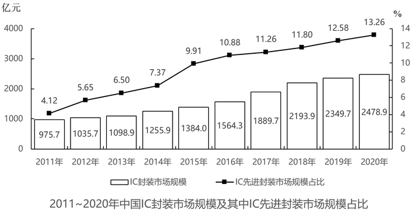

2012~2020年，中国IC封装市场中IC先进封装市场规模占比同比提升1个百分点以上的年份有几个？

- **A**. 2　✅
- **B**. 3
- **C**. 4
- **D**. 5

**答案**：A

**官方解析**

定位统计图，可知2011-2020年中国IC封装市场中IC先进封装市场规模占比，则其占比同比提升1个百分点以上的有2012年（5.65%-4.12%＞1%）、2015年（9.91%-7.37%＞1%），共2年。
故正确答案为A。

---

### 第 2 题　qid 4637158 · 出现于 2022 · 地市级/行政执法

> 共享材料同上一题。

2012~2020年，中国IC封装市场规模同比增量最大的年份是:

- **A**. 2016年
- **B**. 2017年　✅
- **C**. 2018年
- **D**. 2019年

**答案**：B

**官方解析**

根据题干“······同比增量最大的年份是”，可判定本题为增长量比较问题。定位统计图可得：中国IC封装市场规模2015年、2016年、2017年、2018年、2019年分别是1384.0亿元、1564.3亿元、1889.7亿元、2193.9亿元、2349.7亿元。根据公式：增长量=现期量-基期量，则2016-2019年中国IC封装市场规模的同比增长量分别为：

2016年：亿元；

2017年：亿元；

2018年：亿元；

2019年：亿元。

比较可知，中国IC封装市场规模同比增长量最大的年份是2017年。

故正确答案为B。

---

### 第 3 题　qid 4637160 · 出现于 2022 · 地市级/行政执法

> 共享材料同上一题。

已知2020年中国IC封装市场规模同比增长x亿元，IC封装市场中IC先进封装市场规模占比同比增长y个百分点，而2020年往后中国IC封装市场规模及IC先进封装市场规模占比每年都分别同比增长x亿元和y个百分点，则到“十四五”最后一年（2025年），中国IC先进封装市场规模将达到多少亿元?

- **A**. 433
- **B**. 469
- **C**. 521　✅
- **D**. 575

**答案**：C

**官方解析**

根据题干“······‘十四五’最后一年（2025年）······将达到多少亿元”，可判定本题为现期计算问题。定位统计图可得：2020年、2019年IC封装市场规模分别为2478.9亿元、2349.7亿元；IC先进封装市场规模占比分别为13.26%、12.58%。则x=2478.9-2349.7=129.2亿元；y=13.26%-12.58%=0.68%，即0.68个百分点。根据公式：现期量=基期量+增长量×n，则2025年IC封装市场规模=2478.9+129.2×5=3124.9亿元，IC先进封装市场规模占比=13.26%+0.68%×5=16.66%。根据公式：部分=总体×比重，则2025年中国IC先进封装市场规模将达到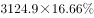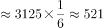亿元。

故正确答案为C。

---

### 第 4 题　qid 4637425 · 出现于 2022 · 副省级/地市级

#### 本题共享材料

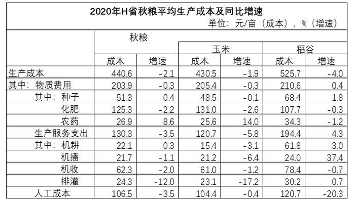

        2020年，H省秋粮玉米和稻谷的市场平均交易价格分别为2.34元/公斤和2.74元/公斤，分别比上年上涨28.6%和8.7%。按此价格测算，2020年全省农户种植玉米、稻谷扣除成本前的产值分别为957.1元/亩、1520.7元/亩，分别比上年增长33.4%、8.9%。

将2020年H省秋粮机耕、机播、机收、排灌成本按同比增量从高到低的顺序排列，以下正确的是：

- **A**. 机收、排灌、机耕、机播
- **B**. 机耕、机播、机收、排灌　✅
- **C**. 机耕、机播、排灌、机收
- **D**. 机收、排灌、机播、机耕

**答案**：B

**官方解析**

根据题干“将2020年······同比增量从高到低的顺序······”，可判定本题为增长量比较问题。定位表格材料可得，2020年H省秋粮机耕成本、增速分别为22.1元/亩，0.3%；机播成本、增速分别为21.7元/亩，-1.1%；机收成本、增速分别为62.3元/亩，-2.0%；排灌成本、增速分别为24.3元/亩，-12.0%。根据机耕成本增长，其余成本均下降，则机耕成本同比增量最高，排除A、D两项。根据公式：增长量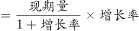，可得机收成本同比增量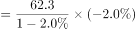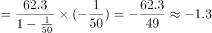；排灌成本同比增量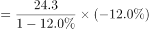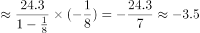；排灌成本同比增量（-3.5）&lt;机收成本同比增量（-1.3），排除C项。

故正确答案为B。

---

### 第 5 题　qid 4639489 · 出现于 2022 · 副省级

#### 本题共享材料

        2021年1-2月，J省发电量为167亿千瓦时，其中风力发电量为17.4亿千瓦时。

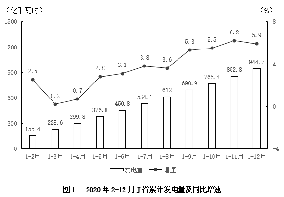

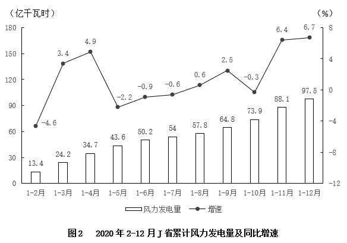

2021年1-2月J省累计发电量同比增速比同期风力发电量同比增速：

- **A**. 高不到10个百分点
- **B**. 低不到10个百分点
- **C**. 高10个百分点以上
- **D**. 低10个百分点以上　✅

**答案**：D

**官方解析**

根据题干“2021年1-2月······同比增速比······同比增速”，可判定本题为一般增长率问题。定位文字材料可得：2021年1-2月J省发电量为167亿千瓦时，其中风力发电量为17.4亿千瓦时。定位图1、图2可得：2020年1-2月J省累计发电量为155.4亿千瓦时，风力发电量为13.4亿千瓦时。根据公式：增长率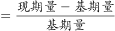，则题干所求，即低20个百分点以上，在D项范围内。

故正确答案为D。

---

### 第 6 题　qid 4639490 · 出现于 2022 · 副省级

> 共享材料同上一题。

2020年3-12月，J省当月发电量同比增速快于当月累计发电量同比增速的月份有几个？

- **A**. 5
- **B**. 6
- **C**. 7　✅
- **D**. 8

**答案**：C

**官方解析**

根据题干“2020年3-12月······当月发电量同比增速快于当月累计发电量同比增速······”，结合材料给出各月累计发电量同比增速，可判定本题为混合增长率问题。定位图1可得2020年2-12月J省各月累计发电量同比增速。当月累计发电量=上月累计发电量+当月发电量，要求当月发电量同比增速快于当月累计发电量同比增速，根据“整体增速介于两部分增速之间”，可得当月发电量同比增速＞当月累计发电量同比增速＞上月累计发电量同比增速，即当月累计发电量同比增速＞上月累计发电量同比增速时满足条件。则满足题意的有4月、5月、6月、7月、9月、10月、11月，共7个月。
故正确答案为C。

---

### 第 7 题　qid 4639653 · 出现于 2022 · 副省级

#### 本题共享材料

        2020年1-6月，全国电池制造业主要产品中，锂离子电池产量71.5亿只，同比增长1.3%；铅酸蓄电池产量9635.6万千伏安时，同比增长6.1%；原电池及原电池组（非扣式）产量178.2亿只，同比下降0.7%。

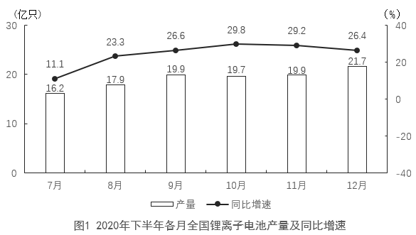

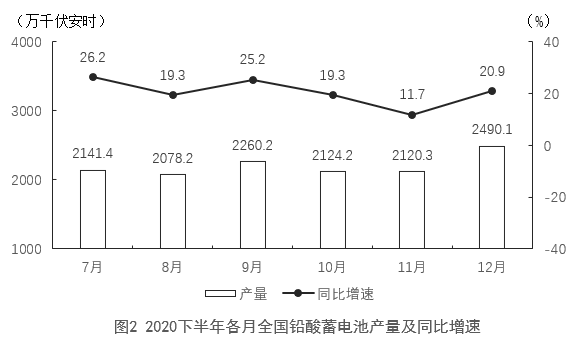

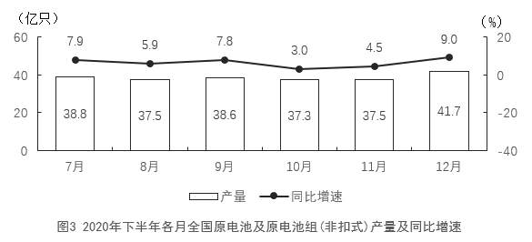

2020年四季度，全国锂离子电池产量约比三季度增长了多少亿只？

- **A**. 5
- **B**. 7　✅
- **C**. 9
- **D**. 11

**答案**：B

**官方解析**

根据题干“2020年四季度······约比三季度增长了多少亿只”，可判定本题为增长量计算问题。定位统计图1可得：2020年7-12月各月全国锂离子电池产量分别为16.2亿只、17.9亿只、19.9亿只、19.7亿只、19.9亿只、21.7亿只。根据公式：增长量=现期量-基期量，则2020年四季度，全国锂离子电池产量比三季度增长了（19.7+19.9+21.7）-（16.2+17.9+19.9）=7.3亿只，与B项最接近。
故正确答案为B。

---

### 第 8 题　qid 4639657 · 出现于 2022 · 副省级

> 共享材料同上一题。

2020年下半年，全国锂离子电池产量同比增速快于铅酸蓄电池产量同比增速的月份有几个？

- **A**. 2
- **B**. 3
- **C**. 4
- **D**. 5　✅

**答案**：D

**官方解析**

定位图1、图2可得，2020年7-12月各月全国锂离子电池产量的同比增速和铅酸蓄电池产量的同比增速。比较可知，2020年下半年，全国锂离子电池产量同比增速快于铅酸蓄电池产量同比增速的月份有：8月（23.3%＞19.3%）、9月（26.6%＞25.2%）、10月（29.8%＞19.3%）、11月（29.2%＞11.7%）、12月（26.4%＞20.9%），共5个。
故正确答案为D。

---

### 第 9 题　qid 5445738 · 出现于 2023 · 副省级/行政执法

#### 本题共享材料

        2021年，全国纺织品服装出口3155亿美元，同比增长8.4%。其中，纺织品出口1452.2亿美元，同比下降5.6%，较2019年增长22.0%；服装出口1702.8亿美元，同比增长24.0%，较2019年增长16.0%。其中，针织服装及衣着附件出口864.8亿美元，同比增长39.0%；梭织服装及衣着附件出口701.2亿美元，同比增长12.6%。

        2021年，中国对美国、东盟、欧盟和日本的纺织品服装出口合计1724.9亿美元。其中，对美国出口额为563.5亿美元，同比增长4.0%；向东盟十国出口纺织品服装491.2亿美元，同比增长24.9%；对欧盟27国出口纺织品服装469.9亿美元，同比下降11.1%；对日本出口纺织品服装200.3亿美元，同比下降7.2%。

        2021年，中国向全球出口纺织纱线138亿美元，出口织物667亿美元，分别同比增长41.5%和34.3%。纺织制品当中，防疫类口罩出口额为129.5亿美元，出口金额、数量同比分别下降76.0%和13.0%。除防疫类口罩外，其他纺织制品出口额为517.2亿美元，同比增长27.5%。

        2021年，中国向“一带一路”沿线国家出口纺织品服装1137.9亿美元，同比增长24.5%，较2019年增长17.3%；同时，中国自“一带一路”沿线国家进口纺织品服装131.6亿美元，同比增长24.5%。

将①美国、②东盟十国、③欧盟27国和④日本按2021年自中国进口纺织品服装金额同比增量从高到低排列，以下正确的是：

- **A**. ①②③④
- **B**. ①②④③
- **C**. ②①③④
- **D**. ②①④③　✅

**答案**：D

**官方解析**

根据题干“······同比增量从高到低······”，可判定本题为增长量比较问题。定位文字材料第二段可得：2021年······对美国出口额为563.5亿美元，同比增长4.0%；向东盟十国出口纺织品服装491.2亿美元，同比增长24.9%；对欧盟27国出口纺织品服装469.9亿美元，同比下降11.1%；对日本出口纺织品服装200.3亿美元，同比下降7.2%。根据公式：增长量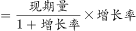，则2021年题干中四个国家自中国进口（即中国对四个国家出口）纺织品服装金额同比增量分别为：①美国：亿美元；②东盟十国：亿美元；③欧盟27国：亿美元；④日本：亿美元。则按同比增量从高到低排列为：②东盟十国（亿美元）、①美国（亿美元）、④日本（亿美元）、③欧盟27国（亿美元）。

故正确答案为D。

---

### 第 10 题　qid 5445742 · 出现于 2023 · 副省级/行政执法

#### 本题共享材料

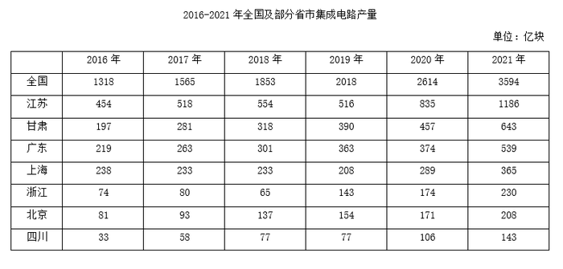

2017~2021年间，全国集成电路产量同比增速超过20%的年份有几个？

- **A**. 1
- **B**. 2　✅
- **C**. 3
- **D**. 4

**答案**：B

**官方解析**

根据题干“2017~2021年间······同比增速······”，可判定本题为一般增长率计算问题。定位统计表可知2016~2021年每年的全国集成电路产量。根据公式：一般增长率，则2017~2021年全国集成电路产量同比增速分别为：

2017年，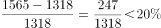；

2018年，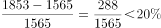；

2019年，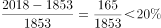；

2020年，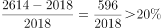；

2021年，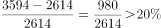。

综上，同比增速超过20%的年份有2020年、2021年，共2个。

故正确答案为B。

---

### 第 11 题　qid 5445743 · 出现于 2023 · 副省级/行政执法

> 共享材料同上一题。

表中所列7个省市中，2019年集成电路产量同比增速超过2%的省市比上年：

- **A**. 少1个　✅
- **B**. 少2个
- **C**. 多1个
- **D**. 多2个

**答案**：A

**官方解析**

根据题干“······2019年······同比增速······”，可判定本题为一般增长率问题。定位统计表可知2017~2019年每年各省市集成电路产量数据。根据公式：增长率，可得：

（1）2018年各省市集成电路产量增长率分别为：

江苏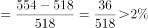；甘肃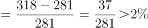；广东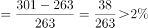；上海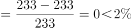；浙江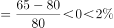；北京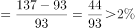；四川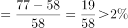。综上，2018年表中所列7个省市中集成电路产量同比增速超过2%的省市有5个。

（2）2019年各省市集成电路产量增长率分别为：

江苏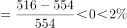；甘肃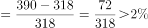；广东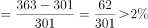；上海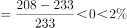；浙江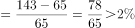；北京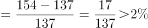；四川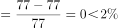。综上，2019年表中所列7个省市中集成电路产量同比增速超过2%的省市有4个。

则表中所列7个省市中，2019年集成电路产量同比增速超过2%的省市（4个）比上年（5个）少1个。

故正确答案为A。

---

### 第 12 题　qid 5445745 · 出现于 2023 · 副省级/行政执法

> 共享材料同上一题。

将①甘肃、②广东、③上海和④浙江按2016~2021年集成电路产量年均增速（以2016年为基期计算）从高到低排列，以下正确的是：

- **A**. ④①②③
- **B**. ④①③②
- **C**. ①④②③　✅
- **D**. ①④③②

**答案**：C

**官方解析**

根据题干“······按2016~2021年······年均增速（以2016年为基期计算）从高到低排列······”，可判定本题为年均增长率问题。定位统计表可知2016年和2021年甘肃、广东、上海、浙江的集成电路产量。根据年均增长率公式：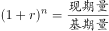（n为年份差），当年份差n相同时，直接根据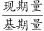的值即可比较年均增长率的大小。计算各省份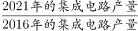可得：①甘肃；②广东；③上海；④浙江，则年均增速从高到低排列为：①④②③。

故正确答案为C。

---

### 第 13 题　qid 5445750 · 出现于 2023 · 副省级/行政执法

> 共享材料同上一题。

以下折线图中，最能准确反映2017~2021年间北京市集成电路产量同比增量变化趋势的是：

- **A**. 

　✅
- **B**. 

- **C**. 

- **D**. 

**答案**：A

**官方解析**

根据题干“······2017~2021年间北京市集成电路产量同比增量变化趋势的是”，可判定本题为增长量比较问题。定位统计表可得：2016~2021年北京市集成电路产量分别为81亿块、93亿块、137亿块、154亿块、171亿块、208亿块。根据公式：增长量=现期量-基期量，则2017年同比增量为93-81=12亿块，2018年为137-93=44亿块，2019年为154-137=17亿块，2020年为171-154=17亿块，2021年为208-171=37亿块。可知2019年与2020年同比增量相等，即折线图中第三和第四个点高度一致，只有A项符合。
故正确答案为A。

---

### 第 14 题　qid 5445756 · 出现于 2023 · 地市级/行政执法

#### 本题共享材料

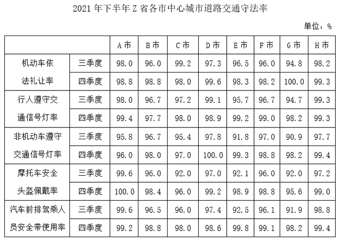

2021年三季度Z省中心城市道路非机动车遵守交通信号灯率最低的城市，其四季度中心城市道路非机动车遵守交通信号灯率比上季度增长了：

- **A**. 4~6个百分点之间
- **B**. 超过6个百分点　✅
- **C**. 不到2个百分点
- **D**. 2~4个百分点之间

**答案**：B

**官方解析**

定位表格材料可得：2021年三季度Z省中心城市道路非机动车遵守交通信号灯率最低的城市是G市（90.9%）。2021年四季度以及三季度G市中心城市道路非机动车遵守交通信号灯率分别为98.2%、90.9%。则2021年四季度G市中心城市道路非机动车遵守交通信号灯率比上季度增长了98.2%-90.9%=7.3%，即增长了7.3个百分点，在B项范围内。
故正确答案为B。

---

### 第 15 题　qid 5445763 · 出现于 2023 · 地市级/行政执法

#### 本题共享材料

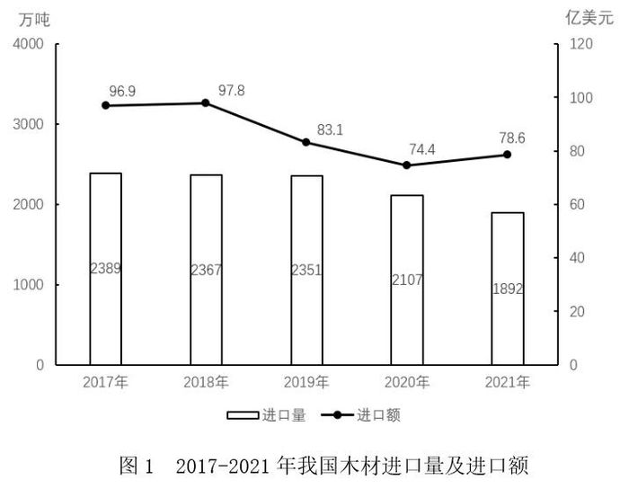

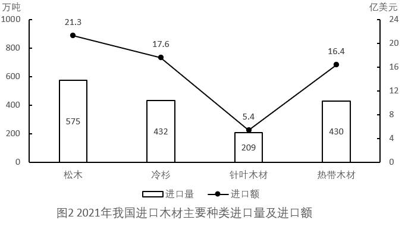

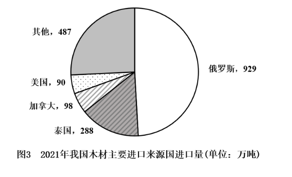

以下折线图中，最能准确反映2018-2021年我国木材进口额同比增量变化趋势的是：

- **A**. 

- **B**. 

- **C**. 

　✅
- **D**. 

**答案**：C

**官方解析**

根据题干“······2018-2021年······同比增量变化趋势”，可判定本题为增长量比较问题。定位图1可得，2017-2021年，我国木材进口额分别为96.9亿美元、97.8亿美元、83.1亿美元、74.4亿美元、78.6亿美元。根据公式：增长量=现期量-基期量，则2018-2021年我国木材进口额同比增量分别为：
2018年，97.8-96.9=0.9亿美元；
2019年，83.1-97.8=-14.7亿美元；
2020年，74.4-83.1=-8.7亿美元；
2021年，78.6-74.4=4.2亿美元。
综上可知，同比增量呈先下降后上升的趋势，且2019年同比增量最低，2021年同比增量最高，与C项变化趋势一致。
故正确答案为C。

---

### 第 16 题　qid 5445850 · 出现于 2023 · 副省级/地市级

#### 本题共享材料

        超级计算，也被称为高性能计算。从算力资源的需求看，高性能计算可以分为尖端超算、通用超算、业务超算和人工智能超算四大类。

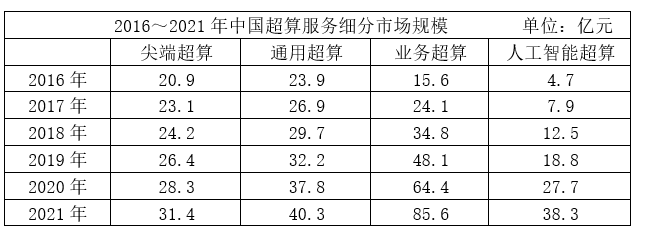

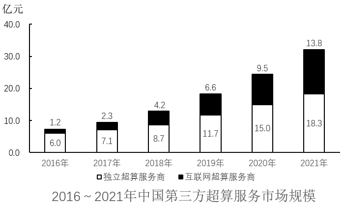

2018年，中国超算服务4类细分市场中，同比增速最快和最慢的市场当年市场规模同比增速相差约多少个百分点？

- **A**. 41
- **B**. 47
- **C**. 53　✅
- **D**. 59

**答案**：C

**官方解析**

根据题干“2018年······同比增速······百分点”，可判定本题为一般增长率问题。定位统计表可得2017、2018年中国超算服务4类细分市场的市场规模。根据公式：增长率，可知2018年，中国超算服务4类细分市场的市场规模同比增速分别为：

尖端超算：；

通用超算：；

业务超算：；

人工智能超算：。

则增速最快的市场为人工智能超算，最慢的市场为尖端超算，所求=58%-5%=53%，即相差约53个百分点。

故正确答案为C。

---

### 第 17 题　qid 5445851 · 出现于 2023 · 副省级/地市级

> 共享材料同上一题。

如保持2021年同比增量不变，则到哪一年第三方互联网超算服务商提供的服务市场规模将第一次超过第三方独立超算服务商？

- **A**. 2025年
- **B**. 2026年　✅
- **C**. 2027年
- **D**. 2028年

**答案**：B

**官方解析**

根据题干“如保持2021年同比增量不变，则到哪一年······将第一次超过······”，可判定本题为现期追赶问题。定位统计图可知2020年、2021年中国第三方独立超算和互联网超算服务商市场规模。根据公式：增长量=现期量-基期量，则2021年第三方互联网超算服务商市场规模同比增量=13.8-9.5=4.3亿元，2021年第三方独立超算服务商市场规模同比增量=18.3-15.0=3.3亿元。根据公式：现期量=基期量+n×增长量，可列式：13.8+n×4.3＞18.3+n×3.3，解得n＞4.5，则n至少为5，即到2026年第三方互联网超算服务商提供的服务市场规模将第一次超过第三方独立超算服务商。
故正确答案为B。

---

### 第 18 题　qid 5445860 · 出现于 2023 · 地市级

#### 本题共享材料

        2021年H省商品、服务类电子商务交易额为11526.13亿元，比上年同期增长21.8%，高于全国增速2.3个百分点。H省跨境电商进出口交易额为2018.3亿元，其中，出口1475.5亿元，同比增长15.7%；进口542.8亿元，同比增长16.0%。H省网上零售额为2948.2亿元，同比增长12.5%，其中，实物商品网上零售额为2426.4亿元，同比增长10.1%。

        从交易对象看，2021年H省商品类电子商务交易额为8896.60亿元，同比增长16.6%；服务类电子商务交易额为2629.53亿元，同比增长43.5%。从交易主体看，2021年H省对单位电子商务交易额为7254.75亿元，同比增长19.8%，占商品、服务类电子商务交易额比重为62.9%；对个人电子商务交易额为4271.38亿元，同比增长25.4%。

        2021年H省共有电子商务平台87个，在本省电商平台上实现交易金额为5354.93亿元，同比增长41.0%，收取的平台交易服务费为3.17亿元，同比增长49.5%。从地区分布来看，2021年本地电子商务平台拥有量最多的为Z市，有44个平台，实现交易金额4239.04亿元。

2021年，全国商品、服务类电子商务交易额同比增长了：

- **A**. 17.2%
- **B**. 19.5%　✅
- **C**. 21.8%
- **D**. 24.1%

**答案**：B

**官方解析**

根据题干“2021年······同比增长了”，结合选项为百分数，可判定本题为一般增长率问题。定位文字材料第一段可得：2021年H省商品、服务类电子商务交易额为11526.13亿元，比上年同期增长21.8%，高于全国增速2.3个百分点。则2021年，全国商品、服务类电子商务交易额同比增长了21.8%-2.3%=19.5%。
故正确答案为B。

---

### 第 19 题　qid 5445929 · 出现于 2023 · 副省级

#### 本题共享材料

        截至2021年底，我国固定互联网宽带接入用户数比上年底净增5224万户。其中，100Mbps及以上接入速率的用户比上年底净增6385万户。

        按接入方式划分，固定互联网宽带接入用户可分为xDSL用户、光纤用户和其他用户；按接入速率划分，固定互联网宽带接入用户可分为100Mbps速率以上用户和其他用户。

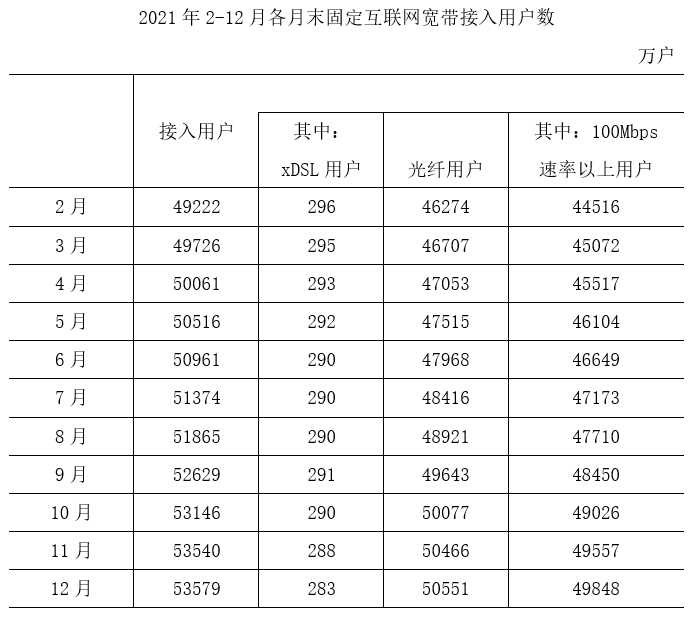

2021年1~2月，我国固定互联网宽带接入用户数月均约增加多少万户？

- **A**. 867
- **B**. 629
- **C**. 434　✅
- **D**. 315

**答案**：C

**官方解析**

根据题干“2021年1~2月······月均约增加······万户”，可判定本题为年均增长量问题。定位文字材料第一段可得：截至2021年底，我国固定互联网宽带接入用户数比上年底净增5224万户；定位统计表可得：2021年2月末我国固定互联网宽带接入用户数为49222万户，12月末为53579万户。根据公式：基期量=现期量-增长量，可得2020年12月末我国固定互联网宽带接入用户数为53579-5224=48355万户。根据公式：年均增长量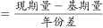，则2021年1~2月，我国固定互联网宽带接入用户数月均增加万户。

故正确答案为C。

---

### 第 20 题　qid 5893712 · 出现于 2024 · 行政执法

#### 本题共享材料

        2023年3月，全国规模以上工业企业的工业机器人完成产量4.4万套，服务机器人完成产量70万套。2023年1~3月全国规模以上工业企业的工业机器人累计完成产量10.4万套，服务机器人累计完成产量145万套。

        2023年3月，我国机器人设备出口金额0.7亿美元，较上年增长110.3%，进口金额2.4亿美元，较上年增长68.5%。2023年1~3月我国机器人设备累计出口金额1.9亿美元，较上年增长62.1%，累计进口金额6.9亿美元，较上年增长55.1%。

        2022年12月，全国规模以上工业企业的工业机器人完成产量4万套，服务机器人完成产量49.1万套。2022年1~12月全国规模以上工业企业的工业机器人累计完成产量44.3万套，服务机器人累计完成产量645.8万套。

        2022年12月，我国工业机器人设备出口金额0.5亿美元，进口金额1.8亿美元。2022年1~12月我国工业机器人设备累计出口金额6.1亿美元，累计进口金额20亿美元。

2023年一季度，我国机器人设备进出口贸易逆差比上年同期：

- **A**. 下降了不到30%
- **B**. 下降了30%以上
- **C**. 上升了不到30%
- **D**. 上升了30%以上　✅

**答案**：D

**官方解析**

方法一：根据题干“2023年一季度······进出口贸易逆差比上年同期······”，结合选项为百分数，可判定本题为一般增长率问题。定位文字材料第二段可知：2023年1~3月，我国机器人设备累计出口金额1.9亿美元，较上年增长62.1%，累计进口金额6.9亿美元，较上年增长55.1%。根据公式：贸易逆差=进口额-出口额，则2023年1-3月，我国机器人设备进出口贸易逆差为6.9-1.9=5亿美元；根据公式：基期量，则2022年1-3月，我国机器人设备进出口贸易逆差为亿美元。根据公式：增长率，故贸易逆差的增长率为，即上升了30%以上。

方法二：根据公式：贸易逆差=进口额-出口额，则进口额=贸易逆差+出口额，结合材料中给出了进口额与出口额的增长率，可判定本题为混合增长率问题。根据混合增长率口诀“混合居中”，则有出口额同比增长率（62.1%）＞进口额同比增长率（55.1%）＞贸易逆差同比增长率（r）。2023年1-3月，我国机器人设备进出口贸易逆差为6.9-1.9=5亿美元，出口额为1.9亿美元，根据“混合增长率偏向基期量大的（一般用现期量代替基期量近似计算）”，故进口额同比增长率更靠近贸易逆差的同比增长率，则有55.1%-r＜62.1%-55.1%，解得r＞48.1%，即上升了30%以上。

故正确答案为D。

---

### 第 21 题　qid 5893722 · 出现于 2024 · 副省级/行政执法

#### 本题共享材料

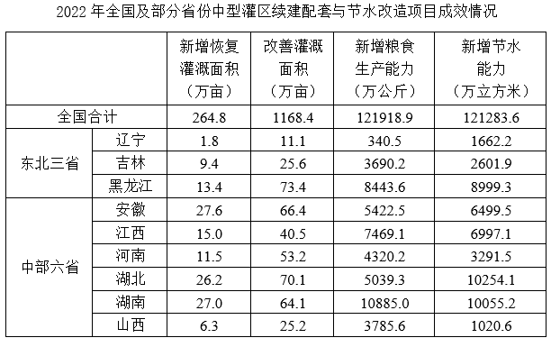

2022年全国粮食产量同比增加368万吨。如全国中型灌区新增粮食生产能力均得到充分利用，则中部六省中型灌区新增粮食生产能力对全国粮食增产的贡献占比为：

- **A**. 不到2%
- **B**. 超过9%　✅
- **C**. 2%~5%之间
- **D**. 5%~9%之间

**答案**：B

**官方解析**

根据题干“2022年······贡献占比为”，可判定本题为现期比重问题。定位表格材料可得：2022年中部六省中型灌区新增粮食生产能力分别为：安徽5422.5万公斤、江西7469.1万公斤、河南4320.2万公斤、湖北5039.3万公斤、湖南10885.0万公斤、山西3785.6万公斤；根据题干可知“2022年全国粮食产量同比增加368万吨”。根据公式：增长贡献率，结合1吨=1000公斤，则题干所求为，在B项范围内。

故正确答案为B。

---

### 第 22 题　qid 5893728 · 出现于 2024 · 地市级/行政执法

#### 本题共享材料

        2022年，S省各级12315工作机构共接收诉求220.4万件，同比增长21.41%。其中，投诉55.6万件、举报26.3万件、咨询138.5万件，比上一年分别增加14.0万件、8.9万件、16.0万件。

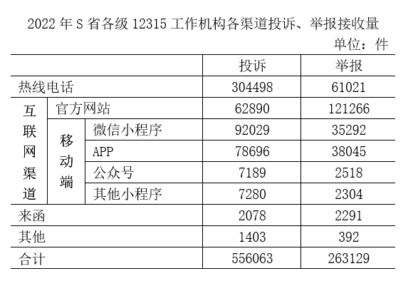

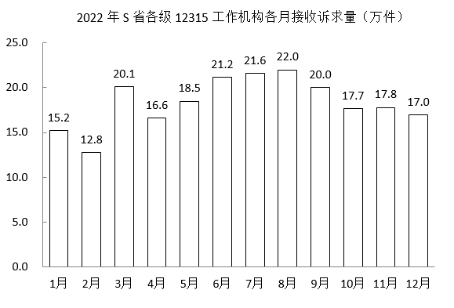

将S省各级12315工作机构接收的投诉、举报和咨询三类诉求量按2022年同比增速从高到低排序，以下正确的是：

- **A**. 投诉量、举报量、咨询量
- **B**. 咨询量、投诉量、举报量
- **C**. 举报量、咨询量、投诉量
- **D**. 举报量、投诉量、咨询量　✅

**答案**：D

**官方解析**

根据题干“······按2022年同比增速从高到低排序······”，可判定本题为一般增长率比较问题。定位文字材料可知：2022年S省各级12315工作机构接收的诉求中：投诉55.6万件、举报26.3万件、咨询138.5万件，比上一年分别增加14.0万件、8.9万件、16.0万件。根据公式：增长率，则2022年三类诉求量的同比增速分别为：投诉量；举报量；咨询量。故同比增速从高到低排序为：举报量、投诉量、咨询量。

故正确答案为D。

---

### 第 23 题　qid 5893729 · 出现于 2024 · 副省级/行政执法

#### 本题共享材料

        截至2022年末，全国累计投运各类电化学储能电站（包括大、中、小型电站）472座，总能量14.05GWh。其中大型电站26座，总能量5.99GWh；中型电站275座，总能量7.23GWh。2022年新增投运电化学储能电站194座，总能量达7.86GWh。其中大型电站19座，总能量4.64GWh；中型电站114座，总能量2.92GWh。

        2022年末累计投运的各类电化学储能电站中，锂离子电池电站435座，总能量占比达到89.2%（磷酸铁锂电池占88.7%，三元锂电池和钛酸锂电池分别占0.3%和0.2%），铅酸/铅碳电池总能量占比4.0%，液流电池总能量占比3.7%。在新增投运的电化学储能电站中，锂离子电池总能量占比达到86.5%，全部为磷酸铁锂电池。此外，铅酸/铅碳电池总能量占2.7%，液流电池总能量占5.6%。

2018-2022年，全国电化学储能电站年末总能量同比增长100%以上的年份有几个？

- **A**. 1
- **B**. 2
- **C**. 3　✅
- **D**. 4

**答案**：C

**官方解析**

根据题干“······同比增长100%以上的年份有几个”，可判定本题为一般增长率问题。定位统计图可得：2017-2022年全国电化学储能电站年末总能量。根据公式：增长率，所求为，化简得：现期量&gt;基期量×2。代入数据可得：2018年（858&gt;311×2），符合；2019年（1415&lt;858×2），不符合；2020年（3349&gt;1415×2），符合；2021年（6197&lt;3349×2），不符合；2022年（14054&gt;6197×2），符合。综上，2018-2022年，全国电化学储能电站年末总能量同比增长100%以上的年份有2018年、2020年、2022年，共3年。

故正确答案为C。

---

### 第 24 题　qid 5893772 · 出现于 2024 · 副省级/地市级

#### 本题共享材料

        2022年，京津冀地区生产总值合计10.0万亿元，是2013年的1.8倍。其中，北京、河北跨越4万亿元量级，均为4.2万亿元，分别是2013年的2.0倍和1.7倍；天津1.6万亿元，是2013年的1.6倍。京津冀第一产业、第二产业、第三产业增加值占生产总值比重构成由2013年的6.2：35.7：58.1变化为2022年的4.8：29.6：65.6。京津冀三地第三产业增加值占生产总值比重分别为83.8%、61.3％和49.4%，较2013年分别提高4.3、7.2和8.4个百分点。

        2013—2022年，京津冀地区城镇累计分别新增就业288.1万、405.5万和748.4万人。2021年，北京法人单位从业人员中，第三产业比重为84.4%，较2013年提高6.2个百分点，其中信息服务业和商务服务业占比达25.5%，较2013年提高6.2个百分点；天津和河北第三产业就业人员占比为60.5％和46.6%，较2013年提高10.9和15.1个百分点。

        2022年，京津冀三地全体居民人均可支配收入分别为77415元、48976元和30867元，与2013年相比，年均分别增长7.4%、7.1％和8.2%。其中，城镇居民人均可支配收入分别增长7.3%、6.9％和7.1%，农村居民人均可支配收入分别增长8.2%、7.3％和8.6%。

以2013年为基期，则2013-2022年京津冀地区生产总值年均约增加多少万亿元？

- **A**. 1.1
- **B**. 0.9
- **C**. 0.7
- **D**. 0.5　✅

**答案**：D

**官方解析**

根据题干“······年均约增加多少万亿元”，可判定本题为年均增长量问题。定位文字材料第一段可得：2022年，京津冀地区生产总值合计10.0万亿元，是2013年的1.8倍。则2013年，京津冀地区生产总值合计万亿元。根据公式：年均增长量，则2013-2022年京津冀地区生产总值年均增加万亿元。

故正确答案为D。

---

### 第 25 题　qid 5893777 · 出现于 2024 · 副省级/地市级

> 共享材料同上一题。

将京、津、冀按2013—2022年居民人均可支配收入年均增速的城乡差值的绝对值从大到小排列，以下正确的是：

- **A**. 京、冀、津
- **B**. 冀、京、津　✅
- **C**. 京、津、冀
- **D**. 冀、津、京

**答案**：B

**官方解析**

定位文字材料第三段可知，2022年与2013年相比，京津冀三地城镇和农村居民人均可支配收入年均增速。三地居民城乡人均可支配收入年均增速差值的绝对值分别为：京，津，冀，故从大到小排列为：冀、京、津。

故正确答案为B。

---

### 第 26 题　qid 5893779 · 出现于 2024 · 副省级/地市级

> 共享材料同上一题。

在以下信息中，能够从上述资料中推出的有几项？
①2013—2022年京津冀第一产业增加值年均增量（以2013年为基期）
②2013年天津第一产业、第二产业增加值之和
③2013—2022年河北城镇新增就业人员中第三产业就业人员人数

- **A**. 0项
- **B**. 1项
- **C**. 2项　✅
- **D**. 3项

**答案**：C

**官方解析**

①定位文字材料第一段可得，2022年，京津冀地区生产总值合计10.0万亿元，是2013年的1.8倍。京津冀第一产业占生产总值比重构成由2013年的6.2：35.7：58.1变化为2022年的4.8：29.6：65.6。则所求年均增量，可以推出；

②定位文字材料第一段可得，2022年······天津1.6万亿元，是2013年的1.6倍。京津冀三地第三产业增加值占生产总值的比重分别为83.8%、61.3%和49.4%，较2013年分别提高4.3、7.2和8.4个百分点。则2013年天津地区生产总值为万亿元，2013年天津第三产业增加值占比为61.3%-7.2%=54.1%。则所求=2013年天津总产值×（1-第三产业增加值占比）万亿元，可以推出；

③定位文字材料第二段可知，材料只给出2022年河北城镇累计新增就业人数和2021年、2013年河北第三产业就业人员占比，2013—2022年河北城镇新增就业人员中第三产业就业人员人数均无法推出。

综上可知，只有①②可以推出，共2项。

故正确答案为C。

---

### 第 27 题　qid 5893793 · 出现于 2024 · 副省级/地市级

#### 本题共享材料

2018~2022年，我国马铃薯单位面积产量同比增长的年份有几个？

- **A**. 2
- **B**. 3
- **C**. 4
- **D**. 5　✅

**答案**：D

**官方解析**

根据题干“2018~2022年······单位面积产量同比增长的年份有几个”，结合材料给出了2017~2022年我国马铃薯的播种面积和产量，可判定本题为两期平均数比较问题。定位图1可得：2017~2022年我国马铃薯的播种面积和产量。单位面积产量，根据两期平均数比较结论“当分子增速（a）大于分母增速（b）时，平均数上升”，观察发现，2018、2020、2021、2022年我国马铃薯产量的同比增长率均大于0，面积的同比增长率均小于0，则这4个年份我国马铃薯单位面积产量为同比增长。只需再判断2019年我国马铃薯单位面积产量是否同比增长即可。

方法一：2018年我国马铃薯单位面积产量为，2019年为，则2019年我国马铃薯单位面积产量同比增长。

方法二：根据公式：增长率，可得2019年我国马铃薯产量的同比增长率（a）为，面积的同比增长率（b）为。a＞b，可判断平均数上升，即2019年我国马铃薯单位面积产量同比增长。

综上分析，2018~2022年我国马铃薯单位面积产量同比增长的年份有5个。

故正确答案为D。

---

### 第 28 题　qid 5893795 · 出现于 2024 · 副省级/地市级

> 共享材料同上一题。

以下折线图反映了2019~2022年我国马铃薯哪一产销数据的同比增量变化趋势？

- **A**. 出口额
- **B**. 出口量
- **C**. 播种面积
- **D**. 产量　✅

**答案**：D

**官方解析**

根据题干“以下折线图反映了2019~2022年······同比增量变化趋势”，可判定本题为增长量比较问题。定位图1可得2018~2022年我国马铃薯播种面积及产量；定位图2可得2018~2022年我国马铃薯出口额及出口量。根据公式：增长量=现期量-基期量，可得：
A项：2019年出口额同比上升（3.98亿美元&gt;2.61亿美元），增长量&gt;0；2020年出口额同比下降（2.90亿美元&lt;3.98亿美元），增长量&lt;0。则第二个点应低于第一个点，不符合折线图趋势，排除；
B项：2019年出口量同比上升（50.33万吨&gt;44.81万吨），增长量&gt;0；2020年出口量同比下降（44.19万吨&lt;50.33万吨），增长量&lt;0。则第二个点应低于第一个点，不符合折线图趋势，排除；
C项：2020年播种面积同比增量为466-467=-1万公顷；2021年同比增量为461-466=-5万公顷。则第三个点应低于第二个点，不符合折线图趋势，排除；
D项：2019年产量同比增量为1778-1798=-20万吨；2020年同比增量为1798-1778=20万吨；2021年同比增量为1831-1798=33万吨；2022年同比增量为1852-1831=21万吨，符合折线图趋势，当选。
故正确答案为D。

---

### 第 29 题　qid 5894966 · 出现于 2024 · 地市级

#### 本题共享材料

2019年，蜂窝物联网终端用户数同比增量约是移动电话用户数同比增量的多少倍？

- **A**. 7
- **B**. 10　✅
- **C**. 13
- **D**. 16

**答案**：B

**官方解析**

根据题干“2019年······约是······的多少倍”，可判定本题为现期倍数问题。定位图2可得：2019年蜂窝物联网终端用户数10.28亿户，移动电话用户数16.01亿户；2018年蜂窝物联网终端用户数6.71亿户，移动电话用户数15.66亿户。根据公式：增长量=现期量-基期量，则题干所求倍。

故正确答案为B。

---

### 第 30 题　qid 5894968 · 出现于 2024 · 地市级

> 共享材料同上一题。

以下年份中，全国电信新兴业务收入同比增速最快的是：

- **A**. 2019年
- **B**. 2020年
- **C**. 2021年　✅
- **D**. 2022年

**答案**：C

**官方解析**

根据题干“以下年份中······同比增速最快的是”，可判定本题为一般增长率比较问题。定位图1可得：2018~2022年全国电信新兴业务收入分别为1084亿元、1374亿元、1737亿元、2372亿元、3072亿元。根据公式：增长率，可得2019~2022年各年全国电信新兴业务收入同比增速分别为：

A项：2019年，；

B项：2020年，；

C项：2021年，；

D项：2022年，。

比较可知，全国电信新兴业务收入同比增速最快的是2021年。

故正确答案为C。

---

### 第 31 题　qid 5894970 · 出现于 2024 · 地市级

> 共享材料同上一题。

以下折线图反映了2019~2022年全国哪一类电信业务收入同比增量的变化趋势？

- **A**. 新兴业务
- **B**. 移动数据流量业务
- **C**. 互联网宽带接入业务
- **D**. 语音业务　✅

**答案**：D

**官方解析**

根据题干“······2019~2022年······同比增量的变化趋势”，可判定本题为增长量比较问题。定位图1可知2018~2022年全国主要电信业务收入。根据公式：增长量=现期量-基期量，可得2019~2022年全国主要电信业务收入的同比增量：

A项：2019年，亿元；2020年，亿元。不符合折线图中第二个点低于第一个点的趋势，排除；

B项：2021年，亿元；2022年，亿元。不符合折线图中第四个点高于第三个点的趋势，排除；

C项：2019年，亿元；2020年，亿元。不符合折线图中第二个点低于第一个点的趋势，排除；

D项：2019年，1613-1744=-131亿元；2020年，1435-1613=-178亿元；2021年，1375-1435=-60亿元；2022年，1364-1375=-11亿元。完全符合折线图的变化趋势，当选。

故正确答案为D。

---

### 第 32 题　qid 19283734 · 出现于 2025 · 副省级/行政执法

#### 本题共享材料

        2023年三季度，支付系统共处理支付业务3358.88亿笔，金额3151.37万亿元，同比分别增长12.59%和6.97%。

        三季度，人民银行清算总中心系统共处理支付业务54.79亿笔，金额2379.52万亿元，同比分别增长0.92%和9.53%，其中，大额实时支付系统处理业务9518.17万笔，同比下降10.39%，金额2254.07万亿元，同比增长9.72%；小额批量支付系统处理业务11.51亿笔，金额46.69万亿元，同比分别增长5.73%和10.03%；网上支付跨行清算系统处理业务42.31亿笔，同比下降0.03%，金额74.66万亿元，同比增长5.38%；境内外币支付系统处理业务134.46万笔，同比增长2.83%，金额5707.35亿美元，同比下降14.63%。

        在其他支付系统中，银行行内业务系统三季度处理业务54.42亿笔，同比增长11.14%，金额539.56万亿元，同比下降4.10%；银联跨行支付系统处理业务837.93亿笔，金额70.27万亿元，同比分别增长21.37%和8.70%；城银清算支付清算系统处理业务1056.40万笔，金额9744.45亿元，同比分别增长34.61%和36.31%；农信银支付清算系统处理业务7.41亿笔，金额7162.13亿元，同比分别下降39.98%和13.55%；人民币跨境支付系统处理业务176.43万笔，金额33.42万亿元，同比分别增长43.23%和31.41%；网联清算平台处理业务2404.21亿笔，金额126.92万亿元，同比分别增长10.42%和6.28%。

2023年三季度，人民银行清算总中心系统处理支付业务中，小额批量支付系统处理业务笔数的占比同比：

- **A**. 下降了2个百分点以上
- **B**. 下降了不到2个百分点
- **C**. 上升了2个百分点以上
- **D**. 上升了不到2个百分点　✅

**答案**：D

**官方解析**

根据题干“2023年三季度，······中······的占比同比”，结合选项为“上升/下降+百分点”，可判定本题为两期比重计算问题。定位文字材料第二段可得：2023年三季度，人民银行清算总中心系统共处理支付业务54.79亿笔（B），同比增长0.92%（b），其中，小额批量支付系统处理业务11.51亿笔（A），同比增长5.73%（a）。根据公式：两期比重差，则题干所求，即上升了不到2个百分点。

故正确答案为D。

---

### 第 33 题　qid 19283738 · 出现于 2025 · 副省级/行政执法

> 共享材料同上一题。

将其他支付系统中①银行行内业务系统、②银联跨行支付系统、③城银清算支付清算系统和④农信银支付清算系统按2023年三季度平均每笔业务金额同比增速从高到低排列，以下正确的是：

- **A**. ①②③④
- **B**. ③②①④
- **C**. ④③②①　✅
- **D**. ④①②③

**答案**：C

**官方解析**

根据题干“······2023年三季度平均每笔业务金额同比增速······”，可判定本题为平均数的增长率问题。定位文字资料第三段可得：（2023年三季度）在其他支付系统中，银行行内业务系统三季度处理业务数量同比增长11.14%（），金额同比下降4.10%（）；银联跨行支付系统处理业务数量和金额同比分别增长21.37%（）和8.70%（）；城银清算支付清算系统处理业务数量和金额同比分别增长34.61%（）和36.31%（）；农信银支付清算系统处理业务数量和金额同比分别下降39.98%（）和13.55%（）。根据公式：平均数的增长率，则2023年三季度①银行行内业务系统、②银联跨行支付系统、③城银清算支付清算系统和④农信银支付清算系统平均每笔业务金额同比增速分别为：

①银行行内业务系统：；

②银联跨行支付系统：；

③城银清算支付清算系统：；

④农信银支付清算系统：。

综上可知，同比增速从高到低排列为：④③②①。

故正确答案为C。

---

### 第 34 题　qid 19283742 · 出现于 2025 · 副省级/行政执法

#### 本题共享材料

        截至2023年末，我国集成电路布图设计登记累计申请93147件，发证72378件，2024年1-4月，我国集成电路布图设计登记申请3503件，发证4189件。

如2024年5-12月，我国集成电路布图设计登记月均发证量与1-4月水平相同，则2024年全年，我国集成电路布图设计登记发证量将比上年：

- **A**. 下降不到20%
- **B**. 下降20%以上
- **C**. 上升不到20%　✅
- **D**. 上升20%以上

**答案**：C

**官方解析**

根据题干“······我国集成电路布图设计登记发证量将比上年”，结合选项为百分数，可判定本题为一般增长率问题。定位文字材料可知：2024年1-4月，我国集成电路布图设计登记申请3503件，发证4189件。定位统计图可知：2023年我国集成电路布图设计登记发证11316件。则2024年1-4月我国集成电路布图设计登记月均发证量件，2024年全年我国集成电路布图设计登记发证量=4189+1047×（12-4）=12565件。根据公式：增长率，可得2024年全年我国集成电路布图设计登记发证量比上年增长，即上升不到20%。

故正确答案为C。

---

### 第 35 题　qid 19283744 · 出现于 2025 · 副省级/行政执法

> 共享材料同上一题。

2019-2021年，我国集成电路布图设计登记申请量三年的同比增速：

- **A**. 先升后降
- **B**. 先降后升
- **C**. 逐年上升
- **D**. 逐年下降　✅

**答案**：D

**官方解析**

根据题干“2019-2021······三年的同比增速”，可判定本题为一般增长率问题。定位统计图可得：2018-2021年我国集成电路布图设计登记申请量分别为4431件、8319件、14375件、20353件。根据公式：增长率，则2019-2021年我国集成电路布图设计登记申请量同比增速分别为：

2019年，；

2020年，；

2021年，。

综上所述，2019-2021年，我国集成电路布图设计登记申请量同比增速逐年下降。

故正确答案为D。

---

### 第 36 题　qid 19283747 · 出现于 2025 · 副省级/行政执法

> 共享材料同上一题。

以下柱状图反映了哪一时间段内，我国集成电路布图设计登记发证量同比增量的变化趋势（横轴位置表示增量为0）？

- **A**. 2017-2020年
- **B**. 2016-2019年
- **C**. 2019-2022年
- **D**. 2018-2021年　✅

**答案**：D

**官方解析**

根据题干“······同比增量的变化趋势”，可判定本题为增长量比较问题。定位统计图可得2015-2022年我国集成电路布图设计登记发证量。根据公式：增长量=现期量-基期量，则2016-2022年我国集成电路布图设计登记发证量同比增量分别为：

2016年，；

2017年，；

2018年，；

2019年，；

2020年，；

2021年，；

2022年，9106-13087&lt;0。

观察可知，柱状图呈现先上升再下降的趋势，且第三个柱子最高，与2018-2021年同比增量的变化趋势一致。

故正确答案为D。

---

### 第 37 题　qid 19283763 · 出现于 2025 · 地市级/行政执法

#### 本题共享材料

如保持2023年同比增量不变，则到哪一年Z省律师办理法律业务数将首次超过150万件？

- **A**. 2026年
- **B**. 2027年
- **C**. 2028年　✅
- **D**. 2029年

**答案**：C

**官方解析**

根据题干“如保持2023年同比增量不变，则到哪一年······将首次超过150万件”，结合材料时间为2023年，可判定本题为现期追赶问题。定位统计表可得：2022年、2023年Z省律师办理法律业务数分别为81.24万件、93.55万件。根据公式：增长量=现期量-基期量，则2023年Z省律师办理法律业务数的同比增长量=93.55-81.24=12.31万件。根据公式：现期量=基期量＋n×增长量，可列式：93.55＋n×12.31&gt;150，解得n&gt;4.6，则n至少为5，即2023+5=2028年Z省律师办理法律业务数将首次超过150万件。
故正确答案为C。

---

### 第 38 题　qid 19283764 · 出现于 2025 · 地市级/行政执法

> 共享材料同上一题。

以下柱状图反映了2021、2022和2023年Z省律师、基层法律服务工作哪一指标的同比增量变化趋势（横轴位置表示增量为0）？

- **A**. 律师事务所总数
- **B**. 律师人数
- **C**. 村（社区）法律顾问数
- **D**. 法律顾问数（不含村、社区）　✅

**答案**：D

**官方解析**

根据题干“以下柱状图反映了2021、2022和2023年······同比增量变化趋势（横轴位置表示增量为0）”，可判定本题为增长量比较问题。定位统计表可得2020-2023年Z省律师事务所总数、律师人数、村（社区）法律顾问数、法律顾问数（不含村、社区）。根据公式：增长量=现期量-基期量，可得2021-2023年各指标同比增长量：

A项，律师事务所总数：2022年，1755-1705=50家；2023年，1826-1755=71家。2022年同比增长量＜2023年同比增长量，不符合柱状图变化趋势，排除；

B项，律师人数：2021年，30889-27302=人；2022年，36938-30889=人。2021年同比增长量＜2022年同比增长量，不符合柱状图变化趋势，排除；

C项，村（社区）法律顾问数：2021年（24951家）＜2020年（26153家），同比增长量＜0，而柱状图（横轴位置表示增量为0）中2021年同比增长量＞0，不符合，排除；

D项，法律顾问数（不含村、社区）：2021年，89450-72739=家；2022年，102251-89450=家；2023年，111811-102251=家。2021年同比增长量＞2022年同比增长量＞2023年同比增长量，符合柱状图变化趋势，当选。

故正确答案为D。

---

### 第 39 题　qid 19283908 · 出现于 2025 · 地市级

#### 本题共享材料

        2023年一季度，我国外贸进出口总额为9.89万亿元，同比增加0.45万亿元。其中，东部地区进出口7.75万亿元，同比增长2.9%；中西部、东北地区分别进出口1.84万亿元、2975.4亿元，同比分别增长12.6%、9.4%。

        2月份，东部地区进出口同比增速由1月份的下降11.1%转为增长7%，3月份增速扩大至15.8%。一季度有进出口实绩企业数量38.7万家，同比增长5.2%。一季度，东部地区出口高技术产品7741.7亿元，同比增长9.8%，占东部地区出口额比重为17.9%，同比提升0.7个百分点，其中3月增速为21%。

        一季度，中西部地区民营企业进出口1.08万亿元，同比增长32.8%，中西部地区对“一带一路”沿线国家进出口7400.9亿元，同比增长38%。一般贸易占中西部地区进出口总额的56.6%，同比提升4.9个百分点。

        一季度，东北地区黑色金属冶炼和压延加工业、汽车制造业、铁路船舶等其他运输设备制造业出口同比分别增长42.9%、62.3%、136.4%。化肥、种子分别进口25亿元、5867.6万元，同比分别增长117.8%、119.9%。

2023年一季度，中西部地区对“一带一路”沿线国家进出口贸易额同比增量约占同期中西部地区外贸进出口总额同比增量的：

- **A**. 33%
- **B**. 55%
- **C**. 77%
- **D**. 99%　✅

**答案**：D

**官方解析**

根据题干“2023年一季度······占······”，结合材料时间为2023年一季度，可判定本题为现期比重问题。定位文字材料第一段可得：2023年一季度，中西部地区进出口1.84万亿元，同比增长12.6%。定位文字材料第三段可得：（2023年）一季度，中西部地区对“一带一路”沿线国家进出口7400.9亿元，同比增长38%。根据公式：增长量、比重，可得所求，与D项最接近。

故正确答案为D。

---

### 第 40 题　qid 19526212 · 出现于 2026 · 地市级/行政执法

#### 本题共享材料

2024年上半年，中国医药保健品进出口贸易顺差（出口额-进口额）比上年同期：

- **A**. 下降了20%以上
- **B**. 下降了不到20%
- **C**. 上升了20%以上　✅
- **D**. 上升了不到20%

**答案**：C

**官方解析**

根据题干“2024年上半年······顺差（出口额-进口额）比上年同期”，结合选项为百分数，且出口额=进口额+顺差，可判定本题为混合增长率问题。定位统计表可得：2024年上半年，中国医药保健品进、出口额分别为451.76亿美元、525.79亿美元，同比增长率分别为-5.76%、1.96%。根据混合增长率口诀“混合后居中但不正中”可得，进口额增长率（-5.76%）＜出口额增长率（1.96%）＜顺差增长率，排除A、B两项。

2024年上半年中国医药保健品进出口贸易顺差亿美元，根据线段法：距离与量成反比（一般用现期量代替基期量计算），可得：，解得：，在C项范围内。

故正确答案为C。

---

### 第 41 题　qid 19526214 · 出现于 2026 · 地市级/行政执法

> 共享材料同上一题。

表中所列医药保健品12个小类中，2024年上半年进出口总额同比上升的有几类？

- **A**. 7　✅
- **B**. 6
- **C**. 5
- **D**. 4

**答案**：A

**官方解析**

根据题干“······2024年上半年······同比上升的有几类”，结合材料给出2024年上半年各小类医药保健品进口额、出口额及分别的同比增速，可判定本题为混合增长率问题。定位统计表可得2024年上半年，医药保健品12个小类进口额、出口额及分别的同比增速。根据混合增长率口诀“混合居中不正中，偏向基期较大的（一般用现期代替）”，观察可知中成药、保健品、西药原料、生化药、保健康复用品、口腔设备与材料这6类的进、出口额同比增速均大于0，则进出口总额同比增速也大于0，则同比上升，均满足；中药材及饮片、医用敷料进、出口额同比增速均小于0，则进出口总额同比增速也小于0，则同比下降，均不满足；其余类别进、出口额同比增速一正一负，其中提取物：现期量出口额14.92亿美元&gt;进口额3.58亿美元，则，即r&lt;0，则同比下降，不满足；西成药：现期量进口额110.28亿美元&gt;出口额35.24亿美元，则，即r&lt;0，则同比下降，不满足；一次性耗材：现期量出口额48.81亿美元&gt;进口额19.55亿美元，则，即r&gt;0，则同比上升，满足；医院诊断与治疗：现期量进口额138.23亿美元&gt;出口额103.95亿美元，则，即r&lt;0，则同比下降，不满足。

综上可知，2024年上半年进出口总额同比上升的有中成药、保健品、西药原料、生化药、一次性耗材、保健康复用品、口腔设备与材料，共7类。

故正确答案为A。

---

### 第 42 题　qid 19526215 · 出现于 2026 · 地市级/行政执法

> 共享材料同上一题。

将2024年上半年①医用敷料②一次性耗材③保健康复用品④口腔设备与材料进口额同比增量从高到低排序正确的是：

- **A**. ③④①②
- **B**. ③④②①
- **C**. ④③①②　✅
- **D**. ④③②①

**答案**：C

**官方解析**

根据题干“······2024年上半年······同比增量从高到低排序······”，可判定本题为增长量比较问题。定位表格可得：2024年上半年，医用敷料、一次性耗材、保健康复用品、口腔设备与材料的进口额分别为2.60亿美元、19.55亿美元、9.04亿美元、7.31亿美元，同比增速分别为-8.34%、-3.05%、9.62%、14.27%。根据公式：增长量，则以上四类医疗器械进口额的同比增量分别为：①医用敷料：亿美元；②一次性耗材：亿美元；③保健康复用品：亿美元；④口腔设备与材料：亿美元。比较可知，同比增量从高到低排序正确的是：④③①②。

故正确答案为C。

---

### 第 43 题　qid 19526220 · 出现于 2026 · 行政执法

#### 本题共享材料

        2024年，我国企业发明专利产业化平均收益（平均每件已产业化的有效专利产生的收益）为869.5万元/件，较上年增长4.8％。其中，战略性新兴产业和未来产业领域的企业发明专利产业化平均收益分别为939.1万元/件和1132.7万元/件。分企业规模看，中型企业发明专利产业化平均收益最高，为991.9万元/件，其次为大型企业和小型企业，分别为953.9万元/件和752.4万元/件，微型企业相对最低，为260.1万元/件。

资料所列13个行业中，2024年企业发明专利产业化率同比增量超过3个百分点的有几个？

- **A**. 5
- **B**. 6
- **C**. 7　✅
- **D**. 8

**答案**：C

**官方解析**

根据题干“2024年······同比增量超过······有几个”，可判定本题为增长量计算问题。定位统计图可知2023年及2024年我国不同行业企业发明专利产业化率。根据公式：增长量=现期量-基期量，本题所求企业发明专利产业化率的增长量，2024年企业发明专利产业化率相当于现期量，2023年企业发明专利产业化率相当于基期量，故2024年各行业企业发明专利产业化率的同比增量如下：
研究和试验发展：32.5%-31.9%=0.6个百分点，不符合；
专业技术服务业：34.2%-29.6%=4.6个百分点，符合；
医药制造业：46.8%-43.0%=3.8个百分点，符合；
计算机、通信和其他电子设备制造业：50.8%&lt;52.2%，即同比减少，不符合；
软件和信息技术服务业：54.9%&lt;55.3%，即同比减少，不符合；
汽车制造业：62.2%&lt;63.3%，即同比减少，不符合；
非金属矿物制造业：63.7%-57.8%=5.9个百分点，符合；
橡胶和塑料制品业：63.8%-62.5%=1.3个百分点，不符合；
化学原料和化学制品制造业：64.4%-57.4%=7.0个百分点，符合；
金属制品业：64.9%-58.1%=6.8个百分点，符合；
通用设备制造业：67.5%-61.6%=5.9个百分点，符合；
专用设备制造业：68.9%-66.9%=2.0个百分点，不符合；
电气机械和器材制造业：71.2%-63.8%=7.4个百分点，符合。
综上，资料所列13个行业中，2024年企业发明专利产业化率同比增量超过3个百分点的有7个。
故正确答案为C。

---

### 第 44 题　qid 19526223 · 出现于 2026 · 地市级/行政执法

#### 本题共享材料

      科幻产业包括科幻阅读、科幻影视、科幻游戏、科幻衍生品、科幻文旅五大领域。2024年，我国科幻产业总营收1089.6亿元。

如保持2024年同比增量不变，则2026-2030年，我国科幻游戏产业累计营收将在以下哪个范围内？

- **A**. 不到4500亿元
- **B**. 4500亿～4750亿元之间
- **C**. 超过5000亿元
- **D**. 4750亿～5000亿元之间　✅

**答案**：D

**官方解析**

根据题干“如保持2024年同比增量不变，则2026-2030年······将在以下哪个范围内”，结合材料时间为2022-2024年，可判定本题为现期计算问题。定位统计图2可得：2023年、2024年我国科幻游戏产业营收分别为：651.9亿元、718.1亿元。根据公式：增长量=现期量-基期量，则2024年我国科幻游戏产业营收同比增量=718.1-651.9=66.2亿元。根据公式：现期量=基期量+n×增长量（n为年份差），则2026年营收=718.1+66.2×2=850.5亿元。可知2026-2030年累计营收构成首项为850.5、公差为66.2、项数为5的等差数列，根据等差数列求和公式：（n为项数），则2026-2030年，我国科幻游戏产业累计营收亿元，在D项范围内。

故正确答案为D。

---

### 第 45 题　qid 19526224 · 出现于 2026 · 地市级/行政执法

> 共享材料同上一题。

我国科幻产业五大领域中，2024年营收额同比增速快于2023年水平的有几个？

- **A**. 4
- **B**. 3
- **C**. 2　✅
- **D**. 1

**答案**：C

**官方解析**

根据题干“······2024年······同比增速快于2023年水平······”，可判定本题为一般增长率比较问题。定位统计图2可得：2024年我国科幻产业五大领域营收额分别为：35.1亿元、67.1亿元、718.1亿元、25.3亿元、244.0亿元；2023年我国科幻产业五大领域营收额分别为：31.7亿元、115.9亿元、651.9亿元、22.8亿元、310.6亿元；2022年我国科幻产业五大领域营收额分别为：30.4亿元、83.5亿元、565.0亿元、48.3亿元、150.3亿元，根据公式：增长率可得：

2024年我国科幻产业五大领域营收额的同比增速分别如下：

科幻阅读：；

科幻影视：；

科幻游戏：；

科幻衍生品：；

科幻文旅：。

2023年我国科幻产业五大领域营收额的同比增速分别如下：

科幻阅读：；

科幻影视：；

科幻游戏：；

科幻衍生品：；

科幻文旅：。

综上可知，我国科幻产业五大领域中，2024年营收额同比增速快于2023年水平的有科幻阅读、科幻衍生品两个领域。

故正确答案为C。

---

### 第 46 题　qid 19526226 · 出现于 2026 · 地市级/行政执法

> 共享材料同上一题。

以下柱状图反映了哪一时间段内，我国科幻产业营收额同比增量的变化情况（横轴位置表示增量为0）？

- **A**. 2021~2024年
- **B**. 2020~2023年
- **C**. 2019~2022年
- **D**. 2018~2021年　✅

**答案**：D

**官方解析**

根据题干“······我国科幻产业营收额同比增量的变化情况······”，可判定本题为增长量比较问题。定位图1可知2017~2024年我国科幻产业各年度营收额，根据公式：增长量=现期量-基期量，则选项中各年份增长量分别为：
A项：2021年，829.6-551.1=278.5亿元；2022年，877.5-829.6=47.9亿元；2023年，1132.9-877.5=255.4亿元，题干图中第三年增长量为负，排除。
B项：2020年，551.1-658.7=-107.6亿元，题干图中第一年增长量为正，排除。
C项：2019年，658.7-456.4=202.3亿元；2020年，551.1-658.7=-107.6亿元，题干图中第二年增长量为正，排除。
D项：2018年，456.4-140.0=316.4亿元；2019年，658.7-456.4=202.3亿元；2020年，551.1-658.7=-107.6亿元；2021年，829.6-551.1=278.5亿元，符合题干图形的变化情况，当选。
故正确答案为D。

---

### 第 47 题　qid 19526227 · 出现于 2026 · 行政执法

#### 本题共享材料

        2025年清明假期3天，Y省接待游客2110.5万人次，同比增长6.4%；实现旅游收入107.8亿元，同比增长8.7%。全省4A级及以上景区接待游客657.5万人次，同比增长7.4%；纳入监测的13家红色旅游经典景区接待游客54.7万人次，同比增长5.1%。

        2025年“五一”假期5天，Y省接待游客4608.2万人次，同比增长18.7%；实现旅游收入295亿元，同比增长20.3%。全省4A级及以上景区接待游客1629.9万人次，同比增长14.3%；纳入监测的13家红色旅游经典景区接待游客119.5万人次，同比增长12.0%。

        2025年端午假期3天，Y省接待游客2321.0万人次，同比增长20.6%；实现旅游收入114.4亿元，同比增长25.6%。全省4A级及以上景区接待游客726.1万人次，同比增长18.9%；纳入监测的13家红色旅游经典景区接待游客54.4万人次，同比增长17.5%。

2025年清明假期、“五一”假期和端午假期，Y省接待游客总人次数比上年增长了：

- **A**. 超过1400万人次
- **B**. 1100万~1400万人次之间　✅
- **C**. 800万~1100万人次之间
- **D**. 不到800万人次

**答案**：B

**官方解析**

根据题干“······接待游客总人次数比上年增长了”，结合选项带单位，可判定本题为增长量计算问题。定位文字材料第一、二、三段可得：2025年清明假期，Y省接待游客2110.5万人次，同比增长6.4%；“五一”假期，Y省接待游客4608.2万人次，同比增长18.7%；端午假期，Y省接待游客2321.0万人次，同比增长20.6%。根据公式：增长量，可得所求万人次，在B项范围内。

故正确答案为B。

---

### 第 48 题　qid 19526366 · 出现于 2026 · 副省级/地市级

#### 本题共享材料

        2024年，我国对联合国定义的45个最不发达国家（以下简称最不发达国家）进出口14230.2亿元人民币，占同期我国外贸进出口总值的3.2%。其中出口8664.6亿元，同比（下同）增长4.3%；进口5565.5亿元，增长12.8%。

        2024年，我国对最不发达国家出口机电产品3942.2亿元，增长13.5%。其中出口船舶690.8亿元，增长65.9%，主要出口至全球第一大船旗国利比里亚。出口金额654.3亿元，增长67%；出口工程机械、火车分别为165.3亿元、91.6亿元，分别增长28.9%、39.5%；出口劳动密集型产品2481亿元，增长3.7%，其中纺织品1623.5亿元，增长15.3%。

        2024年，我国自最不发达国家进口铜材、原油、金属矿砂分别为1469.6亿元、1364.2亿元、1221亿元。最不发达国家成为我国钢材、铝矿、锡矿、钨矿、钛矿第一大进口来源地，分别占我国同类商品进口总值的38.2%，73.1%，65.4%，57.7%，58.1%。

        2024年12月1日起，我国给予所有已建交的最不发达国家100%税目产品零关税待遇。12月，我国自最不发达国家进口512.7亿元，增长18.1%，其中自刚果民主共和国、几内亚、老挝、赞比亚分别进口156.3亿元，54.7亿元，35.6亿元，33.9亿元，分别增长84.6%，40.3%，25.7%、127.27%。

2024年，我国对最不发达国家进出口总值同比增速约为：

- **A**. 9.5%
- **B**. 8.5%
- **C**. 7.5%　✅
- **D**. 10.5%

**答案**：C

**官方解析**

根据题干“2024年······同比增速约为”，结合材料给出2024年我国对最不发达国家进口、出口总值及同比增速，且进口总值+出口总值=进出口总值，可判定本题为混合增长率问题。定位文字材料第一段可得：2024年，我国对最不发达国家出口8664.6亿元，同比（下同）增长4.3%；进口5565.5亿元，增长12.8%。根据混合增长率口诀“混合居中不正中，偏向基期量大的一方（一般用现期量代替基期量）”可知，，排除A、D两项。根据线段法“距离与量成反比（一般用现期量代替基期量）”可知，，解得，与C项最接近。

故正确答案为C。

---

### 第 49 题　qid 19526443 · 出现于 2026 · 副省级

#### 本题共享材料

2025年1~2月，上海期货交易所成交额同比增速在以下哪个范围内？

- **A**. 不到45%
- **B**. 超过85%
- **C**. 45%~65%之间
- **D**. 65%~85%之间　✅

**答案**：D

**官方解析**

根据题干“2025年1~2月······同比增速在以下哪个范围内”，结合选项是百分数，且材料给出2025年一季度与3月的相关数据，可判定本题为混合增长率问题。定位统计表可得：2025年一季度，上海期货交易所成交额为48.2万亿元、同比增速为54.4%；2025年3月，上海期货交易所成交额为19.4万亿元、同比增速为31.9%。根据混合增长率结论“混合后居中不正中”，可得，排除A项。2025年1~2月上海期货交易所成交额=48.2-19.4=28.8万亿元，根据混合增长率口诀：增速差与基期量成反比（一般用现期量代替基期量计算），可得，解得，在D项范围内。

故正确答案为D。

---

### 第 50 题　qid 19526446 · 出现于 2026 · 副省级

> 共享材料同上一题。

全国期货交易所中，2025年3月平均每手成交额同比增幅和同比降幅最大的分别是：

- **A**. 中国金融期货交易所，广州期货交易所
- **B**. 中国金融期货交易所，上海国际能源交易中心
- **C**. 上海期货交易所，广州期货交易所　✅
- **D**. 上海期货交易所，上海国际能源交易中心

**答案**：C

**官方解析**

根据题干“2025年3月平均······同比增幅和同比降幅最大的分别是”，可判定本题为平均数的增长率问题。定位统计表可知2025年3月全国各期货交易所的成交数量同比增速（b）及成交金额同比增速（a），根据公式：平均数的增长率，计算比较选项各期货交易所相关增幅与降幅即可。

中国金融期货交易所同比增幅：；上海期货交易所同比增幅：，后者较前者分子大分母小，增幅更大，排除A、B两项；

广州期货交易所同比降幅：；上海国际能源交易中心同比降幅：，前者降幅大于后者，可排除D项。

故正确答案为C。

---

## 比重

### 第 51 题　qid 4637133 · 出现于 2022 · 行政执法

#### 本题共享材料

        2020年12月，全国“12369环保举报联网管理平台”共接到环保举报31156件，环比下降23.2%，同比下降10.3%，其中，受理量23792件，较11月减少6316件；因举报线索不详或不属于生态环境部门职责范围而未受理7364件，较11月减少3119件。

2020年1～4月，通过微信举报的件数占当月环保举报件数比重最高的月份是：

- **A**. 1月
- **B**. 2月　✅
- **C**. 3月
- **D**. 4月

**答案**：B

**官方解析**

根据题干“2020年1～4月······占······比重”，结合材料时间为2020年各月，可判定本题为现期比重问题。定位表格材料可得：2020年1～4月，各月通过微信举报的件数分别为9410件、7288件、18588件、22585件。通过微信举报的件数占当月环保举报件数比重，由环保举报件数=受理量+未受理量，定位统计图可得：2020年1～4月，各月环保举报件数分别为件、件、件、件。故2020年1～4月，各月通过微信举报的件数占当月环保举报件数比重分别为、、、，即2月通过微信举报的件数占当月环保举报件数比重最高。

故正确答案为B。

---

### 第 52 题　qid 4637445 · 出现于 2022 · 副省级/地市级

#### 本题共享材料

        2020年12月，C市天然气用量为9.67亿立方米，同比增长11.66%。从供应结构看：中石油供应7.22亿立方米，同比增长7.44%；中石化供应2.45亿立方米，同比增长26.29%。从用气结构看：民用气为3.98亿立方米，同比增长16.72%；CNG用气0.64亿立方米，同比下降7.25%；工业用气5.05亿立方米，同比增长10.75%。

        2020年，C市天然气用量为107.47亿立方米，同比增长3.83%。其中，中石油供应73.96亿立方米，同比增长1.72%；中石化供应33.51亿立方米，同比增长8.8%。从用气结构看：民用气为33.75亿立方米，同比增长5.4%；CNG用气6.99亿立方米，同比下降13.92%；工业用气66.73亿立方米，同比增长5.3%。

        2021年2月，C市天然气用量为9.31亿立方米，同比增长21.38%。从供应结构看：中石油供应6.7亿立方米，同比增长25.23%；中石化供应2.61亿立方米，同比增长12.5%。从用气结构看：民用气为3.56亿立方米，同比增长16.34%；CNG用气0.52亿立方米，同比增长205.88%；工业用气5.23亿立方米，同比增长17.79%。

        2021年1—2月，C市天然气用量为19.21亿立方米，同比增长12.8%。其中，中石油供应14.23亿立方米，同比增长18.88%；中石化供应4.98亿立方米，同比下降1.58%。从用气结构看：民用气为7.78亿立方米，同比增长12.75%；CNG用气1.14亿立方米，同比增长44.3%；工业用气10.29亿立方米，同比增长10.17%。

2020年，中石化供气量占C市天然气用量的比重比上年：

- **A**. 减少了不到3个百分点
- **B**. 增加了不到3个百分点　✅
- **C**. 减少了3个百分点以上
- **D**. 增加了3个百分点以上

**答案**：B

**官方解析**

根据题干“2020年······占······的比重比上年”，结合选项为增加/减少+百分点，可判定本题为两期比重计算问题。定位文字材料第二段可得：2020年，C市天然气用量为107.47亿立方米（B），同比增长3.83%（b）。中石化供应33.51亿立方米（A），同比增长8.8%（a）。根据公式：两期比重差，则2020年与上年的比重差值为，即增加了不到1.5个百分点，只有B项符合。

故正确答案为B。

---

### 第 53 题　qid 4637459 · 出现于 2022 · 副省级/地市级

> 共享材料同上一题。

以下哪个饼图最能准确反映2021年1—2月C市天然气用量中，民用气（白色）、CNG用气（黑色）和工业用气（斜线）的占比关系？

- **A**. 

- **B**. 

- **C**. 

- **D**. 

　✅

**答案**：D

**官方解析**

根据题干“以下哪个饼图最能准确反映2021年1—2月······的占比关系”，结合材料时间为2021年，可判定本题为现期比重问题。定位文字材料第四段可得“2021年1—2月，C市天然气用量为19.21亿立方米······从用气结构看：民用气为7.78亿立方米；CNG用气1.14亿立方米；工业用气10.29亿立方米”。因此，民用气占比为，观察图形，A、B两项民用气占比大于50%，C项民用气占比小于25%，均不满足，排除A、B、C三项，D项当选。

故正确答案为D。

---

### 第 54 题　qid 4639655 · 出现于 2022 · 副省级

#### 本题共享材料

        2020年1-6月，全国电池制造业主要产品中，锂离子电池产量71.5亿只，同比增长1.3%；铅酸蓄电池产量9635.6万千伏安时，同比增长6.1%；原电池及原电池组（非扣式）产量178.2亿只，同比下降0.7%。

2020年下半年，全国原电池及原电池组（非扣式）产量占全年产量的比重在以下哪个范围内？

- **A**. 不到55%
- **B**. 55%~60%　✅
- **C**. 60%~65%
- **D**. 超过65%

**答案**：B

**官方解析**

根据题干“2020年下半年······占全年······的比重······”，结合材料时间为2020年，可判定本题为现期比重问题。定位文字材料可得：2020年1-6月全国原电池及原电池组（非扣式）产量178.2亿只；定位图3可得：2020年7-12月各月全国原电池及原电池组（非扣式）产量分别为38.8亿只、37.5亿只、38.6亿只、37.3亿只、37.5亿只、41.7亿只。根据公式：比重，则2020年下半年全国原电池及原电池组（非扣式）产量占全年产量的比重，在B项范围内。

故正确答案为B。

---

### 第 55 题　qid 5445741 · 出现于 2023 · 副省级/行政执法

#### 本题共享材料

        2021年，全国纺织品服装出口3155亿美元，同比增长8.4%。其中，纺织品出口1452.2亿美元，同比下降5.6%，较2019年增长22.0%；服装出口1702.8亿美元，同比增长24.0%，较2019年增长16.0%。其中，针织服装及衣着附件出口864.8亿美元，同比增长39.0%；梭织服装及衣着附件出口701.2亿美元，同比增长12.6%。

        2021年，中国对美国、东盟、欧盟和日本的纺织品服装出口合计1724.9亿美元。其中，对美国出口额为563.5亿美元，同比增长4.0%；向东盟十国出口纺织品服装491.2亿美元，同比增长24.9%；对欧盟27国出口纺织品服装469.9亿美元，同比下降11.1%；对日本出口纺织品服装200.3亿美元，同比下降7.2%。

        2021年，中国向全球出口纺织纱线138亿美元，出口织物667亿美元，分别同比增长41.5%和34.3%。纺织制品当中，防疫类口罩出口额为129.5亿美元，出口金额、数量同比分别下降76.0%和13.0%。除防疫类口罩外，其他纺织制品出口额为517.2亿美元，同比增长27.5%。

        2021年，中国向“一带一路”沿线国家出口纺织品服装1137.9亿美元，同比增长24.5%，较2019年增长17.3%；同时，中国自“一带一路”沿线国家进口纺织品服装131.6亿美元，同比增长24.5%。

2020年中国出口的纺织制品总额中，防疫类口罩出口额占比约为：

- **A**. 57%　✅
- **B**. 72%
- **C**. 33%
- **D**. 45%

**答案**：A

**官方解析**

根据题干“2020年······占比······”，结合材料时间为2021年，可判定本题为基期比重问题。定位文字材料第三段可知：2021年······纺织制品当中，防疫类口罩出口额为129.5亿美元，出口金额同比下降76.0%。除防疫类口罩外，其他纺织制品出口额为517.2亿美元，同比增长27.5%。根据公式：基期量，可得2020年防疫类口罩出口额亿美元；2020年其他纺织制品出口额亿美元。根据公式：比重，可得所求。

故正确答案为A。

---

### 第 56 题　qid 5445753 · 出现于 2023 · 地市级/行政执法

#### 本题共享材料

2021年，自俄罗斯进口的木材占当年木材进口总量的比重约比美国高多少个百分点？

- **A**. 44　✅
- **B**. 50
- **C**. 32
- **D**. 38

**答案**：A

**官方解析**

根据题干“2021年······的比重约比······高多少个百分点”，可判定本题为现期比重问题。定位图1可得：2021年我国木材进口量为1892万吨；定位图3可得：2021年我国自俄罗斯和美国进口木材量分别为929万吨和90万吨。根据公式：比重，故所求为。

故正确答案为A。

---

### 第 57 题　qid 5445861 · 出现于 2023 · 地市级

#### 本题共享材料

        2021年H省商品、服务类电子商务交易额为11526.13亿元，比上年同期增长21.8%，高于全国增速2.3个百分点。H省跨境电商进出口交易额为2018.3亿元，其中，出口1475.5亿元，同比增长15.7%；进口542.8亿元，同比增长16.0%。H省网上零售额为2948.2亿元，同比增长12.5%，其中，实物商品网上零售额为2426.4亿元，同比增长10.1%。

        从交易对象看，2021年H省商品类电子商务交易额为8896.60亿元，同比增长16.6%；服务类电子商务交易额为2629.53亿元，同比增长43.5%。从交易主体看，2021年H省对单位电子商务交易额为7254.75亿元，同比增长19.8%，占商品、服务类电子商务交易额比重为62.9%；对个人电子商务交易额为4271.38亿元，同比增长25.4%。

        2021年H省共有电子商务平台87个，在本省电商平台上实现交易金额为5354.93亿元，同比增长41.0%，收取的平台交易服务费为3.17亿元，同比增长49.5%。从地区分布来看，2021年本地电子商务平台拥有量最多的为Z市，有44个平台，实现交易金额4239.04亿元。

2021年，H省实物商品网上零售额占网上零售额的比重比上年同期：

- **A**. 下降了不到3个百分点　✅
- **B**. 下降了3个百分点以上
- **C**. 上升了不到3个百分点
- **D**. 上升了3个百分点以上

**答案**：A

**官方解析**

根据题干“2021年······占······比重比上年同期”，结合选项为“下降/上升+百分点”，可判定本题为两期比重问题。定位文字材料第一段可得：2021年，H省网上零售额为2948.2亿元（B），同比增长12.5%（b），其中，实物商品网上零售额为2426.4亿元（A），同比增长10.1%（a）。根据公式：两期比重，可得所求，即比重比上年同期下降了不到3个百分点。

故正确答案为A。

---

### 第 58 题　qid 5445864 · 出现于 2023 · 地市级

> 共享材料同上一题。

以下饼图中，最能准确反映2021年H省商品类（白色）和服务类（黑色）电子商务交易额占商品、服务类电子商务交易额比重关系的是：

- **A**. 

- **B**. 

　✅
- **C**. 

- **D**. 

**答案**：B

**官方解析**

根据题干“以下饼图中，最能准确反映2021年H省······占······比重关系的是”，可判定本题为现期比重问题。定位文字材料第一、二段可得：2021年H省商品、服务类电子商务交易额为11526.13亿元······商品类电子商务交易额为8896.60亿元，服务类电子商务交易额为2629.53亿元。服务类电子商务交易额占比为，占比略小于25%，即在饼图中黑色部分应略小于圆的，排除A、C、D三项，B项当选。

故正确答案为B。

---

### 第 59 题　qid 5445932 · 出现于 2023 · 副省级

#### 本题共享材料

        截至2021年底，我国固定互联网宽带接入用户数比上年底净增5224万户。其中，100Mbps及以上接入速率的用户比上年底净增6385万户。

        按接入方式划分，固定互联网宽带接入用户可分为xDSL用户、光纤用户和其他用户；按接入速率划分，固定互联网宽带接入用户可分为100Mbps速率以上用户和其他用户。

2021年年末，我国固定互联网宽带接入用户中100Mbps速率以上用户占比比上年末：

- **A**. 上升了不到1个百分点
- **B**. 上升了1个百分点以上　✅
- **C**. 下降了不到1个百分点
- **D**. 下降了1个百分点以上

**答案**：B

**官方解析**

根据题干“2021年年末······中······占比比上年末”，结合选项为上升/下降+百分点，可判定本题为两期比重问题。定位文字材料第一段可得：截至2021年底，我国固定互联网宽带接入用户数比上年底净增5224万户。其中，100Mbps及以上接入速率的用户比上年底净增6385万户；定位表格材料可得：2021年12月末我国固定互联网宽带接入用户数53579万户，其中，100Mbps速率以上接入用户49848万户。根据公式：比重，基期量=现期量-增长量，所求比重差，即约上升了3个百分点，在B项范围内。

故正确答案为B。

---

### 第 60 题　qid 5893723 · 出现于 2024 · 副省级/行政执法

#### 本题共享材料

在资料所给中型灌区续建配套与节水改造项目成效的4个指标中，东北三省占全国比重超过10%的指标有几个？

- **A**. 1
- **B**. 2　✅
- **C**. 3
- **D**. 4

**答案**：B

**官方解析**

根据题干“······占全国比重超过10%的指标有几个“，可判定本题为现期比重问题。根据表格数据可知：2022年东北三省新增恢复灌溉面积万亩&lt;264.8万亩×10%；东北三省改善灌溉面积万亩&lt;1168.4万亩×10%；东北三省新增粮食生产能力万公斤&gt;121918.9万公斤×10%；东北三省新增节水能力万立方米&gt;121283.6万立方米×10%。因此，资料所给的4个指标中，东北三省占全国比重超过10%的指标有新增粮食生产能力和新增节水能力，共2个。

故正确答案为B。

---

### 第 61 题　qid 5893726 · 出现于 2024 · 副省级/行政执法

#### 本题共享材料

        截至2022年末，全国累计投运各类电化学储能电站（包括大、中、小型电站）472座，总能量14.05GWh。其中大型电站26座，总能量5.99GWh；中型电站275座，总能量7.23GWh。2022年新增投运电化学储能电站194座，总能量达7.86GWh。其中大型电站19座，总能量4.64GWh；中型电站114座，总能量2.92GWh。

        2022年末累计投运的各类电化学储能电站中，锂离子电池电站435座，总能量占比达到89.2%（磷酸铁锂电池占88.7%，三元锂电池和钛酸锂电池分别占0.3%和0.2%），铅酸/铅碳电池总能量占比4.0%，液流电池总能量占比3.7%。在新增投运的电化学储能电站中，锂离子电池总能量占比达到86.5%，全部为磷酸铁锂电池。此外，铅酸/铅碳电池总能量占2.7%，液流电池总能量占5.6%。

截至2021年末全国累计投运的各类电化学储能电站总数中，小型电站数量占比约为：

- **A**. 30%
- **B**. 35%
- **C**. 40%　✅
- **D**. 45%

**答案**：C

**官方解析**

根据题干“截至2021年末······总数中，小型电站数量占比约为”，结合选项为百分号，且材料时间为截至2022年末，可判定本题为基期比重问题。定位文字材料第一段可得：截至2022年末，全国累计投运各类电化学储能电站（包括大、中、小型电站）472座，其中大型电站26座，中型电站275座；2022年新增投运各类电化学储能电站194座，其中大型电站19座，中型电站114座。根据公式：基期量=现期量-增长量，则截至2021年末全国累计投运各类电化学储能电站为472-194=278座，大型电站为26-19=7座，中型电站为275-114=161座，则小型电站为278-7-161=110座。根据公式：基期比重，则截至2021年末小型电站数量占比。

故正确答案为C。

---

### 第 62 题　qid 5893730 · 出现于 2024 · 地市级/行政执法

#### 本题共享材料

        2022年，S省各级12315工作机构共接收诉求220.4万件，同比增长21.41%。其中，投诉55.6万件、举报26.3万件、咨询138.5万件，比上一年分别增加14.0万件、8.9万件、16.0万件。

2022年，S省各级12315工作机构热线电话投诉接收件数占投诉总件数的比重比热线电话举报接收件数占举报总件数的比重：

- **A**. 高20个百分点以上　✅
- **B**. 低20个百分点以上
- **C**. 高不到20个百分点
- **D**. 低不到20个百分点

**答案**：A

**官方解析**

根据题干“2022年······占······的比重比······占······的比重”，可判定本题为现期比重问题。定位文字材料可得：2022年S省各级12315工作机构共接收投诉55.6万件、举报26.3万件。定位统计表可得：2022年S省各级12315工作机构热线电话共接收投诉304498件、举报61021件。根据公式：比重，则所求，即高20个百分点以上。

故正确答案为A。

---

### 第 63 题　qid 5893732 · 出现于 2024 · 副省级/行政执法

#### 本题共享材料

        截至2022年末，全国累计投运各类电化学储能电站（包括大、中、小型电站）472座，总能量14.05GWh。其中大型电站26座，总能量5.99GWh；中型电站275座，总能量7.23GWh。2022年新增投运电化学储能电站194座，总能量达7.86GWh。其中大型电站19座，总能量4.64GWh；中型电站114座，总能量2.92GWh。

        2022年末累计投运的各类电化学储能电站中，锂离子电池电站435座，总能量占比达到89.2%（磷酸铁锂电池占88.7%，三元锂电池和钛酸锂电池分别占0.3%和0.2%），铅酸/铅碳电池总能量占比4.0%，液流电池总能量占比3.7%。在新增投运的电化学储能电站中，锂离子电池总能量占比达到86.5%，全部为磷酸铁锂电池。此外，铅酸/铅碳电池总能量占2.7%，液流电池总能量占5.6%。

在①磷酸铁锂电池、②三元锂电池、③铅酸/铅碳电池和④液流电池四类应用不同技术的电化学储能电站中，2022年末累计投运电站总能量占各类电化学储能电站总能量比重高于2021年末水平的是：

- **A**. 仅①
- **B**. 仅④　✅
- **C**. ①②
- **D**. ③④

**答案**：B

**官方解析**

根据题干“······比重高于2021年末水平的是”，结合文字材料第二段给出2022年末累计投运的各类电化学储能电站总能量占比情况，以及2022年新增投运的各类电化学储能电站总能量占比情况，由于2022年末累计总能量=2021年末累计总能量+2022年新增总能量，可判定本题为混合比重问题。根据混合比重口诀“混合后总体比重居中”，结合题目要求“2022年末比重高于2021年末比重”可得：2021年末比重＜2022年末比重＜2022年新增比重，则找出2022年末比重＜2022年新增比重即可。根据文字材料第二段可知，仅④液流电池满足，2022年末累计投运的电化学储能电站占比（3.7%）＜2022年新增投运的电化学储能电站占比（5.6%）。
故正确答案为B。

---

### 第 64 题　qid 5893773 · 出现于 2024 · 副省级/地市级

#### 本题共享材料

        2022年，京津冀地区生产总值合计10.0万亿元，是2013年的1.8倍。其中，北京、河北跨越4万亿元量级，均为4.2万亿元，分别是2013年的2.0倍和1.7倍；天津1.6万亿元，是2013年的1.6倍。京津冀第一产业、第二产业、第三产业增加值占生产总值比重构成由2013年的6.2：35.7：58.1变化为2022年的4.8：29.6：65.6。京津冀三地第三产业增加值占生产总值比重分别为83.8%、61.3％和49.4%，较2013年分别提高4.3、7.2和8.4个百分点。

        2013—2022年，京津冀地区城镇累计分别新增就业288.1万、405.5万和748.4万人。2021年，北京法人单位从业人员中，第三产业比重为84.4%，较2013年提高6.2个百分点，其中信息服务业和商务服务业占比达25.5%，较2013年提高6.2个百分点；天津和河北第三产业就业人员占比为60.5％和46.6%，较2013年提高10.9和15.1个百分点。

        2022年，京津冀三地全体居民人均可支配收入分别为77415元、48976元和30867元，与2013年相比，年均分别增长7.4%、7.1％和8.2%。其中，城镇居民人均可支配收入分别增长7.3%、6.9％和7.1%，农村居民人均可支配收入分别增长8.2%、7.3％和8.6%。

2013年，北京第三产业增加值占其生产总值比重比天津高多少个百分点？

- **A**. 25.4　✅
- **B**. 22.5
- **C**. 19.6
- **D**. 16.7

**答案**：A

**官方解析**

定位文字材料第一段可知，2022年京津冀三地第三产业增加值占生产总值比重分别为83.8%、61.3％和49.4%，较2013年分别提高4.3、7.2和8.4个百分点。则2013年北京第三产业增加值占其生产总值比重=83.8%-4.3%=79.5%，2013年天津第三产业增加值占其生产总值比重=61.3％-7.2%=54.1%，故题干所求=79.5%-54.1%=25.4%，即2013年北京第三产业增加值占其生产总值比重比天津高25.4个百分点。
故正确答案为A。

---

### 第 65 题　qid 5893794 · 出现于 2024 · 副省级/地市级

#### 本题共享材料

2020~2022年，我国马铃薯出口量占产量的比重呈现何种变化趋势？

- **A**. 持续上升
- **B**. 持续下降
- **C**. 先降后升　✅
- **D**. 先升后降

**答案**：C

**官方解析**

根据题干“2020~2022年，······比重呈现何种变化趋势”，可判定本题为现期比重问题。定位图1可得2020~2022年我国马铃薯产量；定位图2可得2020~2022年我国马铃薯出口量。根据公式：比重，则2020年我国马铃薯出口量占产量的比重，2021年的比重，2022年的比重。故2020~2022年，我国马铃薯出口量占产量的比重呈现先降后升的变化趋势。

故正确答案为C。

---

### 第 66 题　qid 19283748 · 出现于 2025 · 地市级/行政执法

#### 本题共享材料

2019-2023年，有几个城市五批次累计公示的专精特新“小巨人”上市企业数量占全国的比重超过5%？

- **A**. 1
- **B**. 2
- **C**. 3　✅
- **D**. 4

**答案**：C

**官方解析**

根据题干“2019-2023年，有几个城市······占全国的比重超过5%”，结合材料时间为2019-2023年，可判定本题为现期比重问题。定位柱状图可知2019-2023年我国各批次专精特新“小巨人”上市企业数量，则2019-2023年我国五批次累计公示的专精特新“小巨人”上市企业数量为39+198+229+282+134=882家。根据公式：比重，题目求，则满足城市&gt;全国×5%=882×5%=44.1家即可。定位表格可知全国排名前10的城市五批次累计专精特新“小巨人”上市企业数量，观察发现，从第4名开始均小于44.1家，即只有3个城市的占比超过5%。

故正确答案为C。

---

### 第 67 题　qid 19283749 · 出现于 2025 · 地市级/行政执法

> 共享材料同上一题。

以下批次中，公示的专精特新“小巨人”上市企业数量占同批次专精特新“小巨人”企业数量比重最高的是：

- **A**. 第二批次　✅
- **B**. 第三批次
- **C**. 第四批次
- **D**. 第五批次

**答案**：A

**官方解析**

根据题干“以下批次中······占同批次······比重最高的是”，可判定本题为现期比重问题。定位统计图可知各批次公示的专精特新“小巨人”上市企业数量及企业数量，根据公式：比重，各批次公示的专精特新“小巨人”上市企业数量占同批次专精特新“小巨人”企业数量比重分别为：第二批次，；第三批次，；第四批次，；第五批次，，则第二批次公示的专精特新“小巨人”上市企业数量占同批次专精特新“小巨人”企业数量比重最高。

故正确答案为A。

---

### 第 68 题　qid 19283765 · 出现于 2025 · 地市级/行政执法

> 共享材料同上一题。

以下饼状图中，最能准确反映2019-2023年五批次公示的专精特新“小巨人”上市企业中，第一批次（黑色）、第二批次（横线）、第三批次（竖线）、第四批次（白色）和第五批次（网格）企业数量比例关系的是：

- **A**. 

- **B**. 

　✅
- **C**. 

- **D**. 

**答案**：B

**官方解析**

根据题干“······最能准确反映2019-2023年······企业数量比例关系的是”，结合材料时间为2019-2023年，可判定本题为现期比重问题。定位统计图可知：2019-2023年五批次公示的专精特新“小巨人”上市企业数量分别为39家、198家、229家、282家、134家。根据第四批次公示上市企业数量（282家）最多，可知第四批次（白色）占比最大，排除A、D两项；第五批次公示上市企业数量（134家）&lt;第二批次公示上市企业数量（198家），可知第五批次（网格）占比&lt;第二批次（横线）占比，排除C项，B项当选。
故正确答案为B。

---

### 第 69 题　qid 19283904 · 出现于 2025 · 地市级

#### 本题共享材料

        2023年一季度，我国外贸进出口总额为9.89万亿元，同比增加0.45万亿元。其中，东部地区进出口7.75万亿元，同比增长2.9%；中西部、东北地区分别进出口1.84万亿元、2975.4亿元，同比分别增长12.6%、9.4%。

        2月份，东部地区进出口同比增速由1月份的下降11.1%转为增长7%，3月份增速扩大至15.8%。一季度有进出口实绩企业数量38.7万家，同比增长5.2%。一季度，东部地区出口高技术产品7741.7亿元，同比增长9.8%，占东部地区出口额比重为17.9%，同比提升0.7个百分点，其中3月增速为21%。

        一季度，中西部地区民营企业进出口1.08万亿元，同比增长32.8%，中西部地区对“一带一路”沿线国家进出口7400.9亿元，同比增长38%。一般贸易占中西部地区进出口总额的56.6%，同比提升4.9个百分点。

        一季度，东北地区黑色金属冶炼和压延加工业、汽车制造业、铁路船舶等其他运输设备制造业出口同比分别增长42.9%、62.3%、136.4%。化肥、种子分别进口25亿元、5867.6万元，同比分别增长117.8%、119.9%。

以下饼状图中，最能准确反映2023年一季度我国外贸进出口总额中，东部地区（白色）、中西部地区（斜线）和东北地区（黑色）外贸进出口额占比关系的是：

- **A**. 

　✅
- **B**. 

- **C**. 

- **D**. 

**答案**：A

**官方解析**

根据题干“以下饼状图中，最能准确反映2023年一季度······占比关系的是”，结合材料时间为2023年一季度，可判定本题为现期比重问题。定位文字材料第一段可得：2023年一季度，我国外贸进出口总额为9.89万亿元。其中，东部地区进出口7.75万亿元；中西部、东北地区分别进出口1.84万亿元、2975.4亿元。根据公式：比重，则东部地区外贸进出口额占我国外贸进出口总额的比重为，排除C、D两项；中西部地区与东北地区外贸进出口额的倍数关系为，排除B项。

故正确答案为A。

---

### 第 70 题　qid 19283911 · 出现于 2025 · 地市级

> 共享材料同上一题。

2023年一季度，东部地区外贸进出口额占我国外贸进出口总额比重比上年同期：

- **A**. 上升了5个百分点以上
- **B**. 上升了不到5个百分点
- **C**. 下降了5个百分点以上
- **D**. 下降了不到5个百分点　✅

**答案**：D

**官方解析**

根据题干“2023年一季度······占······比重比上年同期”，结合选项为“上升了/下降了+百分点”，可判定本题为两期比重问题。定位文字材料第一段可得：2023年一季度，我国外贸进出口总额为9.89万亿元（B），同比增加0.45万亿元。其中，东部地区进出口7.75万亿元（A），同比增长2.9%（a）。根据公式：增长率，可得2023年一季度我国外贸进出口总额同比增长率（b）；根据公式：两期比重差，则所求，即下降了不到1.9个百分点，在D项范围内。

故正确答案为D。

---

### 第 71 题　qid 19283963 · 出现于 2025 · 副省级

#### 本题共享材料

以下折线图中，最能准确反映第10-14届CMC决赛人数占参赛人数比重变化趋势的是：

- **A**. 

- **B**. 

　✅
- **C**. 

- **D**. 

**答案**：B

**官方解析**

根据题干“······第10-14届······比重······”，结合材料给出第10-14届CMC参赛人数情况，可判定本题为现期比重问题。定位统计图可知第10-14届CMC参赛人数及决赛人数。根据公式：比重，可得第10-14届CMC决赛人数占参赛人数比重分别为：

第10届，；

第11届，；

第12届，；

第13届，；

第14届，。

比较可知，第12届比重最小，第14届比重最大，只有B项满足。

故正确答案为B。

---

### 第 72 题　qid 19283969 · 出现于 2025 · 副省级

#### 本题共享材料

2019-2023年，我国厨房小家电全品类零售额中线上零售额占比超过75%的年份有几个？

- **A**. 4
- **B**. 3　✅
- **C**. 2
- **D**. 1

**答案**：B

**官方解析**

根据题干“2019-2023年······中······占比超过75%的年份有几个”，可判定本题为现期比重问题。定位统计表可得：2019-2023年，我国厨房小家电全品类零售额分别为672.8亿元、631.9亿元、557.5亿元、520.3亿元、549.3亿元；线上零售额分别为378亿元、443亿元、435亿元、473亿元、422亿元。根据公式：比重，可得各年份我国厨房小家电全品类零售额中线上零售额占比分别为：

2019年：，不满足；

2020年：，不满足；

2021年：，满足；

2022年：，满足；

2023年：，满足。

综上，2019-2023年，我国厨房小家电全品类零售额中线上零售额占比超过75%的年份有2021年、2022年、2023年，共3个。

故正确答案为B。

---

### 第 73 题　qid 19526213 · 出现于 2026 · 地市级/行政执法

#### 本题共享材料

2024年上半年，中药提取物出口额占医药保健品出口总额的比重比上年同期：

- **A**. 上升了3个百分点以上
- **B**. 下降了3个百分点以上
- **C**. 上升了不到3个百分点
- **D**. 下降了不到3个百分点　✅

**答案**：D

**官方解析**

根据题干“2024年上半年······占······的比重比上年同期”，结合选项为上升了/下降了+百分点，可判定本题为两期比重问题。定位统计表可得：2024年上半年中国医药保健品出口总额为525.79亿美元（B），同比增长1.96%（b）；中药提取物出口额为14.92亿美元（A），同比增长-14.28%（a）。根据公式：两期比重差，则题干所求为，即约下降了0.53个百分点。在D项范围内。

故正确答案为D。

---

### 第 74 题　qid 19526216 · 出现于 2026 · 地市级/行政执法

> 共享材料同上一题。

以下饼图中，最能准确反映2024年上半年中国西药类进出口总额中，西药原料（白色）、西成药（横线）和生化药（黑色）占比关系的是：

- **A**. 

- **B**. 

- **C**. 

- **D**. 

　✅

**答案**：D

**官方解析**

根据题干“······最能准确反映2024年上半年······占比关系的是”，结合材料时间为2024年上半年，可判定本题为现期比重问题。定位统计表可知：2024年上半年，西药原料出口额为213.43亿美元、进口额为51.78亿美元；西成药出口额为35.24亿美元、进口额为110.28亿美元；生化药出口额为20.71亿美元、进口额为97.84亿美元。则2024年上半年，西药原料（白色）进出口额=213.43+51.78=265.21亿美元，西成药（横线）进出口额=35.24+110.28=145.52亿美元，生化药（黑色）进出口额=20.71+97.84=118.55亿美元。可知西药原料（白色）进出口额最大，排除C项；西药原料（白色）与西成药（横线）倍数关系为，排除A项；西成药（横线）与生化药（黑色）倍数关系为，排除B项。

故正确答案为D。

---

### 第 75 题　qid 19526225 · 出现于 2026 · 地市级/行政执法

#### 本题共享材料

      科幻产业包括科幻阅读、科幻影视、科幻游戏、科幻衍生品、科幻文旅五大领域。2024年，我国科幻产业总营收1089.6亿元。

2022~2024年，科幻文旅营收额占科幻产业营收额的比重超过20%的年份仅包括：

- **A**. 2023和2024年　✅
- **B**. 2023年
- **C**. 2022和2024年
- **D**. 2022年

**答案**：A

**官方解析**

根据题干“2022~2024年······占······的比重超过20%的年份仅包括”，结合材料时间为2022~2024年，可判定本题为现期比重问题。定位图1可得：2022~2024年我国科幻产业营收额分别为877.5亿元、1132.9亿元、1089.6亿元；定位图2可得：2022~2024年我国科幻文旅营收额分别为150.3亿元、310.6亿元、244.0亿元。根据公式：比重，则2022~2024年，科幻文旅营收额占科幻产业营收额的比重分别为：

2022年：；

2023年：；

2024年：。

综上所述，2022~2024年，科幻文旅营收额占科幻产业营收额的比重超过20%的年份仅包括2023和2024年。

故正确答案为A。

---

### 第 76 题　qid 19526368 · 出现于 2026 · 副省级/地市级

#### 本题共享材料

        2024年，我国对联合国定义的45个最不发达国家（以下简称最不发达国家）进出口14230.2亿元人民币，占同期我国外贸进出口总值的3.2%。其中出口8664.6亿元，同比（下同）增长4.3%；进口5565.5亿元，增长12.8%。

        2024年，我国对最不发达国家出口机电产品3942.2亿元，增长13.5%。其中出口船舶690.8亿元，增长65.9%，主要出口至全球第一大船旗国利比里亚。出口金额654.3亿元，增长67%；出口工程机械、火车分别为165.3亿元、91.6亿元，分别增长28.9%、39.5%；出口劳动密集型产品2481亿元，增长3.7%，其中纺织品1623.5亿元，增长15.3%。

        2024年，我国自最不发达国家进口铜材、原油、金属矿砂分别为1469.6亿元、1364.2亿元、1221亿元。最不发达国家成为我国钢材、铝矿、锡矿、钨矿、钛矿第一大进口来源地，分别占我国同类商品进口总值的38.2%，73.1%，65.4%，57.7%，58.1%。

        2024年12月1日起，我国给予所有已建交的最不发达国家100%税目产品零关税待遇。12月，我国自最不发达国家进口512.7亿元，增长18.1%，其中自刚果民主共和国、几内亚、老挝、赞比亚分别进口156.3亿元，54.7亿元，35.6亿元，33.9亿元，分别增长84.6%，40.3%，25.7%、127.27%。

下列饼状图，最能准确反映2024年我国自最不发达国家进口值中，铜材（黑色），原油（横线），金属矿砂（白色）和其他（竖线）进口值占比关系的是：

- **A**. 

- **B**. 

　✅
- **C**. 

- **D**. 

**答案**：B

**官方解析**

根据题干“下列饼状图，最能准确反映2024年······占比关系的是”，结合材料时间为2024年，可判定本题为现期比重问题。定位文字材料第一段可得：2024年，我国······进口5565.5亿元；定位文字材料第三段可得：2024年，我国自最不发达国家进口铜材、原油、金属矿砂分别为1469.6亿元、1364.2亿元、1221亿元。观察发现，铜材进口值&gt;原油进口值，排除A、C项。根据公式：比重，则2024年铜材进口值占进口值的比重，排除D项。 

故正确答案为B。 

---

### 第 77 题　qid 19526371 · 出现于 2026 · 副省级/地市级

#### 本题共享材料

        绿证是对可再生能源绿色电力颁发的具有独特标识代码的电子证书，1个绿证单位对应1000千瓦时可再生能源电量。2024年全国核发绿证47.34亿个，其中可交易绿证31.58亿个。截至2024年12月底全国累计核发绿证49.55亿个，其中可交易绿证33.79亿个。

        2024年，全国集中式项目核发绿证46.77亿个。按项目类型划分，风电19.07亿个，常规水电15.78亿个，太阳能发电8.03亿个，生物质发电3.81亿个，风光一体化项目755万个，地热能发电52万个，海洋能发电1.1万个。2024年全国分布式项目核发绿证5695万个，同比增长27.8倍。其中，分散式风电核发绿证3364万个，分布式光伏核发绿证2331万个。

2024年，全国集中式风电项目核发绿证数量占当年集中式项目核发绿证数量的比重比太阳能发电项目的占比高约多少个百分点？

- **A**. 16
- **B**. 20
- **C**. 24　✅
- **D**. 28

**答案**：C

**官方解析**

根据题干“2024年，······占······的比重比······的占比高约多少个百分点”，结合材料时间为2024年，可判定本题为现期比重问题。定位文字材料第二段可得：2024年，全国集中式项目核发绿证46.77亿个。按项目类型划分，风电19.07亿个、太阳能发电8.03亿个。根据公式：比重，则题干所求为，即高约23个百分点，与C项最接近。

故正确答案为C。

---

### 第 78 题　qid 19526451 · 出现于 2026 · 副省级

#### 本题共享材料

2024年，职工基本医疗保险统筹基金支出占全国基本医疗保险统筹基金支出比重最大的月份，当月职工基本医疗保险支出比上月：

- **A**. 增加了5%以上
- **B**. 减少了5%以上
- **C**. 增加了不到5%
- **D**. 减少了不到5%　✅

**答案**：D

**官方解析**

根据题干“2024年······比上月”，结合选项为增加/减少+百分数，可判定本题为一般增长率问题。定位统计图2可知2024年1-12月全国职工及城乡居民基本医疗保险统筹基金支出。根据公式：比重，及全国基本医疗保险统筹基金支出=职工基本医疗保险统筹基金支出+城乡居民基本医疗保险统筹基金支出。代入数据可知各月职工基本医疗保险统筹基金支出占全国基本医疗保险统筹基金支出比重分别为：1月，；2月，；3月，；4月，；5月，；6月，；7月，；8月，，9月，；10月，；11月，；12月，。比较可知，比重最大的月份为10月。根据公式：增长率，则10月职工基本医疗保险支出环比增长率为，即比上月减少了不到5%。

故正确答案为D。

---

## 平均数

### 第 79 题　qid 4637139 · 出现于 2022 · 行政执法

#### 本题共享材料

        2021年1-5月，全国共破获电信网络诈骗案件11.4万起，打掉犯罪团伙1.4万个，抓获犯罪嫌疑人15.4万名，同比分别上升60.4%、80.6%和146.5%。2021年5月，全国共立电信网络诈骗案件8.46万起，与4月相比下降14.3%。

        2021年1-5月，全国拦截诈骗电话6.1亿次，拦截诈骗短信9.1亿条，封堵诈骗网址82.1万个。1-5月公安部日均下发预警指令5.2万条。

        2021年1-5月，全国共成功劝阻771万名群众免于受骗，紧急止付涉案资金2654亿元，为群众挽回经济损失991亿元。

        2021年1-5月，全国公安机关捣毁境内诈骗窝点6500余个，共破获被骗百万元以上案件881起，同比上升160.5%，先后组织20余次集中收网行动，抓获犯罪嫌疑人2421名，打掉技术开发平台、网络引流推广、虚拟货币洗钱等团伙380余个。

        2020年10月至2021年5月，全国公安机关会同检察、法院、通讯、金融等部门，共打掉“两卡”违法犯罪团伙1.5万个，缴获涉诈电话卡373.3万张，银行卡56.6万张，惩戒“两卡”失信人员17.3万名，整治违规行业网点，机构1.8万家。

2020年1-5月，全国平均每月打掉电信网络诈骗犯罪团伙：

- **A**. 不到1000个
- **B**. 1000～2000个之间　✅
- **C**. 2000～4000个之间
- **D**. 4000个以上

**答案**：B

**官方解析**

根据题干“2020年1-5月······平均每月······”，结合材料时间为2021年，可判定本题为基期平均数问题。定位文字材料第一段可得：2021年1-5月，全国打掉犯罪团伙1.4万个，同比上升80.6%。根据公式：基期量，可得2020年1-5月全国打掉电信网络诈骗犯罪团伙个数。则2020年1-5月，全国平均每月打掉电信网络诈骗犯罪团伙个数，属于B项的范围。

故正确答案为B。

---

### 第 80 题　qid 4637142 · 出现于 2022 · 行政执法

> 共享材料同上一题。

2021年1-5月，全国平均每天拦截诈骗短信约多少万条？

- **A**. 545
- **B**. 571
- **C**. 603　✅
- **D**. 659

**答案**：C

**官方解析**

根据题干“2021年1-5月······平均每天······”，结合材料时间为2021年1-5月，可判定本题为现期平均数问题。定位文字材料第二段可得：2021年1-5月，全国拦截诈骗短信9.1亿条。2021年1-5月共计31+28+31+30+31=151天，则平均每天拦截诈骗短信万条。

故正确答案为C。

---

### 第 81 题　qid 4637144 · 出现于 2022 · 行政执法

> 共享材料同上一题。

以下信息中，能够从上述资料中推出的有几项？
①2020年1-5月，全国抓获电信网络诈骗犯罪嫌疑人10万名以上
②2021年1-5月，全国公安机关破获被骗百万元以上案件比去年同期多500件以上
③2020年10月-2021年5月，每打掉1个“两卡”违法犯罪团伙，平均缴获的电话卡和银行卡总量就在300张以上

- **A**. 0项
- **B**. 1项　✅
- **C**. 2项
- **D**. 3项

**答案**：B

**官方解析**

①：定位文字材料第一段可得：2021年1-5月，全国共破获电信网络诈骗案件······抓获犯罪嫌疑人15.4万名，同比分别上升······146.5%。根据公式：基期量，则2020年1-5月，全国抓获电信网络诈骗犯罪嫌疑人 万名万名，错误；

②：定位文字材料第四段可得：2021年1-5月，全国公安机关共破获被骗百万元以上案件881起，同比上升160.5%。根据公式：增长量，则2021年1-5月，全国公安机关破获被骗百万元以上案件同比增长量起，正确；

③：定位文字材料第五段可得：2020年10月至2021年5月，全国公安机关会同检察、法院、通讯、金融等部门，共打掉“两卡”违法犯罪团伙1.5万个，缴获涉诈电话卡373.3万张，银行卡56.6万张。则题目所求平均数张，错误。

综上所述，只有②正确，共1项。

故正确答案为B。

---

### 第 82 题　qid 4637423 · 出现于 2022 · 副省级/地市级

#### 本题共享材料

        2020年，H省秋粮玉米和稻谷的市场平均交易价格分别为2.34元/公斤和2.74元/公斤，分别比上年上涨28.6%和8.7%。按此价格测算，2020年全省农户种植玉米、稻谷扣除成本前的产值分别为957.1元/亩、1520.7元/亩，分别比上年增长33.4%、8.9%。

2019年，H省秋粮稻谷的平均生产成本约为多少元/亩？

- **A**. 439
- **B**. 450
- **C**. 533
- **D**. 548　✅

**答案**：D

**官方解析**

根据题干“2019年······约为多少元/亩”，结合材料时间为2020年，可判定本题为基期计算问题。定位表格材料可得：2020年H省秋粮稻谷平均生产成本为525.7元/亩，同比增速为-4.0%。根据公式：基期量，可知2019年H省秋粮稻谷的平均生产成本元/亩，与D项最接近。

故正确答案为D。

---

### 第 83 题　qid 4637428 · 出现于 2022 · 副省级/地市级

> 共享材料同上一题。

如种植收益=产值-生产成本，则2020年H省秋粮稻谷平均每亩的种植收益约是玉米的多少倍？

- **A**. 1.9　✅
- **B**. 1.6
- **C**. 0.7
- **D**. 0.5

**答案**：A

**官方解析**

根据题干“······2020年······是······的多少倍”，结合材料时间为2020年，可判定本题为现期倍数问题。定位统计表可得：2020年H省秋粮玉米和稻谷的平均生产成本分别为430.5元/亩和525.7元/亩；定位文字材料可得：2020年全省农户种植玉米、稻谷扣除成本前的产值分别为957.1元/亩、1520.7元/亩。根据题干条件“种植收益=产值-生产成本”，则所求倍数。

故正确答案为A。

---

### 第 84 题　qid 4637429 · 出现于 2022 · 副省级/地市级

> 共享材料同上一题。

2020年，H省农民老王在承包地中种植秋粮玉米，按全省平均生产成本估算，他在种子和农药上需要花费2000元。如亦按全省平均生产成本估算，他需要花费的人工成本在以下哪个范围内？

- **A**. 不到2000元
- **B**. 2000—2500元之间
- **C**. 2500—3000元之间　✅
- **D**. 超过3000元

**答案**：C

**官方解析**

根据题干“2020年······按全省平均生产成本估算······人工成本······”，结合材料与题干给出玉米种子和农药的平均生产成本与总成本的数据，可判定本题为现期平均数问题。定位表格材料可得：2020年，H省秋粮玉米种子的平均生产成本为48.5元/亩；农药的平均生产成本为25.6元/亩；玉米的人工成本为104.4元/亩。由材料可知：平均生产成本，则老王承包土地的总亩数亩。故按全省平均生产成本估算，老王需要花费的人工成本为元，在2500—3000元之间。

故正确答案为C。

---

### 第 85 题　qid 5445748 · 出现于 2023 · 地市级/行政执法

#### 本题共享材料

2017-2021年，我国木材进口平均单价高于400美元/吨的年份有几个？

- **A**. 4
- **B**. 3　✅
- **C**. 2
- **D**. 1

**答案**：B

**官方解析**

根据题干“2017-2021年······平均单价高于400美元/吨的年份有几个”，可判定本题为现期平均数问题。定位图1可知2017-2021年我国每年木材进口量及进口额。根据公式：进口平均单价，则2017-2021年我国木材进口平均单价分别为：2017年，美元/吨；2018年，美元/吨；2019年，美元/吨；2020年，美元/吨；2021年，美元/吨。因此，平均单价高于400美元/吨的年份有2017年、2018年、2021年，共3个。

故正确答案为B。

---

### 第 86 题　qid 5445759 · 出现于 2023 · 地市级/行政执法

#### 本题共享材料

如用求各市算术平均值的方式计算全省数值，则2021年四季度Z省中心城市道路汽车前排驾乘人员安全带使用率比上季度：

- **A**. 下降了不到2个百分点
- **B**. 下降了2个百分点以上
- **C**. 提升了不到2个百分点
- **D**. 提升了2个百分点以上　✅

**答案**：D

**官方解析**

根据题干“如用求各市算术平均值的方式计算全省数值，则2021年四季度······比上季度”，结合选项为下降/提升+百分点，可判定本题为平均数的增长量问题。定位表格材料可得：2021年四季度Z省各市中心城市道路汽车前排驾乘人员安全带使用率分别为99.2%、98.8%、98.0%、98.6%、99.8%、99.1%、98.2%、99.4%，2021年三季度分别为99.6%、96.5%、96.0%、97.4%、92.5%、96.1%、91.9%、98.8%。则所求，即约比上季度提升了2个百分点以上。

故正确答案为D。

---

### 第 87 题　qid 5445865 · 出现于 2023 · 地市级

#### 本题共享材料

        2021年H省商品、服务类电子商务交易额为11526.13亿元，比上年同期增长21.8%，高于全国增速2.3个百分点。H省跨境电商进出口交易额为2018.3亿元，其中，出口1475.5亿元，同比增长15.7%；进口542.8亿元，同比增长16.0%。H省网上零售额为2948.2亿元，同比增长12.5%，其中，实物商品网上零售额为2426.4亿元，同比增长10.1%。

        从交易对象看，2021年H省商品类电子商务交易额为8896.60亿元，同比增长16.6%；服务类电子商务交易额为2629.53亿元，同比增长43.5%。从交易主体看，2021年H省对单位电子商务交易额为7254.75亿元，同比增长19.8%，占商品、服务类电子商务交易额比重为62.9%；对个人电子商务交易额为4271.38亿元，同比增长25.4%。

        2021年H省共有电子商务平台87个，在本省电商平台上实现交易金额为5354.93亿元，同比增长41.0%，收取的平台交易服务费为3.17亿元，同比增长49.5%。从地区分布来看，2021年本地电子商务平台拥有量最多的为Z市，有44个平台，实现交易金额4239.04亿元。

2021年，H省除Z市外其他地区的电子商务平台平均每个平台实现的交易金额约为多少亿元？

- **A**. 5
- **B**. 12
- **C**. 26　✅
- **D**. 62

**答案**：C

**官方解析**

根据题干“2021年······平均每个······交易金额约为多少亿元”，可判定本题为现期平均数问题。定位文字材料第三段可得，2021年H省共有电子商务平台87个，在本省电商平台上实现交易金额为5354.93亿元······2021年本地电子商务平台拥有量最多的为Z市，有44个平台，实现交易金额4239.04亿元。故2021年H省除Z市外其他地区的电子商务平台平均每个平台实现的交易金额亿元。

故正确答案为C。

---

### 第 88 题　qid 5893731 · 出现于 2024 · 副省级/行政执法

#### 本题共享材料

        截至2022年末，全国累计投运各类电化学储能电站（包括大、中、小型电站）472座，总能量14.05GWh。其中大型电站26座，总能量5.99GWh；中型电站275座，总能量7.23GWh。2022年新增投运电化学储能电站194座，总能量达7.86GWh。其中大型电站19座，总能量4.64GWh；中型电站114座，总能量2.92GWh。

        2022年末累计投运的各类电化学储能电站中，锂离子电池电站435座，总能量占比达到89.2%（磷酸铁锂电池占88.7%，三元锂电池和钛酸锂电池分别占0.3%和0.2%），铅酸/铅碳电池总能量占比4.0%，液流电池总能量占比3.7%。在新增投运的电化学储能电站中，锂离子电池总能量占比达到86.5%，全部为磷酸铁锂电池。此外，铅酸/铅碳电池总能量占2.7%，液流电池总能量占5.6%。

2022年新增投运的电化学储能电站中，平均每个大型电站的能量约是中型电站的多少倍？

- **A**. 4
- **B**. 6
- **C**. 8
- **D**. 10　✅

**答案**：D

**官方解析**

根据题干“2022年，······约是······的多少倍”，可判定本题为现期倍数问题。定位文字资料第一段可得：2022年新增投运电化学储能电站194座，其中大型电站19座，总能量4.64Gwh；中型电站114座，总能量2.92Gwh。根据公式：平均数，则平均每个大型电站的能量，平均每个中型电站的能量。前者约是后者的倍。

故正确答案为D。

---

### 第 89 题　qid 19283733 · 出现于 2025 · 副省级/行政执法

#### 本题共享材料

        2023年三季度，支付系统共处理支付业务3358.88亿笔，金额3151.37万亿元，同比分别增长12.59%和6.97%。

        三季度，人民银行清算总中心系统共处理支付业务54.79亿笔，金额2379.52万亿元，同比分别增长0.92%和9.53%，其中，大额实时支付系统处理业务9518.17万笔，同比下降10.39%，金额2254.07万亿元，同比增长9.72%；小额批量支付系统处理业务11.51亿笔，金额46.69万亿元，同比分别增长5.73%和10.03%；网上支付跨行清算系统处理业务42.31亿笔，同比下降0.03%，金额74.66万亿元，同比增长5.38%；境内外币支付系统处理业务134.46万笔，同比增长2.83%，金额5707.35亿美元，同比下降14.63%。

        在其他支付系统中，银行行内业务系统三季度处理业务54.42亿笔，同比增长11.14%，金额539.56万亿元，同比下降4.10%；银联跨行支付系统处理业务837.93亿笔，金额70.27万亿元，同比分别增长21.37%和8.70%；城银清算支付清算系统处理业务1056.40万笔，金额9744.45亿元，同比分别增长34.61%和36.31%；农信银支付清算系统处理业务7.41亿笔，金额7162.13亿元，同比分别下降39.98%和13.55%；人民币跨境支付系统处理业务176.43万笔，金额33.42万亿元，同比分别增长43.23%和31.41%；网联清算平台处理业务2404.21亿笔，金额126.92万亿元，同比分别增长10.42%和6.28%。

2023年三季度，支付系统平均每笔支付业务金额比上年同期：

- **A**. 下降了不到1000元　✅
- **B**. 下降了1000元以上
- **C**. 上升了不到1000元
- **D**. 上升了1000元以上

**答案**：A

**官方解析**

根据题干“2023年三季度······平均每······比上年同期”，结合选项带单位，可判定本题为平均数的增长量问题。定位文字材料第一段可得：2023年三季度，支付系统共处理支付业务3358.88亿笔（B），金额3151.37万亿元（A），同比分别增长12.59%（b）和6.97%（a）。根据公式：平均数的增长量，可得所求为元，即下降了不到1000元。

故正确答案为A。

---

### 第 90 题　qid 19283750 · 出现于 2025 · 地市级/行政执法

#### 本题共享材料

已知2023年第五批次公示的专精特新“小巨人”企业分布于全国300个城市中，则这些城市平均每个有多少家第五批次公示的专精特新“小巨人”非上市企业？

- **A**. 不到11家
- **B**. 11-12家之间　✅
- **C**. 12-13家之间
- **D**. 超过13家

**答案**：B

**官方解析**

根据题干“已知2023年第五批次公示······平均每个有多少家······”，结合材料给出2023年第五批次公示相关数据，可判定本题为现期平均数问题。定位统计图可得：2023年第五批次公示专精特新“小巨人”企业数量为3671家，专精特新“小巨人”上市企业数量为134家。根据平均数，可得全国300个城市中，平均每个城市第五批次公示的专精特新“小巨人”非上市企业数量家，在B项范围内。

故正确答案为B。

---

### 第 91 题　qid 19283940 · 出现于 2025 · 地市级

#### 本题共享材料

注：上座率

以下城市中2023年12月平均每场电影观众人次数最多的是：

- **A**. 武汉　✅
- **B**. 杭州
- **C**. 重庆
- **D**. 南京

**答案**：A

**官方解析**

根据题干“以下城市中2023年12月平均······最多的是”，结合材料时间为2023年12月，可判定本题为现期平均数问题。定位图1、图2可得2023年12月各城市电影总放映场次以及总观众人次。根据平均每场电影观众人次数，则以下城市2023年12月平均每场电影观众人次数分别为：

武汉：人次；

杭州：人次；

重庆：人次；

南京：人次。

综上，2023年12月平均每场电影观众人次数最多的是武汉。

故正确答案为A。

---

### 第 92 题　qid 19283941 · 出现于 2025 · 地市级

> 共享材料同上一题。

2023年12月资料中有几个城市平均每人次观众创造的票房超过40元？

- **A**. 3
- **B**. 4　✅
- **C**. 5
- **D**. 6

**答案**：B

**官方解析**

根据题干“2023年12月······平均每人次······”，结合材料时间为2023年12月，可判定本题为现期平均数问题。定位图1可知2023年12月各个城市电影票房，定位图2可知2023年12月各个城市电影总观众人次。根据公式：平均每人次观众创造的票房，则：

北京：元/人次，符合；

上海：元/人次，符合；

深圳：元/人次，符合；

广州：元/人次，符合；

成都：元/人次，不符合；

武汉：元/人次，不符合；

杭州：元/人次，不符合；

重庆：元/人次，不符合；

西安：元/人次，不符合；

南京：元/人次，不符合。

综上，2023年12月资料中北京、上海、深圳、广州平均每人次观众创造的票房超过40元，即有4个城市。

故正确答案为B。

---

### 第 93 题　qid 19283942 · 出现于 2025 · 地市级

> 共享材料同上一题。

如某月北京的电影总放映场次和平均每场座位数与2023年12月相同，但上座率增加5个百分点，则该月北京将有约多少万人次观众观影？

- **A**. 602　✅
- **B**. 431
- **C**. 794
- **D**. 696

**答案**：A

**官方解析**

根据题干“······与2023年12月相同，但上座率增加5个百分点······”，结合材料时间为2023年12月，可判定本题为现期比重问题。

方法一：根据上座率，可知总观众人次=总放映场次×平均每场座位数×上座率，则2023年12月北京总观众人次=12月总放映场次×12月平均每场座位数×12月上座率。定位图2可得：2023年12月北京总观众人次为410.74万人次，上座率为10.75%。则2023年12月总放映场次×12月平均每场座位数，结合题干“某月北京的电影总放映场次和平均每场座位数与2023年12月相同，但上座率增加5个百分点”，则该月北京总观众人次=12月总放映场次×12月平均每场座位数×该月上座率万人次，与A项最接近。

方法二：定位图2可得：2023年12月北京总观众人次为410.74万人次，上座率为10.75%。结合题干“某月北京的电影总放映场次和平均每场座位数与2023年12月相同，但上座率增加5个百分点”，则北京该月上座率=10.75%+5%=15.75%。根据上座率，则座位数，可得：，整理可得：该月总观众人次万人次，与A项最接近。

故正确答案为A。

---

### 第 94 题　qid 19283959 · 出现于 2025 · 副省级

#### 本题共享材料

表中所列赛区中，第15届CMC平均每个参赛学校参赛人数最少的是：

- **A**. 河北
- **B**. 湖北
- **C**. 四川
- **D**. 广东　✅

**答案**：D

**官方解析**

根据题干“······第十五届······平均每个······”，结合材料给出第十五届CMC各赛区参赛情况，可判定本题为现期平均数问题。定位统计表可知第十五届CMC各赛区参赛学校数及参赛人数，根据公式：平均数，可得：河北为，湖北为，四川为，广东为。比较可知，广东赛区平均每个参赛学校参赛人数最少。

故正确答案为D。

---

### 第 95 题　qid 19283973 · 出现于 2025 · 副省级

#### 本题共享材料

以下折线图中，最能准确反映2019-2023年我国厨房小家电平均每台零售价变化趋势的是：

- **A**. 

- **B**. 

- **C**. 

- **D**. 

　✅

**答案**：D

**官方解析**

根据题干“······2019-2023年······平均每台零售价变化趋势的是”，可判定本题为现期平均数问题。定位统计表可得：2019-2023年，我国厨房小家电全品类零售量及零售额。平均每台零售价，可得2019-2023年我国厨房小家电平均每台零售价分别为：

2019年，元/台；

2020年，元/台；

2021年，元/台；

2022年，元/台；

2023年，元/台。

比较可知，2019年我国厨房小家电平均每台零售价比其它年份都明显高，排除A、B两项；2020年-2022年这三年数值接近，排除C项，只有D项符合。

故正确答案为D。

---

### 第 96 题　qid 19526217 · 出现于 2026 · 行政执法

#### 本题共享材料

        2024年，我国企业发明专利产业化平均收益（平均每件已产业化的有效专利产生的收益）为869.5万元/件，较上年增长4.8％。其中，战略性新兴产业和未来产业领域的企业发明专利产业化平均收益分别为939.1万元/件和1132.7万元/件。分企业规模看，中型企业发明专利产业化平均收益最高，为991.9万元/件，其次为大型企业和小型企业，分别为953.9万元/件和752.4万元/件，微型企业相对最低，为260.1万元/件。

2024年，我国企业发明专利产业化平均收益比上年增长约多少万元/件？

- **A**. 60
- **B**. 50
- **C**. 40　✅
- **D**. 30

**答案**：C

**官方解析**

根据题干“2024年······比上年增长约多少万元/件”，可判定本题为增长量计算问题。定位文字材料可得：2024年，我国企业发明专利产业化平均收益为869.5万元/件，较上年增长4.8%。根据公式：增长量，则所求万元/件，与C项最接近。

故正确答案为C。

---

### 第 97 题　qid 19526219 · 出现于 2026 · 行政执法

> 共享材料同上一题。

2024年，我国大型企业平均每拥有1件有效发明专利产生的专利产业化收益约是我国中型企业的多少倍？

- **A**. 0.8　✅
- **B**. 1.0
- **C**. 1.3
- **D**. 1.6

**答案**：A

**官方解析**

根据题干“2024年······约是······的多少倍”，结合材料时间为2024年，可判定本题为现期倍数问题。定位文字材料可得：2024年，我国中型企业发明专利产业化平均收益（平均每件已产业化的有效专利产生的收益）为991.9万元/件，大型企业为953.9万元/件；定位统计表可得：2024年我国大型企业专利产业化率为49.5%，中型企业为61.4%。有效发明专利中包括已产业化专利和未产业化专利，则平均每拥有1件有效发明专利产生的专利产业化收益，则所求倍数，与A项最接近。

故正确答案为A。

---

### 第 98 题　qid 19526221 · 出现于 2026 · 行政执法

> 共享材料同上一题。

在①2023年未来产业领域企业发明专利产业化平均收益、②2024年小微企业发明专利产业化总体平均收益、③2023年金属制品业大型企业发明专利产业化率3项指标中，能够从上述资料中推出的有几项？

- **A**. 3项
- **B**. 2项
- **C**. 1项
- **D**. 0项　✅

**答案**：D

**官方解析**

①定位文字材料可得：2024年，我国未来产业领域的企业发明专利产业化平均收益为1132.7万元/件。并未给出相较于2023年的增长率或增长量，故无法推出2023年未来产业领域企业发明专利产业化平均收益；
②定位文字材料可得：2024年，小型企业发明专利产业化平均收益为752.4万元/件，微型企业为260.1万元/件。并未给出小型企业和微型企业已产业化的有效专利数量，故无法推出2024年小微企业发明专利产业化总体平均收益；
③定位统计表可知2023年大型企业发明专利产业化率；定位柱状图可知2023年金属制品业企业发明专利产业化率。并未给出金属制品业大型企业发明专利产业化率的情况，故无法推出2023年金属制品业大型企业发明专利产业化率。
综上，3项均无法推出。
故正确答案为D。

---

### 第 99 题　qid 19526228 · 出现于 2026 · 行政执法

#### 本题共享材料

        2025年清明假期3天，Y省接待游客2110.5万人次，同比增长6.4%；实现旅游收入107.8亿元，同比增长8.7%。全省4A级及以上景区接待游客657.5万人次，同比增长7.4%；纳入监测的13家红色旅游经典景区接待游客54.7万人次，同比增长5.1%。

        2025年“五一”假期5天，Y省接待游客4608.2万人次，同比增长18.7%；实现旅游收入295亿元，同比增长20.3%。全省4A级及以上景区接待游客1629.9万人次，同比增长14.3%；纳入监测的13家红色旅游经典景区接待游客119.5万人次，同比增长12.0%。

        2025年端午假期3天，Y省接待游客2321.0万人次，同比增长20.6%；实现旅游收入114.4亿元，同比增长25.6%。全省4A级及以上景区接待游客726.1万人次，同比增长18.9%；纳入监测的13家红色旅游经典景区接待游客54.4万人次，同比增长17.5%。

2025年“五一”假期，Y省平均每接待1人次游客产生的旅游收入比清明假期：

- **A**. 高10%以上　✅
- **B**. 高不到10%
- **C**. 低10%以上
- **D**. 低不到10%

**答案**：A

**官方解析**

根据题干“2025年······平均每接待1人次游客产生的旅游收入比清明假期”，结合选项为高/低+百分数，可判定本题为平均数的增长率问题。定位材料第一、二段可得：2025年清明假期3天，Y省接待游客2110.5万人次；实现旅游收入107.8亿元。2025年“五一”假期5天，Y省接待游客4608.2万人次；实现旅游收入295亿元。根据公式：平均每接待1人次游客产生的旅游收入，故“五一”假期平均每接待1人次游客产生的旅游收入为，清明假期平均每接待1人次游客产生的旅游收入为，则所求为，即约高25%，在A项范围内。

故正确答案为A。

---

### 第 100 题　qid 19526230 · 出现于 2026 · 行政执法

> 共享材料同上一题。

2025年清明假期、“五一”假期和端午假期Y省接待的游客中，平均每万人次中有多少人次前往纳入监测的13家红色旅游经典景区旅游？

- **A**. 超过300人次
- **B**. 200~300人次之间　✅
- **C**. 100~200人次之间
- **D**. 不到100人次

**答案**：B

**官方解析**

根据题干“2025年······平均每万人次······”，结合材料时间为2025年，可判定本题为现期平均数问题。定位文字材料第一、二、三段可得2025年清明假期、“五一”假期、端午假期Y省接待游客人次数以及纳入监测的13家红色旅游经典景区接待游客人次数。则题干所求人次，在B项范围内。

故正确答案为B。

---

## 倍数

### 第 101 题　qid 4637204 · 出现于 2022 · 地市级/行政执法

#### 本题共享材料

关于2021年第一季度市场监管部门食品安全监督情况，以下信息能够从上述资料中推出的有几项？
①蔬菜、水果制品的总体抽检合格率高于95%
②样品抽检量超过1万批次的食品类别有12个
③糕点类食品的抽检合格量是不合格量的50倍以上

- **A**. 0项　✅
- **B**. 1项
- **C**. 2项
- **D**. 3项

**答案**：A

**官方解析**

①： 定位统计表可知，蔬菜制品的抽检量为9241，合格量为8598；水果制品的抽检量为5744，合格量为5611。根据合格率，则蔬菜，水果制品的总体抽检合格率。故蔬菜，水果制品的总体抽检合格率并非高于95%，错误；

②：定位统计表可知，样品抽检量超过1万批次的食品类别有：粮食加工品，食用油、油脂及其制品，调味品，酒类，炒货食品及坚果制品，糕点，餐饮食品，食用农产品，肉制品，饮料，速冻食品，共11个，错误；

③：定位统计表可知，糕点类食品的抽检量为14517，合格量为14214，则抽检不合格量为：14517-14214=303，因为14214&lt;303×50=15150，因此糕点类食品的抽检合格量不到不合格量的50倍，错误。

故正确答案为A。

---

### 第 102 题　qid 5445878 · 出现于 2023 · 副省级/地市级

#### 本题共享材料

        2021年，全国纺织品服装出口3155亿美元，同比增长8.4%。其中，纺织品出口1452.2亿美元，同比下降5.6%，较2019年增长22.0%；服装出口1702.8亿美元，同比增长24.0%，较2019年增长16.0%。其中，针织服装及衣着附件出口864.8亿美元，同比增长39.0%；梭织服装及衣着附件出口701.2亿美元，同比增长12.6%。

        2021年，中国对美国、东盟、欧盟和日本的纺织品服装出口合计1724.9亿美元。其中，对美国出口额为563.5亿美元，同比增长4.0%；向东盟十国出口纺织品服装491.2亿美元，同比增长24.9%；对欧盟27国出口纺织品服装469.9亿美元，同比下降11.1%；对日本出口纺织品服装200.3亿美元，同比下降7.2%。

        2021年，中国向全球出口纺织纱线138亿美元，出口织物667亿美元，分别同比增长41.5%和34.3%。纺织制品当中，防疫类口罩出口额为129.5亿美元，出口金额、数量同比分别下降76.0%和13.0%。除防疫类口罩外，其他纺织制品出口额为517.2亿美元，同比增长27.5%。

        2021年，中国向“一带一路”沿线国家出口纺织品服装1137.9亿美元，同比增长24.5%，较2019年增长17.3%；同时，中国自“一带一路”沿线国家进口纺织品服装131.6亿美元，同比增长24.5%。

甲、乙二人合伙成立公司，约定每年利润的60%留作公司发展用途，40%按二人投资比例分配。已知公司成立第三年的利润比第二年高300万元，是第一年利润的3倍；甲第二年分配的金额是第三年的一半，且比第一年多20万元。问乙的投资额占比为多少？

- **A**. 40%
- **B**. 50%　✅
- **C**. 60%
- **D**. 75%

**答案**：B

**官方解析**

设该公司第一年的利润为x万元，根据题意可得，第三年的利润为3x万元，第二年的利润为（3x-300）万元。已知每年二人将利润的40%按投资比例分配，且甲第二年分配的金额是第三年的一半，设甲的投资额占比为y，可列方程：，解得x=200。则第一年的利润为200万元，第二年的利润为3×200-300=300万元。又因甲第二年分配的金额比第一年多20万元，可列方程：300×40%×y=200×40%×y+20，解得y=50%，故甲的投资额占比为50%，则乙的投资额占比为1-50%=50%。

故正确答案为B。

---

## 综合

### 第 103 题　qid 4637127 · 出现于 2022 · 行政执法

#### 本题共享材料

        2020年12月，全国“12369环保举报联网管理平台”共接到环保举报31156件，环比下降23.2%，同比下降10.3%，其中，受理量23792件，较11月减少6316件；因举报线索不详或不属于生态环境部门职责范围而未受理7364件，较11月减少3119件。

2020年1月，全国“12369环保举报联网管理平台”接到环保举报件数比上个月：

- **A**. 下降了不到30%
- **B**. 下降了30%以上　✅
- **C**. 上升了不到30%
- **D**. 上升了30%以上

**答案**：B

**官方解析**

根据题干“2020年1月······比上个月”，结合选项为百分数，可判定本题为一般增长率计算问题。定位文字材料可得：2020年12月，全国“12369环保举报联网管理平台”共接到环保举报31156件，环比下降23.2%，同比下降10.3%。根据公式：基期量，则2019年12月，全国“12369环保举报联网管理平台”共接到环保举报件数为件；定位柱状图可得：2020年1月，全国“12369环保举报联网管理平台”接到环保举报件数中未受理量为4543件，受理量为15123件。则2020年1月，全国“12369环保举报联网管理平台”接到环保举报件数为4543+15123=19666件。根据公式：增长率，则所求增长率，即下降了30%以上，对应B项。

故正确答案为B。

---

### 第 104 题　qid 4637135 · 出现于 2022 · 行政执法

> 共享材料同上一题。

2020年下半年，环保举报的受理率超过75%的月份有几个？

- **A**. 3
- **B**. 4
- **C**. 5　✅
- **D**. 6

**答案**：C

**官方解析**

根据题干“2020年下半年······受理率······”，结合材料时间为2020年各月，可判定本题为现期比重问题。根据受理率，2020年下半年为2020年7~12月，定位统计图可得：

2020年7月，环保举报的受理率；

2020年8月，环保举报的受理率；

2020年9月，环保举报的受理率；

2020年10月，环保举报的受理率；

2020年11月，环保举报的受理率；

2020年12月，环保举报的受理率。

故2020年下半年，环保举报的受理率超过75%的月份有7月、8月、9月、10月和12月，共5个月份。

故正确答案为C。

---

### 第 105 题　qid 4637137 · 出现于 2022 · 行政执法

> 共享材料同上一题。

如同一个月内各类举报的受理率彼此相同，则2020年12月通过电话的环保举报被受理的件数在以下哪个范围内？

- **A**. 低于7501件
- **B**. 7501～8500件之间
- **C**. 8501～9500件之间　✅
- **D**. 高于9500件

**答案**：C

**官方解析**

根据题干“2020年12月······件数在以下哪个范围内”，结合材料给出通过电话的环保举报数量及举报量与受理量，可判定本题为现期比重问题。定位文字材料可得：2020年12月，全国“12369环保举报联网管理平台”共接到环保举报31156件······受理量23792件。根据公式：受理率，则2020年12月的受理率。定位表格材料可得：2020年12月，通过电话的环保举报数量为11970件。根据公式：受理量=受理率×举报量，由“同一个月内各类举报的受理率彼此相同”，则2020年12月通过电话的环保举报被受理的件数=受理率×电话举报数量件，在8501~9500件之间。

故正确答案为C。

---

### 第 106 题　qid 4637138 · 出现于 2022 · 行政执法

> 共享材料同上一题。

以下折线图反映了2020年第二季度各月哪类环保举报件数环比增量的变化趋势？

- **A**. 电话举报
- **B**. 微信举报
- **C**. 网上举报
- **D**. 其他渠道举报　✅

**答案**：D

**官方解析**

根据题干“······环比增量的变化趋势”，可判定本题为增长量比较问题。定位表格材料可得：2020年3~6月各途径的环保举报数量。观察折线图，该类途径第二季度各月环比增量应符合：6月增量＞4月增量＞5月增量。

根据公式：增长量=现期量-基期量，则2020年第二季度各途径的环保举报件数的环比增量如下：

电话举报：4月，件；5月，件；6月，18441-19113＜0件。4月增量＞5月增量＞6月增量，不符合；

微信举报：4月，件；5月，件；6月，19676-23657＜0件。4月增量＞5月增量＞6月增量，不符合；

网上举报：4月，件；5月，2628-2707＜0件；6月，件。4月增量＞6月增量＞5月增量，不符合；

其他渠道举报：4月，件；5月，件；6月，件。6月增量＞4月增量＞5月增量，变化趋势恰好与折线图相符合。

故正确答案为D。

---

### 第 107 题　qid 4637140 · 出现于 2022 · 行政执法

#### 本题共享材料

        2021年1-5月，全国共破获电信网络诈骗案件11.4万起，打掉犯罪团伙1.4万个，抓获犯罪嫌疑人15.4万名，同比分别上升60.4%、80.6%和146.5%。2021年5月，全国共立电信网络诈骗案件8.46万起，与4月相比下降14.3%。

        2021年1-5月，全国拦截诈骗电话6.1亿次，拦截诈骗短信9.1亿条，封堵诈骗网址82.1万个。1-5月公安部日均下发预警指令5.2万条。

        2021年1-5月，全国共成功劝阻771万名群众免于受骗，紧急止付涉案资金2654亿元，为群众挽回经济损失991亿元。

        2021年1-5月，全国公安机关捣毁境内诈骗窝点6500余个，共破获被骗百万元以上案件881起，同比上升160.5%，先后组织20余次集中收网行动，抓获犯罪嫌疑人2421名，打掉技术开发平台、网络引流推广、虚拟货币洗钱等团伙380余个。

        2020年10月至2021年5月，全国公安机关会同检察、法院、通讯、金融等部门，共打掉“两卡”违法犯罪团伙1.5万个，缴获涉诈电话卡373.3万张，银行卡56.6万张，惩戒“两卡”失信人员17.3万名，整治违规行业网点，机构1.8万家。

2021年4-5月，全国共立电信网络诈骗案件约多少万起？

- **A**. 12
- **B**. 14
- **C**. 16
- **D**. 18　✅

**答案**：D

**官方解析**

根据题干“2021年4-5月······约多少万起”，结合材料时间为2021年5月，可判定本题为基期计算问题。定位文字材料第一段可得：2021年5月，全国共立电信网络诈骗案件8.46万起，与4月相比下降14.3%。根据公式：基期量，则2021年4月全国共立电信网络诈骗案件万起。故2021年4-5月，全国共立电信网络诈骗案件=8.46＋9.87=18.33万起，与D项最接近。

故正确答案为D。

---

### 第 108 题　qid 4637143 · 出现于 2022 · 行政执法

> 共享材料同上一题。

2021年1-5月，全国紧急止付涉案资金金额约是为群众挽回经济损失金额的多少倍？

- **A**. 2.7　✅
- **B**. 2.4
- **C**. 2.1
- **D**. 1.8

**答案**：A

**官方解析**

根据题干“2021年1-5月······是······的多少倍”，结合材料时间为2021年1-5月，可判定本题为现期倍数问题。定位文字材料第三段可得：2021年1-5月，全国紧急止付涉案资金2654亿元，为群众挽回经济损失991亿元，则题目所求倍数倍。

故正确答案为A。

---

### 第 109 题　qid 4637154 · 出现于 2022 · 地市级/行政执法

#### 本题共享材料

2019年，中国IC先进封装市场规模约为多少亿元?

- **A**. 235
- **B**. 252
- **C**. 279
- **D**. 296　✅

**答案**：D

**官方解析**

根据题干“2019年，中国IC先进封装市场规模约为多少亿元”，结合材料给出2019年中国IC封装市场规模以及IC先进封装市场规模的占比，可判定本题为现期比重问题。定位统计图可得：2019年中国IC封装市场规模为2349.7亿元，IC先进封装市场规模占比为12.58%。根据公式：部分=整体×比重，则2019年中国IC先进封装市场规模亿元，只有D项满足。

故正确答案为D。

---

### 第 110 题　qid 4637156 · 出现于 2022 · 地市级/行政执法

> 共享材料同上一题。

“十三五”（2016-2020年）期间，中国IC封装市场总规模：

- **A**. 不到1.0万亿元
- **B**. 在1.0~1.1万亿元之间　✅
- **C**. 在1.1~1.2万亿元之间
- **D**. 超过1.2万亿元

**答案**：B

**官方解析**

定位统计图可得，2016-2020年中国IC封装市场规模分别为1564.3、1889.7、2193.9、2349.7、2478.9亿元。则“十三五”期间IC封装市场总规模为1564.3+1889.7+2193.9+2349.7+2478.92000×5+（-440-110+190+350+480）=10470亿元=1.047万亿元，在B项范围之内。

故正确答案为B。

---

### 第 111 题　qid 4637198 · 出现于 2022 · 地市级/行政执法

#### 本题共享材料

表中所列食品类别中，2021年第一季度所有抽检样本全部合格的有几类？

- **A**. 2
- **B**. 3　✅
- **C**. 4
- **D**. 5

**答案**：B

**官方解析**

定位表格材料可得，抽检量与合格量相等的种类有“可可及焙烤咖啡产品”、“特殊医学用途配方食品”、“食品添加剂”，共3类。
故正确答案为B。

---

### 第 112 题　qid 4637199 · 出现于 2022 · 地市级/行政执法

> 共享材料同上一题。

2021年第一季度市场监管部门食品安全监督抽检的总体不合格率在以下哪个范围内？

- **A**. 不到1%
- **B**. 1%～2%之间
- **C**. 2%～3%之间　✅
- **D**. 3%以上

**答案**：C

**官方解析**

根据题干“2021年第一季度······的总体不合格率······”，结合材料给出2021年第一季度抽检量和合格量，可判定本题为现期比重问题。定位表格材料可知，2021年第一季度的总抽检量为420403批次，总合格量为410711批次。代入公式：不合格率，则抽检的总体不合格率，在C项范围。

故正确答案为C。

---

### 第 113 题　qid 4637200 · 出现于 2022 · 地市级/行政执法

> 共享材料同上一题。

2021年第一季度市场监管部门食品安全监督抽检量最多的3个食品类别，同期抽检不合格量约是其余所有类别抽检不合格量的多少倍？

- **A**. 0.5
- **B**. 0.8
- **C**. 1.3
- **D**. 1.9　✅

**答案**：D

**官方解析**

根据题干“2021年第一季度······是······的多少倍”，结合材料时间为2021年第一季度，可判定本题为现期倍数计算问题。定位表格材料可知，2021年第一季度市场监管部门食品安全监督抽检量最多的3个食品类别分别是食用农产品（169040批次）、餐饮食品（37795批次）、粮食加工品（23131批次），且食用农产品合格量为164905批次、餐饮食品合格量为35986批次、粮食加工品合格量为22751批次，同期抽检的所有食品合计抽检量为420403批次，合格量为410711批次。则食用农产品、餐饮食品、粮食加工品不合格量之和=（169040-164905）+（37795-35986）+（23131-22751）批次，同期抽检的所有食品不合格量=420403-410711批次。所以题干所求倍。

故正确答案为D。

---

### 第 114 题　qid 4637202 · 出现于 2022 · 地市级/行政执法

> 共享材料同上一题。

将①肉制品、②乳制品和③蛋制品按2021年第一季度市场监管部门食品安全监督抽检合格率从高到低排列，以下正确的是：

- **A**. ①②③
- **B**. ①③②
- **C**. ③②①
- **D**. ②③①　✅

**答案**：D

**官方解析**

根据题干“······2021年第一季度······抽检合格率从高到低······”，结合材料给出抽检量和合格量，可判定本题为现期比重比较问题。定位表格材料可得：2021年第一季度肉制品抽检量为18104批次、合格量为17779批次，乳制品抽检量为8704批次、合格量为8690批次，蛋制品抽检量为1185批次、合格量为1182批次，则①肉制品抽检合格率②乳制品抽检合格率，③蛋制品抽检合格率，三者按从高到低排列为②③①。

故正确答案为D。

---

### 第 115 题　qid 4637426 · 出现于 2022 · 副省级/地市级

#### 本题共享材料

        2020年，H省秋粮玉米和稻谷的市场平均交易价格分别为2.34元/公斤和2.74元/公斤，分别比上年上涨28.6%和8.7%。按此价格测算，2020年全省农户种植玉米、稻谷扣除成本前的产值分别为957.1元/亩、1520.7元/亩，分别比上年增长33.4%、8.9%。

2020年，H省秋粮玉米和稻谷的亩产与上年相比：

- **A**. 仅稻谷亩产高于上年水平
- **B**. 仅玉米亩产高于上年水平
- **C**. 两者亩产均高于上年水平　✅
- **D**. 两者亩产均低于上年水平

**答案**：C

**官方解析**

根据题干“2020年······亩产与上年相比”，结合材料给出了每亩产值和平均交易价格，可判定本题为两期平均数比较问题。根据平均交易价格，则有：亩产。定位文字材料可知：2020年，H省秋粮玉米和稻谷的市场平均交易价格·······分别比上年上涨28.6%和8.7%（b）。按此价格测算，2020年全省农户种植玉米、稻谷扣除成本前的产值·······分别比上年增长33.4%、8.9%（a）。根据两期平均数比较理论，当a&gt;b时，平均数提高，即2020年H省秋粮玉米和稻谷的亩产均高于上年水平。

故正确答案为C。

---

### 第 116 题　qid 4637442 · 出现于 2022 · 副省级/地市级

#### 本题共享材料

        2020年12月，C市天然气用量为9.67亿立方米，同比增长11.66%。从供应结构看：中石油供应7.22亿立方米，同比增长7.44%；中石化供应2.45亿立方米，同比增长26.29%。从用气结构看：民用气为3.98亿立方米，同比增长16.72%；CNG用气0.64亿立方米，同比下降7.25%；工业用气5.05亿立方米，同比增长10.75%。

        2020年，C市天然气用量为107.47亿立方米，同比增长3.83%。其中，中石油供应73.96亿立方米，同比增长1.72%；中石化供应33.51亿立方米，同比增长8.8%。从用气结构看：民用气为33.75亿立方米，同比增长5.4%；CNG用气6.99亿立方米，同比下降13.92%；工业用气66.73亿立方米，同比增长5.3%。

        2021年2月，C市天然气用量为9.31亿立方米，同比增长21.38%。从供应结构看：中石油供应6.7亿立方米，同比增长25.23%；中石化供应2.61亿立方米，同比增长12.5%。从用气结构看：民用气为3.56亿立方米，同比增长16.34%；CNG用气0.52亿立方米，同比增长205.88%；工业用气5.23亿立方米，同比增长17.79%。

        2021年1—2月，C市天然气用量为19.21亿立方米，同比增长12.8%。其中，中石油供应14.23亿立方米，同比增长18.88%；中石化供应4.98亿立方米，同比下降1.58%。从用气结构看：民用气为7.78亿立方米，同比增长12.75%；CNG用气1.14亿立方米，同比增长44.3%；工业用气10.29亿立方米，同比增长10.17%。

2021年1月，C市天然气用量比上月：

- **A**. 增加了0.2亿立方米以上　✅
- **B**. 减少了不到0.2亿立方米
- **C**. 减少了0.2亿立方米以上
- **D**. 增加了不到0.2亿立方米

**答案**：A

**官方解析**

根据题干“2021年1月······比上月”，结合选项带单位，可判定本题为增长量计算问题。定位文字材料第一、三、四段可得：2020年12月，C市天然气用量为9.67亿立方米；2021年2月，C市天然气用量为9.31亿立方米；2021年1—2月，C市天然气用量为19.21亿立方米。则2021年1月C市天然气用量=2021年1—2月C市天然气用量-2021年2月C市天然气用量=19.21-9.31=9.9亿立方米。故2021年1月C市天然气用量比上月（2020年12月）增加了亿立方米0.2亿立方米。

故正确答案为A。

---

### 第 117 题　qid 4637447 · 出现于 2022 · 副省级/地市级

> 共享材料同上一题。

2019—2020年，C市CNG用气总量约为多少亿立方米？

- **A**. 15　✅
- **B**. 17
- **C**. 11
- **D**. 13

**答案**：A

**官方解析**

根据题干“2019—2020年······约为多少亿立方米”，结合材料中只给出了2020年的数据，可判定本题为基期计算问题。定位文字材料第二段可得：2020年，C市天然气用量为107.47亿立方米，同比增长3.83%。其中······CNG用气6.99亿立方米，同比下降13.92%。根据公式：基期量，则2019年C市CNG用气量为亿立方米，故2019—2020年，C市CNG用气总量为亿立方米，与A项最接近。

故正确答案为A。

---

### 第 118 题　qid 4637465 · 出现于 2022 · 副省级/地市级

> 共享材料同上一题。

以下柱状图反映了C市天然气2020年12月—2021年2月间哪一数值的变化趋势？

- **A**. 中石油供气量
- **B**. 中石化供气量　✅
- **C**. 民用气用量
- **D**. 工业用气用量

**答案**：B

**官方解析**

定位文字材料第一段可知，2020年12月，中石油供应7.22亿立方米，中石化供应2.45亿立方米，民用气为3.98亿立方米，工业用气5.05亿立方米。定位文字材料第三段可知，2021年2月，中石油供应6.7亿立方米，中石化供应2.61亿立方米，民用气为3.56亿立方米，工业用气5.23亿立方米。定位文字材料第四段可知，2021年1—2月，中石油供应14.23亿立方米，中石化供应4.98亿立方米，民用气为7.78亿立方米，工业用气10.29亿立方米。所以2021年1月，中石油供应=14.23-6.7=7.53亿立方米，中石化供应=4.98-2.61=2.37亿立方米，民用气=7.78-3.56=4.22亿立方米，工业用气=10.29-5.23=5.06亿立方米。观察发现，图中数据的变化趋势是先下降，再上升，满足变化趋势的只有中石化供气量。
故正确答案为B。

---

### 第 119 题　qid 4639483 · 出现于 2022 · 副省级

#### 本题共享材料

        2021年1-2月，J省发电量为167亿千瓦时，其中风力发电量为17.4亿千瓦时。

2020年第二季度，J省除风力发电之外的发电量在以下哪个范围内？

- **A**. 不到200亿千瓦时　✅
- **B**. 在200亿~215亿千瓦时
- **C**. 在215亿~230亿千瓦时
- **D**. 超过230亿千瓦时

**答案**：A

**官方解析**

定位图1可得：2020年1-3月J省累计发电量为228.6亿千瓦时，1-6月为450.8亿千瓦时。定位图2可得：2020年1-3月J省累计风力发电量为24.2亿千瓦时，1-6月为50.2亿千瓦时。则2020年第二季度J省除风力发电之外的发电量=（450.8-228.6）-（50.2-24.2）=222.2-26=亿千瓦时，在A项范围内。

故正确答案为A。

---

### 第 120 题　qid 4639492 · 出现于 2022 · 副省级

> 共享材料同上一题。

将2020年四个季度按J省风力发电量由高到低的顺序排列，以下正确的是：

- **A**. 第三季度、第一季度、第二季度、第四季度
- **B**. 第四季度、第二季度、第一季度、第三季度　✅
- **C**. 第四季度、第三季度、第一季度、第二季度
- **D**. 第三季度、第一季度、第四季度、第二季度

**答案**：B

**官方解析**

定位图2可得：2020年1-3月（第一季度）J省累计风力发电量为24.2亿千瓦时，1-6月为50.2亿千瓦时，1-9月为64.8亿千瓦时，1-12月为97.5亿千瓦时。则第二季度（4-6月）J省风力发电量=50.2-24.2=26亿千瓦时；第三季度（7-9月）J省风力发电量亿千瓦时；第四季度（10-12月）J省风力发电量亿千瓦时，由高到低排列为第四季度、第二季度、第一季度、第三季度。

故正确答案为B。

---

### 第 121 题　qid 4639494 · 出现于 2022 · 副省级

> 共享材料同上一题。

以下折线图反映了2020年哪个时间段内J省单月发电量的变化趋势？

- **A**. 3-7月
- **B**. 4-8月　✅
- **C**. 5-9月
- **D**. 6-10月

**答案**：B

**官方解析**

定位图1可得2020年2-12月J省累计发电量，则3月发电量亿千瓦时；4月发电量亿千瓦时；5月发电量=376.8-299.8=77亿千瓦时；6月发电量=450.8-376.8=74亿千瓦时；7月发电量亿千瓦时；8月发电量亿千瓦时；9月发电量亿千瓦时；10月发电量亿千瓦时。折线图趋势为上升-下降-上升-下降，且时间段内的第4个月发电量最大，只有4-8月的单月发电量满足该变化趋势。

故正确答案为B。

---

### 第 122 题　qid 4639650 · 出现于 2022 · 副省级

#### 本题共享材料

        2020年1-6月，全国电池制造业主要产品中，锂离子电池产量71.5亿只，同比增长1.3%；铅酸蓄电池产量9635.6万千伏安时，同比增长6.1%；原电池及原电池组（非扣式）产量178.2亿只，同比下降0.7%。

2019年上半年，全国铅酸蓄电池月均产量约为多少亿千伏安时？

- **A**. 0.13
- **B**. 0.14
- **C**. 0.15　✅
- **D**. 0.16

**答案**：C

**官方解析**

根据题干“2019年上半年······月均产量约为······”，结合材料时间为2020年1-6月，可判定本题为基期平均数问题。定位文字材料可得，2020年1-6月······铅酸蓄电池产量9635.6万千伏安时，同比增长6.1%。根据公式：基期量，则2019年上半年全国铅酸蓄电池月均产量万千伏安时亿千伏安时。

故正确答案为C。

---

### 第 123 题　qid 4639661 · 出现于 2022 · 副省级

> 共享材料同上一题。

能够从上述资料中推出的是：

- **A**. 2020年上半年，全国锂离子电池产量同比增长了不到1亿只　✅
- **B**. 2020年下半年，全国锂离子电池产量和原电池及原电池组（非扣式）产量最低的月份在同一个季度
- **C**. 2020年12月，全国铅酸蓄电池当年累计产量首次超过2亿千伏安时
- **D**. 2020年12月，全国锂离子电池产量环比增速快于同期铅酸蓄电池产量环比增速

**答案**：A

**官方解析**

A项：定位文字材料可得，2020年1-6月，全国锂离子电池产量71.5亿只，同比增长1.3%。根据公式：增长量，则2020年上半年，全国锂离子电池产量的同比增长量亿只，正确；

B项：定位图1和图3可得2020年下半年各月全国锂离子电池产量和原电池及原电池组（非扣式）产量。比较可知，2020年下半年全国锂离子电池产量最低的月份在7月（16.2亿只），为第三季度；原电池及原电池组（非扣式）产量最低的月份在10月（37.3亿只），为第四季度。非同一季度，错误；

C项：定位文字材料可得，2020年1-6月，全国铅酸蓄电池产量9635.6万千伏安时；定位图2可得，2020年下半年各月全国铅酸蓄电池产量分别为2141.4万千伏安时、2078.2万千伏安时、2260.2万千伏安时、2124.2万千伏安时、2120.3万千伏安时、2490.1万千伏安时。则2020年11月全国铅酸蓄电池当年累计产量为9635.6+2141.4+2078.2+2260.2+2124.2+2120.3＞9600+2100+2000+2200+2100+2100=20100万千伏安时＞20000万千伏安时=2亿千伏安时，故12月全国铅酸蓄电池当年累计产量并非首次超过2亿千伏安时，错误；

D项：定位图1可得，2020年11月和12月全国锂离子电池产量分别为19.9亿只和21.7亿只；定位图2可得，2020年11月和12月全国铅酸蓄电池产量分别为2120.3万千伏安时和2490.1万千伏安时。根据公式：增长率，则2020年12月全国锂离子电池产量的环比增速，2020年12月全国铅酸蓄电池产量的环比增速。前者慢于后者，错误。

故正确答案为A。

---

### 第 124 题　qid 5445733 · 出现于 2023 · 副省级/行政执法

#### 本题共享材料

        2021年，全国纺织品服装出口3155亿美元，同比增长8.4%。其中，纺织品出口1452.2亿美元，同比下降5.6%，较2019年增长22.0%；服装出口1702.8亿美元，同比增长24.0%，较2019年增长16.0%。其中，针织服装及衣着附件出口864.8亿美元，同比增长39.0%；梭织服装及衣着附件出口701.2亿美元，同比增长12.6%。

        2021年，中国对美国、东盟、欧盟和日本的纺织品服装出口合计1724.9亿美元。其中，对美国出口额为563.5亿美元，同比增长4.0%；向东盟十国出口纺织品服装491.2亿美元，同比增长24.9%；对欧盟27国出口纺织品服装469.9亿美元，同比下降11.1%；对日本出口纺织品服装200.3亿美元，同比下降7.2%。

        2021年，中国向全球出口纺织纱线138亿美元，出口织物667亿美元，分别同比增长41.5%和34.3%。纺织制品当中，防疫类口罩出口额为129.5亿美元，出口金额、数量同比分别下降76.0%和13.0%。除防疫类口罩外，其他纺织制品出口额为517.2亿美元，同比增长27.5%。

        2021年，中国向“一带一路”沿线国家出口纺织品服装1137.9亿美元，同比增长24.5%，较2019年增长17.3%；同时，中国自“一带一路”沿线国家进口纺织品服装131.6亿美元，同比增长24.5%。

2020年，全国服装出口额比2019年：

- **A**. 增长了10%以上
- **B**. 下降了10%以上
- **C**. 增长了不到10%
- **D**. 下降了不到10%　✅

**答案**：D

**官方解析**

根据题干“2020年······比2019年”，结合选项为增长/下降+百分数，且材料给出2021年全国服装出口额的同比增速以及相对于2019年的增速，可判定本题为间隔增长率问题。定位文字材料第一段可得：2021年，全国服装出口1702.8亿美元，同比增长24.0%（），较2019年增长16.0%（）。根据公式：，代入数据则有，解得，即下降了不到10%。

故正确答案为D。

---

### 第 125 题　qid 5445736 · 出现于 2023 · 副省级/行政执法

> 共享材料同上一题。

2021年，全国针织、梭织服装及衣着附件总出口额约占纺织品服装出口总额的：

- **A**. 55%
- **B**. 50%　✅
- **C**. 45%
- **D**. 40%

**答案**：B

**官方解析**

根据题干“2021年，全国······约占······的”，结合材料时间为2021年，可判定本题为现期比重问题。定位文字材料第一段可得：2021年，全国纺织品服装出口3155亿美元······其中，针织服装及衣着附件出口864.8亿美元······梭织服装及衣着附件出口701.2亿美元。根据公式：比重，可得所求比重。

故正确答案为B。

---

### 第 126 题　qid 5445740 · 出现于 2023 · 副省级/行政执法

#### 本题共享材料

2021年，表中所列省市集成电路产量约占全国总产量的：

- **A**. 80%
- **B**. 84%
- **C**. 88%
- **D**. 92%　✅

**答案**：D

**官方解析**

根据题干“2021年······占······”，可判定本题为现期比重问题。定位统计表可知2021年表中所列省市及全国集成电路产量。根据公式：比重，可知所求比重。

故正确答案为D。

---

### 第 127 题　qid 5445744 · 出现于 2023 · 副省级/行政执法

#### 本题共享材料

        2021年，全国纺织品服装出口3155亿美元，同比增长8.4%。其中，纺织品出口1452.2亿美元，同比下降5.6%，较2019年增长22.0%；服装出口1702.8亿美元，同比增长24.0%，较2019年增长16.0%。其中，针织服装及衣着附件出口864.8亿美元，同比增长39.0%；梭织服装及衣着附件出口701.2亿美元，同比增长12.6%。

        2021年，中国对美国、东盟、欧盟和日本的纺织品服装出口合计1724.9亿美元。其中，对美国出口额为563.5亿美元，同比增长4.0%；向东盟十国出口纺织品服装491.2亿美元，同比增长24.9%；对欧盟27国出口纺织品服装469.9亿美元，同比下降11.1%；对日本出口纺织品服装200.3亿美元，同比下降7.2%。

        2021年，中国向全球出口纺织纱线138亿美元，出口织物667亿美元，分别同比增长41.5%和34.3%。纺织制品当中，防疫类口罩出口额为129.5亿美元，出口金额、数量同比分别下降76.0%和13.0%。除防疫类口罩外，其他纺织制品出口额为517.2亿美元，同比增长27.5%。

        2021年，中国向“一带一路”沿线国家出口纺织品服装1137.9亿美元，同比增长24.5%，较2019年增长17.3%；同时，中国自“一带一路”沿线国家进口纺织品服装131.6亿美元，同比增长24.5%。

2020年，中国对“一带一路”沿线国家纺织品服装贸易顺差额约为多少亿美元？

- **A**. 1129
- **B**. 1253
- **C**. 808　✅
- **D**. 1006

**答案**：C

**官方解析**

根据题干“2020年······贸易顺差额约为多少亿美元”，结合材料时间为2021年，且贸易顺差额=出口额-进口额，可判定本题为基期和差问题。定位文字材料最后一段可得：2021年，中国向“一带一路”沿线国家出口纺织品服装1137.9亿美元，同比增长24.5%；同时，中国自“一带一路”沿线国家进口纺织品服装131.6亿美元，同比增长24.5%。根据公式：基期量，可得所求亿美元，与C项最接近。

故正确答案为C。

---

### 第 128 题　qid 5445747 · 出现于 2023 · 地市级/行政执法

#### 本题共享材料

2017-2021年，我国总计进口了约多少亿吨木材？

- **A**. 1.4
- **B**. 1.3
- **C**. 1.2
- **D**. 1.1　✅

**答案**：D

**官方解析**

定位图1可知2017-2021年我国每年木材进口量。故2017-2021年，我国总计进口木材量万吨亿吨，与D项最接近。

故正确答案为D。

---

### 第 129 题　qid 5445749 · 出现于 2023 · 地市级/行政执法

#### 本题共享材料

2021年四季度，Z省有几个市的中心城市道路机动车依法礼让率高于上季度水平？

- **A**. 5
- **B**. 6
- **C**. 7　✅
- **D**. 8

**答案**：C

**官方解析**

定位表格材料可得：2021年四季度Z省各市中心城市道路机动车依法礼让率高于上季度水平的有A市（98.8%＞98.0%）、B市（98.8%＞96.0%）、D市（99.6%＞97.3%）、E市（98.3%＞96.5%）、F市（98.2%＞96.0%）、G市（100.0%＞94.8%）、H市（99.3%＞98.2%），共7个。
故正确答案为C。

---

### 第 130 题　qid 5445751 · 出现于 2023 · 地市级/行政执法

#### 本题共享材料

2021年，松木、冷杉和针叶木材进口量之和占当年我国木材进口总量的：

- **A**. 不到60%
- **B**. 60%~65%之间　✅
- **C**. 65%~70%之间
- **D**. 70%以上

**答案**：B

**官方解析**

根据题干“2021年······占当年······的”，结合材料给出2021年相关数据，可判定本题为现期比重问题。定位图1可得：2021年，我国木材进口量为1892万吨。定位图2可得：2021年，我国松木、冷杉、针叶木材进口量分别为575万吨、432万吨、209万吨。根据公式：比重，则松木、冷杉和针叶木材进口量之和占当年我国木材进口总量的比重，在B项范围内。

故正确答案为B。

---

### 第 131 题　qid 5445766 · 出现于 2023 · 地市级/行政执法

#### 本题共享材料

如单纯从统计数据判断，则2021年四季度B市在提升中心城市道路交通守法率方面，工作相比三季度最有成效的是：

- **A**. 机动车依法礼让　✅
- **B**. 行人、非机动车遵守交通信号灯
- **C**. 摩托车驾乘人员佩戴安全头盔
- **D**. 汽车前排驾乘人员使用安全带

**答案**：A

**官方解析**

定位表格材料可得2021年三季度、四季度B市在选项四个方面的城市道路交通守法率，具体情况为：

对比可得，B市2021年三季度的机动车依法礼让率最低（96.0%），而四季度最高（98.8%），差值最大，即工作相比三季度最有成效。

故正确答案为A。

---

### 第 132 题　qid 5445771 · 出现于 2023 · 地市级/行政执法

> 共享材料同上一题。

以下条形图反映了2021年四季度Z省哪个城市中心城市道路交通守法率五项指标之间的大小关系？

- **A**. E市
- **B**. F市　✅
- **C**. G市
- **D**. H市

**答案**：B

**官方解析**

定位表格材料可得2021年四季度E市、F市、G市、H市中心城市道路交通五项指标的守法率。逐一分析选项：
A项：2021年四季度E市中心城市道路交通机动车依法礼让率、行人遵守交通信号灯率、非机动车遵守交通信号灯率、摩托车安全头盔佩戴率、汽车前排驾乘人员安全带使用率五项指标的守法率依次为98.3%、99.2%、99.3%、98.9%、99.8%。即排名第2的指标为非机动车遵守交通信号灯率（99.3%），不符合条形图五项指标之间的大小关系，排除；
B项：2021年四季度F市中心城市道路交通机动车依法礼让率、行人遵守交通信号灯率、非机动车遵守交通信号灯率、摩托车安全头盔佩戴率、汽车前排驾乘人员安全带使用率五项指标的守法率依次为98.2%、99.0%、98.8%、98.8%、99.1%。即符合条形图五项指标之间的大小关系，正确；
C项：2021年四季度G市中心城市道路交通机动车依法礼让率、行人遵守交通信号灯率、非机动车遵守交通信号灯率、摩托车安全头盔佩戴率、汽车前排驾乘人员安全带使用率五项指标的守法率依次为100.0%、98.2%、98.2%、95.6%、98.2%。即排名第1的指标为机动车依法礼让率（100.0%），不符合条形图五项指标之间的大小关系，排除；
D项：2021年四季度H市中心城市道路交通机动车依法礼让率、行人遵守交通信号灯率、非机动车遵守交通信号灯率、摩托车安全头盔佩戴率、汽车前排驾乘人员安全带使用率五项指标的守法率依次为99.3%、99.3%、99.4%、99.0%、99.4%。即并列排名第1的指标为非机动车遵守交通信号灯率和汽车前排驾乘人员安全带使用率（99.4%），不符合条形图五项指标之间的大小关系，排除。
故正确答案为B。

---

### 第 133 题　qid 5445847 · 出现于 2023 · 副省级/地市级

#### 本题共享材料

        超级计算，也被称为高性能计算。从算力资源的需求看，高性能计算可以分为尖端超算、通用超算、业务超算和人工智能超算四大类。

2020～2021年，中国超算服务市场累计规模约为多少亿元？

- **A**. 328
- **B**. 354　✅
- **C**. 371
- **D**. 396

**答案**：B

**官方解析**

定位统计表可得2020年中国尖端超算、通用超算、业务超算和人工智能超算服务市场规模分别为28.3亿元、37.8亿元、64.4亿元、27.7亿元；2021年这四类超算服务市场规模分别为31.4亿元、40.3亿元、85.6亿元、38.3亿元。则2020～2021年，中国超算服务市场累计规模=28.3+37.8+64.4+27.7+31.4+40.3+85.6+38.3亿元。

故正确答案为B。

---

### 第 134 题　qid 5445849 · 出现于 2023 · 副省级/地市级

> 共享材料同上一题。

2019年，中国第三方超算服务市场规模约占同年超算服务总体市场规模的：

- **A**. 15%　✅
- **B**. 18%
- **C**. 21%
- **D**. 24%

**答案**：A

**官方解析**

根据题干“2019年······占同年······”，结合材料时间为2019年，可判定本题为现期比重问题。定位统计表可得2019年中国尖端超算、通用超算、业务超算和人工智能超算的市场规模；定位统计图可得2019年中国第三方独立超算服务商和互联网超算服务商的市场规模。则所求比重，与A项最接近。

故正确答案为A。

---

### 第 135 题　qid 5445854 · 出现于 2023 · 副省级/地市级

> 共享材料同上一题。

能够从上述资料中推出的是：

- **A**. 2016～2020年，通用超算服务市场累计规模超过160亿元
- **B**. 2016～2017年，业务超算服务市场累计规模比人工智能超算服务高30多亿元
- **C**. 2018～2021年，第三方独立超算服务市场规模同比增量逐年递增
- **D**. 2017～2020年，第三方互联网超算服务市场规模同比增速逐年递减　✅

**答案**：D

**官方解析**

A项：定位统计表可得2016~2020年通用超算服务市场规模分别为23.9亿元、26.9亿元、29.7亿元、32.2亿元、37.8亿元。则所求=23.9+26.9+29.7+32.2+37.8亿元＜160亿元，错误；

B项：定位统计表可得2016~2017年业务超算服务市场规模分别为15.6亿元、24.1亿元，人工智能超算服务市场规模分别为4.7亿元、7.9亿元。则所求=（15.6+24.1）-（4.7+7.9）=39.7-12.6=27.1亿元＜30亿元，错误；

C项：定位统计图可得2017~2021年中国第三方独立超算服务市场规模。根据公式：增长量=现期量-基期量，则2018年同比增量=8.7-7.1=1.6亿元；2019年同比增量=11.7-8.7=3.0亿元；2020年同比增量=15.0-11.7=3.3亿元；2021年同比增量=18.3-15.0=3.3亿元。因2021年同比增量与2020年相等，则非逐年递增，错误；

D项：定位统计图可得2016~2020年中国第三方互联网超算服务市场规模。根据公式：增长率，则2017年同比增速；2018年同比增速；2019年同比增速；2020年同比增速。则2017~2020年中国第三方互联网超算服务市场规模同比增速逐年递减，正确。

故正确答案为D。

---

### 第 136 题　qid 5445866 · 出现于 2023 · 地市级

#### 本题共享材料

        2021年H省商品、服务类电子商务交易额为11526.13亿元，比上年同期增长21.8%，高于全国增速2.3个百分点。H省跨境电商进出口交易额为2018.3亿元，其中，出口1475.5亿元，同比增长15.7%；进口542.8亿元，同比增长16.0%。H省网上零售额为2948.2亿元，同比增长12.5%，其中，实物商品网上零售额为2426.4亿元，同比增长10.1%。

        从交易对象看，2021年H省商品类电子商务交易额为8896.60亿元，同比增长16.6%；服务类电子商务交易额为2629.53亿元，同比增长43.5%。从交易主体看，2021年H省对单位电子商务交易额为7254.75亿元，同比增长19.8%，占商品、服务类电子商务交易额比重为62.9%；对个人电子商务交易额为4271.38亿元，同比增长25.4%。

        2021年H省共有电子商务平台87个，在本省电商平台上实现交易金额为5354.93亿元，同比增长41.0%，收取的平台交易服务费为3.17亿元，同比增长49.5%。从地区分布来看，2021年本地电子商务平台拥有量最多的为Z市，有44个平台，实现交易金额4239.04亿元。

关于H省电子商务交易，能够从上述资料中推出的是：

- **A**. 2021年，跨境电商进出口交易额同比增长16%以上
- **B**. 2021年，网上零售额占商品、服务类电子商务交易额的比重高于上年水平
- **C**. 2020年，对个人电子商务交易额占商品、服务类电子商务交易额的38%以上
- **D**. 2020年，省内电子商务平台收取的平台交易服务费超过2亿元　✅

**答案**：D

**官方解析**

A项：定位材料第一段可得：（2021年）H省跨境电商进出口交易额为2018.3亿元，其中，出口1475.5亿元，同比增长15.7%；进口542.8亿元，同比增长16.0%。进出口交易额=出口额+进口额，根据混合增长率口诀“混合后居中”可知，2021年跨境电商进出口交易额的同比增速在15.7%~16.0%之间，错误；

B项：定位材料第一段可得：2021年H省商品、服务类电子商务交易额为11526.13亿元，比上年同期增长21.8%（b）······H省网上零售额为2948.2亿元，同比增长12.5%（a）。根据两期比重比较结论：当部分增长率（a）＜整体增长率（b）时，比重下降。12.5%＜21.8%，即2021年网上零售额占商品、服务类电子商务交易额的比重低于上年水平，错误；

C项：定位材料第一段可得：2021年H省商品、服务类电子商务交易额为11526.13亿元（B），比上年同期增长21.8%（b）；定位材料第二段可得：（2021年H省）对个人电子商务交易额为4271.38亿元（A），同比增长25.4%（a）。根据公式：基期比重，则2020年占比为，2020年对个人电子商务交易额占商品、服务类电子商务交易额的比重不足38%，错误；

D项：定位材料第三段可得：（2021年H省）在本省电商平台上······收取的平台交易服务费为3.17亿元，同比增长49.5%。根据公式：基期量，则2020年省内电子商务平台收取的平台交易服务费为亿元，正确。

故正确答案为D。

---

### 第 137 题　qid 5445931 · 出现于 2023 · 副省级

#### 本题共享材料

        截至2021年底，我国固定互联网宽带接入用户数比上年底净增5224万户。其中，100Mbps及以上接入速率的用户比上年底净增6385万户。

        按接入方式划分，固定互联网宽带接入用户可分为xDSL用户、光纤用户和其他用户；按接入速率划分，固定互联网宽带接入用户可分为100Mbps速率以上用户和其他用户。

2021年下半年，我国固定互联网宽带接入用户中，光纤用户数增量超过500万户的月份有几个？

- **A**. 2　✅
- **B**. 3
- **C**. 4
- **D**. 5

**答案**：A

**官方解析**

根据题干“······光纤用户数增量超过500万户的月份有几个”，可判定本题为增长量计算问题。定位表格材料可知2021年6-12月光纤用户数量。根据公式：增长量=现期量-基期量，可知2021年7月光纤用户数增量为48416-47968万户，8月增长量为48921-48416万户，9月增长量为49643-48921万户，10月增长量为50077-49643万户，11月增长量为50466-50077万户，12月增长量为50551-50466万户。故2021年下半年，我国固定互联网宽带接入用户中，光纤用户数增量超过500万户的月份有8月、9月，共2个月份。

故正确答案为A。

---

### 第 138 题　qid 5445933 · 出现于 2023 · 副省级

> 共享材料同上一题。

2021年末，我国固定互联网宽带接入用户中，使用xDSL和光纤以外接入方式的用户数量比上半年末：

- **A**. 增加了不到200万户　✅
- **B**. 增加了200万户以上
- **C**. 减少了不到200万户
- **D**. 减少了200万户以上

**答案**：A

**官方解析**

根据题干“2021年末······比上半年末”，结合选项为增加/减少+具体单位，可判定本题为增长量计算问题。定位表格材料可得，2021年末我国固定互联网宽带接入用户数53579万户，其中xDSL用户283万户、光纤用户50551万户；2021年上半年末（6月末）固定互联网宽带接入用户数50961万户，其中xDSL用户290万户、光纤用户47968万户。则2021年末使用xDSL和光纤以外接入方式的用户数量比上半年末增加：（53579-283-50551）-（50961-290-47968）=（53579-50961）+（290-283）-（50551-47968）=2618+7-2583=42万户，即增加了不到200万户。
故正确答案为A。

---

### 第 139 题　qid 5445935 · 出现于 2023 · 副省级

> 共享材料同上一题。

以下折线图反映了2021年哪一时间段内，我国固定互联网宽带100Mbps速率以上用户数环比增量的变化趋势？

- **A**. 3~6月
- **B**. 5~8月
- **C**. 7~10月　✅
- **D**. 9~12月

**答案**：C

**官方解析**

根据题干“······环比增量的变化趋势”，可判定本题为增长量比较问题。定位表格材料可知2021年2-12月各月末我国固定互联网宽带100Mbps速率以上用户数。根据公式：增长量=现期量-基期量，可得2021年各时间段内各月的环比增量：
A项：3月，45072-44516＝556万户；4月，45517-45072＝445万户。4月环比增量（445万户）＜3月环比增量（556万户），不符合折线图先增加的变化趋势，排除；
B项：5月，46104-45517＝587万户；6月，46649-46104＝545万户。6月环比增量（545万户）＜5月环比增量（587万户），不符合折线图先增加的变化趋势，排除；
C项：7月，47173-46649＝524万户；8月，47710-47173＝537万户；9月，48450-47710＝740万户；10月，49026-48450＝576万户。则2021年7～10月，我国固定互联网宽带100Mbps速率以上用户数各月环比增量的变化趋势为先增加再降低，符合折线图变化趋势，当选；
D项：由C项可知10月环比增量（576万户）＜9月环比增量（740万户），不符合折线图先增加的变化趋势，排除。
故正确答案为C。

---

### 第 140 题　qid 5893530 · 出现于 2024 · 地市级/行政执法

#### 本题共享材料

某地为工业企业提供相当于营业额2%的税收优惠，当地的A工厂原本预计当年会产生相当于营业额0.8%的亏损，在享受优惠政策后预计可以盈利300万元。问A工厂当年的预计营业额为多少亿元？

- **A**. 4
- **B**. 3.6
- **C**. 3
- **D**. 2.5　✅

**答案**：D

**官方解析**

设A工厂当年的预计营业额为x亿元，则A工厂原本预计会产生的亏损为0.8%x亿元，在享受税收优惠后盈利为2%x-0.8%x=1.2%x=300万元=0.03亿元，解得x=2.5。
故正确答案为D。

---

### 第 141 题　qid 5893711 · 出现于 2024 · 行政执法

#### 本题共享材料

        2023年3月，全国规模以上工业企业的工业机器人完成产量4.4万套，服务机器人完成产量70万套。2023年1~3月全国规模以上工业企业的工业机器人累计完成产量10.4万套，服务机器人累计完成产量145万套。

        2023年3月，我国机器人设备出口金额0.7亿美元，较上年增长110.3%，进口金额2.4亿美元，较上年增长68.5%。2023年1~3月我国机器人设备累计出口金额1.9亿美元，较上年增长62.1%，累计进口金额6.9亿美元，较上年增长55.1%。

        2022年12月，全国规模以上工业企业的工业机器人完成产量4万套，服务机器人完成产量49.1万套。2022年1~12月全国规模以上工业企业的工业机器人累计完成产量44.3万套，服务机器人累计完成产量645.8万套。

        2022年12月，我国工业机器人设备出口金额0.5亿美元，进口金额1.8亿美元。2022年1~12月我国工业机器人设备累计出口金额6.1亿美元，累计进口金额20亿美元。

2023年1~2月，全国规模以上工业企业的服务机器人完成产量约是工业机器人完成产量的多少倍？

- **A**. 12.5　✅
- **B**. 14.0
- **C**. 15.9
- **D**. 18.1

**答案**：A

**官方解析**

根据题干“······约是······的多少倍”，可判定本题为现期倍数问题。定位文字材料第一段可得：2023年3月，全国规模以上工业企业的工业机器人完成产量4.4万套，服务机器人完成产量70万套。2023年1~3月全国规模以上工业企业的工业机器人累计完成产量10.4万套，服务机器人累计完成产量145万套。则2023年1~2月，全国规模以上工业企业的服务机器人完成产量=145-70=75万套，工业机器人完成产量=10.4-4.4=6万套，所求倍。

故正确答案为A。

---

### 第 142 题　qid 5893714 · 出现于 2024 · 行政执法

> 共享材料同上一题。

2022年12月，全国规模以上工业企业的①工业机器人完成产量和②服务机器人完成产量：

- **A**. 均高于1~11月的月均水平
- **B**. 均低于1~11月的月均水平
- **C**. 仅①高于1~11月的月均水平　✅
- **D**. 仅②高于1~11月的月均水平

**答案**：C

**官方解析**

根据题干“2022年12月······产量”，结合选项为“高于/低于1~11月的月均水平”，可判定本题为现期平均数问题。定位文字材料第三段可得：2022年12月，全国规模以上工业企业的工业机器人完成产量4万套，服务机器人完成产量49.1万套。2022年1~12月全国规模以上工业企业的工业机器人累计完成产量44.3万套，服务机器人累计完成产量645.8万套。则2022年1~11月全国规模以上工业企业的工业机器人月均完成产量万套＜4万套（2022年12月产量）；服务机器人月均完成产量万套＞49.1万套（2022年12月产量），即①工业机器人12月完成产量高于1~11月的月均水平，②服务机器人12月完成产量低于1~11月的月均水平。

故正确答案为C。

---

### 第 143 题　qid 5893715 · 出现于 2024 · 行政执法

> 共享材料同上一题。

已知2022年1~11月我国高新技术产品进出口总额约为14544亿美元，则同期我国工业机器人设备累计进出口总额约占高新技术产品累计进出口总额的：

- **A**. 0.2%　✅
- **B**. 0.5%
- **C**. 1.0%
- **D**. 1.6%

**答案**：A

**官方解析**

根据题干“已知2022年1~11月······占······”，可判定本题为现期比重问题。定位文字材料第四段可得：2022年12月，我国工业机器人设备出口金额0.5亿美元，进口金额1.8亿美元；2022年1~12月我国工业机器人设备累计出口金额6.1亿美元，累计进口金额20亿美元。则2022年1~11月我国工业机器人设备累计进出口总额为（6.1+20）-（0.5+1.8）=23.8亿美元，根据公式：比重，则2022年1~11月我国工业机器人设备累计进出口总额占高新技术产品累计进出口总额的比重，与A项最接近。

故正确答案为A。

---

### 第 144 题　qid 5893719 · 出现于 2024 · 副省级/行政执法

#### 本题共享材料

2022年，中部六省中型灌区新增恢复灌溉面积是东北三省的：

- **A**. 4.5~5倍之间　✅
- **B**. 4~4.5倍之间
- **C**. 不到4倍
- **D**. 5倍以上

**答案**：A

**官方解析**

根据题干“2022年······是······的”，结合选项为倍数，可判定本题为现期倍数问题。定位表格材料可得∶2022年，东北三省中型灌区新增恢复灌溉面积分别为：辽宁1.8万亩、吉林9.4万亩、黑龙江13.4万亩；中部六省中型灌区新增恢复灌溉面积分别为：安徽27.6万亩、江西15.0万亩、河南11.5万亩、湖北26.2万亩、湖南27.0万亩、山西6.3万亩。则所求倍，在A项范围内。

故正确答案为A。

---

### 第 145 题　qid 5893720 · 出现于 2024 · 副省级/行政执法

> 共享材料同上一题。

2022年，中部六省中型灌区新增节水能力占全国中型灌区的：

- **A**. 不到三成
- **B**. 一半以上
- **C**. 三成多　✅
- **D**. 四成多

**答案**：C

**官方解析**

根据题干“2022年······占······”，结合材料时间为2022年，可判定本题为现期比重问题。定位表格材料可得：2022年全国中型灌区新增节水能力为121283.6万立方米，中部六省中型灌区新增节水能力分别为安徽6499.5万立方米、江西6997.1万立方米、河南3291.5万立方米、湖北10254.1万立方米、湖南10055.2万立方米、山西1020.6万立方米。根据公式：比重，可得所求比重为，即三成多。

故正确答案为C。

---

### 第 146 题　qid 5893721 · 出现于 2024 · 副省级/行政执法

> 共享材料同上一题。

2022年，中型灌区改善灌溉面积与新增恢复灌溉面积比值最大的中部省份是：

- **A**. 山西
- **B**. 湖北
- **C**. 河南　✅
- **D**. 江西

**答案**：C

**官方解析**

根据题干“2022年······比值最大的······”，可以判定本题为比值比较问题。定位表格材料可得，2022年山西、湖北、河南、江西中型灌区改善灌溉面积分别为25.2万亩、70.1万亩、53.2万亩、40.5万亩，山西、湖北、河南、江西中型灌区新增恢复灌溉面积分别为6.3万亩、26.2万亩、11.5万亩、15.0万亩。则四个省份中型灌区改善灌溉面积与新增恢复灌溉面积的比值分别为：山西，；湖北，；河南，；江西，。比较可知，中型灌区改善灌溉面积与新增恢复灌溉面积的比值最大的中部省份为河南。

故正确答案为C。

---

### 第 147 题　qid 5893724 · 出现于 2024 · 行政执法

#### 本题共享材料

        2023年3月，全国规模以上工业企业的工业机器人完成产量4.4万套，服务机器人完成产量70万套。2023年1~3月全国规模以上工业企业的工业机器人累计完成产量10.4万套，服务机器人累计完成产量145万套。

        2023年3月，我国机器人设备出口金额0.7亿美元，较上年增长110.3%，进口金额2.4亿美元，较上年增长68.5%。2023年1~3月我国机器人设备累计出口金额1.9亿美元，较上年增长62.1%，累计进口金额6.9亿美元，较上年增长55.1%。

        2022年12月，全国规模以上工业企业的工业机器人完成产量4万套，服务机器人完成产量49.1万套。2022年1~12月全国规模以上工业企业的工业机器人累计完成产量44.3万套，服务机器人累计完成产量645.8万套。

        2022年12月，我国工业机器人设备出口金额0.5亿美元，进口金额1.8亿美元。2022年1~12月我国工业机器人设备累计出口金额6.1亿美元，累计进口金额20亿美元。

能够从上述资料中推出的是：

- **A**. 2022年3月，我国机器人设备出口金额不到3000万美元
- **B**. 2023年3月，我国机器人设备进口金额同比增速快于1~2月同比增速　✅
- **C**. 2023年一季度，全国规模以上工业企业的服务机器人完成产量高于上年各季度均值
- **D**. 2022年1~11月，全国规模以上工业企业的工业和服务机器人完成产量之和超过650万套

**答案**：B

**官方解析**

A项：定位文字材料第二段可知，2023年3月，我国机器人设备出口金额0.7亿美元，较上年增长110.3%。根据公式：基期量，可得所求万美元万美元，错误；

B项：定位文字材料第二段可知，2023年3月，我国机器人设备进口金额2.4亿美元，较上年增长68.5%；2023年1~3月我国机器人设备累计进口金额6.9亿美元，较上年增长55.1%。根据混合增长率口诀“混合居中”可知，，即2023年3月，我国机器人设备进口金额同比增速快于1~2月同比增速，正确；

C项：定位文字材料第一段可知，2023年1~3月全国规模以上工业企业的服务机器人累计完成产量145万套；定位文字材料第三段可知，2022年1~12月全国规模以上工业企业的服务机器人累计完成产量645.8万套。则2022年各季度均值万套。故2023年一季度产量（145万套）低于2022年各季度均值（万套），错误；

D项：定位文字材料第三段可知，2022年12月，全国规模以上工业企业的工业机器人完成产量4万套，服务机器人完成产量49.1万套。2022年1~12月全国规模以上工业企业的工业机器人累计完成产量44.3万套，服务机器人累计完成产量645.8万套。则2022年1~11月工业和服务机器人完成产量之和=2022年1~12月产量之和-2022年12月产量之和=（44.3+645.8）-（4+49.1）=645.8+（44.3-49.1）-4＜645.8万套＜650万套，错误。

故正确答案为B。

---

### 第 148 题　qid 5893733 · 出现于 2024 · 副省级/行政执法

#### 本题共享材料

        截至2022年末，全国累计投运各类电化学储能电站（包括大、中、小型电站）472座，总能量14.05GWh。其中大型电站26座，总能量5.99GWh；中型电站275座，总能量7.23GWh。2022年新增投运电化学储能电站194座，总能量达7.86GWh。其中大型电站19座，总能量4.64GWh；中型电站114座，总能量2.92GWh。

        2022年末累计投运的各类电化学储能电站中，锂离子电池电站435座，总能量占比达到89.2%（磷酸铁锂电池占88.7%，三元锂电池和钛酸锂电池分别占0.3%和0.2%），铅酸/铅碳电池总能量占比4.0%，液流电池总能量占比3.7%。在新增投运的电化学储能电站中，锂离子电池总能量占比达到86.5%，全部为磷酸铁锂电池。此外，铅酸/铅碳电池总能量占2.7%，液流电池总能量占5.6%。

关于全国各类电化学储能电站状况，能够从上述资料中推出的是：

- **A**. 2022年末，平均每个累计投运的大型电站能量同比上升　✅
- **B**. 截至2022年末，累计投运的小型电站总能量超过1Gwh
- **C**. 2022年末，平均每个累计投运的锂离子电池电站能量高于总体平均水平
- **D**. 2022年新增电站中，锂离子、铅酸/铅碳和液流电池以外的类型能量占总能量的比重不到5%

**答案**：A

**官方解析**

A项：定位文字材料第一段可得：截至2022年末，全国累计投运各类电化学储能电站（包括大、中、小型电站）472座，其中大型电站26座，总能量5.99Gwh；2022年新增投运电化学储能电站194座，其中大型电站19座，总能量4.64Gwh。则截至2021年末，全国累计投运大型电化学储能电站26-19=7座，总能量5.99-4.64=1.35Gwh。根据公式：平均每个累计投运的大型电站能量，故2022年末，平均每个累计投运的大型电站能量为Gwh，2021年末为Gwh，同比上升，正确；

B项：定位文字材料第一段可得：截至2022年末，全国累计投运各类电化学储能电站（包括大、中、小型电站）472座，总能量14.05Gwh，其中大型电站总能量5.99Gwh，中型电站总能量7.23Gwh。则截至2022年末，小型电站总能量为14.05-5.99-7.23=0.83Gwh，未超过1Gwh，错误；

C项：定位文字材料第一、二段可得：截至2022年末，全国累计投运各类电化学储能电站（包括大、中、小型电站）472座，总能量14.05Gwh；2022年末累计投运的各类电化学储能电站中，锂离子电池电站435座，总能量占比达到89.2%。则2022年末，平均每个累计投运的锂离子电池电站能量为Gwh，电站平均水平为Gwh，故平均每个累计投运的锂离子电池电站能量低于总体平均水平，错误；

D项：定位文字材料第二段可得：2022年末在新增投运的电化学储能电站中，锂离子电池总能量占比达到86.5%，全部为磷酸铁锂电池，此外，铅酸/铅碳电池总能量占2.7%，液流电池总能量占5.6%。则2022年新增电站中，锂离子、铅酸/铅碳和液流电池以外的类型能量占总能量的比重为1-86.5%-2.7%-5.6%=5.2%，超过5%，错误。

故正确答案为A。

---

### 第 149 题　qid 5893734 · 出现于 2024 · 地市级/行政执法

#### 本题共享材料

        2022年，S省各级12315工作机构共接收诉求220.4万件，同比增长21.41%。其中，投诉55.6万件、举报26.3万件、咨询138.5万件，比上一年分别增加14.0万件、8.9万件、16.0万件。

2022年，S省各级12315工作机构接收诉求量最少的季度是：

- **A**. 第一季度　✅
- **B**. 第二季度
- **C**. 第三季度
- **D**. 第四季度

**答案**：A

**官方解析**

定位柱状图可得2022年S省各级12315工作机构各月接收诉求量。观察可知，1~3月的接收诉求量均分别低于4~6月，故第一季度接收诉求量低于第二季度；10~12月的接收诉求量均分别低于7~9月，故第四季度接收诉求量低于第三季度，故比较第一季度和第四季度即可。第一季度接收诉求量=15.2+12.8+20.1=48.1万件；第四季度接收诉求量=17.7+17.8+17&gt;17×3=51万件，则接收诉求量最少的是第一季度。
故正确答案为A。

---

### 第 150 题　qid 5893735 · 出现于 2024 · 地市级/行政执法

> 共享材料同上一题。

以下折线图反映了2022年哪一时间段内S省各级12315工作机构的接收诉求量环比增量的变化趋势？

- **A**. 2~5月
- **B**. 3~6月　✅
- **C**. 5~8月
- **D**. 8~11月

**答案**：B

**官方解析**

根据题干“······环比增量的变化趋势”，可判定本题为增长量比较问题。定位柱状图可得2022年S省各级12315工作机构各月接收诉求量。
A项：2月接收诉求量环比增量=现期量-基期量=12.8-15.2&lt;0；3月环比增量=20.1-12.8&gt;0，即折线图中第1个点应低于第2个点，与题干折线图矛盾，排除；
B项：3月环比增量=20.1-12.8=7.3万件，4月环比增量=16.6-20.1=-3.5万件，5月环比增量=18.5-16.6=1.9万件，6月环比增量=21.2-18.5=2.7万件，满足题干折线图趋势，当选；
C项：5月环比增量（1.9万件）&lt;6月环比增量（2.7万件），即折线图中第1个点应低于第2个点，与题干折线图矛盾，排除；
D项：8月环比增量=22.0-21.6=0.4万件，9月环比增量=20.0-22.0=-2万件，10月环比增量=17.7-20.0=-2.3万件，即折线图中第2个点应略高于第3个点，与题干折线图矛盾，排除。
故正确答案为B。

---

### 第 151 题　qid 5893736 · 出现于 2024 · 地市级/行政执法

> 共享材料同上一题。

关于2022年S省各级12315工作机构接收诉求状况，不能从上述资料中推出的是：

- **A**. 2~12月间，接收诉求件数环比增量最大的是3月
- **B**. 全年接收诉求件数最多月份的诉求件数是最少月份的1.5倍以上
- **C**. 全年举报接收量占本渠道投诉、举报接收量比重最高的渠道是来函　✅
- **D**. 全年互联网渠道投诉、举报接收件数超过40万件

**答案**：C

**官方解析**

A项：定位统计图可得2022年S省各级12315工作机构各月接收诉求量。观察可知2、4、9、10、12月的柱状图均低于上月，即环比增量为负数，剩余3、5、6、7、8、11月份中，3月的柱状图与2月的柱状图高度差最大，故3月环比增量最大，正确；

B项：定位统计图可得2022年全年接收诉求件数最多的月份是8月，共接收诉求件数22.0万件；接收诉求件数最少的月份是2月，共接收诉求件数12.8万件。则所求倍数，正确；

C项：定位统计表可得2022年S省各级12315工作机构各渠道投诉、举报接收量。根据公式：比重，可知所求比重，则来函渠道比重，但通过观察数据可知，官方网站渠道比重，所占比重大于来函，错误；

D项：定位统计表可得2022年互联网渠道中各渠道的投诉、举报接收量。则全年接收件数件&gt;40万件，正确。

本题为选非题，故正确答案为C。

---

### 第 152 题　qid 5893776 · 出现于 2024 · 副省级/地市级

#### 本题共享材料

        2022年，京津冀地区生产总值合计10.0万亿元，是2013年的1.8倍。其中，北京、河北跨越4万亿元量级，均为4.2万亿元，分别是2013年的2.0倍和1.7倍；天津1.6万亿元，是2013年的1.6倍。京津冀第一产业、第二产业、第三产业增加值占生产总值比重构成由2013年的6.2：35.7：58.1变化为2022年的4.8：29.6：65.6。京津冀三地第三产业增加值占生产总值比重分别为83.8%、61.3％和49.4%，较2013年分别提高4.3、7.2和8.4个百分点。

        2013—2022年，京津冀地区城镇累计分别新增就业288.1万、405.5万和748.4万人。2021年，北京法人单位从业人员中，第三产业比重为84.4%，较2013年提高6.2个百分点，其中信息服务业和商务服务业占比达25.5%，较2013年提高6.2个百分点；天津和河北第三产业就业人员占比为60.5％和46.6%，较2013年提高10.9和15.1个百分点。

        2022年，京津冀三地全体居民人均可支配收入分别为77415元、48976元和30867元，与2013年相比，年均分别增长7.4%、7.1％和8.2%。其中，城镇居民人均可支配收入分别增长7.3%、6.9％和7.1%，农村居民人均可支配收入分别增长8.2%、7.3％和8.6%。

2013—2022年，北京城镇累计新增就业人数约占同期京津冀地区城镇累计新增就业总人数的：

- **A**. 30%
- **B**. 35%
- **C**. 20%　✅
- **D**. 25%

**答案**：C

**官方解析**

根据题干“2013—2022年······占······”，可判定本题为现期比重问题。定位文字材料第二段可得：2013—2022年，京津冀地区城镇累计分别新增就业288.1万、405.5万和748.4万人。根据公式：比重，则题干所求比重为。

故正确答案为C。

---

### 第 153 题　qid 5893791 · 出现于 2024 · 副省级/地市级

#### 本题共享材料

2017~2022年我国马铃薯出口量最高的年份，当年出口额在这6年中排名（    ）。

- **A**. 第一
- **B**. 第二
- **C**. 第三　✅
- **D**. 第四

**答案**：C

**官方解析**

定位图2，可知2017~2022年我国马铃薯出口额及出口量。出口量最高的年份为2017年（50.95万吨），当年对应的出口额（2.81亿美元）排名第三。
故正确答案为C。

---

### 第 154 题　qid 5893792 · 出现于 2024 · 副省级/地市级

> 共享材料同上一题。

2016~2020年，我国马铃薯总产量在以下哪个范围内？

- **A**. 不到0.9亿吨　✅
- **B**. 0.9亿~0.92亿吨之间
- **C**. 0.92亿~0.94亿吨之间
- **D**. 超过0.94亿吨

**答案**：A

**官方解析**

定位图1可得：2016~2020年，我国马铃薯产量分别为1699万吨、1770万吨、1798万吨、1778万吨、1798万吨。则2016~2020年我国马铃薯总产量为万吨=0.89亿吨，即不到0.9亿吨。

故正确答案为A。

---

### 第 155 题　qid 5894965 · 出现于 2024 · 地市级

#### 本题共享材料

2017~2022年，全国移动数据流量业务收入总额在以下哪个范围内？

- **A**. 不到3.4万亿元
- **B**. 超过3.6万亿元　✅
- **C**. 3.4万亿—3.5万亿元之间
- **D**. 3.5万亿—3.6万亿元之间

**答案**：B

**官方解析**

定位图1可知2017~2022年每年全国移动数据流量业务收入。则题干所求亿元=3.66万亿元，在B项范围内。

故正确答案为B。

---

### 第 156 题　qid 5894969 · 出现于 2024 · 地市级

> 共享材料同上一题。

如2022年内每个月移动电话用户数增量和蜂窝物联网终端用户数增量均为固定值，则2022年蜂窝物联网终端用户数第一次超过移动电话用户数是在哪个季度？

- **A**. 第一季度
- **B**. 第二季度
- **C**. 第三季度　✅
- **D**. 第四季度

**答案**：C

**官方解析**

根据题干“······2022年······第一次超过······是在哪个季度”，可判定本题为现期追赶问题。定位图2可得：2021~2022年，蜂窝物联网终端用户数分别为13.98亿户、18.45亿户，移动电话用户数分别为16.43亿户、16.83亿户。根据公式：月均增长量，则2022年蜂窝物联网终端用户数的月均增长量为亿户，2022年移动电话用户数的月均增长量为亿户。根据公式：现期量=基期量+增长量×n，可列式：，解得，则n至少为第8个月，8月在三季度，即2022年蜂窝物联网终端用户数第一次超过移动电话用户数是在第三季度。

故正确答案为C。

---

### 第 157 题　qid 19283737 · 出现于 2025 · 副省级/行政执法

#### 本题共享材料

        2023年三季度，支付系统共处理支付业务3358.88亿笔，金额3151.37万亿元，同比分别增长12.59%和6.97%。

        三季度，人民银行清算总中心系统共处理支付业务54.79亿笔，金额2379.52万亿元，同比分别增长0.92%和9.53%，其中，大额实时支付系统处理业务9518.17万笔，同比下降10.39%，金额2254.07万亿元，同比增长9.72%；小额批量支付系统处理业务11.51亿笔，金额46.69万亿元，同比分别增长5.73%和10.03%；网上支付跨行清算系统处理业务42.31亿笔，同比下降0.03%，金额74.66万亿元，同比增长5.38%；境内外币支付系统处理业务134.46万笔，同比增长2.83%，金额5707.35亿美元，同比下降14.63%。

        在其他支付系统中，银行行内业务系统三季度处理业务54.42亿笔，同比增长11.14%，金额539.56万亿元，同比下降4.10%；银联跨行支付系统处理业务837.93亿笔，金额70.27万亿元，同比分别增长21.37%和8.70%；城银清算支付清算系统处理业务1056.40万笔，金额9744.45亿元，同比分别增长34.61%和36.31%；农信银支付清算系统处理业务7.41亿笔，金额7162.13亿元，同比分别下降39.98%和13.55%；人民币跨境支付系统处理业务176.43万笔，金额33.42万亿元，同比分别增长43.23%和31.41%；网联清算平台处理业务2404.21亿笔，金额126.92万亿元，同比分别增长10.42%和6.28%。

2022年三季度，人民银行清算总中心系统境内外币支付系统处理业务日均处理金额在以下哪个范围内？

- **A**. 超过80亿美元
- **B**. 70亿-80亿美元之间　✅
- **C**. 60亿-70亿美元之间
- **D**. 不到60亿美元

**答案**：B

**官方解析**

根据题干“2022年三季度······日均处理金额······”，结合材料时间为2023年三季度，可判定本题为基期平均数问题。定位文字材料第二段可得：2023年三季度，人民银行清算总中心系统境内外币支付系统处理金额5707.35亿美元，同比下降14.63%。根据公式：基期量，可得2022年三季度，人民银行清算总中心系统境内外币支付系统处理金额亿美元。由于2022年7月有31天，8月有31天，9月有30天，则三季度共有31+31+30=92天，可得三季度日均处理金额亿美元，在B项范围内。

故正确答案为B。

---

### 第 158 题　qid 19283741 · 出现于 2025 · 副省级/行政执法

#### 本题共享材料

        截至2023年末，我国集成电路布图设计登记累计申请93147件，发证72378件，2024年1-4月，我国集成电路布图设计登记申请3503件，发证4189件。

截至2014年末，我国集成电路布图设计登记累计申请量在以下哪个范围内？

- **A**. 0.8万-1.5万件之间　✅
- **B**. 不到0.8万件
- **C**. 1.5万-2.2万件之间
- **D**. 超过2.2万件

**答案**：A

**官方解析**

定位文字材料可得：截至2023年末，我国集成电路布图设计登记累计申请93147件；定位统计图可知2015-2023年我国集成电路布图设计登记申请量。则截至2014年末，我国集成电路布图设计登记累计申请量=2023年末累计申请量-2015至2023年申请量之和件=1.1万件，在A项范围内。

故正确答案为A。

---

### 第 159 题　qid 19283743 · 出现于 2025 · 副省级/行政执法

#### 本题共享材料

        2023年三季度，支付系统共处理支付业务3358.88亿笔，金额3151.37万亿元，同比分别增长12.59%和6.97%。

        三季度，人民银行清算总中心系统共处理支付业务54.79亿笔，金额2379.52万亿元，同比分别增长0.92%和9.53%，其中，大额实时支付系统处理业务9518.17万笔，同比下降10.39%，金额2254.07万亿元，同比增长9.72%；小额批量支付系统处理业务11.51亿笔，金额46.69万亿元，同比分别增长5.73%和10.03%；网上支付跨行清算系统处理业务42.31亿笔，同比下降0.03%，金额74.66万亿元，同比增长5.38%；境内外币支付系统处理业务134.46万笔，同比增长2.83%，金额5707.35亿美元，同比下降14.63%。

        在其他支付系统中，银行行内业务系统三季度处理业务54.42亿笔，同比增长11.14%，金额539.56万亿元，同比下降4.10%；银联跨行支付系统处理业务837.93亿笔，金额70.27万亿元，同比分别增长21.37%和8.70%；城银清算支付清算系统处理业务1056.40万笔，金额9744.45亿元，同比分别增长34.61%和36.31%；农信银支付清算系统处理业务7.41亿笔，金额7162.13亿元，同比分别下降39.98%和13.55%；人民币跨境支付系统处理业务176.43万笔，金额33.42万亿元，同比分别增长43.23%和31.41%；网联清算平台处理业务2404.21亿笔，金额126.92万亿元，同比分别增长10.42%和6.28%。

关于2023年三季度支付系统运行情况，不能从上述资料中推出的是：

- **A**. 网上支付跨行清算系统处理业务平均每笔金额同比增长了5%以上
- **B**. 银联跨行支付系统处理业务金额同比增量高于城银清算支付清算系统处理业务金额同比增量
- **C**. 大额实时支付系统处理业务金额占人民银行清算总中心系统处理支付业务总金额的95%以上　✅
- **D**. 人民币跨境支付系统处理业务笔数同比增长了40万笔以上

**答案**：C

**官方解析**

A项：定位文字材料第二段可得，2023年三季度，网上支付跨行清算系统处理业务42.31亿笔，同比下降0.03%（b），金额74.66万亿元，同比增长5.38%（a）。根据公式：平均数的增长率，可得所求，正确；

B项：定位文字材料第三段可得，2023年三季度，银联跨行支付系统处理业务金额70.27万亿元，同比增长8.70%；城银清算支付清算系统处理业务金额9744.45亿元，同比增长36.31%。根据公式：增长量，可得银联跨行支付系统处理业务金额同比增量亿元；城银清算支付清算系统处理业务金额同比增量亿元。故银联跨行支付系统处理业务金额同比增量高于城银清算支付清算系统处理业务金额同比增量，正确；

C项：定位文字材料第二段可得，2023年三季度，人民银行清算总中心系统共处理支付业务金额2379.52万亿元，其中，大额实时支付系统处理业务金额2254.07万亿元。根据公式：比重，可得所求，错误；

D项：定位文字材料第三段可得，2023年三季度，人民币跨境支付系统处理业务176.43万笔，同比增长43.23%。根据公式：增长量，可得所求万笔&gt;40万笔，正确。

本题为选非题，故正确答案为C。

---

### 第 160 题　qid 19283745 · 出现于 2025 · 副省级/行政执法

#### 本题共享材料

        截至2023年末，我国集成电路布图设计登记累计申请93147件，发证72378件，2024年1-4月，我国集成电路布图设计登记申请3503件，发证4189件。

2015-2023年，我国集成电路布图设计登记当年发证量与当年申请量比值大于0.9的年份有几个？

- **A**. 2　✅
- **B**. 3
- **C**. 4
- **D**. 5

**答案**：A

**官方解析**

根据题干“2015-2023年······与······比值大于0.9的年份有几个”，可判定本题为比值计算问题。定位统计图可知2015-2023年我国集成电路布图设计登记当年发证量与当年申请量。2015-2023年各年份比值分别为：

2015年，；

2016年，；

2017年，；

2018年，；

2019年，；

2020年，；

2021年，；

2022年，；

2023年，。

综上，2015-2023年我国集成电路布图设计登记当年发证量与当年申请量比值大于0.9的年份有2016年、2023年，共2个。

故正确答案为A。

---

### 第 161 题　qid 19283752 · 出现于 2025 · 地市级/行政执法

#### 本题共享材料

2019-2023年，北京、上海、广州、深圳4个城市五批次累计公示的专精特新“小巨人”企业数量之和约占全国总数的：

- **A**. 35%
- **B**. 30%
- **C**. 25%
- **D**. 20%　✅

**答案**：D

**官方解析**

根据题干“2019-2023年······约占······”，结合材料给出2019-2023年的相关数据，可判定本题为现期比重问题。定位统计图可得：2019-2023年我国五批次公示的专精特新“小巨人”企业数量分别为248家、1744家、2930家、4357家、3671家；定位统计表可得：2019-2023年北京、上海、广州、深圳4个城市五批次累计专精特新“小巨人”企业数量分别为840家、713家、249家、755家。根据公式：比重，可得题干所求。

故正确答案为D。

---

### 第 162 题　qid 19283759 · 出现于 2025 · 地市级/行政执法

#### 本题共享材料

2023年，Z省含村、社区在内的法律顾问数约是2020年的多少倍？

- **A**. 1.2
- **B**. 1.4　✅
- **C**. 1.6
- **D**. 1.8

**答案**：B

**官方解析**

根据题干“2023年······约是······多少倍”，可判定本题为现期倍数问题。定位统计表可得：2023年Z省（不含村、社区）法律顾问数为111811家，村(社区)法律顾问数为23652家；2020年Z省（不含村、社区）法律顾问数为72739家，村（社区）法律顾问数为26153家。则题干所求倍。

故正确答案为B。

---

### 第 163 题　qid 19283760 · 出现于 2025 · 地市级/行政执法

> 共享材料同上一题。

2020-2023年，Z省律师办理法律业务数之和约是同期基层法律服务工作者办理法律业务数之和的多少倍？

- **A**. 12　✅
- **B**. 15
- **C**. 18
- **D**. 21

**答案**：A

**官方解析**

根据题干“2020-2023年······之和约是······之和的多少倍”，可判定本题为现期倍数问题。定位统计表可知：2020-2023年每年Z省律师办理法律业务数、基层法律服务工作者办理法律业务数。可得题干所求倍数为倍。

故正确答案为A。

---

### 第 164 题　qid 19283761 · 出现于 2025 · 地市级/行政执法

> 共享材料同上一题。

2021-2023年，Z省各年律师人数与律师事务所总数的比值：

- **A**. 先升后降
- **B**. 先降后升
- **C**. 持续下降
- **D**. 持续上升　✅

**答案**：D

**官方解析**

根据题干“2021-2023年······与······的比值”，结合选项为判断升降变化，可判定本题为比值比较问题。定位统计表可得：2021-2023年，Z省各年律师人数分别为30889人、36938人、41924人；各年律师事务所总数分别为1705家、1755家、1826家。则比值分别为2021年：；2022年：；2023年：，故2021-2023年，Z省各年律师人数与律师事务所总数的比值持续上升。

故正确答案为D。

---

### 第 165 题　qid 19283907 · 出现于 2025 · 地市级

#### 本题共享材料

        2023年一季度，我国外贸进出口总额为9.89万亿元，同比增加0.45万亿元。其中，东部地区进出口7.75万亿元，同比增长2.9%；中西部、东北地区分别进出口1.84万亿元、2975.4亿元，同比分别增长12.6%、9.4%。

        2月份，东部地区进出口同比增速由1月份的下降11.1%转为增长7%，3月份增速扩大至15.8%。一季度有进出口实绩企业数量38.7万家，同比增长5.2%。一季度，东部地区出口高技术产品7741.7亿元，同比增长9.8%，占东部地区出口额比重为17.9%，同比提升0.7个百分点，其中3月增速为21%。

        一季度，中西部地区民营企业进出口1.08万亿元，同比增长32.8%，中西部地区对“一带一路”沿线国家进出口7400.9亿元，同比增长38%。一般贸易占中西部地区进出口总额的56.6%，同比提升4.9个百分点。

        一季度，东北地区黑色金属冶炼和压延加工业、汽车制造业、铁路船舶等其他运输设备制造业出口同比分别增长42.9%、62.3%、136.4%。化肥、种子分别进口25亿元、5867.6万元，同比分别增长117.8%、119.9%。

2023年一季度，东部地区外贸进口额约为多少万亿元？

- **A**. 2.2
- **B**. 2.8
- **C**. 3.4　✅
- **D**. 4.0

**答案**：C

**官方解析**

根据题干“2023年一季度，东部地区外贸进口额约为多少万亿元”，结合材料给出2023年一季度东部地区外贸进出口总额、东部地区高技术产品出口额及其占东部地区出口额的比重，可判定本题为现期比重问题。定位文字材料第一段可得：2023年一季度，东部地区进出口7.75万亿元。定位文字材料第二段可得：（2023年）一季度，东部地区出口高技术产品7741.7亿元，占东部地区出口额比重为17.9%。根据公式：整体，则2023年一季度东部地区外贸出口额为万亿元。故2023年一季度东部地区外贸进口额为7.75-4.3=3.45万亿元，与C项最接近。

故正确答案为C。

---

### 第 166 题　qid 19283913 · 出现于 2025 · 地市级

> 共享材料同上一题。

关于我国外贸进出口状况，能够从上述资料中推出的是：

- **A**. 2023年3月东部地区高技术产品出口额
- **B**. 2022年一季度中西部地区一般贸易进出口额　✅
- **C**. 2023年一季度全国高技术产品出口额
- **D**. 2022年东北地区汽车制造业出口额同比增量

**答案**：B

**官方解析**

A项：定位文字材料第二段可得：（2023年）一季度，东部地区出口高技术产品7741.7亿元，3月增速为21%。但是材料缺少2023年1-2月份东部地区高技术产品出口额的相关数据，故2023年3月东部地区高技术产品出口额无法推出；

B项：定位文字材料第一段可得：2023年一季度，中西部地区进出口1.84万亿元，同比增长12.6%；定位文字材料第三段可得：（2023年）一季度，中西部地区一般贸易进出口占中西部地区进出口总额的56.6%，同比提升4.9个百分点。根据公式：基期量，可得2022年一季度中西部地区进出口总额，2022年一季度，中西部地区一般贸易进出口占中西部地区进出口总额的比重为（56.6%-4.9%），则2022年一季度中西部地区一般贸易进出口额，可以推出；

C项：材料没有涉及全国高技术产品出口额的相关数据，故无法推出；

D项：定位文字材料第四段可得：（2023年）一季度，东北地区汽车制造业出口同比增长62.3%，但是材料缺少2022年东北地区汽车制造业出口额的相关数据，故2022年东北地区汽车制造业出口额同比增量无法推出。

故正确答案为B。

---

### 第 167 题　qid 19283939 · 出现于 2025 · 地市级

#### 本题共享材料

注：上座率

2023年12月，资料中电影总放映场次最多的三个城市票房之和在以下哪个范围内？

- **A**. 超过5亿元
- **B**. 4.5亿~4.75亿元之间
- **C**. 4.75亿~5亿元之间　✅
- **D**. 不到4.5亿元

**答案**：C

**官方解析**

定位图1可知2023年12月电影总放映场次最多的三个城市分别为上海、北京、成都，其票房分别为18682万元、19324万元、11085万元，则所求为18682+19324+11085=49091万元亿元，在C项范围内。

故正确答案为C。

---

### 第 168 题　qid 19283943 · 出现于 2025 · 地市级

> 共享材料同上一题。

关于资料中城市2023年12月电影票房状况，能够从上述资料中推出的是：

- **A**. 总观众人次数最多的三个城市，当月总观众之和不到1100万人次
- **B**. 广州平均每场电影的座位数少于深圳
- **C**. 上座率最高的城市，当月票房是上座率最低城市的2倍以上　✅
- **D**. 上海、杭州、南京总放映场次是成都、重庆总放映场次的1.5倍以上

**答案**：C

**官方解析**

A项：定位图2可得2023年12月全国电影票房前10城市总观众人次。最多的三个城市分别为北京（410.74万人次）、上海（398.05万人次）、成都（308.76万人次），410.74+398.05+308.76&gt;410+398+308=1116万人次&gt;1100万人次，错误；

B项：定位图1可得：2023年12月广州、深圳总放映场次分别为21.67万场、21.53万场；定位图2可得：2023年12月广州观众人次数和上座率分别为294.00万人次、8.07%；深圳观众人次数和上座率分别为287.82万人次、8.72%。根据公式：上座率，可得座位数，故2023年12月广州平均每场电影的座位数，深圳平均每场电影的座位数，根据分数比较原则：分子大、分母小，分数值大，则2023年12月广州平均每场电影的座位数多于深圳，错误；

C项：定位图1可得2023年12月全国电影票房前10城市票房；定位图2可得2023年12月全国电影票房前10城市上座率。资料中城市2023年12月上座率最高的城市是北京（10.75%），其票房为19324万元；上座率最低的城市是重庆（6.35%），其票房为8451万元。倍，正确；

D项：定位图1可得：2023年12月上海、杭州、南京、成都、重庆总放映场次分别为28.40万场、15.76万场、12.46万场、24.55万场、21.41万场。倍倍，错误。

故正确答案为C。

---

### 第 169 题　qid 19283960 · 出现于 2025 · 副省级

#### 本题共享材料

如果第15届CMC参赛人数是首届的10.85倍，问第10届CMC参赛人数是首届参赛人数的多少倍？

- **A**. 3
- **B**. 5　✅
- **C**. 7
- **D**. 9

**答案**：B

**官方解析**

根据题干“······第10届······是首届······倍”，可判定本题为现期倍数问题。定位统计图可知：第15届CMC参赛人数为28.84万人，第10届CMC参赛人数为13.88万人。由题干可知：第15届CMC参赛人数是首届的10.85倍，即首届CMC参赛人数为万人。则所求倍数为。

故正确答案为B。

---

### 第 170 题　qid 19283961 · 出现于 2025 · 副省级

> 共享材料同上一题。

若保持第15届CMC参赛人数环比增量不变，问哪一届CMC参赛人数将第一次超过50万人？

- **A**. 第19届　✅
- **B**. 第20届
- **C**. 第21届
- **D**. 第22届

**答案**：A

**官方解析**

根据题干“若保持······环比增量不变，······将第一次超过50万人”，可判定本题为现期计算问题。定位图1可得：第14届CMC参赛人数为23.18万人，第15届CMC参赛人数为28.84万人。根据公式：增长量=现期量-基期量，则第15届CMC参赛人数环比增量=28.84-23.18=5.66万人。根据公式：现期量=基期量+增长量×n，可得28.84+5.66×n&gt;50，解得n&gt;3.7，则n至少取到4，故第15+4=19届CMC参赛人数将第一次超过50万人。
故正确答案为A。

---

### 第 171 题　qid 19283962 · 出现于 2025 · 副省级

> 共享材料同上一题。

表中所列赛区中，参加第15届CMC决赛人数占当届决赛总人数的：

- **A**. 不到40%
- **B**. 40%-50%之间
- **C**. 50%-60%之间　✅
- **D**. 超过60%

**答案**：C

**官方解析**

根据题干“······参加第15届······占当届······的”，结合选项为百分数，可判定本题为现期比重问题。定位统计图可得：参加第15届CMC决赛的总人数为1169人；定位统计表可得：表中所列赛区参加第15届CMC决赛的人数=46+90+48+40+59+57+80+86+90+46=642人。根据公式：比重，则所求比重，在C项范围内。

故正确答案为C。

---

### 第 172 题　qid 19283968 · 出现于 2025 · 副省级

#### 本题共享材料

2019-2023年我国厨房小家电全品类零售总量在以下哪个范围？

- **A**. 12亿台-13亿台之间　✅
- **B**. 13亿台-14亿台之间
- **C**. 不到12亿台
- **D**. 超过14亿台

**答案**：A

**官方解析**

定位统计表可得：2019-2023年我国厨房小家电全品类零售量分别为26748万台、27444万台、23744万台、22049万台、26543万台。则2019-2023年我国厨房小家电全品类零售总量为万台=12.7亿台，在A项范围内。

故正确答案为A。

---

### 第 173 题　qid 19283971 · 出现于 2025 · 副省级

> 共享材料同上一题。

资料所列厨房小家电品类当中，2023年零售额超过全品类零售总额10%的有几类？

- **A**. 4
- **B**. 3
- **C**. 2　✅
- **D**. 1

**答案**：C

**官方解析**

根据题干“······2023年······超过······10%的有几类”，结合材料时间为2023年，可判定本题为现期比重问题。定位表格可得：2023年，我国厨房小家电全品类零售总额为549.3亿元。定位柱形图可知2023年我国厨房小家电分品类零售额情况。根据公式：部分=整体×比重，则2023年超过全品类零售总额10%的小家电品类零售额应超过549.3×10%=54.93亿元，故符合题意的有破壁机（62.7亿元）、电饭煲（133.4亿元），共2类。
故正确答案为C。

---

### 第 174 题　qid 19283972 · 出现于 2025 · 副省级

> 共享材料同上一题。

2023年电饭煲、破壁机和电压力锅零售额之和约是台式单烤、电炖锅和榨汁机零售额之和的多少倍？

- **A**. 8　✅
- **B**. 7
- **C**. 6
- **D**. 5

**答案**：A

**官方解析**

根据题干“2023年······约是······的多少倍”，结合材料时间为2023年，可判定本题为现期倍数问题。定位图形材料可得：2023年，电饭煲、破壁机、电压力锅零售额分别为133.4亿元、62.7亿元、53.6亿元，台式单烤、电炖锅、榨汁机零售额分别为12.1亿元、12亿元、6.5亿元。则所求倍。

故正确答案为A。

---

### 第 175 题　qid 19526218 · 出现于 2026 · 行政执法

#### 本题共享材料

        2024年，我国企业发明专利产业化平均收益（平均每件已产业化的有效专利产生的收益）为869.5万元/件，较上年增长4.8％。其中，战略性新兴产业和未来产业领域的企业发明专利产业化平均收益分别为939.1万元/件和1132.7万元/件。分企业规模看，中型企业发明专利产业化平均收益最高，为991.9万元/件，其次为大型企业和小型企业，分别为953.9万元/件和752.4万元/件，微型企业相对最低，为260.1万元/件。

将我国企业的发明专利、实用新型专利、外观设计专利按产业化率从高到低排序，则2020~2023年中次序与2024年次序一致的年份有几个？

- **A**. 0
- **B**. 1　✅
- **C**. 2
- **D**. 3

**答案**：B

**官方解析**

定位统计表可得2020-2024年，我国企业的发明专利、实用新型专利、外观设计专利产业化率。将我国企业的各类专利按产业化率从高到低排序分别为：
2020年，外观设计专利（51.6%）、发明专利（44.9%）、实用新型专利（42.0%）；
2021年，外观设计专利（52.3%）、发明专利（46.8%）、实用新型专利（46.2%）；
2022年，外观设计专利（58.7%）、发明专利（48.1%）、实用新型专利（44.9%）；
2023年，外观设计专利（66.0%）、实用新型专利（57.1%）、发明专利（51.3%）；
2024年，外观设计专利（63.5%）、实用新型专利（54.9%）、发明专利（53.3%）。
则2020~2023年中次序与2024年次序一致的年份是2023年，共1个。
故正确答案为B。

---

### 第 176 题　qid 19526222 · 出现于 2026 · 地市级/行政执法

#### 本题共享材料

      科幻产业包括科幻阅读、科幻影视、科幻游戏、科幻衍生品、科幻文旅五大领域。2024年，我国科幻产业总营收1089.6亿元。

2021~2024年，我国科幻产业累计营收额约是2017~2020年的多少倍？

- **A**. 2.5
- **B**. 2.2　✅
- **C**. 1.9
- **D**. 1.6

**答案**：B

**官方解析**

根据题干“2021~2024年······约是2017~2020年的多少倍”，结合材料已给出2017~2024年的相关数据，可判定本题为现期倍数问题。定位统计图1可得2017~2024年我国科幻产业营收额，则所求倍数倍。

故正确答案为B。

---

### 第 177 题　qid 19526229 · 出现于 2026 · 行政执法

#### 本题共享材料

        2025年清明假期3天，Y省接待游客2110.5万人次，同比增长6.4%；实现旅游收入107.8亿元，同比增长8.7%。全省4A级及以上景区接待游客657.5万人次，同比增长7.4%；纳入监测的13家红色旅游经典景区接待游客54.7万人次，同比增长5.1%。

        2025年“五一”假期5天，Y省接待游客4608.2万人次，同比增长18.7%；实现旅游收入295亿元，同比增长20.3%。全省4A级及以上景区接待游客1629.9万人次，同比增长14.3%；纳入监测的13家红色旅游经典景区接待游客119.5万人次，同比增长12.0%。

        2025年端午假期3天，Y省接待游客2321.0万人次，同比增长20.6%；实现旅游收入114.4亿元，同比增长25.6%。全省4A级及以上景区接待游客726.1万人次，同比增长18.9%；纳入监测的13家红色旅游经典景区接待游客54.4万人次，同比增长17.5%。

将Y省2024年清明假期、“五一”假期和端午假期日均实现旅游收入从高到低排列，以下正确的是：

- **A**. “五一”、端午、清明
- **B**. 清明、“五一”、端午
- **C**. “五一”、清明、端午　✅
- **D**. 清明、端午、“五一”

**答案**：C

**官方解析**

根据题干“将Y省2024年······日均······”，结合材料时间为2025年，可判定本题为基期平均数问题。定位文字材料第一、二、三段可得：2025年清明假期3天······实现旅游收入107.8亿元，同比增长8.7%；2025年“五一”假期5天······实现旅游收入295亿元，同比增长20.3%；2025年端午假期3天······实现旅游收入114.4亿元，同比增长25.6%。根据公式：基期量，则2024年清明假期日均实现旅游收入为亿元/天，2024年“五一”假期日均实现旅游收入为亿元/天，2024年端午假期日均实现旅游收入为亿元/天。故Y省2024年日均实现旅游收入从高到低排列为“五一”假期、清明假期、端午假期。

故正确答案为C。

---

### 第 178 题　qid 19526231 · 出现于 2026 · 行政执法

> 共享材料同上一题。

以下柱状图反映了2025年清明假期、“五一”假期和端午假期，Y省接待游客哪一指标的变化情况（横轴位置表示数值为0）？

- **A**. 纳入监测的13家红色旅游经典景区日均接待游客数同比增量　✅
- **B**. 纳入监测的13家红色旅游经典景区日均接待游客数量
- **C**. 4A级及以上景区日均接待游客数同比增量
- **D**. 4A级及以上景区日均接待游客数量

**答案**：A

**官方解析**

根据题干“以下柱状图反映了2025年······Y省接待游客哪一指标的变化情况······”，结合选项中涉及日均接待游客数，可判定本题为平均数问题。定位材料第一、二、三段可得2025年清明假期、“五一”假期和端午假期的天数、Y省接待游客各指标数据和同比增长率。根据公式：平均数，增长量，可得Y省接待游客各指标的数据情况如下：

A项，纳入监测的13家红色旅游经典景区日均接待游客数同比增量：清明假期，万人次；“五一”假期，万人次；端午假期，万人次，符合柱状图变化趋势，当选；

B项，纳入监测的13家红色旅游经典景区日均接待游客数量：清明假期，万人次；端午假期，万人次。清明假期日均接待游客数量与端午假期几乎相等，不符合柱状图变化趋势，排除；

C项，4A级及以上景区日均接待游客数同比增量：清明假期，万人次；“五一”假期，人次；端午假期，万人次。“五一”假期同比增量&gt;端午假期同比增量，不符合柱状图变化趋势，排除；

D项，4A级及以上景区日均接待游客数量：清明假期，万人次；“五一”假期，万人次；端午假期，万人次。“五一”假期日均接待游客数量&gt;端午假期日均接待游客数量，不符合柱状图变化趋势，排除。

故正确答案为A。

---

### 第 179 题　qid 19526363 · 出现于 2026 · 副省级/地市级

#### 本题共享材料

        2024年，我国对联合国定义的45个最不发达国家（以下简称最不发达国家）进出口14230.2亿元人民币，占同期我国外贸进出口总值的3.2%。其中出口8664.6亿元，同比（下同）增长4.3%；进口5565.5亿元，增长12.8%。

        2024年，我国对最不发达国家出口机电产品3942.2亿元，增长13.5%。其中出口船舶690.8亿元，增长65.9%，主要出口至全球第一大船旗国利比里亚。出口金额654.3亿元，增长67%；出口工程机械、火车分别为165.3亿元、91.6亿元，分别增长28.9%、39.5%；出口劳动密集型产品2481亿元，增长3.7%，其中纺织品1623.5亿元，增长15.3%。

        2024年，我国自最不发达国家进口铜材、原油、金属矿砂分别为1469.6亿元、1364.2亿元、1221亿元。最不发达国家成为我国钢材、铝矿、锡矿、钨矿、钛矿第一大进口来源地，分别占我国同类商品进口总值的38.2%，73.1%，65.4%，57.7%，58.1%。

        2024年12月1日起，我国给予所有已建交的最不发达国家100%税目产品零关税待遇。12月，我国自最不发达国家进口512.7亿元，增长18.1%，其中自刚果民主共和国、几内亚、老挝、赞比亚分别进口156.3亿元，54.7亿元，35.6亿元，33.9亿元，分别增长84.6%，40.3%，25.7%、127.27%。

2024年，我国外贸进出口总值在以下哪个范围内？

- **A**. 不到44万亿元
- **B**. 44万亿元~45万亿元之间　✅
- **C**. 45万亿元~46万亿元之间
- **D**. 超过46万亿元

**答案**：B

**官方解析**

根据题干“2024年······外贸进出口总值······”，结合材料给出2024年我国对联合国定义的45个最不发达国家进出口总值及其占同期我国外贸进出口总值的比重，可判定本题为现期比重问题。定位文字材料第一段可得：2024年，我国对联合国定义的45个最不发达国家进出口14230.2亿元人民币，占同期我国外贸进出口总值的3.2%。根据公式：整体，可得所求万亿元，在B项范围内。

故正确答案为B。

---

### 第 180 题　qid 19526365 · 出现于 2026 · 副省级/地市级

#### 本题共享材料

        绿证是对可再生能源绿色电力颁发的具有独特标识代码的电子证书，1个绿证单位对应1000千瓦时可再生能源电量。2024年全国核发绿证47.34亿个，其中可交易绿证31.58亿个。截至2024年12月底全国累计核发绿证49.55亿个，其中可交易绿证33.79亿个。

        2024年，全国集中式项目核发绿证46.77亿个。按项目类型划分，风电19.07亿个，常规水电15.78亿个，太阳能发电8.03亿个，生物质发电3.81亿个，风光一体化项目755万个，地热能发电52万个，海洋能发电1.1万个。2024年全国分布式项目核发绿证5695万个，同比增长27.8倍。其中，分散式风电核发绿证3364万个，分布式光伏核发绿证2331万个。

2024年，全国核发的不可交易绿证对应约多少万亿千瓦时可再生能源电量？

- **A**. 1.6　✅
- **B**. 3.2
- **C**. 7.9
- **D**. 15.8

**答案**：A

**官方解析**

定位文字材料第一段可得：2024年全国核发绿证47.34亿个，其中可交易绿证31.58亿个。故2024年全国核发的不可交易绿证47.34-31.58=15.76亿个，结合文字材料第一段中的“1个绿证单位对应1000千瓦时可再生能源电量”，则题干所求为万亿千瓦时，与A项最接近。

故正确答案为A。

---

### 第 181 题　qid 19526367 · 出现于 2026 · 副省级/地市级

> 共享材料同上一题。

2023年，全国核发绿证数量约是2022年的多少倍？

- **A**. 3.7
- **B**. 5.1
- **C**. 6.3
- **D**. 7.8　✅

**答案**：D

**官方解析**

根据题干“2023年······约是2022年的多少倍”，结合材料给出2022年、2023年全国绿证累计核发量，可判定本题为现期倍数问题。定位统计图可得，2021-2023年末全国绿证累计核发量分别为3893万个、5954万个、22075万个。则2023年全国核发绿证数量=22075-5954=16121万个，2022年全国核发绿证数量=5954-3893=2061万个。则所求倍数倍，与D项最接近。

故正确答案为D。

---

### 第 182 题　qid 19526369 · 出现于 2026 · 副省级/地市级

> 共享材料同上一题。

2024年绿证核发量最多的5个省级行政区，绿证核发量约占全国总量的：

- **A**. 38%
- **B**. 42%　✅
- **C**. 46%
- **D**. 50%

**答案**：B

**官方解析**

根据题干“2024年······约占全国总量的”，结合材料时间为2024年，可判定本题为现期比重问题。定位文字材料第一段可得：2024年全国核发绿证47.34亿个；定位统计表可得：2024年绿证核发量最多的5个省级行政区是云南（74104万个）、内蒙古（39461万个）、四川（37239万个）、新疆（27483万个）、青海（21553万个）。根据公式：比重，可得题干所求为。

故正确答案为B。

---

### 第 183 题　qid 19526370 · 出现于 2026 · 副省级/地市级

#### 本题共享材料

        2024年，我国对联合国定义的45个最不发达国家（以下简称最不发达国家）进出口14230.2亿元人民币，占同期我国外贸进出口总值的3.2%。其中出口8664.6亿元，同比（下同）增长4.3%；进口5565.5亿元，增长12.8%。

        2024年，我国对最不发达国家出口机电产品3942.2亿元，增长13.5%。其中出口船舶690.8亿元，增长65.9%，主要出口至全球第一大船旗国利比里亚。出口金额654.3亿元，增长67%；出口工程机械、火车分别为165.3亿元、91.6亿元，分别增长28.9%、39.5%；出口劳动密集型产品2481亿元，增长3.7%，其中纺织品1623.5亿元，增长15.3%。

        2024年，我国自最不发达国家进口铜材、原油、金属矿砂分别为1469.6亿元、1364.2亿元、1221亿元。最不发达国家成为我国钢材、铝矿、锡矿、钨矿、钛矿第一大进口来源地，分别占我国同类商品进口总值的38.2%，73.1%，65.4%，57.7%，58.1%。

        2024年12月1日起，我国给予所有已建交的最不发达国家100%税目产品零关税待遇。12月，我国自最不发达国家进口512.7亿元，增长18.1%，其中自刚果民主共和国、几内亚、老挝、赞比亚分别进口156.3亿元，54.7亿元，35.6亿元，33.9亿元，分别增长84.6%，40.3%，25.7%、127.27%。

2023年1~11月，我国对最不发达国家月均进口值约为多少亿元？

- **A**. 395
- **B**. 409　✅
- **C**. 468
- **D**. 502

**答案**：B

**官方解析**

根据题干“2023年1~11月······月均进口值约为多少亿元”，结合材料时间为2024年，可判定本题为基期平均数问题。定位文字材料第一段可得：2024年，我国对最不发达国家进口5565.5亿元，增长12.8%；定位文字材料第四段可得：2024年12月，我国自最不发达国家进口512.7亿元，增长18.1%。根据公式：基期量，可得2023年1-11月我国对最不发达国家进口值为亿元，则2023年1~11月我国对最不发达国家月均进口值为亿元，与B项最接近。

故正确答案为B。

---

### 第 184 题　qid 19526374 · 出现于 2026 · 副省级/地市级

> 共享材料同上一题。

关于2024年我国进出口情况，能根据上述资料推出的是：

- **A**. 铜材进口总值不到3000亿元
- **B**. 我国对最不发达国家火车出口值同比增量高于对其工程机械出口值同比增量
- **C**. 劳动密集型产品出口值占我国最不发达国家出口总值的比重高于上年水平
- **D**. 12月自刚果民主共和国、几内亚、老挝、赞比亚的进口总值超过当月我国自最不发达国家进口总值的一半　✅

**答案**：D

**官方解析**

A项：定位文字材料第三段可得：2024年，我国自最不发达国家进口铜材1469.6亿元。但材料未给出我国进口铜材的具体值，无法计算，错误；

B项：定位文字材料第二段可得：2024年，我国对最不发达国家出口工程机械、火车分别为165.3亿元、91.6亿元，分别增长28.9%、39.5%。根据公式：增长量，可得2024年我国对最不发达国家出口工程机械同比增量亿元，对最不发达国家出口火车同比增量亿元，则2024年我国对最不发达国家火车出口值同比增量（26亿元）低于对其工程机械出口值同比增量（37亿元），错误；

C项：定位文字材料第一段可得：2024年，我国对最不发达国家出口总值为8664.6亿元，同比增长4.3%（b）；定位文字材料第二段可得：2024年，我国对最不发达国家出口劳动密集型产品2481亿元，增长3.7%（a）。根据两期比重结论：a&gt;b，比重上升。由于a（3.7%）&lt;b（4.3%），故比重低于上年水平，错误；

D项：定位文字材料最后一段可得：2024年12月，我国自最不发达国家进口512.7亿元，其中自刚果民主共和国、几内亚、老挝、赞比亚分别进口156.3亿元，54.7亿元，35.6亿元，33.9亿元。根据公式：比重，可得所求，即占比超过一半，正确。

故正确答案为D。

---

### 第 185 题　qid 19526375 · 出现于 2026 · 副省级/地市级

#### 本题共享材料

        绿证是对可再生能源绿色电力颁发的具有独特标识代码的电子证书，1个绿证单位对应1000千瓦时可再生能源电量。2024年全国核发绿证47.34亿个，其中可交易绿证31.58亿个。截至2024年12月底全国累计核发绿证49.55亿个，其中可交易绿证33.79亿个。

        2024年，全国集中式项目核发绿证46.77亿个。按项目类型划分，风电19.07亿个，常规水电15.78亿个，太阳能发电8.03亿个，生物质发电3.81亿个，风光一体化项目755万个，地热能发电52万个，海洋能发电1.1万个。2024年全国分布式项目核发绿证5695万个，同比增长27.8倍。其中，分散式风电核发绿证3364万个，分布式光伏核发绿证2331万个。

能够从上述资料中推出的是：

- **A**. 2019年，全国绿证核发量多于2018年
- **B**. 截至2023年底，全国累计核发绿证中，可交易绿证的占比不到1%
- **C**. 2024年，全国常规水电核发绿证不到集中式项目核发绿证总数量的三分之一
- **D**. 2024年，湖北、湖南核发绿证之和占全国比重比广东、广西之和高1个百分点以上　✅

**答案**：D

**官方解析**

A项：定位统计图可知，2017年末-2019年末全国绿证累计核发量分别为1428万个、2658万个、2954万个。则2019年全国绿证核发量为2954-2658=296万个，2018年全国绿证核发量为2658-1428=1230万个，2019年全国绿证核发量少于2018年，错误；

B项：定位文字材料第一段可知，2024年全国核发绿证47.34亿个，其中可交易绿证31.58亿个。截至2024年12月底全国累计核发绿证49.55亿个，其中可交易绿证33.79亿个。则截至2023年底，全国累计核发绿证49.55-47.34=2.21亿个，可交易绿证33.79-31.58=2.21亿个。根据公式：比重，则截至2023年底全国累计核发绿证中，可交易绿证的占比为，错误；

C项：定位文字材料第二段可知，2024年，全国集中式项目核发绿证46.77亿个，常规水电15.78亿个。根据公式：比重，则2024年全国常规水电核发绿证数量占集中式项目核发绿证总数量的比重为，即超过三分之一，错误；

D项：定位文字材料第一段可知，2024年全国核发绿证47.34亿个；定位统计表可知，2024年湖北、湖南、广东、广西分别核发绿证21445万个、10580万个、14836万个、11260万个。根据公式：比重，则2024年湖北、湖南核发绿证之和占全国比重比广东、广西之和高，即高1个百分点以上，正确。

故正确答案为D。

---

### 第 186 题　qid 19526442 · 出现于 2026 · 副省级

#### 本题共享材料

2025年一季度全国期货市场成交额约为多少万亿元？

- **A**. 153
- **B**. 162　✅
- **C**. 175
- **D**. 184

**答案**：B

**官方解析**

定位统计表可得：2025年一季度表中所列6个期货交易所市场成交额分别为48.2万亿元、7.7万亿元、21.1万亿元、60.6万亿元、22.6万亿元、1.8万亿元。则所求为万亿元，与B项最接近。

故正确答案为B。

---

### 第 187 题　qid 19526444 · 出现于 2026 · 副省级

> 共享材料同上一题。

全国2025年3月成交量超过一季度月均成交量的期货交易所有几个？

- **A**. 5　✅
- **B**. 4
- **C**. 3
- **D**. 2

**答案**：A

**官方解析**

根据题干“全国2025年3月······超过一季度月均······”，结合材料时间为2025年3月和一季度，可判定本题为现期平均数问题。定位表格材料可得2025年3月和一季度各期货交易所成交量。3月成交量超过一季度月均成交量，即3月，整理为3月×3&gt;一季度，即可满足条件。分别验证如下：

上海期货交易所，193.3×3&gt;190×3=570&gt;493.5百万手，满足；

上海国际能源交易中心，15.0×3=45&gt;39.0百万手，满足；

郑州商品交易所，253.4×3&gt;250×3=750&gt;633.2百万手，满足；

中国金融期货交易所，26.2×3&gt;25×3=75&gt;72.7百万手，满足；

大连商品交易所，234.7×3&gt;200×3=600&gt;573.1百万手，满足；

广州期货交易所，11.9×3&lt;12×3=36&lt;38.2百万手，不满足。

综上，2025年3月成交量超过一季度月均成交量的期货交易所有上海期货交易所、上海国际能源交易中心、郑州商品交易所、中国金融期货交易所、大连商品交易所，共5个。

故正确答案为A。

---

### 第 188 题　qid 19526445 · 出现于 2026 · 副省级

> 共享材料同上一题。

2024年一季度，郑州商品交易所成交量比大连商品交易所：

- **A**. 多不到0.5亿手
- **B**. 少不到0.5亿手　✅
- **C**. 多0.5亿手以上
- **D**. 少0.5亿手以上

**答案**：B

**官方解析**

根据题干“2024年一季度······比······”，结合材料时间为2025年一季度，且选项为“多/少+单位”，可判定本题为基期和差问题。定位统计表可得：2025年一季度，郑州商品交易所成交量为633.2百万手，同比增速为28.9%；大连商品交易所成交量为573.1百万手，同比增速为12.7%。根据公式：基期量，则题目所求百万手=-0.34亿手，即少0.34亿手，在B项范围内。

故正确答案为B。

---

### 第 189 题　qid 19526448 · 出现于 2026 · 副省级

#### 本题共享材料

2024年，全国基本医疗保险统筹基金支出金额超过收入金额的月份有几个？

- **A**. 4
- **B**. 5　✅
- **C**. 6
- **D**. 7

**答案**：B

**官方解析**

根据题干“2024年，全国基本医疗保险······支出金额超过收入金额的月份有几个”，结合材料全国基本医疗保险=职工基本医疗保险+城乡居民基本医疗保险，定位统计图1和图2可知2024年各月职工基本医疗保险和城乡居民基本医疗保险情况。故各月基金支出和基金收入情况如下：

1月：全国基金支出亿元；全国基金收入亿元。基金支出＜基金收入，不符合；

2月：全国基金支出亿元；全国基金收入亿元。基金支出＜基金收入，不符合；

3月：全国基金支出亿元；全国基金收入亿元。基金支出＜基金收入，不符合；

4月：全国基金支出亿元；全国基金收入亿元。基金支出＞基金收入，符合；

5月：全国基金支出亿元；全国基金收入亿元。基金支出＞基金收入，符合；

6月：全国基金支出亿元；全国基金收入亿元。基金支出＞基金收入，符合；

7月：全国基金支出亿元；全国基金收入亿元。基金支出＞基金收入，符合；

8月：全国基金支出=804+1082=1886亿元；全国基金收入=415+1424=1839亿元。基金支出＞基金收入，符合；

9月：全国基金支出亿元；全国基金收入亿元。基金支出＜基金收入，不符合；

10月：全国基金支出亿元；全国基金收入亿元。基金支出＜基金收入，不符合；

11月：全国基金支出亿元；全国基金收入亿元。基金支出＜基金收入，不符合；

12月：全国基金支出亿元；全国基金收入亿元。基金支出＜基金收入，不符合。

综上，2024年全国基本医疗保险统筹基金支出金额超过收入金额的月份有4月、5月、6月、7月、8月，共5个。

故正确答案为B。

---

### 第 190 题　qid 19526449 · 出现于 2026 · 副省级

> 共享材料同上一题。

2024年，全国基本医疗保险统筹基金累计收入第一次超过1.5万亿元是在几月？

- **A**. 5月
- **B**. 6月
- **C**. 7月　✅
- **D**. 8月

**答案**：C

**官方解析**

定位图1可知2024年全国基本医疗保险统筹基金每月收入情况。则2024年1-5月累计收入为亿元；1-6月累计收入约为亿元；1-7月累计收入约为亿元万亿元，第一次超过1.5万亿元。

故正确答案为C。

---

### 第 191 题　qid 19526450 · 出现于 2026 · 副省级

> 共享材料同上一题。

2024年，全国城乡居民基本医疗保险统筹基金收入最高的季度是：

- **A**. 一季度
- **B**. 二季度
- **C**. 三季度
- **D**. 四季度　✅

**答案**：D

**官方解析**

定位统计图1可得2024年各月全国城乡居民基本医疗保险统筹基金收入，则2024年各季度全国城乡居民基本医疗保险统筹基金收入分别为：

一季度，亿元；

二季度，亿元；

三季度，亿元；

四季度，亿元。

综上，2024年全国城乡居民基本医疗保险统筹基金收入最高的季度是四季度。

故正确答案为D。

---

### 第 192 题　qid 19526452 · 出现于 2026 · 副省级

> 共享材料同上一题。

以下柱状图反映了2024年9～12月，全国基本医疗保险统筹基金哪一指标的环比增量变化情况（横轴位置表示增量为0）？

- **A**. 职工基本医疗保险统筹基金收入
- **B**. 职工基本医疗保险统筹基金支出
- **C**. 城乡居民基本医疗保险统筹基金收入　✅
- **D**. 城乡居民基本医疗保险统筹基金支出

**答案**：C

**官方解析**

根据题干“······环比增量变化情况······”，可判定本题为增长量比较问题。定位统计图可得2024年8-12月全国基本医疗保险统筹基金的收支情况。根据公式：增长量=现期量-基期量，可得选项中各指标环比增量如下：
A项，职工基本医疗保险统筹基金收入2024年9月环比增量=1479-1424=55亿元，10月环比增量=1503-1479=24亿元，11月环比增量=1430-1503=-73亿元，由于|11月环比增量|&gt;|9月环比增量|，而柱状图（横轴位置代表增量为0）中第三个月柱体长度&lt;第一个月柱体长度，不符合柱状图变化趋势，排除；
B项，职工基本医疗保险统筹基金支出2024年9月环比增量=1054-1082&lt;0，而柱状图中第一个月的环比增量&gt;0，不符合柱状图变化趋势，排除；
C项，城乡居民基本医疗保险统筹基金收入2024年9月环比增量=1094-415=679亿元，10月环比增量=1395-1094=301亿元，11月环比增量=1089-1395=-306亿元，12月环比增量=1305-1089=216亿元，符合柱状图变化趋势，当选；
D项，城乡居民基本医疗保险统筹基金支出2024年9月环比增量=810-804=6亿元，10月环比增量=560-810=-250亿元，而柱状图中第二个月的环比增量&gt;0，不符合柱状图变化趋势，排除。
故正确答案为C。

---
